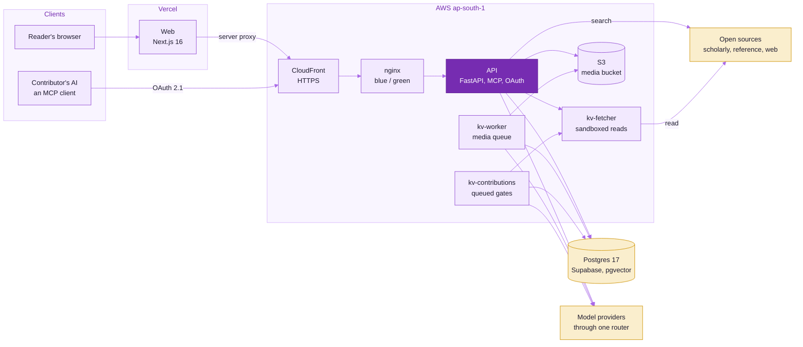
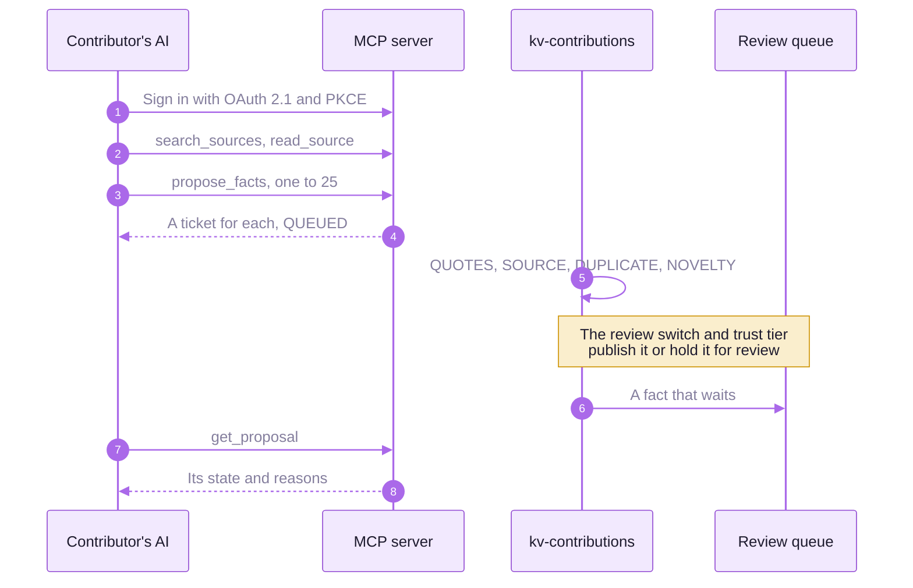

<picture>
  <source media="(prefers-color-scheme: dark)" srcset="docs/readme-kit/assets/hero-dark.svg">
  
</picture>

<p align="center">
  <picture>
    <source media="(prefers-color-scheme: dark)" srcset="https://readme-typing-svg.demolab.com?font=Plus+Jakarta+Sans&weight=600&size=20&duration=2800&pause=900&color=C090F5&center=true&vCenter=true&width=760&lines=Every+craft+read+as+a+cited+monograph;Every+sentence+of+every+answer+cited;Thirteen+languages%2C+three+depths;Knowledge+contributed+over+MCP;Open+data+with+a+DOI">
    
  </picture>
</p>

<p align="center">
  
  
  
  
  
</p>

<p align="center">
  
  
  
  
</p>

**KalaVigyan** is a research platform on Indian crafts and the science behind them, built by the
Centre of Excellence for Unified AI-Enabled Craft Ecosystem Platform at IIT Kharagpur. Every craft
on the IIT master list reads as a monograph of cited facts, from its process and chemistry to its
place, its people and its pictures, and a question in any of thirteen languages is answered with a
source under every sentence. Reading is public and asking is signed in; the knowledge itself is
created by contributors' AI agents through an MCP server whose gates check every quote against its
source.

<picture>
  <source media="(prefers-color-scheme: dark)" srcset="docs/readme-kit/assets/stats-dark.svg">
  
</picture>

<picture>
  <source media="(prefers-color-scheme: dark)" srcset="docs/readme-kit/assets/divider-dark.svg">
  
</picture>

## Contents

| | |
|---|---|
| [What it does](#what-it-does) | the six things KalaVigyan is for |
| [How it works](#how-it-works) | how knowledge flows, and the system around it |
| [The MCP studio](#the-mcp-studio) | how a contributor's AI reads, proposes and builds pages |
| [Built with](#built-with) | the stack, layer by layer |
| [Quick start](#quick-start) | working on it from a clone |
| [Documentation](#documentation) | where every question is answered |
| [Status](#status) | the rounds, and what each shipped |

## &nbsp; What it does

<picture>
  <source media="(prefers-color-scheme: dark)" srcset="docs/readme-kit/assets/cards-dark.svg">
  
</picture>

| Area | What a reader gets | Read more |
|---|---|---|
| Crafts | `/crafts/{slug}`: every craft drawn as its monograph document, a curated craft from the cited sections its dossier publishes; the nine category pages beside them | [craft-page.md](docs/contracts/craft-page.md), [monograph-document.md](docs/contracts/monograph-document.md), [category-page.md](docs/contracts/category-page.md) |
| Answers | `/ask`: a lede and one section per field the question touches, at Basic, Detailed or Expert depth, in English or twelve Indian languages; a sentence without a source is not shown | [explainer.md](docs/contracts/explainer.md), [research.md](docs/contracts/research.md) |
| Atlas and map | `/map`: craft places and district layers on the Survey of India outline, with the Natural Earth base, relief, rivers and minerals | [region.md](docs/contracts/region.md), [DATA_SOURCES.md](docs/DATA_SOURCES.md) |
| The MCP studio | `POST /api/mcp`: tools in six groups for a contributor's AI, signed in with OAuth 2.1 | [knowledge-api.md](docs/contracts/knowledge-api.md), [open-work.md](docs/contracts/open-work.md), [mcp-oauth.md](docs/contracts/mcp-oauth.md) |
| Lessons and voice | lesson packs, the explainer PDF and citation files; a finished explainer read aloud, each word or sentence marked as it is read | [learning.md](docs/contracts/learning.md), [voice.md](docs/contracts/voice.md) |
| Open data | `/data`: a reproducible release of the open knowledge under CC BY 4.0, deposited on Zenodo with a DOI | [open-data.md](docs/contracts/open-data.md) |
| Access | six roles from Student to Master Admin; only accounts on the access roster sign in, and only Researchers and above propose knowledge | [roles-and-contributions.md](docs/contracts/roles-and-contributions.md), [ARCHITECTURE.md](docs/ARCHITECTURE.md#students-and-artisans-decision-0083) |

## &nbsp; How it works

<picture>
  <source media="(prefers-color-scheme: dark)" srcset="docs/readme-kit/assets/pipeline-dark.svg">
  
</picture>

Knowledge is stored as claims, each with its sources and an evidence level stored on the claim,
never inferred from model text; a fact rests on a quoted passage that passed the gates. Pages and
answers are built from those stored rows, so a page needs no question. The web app on Vercel reaches
the API through CloudFront; the API runs in two slots behind nginx, beside three more processes on
the same box: the media worker, the contribution worker and the fetcher.



| Piece | What it does | Read more |
|---|---|---|
| Web | Next.js App Router on Vercel; reading pages never redirect to sign-in, while asking and the signed-in tools need a session | [ARCHITECTURE.md](docs/ARCHITECTURE.md#frontend) |
| Edge | CloudFront ends HTTPS; port 80 on the box answers CloudFront's prefix list only, and nginx refuses a request without the origin header | [RUNBOOK.md](docs/RUNBOOK.md#what-exists) |
| API | `kv-api@8000` and `kv-api@8001`: a release starts in the idle slot, passes `/health`, then nginx switches to it | [RUNBOOK.md](docs/RUNBOOK.md#deploy) |
| Workers | `kv-worker` (generated media), `kv-contributions` (queued proposals and their gates), `kv-fetcher` (address-pinned reads with no database and no AWS) | [ARCHITECTURE.md](docs/ARCHITECTURE.md#backend-layers) |
| Data | Postgres 17 on Supabase through the session pooler, with pgvector, PostGIS, pg_trgm, unaccent and citext; a private S3 bucket behind presigned links | [RUNBOOK.md](docs/RUNBOOK.md#connection-budget) |
| Sources | scholarly, reference, web and picture adapters, one per service, plus the field voices of both portals | [DATA_SOURCES.md](docs/DATA_SOURCES.md) |

## &nbsp; The MCP studio

<picture>
  <source media="(prefers-color-scheme: dark)" srcset="docs/readme-kit/assets/cards-mcp-dark.svg">
  
</picture>

Content arrives through MCP from many contributors at once, so every write is queued, batched and
idempotent, and the gates run off the request. A contributor's AI uses KalaVigyan's own source
registries, reader and quote matcher, so what it checks before proposing is what the gates check
after.



| Step | What happens | Read more |
|---|---|---|
| Sign in | the access roster admits the account, and the MCP terms of use are accepted at the consent page | [mcp-oauth.md](docs/contracts/mcp-oauth.md), [mcp-terms-of-use.md](docs/legal/mcp-terms-of-use.md) |
| Propose | facts (one to 25 at a time), structure, sources, components and whole pages; a fact is checked at the door for its shape, subject, key and the hour's allowance, then queued | [knowledge-writes.md](docs/contracts/knowledge-writes.md) |
| Preview | a draft per page and a preview report on the page checklist, drawn in the chat before anything is submitted | [open-work.md](docs/contracts/open-work.md) |
| Review | one queue for facts, components, pictures and testimony from other people | [review-queue.md](docs/contracts/review-queue.md) |
| Method | the page checklist, source rubric, quotes, fields, component and dataset guides, served over MCP | [kalavigyan-craft-pages](.claude/skills/kalavigyan-craft-pages/SKILL.md) |

## &nbsp; Built with

<p align="center">
  <picture>
    <source media="(prefers-color-scheme: dark)" srcset="https://skillicons.dev/icons?i=nextjs,react,ts,tailwind,py,fastapi,postgres,supabase,redis,nginx,aws,terraform,githubactions,vercel&theme=dark&perline=14">
    
  </picture>
</p>

| Layer | Stack |
|---|---|
| Web | Next.js 16, React 19, Tailwind 4, framer-motion 14, 3Dmol.js 2.5, TypeScript 6; the Alum & Indigo design system |
| API | FastAPI on Python 3.15, SQLAlchemy 2.1 with Alembic and psycopg 3, pgvector, Pint, trafilatura and pypdf, citeproc-py, fpdf2 and python-pptx |
| Models | Anthropic, Gemini, OpenAI and DeepSeek behind one AI router, ElevenLabs for voice and sound |
| Data | Postgres 17 on Supabase with pgvector, PostGIS, pg_trgm, unaccent and citext; S3; Redis on the box |
| Delivery | GitHub Actions with OIDC, Terraform, SSM, systemd, nginx blue/green, Vercel |

## &nbsp; Quick start

A development machine writes code and runs formatters, linters and generators; it never runs tests,
type-checks, builds, dev servers or browsers (owner, 2026-11-20). Every suite runs on GitHub Actions.

1. Read the rules first: [project-bindings.md](.claude/skills/engineering-practices/references/project-bindings.md)
   binds the practice skills to this repository, and [PLAN.md](docs/PLAN.md) section 0 is the owner's
   direction.
2. Make the backend environment, Python 3.15 with uv:

   ```sh
   cd backend
   uv sync --locked
   ```

3. Run only what a development machine runs, from the repository root (`backend/.venv/bin/python`
   off Windows):

   ```sh
   backend/.venv/Scripts/python.exe -m ruff format <changed files>
   backend/.venv/Scripts/python.exe -m ruff check <changed files>
   backend/.venv/Scripts/python.exe tools/hygiene_check.py
   backend/.venv/Scripts/python.exe tools/repo_facts_build.py
   node docs/readme-kit/tools/build.mjs
   ```

   In `frontend/`, `npx eslint <changed files>`.
4. Push a branch to the `deploy` remote and open a draft pull request; Backend checks, Frontend
   checks, Hygiene and the README check run on it.
5. To see a branch before it ships, deploy a Vercel preview from the repository root and run
   **Capture screens** or **Monograph parity** on it ([RUNBOOK.md](docs/RUNBOOK.md#deploy)).

## &nbsp; Documentation

| Question | Answer |
|---|---|
| Where do I start? | [docs/README.md](docs/README.md), the index |
| How do the pieces fit? | [ARCHITECTURE.md](docs/ARCHITECTURE.md) |
| What is the plan, and what did the owner direct? | [PLAN.md](docs/PLAN.md) |
| Which shared code exists before I write a helper? | [CORE_API.md](docs/CORE_API.md) |
| What does each interface promise? | [contracts/README.md](docs/contracts/README.md) |
| Why is it built this way? | [decisions/README.md](docs/decisions/README.md) |
| How do I deploy, roll back or switch something on? | [RUNBOOK.md](docs/RUNBOOK.md) |
| Which datasets, licences and citations? | [DATA_SOURCES.md](docs/DATA_SOURCES.md) |
| Where does the work stand? | [PROGRESS.md](docs/PROGRESS.md), [NEXT.md](docs/NEXT.md) |
| What is knowingly below standard? | [TECH_DEBT.md](docs/TECH_DEBT.md) |
| How do I bring a craft page to the Kutch Ajrakh bar? | [kalavigyan-craft-pages](.claude/skills/kalavigyan-craft-pages/SKILL.md) |
| How must a screen look and read? | [kalavigyan-design](.claude/skills/kalavigyan-design/SKILL.md), [master-board.html](docs/design/master-board.html) |
| What does a contributor agree to? | [contribution-terms.md](docs/legal/contribution-terms.md), [image-declaration.md](docs/legal/image-declaration.md) |
| How many tables, routes, tools and tests? | [REPO_FACTS.md](docs/REPO_FACTS.md), generated; no count is written by hand |
| How is this README built? | [readme-kit/README_STYLE.md](docs/readme-kit/README_STYLE.md) |

## &nbsp; Status

<picture>
  <source media="(prefers-color-scheme: dark)" srcset="docs/readme-kit/assets/timeline-dark.svg">
  
</picture>

Before the rounds, the foundation and the answer experience's phases A to D were built by 18
November 2026 ([PROGRESS.md](docs/PROGRESS.md#done)). Decision 0101's track of rounds followed.

| Round | Date | What shipped |
|---|---|---|
| 1 | 19 Nov 2026 | retrieval by field, the gates, the review switch and nightly upkeep, MCP sign-in, terms and open work, nightly static builds and the bulk export |
| 2 | 19 Nov 2026 | the unified review queue, MCP `ask` and picture uploads, approved pictures on craft pages, contribution screens, the dossier export |
| 3 | 19 Nov 2026 | one monograph template for every page: the split, the document API, page layouts, generated documents, every component kind as a spec with its view |
| 4 | 20 Nov 2026 | MCP and retrieval finished, every craft as its English document, redesign wave 1B |
| 5 | 20 Nov 2026 | the answer page and every signed-in screen, every field everywhere |
| 6 | 20 Nov 2026 | curated crafts as documents, native Kutch Ajrakh views, the boards matched, the structure write path |
| 7 | 20 Nov 2026 | MCP as the place knowledge is created, the landing and the map rebuilt; its fix lanes then held every answer sentence to the quotes it cites, filed write-backs by what their sources say and made every release one the live side can read |
| Debt round | 22–23 Nov 2026 | the debt register cleared lane by lane, and kept so it can only shrink: rivers named from open datasets, film scores made once, Listen read by the Gemini voice when ElevenLabs cannot, translations read back, contributed facts on curated pages, write-backs judged cheapest first |

<picture>
  <source media="(prefers-color-scheme: dark)" srcset="docs/readme-kit/assets/divider-dark.svg">
  
</picture>

## How this document is kept true

This file is the front page. Depth lives in [docs/](docs/README.md), and when the two disagree,
`docs/` wins and this file is the one to fix.

| Claim | Kept true by |
|---|---|
| Images, `<picture>` pairs and every mermaid block | `readme-check.yml`: the kit rebuilt from `kit.json` and diffed, every SVG checked, every diagram drawn by mermaid-cli and opened on github.com |
| The stack and its versions | `frontend/package.json` and `backend/pyproject.toml` |
| Roles, depths and languages in the stats | `backend/app/core/roles.py`, `backend/app/research/depth.py` and `backend/app/research/vocabulary.py` |
| The nine categories | the vendored master list, `backend/app/data/craft_master_list.json`, pinned by `shared/craft-master.sha1` |
| The deployed pieces | [RUNBOOK.md](docs/RUNBOOK.md), what exists |
| The rounds | [PROGRESS.md](docs/PROGRESS.md), Done |
| Counts of tables, routes, tools and tests | not stated here; [REPO_FACTS.md](docs/REPO_FACTS.md) is generated |

**Review triggers:** a round that ships, a new deployed piece or workflow, a change to the stack's
major versions, or a change to what a development machine may run.

<picture>
  <source media="(prefers-color-scheme: dark)" srcset="docs/readme-kit/assets/footer-dark.svg">
  
</picture>
