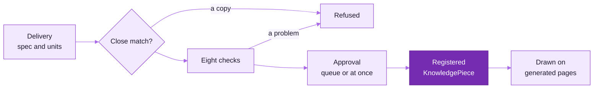

# Component specs: delivered components and the declared kinds

A component arrives finished: its kind's spec data and the texts it places, each resting on shown
facts. The 22 contributable kinds (`component_specs.CONTRIBUTABLE_KINDS`) can be delivered this
way; five of them (`drawing`, `chart`, `fact_table`, `timeline`, `map_layer`) also take a declared
spec that draws anything new from data. Nothing a contributor sends is ever run as code. A
contributor's agent reads this over MCP before it delivers one, and engineers before they change a kind.

| For | Read |
|---|---|
| Why components arrive finished | the owner, 2026-11-20: contributors deliver whole components and pages through MCP (round 7) |
| One kind per job | [decision 0114](../decisions/0114-kinds-and-datasets.md) |
| The proposal, the close-match search, drafts and bundles | [open-work.md](open-work.md) |
| Where a registered delivery is drawn | [page-layout.md](page-layout.md), Generated documents |
| The other groups' kinds | [component-specs-science.md](component-specs-science.md), [component-specs-data.md](component-specs-data.md), [component-specs-plates.md](component-specs-plates.md) |

## One kind per job

One kind per job (decision 0114): the general_* names are retired. `chart`, `fact_table`,
`timeline` and `map_layer` each take two forms of spec: a spec with a `head` is declared and drawn
by the general view, a spec without one is the authored figure of a page (Kutch Ajrakh's) and drawn
by the kind's own view (`component_specs_either.EITHER_FORMS`, `form_model`;
`frontend/components/monograph/eitherView.tsx`). `drawing` has only the declared form. The page
tools (`PAGE_TOOL_KINDS`), the authored art (`AUTHORED_ART_KINDS`) and the authored scripts
(`AUTHORED_SCRIPT_KINDS`: `model_explainer`, `timeline_map`) are refused with a reason
(`component_specs.not_contributable`). Each contributable kind has a fixture for a craft other
than Kutch Ajrakh in `frontend/lib/kindFixtures/`, checked by the gates in
`backend/tests/research/test_kind_fixtures.py`, drawn by its view in
`frontend/e2e/kind-fixtures-unit.spec.ts` and placed together on `/design/kinds`.

Last reviewed: 2026-11-22.

| Side | File |
|---|---|
| General kinds | `backend/app/models/component_kinds.GENERAL_KINDS` (the one home of the names), spec models `backend/app/research/component_specs_general.py` (`SPEC_MODELS_GENERAL`, registered in `component_specs.SPEC_GROUPS`) |
| The SVG intake | `backend/app/research/component_specs_general_svg.py` |
| Delivery (units, checks, renaming) | `backend/app/research/component_specs_general_delivery.py` |
| Checks against stored facts | `backend/app/services/component_proposals_spec.py` |
| Registration on approval | `backend/app/services/component_proposals_register.py` |
| Drawing a registered delivery | `backend/app/services/component_proposals_drawn.py`, called by `monograph_generated_assembly._drawn` and `monograph_generated.generated_parts` |
| Shapes | `frontend/lib/componentSpecsGeneral.ts` |
| Views | `frontend/components/monograph/kinds/general/` (`index.ts` exports `VIEWS`, registered in `componentViews.ts`) |
| Tests | `backend/tests/research/test_component_specs_general.py`, `test_component_specs_general_delivery.py`, `backend/tests/db/test_delivered_components_db.py`; `frontend/e2e/monograph-kinds-general-unit.spec.ts` |

## A delivered component

A component in a draft or bundle of `propose_page` (MCP) and `ComponentProposalDraft` carry,
beside the proposal's label, title, description, kind, field, subjects and considered labels
(`open-work.md`):

| Part | What it holds |
|---|---|
| `spec` | the kind's spec as a JSON object, checked by `component_specs.checked_spec` and stored as the model writes it back (camelCase, defaults filled, a drawing's SVG cleaned); the MCP server serves each kind's JSON schema as `kalavigyan://components/<kind>.schema.json` (`api/mcp_component_schemas.py`), so the tools' own input schemas take a spec as an object |
| `units` | `{u0001: {text, claimIds}}`, at most 400, each text 1 to 600 characters with at most 20 fact ids. Unit ids are the delivery's own (`u` and four digits); every unit the spec names is delivered and every delivered unit has a place in the spec |

On MCP a spec is required except for a `SUBJECT_LINK`, which carries none. The site's own form
(`POST /api/contributions/proposals/components`) may still send a proposal without one: it is
approved for a builder as before.

**The checks**, each refusal one sentence naming every problem (`problems_sentence`, the first six
and a count of the rest):

1. the spec validates against its kind's model;
2. the spec's unit refs and the delivered units are the same set;
3. no citation is held in the spec's own text (a `cite` mark): a fact is cited through a unit;
4. at least one unit cites a fact, so the registered piece rests on facts and their sources;
5. every cited fact is stored and shown (`knowledge_view.claims_by_id`: not hidden, open, with a
   readable source), or a fact of the same page bundle (`page_proposals`);
6. every number a unit states is in its facts' texts or quotes (`quotes.unsupported_figures`); a
   unit citing nothing is a label of at most 80 characters and states no number;
7. the general kinds' values: a chart point's value is a number its `reading` unit states, a
   timeline event's year (without its sign) is stated by its `when` unit, a map place's value by its
   `reading` unit, and a numeric table column's cells state a number;
8. the spec speaks the design's vocabulary (`drawing_spec_rules.spec_design_problems`): every
   drawing node of a science kind (`SvgNode`), every swatch, dip and colour token and a drawing's
   SVG name colours only by design role, name no font, keep text at 12 px or more and blend no two
   roles in a gradient (The design's vocabulary, below); a swatch or dip names a depicted material;
   and a spec sends no `themes`, which the server draws.

The close-match search of `open-work.md` runs first: a copy of a registered component is refused
before its spec is read.

## Registration (no builder step)

The proposal row keeps the delivery (`ComponentProposal.spec`, `units`, `claimIds`, migration
`0049_delivered_components`). Approval registers it (`register_component`): an Admin's approval in
the review queue (`review_queue_components.approve_component`, "Approved and registered in the
library"), or at once for a Professor's, Admin's or Master Admin's own proposal ("Registered at once
in the library"). Registering writes one `KnowledgePiece`: the proposal's label, title,
description, kind, field (`facet`) and further fields, its owning craft, `payload {delivered: {spec,
units}, proposalId}`, `claimIds` the units' facts, `sourceIds` their sources, `topicKey`
`component:<label>`, depth `EXPERT`, language `en`, and one `KnowledgePieceSubject` per subject. A
`SUBJECT_LINK` adds its subjects to the registered piece it names. Approval is refused (409) while a
fact the component rests on is not shown, or when its facts cite no readable source.

## Drawing

Every generated document (`page-layout.md`, Generated documents) draws a registered delivery as it
draws a component with a spec file: `subject_components` reads `payload.delivered` into the
`RegisteredComponent` (`stored_delivery`; a payload off its contract is logged and left out), the
facts it rests on join the page's shown facts (`with_delivered_claims`), and `_drawn` renames its
units to page-unique ids `u5001` to `u8999` in unit order (`unit_ids.DELIVERED_UNITS`), rewrites the spec's
refs (`renamed_spec`), and places the units within the component (`within` its label) as cited
units, so each carries its citation cluster, quotes and claims like any sentence of the page. A
delivery whose facts are no longer shown is left out of the page. The web app draws the spec with
the kind's view (`componentViews.ts`); the general kinds sit in the default frame
(`monographScopes.componentPlace`: `bx-mb`, `wrap`).

## The general kinds

Each spec has `head {title, caption?}`: the title states the finding (a chart) or what is shown (a
drawing, map, timeline, table), the caption is a cited sentence under it. Every text is a unit.

| Kind | Spec | View |
|---|---|---|
| `drawing` | `head`, `svg` (one SVG in the design's roles, cleaned at intake), `alt` (what it shows) | the drawing in the reader's theme: generated documents serve `themes {light, dark, hcLight, hcDark}` (`services/drawing_themes.themed_spec`), each the SVG with every role's value from the tokens and its text in the UI face, and the view shows the variant the page's theme asks for as an image (`img` of a `data:image/svg+xml` URI at its viewBox's size), following `data-theme`, `data-high-contrast` and the system preference as the tokens do; `alt` as its description |
| `chart` | `head`, `form` (`bars` or `line`), `valueLabel` (what is measured, with its unit), `series` 1 to 3 `{name, points [{label, value, reading, cell?}]}`, `dataset?` (1 to 60, the same count in each), `emphasis` (the first series' point the title names) | one small multiple per series: bars as rows (label, bar at its share of the largest from zero, the cited reading), a line on a plot with three ticks and its first and last label, every value behind "All N values"; `--chart-series`, the emphasised mark `--chart-emph` |
| `fact_table` | `head`, `columns` 1 to 8 `{label, numeric, column?}`, `rows` 1 to 100 `{cells, row?}` (one per column), `dataset?` | a table with the first cell of a row as its header, numeric columns at the end in tabular figures |
| `timeline` | `head`, `events` 2 to 40 `{year, when, title, text}` in year order (-3000 to 2100) | a dated axis marking each event, its first and last year (BCE for negative years), then one row per event: the date as written, the title, the cited sentence |
| `map_layer` | `head`, `places` 1 to 60 `{longitude 68 to 97.5, latitude 6.5 to 37.5, name, reading, value?, cell?}`, `dataset?`, `valueLabel` (only and always when places have values) | India's outline in the map tokens (`--map-land`, `--map-coast`, no state lines), a numbered disc per place sized by the square root of its value, and the numbered list of places with their cited readings |

General figures carry their kind as the kicker ("Chart", "Table") rather than a figure number:
numbering them through the page with the answer blocks' figures is open. A page draft (decision
0110, `open-work.md`, Drafts) holds delivered components and general figures as `{proposal, cites}`
like a bundle, and its checklist report numbers every figure of the assembled page in reading order
with its kind, field and whether it cites through its units (rule 9); a declared `chart` passes rule 17
because the view draws its bars from zero.

A declared `chart`, `fact_table` or `map_layer` may rest on a contributed dataset (`dataset {code}`,
each value's `cell {row, column}`, a table's `row` and `column`): `services/dataset_cells.checked_cells`
reads each cell from the stored `DatasetTable`, refuses a cell the table does not hold or a value
that is not the number it states, lets a unit state the figures of its cells without a fact, and
replaces the spec's `dataset` with the stored record's credit and address. A component citing a
dataset needs no fact of its own; an `experiment_lab` rests on its toggles' facts
(`CONTAINER_KINDS`).

### The SVG intake (`cleaned_svg`)

A drawing is at most 200,000 characters, declares no document type, entity or processing
instruction (so no entity expands), parses as XML, and is one `svg` element in the SVG namespace
with a viewBox of four numbers and a positive size. Cleaning keeps only SVG elements of the drawing
set (`KEPT_DRAWING_TAGS`: shapes, groups, text, gradients, patterns, masks, clips, markers, symbols,
`use`) and removes, with everything inside them, scripts, `foreignObject`, `image`, `style`, links
and every element of another namespace; it removes every event handler (`on…`), every attribute of
another namespace, every `href` that is not a local `#` reference, every value with an outside
`url(…)`, `javascript:`, `expression(` or `@import`, and the root's fixed `width` and `height`. The
stored spec holds the cleaned markup, and the web app only ever draws it as an image, which runs no
script and loads nothing.

### The design's vocabulary (`drawing_roles`, `drawing_rules`)

An image cannot read the page's tokens, so a drawing names its colours by role and the server
paints each theme (owner, 2026-11-21). After cleaning, a drawing is refused with a reason that
names the element and the allowed roles when it:

- names a colour other than `var(--role)` or a `color-mix` of two roles, where a role is one of
  `ink-1` to `ink-3`, `rule`, `rule-strong`, `ground`, `raised`, `sunk`, the `chart-*` and
  `series-*` tokens, a ramp step (`rain-1` to `rain-6` and the other ramps), the `map-*` tokens,
  a depicted `dye-*` or `dip-*` material, `terracotta` (place) or `madder` (a hazard), in a paint
  attribute or a style declaration; `none`, `transparent`, `currentColor`, a local `url(#id)` and,
  inside a mask or clip, white and black are kept; indigo, which means a control, is refused;
- names a font (`font-family`, `font`), or sizes text other than in drawing units;
- sets text that would draw under 12 px when the drawing is 320 px wide (its font size, with its
  groups' scales, under 12 times the viewBox width divided by 320; unsized text counts as 16);
- blends two roles in a gradient (a gradient fades one role, steps through one ramp or passes
  between depicted materials), fills text with a gradient, blurs or casts a shadow; or
- draws words as outlines (a labelled group of paths carrying type settings, glyph symbols).

Contributed SVG pictures (`image_intake_svg.clean_svg`, `give_pictures`) meet the same rule;
they are stored in roles and served by `?theme=light|dark|hcLight|hcDark`, and a plate marks
them `themed`, so the page shows the variant its reader's theme asks for. Inline science
drawings (`SvgNode`) and colour tokens are drawn with the page's tokens, so the delivery check
holds them to the roles (and the molecule kit's `mol-*` and `atom-*`) without variants. The
preview's report fails a delivered figure off the vocabulary, a drawing without its four
variants and a figure or picture without its alt text (checklist rule 27). Agents that draw
KalaVigyan's knowledge themselves read `kalavigyan://design/tokens.css` and
`kalavigyan://design/drawing.md`.

## How this document is kept true

| Claim | Kept true by |
|---|---|
| The general kinds' specs, bounds and the SVG intake | `backend/tests/research/test_component_specs_general.py` |
| A delivery's units and its eight checks | `backend/tests/research/test_component_specs_general_delivery.py` |
| The design's vocabulary for drawings, pictures and science specs | `backend/tests/research/test_drawing_vocabulary.py` |
| The four themes, the tokens as CSS and the drawing guide | `backend/tests/mcp/test_design_kit.py` |
| The report's design rule | `backend/tests/research/test_page_report_design.py` |
| Registration and drawing on generated pages | `backend/tests/db/test_delivered_components_db.py` |
| Each kind's fixture for a craft other than Kutch Ajrakh | `backend/tests/research/test_kind_fixtures.py` and `frontend/e2e/kind-fixtures-unit.spec.ts` |
| The views | `frontend/e2e/monograph-kinds-general-unit.spec.ts` |
| The same limits, as the component guide states them to contributors | `backend/tests/mcp/test_reference_limits.py` reads them from the constants, not from this page |
| The copy a contributor's agent reads | `backend/tests/mcp/test_skill_references.py` holds `backend/app/data/contributor/contracts/component-specs-general.md` byte for byte equal to this file |

Re-read it when a kind becomes contributable or retires, a bound changes, or the SVG intake keeps or
removes another element; copy it to `backend/app/data/contributor/contracts/` in the same change.
