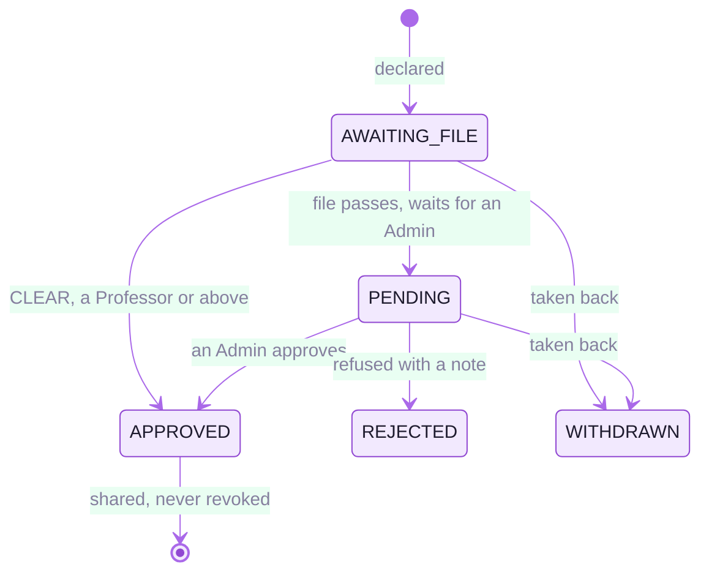

# Image contributions

Pictures that readers with the right to propose knowledge give to a craft: photographs, drawings
and AI-made illustrations. Each is declared, checked on our side, screened, stored privately, and
shared on approval. A Professor's, Admin's or Master Admin's picture is approved at once when the
screen clears it; anyone else's, and every picture the screen flags or could not look at, waits for an Admin.
Engineers, reviewers and a contributor's agent (over MCP) read it before a picture is given or decided.

| For | Read |
|---|---|
| Why pictures are taken this way | [decision 0101](../decisions/0101-knowledge-architecture-for-every-craft.md), items 12 and 17; [0104](../decisions/0104-image-contributions-intake.md); [0109](../decisions/0109-image-formats-and-screens.md) |
| The declaration's own words | [legal/image-declaration.md](../legal/image-declaration.md) |
| Giving a picture from a chat, and upload links | [mcp-ask-and-upload.md](mcp-ask-and-upload.md) |
| Where an approved picture is placed | [craft-page.md](craft-page.md), Contributed pictures |
| `MISSING_PICTURE` tasks and drafts | [open-work.md](open-work.md) |

## Who may do what

| Action | Capability | Roles |
|---|---|---|
| Declare, upload, list own, withdraw | `PROPOSE_KNOWLEDGE` | Researcher and above |
| Review the queue, approve, reject | `REVIEW_CONTRIBUTIONS` | Admin, Master Admin |

A reviewer never decides their own picture.

## Routes (`/api/contributions/images`)

| Route | Body | Answer |
|---|---|---|
| `POST ""` | `ImageDeclaration` | 201 `ImageContributionView`, status `AWAITING_FILE` |
| `POST /batch` | `ImageBatch` | 201 `ImageContributionView[]`, each `AWAITING_FILE`, under one `PictureDeclaration` (channel `WEB`) |
| `PUT /{id}/file` | the picture's bytes (any accepted format, at most 10 MB) | `ImageContributionView`, `PENDING` or `APPROVED` |
| `GET /mine` | none | `ImageContributionView[]`, newest first, at most 100 |
| `POST /{id}/withdraw` | none | `ImageContributionView`, `WITHDRAWN`, only while the picture waits for its file or for review; an approved picture stays (409): consent cannot be revoked |
| `GET /review?state=PENDING` | none | `ImageQueue {status, items[]}`, oldest first, at most 100 |
| `POST /review/{id}/approve` | `{note?}` | `ImageContributionView`, `APPROVED`; the picture is shared |
| `POST /review/{id}/reject` | `{note}` (3 to 500 characters) | `ImageContributionView`, `REJECTED` |

Refusals: 404 for a contribution that is not the caller's (or does not exist), 409 for a state
that does not allow the step (a second file, a decided picture, a repeat of a picture KalaVigyan
holds, one's own picture), 413 over 10 MB, 422 for a declaration or file that fails its checks,
503 when the media bucket is not configured.

## `ImageDeclaration`

| Field | Rule |
|---|---|
| `craftSlug`; `claimIds` | at most 20 fact ids, each a fact a signed-out reader is shown |
| One target, at most | `stageId` (one of the craft's stages), `materialId` (one of the materials its stages use) or `slot` (`MASTHEAD`, the page's first picture; `RECORD`, the GI record's picture) |
| `taskKey` | optional, a `MISSING_PICTURE` task of this craft (`open-work.md`), whose target is used when none is given and must match one that is |
| `origin` | `PHOTOGRAPH`, `DRAWING` or `AI_GENERATED` |
| `generator`, `prompt` | an AI-made picture names its `generator` (tool and model, 2 to 120 characters), its `prompt` (up to 4,000 characters) and at least one fact it shows. Other origins carry neither |
| `caption`, `altText` | 3 to 300 characters each |
| `rightsConfirmed: true`, `termsVersion: "2026-11-19"` | the declaration's version (its text: `docs/legal/image-declaration.md`): the uploader holds the rights to give the picture under the contribution terms |

`ImageBatch` is one declaration for one to ten pictures of one craft: `craftSlug`, `origin`,
`generator` (AI only), `rightsConfirmed`, `termsVersion`, and `pictures[]`, each with its own
`claimIds`, `prompt` (AI only), `caption`, `altText` and target. Each picture is screened and
reviewed on its own.

## What the file goes through (`research/image_intake*.py`, `services/image_screens.py`)

Cheap first; the vision call is the last step and runs only for a picture that passed the rest.

1. **Type from the bytes** (`image_intake_types.py`): PNG, JPEG, WebP and AVIF are kept as they
   are; a GIF keeps its first frame as a PNG; HEIC, HEIF, TIFF and BMP are turned upright and made
   WebP (quality 90, colour profile kept); an SVG is cleaned (`image_intake_svg.py`). Anything else
   is refused.
2. **Size**: at most 10 MB received and stored; 320 to 8,192 pixels a side; at most 40 million
   pixels and 128 MB decoded, refused from the header before decoding (`image_intake_pixels.py`,
   Pillow with pillow-heif, decoded in a worker thread, two at a time). An SVG is at most 2 MB and
   its size comes from its `viewBox` or its width and height.
3. **Metadata removed**: PNG text, EXIF and time chunks; JPEG EXIF (except a rebuilt orientation),
   XMP, IPTC, comments and Content Credentials (APP11); WebP EXIF, XMP and C2PA chunks, with the
   extended header's flags cleared; AVIF Exif, XMP and URI items emptied in place and `uuid` boxes
   made `free` (`image_intake_avif.py`); converted files carry nothing but their colour profile; an
   SVG loses scripts, event handlers, foreign objects, embedded and linked pictures, links outside
   the drawing, `@import` and outside `url()`, `<metadata>` and editor attributes, and a document
   type or entity is refused.
4. **AI mark:** a file whose own metadata carries the IPTC digital source type
   `trainedAlgorithmicMedia` is marked `aiMarked`; a picture declared a photograph or drawing that
   carries it is refused.
5. **Repeats:** a picture whose cleaned bytes match a live contribution's (SHA-256) is refused;
   then its 64-bit perceptual fingerprint (a DCT hash of the upright picture) is compared in SQL
   with every stored picture's (`ImageFingerprint`). Within 6 bits of a live contribution or another
   stored picture it is refused ("contributed already" or "already holds"); within 12 bits it is
   flagged `NEAR_DUPLICATE`.
6. **The vision screen:** one call to the cheapest enabled route of the CAPTION task
   (`providers/picture_vision.py`), with a JPEG preview of at most 768 pixels a side, asking in a JSON
   schema whether the picture shows an identity document or a card with a face and a number
   (`ID_DOCUMENT`), a human face when it is AI-made (`FACE_IN_AI_IMAGE`), or unsafe content
   (`UNSAFE`). The call is reserved and settled in the usage ledger like every model call. No
   route, a spent budget, a failed call or an answer off the schema, and every SVG, give
   `NOT_SCREENED`.

The verdict is `CLEAR` (no flag), `FLAGGED` or `UNSCREENED` (`NOT_SCREENED` among the flags). Only
a `CLEAR` picture of a Professor or above is approved at once.

## Storage

The cleaned file goes to the media bucket at `media/<contributor id>/<token>/<name>`, named
`KalaVigyan_Contribution_<date>_<time>_<craft>_<caption>_<Photo|Drawing|Illustration>.<ext>`
(`png`, `jpg`, `webp`, `avif` or `svg`).

| Row | What it holds |
|---|---|
| `MediaAsset` | the file: mime, size, width, height, the caption as label, the generator as model, the alt text; `PRIVATE` until approved, `CRAFT_SHARED` after, with `approvedById` |
| `ImageContribution` | the declaration (with `stageId`, `materialId`, `slot`, `taskKey`, at most one target), the status, the asset, the SHA-256, the AI mark, the review (`reviewedById`, `reviewedAt`, `reviewNote`) and `declarationId` |
| `ImageScreen` | one per contribution: the received MIME type and size, the fingerprint, the nearest stored picture and its distance, the verdict, flags and reasons, and the screen's provider, model, usage event, tokens and `costUsd` |
| `ImageFingerprint` | one per stored picture, keyed by its `MediaAsset`: the signed 64-bit fingerprint. `python -m app.scripts.fingerprint_pictures` fills it for pictures stored before |
| `PictureDeclaration` | one declaration for one or more pictures, with its channel (`WEB`, `LINK`, `SLOT`, `MCP`), origin, generator, terms version, when the rights were confirmed and, from MCP, the person's words of confirmation, under the contributor |

Migration `0050_image_screens`. Row level security is on and the public roles have no grants.

## `ImageContributionView`

`{id, craftSlug, craftName, stageId, materialId, slot, taskKey, claimIds, origin, label, generator,
prompt, caption, altText, status, aiMarked, mime, width, height, fileUrl, screen, createdAt,
reviewedAt, reviewNote}`. `label` is how a page names the picture: "Photograph", "Drawing" or
"Illustration, made with <generator>". `fileUrl` is a ten-minute presigned link to view the stored
file. `screen` is `{verdict, flags, reasons}` or null for a picture without its file.

## Screens

- `/contributions/pictures` (Researcher and above): the declaration and the upload in one form (craft, what it is, the AI tool and prompt, the craft's facts to choose from, caption, description, the picture with a preview of it as it will be shown, caption first and credit after, the declaration; or up to ten pictures of one craft under one declaration through `POST /batch`, each with its own caption, description and prompt, sent one by one), and the contributor's own pictures with the screen's reasons while one is held, and Take it back while one still waits.
- `/admin/pictures` (Admin and Master Admin): the queue by status, each picture with its label, caption, description, prompt, facts, AI mark and the screen's reasons, Approve, and Refuse with a note.

## On craft pages

An approved picture is shown on its craft's page, placed in a chapter (`docs/contracts/craft-page.md`,
Contributed pictures): a stage's picture beside its stage, a picture for facts in the chapter of
their field, any other at a glance; an AI image only when every fact it was made from is on the
page. Each plate shows the caption first and the credit after, with the alt text on the picture.
The credit never names the contributor: "Contributed to KalaVigyan" for a photograph or drawing,
"Illustration, made with <generator>" for an AI image, which is never shown as a photograph.

In a generated document (round 7, `services/monograph_generated_pictures.py`), an approved picture
is a `picture_plate` labelled `<craft>/pictures/contributed-<first 12 hex of its id>`, after the
curated pictures: `MASTHEAD` as the hero when the page has none (else leading At a glance),
`RECORD` in Market and GI, a stage's in How it is made, a material's in its field's chapter, one for
facts in the chapter most of them belong to, any other At a glance. Caption first, the credit after
(the same two lines), the alt text on the picture; an AI image only when every fact it was made from
is shown. A page bundle's picture may name a picture this account already gave
(`contributionId`, waiting or approved): `preview_page` draws it in place from
`GET /api/knowledge/pages/pictures/{id}`, which serves its bytes to its own contributor only
(`private, no-store`, `nosniff`, the SVG policy), and `propose_page` accepts it as given, starting no
second upload. The spec's `src` pattern admits both addresses (`component_specs_plates_parts.py`,
`lib/componentSpecsPlates.ts`).

The picture is served by `GET /api/crafts/contributed/{id}` (public asset): the stored bytes with
their MIME type, `private, max-age=300`, an `ETag` of the SHA-256, `nosniff` and
`Content-Security-Policy: default-src 'none'; style-src 'unsafe-inline'; sandbox`, so an SVG opened
on its own runs nothing; 404 for a contribution that is not approved and shared. Approving a
picture moves the page stamp (its count and latest change, and its file's), so the page is rebuilt
on its next read. A picture placed by its `slot`, material or task on the page is the craft page's
work (`craft-page.md`).

## From MCP

`give_pictures` takes a picture from the chat itself, or with `upload: true` hands back the upload
page's link and a presigned slot (`docs/contracts/mcp-ask-and-upload.md`). A page draft (decision
0110, `open-work.md`, Drafts) holds pictures as a bundle does: `{contribution_id}` for a picture the
account gave, drawn in its place by `preview_page`, or a new picture's facts and declaration, whose
upload starts when the draft is proposed with `propose_page`. The draft's report counts the page's
pictures by licence from each plate's credit: `CONTRIBUTED` ("Contributed to KalaVigyan"),
`AI_ILLUSTRATION` ("Illustration, made with ..."), the licence a Commons credit names (CC BY-SA 4.0,
CC0, Public domain), or `NAMED_IN_CREDIT`.

## How this document is kept true

| Claim | Kept true by |
|---|---|
| Types, sizes, metadata removal and the AI mark | `backend/tests/research/test_image_intake.py` and `test_image_intake_formats.py` |
| Repeats, the fingerprint and the vision screen's verdicts | `backend/tests/research/test_image_screens.py`, `backend/tests/images/test_picture_vision.py` and `backend/tests/db/test_image_screens_db.py` |
| Routes, states, storage and review | `backend/tests/db/test_image_contributions_db.py` |
| Placement in generated documents and the public picture route | `backend/tests/db/test_contributed_pictures_db.py` and `backend/tests/public/test_contributed_picture_route.py` |
| `MISSING_PICTURE` tasks | `backend/tests/db/test_open_work_pictures_db.py` |
| Pictures from MCP | `backend/tests/mcp/test_give_pictures.py` and `backend/tests/db/test_given_pictures_db.py` |
| The screens and the plates' credit | `frontend/e2e/image-contributions-unit.spec.ts` and `craft-contributed-unit.spec.ts` |
| The copy a contributor's agent reads | `backend/tests/mcp/test_skill_references.py` holds `backend/app/data/contributor/contracts/image-contributions.md` byte for byte equal to this file |

Re-read it when a format, a screen, a size limit or the declaration's version changes; copy it to
`backend/app/data/contributor/contracts/` in the same change.
