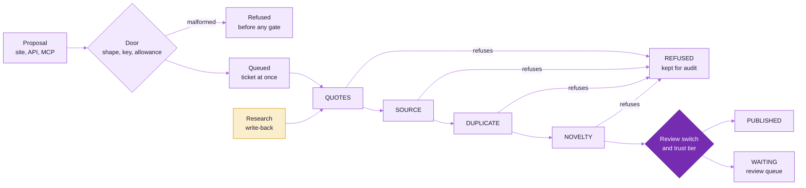
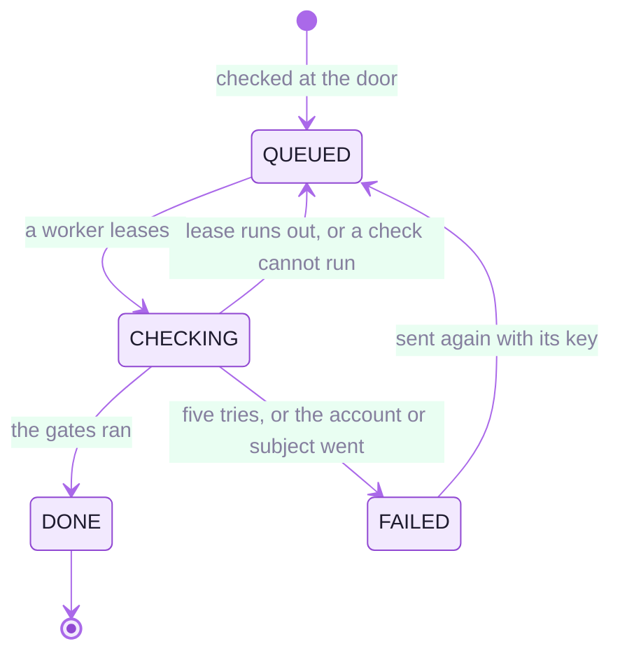

# Knowledge writes

Every new fact, whatever its origin, is a candidate. It is published only through four automatic
gates, run in order, and the review switch then decides whether it goes live at once or waits for
a Professor or Admin. The same path serves a person on the site, the Knowledge API, an agent on the
MCP server and our own research write-back, and carries layouts, structure, sources and supplied texts too.

| For | Read |
|---|---|
| Why the path is this way | [decision 0101](../decisions/0101-knowledge-architecture-for-every-craft.md), items 5, 8, 12 and 14; [0108](../decisions/0108-structure-proposals-become-curated-facts.md); [0110](../decisions/0110-contributor-supplied-sources.md); [0111](../decisions/0111-fewer-mcp-tools.md) |
| The tasks a proposal names and the method served over MCP | [open-work.md](open-work.md) |
| How a waiting fact, layout or structure item is decided | [review-queue.md](review-queue.md) |
| A page's layout record | [page-layout.md](page-layout.md) |
| Signing in and the `contribute` scope | [mcp-oauth.md](mcp-oauth.md) |
| Facts held and healed every night | [nightly-upkeep.md](nightly-upkeep.md) |
| Where a live-research fact is filed, held for a reviewer and keyed | [decision 0135](../decisions/0135-write-backs-filed-under-the-craft-they-name.md) and [decision 0136](../decisions/0136-write-backs-filed-by-their-source.md) |

## A fact's path

The site's single form (`POST /api/knowledge/facts`) runs the gates in the request; MCP and the batch
route queue the fact first (The contribution queue, below).

## Where the code is

| Part | Code |
|---|---|
| The proposal and the reply | `research/knowledge_writes.py` |
| The pure gate decisions | `research/candidate_gates.py` |
| The judge's prompts, schemas and reply rules | `research/candidate_judge.py` |
| The switch and where a fact is placed | `research/review_switch.py`; the switch setting in `services/app_settings.py` |
| Fetching and grading the sources | `services/candidate_sources.py` |
| The subject's held facts | `services/candidate_store.py` |
| Running the gates with the adapters | `services/candidate_gates.py` |
| The stored outcomes and sources differ | `services/candidate_writes.py`; the flag settled from live pairs in `services/sources_differ.py` |
| `propose_fact` | `services/proposal_writes.py` and `services/fact_proposals.py` |
| The research write-back | `services/write_back_gates.py`; where a fact is filed in `services/write_back_crafts.py` and `write_back_passages.py`; the filing report in `services/write_back_filing.py` and `write_back_filing_store.py` |
| Routes and tools | `api/routes/knowledge_writes.py`, `api/mcp_fact_tools.py`, `api/proposal_deps.py` |
| The limits | `core/rate_limit.py` and `api/proposal_limits.py` |
| Layout proposals | `research/layout_proposals.py`, `services/page_layout_proposals.py`, `services/review_queue_layouts.py`, `api/mcp_page_tools.py`, `models/layout_proposals.py` |
| Structure proposals | `research/structure_proposals.py` (the contract), `research/structure_proposals_values.py` (the STATED check), `services/structure_proposals.py` (the proposal), `services/structure_proposals_dossier.py` (the dossier's own rules), `services/structure_proposals_page.py` (where an item lands on the page index), `services/structure_proposals_write.py`, `services/structure_proposals_claims.py` and `services/structure_proposals_rows.py` (what approval writes), `services/structure_proposals_review.py` (approve, reject), `api/routes/structure_proposals.py`, `api/mcp_structure_tools.py`, `api/structure_proposal_deps.py`, `models/structure_proposals.py` |
| Supplied sources (decision 0110) | `research/supplied_sources.py` (the contract, the cite url, the grade and the identity match), `services/supplied_sources.py` (storing and the upload slot), `services/supplied_sources_identity.py` (the index lookups), `services/supplied_sources_pdf.py` (a file's text), `services/supplied_sources_gate.py` (what the gates read and keep), `services/supplied_sources_review.py` (the review queue's provenance), `services/supplied_sources_views.py`, `api/mcp_studio_sources.py`, `api/routes/supplied_sources.py`, `models/studio.py` |

## Who may do what

| Action | Capability | Roles |
|---|---|---|
| Propose a fact (`POST /api/knowledge/facts`, MCP `propose_facts`) | `PROPOSE_KNOWLEDGE` | Researcher and above |
| Propose a page layout (`POST /api/knowledge/layouts`, MCP `propose_page` with a layout) | `PROPOSE_KNOWLEDGE` | Researcher and above |
| Propose page structure (`POST /api/knowledge/structure`, MCP `propose_structure`) | `PROPOSE_KNOWLEDGE` | Researcher and above |
| Propose a source for a held fact (MCP `propose_source`) | `PROPOSE_KNOWLEDGE` | Researcher and above |
| Supply a source's text (MCP `supply_source`, its upload slot) | `PROPOSE_KNOWLEDGE` | Researcher and above |
| Read a supplied source's text (`GET /api/knowledge/supplied-sources/{id}`) | its supplier, or `REVIEW_CONTRIBUTIONS` | Researcher and above for their own; Admin, Master Admin for any |
| Read and set the review switch (`/api/knowledge/review-switch`) | `REVIEW_CONTRIBUTIONS` | Admin, Master Admin |

The MCP tools also need a signed-in connection holding the `contribute` scope
(`core/mcp_scopes.CONTRIBUTE_SCOPE`); without it the call is challenged (`mcp-oauth.md`) or answered
with a tool error naming the scope. The site's routes ask for the contribution terms first.

## The proposal (`FactProposal`, schema version 1, camelCase on the wire)

| Field | Rule |
|---|---|
| `subject {kind, slug}` | kind `craft` or `category`: a craft by its slug (merged crafts follow their merge) or a category by its slug |
| `field` | one of the 16 fields (`get_page` with no subject) |
| `fields` | up to 3 secondary fields, distinct and without the primary one |
| `statement` | 20 to 1,000 characters, one fact, no personal data (emails, phone and Aadhaar-like numbers are refused) |
| `sources` | 1 to 5, each named once (by canonical URL): `{url (https), title, licence?, quotes: [{text (at most 300 characters), locator?}] (1 to 6, each once)}` |
| `taskKey` | optional, the open-work task the proposer claimed for this fact (below) |

- `taskKey` (optional): the open-work task the proposer claimed for this fact
  (`docs/contracts/open-work.md`). It must be a field, corroboration or question task (`MISSING_FIELD`,
  `THIN_FIELD`, `SECOND_SOURCE`, `SOURCES_DIFFER`, `ANSWER_GAP`) of the same page (a craft subject takes a
  craft or family key, a category a category key) and name the primary field or a secondary one
  (`SECOND_SOURCE` and `SOURCES_DIFFER` may name none; an `ANSWER_GAP` key names its question,
  `gap-<id>`); otherwise the proposal is malformed (`research/knowledge_writes.fact_task_problem`). An
  `ANSWER_GAP` key is taken only when the question's gap lists the primary field or a secondary one
  among the fields its readers lacked, and is refused before any gate otherwise
  (`services/fact_task_checks.check_question_task`, the same check for a structure item's fact). Once the
  gates have run, a fact that passed
  (published or waiting for review) ends the proposer's live reservation of that key `COMPLETED`, and a
  refused one gives it back (`RELEASED`, or `EXPIRED` past its time), so the task returns to the list
  (`services/task_reservations.complete_task`, `give_back_task`). Another account's reservation is
  never touched, and without a reservation nothing changes.

A malformed proposal is refused before any gate (422 on the site; a tool error on MCP).

## The gates, in order

A refusal stops the run; every gate that ran is stored as one `CandidateCheck` row
(`claimId, gate, passed, reasons[], relatedClaimIds[], model, checkedAt`, one per claim and gate).

1. **QUOTES.** Every source is fetched by our fetcher (`research/fetcher.Fetcher`, the same one
   live research uses) and every quote must be found verbatim in the fetched text
   (`research/quotes.quote_occurs`: NFKC, typographic dashes and quotes, line-break hyphens and
   whitespace folded) and be at least 20 characters. Every number or formula in the statement
   must appear in one of its quotes, except a cited source's own publication year, or its full
   date written day.month.year, which the statement may give without a quote holding it
   (`candidate_gates.publication_figures`; decision 0149). A page that is refused (robots, size, type), missing or
   blank refuses its quotes with the reason. When our fetcher itself is down nothing is stored
   and the caller is asked to try again (503, or a tool error). A source the proposer supplied
   (Supplied sources, below) is read from the supplied text instead of being fetched, and the
   gate's reasons say so.
2. **SOURCE.** Each source is graded: a source already stored keeps its own reliability; a newly
   fetched page takes the grade the research pipeline gives a web page (C). A fact resting only on
   D sources is refused, except an ECONOMICS fact stating a price (the curation rule). A source
   stored as RESTRICTED is refused. A source whose title is a file name or has fewer than three
   words of letters takes the proposal's title, else, for a PDF, the title its first page states,
   else the document's first such heading (`research/source_titles.usable_title`); one with none of
   them is refused, asking for the work's title, and a stored source with such a title takes the
   next proposal's usable title. A PDF, contributed or fetched by research, is described by its
   first page beside its file's metadata (`research/front_page`, `sources/web/page.page_item`):
   among its first 15 lines, a journal line (a name holding Journal, Bulletin, Proceedings,
   Transactions, Annals, Review, Letters, Quarterly or Magazine, then a month and a year) makes it
   kind `PAPER` with that journal as its `containerTitle` and dates it to that month, since a PDF's
   own date is only its file's creation; an author that is a producer's word (sys, user, admin, a
   software name such as Microsoft or PScript, or one word with no capital letter) is dropped, and
   with none left the first page's authors line (names of two to five words or initials, after a
   title line) gives the authors, the lines between it and the journal line the title. A DOI the
   page prints is not taken, because a DOI changes the key a source is stored under; a stored
   source is never re-described. A licence declared open (CC BY, CC0, public domain) that the
   page itself contradicts is refused. Otherwise the licence passes and is recorded; it decides
   only whether quotes are public: a fetched page's full text is stored for researchers
   (`chunk_acl`), so its quotes are withheld from public views and exports, whether or not a
   passage holds them (Citations and their passages, below).
3. **DUPLICATE.** The statement is embedded in the stored document form, titled as the stored
   facts are (`Candidate.title`, `candidate_gates.candidate_text`: the owner, the concept and the
   field, `candidate_store.subject_title`; decision 0136), and compared with the
   subject's held facts in the field (primary or secondary): shown or waiting statuses (`DRAFT`,
   `PROPOSED`, `IN_REVIEW`, `APPROVED`), open sensitivity. The same statement once case and final
   stops are folded is refused at once. Otherwise the 8 nearest held facts at cosine similarity
   0.8 or more go to the judge (the structured model, `EVAL_JUDGE`), which answers per pair in
   parts: `same`, `sameSubject`, `sameProperty`, `sameWhen`, `bothTrue` (can both be true at
   once), the `subject` and `property` and the two values, and a reason. The relation is worked out
   from them (`research/candidate_verdicts.comparison_relation`): SAME when `same`; DIFFERS only
   when it is one subject, property and stage or time, both cannot be true and the two values
   differ; DISTINCT otherwise. SAME refuses; DIFFERS passes and is kept as sources differ, never
   resolved, its reason naming the two values; DISTINCT passes. A DIFFERS pair also names what the
   facts differ on, from the judge's own `subject` and `property` ("The indigo vat, number of
   dips", `candidate_verdicts.differs_about`), so no prompt or schema word is added to the call
   (decision 0165); the outcome stores the first pair's in `CandidateCheck.differsOn` (decision
   0177). Held facts without a vector are found only by the identical text.
4. **NOVELTY.** The judge lists the details the fact states that the subject's 12 nearest held
   facts in the field do not (`newDetails`) and says whether it is specific to the craft; it adds
   exactly when the list is not empty and it is specific (`candidate_verdicts.novelty_adds`), and
   the stored reason names the details. A fact that differs from a held fact passes without the
   judge (it changes the section), and so does the first fact of a field. A refusal names the held
   facts that already say it.

The judges are scored every night on labelled cases (`app/data/eval/judge_cases.json`,
`app.scripts.eval_judges`, `.github/workflows/judge-eval.yml`), asked as the queue asks them (the
cheapest priced model first, then the default route), and the run fails below the floors in that
file: duplicate accuracy 0.80, compatible pairs kept DISTINCT 0.85, novelty accuracy 0.80
(decision 0149). `app.scripts.rejudge_differing` re-judges every live pair flagged sources differ
and writes nothing.

The subject's facts are the craft's (its own concepts and its sub-category's), or a category's
(its curated claims and the shared concepts named for it). All text sent to the judge is quoted
data in `untrusted_source` blocks.

## The review switch and trust tiers

One admin setting, `knowledge.review_switch`, per origin:

| Origin | Who | Default |
|---|---|---|
| `RESEARCH` | the research write-back of answers and coverage enrichment | `AUTO` |
| `CONTRIBUTION` | the site and the Knowledge API | `APPROVAL` |
| `AGENT` | the MCP server | `APPROVAL` |

| Case | Claim status | Shown | In the review queue | Reply `outcome` |
|---|---|---|---|---|
| Passed, proposed by a Professor, Admin or Master Admin | `APPROVED` | yes | no | `PUBLISHED`, `approvedAtOnce` |
| Passed, a `PROVEN` contributor, not drawn for review | `APPROVED` (at `PROVISIONAL`) | yes | no | `PUBLISHED`, `approvedAtOnce` |
| Passed, a `PROVEN` contributor, drawn for review | `IN_REVIEW` (live, unreviewed) | yes | yes | `PUBLISHED` |
| Passed, a `NEW` contributor, whatever the switch | `DRAFT` (hidden) | no | yes | `WAITING` |
| Passed, an `ESTABLISHED` contributor, `AUTO` | `IN_REVIEW` (live, unreviewed) | yes, at its level | yes | `PUBLISHED` |
| Passed, an `ESTABLISHED` contributor, `APPROVAL` | `DRAFT` (hidden) | no | yes | `WAITING` |
| Refused at a gate | `REJECTED`, kept only for audit | no | no | `REFUSED` |

**Trust tiers** (round 7; `research/trust_tiers.py`, `services/trust_tiers.py`). An account's tier is
read from its record at the moment of the write: its contributed facts (`Claim.origin`
`CONTRIBUTION`, `createdById` the account) counted as accepted (`APPROVED`, `IN_REVIEW`, `PROPOSED`),
refused (`REJECTED`, `RETRACTED`) and waiting (`DRAFT`, never counted for the tier).

| Tier | Earned when | Tasks held at once | Facts an hour | Placement |
|---|---|---|---|---|
| `NEW` | otherwise | 5 (`RESERVATIONS_HELD_MAX`) | 30 (`FACT_PROPOSALS_PER_WINDOW`) | waits for review, even under `AUTO` |
| `ESTABLISHED` | 5 or more accepted and at least 75 % of the decided ones accepted | 10 | 60 | the review switch decides |
| `PROVEN` | 25 or more accepted and at least 90 % of the decided ones accepted | 20 | 150 | published at once, `AUTO` under any switch; one in five (`REVIEW_SAMPLE_PERCENT` 20) is drawn into the review queue |

- Drawn for review: the first four bytes of the SHA-256 of the proposal's id, read as a number, modulo
  100, below 20 (`drawn_for_review`); the queue passes its proposal id, the site's single form a fresh
  one. Unpredictable to the proposer, the same on every retry.
- Professors and above keep their own rule (approved at once) and hold the `PROVEN` allowances.
- An admin holds an account at a tier whatever its record (`TrustTierOverride`, audited
  `knowledge.trust_tier_set`) or gives it back to its record (`tier: null`). The standing an admin
  reads is `TrustStanding {schemaVersion 1, userId, name, role, tier, earned, accepted, refused,
  waiting, tasksHeldMax, factsPerHour, reviewSamplePercent (0 for a reviewer, 20 for proven, 100
  otherwise), override {tier, note, setAt, setBy} | null}`.
- The ReviewEvent note says why (`... approved at once: a proven contributor's fact not drawn for
  review`, `... drawn for review (one in 5); it waits in the review queue`, `... waits hidden for a
  Professor's or Admin's approval: a new contributor's fact`), and the reply's message says the same.

- The proposer's role is read from their account row at the moment of the write, never from the
  request or the token.
- A quoted fact is stored at `PROVISIONAL`; approval at once does not raise the level (only a
  review does). A fact refused at QUOTES is stored at `HYPOTHESIS`.
- Sources differ: when a differing fact goes live, it and every held fact it differs from get
  `sourcesDiffer`: a proposal or a write-back that goes live calls
  `services/candidate_writes.mark_sources_differ(session, claim_id)`, which reads the stored
  DUPLICATE outcome and, when it names what the facts differ on, stores that in `Claim.differsOn`
  wherever none is stored yet (decisions 0156, 0177). A waiting fact is flagged when it is
  approved, by the review's settling below, which names a flagged fact's subject the same way from
  the outcome of a live pair that holds it. The flag lasts only while a live
  pair or a curated conflict holds it (decision 0171): two facts differ live when a passed
  DUPLICATE outcome of one names the other, both are held, at least one is shown, and both rest on
  one craft's facts as the gate compares them (the same craft, a craft and its own family's facts,
  or two shared or family facts of one family). `services/sources_differ.settle_sources_differ`
  works the flag out again for a fact and every fact it was paired with after each review decision
  (approve, raise, reject, retract, refile), after a write-back files a stored fact again (a
  release from hold among them) and after an import or a retirement supersedes curated facts, and
  clears `differsOn` with the flag. So a retracted fact leaves its rival unflagged unless another
  live fact still differs from it, a fact approved under another craft is flagged against neither
  craft, and a dossier import keeps the flag a live fact holds on a curated one. A mark a person
  cleared (`review.sources_differ_cleared`, decision 0170) stays cleared: it dismisses every pair
  judged at or before the clearance and every curated conflict naming the fact that was not
  approved after it, for settling and for the import (`services/differ_clearances.py`).
- Who proposed it is kept privately: `Claim.createdById`, a `ReviewEvent` by the proposer whose
  note names the origin and the placement, and `ClaimSource.foundBy` (`CONTRIBUTION` or `AGENT`).
  A proposed claim's `origin` is `CONTRIBUTION` (`services/proposal_writes.PROPOSAL_CLAIM_ORIGIN`),
  whatever the channel: the channel stays in `ClaimSource.foundBy`. Migration `0044_contributed_origin`
  adds the value and moves the facts proposed before it (`RESEARCHER` claims written by a user with
  candidate checks) to it. The craft page shows a contributed fact with the provenance `RESEARCHER`
  (`services/craft_page.ORIGIN_PROVENANCES`): every proposer is a Researcher or above.
  A newly stored source is marked `origin CONTRIBUTION` with `addedById`.

## Routes

| Route | Body | Answer |
|---|---|---|
| `POST /api/knowledge/facts` | `FactProposal` | 200 `ProposalReply` (origin `CONTRIBUTION`) |
| `POST /api/knowledge/layouts` | `LayoutProposalDraft` | 200 `LayoutProposalResult` (origin `CONTRIBUTION`) |
| `GET /api/knowledge/review-switch` | none | `ReviewSwitchView {current, defaults}`, each `{research, contribution, agent}` of `AUTO` or `APPROVAL` |
| `PUT /api/knowledge/review-switch` | `ReviewSwitchUpdate`, any of `research`, `contribution`, `agent` | `ReviewSwitchView`; audited as `settings.review_switch_updated` |

Refusals: 401 or 403 without the capability or the contribution terms; 422 for a malformed proposal
or an unknown subject; 403 when the proposer's account no longer exists; 409 for a layout built on a
version the page has left; 429 with `Retry-After` when the account's proposal limit is spent; 503
when the fetcher, the embedding route or the judge could not run (nothing is stored).

`ProposalReply {schemaVersion 1, outcome, claimId, status, level, approvedAtOnce, inReviewQueue,
sourcesDiffer, differsFrom[], gates[{gate, passed, reasons[]}], message, readers?}`. A refused proposal is
still a 200: the reply's outcome and the failing gate's reasons say why. A proposal that passed the
gates carries `readers {shown, reason, pageUrl, chapter, field, inProse, writeTask}`
(`services/fact_proposals_readers.reader_place`, decision 0149): `shown` is whether a signed-out
reader sees the fact now by the one rule (`retrieval/citation_access.reader_fact`); a fact not shown
names why (`WAITING` for a reviewer, `HELD`, `RESTRICTED_FACT`, `HIDDEN_CONCEPT`, `NO_SHOWN_SOURCE`);
a shown one names its page, field and chapter, whether a published section cites it (`inProse`) and
otherwise the open write-section task. The message says "Readers see it now at …" or "Readers cannot
see it yet: …"; a contributor's AI tells a person a fact is on the page only when `shown` is true.

## MCP

The fact tools (`api/mcp_fact_tools.py`, arguments in `api/mcp_fact_arguments.py`, in `FACT_TOOLS`),
scope `contribute`, origin `AGENT`. A missing sign-in, scope or rank comes back as a tool error the
agent can act on, and a malformed fact as that fact's refusal. The gates run in the contribution
queue (below), so the reply comes at once. Decision 0111 retired `propose_fact`: one fact is a batch
of one.

| Tool | Arguments | Result | Hints |
|---|---|---|---|
| `propose_facts` | `facts` (1 to 25, each `craft_slug` or `category_slug` (one), `field`, `fields?`, `statement`, `sources`, `task_key?`, `idempotency_key?`) | `ProposalBatch` | writes |
| `get_proposal` | `proposal_id` | `ProposalTicket` (the account's own; an admin's any) | read-only |

- **Old names.** The camelCase names inside a fact
  (`craftSlug`, `categorySlug`, `taskKey`, `idempotencyKey`) keep working until the next release, and
  the result's `notices[]` says so (`api/mcp_argument_names.RenamedArguments`, which any tool file may
  use for its own old names).
- **Each fact on its own.** In `propose_facts` a malformed fact is refused by its index with the
  problem (`BatchItem {index, accepted false, idempotencyKey, problem}`) and the rest go on; more than
  25 facts refuse the call. The `research_field` prompt tells the agent to pass the task key it claimed.

## Proposal limits

Every proposal costs work (a fact a fetch per source, an embedding and up to two judge calls), so each
account has an hourly bucket per kind (`core/rate_limit.proposal_attempt`, a clock hour in UTC), counted
once in Postgres for every process (`core/allowances`, table `AllowanceBucket`):

| Kind (`core/rate_limit`) | Per hour (constant) | Counted at |
|---|---|---|
| `FACT_PROPOSALS` | `FACT_PROPOSALS_PER_WINDOW` = 30; for a queued fact the account's tier allowance (`TIER_FACTS_PER_HOUR`: 30, 60, 150) | `POST /api/knowledge/facts` (after the terms); each new fact queued by MCP `propose_facts` and `POST /api/knowledge/proposals/facts` (`core/rate_limit.proposal_slots`: a batch takes what is left of the same hour, and each fact beyond it is refused on its own; a fact sent again with its key takes nothing); MCP `supply_source`, one a supplied source (decision 0110) |
| `COMPONENT_PROPOSALS` | `COMPONENT_PROPOSALS_PER_WINDOW` = 10 | `POST /api/contributions/proposals/components`, each component part of MCP `propose_page` |
| `LAYOUT_PROPOSALS` | `LAYOUT_PROPOSALS_PER_WINDOW` = 10 | `POST /api/knowledge/layouts` (after the terms), the layout part of MCP `propose_page` |
| `STRUCTURE_PROPOSALS` | `STRUCTURE_PROPOSALS_PER_WINDOW` = 20 | `POST /api/knowledge/structure` (after the terms), MCP `propose_structure` |
| `IMAGE_UPLOADS` | `IMAGE_UPLOADS_PER_WINDOW` = 20 | `POST /api/contributions/images` (a picture declared on the site), MCP `give_pictures` (each picture given, and each link and slot issued for `upload: true`; the picture given through it is not counted again) |
| `PAGE_PROPOSALS` | `PAGE_PROPOSALS_PER_WINDOW` = 10 | `POST /api/knowledge/pages`, MCP `propose_page` with a draft or a bundle of more than one part (each part also counts against its own kind; a bundle of one part counts against that part's kind alone, decision 0111) |
| `PAGE_PREVIEWS` | `PAGE_PREVIEWS_PER_WINDOW` = 30 | `POST /api/knowledge/pages/preview`, MCP `preview_page`, of a bundle or a draft |

- Admins and Master Admins are never limited. A proposal refused at a gate still counts. A request
  without the capability never counts; on the Knowledge API routes and over MCP neither does a
  malformed body or missing terms, while the site's component and picture routes count a request once
  the capability is checked, before its body.
- On HTTP a spent limit is 429 with `Retry-After` (whole seconds) and a detail such as "This account
  made 30 fact proposals this hour, the most one account may. Try again in 12 minutes."; over
  MCP the same sentence is a tool error (`api/proposal_limits.py`: `proposal_limit` for routes,
  `refuse_tool_when_spent` for tools).
- A count that cannot be read within `COUNT_SECONDS` (5) refuses the call for a minute and does
  nothing (`ALLOWANCE_UNREAD`): 503 with `Retry-After: 60` on HTTP, a tool error over MCP, a refused
  fact in a batch.

## The contribution queue (round 7)

Content arrives through MCP from many contributors at once, so the gates run off the request. Code:
`research/contribution_queue.py` (tickets, batches, keys, retries), `services/contribution_queue.py`
(queueing), `services/contribution_queue_tickets.py` (progress), `services/contribution_queue_worker.py`
(the worker), `app/scripts/contribution_worker.py` (its entry and adapters), `models/contributions.py`
(`QueuedProposal`), migration `0048_contribution_queue`, `infra/deploy/units/kv-contributions.service`.

**Queueing.** A proposed fact is checked at the door for what costs nothing: its shape, its subject
(an unknown craft or category is refused), its idempotency key and the hour's allowance. It is then
stored `QUEUED` and the reply comes at once: `ProposalTicket {schemaVersion 1, proposalId, kind FACT,
state, idempotencyKey, replayed, subject, field, statement, taskKey, position (proposals ahead while
QUEUED), attempts, queuedAt, startedAt, finishedAt, nextTryAt, outcome, reply (the ProposalReply once
DONE), modelCalls, costUsd, message, notices[]}`. `ProposalBatch {schemaVersion 1, accepted, refused,
items[BatchItem {index, accepted, idempotencyKey, ticket, problem}], message, notices[]}`.

**Idempotency.** Every fact has a key per account: the one given (8 to 120 letters, digits, `.`, `_`,
`:` or `-`), else `fact:` and the first 40 hex digits of the SHA-256 of the proposal's canonical JSON.
A key sent again with the same fact returns the first proposal (`replayed`; nothing added, no
allowance taken); with another fact it is refused; given twice in one call the second is refused. A
`FAILED` proposal sent again with its key is queued once more. A unique index on `(proposerId,
idempotencyKey)` holds this under concurrent retries.

**States.** `QUEUED`, then `CHECKING` (a worker holds it for `LEASE_TIME`, 15 minutes; a lease that
runs out returns it to the queue), then `DONE` (the gates ran: `outcome` PUBLISHED, WAITING or
REFUSED, the `reply`, `claimId`) or `FAILED` (the checks could not run `ATTEMPTS_MAX` = 5 times, or the
account or subject went; nothing was stored). A check that cannot run (the fetcher, the embedding route
or the judge down) is queued again after 30 seconds, doubling each try up to 30 minutes (`retry_delay`).

**The worker** (`kv-contributions`, started and stopped with the other workers by
`infra/deploy/blue_green.sh`) claims one proposal at a time (`SELECT ... FOR UPDATE SKIP LOCKED`,
oldest first; the facts of one call keep their order) and checks up to `--concurrency` (2,
`CONTRIBUTION_WORKERS`, no more than its connection budget carries, decision 0163) at once, never two of the same subject together, so the
duplicate gate sees the first before the second. Each check is `services/fact_proposals.propose_fact_run`
in a savepoint, under the request id `contribution-<proposal id hex>`; the kept sources' passages are embedded once the outcome is stored (`embed_sources`, which commits as it goes);
`python -m app.scripts.contribution_worker --once` checks what is queued and stops.

**Cost at the centre.** The worker's gates, and the research write-back's (below), are thrifty
(`research/gate_thrift.py`): the deterministic gates decide first, and the judge is asked only when
they cannot.
- QUOTES and SOURCE as above; a refusal there spends no model call.
- DUPLICATE: the identical text as above; a held fact at cosine similarity 0.97 or more
  (`VECTOR_TWIN_SIMILARITY`) with the same figures, the same negations and 80 % of the same content
  stems (`TWIN_STEM_OVERLAP`) is refused without the judge; no held fact at 0.8 or more passes
  without it.
- NOVELTY: when every held fact of the field is below 0.75 (`NOVELTY_JUDGE_SIMILARITY`), the fact adds
  to the section without the judge.
- The judge runs first on the cheapest route that may judge: each provider's least priced verified
  model for `EVAL_JUDGE` (`providers/judge_routes.cheapest_judge_models`: OpenAI `gpt-6-luna`,
  Gemini `gemini-3.5-flash-lite`, Anthropic `claude-haiku-5-5`, through `RouteTuning.models`), and only
  when its reply fails the judge's checks (not JSON, off its schema, a pair or candidate left
  unanswered) on the configured route (`later_gates(..., escalate=...)`). The two are one
  `research/judge_ladder.JudgeLadder` (`first`, `escalate`), built by
  `providers/judge_routes.thrifty_judges(principal, request_budget_usd=...)`.
- The site's single form (`POST /api/knowledge/facts`) keeps the gates as they were.

**The cost ledger** (`research/cost_ledger.py`, `services/cost_ledger.py`). Every model call a queued
proposal causes is a `UsageEvent` of the proposer carrying the proposal's request id, and the proposal
keeps its own `modelCalls` and `costUsd`. `GET /api/knowledge/contribution-costs?from&to` (days in
India time, by default the last 7, at most 92; `VIEW_USAGE`, Admin and above) answers `CostLedger
{schemaVersion 1, dayFrom, dayTo, timeZone, days[{day, userId, name, role, proposals (checks
finished), calls, judgeCalls, embedCalls, failures, costUsd}], accounts[{userId, name, proposals,
calls, costUsd}], calls, costUsd}`, days in order and the costliest account first.

| Route | Who | Answer |
|---|---|---|
| `POST /api/knowledge/proposals/facts` | `PROPOSE_KNOWLEDGE` and the terms | body `{facts: [{idempotencyKey?, proposal: FactProposal}]}` (1 to 25); `ProposalBatch`, origin `CONTRIBUTION`; 403 without the terms, 422 malformed |
| `GET /api/knowledge/proposals?limit` | `PROPOSE_KNOWLEDGE` | `ProposalTickets {schemaVersion 1, proposals[]}`, the account's latest (at most 50) |
| `GET /api/knowledge/proposals/{proposalId}` | `PROPOSE_KNOWLEDGE` | `ProposalTicket`; 404 when it is not the account's |
| `GET /api/knowledge/trust-tiers?limit` | `REVIEW_CONTRIBUTIONS` | `TrustStandings {schemaVersion 1, accounts[]}`, every account with a record or a held tier, most accepted first |
| `GET /api/knowledge/trust-tiers/{userId}` | `REVIEW_CONTRIBUTIONS` | `TrustStanding` |
| `PUT /api/knowledge/trust-tiers/{userId}` | `REVIEW_CONTRIBUTIONS` | body `TierUpdate {tier: NEW, ESTABLISHED, PROVEN or null, note?}`; `TrustStanding` |
| `GET /api/knowledge/contribution-costs` | `VIEW_USAGE` | `CostLedger`; 422 for a range that runs backwards or is too long |

Tables (migration `0048_contribution_queue`, row level security on, no grants to the public roles):
`QueuedProposal` (`proposerId` cascading, `kind` `FACT`, `origin` `CONTRIBUTION` or `AGENT`,
`idempotencyKey`, `fingerprint`, `subjectKey` `<kind>:<slug folded>`, `taskKey`, `proposal` JSONB,
`state`, `attempts`, `availableAt`, `leaseUntil`, `startedAt`, `finishedAt`, `outcome` set exactly when
`DONE`, `claimId`, `reply` JSONB, `failure`, `modelCalls`, `costUsd`), `TrustTierOverride` (`userId`
key, `tier`, `note`, `setById`, `setAt`) and `CraftSteward` (`open-work.md`).

## Layout proposals (decision 0101, item 14)

A page layout (`docs/contracts/page-layout.md`) can be proposed by anyone who may propose facts; it
waits in the review queue as kind `LAYOUTS`, and an Admin's approval writes it as the page's next
version.

- `LayoutProposalDraft` (schema version 1, camelCase): `subject {kind craft | family | category,
  slug}`, `baseVersion` (the version the proposer read, 0 when the page has none), `entries[]` (the
  whole layout, each a `PageLayoutEntry`, checked by the layout rules), `note?` (1 to 500 characters,
  why). MCP `propose_page` (`api/mcp_page_tools.py`, scope `contribute`, a write) takes a layout as
  a bundle's part `{base_version, entries, note}`, origin `AGENT`; the route's origin is `CONTRIBUTION`.
- `services/page_layout_proposals.propose_layout`: the subject is found as `get_page` finds it (a
  family asked for as a craft is refused like an unknown slug: 422, or a tool error); a `baseVersion`
  that is not the page's current version is refused (`Refused("stale_layout")`: 409, or a tool error
  naming the current version). An account that reviews layouts (`REVIEW_CONTRIBUTIONS`, Admin and
  above) has its proposal written at once through `page_layouts.store_layout` (audited
  `PAGE_LAYOUT_WRITTEN`) and recorded `APPROVED` with the version; everyone else's waits `PENDING`.
- `LayoutProposalResult {schemaVersion 1, outcome STORED | WRITTEN, proposalId, status, subject,
  baseVersion, version (the written version, null while waiting), pageUrl, message}`.
- Table `LayoutProposal` (migration `0044_contributed_origin`): `proposerId`, `subjectKind`,
  `craftId` or `categoryId` (exactly one, matching the kind), `baseVersion`, `entries` (JSONB),
  `note`, `origin` (`CONTRIBUTION`, `AGENT`), `status` (`PENDING`, `APPROVED`, `REJECTED`),
  `reviewedById`, `reviewedAt`, `reviewNote`, `layoutVersion` (set exactly when approved), with row
  level security on and no grants to the public roles. Who proposed it is kept for moderation only.
- Review (`review-queue.md`): approving writes the next version through `store_layout` as the
  reviewer (audited `PAGE_LAYOUT_WRITTEN` and `review.layout_approved`) while the page is still at
  `baseVersion`, else 409 and the proposal can only be rejected; rejecting keeps the reason
  (`review.layout_rejected`).

## Structure proposals (round 6; debt "Structure still enters by bulk import")

The parts of a curated craft, family or category page that are not plain facts can be proposed one
at a time, each with the fact that states it, and pass the same gates; they wait in the review queue
as kind `STRUCTURE`, and approval writes them into the page index (`CuratedCraft.page`, or
`CuratedCategory.page` for a category) and the rows the page, the generated documents and the dossier
export read. A craft or category without a curated page is refused (422): its structure arrives with
its first dossier.

`StructureProposal` (schema version 1, camelCase): `subject {kind craft | category, slug}` (a craft or
family by slug, merges followed, or a category by slug; decision 0169), `item` (one of the kinds below, by `kind`), `field`, `statement` (20 characters
and up, at most 600 because it becomes a dossier sentence; no personal data), `sources` (1 to 5, each
named once: `{url, title, licence?, language (a language tag such as en or gu-Gujr), quotes [{text,
locator}]}`, every quote with its locator), `taskKey?` (a field or corroboration task of the same page
naming `field`, as for a fact), `note?` (1 to 500 characters). A `CONFLICT` item gives no field,
statement, sources or task.

| Item `kind` | Parts | The fact is about |
|---|---|---|
| `STAGE_AFTER` | `stageKey`, `text` (at most 120), `colours` (up to 3 colour words) | the stage's concept |
| `STAGE_WHY` | `stageKey`; `field` one of the dossier's why fields (CHEMISTRY, MATERIALS, PHYSICS, BOTANY, PROCESS) | the stage's concept |
| `NATIVE_NAME` | `text`, `language`, `script?` (ISO 15924) | the craft's concept for `field` |
| `REACTION` | `reactionKind`, `stageKey?`, `reactants` and `products` (1 to 8 `{name, formula?}`) | the stage's concept, else the craft's |
| `BOTANICAL_NAME` | `materialKey`, `botanicalName` | the material's concept |
| `GLOSSARY_TERM` | `term`, `meaning` (at most 600), `language?`, `script?` | a new term concept under the next `W` key |
| `CONFLICT` | `about`, `claimIds` (2 to 6 facts of the page's dossier) | none: no new fact |
| `OPEN_QUESTION` | `question`, `settledBy?` | the craft's concept for `field` |
| `GI_RECORD` | any of `applicationNumber`, `certificateNumber`, `filedOn`, `registeredOn`, `journalIssue`, `proprietors`, `authorisedUserCount` (at least one) | the craft's concept for `field` |
| `ALTERNATIVE` | `materialKey`, `alternativeKey` (another material of the page that can stand in for it) | the material's concept |

**A category page** keeps no stages, materials, native names or GI record of its own (the category
import stores none), so a category subject takes `REACTION` without a `stageKey`, `GLOSSARY_TERM`,
`OPEN_QUESTION` and `CONFLICT` only; any other item is refused by the model (422). Its facts are the
category's curated facts (`CuratedCategoryClaim`, keys after the category's highest `C` key), its
concepts carry no craft, a glossary term writes no `TermCraft`, an open question joins with no
sub-categories, and a conflict names facts the category's dossier holds.

**Refused before any check (422, or a tool error):** a malformed body; an unknown craft or category or
one with no curated page; an item the dossier's own models refuse (`services/structure_proposals_dossier.py` builds
the dossier part: language and script patterns, sentence and name lengths, the why fields); an item that
does not fit the page (`structure_proposals_page.target_problem`): an unknown stage or material, a native
name the page already gives in that language, a glossary term or an open question it already holds, a
conflict naming a fact outside the page's claim order (a category's: its curated facts) or one it
already shows, an alternative naming a material the page does not hold or one it already gives.

**Checks, in order** (`StructureCheck {check, passed, reasons[]}`; a refusal stops the run):

1. `STATED`: every name, colour and number the item gives is in one of the proposal's own quotes (case
   folded, whole words): the native name, the term, the botanical name, each reactant and product by
   name or formula, each colour word, and of a GI record its numbers, journal issue, proprietors, the
   count of authorised users and the year of each date. Nothing is fetched when it fails.
2. `QUOTES` and 3. `SOURCE`: the fact gates of the same name, on the statement and the sources.

The duplicate and novelty gates do not run: the item, not the sentence, is what is new. A `CONFLICT`
has no checks.

**Placement.** Passed: the fetched pages are kept (`keep_document`, a new page marked `CONTRIBUTION`
with the proposer) and the proposal is stored `PENDING`, or written at once (`APPROVED`) when the
proposer is a Professor, Admin or Master Admin (the role read from the account row). Refused: stored
`REFUSED` with its checks for audit, nothing kept. A claimed task is completed when the checks pass and
given back when they refuse, as for a fact.

**Approval** (`services/structure_proposals_write.write_structure`, the page row locked) re-checks that
the item still fits the page (409 otherwise, and the proposal can only be rejected), then:

- the fact becomes a curated fact of the dossier: claim id `curated_id(slug, C<next>)` (the next key
  after the craft's highest `C` key, three digits), `APPROVED` at `PROVISIONAL`, origin `CONTRIBUTION`,
  `createdById` the proposer, a `CuratedClaim` marker with the key and field, one `CandidateCheck` per
  QUOTES and SOURCE outcome, a `ReviewEvent` by the reviewer, and its place at the end of the page's
  claim order;
- each quote is a `ClaimSource` found by `curation` (the dossier's own citation; the channel stays on
  the proposal's `origin`), id `claim_source_id(slug, key, S<key>, quote)`, from a source the dossier
  keeps: one it already keeps by that address, else the kept page marked `externalIds.curation
  <slug>:S<next>` with the proposal's language and access `OPEN`, else, when another dossier keeps the
  page, a copy row `curated_id(slug, S<next>)` (refused with 409 when that page is named by its DOI);
- the item joins the page index under the next key of its letter (`R`, `W`, `O`, two digits): a stage's
  `after` or `whyClaimId` (replacing what was there), a native name, a reaction (on a stage, also its
  stored `Reaction` row `curated_id(slug, reaction, R<nn>)` with a `ReactionCitation` per quote of its
  fact, as the import writes it, and the entry's `reactionId`), a botanical name with its fact added to
  the material's, a glossary term (also its shared glossary entry: the `Term` keyed by the term's slug,
  its `TermCraft` and `TermConcept` links, the entry's `termKey` and the term's stored English summary;
  decision 0162), a conflict (both facts marked `sourcesDiffer`, with its `about` as their `differsOn`), an open question, an alternative
  (on the material's `alternatives` with its fact, and a `CONTRASTS_WITH` `ConceptEdge` from the
  material's concept to the alternative's carrying the fact as its `claimId`, id
  `curated_id(slug, alternative, <material>, <alternative>)`, as the import writes it); a GI record writes `CraftGiRecord`
  (the parts given replace, proprietors and facts are added); a concept missing for the fact is created
  as the import would (`curation:<slug>:craft:<FIELD>` or `curation:<slug>:W<nn>`);
- the proposal is `APPROVED` with the reviewer, the time, the note and `claimId`, audited
  `review.structure_approved`; a rejection keeps the reason, audited `review.structure_rejected`.

Exporting the dossier afterwards gives the new fact, its quote and its source under their keys, and the
item under its key (`tests/db/test_structure_export_db.py`); importing that export again moves the
fact's quotes to the dossier's own source rows.

`StructureProposalResult {schemaVersion 1, outcome STORED | WRITTEN | REFUSED, proposalId, status,
kind, subject, claimId, checks[], pageUrl, message}`. A refused proposal is a 200 whose checks say why.

Table `StructureProposal` (migration `0047_structure_proposals`; `categoryId` and a nullable `craftId`,
exactly one set, and the `ALTERNATIVE` kind since `0092_readings_layers_categories`): `proposerId`,
`craftId`, `categoryId`, `kind`,
`item` (JSONB), `field`, `statement`, `sources` (JSONB: each with its quotes, language and the kept
`sourceId`), `checks` (JSONB), `taskKey`, `note`, `origin` (`CONTRIBUTION`, `AGENT`), `status`
(`PENDING`, `APPROVED`, `REJECTED`, `REFUSED`), `reviewedById`, `reviewedAt`, `reviewNote`, `claimId`,
row level security on and no grants to the public roles.

| Route | Body | Answer |
|---|---|---|
| `POST /api/knowledge/structure` | `StructureProposal` | 200 `StructureProposalResult` (origin `CONTRIBUTION`); 401 or 403 without the capability or the terms; 422 malformed; 409 when an at-once write meets a moved page or a source named by DOI elsewhere; 429 when the limit is spent; 503 when the fetcher could not run |

MCP `propose_structure` (`api/mcp_structure_tools.py`, in `STRUCTURE_TOOLS`), scope `contribute`,
`readOnlyHint false`, arguments `{proposal: StructureProposal}`, origin `AGENT`; refusals are tool
errors. Approving a structure proposal, at once or from the queue, refreshes the craft's or the
category's signed-out pages (`review-queue.md`, Refreshing signed-out pages). A page bundle
(`propose_page`) carries a craft's structure only; a category's is proposed on its own.

## Source proposals (round 7)

A fact that lost its quotes (held from its page by the nightly upkeep, `nightly-upkeep.md` 1a), one
whose quote failed, one resting on a rotten link or on a single source is repaired on the fact
itself: a new source with quotes that state it, never a restated fact (the duplicate gate would
refuse the restatement, and two facts would say one thing).

`SourceProposal` (schema version 1, camelCase): `claimId` (a shown, open fact), `sources` (1 to 5,
each named once by canonical URL: `{url, title, licence?, quotes [{text, locator?}]}`, as for a fact),
`taskKey?` (a `RESOURCE_FACT`, `CORROBORATE_FACT`, `FIND_ANOTHER_SOURCE`, `SECOND_SOURCE` or
`DEAD_SOURCE` task; another kind is malformed, `research/source_proposals.source_task_problem`).

- **Refused before any fetch** (a tool error): an unknown fact or one not shown (`DRAFT`, rejected,
  retracted, superseded or withdrawn, or not open); a quote the fact already cites; a task key whose
  task is not open now, or that lists other facts than this one (`services/source_proposals.task_problem`;
  a task that lists fewer ids than its count lets any fact through, a `DEAD_SOURCE` task the facts
  citing one of its sources).
- **Checks**: the `QUOTES` and `SOURCE` gates of a fact, run on the fact's own statement with the new
  sources (`candidate_gates.first_gates`). The duplicate and novelty gates do not run: the statement is
  already held.
- **Passed**: each fetched page is kept (`keep_document`, a new page marked `CONTRIBUTION` with the
  proposer) and each quote becomes a `ClaimSource` with `quoteCheck PASS`, `checkedAt` now and `foundBy`
  the origin (`AGENT`), at once: the statement was reviewed when it was published and every quote is
  found verbatim by our fetcher, the same proof the nightly re-check trusts. A held fact is no longer
  held and returns to its pages, which are refreshed after the commit. Audited
  `knowledge.source_added` (actor, the fact, the kept sources, the origin).
- **Refused at a gate**: nothing is stored; the reply carries the gate's reasons.
- A claimed task is completed when the quotes pass and given back when they refuse, as for a fact.
- Counted against the account's `FACT_PROPOSALS` hour (a source costs a fetch like a fact).

`SourceProposalReply {schemaVersion 1, outcome ADDED | REFUSED, claimId, quotesAdded, held, gates[],
message}`. MCP `propose_source` (`api/mcp_source_tools.py`, in `SOURCE_TOOLS`), scope `contribute`,
`readOnlyHint false`, arguments `{proposal: SourceProposal}`, origin `AGENT`; an outage is a tool error
asking to call again. There is no site route yet: contributions of this kind arrive over MCP.

## Supplied sources (round 7, decision 0110)

A source the contributor's AI can read and our fetcher cannot (a paywalled paper through the
contributor's subscription or library, a book or PDF they hold, an archive, a site that refuses the
fetcher) is supplied with its text, and the gates read that text instead of fetching it.

`SupplySource` (schema version 1, camelCase; MCP `supply_source` takes the same names in snake_case):
`identity {doi?, isbn?, url?, title (3 to 500), authors[] (up to 20), year?, publisher?, kind (PAPER,
BOOK, BOOK_CHAPTER, WEB_PAGE, ENCYCLOPEDIA, DATASET, GI_JOURNAL, GOVERNMENT_REPORT or OTHER), language}`
(at least one of DOI, ISBN and url; a DOI is folded to lower case, an ISBN-10 or 13 is checked and kept
as ISBN-13), `access {how (SUBSCRIPTION, INSTITUTION, OWN_COPY, ARCHIVE or BLOCKED_SITE), accessedOn
(not after today), note?}`, `licence?` (the source's own), and exactly one of `passages` (1 to 60, each
`{text (20 to 8,000), locator (1 to 200)}`, each once, 200,000 characters together), `text` (200 to
200,000 characters) or `upload` (`pdf` or `text`).

- **Identity** (`services/supplied_sources_identity.py`): the title is searched in OpenAlex, Crossref
  and Semantic Scholar in that order (five results each, stopping at the first match). With a DOI only
  an equal DOI matches; otherwise the same title words (or one a prefix of the other from four words),
  the year within one when both give it and a shared author surname when both name authors
  (`research/supplied_sources.matching_work`). An index that fails is skipped; with no contact email
  configured nothing is looked up.
- **Grade** (`supplied_grade`): a confirmed work takes the index's grade (paper, book, chapter A;
  preprint, thesis, report, dataset B; other C), and B becomes C without a named author; a work found
  nowhere is C with a named author or publisher and D otherwise, with the reason stored.
- **Cite url** (`cite_url`, `cite_key`): `https://doi.org/<doi>` (the confirmed DOI when none was
  given), else the canonical url, else `https://openlibrary.org/isbn/<isbn13>`. The reply's
  `citeAs {url, title, licence}` is what a fact's source names.
- **Upload slot**: `upload` stores the source `AWAITING_FILE` with a slot token (`kvss_` and 32 random
  bytes; only its SHA-256 is kept), valid 30 minutes, at `PUT /api/knowledge/supplied-sources/slots/
  {token}` (no session, counted as an anonymous read): a PDF (read with pypdf in a worker thread, two at
  a time, the first 150 pages within the fetcher's 20 MB decompression limit, refused without a text
  layer or when encrypted) or UTF-8 text, at most 20 MB, cut to 200,000 characters. The slot is single
  use and stops when the supplier's sessions end, the account goes or it loses the capability (404
  unknown, 410 used, expired or changed account, 413 too large, 422 unreadable). Without the API origin
  configured an upload is refused and the text is asked for instead.
- **Limits**: supplying counts against the hour's `FACT_PROPOSALS`, like a source proposal; an account
  holds at most 300 supplied sources (`SUPPLIED_HELD_MAX`).

`SuppliedSourceReply {schemaVersion 1, suppliedSourceId, state READY | AWAITING_FILE, citeAs, grade,
gradeReason, confirmed {index, workId, title, doi, year, authors} | null, characters, passages,
textSha256, upload {uploadUrl, uploadMethod PUT, uploadTypes, uploadMaxBytes, expiresAt} | null,
message, nextStep}`; over MCP also `draftId` (the draft it joined, when `draft_id` was given) and
`notices`.

**The gates' branch** (`services/candidate_sources.read_source` with `proposer_id`): for a fact (direct
or queued), a structure item or a source proposal, a source whose cite key equals a READY supplied
source of the same proposer is not fetched. The QUOTES gate reads every READY supply of that source by
that proposer, joined by a pilcrow on its own line so no quote spans two passages, and its passing
reasons add "<url>: text supplied by the proposer, read through ... on <day>, is held privately for
reviewers as supplied source <id>"; a missing quote is "not in the text supplied for it". The SOURCE
gate takes a stored source's own grade, else the supplied grade; no licence is read from the text.
Another account's supplied text is never read.

**What is kept**: a passing fact's supplied source becomes a link-only `Source` (`keep_supplied`: the
DOI or url, title, authors and the grade as reliability, no chunks, marked `CONTRIBUTION` with the
proposer) whose id joins `SuppliedSource.sourceIds`; its quotes are `ClaimSource` rows without a chunk,
so readers see the short quote and its citation as for every source with no passages (when the same
source also holds a fetched text kept for researchers, its quotes follow that text, decision 0121),
and the text never reaches retrieval, answers or exports. `GET /api/knowledge/supplied-sources/{id}` (`SuppliedSourceView {id,
state, citeUrl, identity, access, licence, grade, gradeReason, confirmed, characters, textSha256,
passages[], text (whole texts only), createdAt}`, `private, no-store`, `noindex`) answers its supplier
and reviewers (`REVIEW_CONTRIBUTIONS`), 404 for anyone else.

**In the review queue**: a fact's source supplied by the fact's proposer carries `supplied
{suppliedSourceId, access, accessedOn, grade, confirmedBy, textSha256, characters}` (absent otherwise),
and the review card says the text was supplied, how and when it was read, whether an index found it,
and its length and hash. Trust tiers and the review switch apply unchanged.

Table `SuppliedSource` (migration `0052_drafts_and_supplied_sources`, row level security on, no grants
to the public roles): `userId` (cascading), `userTokenVersion`, `state`, `citeUrl`, `title`, `doi`,
`isbn`, `identity` and `confirmation` (JSONB), `accessKind`, `accessedOn`, `accessNote`, `licence`,
`grade`, `gradeReason`, `passages` (JSONB), `text`, `textSha256`, `fileSha256`, `characters`, `upload`,
`slotHash` (unique), `slotExpiresAt`, `sourceIds`; READY exactly when the text and its hash are held, a
slot hash exactly with its expiry; indexes on `(userId, citeUrl)` and `(userId, createdAt)`.

## Citations and their passages (decision 0121)

Every writer that stores a quote (a proposed fact, a structure item, a source proposal, the research
write-back) keeps the fetched page first (`live_source_store.keep_document`) and then links the quote
to the passage that holds it (`live_source_store.chunk_for_quote`): one passage, else two neighbouring
passages of the same access, linked to the first with both paragraphs as its locator
(`retrieval.md`, The passage that holds a quote). Who may then read the quote follows its page, never
the absence of a link: a linked quote follows its passage, an unlinked one the most closed passage of
its source, and an unquoted citation shows no words and is read by everyone (`retrieval.md`, Who may
read a citation).

`keep_document` stores a page's passages when the source has none, when a live-research source is
read in full or had only an abstract, and, since decision 0121, when any other source (a curated or
contributed one) is read in full: its earlier passages are replaced by the full text with the page's
own access. Re-reading never moves or hides what earlier citations rest on: every quoted citation of
the source is re-linked to the passage that holds its quote now, and one that everyone could read
before keeps a public passage of exactly its quote (`retrieval.md`, Re-reading a source). So a curated
quote stays on its page, and a new quote of a closed page is for researchers.

## Pages follow their facts (round 7)

A fact that changes what a page shows refreshes the page's signed-out copy at once, through the
revalidation route of `review-queue.md` (`services/claim_pages.refresh_claim_pages`: the fact's page
owners by `page_revalidation.claim_owners`, then `refresh_pages`), always after the commit:

| The fact | Where |
|---|---|
| published by a proposal (`PUBLISHED`, at once or unreviewed), with the facts it differs from | `api/proposal_deps.proposed`, for the route and a fact part of `propose_page`; `services/contribution_queue_worker.work_on`, for `propose_facts` |
| written or re-found by a live research write-back (written ones only when the switch shows them) | `services/research_write_back.store_live_research` |
| approved, raised, rejected or retracted in the review queue | `services/review_queue_refresh.refresh_after_decision` (every fact decision) |
| held or lifted by the nightly upkeep | `services/upkeep_healing.heal` |
| given a new source | `api/mcp_source_tools.source_proposed` |

The page stamp moves with the fact's row (`Claim.updatedAt`, `ClaimSource.updatedAt`), so the refreshed
page is rebuilt from the database on its next read; the nightly 60-page rebuild stays for the backlog.
Without the secret nothing is sent and the pages refresh on their daily schedule.

## The research write-back

`services/research_write_back.store_live_research(..., judge=None)` runs each new claim (one
whose dedupe id is not yet stored) through the same gates with origin `RESEARCH`, using the
documents the research already fetched for gate 1 and the evidence items' grades and licences
for gate 2. Its `judge` is the worker's `JudgeLadder`, and its later gates are the worker's thrifty
ones (`write_back_gates.write_back_later_gates`, with `GateThrift()`): an answer's write-back
(`answer_routes.answer_models`, on the optional principal) and the coverage job's (under its day
budget) ask the cheapest judge first and the configured `EVAL_JUDGE` route only for a question
the cheap reply leaves unusable; a voice turn's and a term's write-back have no judge, so their
duplicate gate refuses identical texts only. A claim already held is re-found as before (new citations, a level raised from
hypothesis), with no gates. A refused claim is not written, and its sentence keeps no claim: the
write-back's `skipped` list carries the gate and its first reason, and an answer never cites a held
fact under the writer's wording (decision 0124). Only the glossary's term summary, which shows a
held fact's own text and citations, still takes the identical held fact a refusal names. A written
claim's checks, its vector and its field (the section's, see research.md) are stored; its status
follows the switch for `RESEARCH`.

Research never writes back a fact review closed (decision 0124). A claim whose dedupe id is a fact
now `REJECTED`, `RETRACTED`, `SUPERSEDED` or `WITHDRAWN` (`candidate_store.CLOSED_STATUSES`), or
whose text after the two first gates is the identical text of the subject's closed fact, or a closed
fact at cosine similarity 0.97 or more with the same figures, no negation between them and 80 % of
its content stems (the vector twin rule above), in any field, is refused at the duplicate gate with
the reason `fact <id> says the same and review closed it as <status>; research never writes a
closed fact back`, before any judge is asked. It gains no citation and is never shown instead.
Statements are embedded once per write-back, for the closed-fact check and the later gates both.

Before the gates, a write-back is filed under the craft its sentence or its source names
(decisions 0135 and 0136, research.md, The writer and the coverage job). The filing reads the
sentence, its passing quotes, the passage each quote sits in, then the cited sources' titles,
and the first that names something decides: a fact goes under the craft researched (or a
compared one) it names in whole words (its name, aliases, native names or GI place), under
another catalogued craft it names instead (by its full name, a longer alias, a native-script
alias or a one-word alias that is neither an ordinary English word, such as casting, nor a word
three or more crafts' names share; decision 0144), and nowhere when it names two of the compared crafts,
several other crafts, or a place outside India or another culture's practice as where the practice is.
A place abroad named only as a material's origin, as where goods went or were found, or as the
present country of a historical site of undivided India the text names (Badakhshan's lapis at
Ajanta, carnelian found in Sudan, Chanhu-daro in Pakistan) refuses nothing, so the next level is
read, and a sentence it leaves unnamed is held rather than given to the family (decision 0159). The
craft researched is never named by an ordinary English word of its own name (casting for Metal
Casting). Only after every
level does a fact naming nothing go to its craft family's science (the shared concept named as
the category, which a craft's scope reads, decision 0122) when it is chemistry, physics or
materials. A refused sentence is in the write-back's `skipped` list with its reason, which the
answer's write-back logs. The text the write-back stores is storable text
(`research/storable.storable_text`).

**Held write-backs** (decision 0136). A sentence that names no craft, or a place of India but
no craft of it, and is not family science, is not dropped: it goes through the same gates under
the craft researched, its suggestion, and is stored `DRAFT` (hidden, never read by retrieval or
shown to a reader) whatever the `RESEARCH` switch, with a `ReviewEvent` by `live_research_held`
whose note names the reason and the suggested craft. It waits in the review queue as a researched
fact of that craft; it keeps no claim on the answer's sentence and refreshes no page. A
reviewer's one decision files it: approve files it under the suggested craft, approve with
`craft` files it under another, approve with `family` files it under that family's science
(review-queue.md, Decisions), reject drops it; the Review page shows the hold's reason. A held
sentence that another sentence of the same answer files is one filed fact, and one a later answer
files under the craft it was held for leaves the hold at the switch's status, with a `ReviewEvent`
by `live_research` (decision 0159).

**Family science is its family's** (decision 0136). A family-science write-back carries its
family's category (`ClaimWriteBack.categorySlug`): its dedupe key is the category's, so the same
general sentence found for two families is one fact per family, and its duplicate and novelty
gates and its closed-fact check read that category's facts (`candidate_store.FactSubject` of kind
`category`, `owner_subject`), not every shared fact. Every other gate is unchanged.

**Stored passages** (decision 0144). A sentence may cite a stored passage, a passage of a source a
visible fact already cites, offered to the composer in its own words. Its write-back is a fact of
that passage's own `Source`, never a new source: the citation's evidence is named from the source
row (its https address, else its DOI link, its reliability as the grade, its licence and reading
date), so the writer re-finds that row, and its quote is the span the sentence quotes, checked
against the stored passage (`PASS`) and linked to the passage that holds it, whose access decides
who may read it (Citations and their passages, above). It is filed by the same ladder (the
sentence, its quote, the paragraph of the passage around the quote, the source's title), so a
passage about another craft files its fact under that craft, and passes the same gates under the
same `RESEARCH` switch (`IN_REVIEW` under `AUTO`); a source with no https address and no DOI, or
no reading date, is not cited. Answers offer `PUBLIC` passages only; a hybrid voice turn offers
those its reader may read, writes back a sentence citing one before it is spoken, with
`foundBy` `VOICE` and no `answerId` (the turn's `Answer` row is written after it is spoken, and
lists the fact among its claims).

Every write-back goes through `research_write_back.write_through_gates` (round 7): the answer's, the
voice turn's and the coverage enrichment's (`store_live_research`) and the glossary term's
(`term_store.SqlTermStore.write_back`, with no embedder, so the duplicate gate refuses identical
texts only); no path writes a live-research claim without its checks. The write-backs stored before
the gates (production showed every write-back of the 14 days to 2026-11-20 as `APPROVED` with no
`CandidateCheck` rows) are re-checked read-only by
`python -m app.scripts.write_back_report --gate-less` (`services/write_back_audit.py`): for each
`LIVE_RESEARCH` claim of the window with no checks, the quote gate against the text kept for its
sources, the source gate with the stored grade and licence, and the identical-text duplicate check
against the subject's held facts; it reports `claims`, `byStatus`, `wouldPass`, `wouldBeRefusedAt`
and the first 50 with their verdicts, and writes nothing.

**The filing report** (decision 0136). `python -m app.scripts.write_back_filing [--answer <id>]
[--since <YYYY-MM-DD>]` (`services/write_back_filing_store.filing_report`, the rows and lines in
`services/write_back_filing`) reads the live-research facts (a `ClaimSource.foundBy` of `ANSWER`,
`BACKGROUND` or `VOICE`, at most 500, oldest first), re-runs today's filing on each fact's
statement, its passing quotes, the passage of each quote in its stored chunk and its sources'
titles, for the craft its answer researched (else the craft it is under), and prints one JSON line per fact
(`claim, status, checked, is, would, why, text`: `is` and `would` are `craft:<slug>`,
`family:<category slug>`, `held:<slug>`, `shared`, `refused` or `unknown`) and a summary line
(`claims, moves, held, refused, unknown, unchecked` with the ids of the facts that have no
`CandidateCheck` rows). It writes nothing; a reviewer re-files or rejects what it lists.

Without a judge (the default until the callers pass one), the duplicate gate refuses only
identical texts and records that no judge compared the close facts, and the novelty gate is
recorded only when it needs no judge. When the embedding route fails, the closed-fact check and the
duplicate gate match identical texts only; when the duplicate judge fails, the later gates fall back
to the identical-text check, and when only the novelty call fails, novelty is left unjudged and the
duplicate verdicts already given stand (`write_back_gates.write_back_later_gates`, with
`later_gates(..., novelty_failure=NOVELTY_LEFT_UNJUDGED)`), so a fact the judge found the same is never
written. Each is logged and none fails the answer. A proposal's gates raise a failed judge call
instead of passing it over (`NOVELTY_FAILURE_RAISED`, the default).

## Versioning

`FactProposal` and `ProposalReply` carry `schemaVersion 1`. A change that removes or renames a
field, or changes its meaning, is a new schema version.

## How this document is kept true

| Claim | Kept true by |
|---|---|
| The gates, their order, reasons and the judge's replies | `backend/tests/knowledge_writes/test_candidate_gates.py`, `test_gate_orchestration.py`, `test_judge_and_contract.py`, `backend/tests/write_back/test_novelty_failure.py` (a failed novelty call), and a PDF described by its first page: `backend/tests/research/test_front_page.py`, `backend/tests/sources/test_pdf_front_page.py` and `backend/tests/db/test_producer_authors_db.py` |
| The review switch and placement | `backend/tests/knowledge_writes/test_review_switch.py` |
| A proposal's task key | `backend/tests/knowledge_writes/test_fact_task_key.py` |
| The routes, refusals and the reply | `backend/tests/knowledge_writes/test_knowledge_writes_routes.py` and `backend/tests/db/test_fact_proposals_db.py` |
| Sources differ, set and settled | `backend/tests/knowledge_writes/test_sources_differ.py`, `backend/tests/db/test_review_queue_decisions_db.py`, `test_sources_differ_db.py` and `test_held_write_backs_db.py` |
| Trust tiers | `backend/tests/contribution_scale/test_trust_tiers.py` and `backend/tests/db/test_trust_tiers_db.py` |
| The queue, its keys, states and retries | `backend/tests/contribution_scale/test_queue_rules.py`, `test_contribution_routes.py` and `backend/tests/db/test_contribution_queue_db.py` |
| The thrifty gates and the cost ledger | `backend/tests/contribution_scale/test_gate_thrift.py` and `backend/tests/db/test_cost_ledger_db.py` |
| The hourly limits | `backend/tests/mcp/test_proposal_limits.py`, `backend/tests/test_allowances.py` and `backend/tests/db/test_shared_allowances_db.py` |
| Layout proposals | `backend/tests/layouts/test_layout_proposal_rules.py`, `test_layout_proposal_routes.py` and `backend/tests/db/test_layout_proposals_db.py` |
| Structure proposals and what approval writes | `backend/tests/structure/`, `backend/tests/db/test_structure_proposals_db.py`, `test_structure_writes_db.py` and `test_structure_export_db.py` |
| Source proposals | `backend/tests/db/test_source_proposals_db.py` and `backend/tests/mcp/test_mcp_source_tools.py` |
| Supplied sources | `backend/tests/db/test_supplied_sources_db.py` |
| Citations and their passages | `backend/tests/db/test_quote_relinks_db.py` and `test_quote_visibility_db.py` |
| Pages follow their facts | `backend/tests/db/test_review_queue_refresh_db.py` and `test_page_revalidation_db.py` |
| The research write-back, and the craft a fact is filed under | `backend/tests/write_back/` (`test_write_back_names.py`, `test_write_back_judges.py`, `test_district_other_names.py`, `test_write_back_context.py`, `test_write_back_passages.py`, `test_candidate_titles.py`, `test_write_back_filing_report.py`, `test_stored_passages.py` and `test_filing_names.py`), `backend/tests/voice/test_turn_passages.py`, `backend/tests/db/test_stored_passages_db.py`, `test_write_back_audit_db.py`, `test_write_back_report_db.py`, `test_term_write_back_gates_db.py`, `test_write_back_closed_db.py`, `test_held_write_backs_db.py` and `test_write_back_filing_report_db.py` |
| The copy a contributor's agent reads | `backend/tests/mcp/test_skill_references.py` holds `backend/app/data/contributor/contracts/knowledge-writes.md` byte for byte equal to this file |

Re-read it when a gate, a trust tier, a limit or a proposal kind is added or changed, and copy it to
`backend/app/data/contributor/contracts/` in the same change.
