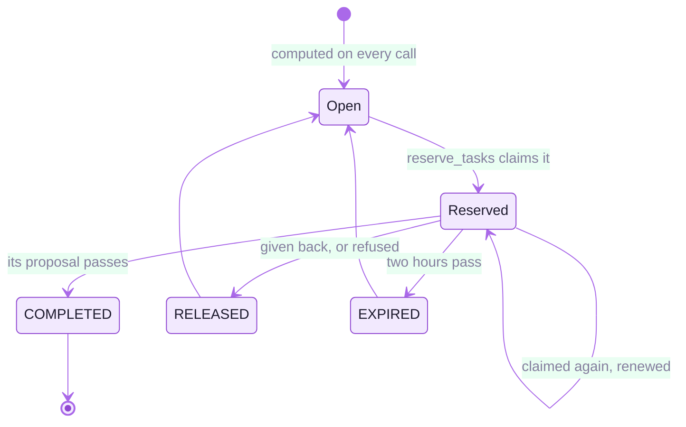
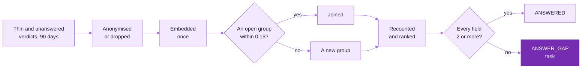
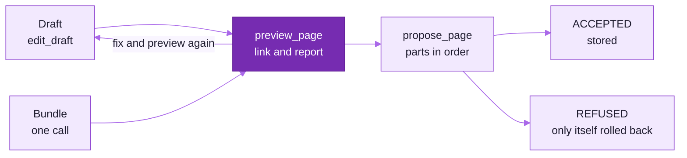

# Open work

The tasks KalaVigyan lists as open work, how they are reserved and completed, component proposals,
whole pages delivered, previewed and drafted, and the method the MCP server serves with them:
decision 0101's Knowledge API and MCP server, item 15 "Open work" and "The method travels with the
server", and item 16's component proposals. Engineers changing open work, the MCP work, page and
source tools, its prompts or the served skill read it, and a contributor's agent reads the same text
as `kalavigyan://contracts/open-work.md`. The endpoint, framing and read tools are in
`docs/contracts/knowledge-api.md`; `propose_facts`, a layout's proposal and `propose_structure` are
in `knowledge-writes.md`.

| For | Read |
|---|---|
| Why open work, the served method and component proposals are this way | [decision 0101](../decisions/0101-knowledge-architecture-for-every-craft.md), items 15 and 16; [0110](../decisions/0110-contributor-supplied-sources.md); [0111](../decisions/0111-fewer-mcp-tools.md); [0113](../decisions/0113-questions-become-work.md); [0117](../decisions/0117-pages-in-other-languages.md) |
| The endpoint, its framing, the read tools and the source tools' limits | [knowledge-api.md](knowledge-api.md) |
| `propose_facts`, a layout's proposal, `propose_structure`, trust tiers and the hourly limits | [knowledge-writes.md](knowledge-writes.md) |
| A delivered component's spec and its checks | [component-specs-general.md](component-specs-general.md) |
| The field coverage the tasks count | [coverage.md](coverage.md) |
| Held, failing and rotting facts, and the night that heals them | [nightly-upkeep.md](nightly-upkeep.md) |
| A page's translations, as they are served and reviewed | [monograph-document.md](monograph-document.md), Pages in other languages |
| Where component and layout proposals are decided | [review-queue.md](review-queue.md) |

## Where the code is

| Part | Where |
|---|---|
| Task contract, keys, filters, reservation constants | `research/open_work.py` |
| Task rules: per subject, review queues, priority, order, selection | `research/open_work_tasks.py` |
| Task wording (what is needed, acceptance) | `research/open_work_texts.py` |
| Source link rule (dead, unarchived) | `research/open_work_links.py` |
| Healing work: held, failing and rotting facts per subject, and their wording | `services/open_work_healing.py`, `services/open_work_healing_texts.py`, over `services/claim_holds.py` and `services/upkeep_links.py` |
| `propose_source` | `research/source_proposals.py`, `services/source_proposals.py`, `api/mcp_source_tools.py` (`SOURCE_TOOLS`) |
| Component proposal contract and the close-match rule | `research/component_proposals.py` |
| Subjects and filters | `services/open_work_subjects.py`; the family rule is `data/curation_scopes.is_family` |
| Facts and sections per field (the field coverage) | `services/coverage.py` (`coverage.md`) |
| Counts per subject (one source, sources differ, links, demand) | `services/open_work_counts.py` |
| Component kinds per craft | `services/open_work_components.py`, over the library's one applies-to query (`services/component_library.applies_to`, with `registered_pieces`) |
| The family flagships: the backlog, the task, its proposal check; the kinds a family page draws | `research/open_work_flagship_backlog.py` (from the interactives skill's `references/flagships.md`, kept equal by a test), `research/open_work_flagships.py`; `services/open_work_flagships.py` |
| Picture tasks (`MISSING_PICTURE`) | `services/open_work_pictures.py`; their keys `research/image_contributions_tasks.py` |
| The nightly refresh of field work | `services/open_work_refresh.py` |
| Pages in the monograph form | `services/open_work_pages.py`; the folder is `data/monograph_files.MONOGRAPHS_DIR` |
| Listing, standings, review queues, live reservations | `services/open_work.py` |
| Questions readers asked: verdicts, privacy, keys, wording | `research/open_work_gaps.py`, `research/open_work_gap_privacy.py`, `research/open_work_gap_keys.py`, `research/open_work_gap_tasks.py` |
| Recording each answer's verdict; the nightly grouping, acceptance and closing; the tasks | `services/answer_gaps.py` (from `SqlAnswerStore.finish`); `services/answer_gap_refresh.py` over `answer_gap_groups.py` and `answer_gap_checks.py`; `services/open_work_gaps.py`; tables `AnswerVerdict` and `AnswerGap` (`models/answer_gaps.py`, migration `0055_answer_gaps`) |
| Claim, claim several, release, complete | `services/task_reservations.py` |
| My tasks (held, completed, outcomes) | `services/contribution_queue_tasks.py`, contract `research/my_tasks.py` |
| Stewardship | `services/stewardship.py`, contract `research/stewardship.py`, table `CraftSteward` (`models/contributions.py`, migration `0048_contribution_queue`) |
| A component proposal | `services/component_proposals.py`; the delivered spec `component_proposals_spec.py`, registration `component_proposals_register.py` (`component-specs-general.md`) |
| `propose_page` and `preview_page` | `research/page_proposals.py` (the bundle and its reports), `services/page_proposals.py` with `page_proposals_parts.py`, `services/page_preview.py` with `page_preview_parts.py`, `page_preview_additions.py` and `page_preview_links.py` |
| Tables | `models/open_work.py` (`TaskReservation`, `ComponentProposal`), migration `0038_open_work`; the delivered spec's columns and `models/page_previews.py` (`PagePreview`), migration `0049_delivered_components` |
| MCP tools | `api/mcp_work_tools.py` (`WORK_TOOLS`: `list_open_work`, `my_work`, `reserve_tasks`, `steward_craft`) and `api/mcp_page_tools.py` (`PAGE_TOOLS`: `edit_draft`, `preview_page`, `propose_page`, with `mcp_page_arguments.py` and `mcp_page_texts.py`), registered in `api/mcp_tools.py`; each names its group in `_meta["kalavigyan/group"]` |
| MCP prompts and resources | `api/mcp_prompts.py`, `api/mcp_resources.py`, dispatched in `api/mcp_tools.py` |
| Source tools (`search_sources`, `read_source`, `lookup`) | `api/mcp_lookup_tools.py` (`LOOKUP_TOOLS`), `services/source_lookup*.py`, limits `core/rate_limit.LOOKUP_LIMITS` (`knowledge-api.md`, Source tools) |
| The contract resources and the index | `data/contributor/contracts/<name>.md`, copies of `docs/contracts/<name>.md`; `data/contributor/index.md`, written from the registry by `tools/mcp_index_build.py` (`api/mcp_index.index_text`: every tool, prompt and resource by its title); read by `data/skill_library.py` |
| HTTP routes | `api/routes/open_work.py`; `api/routes/page_proposals.py` (bundles and previews, `api/page_proposal_deps.py`) |
| The contributor skill | `data/contributor/SKILL.md`, served at `frontend/public/skills/kalavigyan-contributor/SKILL.md` |
| The references, the datasets skill and the interactives skill | `data/contributor/references/<name>.md`, `data/contributor/kalavigyan-datasets/SKILL.md` (from `.claude/skills/kalavigyan-datasets`) and `data/contributor/kalavigyan-interactives/` (from `.claude/skills/kalavigyan-interactives`; both listed in `skill_library.SKILL_FILES`, the one registry of served skills), read by `data/skill_library.py`, served at `frontend/public/skills/references/`, `frontend/public/skills/kalavigyan-datasets/` and `frontend/public/skills/kalavigyan-interactives/` |
| The design tokens resource | `data/design/tokens.json`, written by `tools/design_tokens.py` beside the design skill's `references/tokens.json` |

## Subjects

Every `ACTIVE` craft, and every category. A craft is a **family** when it is a catch-all or is
practised in `All India` only (the rule of `data/curation_scopes`); otherwise it is a **craft**.

## Tasks

`OpenTask {key, kind, priority, subject {kind, slug, name, pageUrl} | null, field, need, needed,
acceptance, count, factIds[], sourceIds[], prompt, reservedUntil}`. `factIds` and `sourceIds` carry
at most 20 ids; `count` is the whole number.

| Kind | When | Key | `count` | Prompt |
|---|---|---|---|---|
| `MISSING_FIELD` | a field holds no cited facts and no section | `MISSING_FIELD:<subject>:<slug>:<FIELD>` | facts wanted | `research_field` |
| `THIN_FIELD` | a field holds facts or a section but fewer facts than the target | `THIN_FIELD:...:<FIELD>` | facts still wanted | `research_field` |
| `SECTION` | a field meets its facts target, but its published section is missing or shorter than the target | `SECTION:...:<FIELD>` | facts held | `write_section` |
| `MISSING_COMPONENT` | a craft or family has no registered component of a need's kinds | `MISSING_COMPONENT:...:<need>` | 0 | `propose_component` |
| `FLAGSHIP` | one of the nine family pages draws no `reaction_player`, `dip_player`, `stage_player` or `experiment_lab` (The family flagships, below) | `FLAGSHIP:category:<slug>` | the backlog's facts | `deliver_page` |
| `PAGE_FORM` | the page is not in the monograph form | `PAGE_FORM:<subject>:<slug>` | 0 | none |
| `PAGE_LAYOUT` | in the monograph form without a layout | `PAGE_LAYOUT:<subject>:<slug>` | 0 | none |
| `SECOND_SOURCE` | facts cited by one source only, per primary field | `SECOND_SOURCE:...[:<FIELD>]` | facts | `research_field` |
| `SOURCES_DIFFER` | facts marked sources differ, per primary field | `SOURCES_DIFFER:...[:<FIELD>]` | facts | `research_field` |
| `DEAD_SOURCE` | cited sources with no archive whose last fetch answered 404 or 410 | `DEAD_SOURCE:<subject>:<slug>` | sources | `research_field` |
| `UNARCHIVED_SOURCE` | cited sources with a link and no archive, not dead | `UNARCHIVED_SOURCE:<subject>:<slug>` | sources | `research_field` |
| `RESOURCE_FACT` | facts held from the page because none of their quotes is found any more, per primary field | `RESOURCE_FACT:...[:<FIELD>]` | facts | none (`propose_source`) |
| `CORROBORATE_FACT` | shown facts with a quote that failed and another that holds, per primary field | `CORROBORATE_FACT:...[:<FIELD>]` | facts | none (`propose_source`) |
| `FIND_ANOTHER_SOURCE` | shown facts resting only on rotten sources (`nightly-upkeep.md`, 1a); `factIds` the facts, `sourceIds` the sources | `FIND_ANOTHER_SOURCE:<subject>:<slug>` | facts | none (`propose_source`) |
| `REVIEW` | a review queue holds items, shown to its reviewers only | `REVIEW:<QUEUE>` | items waiting | none |
| `MISSING_PICTURE` | a craft that is not curated has no picture waiting or approved for its masthead, its GI record (a GI craft), one of its stages or one of its materials; the target is `slot-masthead`, `slot-record`, `stage-<id>` or `material-<id>` (`image-contributions.md`) | `MISSING_PICTURE:craft:<slug>:<target>` | 1 | `give_picture` |
| `TRANSLATE` | a page with a monograph has passages not yet translated into a language it is offered in (Pages in other languages, below) | `TRANSLATE:<subject>:<slug>:<language>` | passages to translate | none (`preview_page`, `propose_page`) |
| `ANSWER_GAP` | readers asked about a craft or family and the answer was thin or found no cited evidence (Questions readers asked, below) | `ANSWER_GAP:<subject>:<slug>:gap-<32 hex>` | readers who asked in the last 90 days | `research_field` |

`<subject>` is `craft`, `family` or `category`. A fact with no primary field gives a key without
the field part.

**Targets** are the curation targets (`curation/limits.py`, the contract's Coverage table): a field
wants `DISCIPLINE_CLAIMS_MIN` (3) facts and a section of `SECTION_SENTENCES_MIN` (3) sentences;
every one of the 16 fields is a core field of every craft, family and category (owner, 2026-11-20:
a missing field is research, not a hole), so each field without cited facts is a `MISSING_FIELD`
task and each under 3 a `THIN_FIELD` task; quotes are 25 to 300 characters.

### What is counted

| What | How it is counted |
|---|---|
| Facts and sections per field | the field coverage (`coverage.md`): cited claims shown on the page, a craft's those about its open concepts, a category's those its dossier links (`CuratedCategoryClaim`), under the primary field and each secondary field, with the communities' claims counted for `SOCIETY` and the GI record's for `POLICY`; the `PUBLISHED` `ArticleSection` per field and its sentence count |
| One source | distinct `ClaimSource.sourceId` equal to 1 |
| Sources differ | `Claim.sourcesDiffer` |
| A source with a link, archived | a stored snapshot (`Source.snapshotKey`) or a curated `externalIds.archivedUrl` |
| A source with a link, dead | the latest `WebFetch` of the link answering 404 or 410 |
| Held facts | every cited quote `FAIL` (`services/claim_holds.held_claim`); left out of every count above, the field coverage among them: a held fact is research, not a fact the page shows. They are counted for `RESOURCE_FACT` |
| Failing facts | a `FAIL` quote, not held; counted for `CORROBORATE_FACT` |
| Rotten sources | `SourceUpkeep.failures` at least 3, no archive of any kind; counted for `FIND_ANOTHER_SOURCE`, over the facts that cite nothing else |
| Components | registered pieces (a label, not hidden, not superseded) of the craft, linked to it, or keyed to its concepts (its own, its stages', its materials'), its materials' compounds or its districts, as the library search reaches them; the needs and the kinds that meet them are below |
| Monograph form | a folder `data/monographs/<slug>` with `content.json`; a layout is a non-empty `layout` in it. Only `Kutch-Ajrakh` is in the form |

| Need | Kinds |
|---|---|
| `what-if` | `what_if`, `experiment_lab` |
| `molecules` | `molecule_3d` |
| `map` | `map_layer`, `region_story`, `timeline_map`, `supply_map`, `map_sequence` |
| `reaction-player` | `reaction_player`, `indigo_vat`, `mordant_bath`, `lost_wax`, `firing`, `dip_player` |
| `pictures` | `images`, `picture_plate`, `specimen_plate` |

A category has no `MISSING_COMPONENT` tasks: the registry keys components to crafts, concepts,
places and compounds, never to a category. A family page has its `FLAGSHIP` task instead.

Review queues and who sees them; queues are listed only without a subject filter:

| Queue | Holds | Seen by |
|---|---|---|
| `FACTS` | claims `PROPOSED` or `IN_REVIEW`, and every shown held claim | `MARK_CLAIM_LEVEL`, Professor and above |
| `TESTIMONY` | pending artisans' testimony | `REVIEW_TESTIMONY` |
| `IMAGES` | pending pictures | `REVIEW_CONTRIBUTIONS`, Admin and above |
| `COMPONENTS` | pending component proposals | `REVIEW_CONTRIBUTIONS` |
| `LAYOUTS` | pending page layout proposals | `REVIEW_CONTRIBUTIONS` |
| `STRUCTURE` | pending page structure proposals | `MARK_CLAIM_LEVEL`, Professor and above |
| `LAYERS` | pending map layer proposals (`propose_dataset` with its `layer`) | `REVIEW_CONTRIBUTIONS` |
| `STAGES` | process stages answers found, waiting to be placed in their craft's process | `MARK_CLAIM_LEVEL`, Professor and above |

### Priority and order

Priority is set per subject:

| Priority | Subjects |
|---|---|
| `HIGH` | on the owner's first list (`kalavigyan-craft-pages` skill, "Order": Bidriware, Blue Pottery of Jaipur, Kutch Bandhani, Machilipatnam Kalamkari, Madhubani, Orissa Pattachitra, Bastar Dhokra, Channapatna), or 25 or more stored answers about the craft. Every review queue is `HIGH` |
| `MEDIUM` | GI-registered (`Craft.giStatus` `GI`), curated (a `CuratedCraft` or `CuratedCategory` row), or 5 or more stored answers |
| `LOW` | every other craft and family, and every category; a family page's `FLAGSHIP` task is `HIGH` all the same, since every craft of the family borrows the flagship |

- Order (the subject's prominence): priority; then the owner's list order; GI before not; curated
  before not; then reader demand, most first; crafts, families, categories; name. Within a subject:
  healing first (re-source, corroborate, find another source; fields in vocabulary order), then
  the questions readers asked (their own priority, most askers first), then fields in vocabulary
  order, components, the flagship, page, corroboration, links. A page that lost a fact is the first
  repair of its subject. Review queues lead the `HIGH` tasks, and picture and translation tasks
  follow the subjects' other tasks of their priority.
- **The nightly upkeep** (`services/open_work_refresh.refresh_field_work`, the `fieldWork` part of
  its report) counts every open `MISSING_FIELD` and `THIN_FIELD` task by kind and priority and ends,
  as `COMPLETED`, each live reservation of a field task that is no longer open (its field was filled
  by an import or another way). Tasks themselves are computed on every call, so they are never
  stale.

### Filters

| Filter | Takes |
|---|---|
| `craftSlug` | one craft; a family's slug is refused |
| `familySlug` | the family's page and the crafts sharing its sub-category |
| `categorySlug` | the category's page and its crafts and families |
| `field`, `kind`, `priority` | one value each |
| `limit` | 1 to 200, default 50 |

At most one of `craftSlug`, `familySlug` and `categorySlug` is given. `OpenWork {schemaVersion 1,
filters, total, reservationMinutes, tasks[]}`: `total` counts every matching task before the limit.

A task reserved by another account is left out until its reservation ends; the caller's own carry
`reservedUntil`. A `MISSING_COMPONENT` or `FLAGSHIP` task is closed while a `PENDING` or `APPROVED`
proposal names its key.

### The family flagships

Each of the nine family pages (the atlas's categories) has one flagship interactive, chosen in the
interactives skill's backlog (`kalavigyan://skills/kalavigyan-interactives/references/flagships.md`).
`research/open_work_flagship_backlog.FLAGSHIPS` holds it in code: per category slug, the family,
the mechanism, the anchor craft, the facts of its states (the candidates' rows left out) and what it
still lacks (the backlog's Missing line); a test keeps the two equal.

| State | When |
|---|---|
| **Open** | while the family page draws no registered component of kind `reaction_player`, `dip_player`, `stage_player` or `experiment_lab`: none rests on (`claimIds`) or is keyed to the concepts of the page's facts (its `CuratedCategoryClaim` claims and those its `PUBLISHED` sections cite), and none is named in its latest layout. `count` is the backlog's facts for it and `factIds` those facts; `needed` names the mechanism, the anchor and what is still lacking |
| **Completed** | by a component proposal naming it as `task_key`: of one of those kinds, delivered with its spec, and keyed to the anchor craft (a `CRAFT` subject or its `craft_slug`), sent in a bundle for the category page. Any other proposal naming it is refused with the reason |

## Questions readers asked (decision 0113)

What readers ask and KalaVigyan answers poorly becomes work. Nothing here calls a model.

**Each answer's verdict.** When an answer is finished (`SqlAnswerStore.finish`), each of its
sections is read for its field: its cited sentences at a fact level (`VERIFIED`, `REVIEWED` or
`PROVISIONAL`, each text once), whether its retrieval scored low, and the facts it cited. Retrieval
scores low when the section ran research and no stored fact was found, or when the stored pack was
reranked (decision 0125) and its best fact's relevance score is below `ANSWERING_RELEVANCE` (0.5:
no stored fact answers the question), or, when no fact carries a relevance score (no reranker, or
the rerank failed), its best stored fact's fused score is at most 1/61 (one over `RRF_K` + 1: the
most a fact found by one ranking alone can score, so nothing matched the question's words or
names) (`services/answer_gaps.retrieval_low`); a section reused from stored pieces is not judged on
retrieval. The store adds the cited facts holding a quote whose last check is `FAIL`.

| Verdict | When |
|---|---|
| `UNANSWERED` | no field holds a cited sentence (`NO_CITED_EVIDENCE`; every field is lacking) |
| `THIN` | a field lacks: `MISSING_FIELD` (no cited sentence), `FEW_SENTENCES` (1 or 2), `LOW_RETRIEVAL`, `FAILED_QUOTE` (it cited such a fact) |
| `ANSWERED` | no field lacks |

`AnswerVerdict {answerId (unique, cascading with the answer), craftId, verdict, fields[] (the
answer's fields, vocabulary order), lacking[], lacks[], sentences, gapId, embedding, embeddingModel,
createdAt}`. A question refused before research keeps no answer row and so no verdict; a question
about no craft keeps a verdict and never a task.

**The nightly step** (`services/answer_gap_refresh.refresh_answer_gaps`, `answerGaps` in the upkeep
report `{questions, dropped, embedded, embeddingError, joined, opened, answered, lapsed, open,
reservationsClosed}`), after the field work:

1. Takes at most 500 `THIN` and `UNANSWERED` verdicts about a craft, asked within 90 days and in no
   group, oldest first, and anonymises each question (Privacy, below); a dropped question stays out.
2. Embeds each anonymised question once (`query_text`, stamped with the current embedding model)
   when its verdict holds no current vector, and an open group's question whose vector is stale; a
   failed embedding is reported as `embeddingError` and the night goes on with the stored vectors.
3. Joins each question to the nearest open group of its craft when their cosine distance is at most
   0.15, or opens a group with it; a group's question is its first asker's, anonymised.
4. Recounts every open group from its members asked within 90 days: `askers` (distinct accounts; an
   answer without an account counts once), the latest asked, `fields` (the union of the members'
   lacking fields) and `lacks`. A group no one asked within 90 days is `LAPSED`.
5. Sets its priority: `HIGH` when 5 or more asked and the latest within 30 days; `MEDIUM` when 5 or
   more asked earlier, or 2 or more with the latest within 30 days; `LOW` otherwise.
6. Checks its acceptance with one count per field, no model and no ranking
   (`services/answer_gap_checks`, decision 0122): the claims of the craft's scope (with its family
   science and the crafts merged into it, `retrieval.md`), shown in mode `HYBRID` at a fact level and
   filed under the field as their field or a secondary field (a claim with no field counts for no
   field), that match the question. A question in an English script matches by its rare words: its
   Latin terms of 3 or more characters less the craft's name and slug words (a plural `s` aside) and
   common words (`COMMON_WORDS`: the quote matcher's stop words and question words such as why, how,
   use, made); a claim matches when its English text-search vector holds 2 of them, or the only one
   (`terms_needed`). A question in another script, or one left with no rare word, matches by
   meaning: a claim whose current-model vector has a cosine similarity of at least 0.6 to the
   group's stored vector (`ANSWER_MIN_SIMILARITY`, the craft finder's semantic floor). When every
   field counts 2 or more, the group is `ANSWERED`.
7. Ends each live `ANSWER_GAP` reservation of a group no longer open: `COMPLETED` when it was
   answered, `EXPIRED` otherwise.

`AnswerGap {id, craftId, question (anonymised), language, fields[], lacks[], askers, firstAskedAt,
lastAskedAt, priority, state OPEN | ANSWERED | LAPSED, closedAt (exactly when not open), embedding,
embeddingModel}`.

**The task.** Each open group with askers is a task of its craft or family, listed after the
subject's healing tasks with its own priority: `field` the first of its fields, `count` the askers,
prompt `research_field`, `needed` `Readers asked "<question>" (<n> readers in the last 90 days, the
latest on <date>); the answer <what it lacked>. Cited facts under <fields> would answer it.`, and the
acceptance above. A fact proposed for it names its key as `task_key` when the fact is filed under one
of the gap's fields (`knowledge-writes.md`); the reservation ends `COMPLETED` once the fact passes the
gates, and the question closes itself at the nightly check.
The site lists it with the fact tasks ("Where help is wanted" on `/contributions/facts`).

**Privacy.** A task never says who asked: no account, no answer, only how many. The question is
anonymised by rules (`research/open_work_gap_privacy.anonymised`):

- Dropped whole when it asks for someone's contact (a phone, mobile, WhatsApp or contact number or
  details of or for someone, an email or address of someone, a home address, how to contact or reach
  someone), or names someone and asks about them (who is, tell me about, biography, life of, how
  old, married, lives or stays, his or her age, family, income, caste, religion, health or home);
  and when fewer than 3 words are left.
- Removed: emails (`[email]`), links (`[link]`), handles (`[name]`), phone numbers of 10 digits, or 8
  after a `+` (`[phone]`), PIN codes, house numbers and street addresses (`[address]`), the asker's
  own name after "my name is", "I am", "myself", "call me" or "मेरा नाम", a name after an honorific
  (Mr, Mrs, Ms, Miss, Dr, Shri, Sri, Smt, Kumari, Prof, Ustad, Pandit, Begum, Madam; श्री, श्रीमती,
  डॉ, कुमारी, सुश्री, उस्ताद), and two or more capitalised words in a row (a sentence's first word
  aside) unless every word is in a craft, category, family, state or district name (`[name]`).

Then, in the nightly step only, never at request time, the questions the rules kept are screened for
names (decision 0159, `services/question_names.screen_names` over `research/question_names`): the
cheapest model route (`AiTask.UNDERSTAND`) reads up to 40 questions a call, as data, and lists every
person's name each holds, a lone first name included, and whether it asks about a person. A question
about a person is dropped; each name it lists is masked (`[name]`) where the rules' text still holds
it; a name the question does not hold drops the question, since it cannot be checked. A question the
screen could not read (a failed call, a malformed reply, a key missing from it) opens no work that night
and waits, unchanged, for the next (`held` and `namesError` in the night's `answerGaps` report).

The answers stay private as before; both tables have row level security and no grants to the
public roles.

## Pages in other languages (decision 0117)

Code: `research/translation_passages.py` (a passage's texts, its hash, `TaskPassage`),
`research/translation_regions.py` (the languages a page is offered in and their priority),
`research/open_work_translation_keys.py` (`TRANSLATE`), `services/page_text_index.py` (the
passages of each page's English document, `PageTextUnit`) and `services/open_work_translations.py`
(the tasks); the translations themselves are `monograph-document.md`'s.

- **Which languages.** A craft's or family's home state (`Craft.stateOfOrigin`) gives its
  regional language among the thirteen answer languages (`STATE_LANGUAGES`, below); every page is
  also offered in Hindi, and a category in Hindi alone. A state outside the table (All India, Goa,
  the north-east but Assam and Tripura) offers Hindi alone.

  | Home state | Language |
  |---|---|
  | Gujarat | `gu` |
  | Maharashtra | `mr` |
  | West Bengal and Tripura | `bn` |
  | Assam | `as` |
  | Tamil Nadu and Puducherry | `ta` |
  | Kerala | `ml` |
  | Karnataka | `kn` |
  | Andhra Pradesh and Telangana | `te` |
  | Odisha | `or` |
  | Punjab | `pa` |
  | Jammu and Kashmir | `ur` |
  | the Hindi-speaking states | `hi` |

- **One task per page and language** with passages left, `TRANSLATE:<subject>:<slug>:<language>`.
  Its count is the passages of the page's English document (every text unit with a letter outside
  a fixed mark, the masthead title aside) that have no live translation (served or waiting) for
  their current hash. Its priority is the page's (`subject_priority`, the most read and owner's
  crafts first) in its home language and one step lower in Hindi when Hindi is not its home
  language.
- **The passages** come from `PageTextUnit`, refreshed whenever the page's English document is
  served or read for translation and its tag changed, so listing open work never builds a
  document. A listed task carries none; the task `reserve_tasks`, `my_work` and claims return
  carries up to 20 (`TASK_ITEMS_MAX`) of its open passages as `passages`, each `{key,
  sourceHash, english, texts, fixed, cited}`.
- **Taken and closed** by a page bundle's `translation` part naming the task as `task_key`
  (`preview_page` first, then `propose_page`; the site's form posts the same bundle). A part naming
  another task is refused whole. A live reservation ends `COMPLETED` once a part leaves no passage
  of the page without a live translation; until then it stays held, so the work can go on over
  several bundles.

## Reservations (`TaskReservation`)

- A claim reserves an open task for 2 hours; claiming it again renews it from now. The key must
  name a task open now (computed for its subject) and not closed by a proposal; a review queue is
  never reserved. How many live reservations one account holds at once is set by its trust tier
  (`knowledge-writes.md`, Trust tiers: `NEW` 5, `ESTABLISHED` 10, `PROVEN` 20; Professors and above
  20); the refusal names the tier. The reservation length (2 hours) and renewal are unchanged.
- MCP `reserve_tasks {claim?, release?}` (decision 0111, in place of `claim_task`, `claim_tasks` and
  `release_task`) first gives back each key of `release`, then claims up to 10 keys of `claim`, each
  in its own savepoint (`task_reservations.claim_tasks`): a key taken, closed or over the cap, or a
  release of a task the caller does not hold, is refused with its reason and the rest go on
  (`ReservedTasks {schemaVersion 1, held[TaskHold], released[TaskHold], refused[{taskKey, problem}],
  tier, holding, holdingMax, message, notices[]}`). The site's routes keep one key a call.
- A live reservation of another account refuses the claim with its end. An expired one is ended
  (`EXPIRED`, at its expiry) by the next claim, and the task returns to the list by itself.
- A release ends the caller's own reservation (`RELEASED`, or `EXPIRED` once past its time).
- One live reservation per key: a partial unique index on `taskKey` where `endedAt` is null.
  `userId` is kept for the reservation only and never shown to another account.

A proposal that names a task ends the proposer's reservation:

| The proposal | The task it names | Its reservation |
|---|---|---|
| A component proposal | its `task_key` | `COMPLETED` |
| A proposed fact (MCP `propose_facts`, a fact part of `propose_page`, or `POST /api/knowledge/facts`) | a field, corroboration or question task, as its `taskKey` | `COMPLETED` once the fact passes the gates (published or waiting for review); given back (`RELEASED`) when the fact is refused, so the task returns to the list (`knowledge-writes.md`). The `research_field` prompt asks the agent to pass it |
| A `propose_source` | a `RESOURCE_FACT`, `CORROBORATE_FACT`, `FIND_ANOTHER_SOURCE`, `SECOND_SOURCE` or `DEAD_SOURCE` task | `COMPLETED` when its quotes pass, given back when they refuse; the task must be open and list the fact (or one of its sources, for `DEAD_SOURCE`), or list more than it shows (`knowledge-writes.md`, Source proposals) |
| A `propose_structure` (or `POST /api/knowledge/structure`) | a field or corroboration task of its page and field | `COMPLETED` once its checks pass, given back when they refuse (`knowledge-writes.md`, Structure proposals) |

## Component proposals (`ComponentProposal`)

| Argument | Holds |
|---|---|
| `label` | `<craft-or-shared>/<field>/<name>`, the registry's pattern |
| `title` | the component's title |
| `description` | 40 to 600 characters, written for a model |
| `kind` | a piece kind |
| `field`, `fields[]` | its field and fields |
| `craft_slug?` | the owning craft; none for a shared component |
| `subjects[{kind, key}]` | 1 to 20: a craft by slug, a concept or compound by id, a place by `lgd:<code>` or `basin:<id>` |
| `considered_labels[]` | registered labels only |
| `extends?` with `extension` | `SUBJECT_LINK` keeps the extended label; `VARIANT` takes a new one |
| `task_key?` | the task it completes (the checks, below) |
| `spec` | the delivery: the kind's spec data, any of the 22 contributable kinds, authored or declared |
| `units` | the delivery's units, `{u0001: {text, claimIds}}` |

The delivery, `spec` and `units`, is required on MCP except for a `SUBJECT_LINK`, which carries none
(`component-specs-general.md`).

- Checks, failing with a sentence the agent can act on: a `task_key` names a `MISSING_COMPONENT`
  task whose need the proposal's kind meets and whose craft the proposal is keyed to, or a
  `FLAGSHIP` task the delivered proposal meets (The family flagships, above), so a proposal never
  closes another task; every considered or extended label is registered; every subject exists
  (a concept must be open); no live proposal holds the label (a subject link excepted, and a
  concurrent duplicate is refused by the partial unique index on `label`).
- **The library search**: `component_library.library_components` on the title and description, and
  for the owning craft and each craft subject with the proposal's kind, plus the registered piece
  holding the same label.
- **A close match**, any of: the same label; the same kind keyed to the same concept, compound or
  place; the same kind with titles sharing half their content words or more; a title and
  description sharing 60 % of their content words or more (words of three letters or more, common
  words dropped, overlap as shared over all). The extended component is never its own match.
- A close match returns `{outcome REFUSED, matches[{component, reasons[]}], waysOn[2]}` and stores
  nothing. The two ways on: place the existing component by its label, or propose an extension (a
  new subject link or a variant). Never a copy.
- A delivery is then checked (`component-specs-general.md`, The checks): the spec against its
  kind's model, its units against the spec, every cited fact stored and shown, every number a unit
  states in its facts. A refusal names every problem in one sentence and stores nothing.
- Otherwise it is stored: `PENDING` for review by an Admin, or `APPROVED` at once when the account
  is a Professor, Admin or Master Admin (decision 0101 item 12, the role read from the signed-in
  account). The proposer is kept in `proposerId` for moderation only and never shown (item 13).
- **Approval registers it** (no builder step): a delivered component becomes a `KnowledgePiece` of
  the library that every page it applies to draws from its spec, and a `SUBJECT_LINK` keys the
  registered component to its new subjects; approved at once means registered at once. A proposal
  without a spec (the site's form) is approved for a builder as before.

## MCP

| Tool | Group | Scope | Hints | Returns |
|---|---|---|---|---|
| `list_open_work` | work | read | read-only | `OpenWork` |
| `my_work` | work | contribute | read-only (records what a steward has seen) | `MyWork {schemaVersion 1, tier, holding, holdingMax, reservationMinutes, claimed[{taskKey, reservedUntil, task (OpenTask, or null once closed)}], completed[{taskKey, ending COMPLETED, endedAt}] (the last 30 days, at most 50), outcomes[ProposalTicket] (the latest 20), crafts[StewardPackage], craftsMax, message}` |
| `reserve_tasks` | work | contribute | writes | `ReservedTasks` (Reservations, above) |
| `steward_craft` | work | contribute | writes | `StewardReply {schemaVersion 1, craftSlug, adopted, message, package: StewardPackage or null}` |
| `get_proposal` | work | contribute | read-only | `ProposalTicket` (`knowledge-writes.md`) |
| `propose_source` | proposing | contribute | writes | `SourceProposalReply {schemaVersion, outcome, claimId, quotesAdded, held, gates, message}` |
| `edit_draft` | pages | contribute | writes | `DraftView` (below) with `notices` |
| `preview_page` | pages | contribute | read-only (a preview, never a proposal; the dispatch keeps the preview it records) | `PagePreviewResult {schemaVersion, subject, pageUrl, previewUrl, expiresAt, chapters[], components, sources, parts[], message}` with `draftId`, `report` (`PageReport`, below) and `notices`; `_meta.ui` names `ui://kalavigyan/page-preview.html` |
| `propose_page` | pages | contribute | writes | `PageProposalResult {schemaVersion, subject, pageUrl, accepted, refused, parts[], message}` with `draftId`, `nextStep` and `notices`; a component part's report carries its close `matches` and `waysOn` |
| `supply_source` | sources | contribute | writes | `SuppliedSourceReply` with `draftId` and `notices` (`knowledge-writes.md`, Supplied sources) |
| `search_sources` | sources | contribute (read for pictures alone) | read-only, open-world | `SourceSearch` (`knowledge-api.md`, Source tools) |
| `read_source` | sources | contribute | read-only, open-world | `SourceReading` |
| `lookup` | sources | read | read-only, open-world | `LookupReply` |

The page, draft and source tools need an account of Researcher or above (`PROPOSE_KNOWLEDGE`), but
`lookup` and a pictures-only search, which anyone may call.

- A write tool's changes are committed by the dispatch when it succeeds and rolled back when it
  refuses (`InvalidInput` or `Refused`, both a tool result with `isError`); a read-only tool that
  records its own bookkeeping (`Tool.records`: `my_work` the steward's last look, `preview_page` the
  preview row and a draft's last preview) is committed the same way.
- **Merged in decision 0111.** `my_work` is `my_tasks` and `my_crafts` in one view (a Student holds
  only its tasks); `reserve_tasks` is `claim_task`, `claim_tasks` and `release_task`; `steward_craft
  {craft_slug, action adopt | drop}` is `adopt_craft` and `drop_craft`; `edit_draft` is
  `create_draft`, `add_to_draft`, `remove_from_draft` and `get_draft`; `preview_page` and
  `propose_page` take a `bundle` or a `draft_id` and are `preview_draft` and `submit_draft` too, and
  `propose_page` with one part alone is `propose_component` and `propose_layout`. Every allowance,
  check and message of the old tools is kept.
- Review queues reach `list_open_work` only on a connection holding the review scope, and then by
  the account's role.
- `initialize` declares `tools`, `prompts` (`listChanged` false) and `resources` (`subscribe` and
  `listChanged` false).
- The server's `instructions` name the tools in the order of the work, the groups, the index and,
  once for every tool, the data note (`api/mcp_protocol.py`).

### Prompts

`prompts/list` and `prompts/get` (`api/mcp_prompts.py`, steps in `api/mcp_prompt_steps.py`) give
seven prompts. The method sections of the contributor skill are Proposals and their progress, Finding
and reading sources and Never:

| Prompt | Arguments | Sections of the contributor skill | References, whole (`Prompt.references`) |
|---|---|---|---|
| `research_field` | `craft_slug`, `field` | the method's three | sources, quotes, fields and the page checklist |
| `write_section` | `craft_slug`, `field` | the method's three and Writing a section | the same four |
| `propose_component` | `craft_slug`, `need?` | the method's three, Components and Pages | the four and components |
| `deliver_page` (round 7) | `subject_kind`, `slug` | the method's three, Structure and sources, Components, Pages and Pictures | the four and components |
| `give_picture` (round 7), the prompt of `MISSING_PICTURE` tasks | `craft_slug` | Pictures, Finding and reading sources and Never | none |
| `deliver_dataset` (round 7) | `craft_slug`, `kind?` (one of the declared kinds but `drawing`) | the method's three, Components and Pages | the four, components and datasets |
| `curate_page` (decision 0110) | `subject_kind?`, `slug?` | those of `deliver_page` | all six |

- Each of the first six returns one user message: the task, the steps naming the tools in order
  (`list_open_work`, `reserve_tasks`, `get_facts` and `get_page`, `list_components` first for a
  component, the source steps (`search_sources`, then `lookup`, `read_source` for the text the gates
  will read and with `quotes` on every quote, with the agent's own search where they find nothing;
  `write_section`, `propose_component` and `deliver_dataset` name the same tools in their own steps,
  and `give_picture` ends on `search_sources` with kinds pictures for open pictures the team places),
  `propose_facts` with idempotency keys and the claimed task as `task_key`, then `get_proposal` or
  `my_work` for the outcome; a component or page is built finished and seen with `preview_page`
  before `propose_page`; a picture is given with `give_pictures` only after the person confirms the
  declaration in their own words), the sections and the references above. A wrong prompt or
  argument is `-32602`.
- `curate_page {subject_kind?, slug?}` (decision 0110, `api/mcp_prompt_curate.py`) walks the whole
  job of one page in order: pick the page (`my_work`, `list_open_work`, `steward_craft`) or read the
  named one (`get_page`, `list_open_work`), claim its tasks, derive its lists (`get_page`,
  `get_facts`) and open the draft with them (`edit_draft`), research with the agent's own reach and
  the sources tools (`search_sources`, its pictures too, and `lookup`), read and check every quote
  (`read_source`, `supply_source` for a source only the agent can read, `read_source`'s quotes and
  archive), `propose_facts` in batches, then structure, components and dataset figures and the
  layout in `edit_draft`'s add, pictures with `give_pictures` and `edit_draft`, `preview_page` with
  the draft and fix against the report until no fixable failure is left, `propose_page` with the
  draft once, follow with `get_proposal`, `my_work` and `edit_draft` by its id, and what to do when
  each gate refuses. Its sections are those of `deliver_page`; its references are all six.

### Resources

`resources/list` and `resources/read` give these; an unknown uri is `-32002`.

| Resource | Uri | Type |
|---|---|---|
| The index (round 7: every tool, prompt and resource with one line each) | `kalavigyan://index.md` | `text/markdown` |
| The contributor skill | `kalavigyan://skills/kalavigyan-contributor/SKILL.md` | `text/markdown` |
| The datasets skill | `kalavigyan://skills/kalavigyan-datasets/SKILL.md` | `text/markdown` |
| The interactives skill and its two references (`skill_library.SKILL_FILES`) | `kalavigyan://skills/kalavigyan-interactives/SKILL.md`, `.../references/flagships.md` and `.../references/storyboard.md` | `text/markdown` |
| The six references | `kalavigyan://skills/references/<name>.md` (`page-checklist`, `sources`, `quotes`, `fields`, `components`, `datasets`) | `text/markdown` |
| The five contracts a contributor's client follows (round 7), each the same text as `docs/contracts/<name>.md` | `kalavigyan://contracts/<name>.md` (`knowledge-writes`, `open-work`, `component-specs-general`, `image-contributions`, `mcp-ask-and-upload`) | `text/markdown` |
| The design tokens | `kalavigyan://design/tokens.json` | `application/json` |
| The answer kit and view | `kalavigyan://design/answer-kit.md` and `ui://kalavigyan/answer.html` | `text/markdown`; `text/html;profile=mcp-app` |
| The page preview view | `ui://kalavigyan/page-preview.html` | `text/html;profile=mcp-app` |
| Each kind's spec schema (decision 0111) | `kalavigyan://components/{kind}.schema.json` | `application/schema+json` |

- The page preview view is `data/design/page-preview-view.html` through `data/page_preview_view.py`:
  one self-contained page, `default-src 'none'` and its one script allowed by hash, the four themes'
  colours and the status colours inlined from `tokens.json`, every text set as text, `https` links
  opened through `ui/open-link`; it draws a `preview_page` result: the private link, the rules failed
  first with their evidence, coverage by field, figures, sources by grade, pictures by licence and
  each part's outcome.
- `resources/templates/list` gives `kalavigyan://components/{kind}.schema.json`, and every kind a
  contributor may deliver is also listed as its own resource (`api/mcp_component_schemas.py`): the
  JSON schema of the kind's spec, the model the server checks a delivered spec with.

## HTTP

| Route | Who | Answer |
|---|---|---|
| `GET /api/knowledge/open-work?craftSlug&familySlug&categorySlug&field&kind&priority&limit` | anyone, counted against the public read limit when signed out; a signed-in reviewer also sees the review queues | `OpenWork`; wrong filters 422 |
| `POST /api/knowledge/open-work/claim` and `/release`, body `{taskKey}` | `PROPOSE_KNOWLEDGE` (Researcher and above) | a reservation conflict or the held maximum 409, a key that is not open 422 |
| `POST /api/knowledge/open-work/claims`, body `{taskKeys}` (1 to 10) | `PROPOSE_KNOWLEDGE` | `TaskClaims` |
| `GET /api/knowledge/open-work/mine` | `PROPOSE_KNOWLEDGE` | `MyTasks` |
| `GET /api/knowledge/stewardship` | `PROPOSE_KNOWLEDGE` | `MyCrafts` |
| `PUT /api/knowledge/stewardship/{slug}` | `PROPOSE_KNOWLEDGE` | adopt, `StewardPackage` |
| `DELETE /api/knowledge/stewardship/{slug}` | `PROPOSE_KNOWLEDGE` | drop, `Stewardship` |

For stewardship, more than 10 crafts is 409, and a craft not stewarded or not known 422.

## Stewardship (round 7)

A contributor adopts crafts and families (`steward_craft {craft_slug, action adopt}`, at most
`STEWARD_CRAFTS_MAX` = 10 live at once) and drops them (`action drop`). A steward sees each craft's
open work as one package (in `my_work`, and in the reply to an adoption), the tasks
`list_open_work` gives for the craft (a family with its crafts) to that account, at most 200:

| `StewardPackage` | Holds |
|---|---|
| `craft` | the `TaskSubject` |
| `adoptedAt` | when it was adopted |
| `seenAt` | the steward's last look, null before the first |
| `stewards` | how many accounts steward it; never who |
| `newTasks[OpenTask]` | open now and not open at the last look: the craft's new gaps, first |
| `tasks[OpenTask]` | the rest |
| `total` | every matching task, before the limit |

Each look records the keys it showed (`CraftSteward.seenTaskKeys`, `seenAt`), so the next look's new
gaps are those opened since; at adoption every gap is new. Stewardship never reserves a task and
never blocks anyone: other accounts list, claim and complete the craft's tasks as before, and a craft
has any number of stewards. Table `CraftSteward` (`userId`, `craftId`, `adoptedAt`, `droppedAt`,
`seenTaskKeys`, `seenAt`; one live row per account and craft by a partial unique index).

## Pages delivered whole (`propose_page`)

One bundle builds one page, `PageBundle {schemaVersion 1, subject, facts[], structure[],
components[], layout?, pictures[], translation?, note?}`, holding at least one part:

| Part | Holds | At most |
|---|---|---|
| `subject` | `{kind craft, family or category, slug}` | one |
| `facts[]` | each a `FactProposal` | 20 |
| `structure[]` | each a `propose_structure` proposal | 20 |
| `components[]` | `{proposal, cites}` | 10 |
| `layout?` | `{baseVersion, entries, note?}` | one |
| `pictures[]` | `{stageId?, claimIds, declaration?}` | 10 |
| `translation?` | a page's passages in one language (Pages in other languages, above; `monograph-document.md`) | one |
| `note?` | a note | one |

Over MCP it is `propose_page`'s and `preview_page`'s `bundle`, in snake_case, and a draft's parts make
one too. One part alone is a bundle: a component by itself (in place of the retired
`propose_component`) or a layout by itself (in place of `propose_layout`). Over MCP every component
of a bundle or draft is delivered finished: a spec, except for a `SUBJECT_LINK`. A component's
`cites` names, per unit, the bundle's facts it rests on besides its `claimIds`, as `fact:0`, `fact:1`
and on (the facts' places in `facts`); a picture's `claimIds` may name them the same way. A reference
beyond the bundle's facts, or to a unit the component lacks, is an argument error.

Parts run in order (facts, structure, components, layout, pictures), each in its own savepoint and
checked exactly as its own tool checks it: a fact through the gates (`knowledge-writes.md`), a
structure item through its checks, a component through the delivery checks and the library search,
the layout against the page's current version (stored for review, or written at once by an
Admin), and a picture by starting its upload (the link and slot of `give_pictures`'s `upload:
true`, `mcp_picture_tools.start_picture`, reported in the part's `upload`); a translation's passages
are checked last, each reported on its own. Each part counts against its own kind's hourly limit,
and a draft or a bundle of more than one part also against the page bundles; a bundle of one part
counts against that part's kind alone, as its retired tool did. A part is also refused when it names
another page (a fact's or structure item's subject), when a category's bundle carries structure or
pictures, when a component is keyed to another craft (`craft_slug` or a `CRAFT` subject), or when it
cites a bundle fact that was refused. A refused part rolls back only itself: the others stand, and
one report lists every part `{part, index, outcome ACCEPTED or REFUSED, status, id, message,
upload?, matches?, waysOn?}` with the counts; a component refused for a close match carries the
matches and the two ways on. A component citing a bundle fact that waits for review is stored, and
its approval waits until that fact is shown. HTTP: `POST /api/knowledge/pages` (`PROPOSE_KNOWLEDGE`,
the contribution terms accepted), 422 for an argument or subject error.

## Previews before submitting (`preview_page`)

`preview_page` takes the same bundle and assembles the document it would produce, without
proposing anything: the page's generated document (`page-layout.md`) built from the stored page
plus the bundle (`PageAdditions` into `monograph_generated.generated_parts`):

| Part | In the preview |
|---|---|
| A fact, and a structure item that states a fact | one more sentence at the end of its field's section, citing its proposed sources (unstored sources, numbered after the page's); a conflict is listed only |
| A component | drawn from its delivered spec where the page will draw it once registered; the delivery checks run, so a component that would be refused is refused here |
| The layout | replaces the page's own as its next version, refused when its base version is stale |
| Pictures | listed: they are drawn once uploaded and approved |

No source is fetched, so the gates' verdicts are only known when the bundle is proposed. Each part
reports `SHOWN`, `LISTED` or `REFUSED`. A page with authored content (Kutch Ajrakh) is not
previewed, and a page that would still hold too few published fields to be a monograph (3 for a
craft, 1 for a family or category) is refused with how to grow it.

The document is kept as a `PagePreview` row (`userId`, subject, `document`, `expiresAt` 24 hours
on; an account keeps at most 20 live previews and expired ones are deleted when it previews again)
and reached through a private link, `<site>/preview/<token>`. The token is
`<preview id hex>.<expiry epoch>.<HMAC-SHA256>`, signed for the account with a key derived from the
JWT secret (`page_preview_links.preview_key`); `GET /api/knowledge/pages/previews/{token}` returns
the document only to that signed-in account before it expires (404 otherwise, never saying which),
with `Cache-Control: private, no-store` and `X-Robots-Tag: noindex, nofollow`. HTTP: `POST
/api/knowledge/pages/preview` (`PROPOSE_KNOWLEDGE`). The web route `/preview/<token>`
(`app/(reading)/preview/[token]`) reads it with the reader's session and draws it with
`MonographPage` exactly as the site draws its pages, `noindex`; signed out it sends the reader to
sign in and back, and any other answer is the not-found page.

## The checklist report (decision 0110)

Over MCP, `preview_page`, of a bundle or a draft, reads back the stored preview document
(`services/page_report.preview_report`) and reports it against the page checklist
(`research/page_report.py`, the rules in `research/page_report_rules.py`); a preview whose document
cannot be read back carries `report: null`. The rule titles are read from the checklist reference
(`services/page_report.checklist_titles`), its one copy.

`PageReport {schemaVersion 1, passed, failed, judged, rules[{rule, title, verdict PASS | FAIL | JUDGE,
evidence[] (at most 12 lines)}] (all 26, in order), sentences, ledeSentences, fields[{field, chapter,
sentences, figures, held, standing DENSE | THIN | ABSENT}] (the sixteen, in vocabulary order),
figures[{number, label, kind, title, field, chapter, cited}] (every component but pictures, numbered in
reading order), figureKinds, sources, sourcesByGrade (A to D, or UNGRADED for a source the gates grade
when it is proposed), suppliedSources, pictures[{label, chapter, caption, credit, licence}],
picturesByLicence, message}`. A sentence is a placed `p` unit with facts outside a component; the lede
is the sentences of the opening; a picture is a `picture_plate`.

| Rule | Checked |
|---|---|
| 1 | no page or component title ends with a question mark; the lede holds at most 3 sentences |
| 2 | a craft's or family's masthead holds a picture (a category's is judged) |
| 3 | at most one picture in the masthead |
| 4 | every number a sentence states is in a quote it cites (`quotes.unsupported_figures`) |
| 6 | the signature fact (the draft's lists: `fact:N` matched by its statement, or a stored fact's id) is on exactly one sentence; judged without lists |
| 7 | no picture file is drawn twice |
| 9 | every figure cites through its units, its spec's sources or its borrowed fragment |
| 10 | no text shows a progress state ("writing section", "n of m scenes", "70 % done") |
| 14 | every picture carries its credit |
| 15 | every figure holds text or cites |
| 17 | every chart is a declared `chart` (drawn from zero by the site); an authored chart is judged |
| 18 | judged, with the number of sentences using each ambiguous term of the lists |
| 20 | each mechanism of the lists is named in 2 or more sentences; judged without lists |
| 21 | each reaction of the bundle's structure with every formula has the same elements on both sides; judged without one |
| 23 | every sentence sits in its field's chapter, and every field holding facts has a sentence |
| 24 | every field on the page has 3 or more sentences |
| 25 | no sentence is told twice, and no figure's unit of 40 characters or more repeats one |
| 26 | no text admits a gap ("not yet", "coming soon", "no data") and no field heading stands without a sentence |
| 5 | judged, with the counts the masthead draws: the sources of the page's own sentences and, apart, those only a `related_crafts` component's sentences cite (`research/page_report_sources.py`) |
| 8, 11, 12, 13, 16, 19, 22 | judged, each with what to look at |

## Drafts (decision 0110)

A draft is a page bundle built over many calls (`research/page_drafts.py`, `services/page_drafts.py`,
`api/mcp_page_tools.py`, `api/mcp_page_arguments.py`, `models/studio.py`). One MCP tool edits it,
`edit_draft {subject? | draft_id?, add?, remove?, lists?}` (decision 0111, in place of
`create_draft`, `add_to_draft`, `remove_from_draft` and `get_draft`), and `preview_page` and
`propose_page` take its `draft_id`.

- With `subject {kind, slug}`, the first edit opens one draft per account and page (the subject found
  as `preview_page` finds it), and every later one works on the open one; an account holds at most
  10 open drafts (`DRAFTS_OPEN_MAX`), and its drafts past their expiry are deleted when it opens one.
  With `draft_id` instead it works on that draft.
- `add {facts?, structure?, components?, layout?, pictures?, supplied_sources?, note?}` and `lists`
  append parts (a layout, lists or note replaces the draft's) and refuse a draft past the bundle's
  limits (20 facts, 20 structure items, 10 components, 10 pictures), 40 supplied sources, 600,000
  bytes of JSON (`DRAFT_BYTES_MAX`), a `fact:N` beyond its facts, a supplied source of another
  account, or a component without its spec (but a `SUBJECT_LINK`). `lists {mechanisms (up to 12),
  ambiguous_terms (up to 12), signature (fact:N or a fact id)}`.
- `remove [{part, index}]` (up to 20): `part` one of `fact`, `structure`, `component`, `layout`,
  `picture`, `supplied_source`; the removals run before the additions, other parts first and facts
  last, each kind from the highest index down, so every index is the one the draft listed; removing
  `fact:i` refuses while a component, picture or the signature names it, and renumbers every later
  `fact:N`.
- An edit with nothing to change returns the draft whole (`draft`), and with a `draft_id` a
  submitted one too, until it expires.
- `preview_page {draft_id}` previews the draft's bundle (`PAGE_PREVIEWS`) and reports it with its
  lists; the draft keeps the link and the report's counts.
- `propose_page {draft_id}` proposes the draft's bundle with the bundle's checks
  (`page_proposal_deps.page_proposed`, origin `AGENT`, `PAGE_PROPOSALS` and each part's own allowance)
  and keeps the result; the draft is then `SUBMITTED` and no longer changes.
- Each change bumps `version`, moves `expiresAt` to 14 days on (`DRAFT_LIFETIME`) and drops the last
  preview. Another account's draft, or an expired one, is "no open draft of yours".

`DraftView {schemaVersion 1, draftId, subject, state OPEN | SUBMITTED, version, updatedAt, expiresAt,
bytes, bytesMax, counts and limits {facts, structure, components, layout, pictures, suppliedSources},
parts[{part, index, summary}], lists, preview {url, expiresAt, passed, failed, judged} | null, result
(PageProposalResult) | null, draft (the whole parts, from an edit with nothing to change) | null, message, nextStep}` and
`notices`.

Table `PageDraft` (migration `0052_drafts_and_supplied_sources`, row level security on, no grants to the
public roles): `userId` (cascading), `subjectKind`, `subjectSlug`, `state`, `parts` (JSONB), `bytes`,
`version`, `previewUrl`, `previewExpiresAt`, `report`, `result`, `submittedAt`, `expiresAt`; one open
draft per account and page by a partial unique index; `SUBMITTED` exactly with `submittedAt` and
`result`.

## The contributor skill

`data/contributor/SKILL.md` is the one copy that is written; `frontend/public/skills/
kalavigyan-contributor/SKILL.md` is served from the site, and `tests/mcp/test_contributor_kit.py`
holds the two byte for byte, the tier and allowance tables equal to the server's constants, and the
tokens resource equal to the design skill's `tokens.json`. After editing the skill, copy it to its
served place; the tokens are regenerated into both places by `tools/design_tokens.py`.

**One source per rule (round 7).** The rules every contributor follows, over MCP or in the
repository, are six references in `data/contributor/references/`: the page checklist (its 27
rules), what counts as a source (grades and licences), quotes and locators (with one fact per
sentence), the fields, authoring a component, and datasets. The contributor skill, the curation
skill (`.claude/skills/kalavigyan-craft-pages`) and the datasets skill
(`.claude/skills/kalavigyan-datasets`, its served copy `data/contributor/kalavigyan-datasets/
SKILL.md`) name them and restate none of them, and the interactives skill's files
(`.claude/skills/kalavigyan-interactives`, served from `data/contributor/kalavigyan-interactives/`)
restate none either; the prompts carry them whole. Copies: each reference at
`frontend/public/skills/references/`, the datasets skill at `frontend/public/skills/
kalavigyan-datasets/`, the interactives skill at `frontend/public/skills/kalavigyan-interactives/`,
and the checklist at `.claude/skills/kalavigyan-craft-pages/references/`.
`tests/mcp/test_skill_references.py` fails when a copy differs from its source, when a skill shares
a run of eight words or a heading with a reference, or when a skill stops naming a reference;
`tests/mcp/test_reference_limits.py` ties each number a reference states (quote lengths, fact
words, sources and quotes, the contributable kinds, the delivery limits, the map's frame and the layers'
tolerances, the bundle's facts, the gaps script's bar) to the constant the server or the build
applies. After editing a reference, copy it to its served places.

**Every tool taught (round 7).** `tests/mcp/test_contributor_kit.py` also fails when a tool of
`api/mcp_tools.TOOLS` is not named in the contributor skill, and holds the skill's source-tool
allowance table equal to `core/rate_limit.LOOKUP_LIMITS`; `tests/mcp/test_skill_references.py`
fails when the curation skill stops naming a source tool, when the index is not the one
`api/mcp_index.index_text` writes from the server's tools, prompts and resources (their titles, one line
each; run `tools/mcp_index_build.py` after adding one, decision 0159), or when a contract resource
differs from `docs/contracts`. After editing one of the five contracts, copy it to `data/contributor/contracts/`.

## Around open work

- Facts and structure proposals close their tasks (above); page layouts are proposed as a part of
  `propose_page` and wait in the `LAYOUTS` queue, page structure with `propose_structure` in the
  `STRUCTURE` queue (`knowledge-writes.md`).
- Component and layout proposals are decided on the review page, `/admin/review`
  (`review-queue.md`). An approved delivered component is registered in the library at once and
  drawn by every page it applies to; a proposal without a spec still waits for a builder; an
  approved layout is written at once.
- The nightly upkeep re-verifies quotes, archives sources at risk and counts dead links
  (`nightly-upkeep.md`), which feed the `DEAD_SOURCE` and `UNARCHIVED_SOURCE` tasks, and its verdicts
  and failure counts feed the three healing tasks; the site's contribution screens parse the kinds
  in `frontend/lib/ownProposalsContract.ts` (`TASK_KINDS`).
- Proposals are limited per account and hour (`knowledge-writes.md`, Proposal limits).

## How this document is kept true

| Claim | Kept true by |
|---|---|
| Task kinds, keys, targets, priority and order | `backend/tests/research/test_open_work.py`, `test_open_work_prominence.py`, `backend/tests/test_open_work_shared_rules.py`, `test_open_work_queries.py` and `backend/tests/db/test_open_work_db.py` |
| Healing tasks | `backend/tests/upkeep/test_healing_rules.py` and `test_healing_tasks.py` |
| The family flagships | `backend/tests/research/test_open_work_flagships.py` and `backend/tests/db/test_flagship_tasks_db.py` |
| Picture tasks | `backend/tests/db/test_open_work_pictures_db.py` and `test_my_tasks_db.py` |
| Questions readers asked | `backend/tests/research/test_open_work_gaps.py`, `test_open_work_gap_tasks.py`, `test_open_work_gap_privacy.py`, `backend/tests/db/test_answer_gaps_db.py` and `test_gap_acceptance_db.py` |
| Translation tasks | `backend/tests/research/test_translation_regions.py` and `backend/tests/db/test_translation_work_db.py` |
| Reservations, claims and my work | `backend/tests/db/test_open_work_db.py`, `test_my_tasks_db.py`, `backend/tests/contribution_scale/test_mcp_task_tools.py` and `backend/tests/knowledge_writes/test_fact_task_key.py` |
| Stewardship | `backend/tests/db/test_stewardship_db.py` |
| Component proposals and their delivery | `backend/tests/research/test_component_proposals.py`, `backend/tests/db/test_component_proposals_db.py` and `test_delivered_components_db.py` |
| Bundles, previews and the checklist report | `backend/tests/research/test_page_proposals.py`, `test_page_report.py`, `backend/tests/db/test_page_bundles_db.py`, `backend/tests/pages/test_page_preview_links.py` and `backend/tests/mcp/test_page_preview_view.py` |
| Drafts | `backend/tests/research/test_page_drafts.py`, `backend/tests/db/test_page_drafts_db.py` and `backend/tests/mcp/test_mcp_page_tools.py` |
| The HTTP routes | `backend/tests/test_open_work_routes.py` and `backend/tests/public/test_route_inventory.py` |
| The prompts and resources | `backend/tests/mcp/test_mcp_prompts_resources.py` and `test_mcp_prompt_curate.py` |
| The skills and references served | `backend/tests/mcp/test_contributor_kit.py`, `test_skill_references.py`, `test_reference_limits.py` and `test_interactives_skill.py` |
| The copy a contributor's agent reads | `backend/tests/mcp/test_skill_references.py` holds `backend/app/data/contributor/contracts/open-work.md` byte for byte equal to this file |

The MCP section was last reviewed on 2026-11-21 (round 7: delivered components and pages, the
source tools, supplied sources, drafts and the checklist report, decision 0110; the 21 tools of
decision 0111), and every path, task kind and served skill here was checked against the code on
2026-11-22. Re-read it when a task kind, a prompt, a resource or a bundle part is added or changed;
copy it to `backend/app/data/contributor/contracts/` in the same change.
