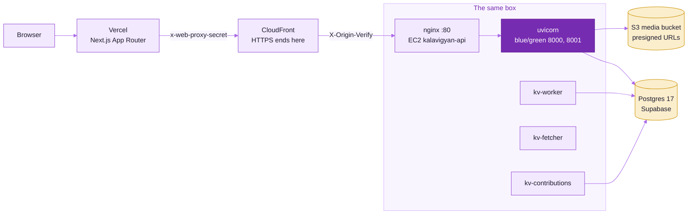
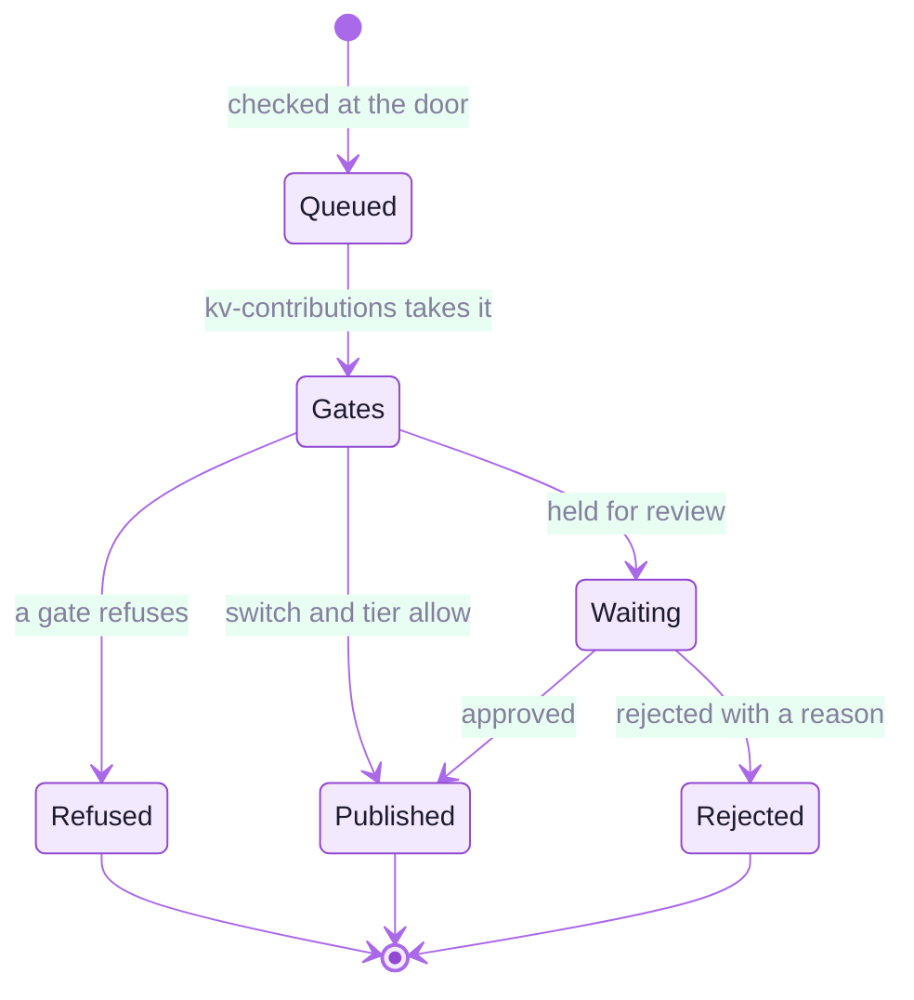
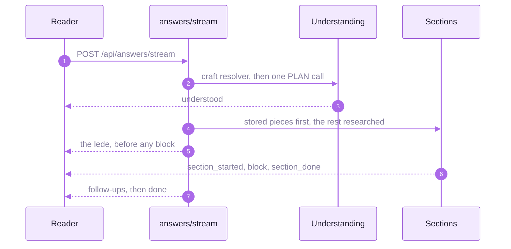
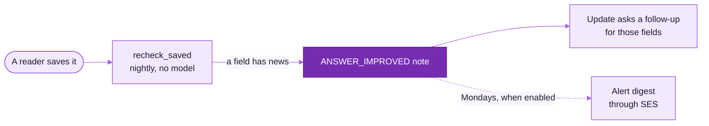
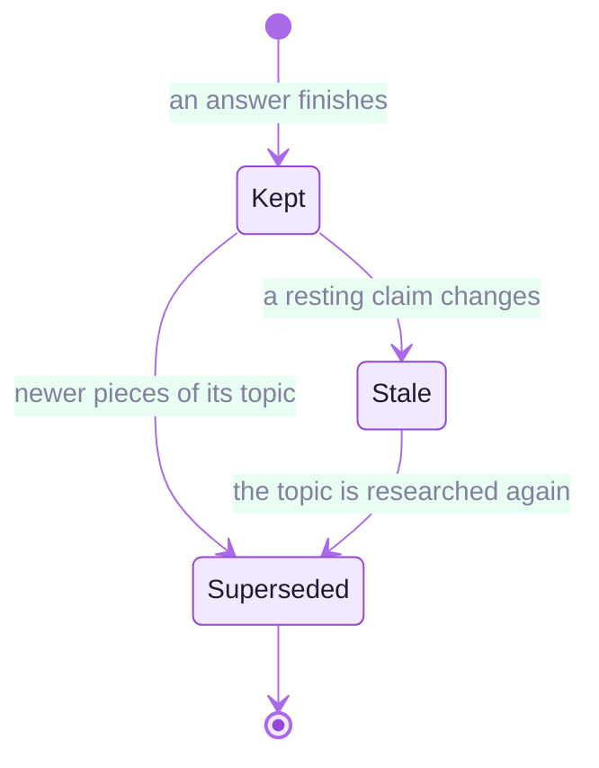
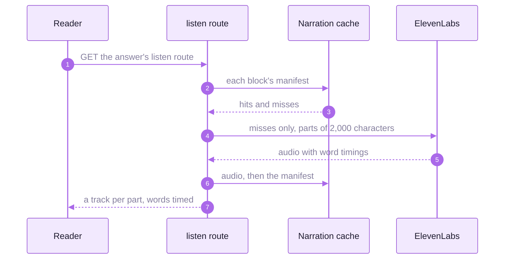
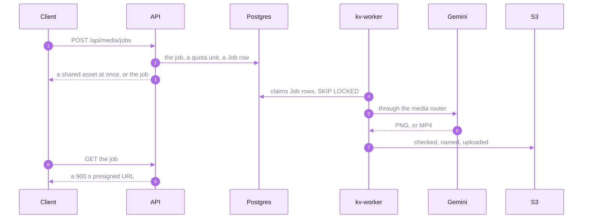

# Architecture

How KalaVigyan is put together today: the pieces, the layers inside the backend, the direction
imports may point, and the contracts between lanes. The target design is `docs/PLAN.md` (section
0 overrides the rest); this page describes what exists and is updated in the same change that
makes it untrue. Engineers read it before changing code; each interface's detail is its contract.

| For | Read |
|---|---|
| Ids, names, the deploy sequence and the box's units | [RUNBOOK.md](RUNBOOK.md) |
| What the box assumes from the code | [contracts/infra.md](contracts/infra.md) |
| The shared code this page names | [CORE_API.md](CORE_API.md) |
| Every interface between lanes | [contracts/README.md](contracts/README.md) |
| Why a placement is the way it is | [decisions/README.md](decisions/README.md) |
| Counts of tables, routes, tools and tests | [REPO_FACTS.md](REPO_FACTS.md), generated |

## Deployed pieces

| Hop | What runs there | Detail |
|---|---|---|
| Web | Vercel, Next.js App Router (`frontend/`) | `lib/server/apiProxy.ts` adds `x-web-proxy-secret` |
| Edge | CloudFront `d89rsltpszebp.cloudfront.net` | HTTPS ends here |
| Origin | nginx `:80` on EC2 `kalavigyan-api` (ap-south-1) | 403 without `X-Origin-Verify` |
| API | `uvicorn app.main:app` | blue/green on 8000/8001 |
| Database | Postgres 17 on Supabase | session pooler `:5432`, each process on the box within its own connection budget (`core/connection_budget`, decision 0163); vector, postgis, pg_trgm, unaccent, citext |
| Workers on the box | `kv-worker`, `kv-fetcher` and `kv-contributions` | the media queue (decision 0018), the daily voice upkeep (decision 0140), the daily sweep of score clips no manifest names and a heartbeat the media routes read (decision 0154), the fetcher sandbox (decision 0007) and the contribution queue's gates (round 7), as `docs/RUNBOOK.md` lists them under On the box |
| Logs | the CloudWatch agent on the box | each service's journal lines and nginx's access and error logs, shipped to the CloudWatch Logs groups `/kalavigyan/<service>` and kept 30 days (decision 0150, `docs/RUNBOOK.md` Logs) |

Media goes to the private S3 bucket through presigned URLs. Ids, names and the deploy sequence
are in `docs/RUNBOOK.md`; what the box assumes from the code is in `docs/contracts/infra.md`.

## Repository map

| Folder | What it holds |
|---|---|
| `backend/` | FastAPI API, SQLAlchemy models, Alembic migrations, tests (uv, Python 3.15; decision 0118) |
| `etl/crafts/` | Craft data pipeline: aliases, Wikidata links, seed claims. Reuses `backend/app/data/` (Python 3.15) |
| `etl/geo/` | Per-district environment statistics from open datasets (`geo_etl`), and `load.py` (Python 3.14 until exactextract publishes a cp315 wheel; decision 0118) |
| `frontend/` | Next.js web client (npm, Node 26) |
| `infra/` | Terraform, deploy scripts, systemd units, secret seeding, Supabase lockdown SQL |
| `shared/` | Files checked by more than one side (`craft-master.sha1`, the `*.golden.*` contract files) |
| `tools/` | Developer tooling: `hygiene_check.py` and the `hygiene` package; `repo_facts_build.py` and the `repo_facts` package, which write `docs/REPO_FACTS.md`; `curation/` (fetch, verify, check, schema and migrate for curated dossiers, decisions 0051 and 0095); `design/` and `design_tokens.py`, the design token generator that writes `frontend/app/tokens.css` and the skill's references (decision 0092); their tests |
| `docs/` | Plan, architecture, catalogue, contracts, decisions, debt, progress, runbook, data sources, the design boards, the contributors' terms, the generated repository facts and the README kit (`docs/README.md` is the index) |
| `.claude/skills/` | Practice skills (engineering, backend, frontend), naming, the frontend design system (`kalavigyan-design`), the contributor's method skills (`kalavigyan-craft-pages`, `kalavigyan-datasets`, `kalavigyan-interactives`), the vendored security audit, and the retired `motion` pointer |

## Backend layers

```mermaid
%%{init: {"theme":"base","fontFamily":"Inter, ui-sans-serif, system-ui, -apple-system, Segoe UI, Roboto, Helvetica, Arial, sans-serif","themeVariables":{"fontSize":"15px","primaryColor":"#F2E9FE","primaryTextColor":"#1E1B2E","primaryBorderColor":"#9148D2","secondaryColor":"#FAEECD","secondaryTextColor":"#1E1B2E","secondaryBorderColor":"#CD9200","tertiaryColor":"#F3F1FA","tertiaryTextColor":"#1E1B2E","tertiaryBorderColor":"#A7A3BC","mainBkg":"#F2E9FE","nodeBorder":"#9148D2","nodeTextColor":"#1E1B2E","lineColor":"#AA69E9","textColor":"#857F9E","edgeLabelBackground":"#F9F5FF","clusterBkg":"#F9F5FF","clusterBorder":"#D6B6FB","titleColor":"#762CB1"}}}%%
flowchart TD
  E["Entry points<br/>main.py, api/, scripts/"]
  subgraph Pipelines
    VO["voice/"]
    ME["media/"]
  end
  PR["Adapters<br/>providers/"]
  subgraph Domain
    SV["services/"]
    SC["schemas/"]
    SI["science/"]
    GE["geo/"]
  end
  PL["planner/"]
  CO["composer/"]
  RE["retrieval/"]
  SO["sources/"]
  FE["fetcher/"]
  CU["curation/"]
  RS["Contracts<br/>research/"]
  CR["Shared<br/>core/"]
  subgraph Foundation
    MO["models/"]
    DA["data/"]
  end
  E --> Pipelines --> PR --> Domain --> PL --> CO --> RE --> SO --> FE --> CU --> RS --> CR --> Foundation
  classDef accent fill:#762CB1,stroke:#5F1C93,color:#FFFFFF
  class RS accent
```

The diagram is the stack from the top down; the edges that may really be imported are below it.

| Layer | Package | What it holds |
|---|---|---|
| entry points | `main.py`, `api/` (`router.py`, `routes/<area>.py`), `scripts/` | the app, the HTTP routes, and the scripts (seeds, sync, coverage job) |
| voice | `voice/` | voice sessions, the custom-LLM turn, relay turns, the encrypted transcript, daily upkeep, agent provisioning (decision 0017; the call is switched off, decision 0035); Listen: narration of finished explainers with word timings, cached in the media bucket (0035), read by the Gemini voice by sentence when ElevenLabs cannot (0161); film mode's score: scenes, fixed prompts, content-addressed clips and a manifest per explainer and language (0058), made once under a lease and timed by the narration heard (0154) |
| media | `media/` | stage illustrations and clips: claim set, prompt, bundle, MP4 and PNG checks (a Gemini JPEG is converted to PNG, decision 0161), the job routes' steps, the kv-worker queue and its SQL, the page copy a shared asset is read from and the worker's heartbeat (decision 0154); `worker.py` runs it as kv-worker (decision 0018) |
| adapters | `providers/` | model adapters and their key checks, the model catalogue, AI router, spend rules and settings, the quota ledger, ElevenLabs |
| domain | `services/` | crafts, knowledge view, access roster, credentials, keys, routing, live-research write-back and the coverage job (decision 0011) |
| domain | `schemas/` | request and response bodies, and the science, region, voice and media contracts (decision 0014), which reuse `research/`'s shapes |
| domain | `science/` | the science engine: formulas, balancing, pint units, stage envelopes, the process view built from stored rows (decision 0015) |
| domain | `geo/` | the region profile and map layers: places, state aggregates, facets, the layer registry and its classes (decision 0016) |
| planner | `planner/` | plan call, facet coverage, parallel live search across the source adapters, dedupe, reading through the fetcher, open-access copies, cited DOIs and OpenAlex reference lists into an evidence pack (decisions 0009, 0181); the understanding step: craft choice, fields, seats (decision 0031) |
| composer | `composer/` | evidence pack to cited candidates, the COMPOSE call, the per-sentence post-checks, one regenerate (decision 0010) |
| retrieval | `retrieval/` | stored-knowledge search: craft-scoped claims and chunks, full text and pgvector fused by RRF, chunking and embedding fill |
| sources | `sources/` | external research sources: paced HTTP, record rules, one adapter per service (`sources/scholarly/`: OpenAlex, Crossref, ..., Zenodo, the open-copy locator and publisher full text, on one pace shared by every process; `sources/reference/`: Wikipedia, Wikidata, PubChem, Commons; `sources/web/`: SearXNG, Brave, the fallback; `sources/images/`: Openverse, the image sources and the Europe PMC figures), the fetcher client |
| fetcher | `fetcher/` | the separate kv-fetcher process: address-pinned https fetch (one client per host and address per fetch), RFC 9309 robots.txt, caps, trafilatura and pypdf extraction in killable parser processes (no DB, no AWS) |
| curation | `curation/` | curated craft dossiers: the model, the offline rules, the check file and the index, read by `tools/curation` and the importer; imports `research/`, `models/` and `data/` only (decision 0051) |
| contracts | `research/` | research and answering types, protocols, post-check rules; the explainer document, blocks, stored pieces and depth by role (decision 0030); dataset rows, rivers, the calendar words, reaction rules and the expert panel (decision 0042) |
| shared | `core/` | settings, db, security (passwords, tokens, secret keys), the managed key store, roles, deps, logging, rate limits and allowances shared by every process, each process's connection budget and the retries of a full pooler (decision 0163), India time, HTTP revalidation, work shielded from a leaving caller |
| foundation | `models/`, `data/` | ORM tables; vendored datasets and pure loaders |

The allowed import edges are the table `LAYER_IMPORTS` in `tools/hygiene/layers.py`, listed in
the project bindings (`.claude/skills/engineering-practices/references/project-bindings.md`).
The hygiene check fails on any other edge, including late imports inside functions, and on any
package under `backend/app` that has no row yet. Two placements are deliberate and recorded:
`core/deps.py` imports `models.User` because the current-user dependency returns the ORM row,
and the provider layer sits below `services/`: the model catalogue is `providers/catalogue`, the
AI spend settings `providers/spend_settings` and the key store `core/managed_keys`, so services
call providers (the key checks, the catalogue) and providers read no service (decision 0139,
which ended decision 0001's `providers -> services` edge). `schemas/` imports `research/` so the HTTP contracts reuse its citation, source
and sentence shapes (decision 0014). `science/` imports `schemas/` for the process contract's rules; since
`services/` may not import `schemas/`, `services/craft_process` reads the rows into
`science/records` and the route hands them to `science/process_view` (decision 0015). `geo/`
follows the same pattern: `services/region_records` and `services/map_layer_store` read rows
into `geo/records`, and the routes hand them to `geo/region_view` and `geo/layers` (decision
0016).
`services/` imports `curation/` so the dossier import reads the checker's own model and rules
(decision 0053); the craft page's response models live in `research/craft_page.py`,
`craft_page_process.py`, `craft_page_context.py`, `craft_chapters.py`, `craft_parts.py`,
`craft_masthead.py` and `craft_origins.py` so `services/craft_page` can build them, and the
editorial family labels and kind questions are vendored data (`data/craft_families.json`,
decision 0081). The page (schema version 3, decisions 0095 and 0098) is read once
(`craft_page_records`, `chapter_records.chapter_rows`), built purely by one module per chapter
(`services/chapter_<key>.py`) that reuses the answer builders' pure halves with fixed rules for
the model's choices, passed through one page ledger (`chapter_ledger`), and cached per craft and
variant under a stamp read in one statement (`craft_page_stamp`, `craft_page_snapshots`). No screen
draws the chapters: a curated craft's monograph document takes them as its structure
(`document_components.document_structure`), and the web reads the page's masthead, lede, record and
lists (decision 0162). A curated craft's document also lists, under each fact's own field, the facts
its dossier does not hold that no curated sentence or figure cites (`craft_page_unwritten.unwritten_facts`,
decision 0158).

## Students and artisans (decision 0083)

Six roles: Student 15, Artisan 18, Researcher 30, Professor 40, Admin 50, Master Admin 60. A
student gives an age band and gender at first entry (`StudentProfile`); an artisan gives one to
twelve crafts, a district, a spoken language and a credit (`ArtisanProfile`, `ArtisanCraft`).
Profiles are in tables of their own, read by `services/reader_profiles` and served only to the
account holder (`api/routes/profile.py`). The age band becomes a reading style appended to the
composer's system prompts; gender reaches no model. An artisan's conversation reuses the voice
backend under its own switch and routes; what the artisan says is drawn into
`ArtisanContribution` rows, reviewed by professors and admins, and only then written as a claim
of sensitivity `ATTRIBUTE_REQUIRED`, which every shared claim reader already refuses, so testimony
is shown only as the artisan's own words. Contract: `docs/contracts/roles-and-contributions.md`.

## API surface

All routes are under `/api` except `/health`, `/health/ready` and the OAuth discovery documents an
MCP client reads at the root (`oauth_well_known`: `/.well-known/oauth-protected-resource`, the same
with `/api/mcp` after it, and `/.well-known/oauth-authorization-server`; 404 while
`MCP_SERVER_ENABLED` is off; `docs/contracts/mcp-oauth.md`), so a proxy rule that passes only
`/api/*` and `/health` breaks every AI client's sign-in. Route groups (`api/routes/`):
`auth` (signing in, the session and the account's own Google link; it includes `auth_signup` and `password_links`, and reads `api/sign_in.py` for proving who signs in and `api/auth_session.py` for the session and access rules every auth route shares), `password_change` (change-password and the first-password nonce, decision 0028), `two_factor`, `me`, `access` (its roster's filters and sorts in `api/access_filters.py`, decision 0168), `users`, `crafts`, `film` (film mode's music and sound score, decision 0058), `knowledge`, `lessons` (lesson packs and their files, decision 0067), `explainer_exports` (an explainer version's PDF and citations, decision 0067), `listen` (an explainer read aloud, decision 0035), `map_districts` (ask the map, decision 0065), `map_layers`, `media`, `profile` (a student's and an artisan's first-entry profile, the artisan recording notice and its consent, and the public district list, decision 0083), `artisan_conversations` (an artisan's conversation with KalaVigyan, 404 while `ARTISAN_CONVERSATION_ENABLED` is off), `artisan_contributions` (an artisan's own conversations and contributions, and withdrawal), `testimony_review` (the review queue for artisan testimony), `public` (the landing's summary, decision 0079), `rivers` (a basin's river lines as TopoJSON, decision 0043), `secrets`,
`settings`, `terms` (a glossary term's cited summary, decision 0034), `usage`, `voice` (404 throughout while `VOICE_CALL_ENABLED` is off, decision 0035). Every route module and its operation count, these and the ones added since, is generated in `docs/REPO_FACTS.md`. Shapes, headers and error forms are in `docs/contracts/backend.md`; the web client's
side is `docs/contracts/frontend.md`. `GET /api/crafts/{slug}/page` (in `crafts`) answers the whole craft page from stored rows: the
curated overview and facts and All evidence (`docs/contracts/craft-page.md`, decision 0053);
`GET /api/categories` and `/api/categories/{slug}` (in `categories`, public reading) answer the
nine categories and a category's curated master page (`docs/contracts/category-page.md`, decision
0078); a craft's stages, materials, conditions and reactions are the process view the answer
builders read from stored rows (`docs/contracts/science.md`), served by no route since decision 0145;
`GET /api/crafts/{slug}/region` its places and each place's headline values (decision 0153), and `GET /api/map/layers` and
`/api/map/layers/{layer}` (in `map_layers`) the district choropleths, all from the stored
district statistics (`docs/contracts/region.md`). `GET /api/map/districts/{districtLgd}` (in
`map_districts`, ask the map, decision 0065) answers a tapped district's located crafts, its
stored region story and place prose pieces and its land values, with no model call
(`docs/contracts/learning.md`). `GET /api/public/summary` (in `public`) answers the landing's live
counts, featured curated crafts, specimen sentence and map points, cached a day.

Public reading (decisions 0079 and 0097): every read except asking (crafts, categories, map,
science, compare, field transcripts and photographs, shared answers and lessons, the public
summary) takes `api/public_deps.public_reader`, or `public_asset_reader` for long-cached assets
(both built on `core/deps.get_optional_user`), instead of the signed-in dependency. Without a
session the reader is read as the lowest role, counted against a per-address limit (assets in a
bucket of their own) and answered `public, max-age=300`; a session still gets its role-scoped answer,
`private, no-cache`; every read varies on `Authorization` and carries an ETag. Every other route
needs a session and carries a reason class (asking, own records, admin, consent) in
`tests/public/test_route_inventory.py`, which checks each one answers 401 anonymously.

## How a contribution reaches the knowledge (round 7)

Every new fact, whatever its origin, is a candidate: the site, the Knowledge API, an agent on the MCP
server (`POST /api/mcp`, decisions 0103 and 0111) and the research write-back take one path
(`docs/contracts/knowledge-writes.md`). A proposed fact is checked at the door for its shape, its
subject, its idempotency key and the hour's allowance, stored `QUEUED` and answered at once with a
ticket; the contribution worker `kv-contributions` then runs the four gates in order (QUOTES, SOURCE,
DUPLICATE, NOVELTY) off the request. The review switch (`knowledge.review_switch`, per origin) and
the contributor's trust tier decide whether a fact that passed goes live at once or waits in the
review queue for a Professor or Admin (`docs/contracts/review-queue.md`). An agent signs in with
OAuth 2.1 (`docs/contracts/mcp-oauth.md`); open work, reservations and the method served over MCP
are `docs/contracts/open-work.md`. The research write-back asks the worker's judge ladder, cheapest
model first (`providers/judge_routes.thrifty_judges`, decision 0169), and a write-back the filing
ladder cannot place waits for a reviewer, who may file it under a craft or a family's science
(decision 0159). Beside facts the queue holds a process stage an answer found (`STAGES`, decision
0167), a reading outside its stage's usual range (`READINGS`) and a proposed map layer (`LAYERS`,
decision 0169); an approved glossary term or reaction writes its shared `Term` or `Reaction` row at
once (decision 0162).

## How a question is answered today

1. `POST /api/answers/stream` (`api/routes/knowledge.py`) takes the reader's depth (default the
   role's: Student Basic, Researcher and Professor Detailed, Admin and Master Admin Expert; any
   known role may choose any depth) and the per-user ask rate limit (none for a Master Admin),
   builds the answer pipeline with the asker's principal and one per-answer spend record (so a
   depth's per-answer cap, a per-role daily cap and a monthly ceiling apply when set, none of them
   to a Master Admin; none is set for now, decision 0093) and
   streams `services/answering.answer_question` through `research/stream.event_stream`, which
   sends each event as it is produced and a heartbeat after 60 s of silence (decisions 0012,
   0031).
2. The question is understood (`planner/understanding.ModelUnderstander`, decision 0031): the
   craft resolver (`services/craft_resolver.DatabaseCraftResolver`, decision 0004: the slug when
   the reader picked one, otherwise exact, fuzzy, family and region matching over every craft's
   names, aliases and spellings, and pgvector neighbours when that leaves no clear winner), then
   one call on the `UNDERSTAND` route (decision 0146) for the choice among ambiguous candidates, crafts named but not matched, the
   fields the question touches, which of them it asks itself (`asked`, decision 0165), and the
   experts to seat. A craft is never required: the best match
   proceeds and the others are offered, nothing found is any craft, and a resolver failure leaves
   the choice to the model's reply (decision 0038). `understood` is the first event; past a set degrade mark Expert runs as Detailed for every role but Master Admin (no mark is set for now, decision 0093).
3. When that call is refused for spend, the chosen craft's verified and reviewed claims are
   sent as explainer sections, one `prose` block per concept heading (`knowledge_view.claims_for`,
   `services/stored_explainer`; a heading that is a field's label takes the field's fallback
   heading, decision 0077); no model is called for a Latin-script question.
4. Otherwise the answer is an explainer of sections, one per field the question touches (at most
   the depth's number), read in the order the question needs: the fields its words ask about
   first, the full process last unless it asks how the craft is made (`sections.question_order`,
   decision 0077). It opens with a lede (`services/answer_lede`): the question as its headline and
   two or three cited sentences that answer it, composed from the craft's stored claims ranked for
   the question while the sections research, held to the prose checks, and sent before any block;
   the same call heads the reused sections and names what the answer leaves open. Each section
   starts under a fallback heading that names the craft and takes the heading its reply writes
   once it is checked (`section_heading`). First the stored knowledge pieces (decision 0033, `services/piece_store`):
   for each field whose topic (`research/piece_topics`: the glossary terms the question names, else
   the craft's districts for place fields, else the craft) holds a set of pieces that is deep
   enough, not stale or superseded, and whose claims are all still visible as cited (and whose
   ladder still matches the process rows), that section streams first, marked "From earlier
   research" with its date, and is not researched; `fresh` (Research again) and any-craft answers
   reuse nothing. The other sections are started at once and run in parallel while the lede is
   written (`services/answer_sections`, decisions 0032 and 0077). Each section
   researches its own field within its share of the depth's budget (Basic and Detailed `HYBRID`,
   Expert `DEEP`), the budget going first to the fields the question asks that the craft holds
   fewer than three facts in, which start first and research fresh, and a field the question
   did not ask writing half the sentences (`services/section_fields`, decision 0138); one read
   per document per answer (`planner/reading.ReadCache`): the planner (decision 0009) plans facets and queries for that field and its
   experts (each seat speaking to the field is named with the kinds of source it reads, and those
   kinds take every other early read; decision 0046), searches stored claims (every craft's, for any craft) and, for what they do not cover
   (every facet in `DEEP`), scholarly, reference and web sources, and reads the best documents (a
   closed DOI from the publisher that holds it, decision 0167),
   streaming each source to the trail as it is found and read. The composer (decision 0010) writes
   the section's cited sentences from stored claims, stored passages (decision 0144) and read
   documents and chooses process stages (Claude Sonnet first, Gemini next); before its regenerate,
   a failing sentence's quotes in an Indian script are read once in English, and a sentence naming
   KalaVigyan's internals fails (decision 0167); what was found is kept
   (`store_live_research`, decision 0011, run as shielded work that finishes even when the learner
   leaves; a sentence citing a stored passage becomes a fact of that passage's source); the server then builds the section's blocks from stored rows and
   stored citations (a process ladder from the science tables, `science/ladder`; a prose block),
   checks each and drops one that fails, marks the glossary terms in each English sentence, and
   sends each block with its sources first, then the section's pictures (decision 0039). A section
   whose stored claims compose nothing researches live once more, and a sentence its write-back
   could not keep is rewritten once from stored claims (`services/section_rewrite`). Passages
   about another craft or a place abroad are not offered to the composer outside a comparison
   (`services/off_question`, decision 0138). `section_started`,
   `section_state`, `block` and `section_done` mark each section; `status` the overall step.
5. Another answer language (decision 0023): each block is still composed and checked in
   English; `services/answer_translation.translated_block` then translates it in one `TRANSLATE`
   call, keeps a translation only when its numbers, formulas, units and script check out and its
   English reading (one more `TRANSLATE` call, `composer/translation_meaning`) still says what the
   English says (else the sentence stays English), copies the citations, and caches claim
   translations in `ClaimTranslation` (decision 0157). The fixed words around it (a stored answer's
   headings and follow-ups, the status lines, the essay's rail and actions, voice's phrases) come
   from the reviewed entries of `backend/app/data/interface_words/` and are English where none is
   reviewed. The planner adds native-language Wikipedia and Wikidata queries and
   searches stored claims with an English rendering of the question.
6. Follow-ups are the questions the lede and the sections say the sources leave open, then one
   per field the question touched that the answer did not show (`follow_ups.left_open`).
   Nothing cited: each section says what it searched and `not_enough_evidence` sums it up; any
   failure of the whole answer is one `error`; `done` always ends the stream. The explainer
   document is kept in `Answer.payload.explainer` and the plans in `Answer.plan`; an answer that
   stops before it finishes (a cancelled stream, a failed research, a lost version) keeps its row,
   marked `Answer.stoppedAt` (decision 0167).
7. A follow-up (`buildsOn`, decision 0063) is the same flow with a layout
   (`services/follow_ups`): the explainer's crafts, depth and language are kept, a field it has
   deepens that section (blocks numbered after its own, already-cited sentences left out, a
   block it shows already left out by its identity or, for kinds without one, by its kind; never
   reused from or stored as pieces) and any other field is added after its sections; `builds_on`
   follows `understood`. `services/version_merge` merges the follow-up into the latest version,
   `version_problems` must hold, and the merged document is kept on the follow-up's answer with
   its `VersionMark` (`Answer.explainerId`, `explainerVersion`); `version` precedes `done`. A
   follow-up that finds the version taken meanwhile is merged again onto the newer one, its
   blocks renumbered (`services/version_race`), and the web opens that stored version once the
   stream is done (decision 0160). Earlier versions are never rewritten.

## How a saved explainer gets better (decision 0063)

1. A reader saves an explainer (`SavedItem` with its first answer). Every night the last module of
   the Coverage enrichment job, `app.scripts.recheck_saved`, counts per saved field (each field a
   claim is filed under) the craft's fact-level claims created or raised since the last check that
   the latest version does not cite,
   and writes one `ANSWER_IMPROVED` note when any field has news; no model is called.
2. The note's Update asks a follow-up for the fields with news, as the reader and under the
   reader's caps. On Mondays the **Alert digest** workflow mails opted-in readers their unread
   notes through SES, only while `ALERT_DIGEST_ENABLED` is set.

## How a lesson pack and its files are made (decision 0067)

1. A Professor or above chooses finished sections of one version of their explainer. The server
   builds the pack from the stored version with no model: the sections' cited fact sentences whose
   claims are still shown, five a slide, each section's first open picture, the quiz by the one
   `quiz_block`, the reading list and sources, and stores it as a `LessonPack` row.
2. A file (HTML deck, PPTX or PDF, or an explainer version's PDF) is asked for by format. The
   route reads the pack or version and its sources' access days, releases its connection, and
   looks for `exports/<builder>/<sha256>/<name>` in the private bucket; only when it is missing
   are the open pictures read from Commons or Openverse, then the APA references written by
   citeproc-py with the vendored APA 7 style and the file rendered, both in one worker thread
   (reveal.js, python-pptx, fpdf2 with HarfBuzz and the Noto fonts), and stored. The export
   libraries are imported on the first file a process makes, never at start-up, and a version is
   read with its hidden generated explainers left out (decision 0070). The answer is a five-minute
   signed link; citation files are answered directly. The files a share link's readers are given
   are recorded against its token (`SharedExportFile`) and deleted from the bucket when the share
   stops (`services/shared_files`, decision 0155).

## How stored pieces stay current (decision 0033)

1. When an answer finishes, every English block of each researched section that cites claims and
   sources is kept as a `KnowledgePiece` (its facet, topic, depth, claims, sources, content hash,
   vector), superseding the earlier pieces of that topic and kind at the same or a lower depth.
   Its vector carries the embedding model's stamp (`KnowledgePiece.embeddingModel`); a piece of
   another stamp is embedded again, and reuse compares only vectors of the route's model (decision
   0166). Stage concepts a `PROCESS` section cites stay concepts: no answer writes process rows,
   since no source states their order (decision 0038); a Professor may place such a stage into its
   craft's process from the review queue (`STAGES`, decision 0167).
2. A trigger on `Claim` (`kv_stale_resting_pieces`) marks every piece resting on a claim stale when
   it is retracted, hidden, deleted, or changes level or text; the next answer for that topic
   researches the section again and its new pieces supersede the stale ones.
3. No nightly run rebuilds pieces: since commit fdf478c the Coverage enrichment run no longer
   researches crafts or rebuilds pieces (`docs/RUNBOOK.md`, Deploy), so a stale piece is researched
   again when the next answer for its topic needs it.

## How an explainer is read aloud (Listen, decision 0035)

1. `GET /api/answers/{answerId}/listen` (`api/routes/listen.py`) checks `VOICE` and reads the
   reader's own explainer from `Answer.payload.explainer` (`voice/listen_store.py`); the limit of
   30 in 10 minutes counts only asks that start a making (`api/listen_deps.making_admission`).
2. `voice/narration.py` picks each block's shown sentences, hypotheses left unread, in reading
   order and each in its own language, so a quantities sentence the answer already said is read
   once (decision 0168), and the cache id per block (piece content hash, model, voice, language).
   `voice/narration_cache.py` reads each block's manifest from `media/narration/<cacheId>/`.
3. For the misses only, `voice/listen_making.py` takes each block's lease in the bucket
   (`voice/object_lease.py`, shared with the film score; a block another request is making is not
   paid again), holds the estimated `VOICE_SECONDS` for every block it leased under the reader's
   `User` row lock (429 when too few are left), and makes them three parts at a time in the API
   process (`core/shielded.ShieldedWork`), the first block first, renewing each lease every 30 s:
   it asks `ElevenLabs.narration` (`/with-timestamps`, `eleven_v4`, each square bracket sent as a
   parenthesis, decision 0161) for each part of at most 2,000 characters, stores the audio and then
   the manifest, and settles the hold to the audio's seconds once every block is made or failed.
4. The request waits only for the first block (the lede of a whole answer): the answer is one track
   per part of the blocks narrated so far, a one-hour presigned link and the words with their times,
   and `pending`, the blocks still being made, with `pollAfterSeconds`; the dock and the film play
   the first block while they ask again for the rest with the same voice
   (`frontend/components/answer/useListenScript.ts`, `frontend/lib/listen.ts`; decision 0176).
5. When ElevenLabs is not offered (no key, or its probe fails) or fails while making the audio,
   the same steps run with the Gemini voice (`voice/listen_voices.py`, `providers/gemini_media.py`
   `read_aloud`): a sentence per request, the WAVs joined per part and timed by sentence, its own
   cache, lease and hold; the script names the voice and the UI highlights the sentence being read
   (decision 0161).

## How a film gets its score (decision 0058)

1. `GET /api/answers/{answerId}/film-score?language=` (`api/routes/film.py`) checks `VOICE` and
   the 10-ask limit (Master Admin unlimited) and reads the reader's own explainer with hidden
   simulations marked, in one short session (`voice/film_store.py`).
2. `voice/film_scenes.py` makes the scenes (the lede first when the answer has one, then the drawn
   blocks in reading order, timed by the narration Listen stored for the reader's voice and
   language when every spoken block has one, else by their narration estimate or
   `FILM_SCENE_SECONDS`), their hash, the bed length and the cues the fixed table of
   `voice/score_prompts.py` names for each scene's stored facet (`film-score/v2`, decision 0154). A
   manifest at `media/score/<answerId>/<language>/score.json` whose hash matches is served at once.
3. Otherwise the score is made once, under a lease in the bucket (`voice/object_lease.py`, 600 s):
   the route waits 45 s and answers 202 `FilmScoreMaking` while the making runs or another ask holds
   it, and the client asks again (decision 0154). `voice/film_score.py` looks up each clip by its
   content address
   (`media/score/<cacheId>/clip.json`) and makes only the missing ones, three at a time, through
   `providers/media_router.MediaRouter` (`MUSIC`, `SOUND_EFFECT`: reserve, ElevenLabs through
   `providers/elevenlabs_media.py`, settle), checks each MP3's length, stores clip and record,
   then the manifest. Any failure stores no manifest. The work runs shielded, so a reader who
   leaves still fills the cache.
4. The answer is `FilmScore`: one-hour presigned links to the bed and cues, labelled with the
   models that made them.

## How a voice call is answered

The call is switched off (`VOICE_CALL_ENABLED`, default false; decision 0035): every route below
answers 404 and no voice button is drawn. The steps hold when the setting is true.

1. `POST /api/voice/session` (`api/routes/voice.py`, `voice/sessions.py`) checks capability, a
   verified email, the voice notice consent, the craft, configuration, one live call per user, the
   day's `VOICE_SECONDS` and the platform's live calls, creates the `VoiceSession` and its `VOICE`
   `Conversation`, and loads the craft's claim pack into the process (`voice/pack.py`). `RELAY`
   answers the recording limits; `AGENT` fetches an ElevenLabs conversation token, binds the
   conversation id to the row with a stored nonce hash (decision 0017) and holds the call's whole
   length in the quota ledger (decision 0022). The user's ended agent calls are reconciled first.
2. `AGENT`: ElevenLabs calls `POST /api/voice/llm/v1/chat/completions` with the bearer and the
   conversation id header; `voice/agent_turn.py` finds and checks the bound row, ends the call at
   its length or turn cap, and `voice/llm.py` streams the turn.
   `RELAY`: the browser uploads each recording to `POST /api/voice/session/{id}/turns`;
   `voice/audio.py` measures it, `voice/relay.py` claims the turn under the session row's lock
   (a minute held, one of 40 turns), runs speech to text, writes back the unheard part, then the
   turn and text to speech, and streams the turn events.
3. A turn (`voice/turns.py`) ranks the pack's claims by the stored hybrid search, then by shared
   words, against the scrubbed question (rendered in
   English first when it is not in Latin script), speaks stored claims (`VERIFIED`) or makes one
   checked `VOICE_TURN` compose (`HYBRID`) from the ranked claims and the stored passages its
   reader may read, writing back each sentence citing a passage before it is spoken
   (`voice/passage_store.py`, decision 0144), translates what it will say into the session language
   (`answer_translation.translated_sentences`, decision 0025), and saves the turn to the encrypted
   transcript with an `Answer` row and its seconds in one transaction.
4. Every day `kv-worker` (`app/worker.py`, `voice/daily_upkeep.py`) closes calls left open, purges
   transcripts after 30 days and reconciles agent calls with ElevenLabs in both directions (refund or
   charge), once when it starts and every 24 hours after.

## How a stage illustration is made

1. `POST /api/media/jobs` (`api/routes/media.py`, `media/jobs.py`) checks the capability, answers a
   repeated key, derives the stage's claim set from stored rows (`media/rows.py`,
   `media/claim_set.py`), builds the versioned prompt and its hash, answers a shared asset with the
   same hash at once, else holds the first route's estimate (`providers/media_router.py`) and, in
   one transaction under a per-user lock, writes the job, one quota unit and a `Job` row.
2. `kv-worker` (`app/worker.py`, `media/queue.py`) claims `Job` rows per queue (4 images, 2 videos)
   with `SKIP LOCKED`; `media/runner.py` opens the HMAC bundle, releases the hold, calls Gemini
   through the media router (one reservation per call, the Interactions API in
   `providers/gemini_media.py`), checks the PNG (a JPEG is converted to PNG, decision 0161) or strips
   the MP4's audio, names the file
   (`services/naming.py`), uploads it to the private bucket (`services/object_store.py`) and stores
   the labelled asset, or retries, or ends the job with a refund.
3. `GET /api/media/jobs/{id}` answers the requester with a fresh 900 s presigned URL.
4. On success the worker also writes a copy free of the requester (`media/craft/<sha256>/<fileName>`,
   `MediaAsset.pageKey`) and shares the asset unless it depicts a named cluster, which the craft
   page shows only after two professors' sign-off; shared assets join their craft's chapters as
   `ai_media` and are read at `GET /api/crafts/media/{assetId}`. The worker writes its heartbeat
   every minute, and the media routes offer no kind and queue no job once it has been silent more
   than five minutes (decision 0154).

## How pictures and terms are found

1. Pictures (decision 0034): `services/section_images.SectionImages` takes a section's block id,
   its craft and the claims its other blocks cite, searches Wikimedia Commons, Openverse (open
   licences only) and SearXNG images (`sources/images/registry.image_sources`, held by
   `LiveSourcesStore.images()`), with Brave's image search when SearXNG finds fewer than two cards
   or fails (`LiveSourcesStore.web_images`), keeps the pictures whose words meet a claim's
   (`research/image_relevance`), stores each once as a `MediaRef` with its claims
   (`services/media_ref_store`) and answers an `images` block: inline under an open licence with
   its author, else a credited link card whose thumbnail the page's own site serves, a site being
   a registrable name by the vendored Public Suffix List (decision 0166). The answer
   stream calls it for every section with blocks, researched or reused, and for the stored-only
   answer, after those blocks are built (`services/section_enrichment`, decision 0039): the
   pictures already stored for the cited claims first, a search only when none is (decision
   0166); each service has 6 s, the step 8 s, and a failure or timeout sends no `images` block
   and leaves the section ready.
2. Terms: `seed_claims` also seeds the `Term` glossary (`services/term_glossary.seed_terms`) from
   craft names, aliases and matched Wikidata labels, the seed's local names with what they mean
   (with the meanings `data/local_term_meanings.json` cites), and its compounds, and removes the
   links its plan no longer makes (decision 0166). `research/term_marking.TermMarker` marks term spans in sentences against an
   answer's glossary (`glossary_entries`): every English sentence of a section's blocks, before
   translation; a translated sentence keeps a span where it shows the span's text, the term's
   rendering or another of its names in any script as a whole word (decisions 0039, 0166 and
   0167). `GET /api/terms/{key}?language=` (`api/routes/terms.py`)
   answers `services/term_summaries.TermLookup.summary`: the cached summary while its claims are
   visible (a researched one for 180 days, decision 0166), else the defining stored claims, the
   Wikipedia lead or one web search with a
   `SUMMARISE` call, kept as quoted claims and cached per term and language.
3. Later blocks (decision 0042): `services/block_builders.BLOCK_BUILDERS` maps a block kind to the
   fields it may be added to, listed in the order a section reads its blocks (`PIECE_BLOCK_ORDER`).
   A researched section with a checked prose or ladder block starts its field's builders together
   with its pictures; their blocks go out after the section's own and before the pictures, each
   builder bounded by its wait, and a failing builder adds nothing. A reused section starts every
   builder of its field whose kind it does not already show, and those marked `rebuilt_on_reuse`
   (the generated explainer and the expert panel only at Expert), over its placed pieces re-marked
   with the answer's glossary, all reused sections at once; a rebuilt reaction player takes the
   stored one's place; a reused process section without a stored ladder is led by one built from
   its stored stages; one answer builds each craft-level story once; at Expert a curated section is
   the floor its field is researched on, and a group an answer made is reused before the curated
   pieces, which no answer supersedes (`services/reuse_enrichment`, decision 0090). Builders implement `services/builder_interface`; only kinds already
   built start, and every phase B kind is built. The matter
   builders (`services/matter_builders`, decision 0045) read the craft's matter in one short
   session (`services/craft_matter`), then add the reaction player (the Process tab's reactions,
   re-checked against the rows), material cards (stored rows and glossary terms, one plan-model
   call sorting stored claims into facts and handling) and one molecule whose 3D conformer the
   PubChem adapter fetched once into the private bucket (`services/molecule_conformers`), served
   to signed-in readers by `GET /api/molecules/{pubchemCid}/conformer`, which releases its
   database connection before the bucket and PubChem (decision 0050). The place builders
   (`services/place_builders`, decision 0044) read a craft's cited districts in one short session
   (`services/place_offers`): a geography section's region story offers the rivers crossing them
   (those its statements name first, then by stream order and discharge, traced through the stored
   network and named from the vendored river names, decision 0153), the districts and the
   layers with values there, and one plan-model call chooses a river, the stored claims for its
   steps (the section's, and a few of the craft's own place claims) and their order by ref, a step
   keeping its district only when its sentence names it by its register name or another name
   sources use; it is kept as a cross-craft piece by basin or by its districts' codes
   (`KnowledgePiece.districtLgds`) and reused with its geography section
   (`services/region_pieces`), and the builder first places the newest current story of the
   craft's basins or districts with no model call (`piece_reuse.usable_region_stories`, decision
   0160). Geology and climate sections get the registry layer whose glossary term their sentences
   carry (`geo/layer_terms.json`, decision 0160), built as the layer route answers it. Climate sections also
   get a seasons strip (their district's CHIRPS rainfall alone when no fact names a month,
   decision 0138), the trends of the craft's districts with the section's cited claims on
   what they mean (`services/climate_risk`, decision 0065), and materials sections a supply map (`services/season_supply_builders`,
   decision 0047): the craft's stages and the section's claims placed only on the months or season
   their own text names, a season given months only by a cited quote that states them, the CHIRPS
   rainfall of the first craft district with twelve normals; supply links whose material and
   origin words one plan-model call chose and the sentence states, an origin that is one register
   district pinned by the register (decision 0160) and any other placed only with Wikidata
   coordinates the Wikidata adapter reads. The expert panel
   (`services/expert_views`, decision 0046) makes one `COMPOSE` call per section for the seats
   speaking to its field (`research/expert_panel.speaking_seats`), over the stored facts the
   section's checked sentences rest on; a take passes the prose checks (which also refuse a month,
   season, state or district no source states, `services/stated_names`), after one retake of a
   failing take while the wait allows (`services/expert_seat_takes`, decision 0156), or is not
   shown, "Experts differ" is kept only for two stored facts about one subject (one concept, or two
   concepts one glossary term links, `services/expert_subjects`) from two sources and not when the
   page already said both readings (decision 0165), a reused panel
   keeps only the seats the new answer seats (`research/piece_reuse.seated_pieces`), and the calls
   spend only from the answer's headroom (`providers/budget.AnswerHeadroom`).
   Sections of the mechanism fields also get a generated explainer (`services/simulation_builder`,
   decision 0055; built since the review, decision 0061): every figure
   the section's cited quotes state is offered with its own words; a stored explainer whose claims
   the section offers is placed first with no model call; otherwise one `COMPOSE` call from the
   headroom chooses values and writes an HTML fragment that must pass the value, static
   (`research/sandbox`) and block checks, with one redraft, all within a 60 s budget, and no call
   at all when the section's facts state no quantity it can draw (dataset rows of the datasets the
   section's blocks cite are offered beside the quoted figures, decision 0142); each builder's
   outcome and time is recorded under the answer's `plan.builds` (`services/builder_record`);
   it is kept as a cross-craft piece by
   concept and claim set from any section (also an any-craft answer and a deepened follow-up), and
   a professor's hide (`PUT /api/answers/{answerId}/simulations/{blockId}/hidden`) keeps it from
   being served or built again; every route that reads a stored explainer back marks it hidden.
   Process, chemistry and water sections also get a what-if (`services/what_if_builder`, decision
   0056; built since decision 0061): a stage's materials that a
   stored contrast relation (a curated alternative is one, decision 0169) or a stored text
   ("madder or al root") relates as alternatives, once a
   section sentence names one, each offered the relation claims on its concept (a hypothesis
   marked and later labelled), its own fact claims and the claims of reactions of its compound;
   after the process rows and one short read of those claims, one plan-model call chooses the
   input, its words and each option's outcomes by ref; an option without evidence is shown
   unknown, and the block is re-checked against the process rows when built and when reused.
   Materials sections also get a powers-of-ten zoom and history sections a timeline map
   (`services/journey_builders`, decision 0057), registered and waiting for their renderers to
   join the built kinds: the zoom reads the craft's mapped districts, the boundary row, the craft's
   claims naming a district and the open pictures already kept for the offered claims in one short
   session, searches Commons and Openverse only for levels still missing, keeps what it shows as
   `MediaRef` rows and shows the molecule only with a kept conformer, every level captioned by a
   distinct stored claim and none faked; the timeline offers the section's facts with the spans of
   years their own texts state, one plan-model call picks points, routes and years by ref, and
   places are pinned only with Wikidata coordinates through the supply origins' rule.
   The web client draws each block kind through one renderer
   (`components/answer/blockRenderers.ts`); a kind without one is not drawn.

## Data

```mermaid
%%{init: {"theme":"base","fontFamily":"Inter, ui-sans-serif, system-ui, -apple-system, Segoe UI, Roboto, Helvetica, Arial, sans-serif","themeVariables":{"fontSize":"15px","primaryColor":"#F2E9FE","primaryTextColor":"#1E1B2E","primaryBorderColor":"#9148D2","secondaryColor":"#FAEECD","secondaryTextColor":"#1E1B2E","secondaryBorderColor":"#CD9200","tertiaryColor":"#F3F1FA","tertiaryTextColor":"#1E1B2E","tertiaryBorderColor":"#A7A3BC","mainBkg":"#F2E9FE","nodeBorder":"#9148D2","nodeTextColor":"#1E1B2E","lineColor":"#AA69E9","textColor":"#857F9E","edgeLabelBackground":"#F9F5FF","clusterBkg":"#F9F5FF","clusterBorder":"#D6B6FB","titleColor":"#762CB1"}}}%%
flowchart LR
  M["alembic upgrade head"] --> SE["seed_crafts, seed_claims,<br/>seed_districts"]
  SE --> IC["import_curation<br/>dossiers, then categories"]
  IC --> SP["sync_portal_crafts"]
  SP --> EM["embed_craft_descriptors,<br/>embed_knowledge"]
  EM --> RP["rebuild_stale_pages"]
  classDef accent fill:#762CB1,stroke:#5F1C93,color:#FFFFFF
  class IC accent
```

Every deploy runs these in order while the old colour serves (`docs/RUNBOOK.md`, Deploy).

Tables follow DR's Prisma naming (quoted PascalCase tables, camelCase columns) so the portals
stay mergeable; the full list is `backend/app/models/` and `backend/migrations/versions/`.
Craft data is vendored from the designer portal (`docs/contracts/crafts.md`); district and
environment data come from open datasets (`docs/contracts/geo.md`, `docs/DATA_SOURCES.md`).
Seeds (`app/scripts/seed_crafts`, `seed_claims`, `seed_districts`) run on every deploy and are
idempotent; right after them `app/scripts/import_curation` imports every checked dossier of
`backend/app/data/curation/` into the same tables, withdraws the seed's edge sentences,
supersedes claims a new dossier version drops (decision 0053), leaves alone a craft whose file
lacks structure a reviewer approved in the database (`BEHIND`, decision 0171) and retires the seed claims and seed
process of every curated craft (superseded and archived, never deleted; `seed_claims` retires them
too, decision 0142), then every checked category
dossier of `curation/categories/`, keyed to its category (decision 0078). `seed_claims` also runs the science seed (`app/data/science_seed.json`: constants,
materials, compounds, reactions, readings; decision 0015); `app/scripts/link_compounds` looks
the seeded compounds up in PubChem, nightly in the Coverage enrichment run (decision 0045). After them, `app/scripts/sync_portal_crafts` adds every craft the two portals hold
beyond the master list, with their aliases, spellings and merge redirects, through the signed
peer route of `docs/contracts/portal-craft-feed.md`; it also runs daily (decision 0003).
The transcripts and craft images of both portals come the same way, through the field voices
routes (`docs/contracts/field-voices.md`, decisions 0084 and 0091): `app/scripts/sync_field_voices`
(daily, `.github/workflows/field-voices-sync.yml`, behind `FIELD_VOICES_ENABLED`) reads each
portal's two streams by cursor, applies tombstones, stores each recording as a `FIELD_TESTIMONY`
source with `PUBLIC` quote chunks and `PUBLIC` transcript windows of kind `WINDOW` (decision 0179),
and each image as a credited
`MediaRef` over a metadata-free copy in the media bucket, linked to the claims its caption and
labels name, never beside a sentence while held. Field quote chunks join stored-knowledge
retrieval and can be cited as field interviews; the craft page carries them as `voices` and
`fieldPhotos`. A recording that is withdrawn, hidden or not heard from in 7 days leaves every read
at once: its chunks, the claims that rest on it alone (`retrieval/field_scope`), and the sentences
of stored explainers that cite it (`services/field_voices_readback`), and a section cut short this
way says so (decision 0156).
Then `app/scripts/embed_craft_descriptors` fills missing craft name-and-alias vectors for the
resolver; the daily Coverage enrichment run fills them first too (decision 0016). The region
routes read the geo ETL's per-district statistics and the state series every geo load and
district seed stores in `StateEnvValue`, and send each place's headline values; nothing
environmental is queried live (decisions 0016 and 0153). River lines (decision 0043) are
HydroRIVERS reaches the geo ETL loads into `RiverReach`, `RiverBasin` and `RiverReachDistrict`
(the districts each reach crosses and where it enters them, computed once in the ETL) and writes
as one TopoJSON per basin, each reach carrying its districts, to the media bucket (`riverlines` in
the Geo ETL run), deleting the files no basin of the load names (decision 0160); `services/river_store` traces a river through a reach (`geo/river_trace`: a named
river's own reaches, else the largest upstream branch, to the source, `NEXT_DOWN` to the mouth) and
orders the districts it crosses from `RiverReachDistrict`, and `GET /api/rivers/{mainRiv}` serves
the basin's file, gzip-compressed to a reader that accepts it. River names come from Wikidata, then
OpenStreetMap, matched to the reaches by the geo ETL's `river-names` step and vendored in
`backend/app/data/rivers/` (`app/data/river_names`, decision 0153). A district's CHIRPS monthly normals reach a
`seasons` block through `services/monthly_rain`. The CHIRPS and GHCN CAMS layers write each
district's yearly series from 1981 with its normal and its Theil-Sen and Mann-Kendall trend
(`etl/geo/geo_etl/trend.py`); `services/climate_store` reads a craft's district trends through
`geo/climate`, and the craft's Rajasthan districts' groundwater through `geo/groundwater`, for a
`climate_risk` block (decisions 0065 and 0153).

## Frontend

Next.js App Router. Reading pages are under `app/(reading)/` (crafts, a craft, map, compare,
field transcripts, shared answers and lessons), whose shell never redirects to sign-in (decision
0097); asking and the signed-in tools are under `app/(protected)/` (ask, saved, lessons,
settings, admin, contribute); `app/api/` holds route handlers that proxy auth and session calls; `lib/api.ts` is the
one API client and `lib/server/apiProxy.ts` the server-side proxy. Generic components are in
`components/ui/`, domain components in `components/<area>/`. Design rules are the
`kalavigyan-design` skill (Alum & Indigo, decision 0092): generated tokens reach components
through `app/globals.css` (which imports the generated `app/tokens.css`) and `tailwind.config.ts`
(written by the token generator, with no migration alias left; decision 0141), button rows and controls through the shared
primitives in `components/ui/`, the reading primitives (the citation cluster and its sources,
evidence marks, specimen label, masthead, plates, fact grid, chapter rail, margin notes) through
`components/editorial/`, and their CSS through `app/primitives.css` and `app/editorial.css`.
Named motions are owned by `app/motion.css` with the hooks in `components/motion/`, declarative
motion by framer-motion; GSAP is gone (decision 0094). `/design` draws every primitive in every
state. Practice rules are `frontend-practices`.

Who sees what is decided in `lib/permissions.ts`: the six roles' ranks and labels (checked
against `shared/roles.json`) and one route guard per admin area. The nav and the settings hub
show an admin area only when its guard admits the viewer, so the two cannot disagree; the
server checks every request again with `core/roles.py` (decision 0024). The access roster draws
exactly the actions each row's `offers` carry, computed by the server's own guards
(`services/access_guards`, decision 0155), and the hub's Facts readers cannot see card shows
Admins the night's count of hidden facts (`components/admin/HiddenFactsCard.tsx`, decision 0161).

`/ask` (decision 0036) is one container hook, `components/ask/useAskScreen.ts`, over pure rules:
the craft pick and what was detected (`lib/askCraft.ts`), the depth from `/answers/config`
(`lib/askConfig.ts`, `lib/askDepth.ts`), the request and the re-ask rule (`lib/askRequest.ts`), and
dictation through the browser's Web Speech API (`lib/dictation.ts`, the one adapter; no speech
reaches the server). The answer is the explainer (decision 0037): `lib/explainerStream.streamExplainer`
parses each frame with the contract's shapes, `lib/explainerState.reduceExplainer` keeps the
state (`components/ask/useAnswerStream.ts` drives it), and `components/answer/ExplainerView.tsx`
draws the understood line, the lede (`LedeBlock`, decision 0077), the research trail, the section
bar and the sections, one component per built block kind (`ProseBlockView`, `ProcessLadder`,
`ImageStrip`), over two contexts: the citation numbering (`CitationContext`, the lede's sources
first) and the reading (`ExplainerReading`: language, original text, hidden terms, the term
sheet and the word Listen is reading, or the sentence when the Gemini voice reads, decision 0161).
Pure rules are in
`lib/explainerView.ts`, `lib/termSummary.ts` and `lib/listen.ts`. A sentence the sources differ on
carries only its tag, and both readings open after its paragraph
(`components/answer/SentencesDiffer.tsx`, decision 0156). The place kinds (decision 0048)
are `components/answer/place/`: the region story (a river from the served basin TopoJSON flowing
across the real district polygons, `lib/riverTopology.ts`, `lib/riverGeometry.ts`,
`lib/regionStory.ts`), the map layer on `IndiaMap`, the seasons strip (`lib/seasonsView.ts`) and
the supply list with its pin map (`lib/supplyView.ts`); map code reaches the browser only when a
map block is drawn (`components/answer/lazyBlock.tsx`). The matter kinds (decision 0049) are
`components/answer/matter/`: the reaction player (`lib/reactionPlayer.ts`), material cards, and
3D molecules drawn by 3Dmol.js through its one adapter (`lib/moleculeViewer.ts`, imported only
when a molecule nears the viewport) from the conformer route (`lib/conformer.ts`); a section's
expert views are one panel with its "Experts differ" cards (`components/answer/experts/`,
`lib/expertPanel.ts`). The phase C kinds (generated explainers in a sandboxed `srcdoc` frame, the
what-if lab, the zoom story, the timeline map) and film mode with its score have their client
shapes in `lib/explainerPlay.ts` and `lib/filmScore.ts` (decision 0054); the score's route is
built (decision 0058). The zoom story and the timeline map are `components/answer/journey/`,
loaded on demand (`lib/zoomView.ts`, `lib/timelineView.ts`, decision 0060). Film mode is
`components/answer/film/`, loaded only when a film starts: one clock over the lede and the drawn
blocks (`lib/filmScenes.ts`), the Listen script and audio for narration and captions, each block's own
animation driven through `components/answer/FilmScene.tsx`, and the optional score mixed by
`lib/filmSound.ts`; `lib/filmScore.ts` asks again while the score is being made, and
`components/answer/film/FilmSound.tsx` plays it through a Web Audio gain where the element volume
is fixed, as on iPhones and iPads (decision 0154).
The phase D kinds (the cloze quiz, compare, the concept graph, local measures, market and GI,
climate and risk) have their client shapes in `lib/explainerLearning.ts` and
`lib/explainerInsight.ts`, and the learning routes (versions and follow-ups, saved explainers
and notifications, lesson packs and citation export, the shared-science explorer, ask the map)
theirs in `lib/learningContract.ts`, `lib/lessonContract.ts`, `lib/sharedScienceContract.ts`,
`lib/quizContract.ts`, `lib/compareContract.ts` and `lib/districtCraftsContract.ts` (decision
0062). On the server the quiz, compare and the concept graph follow fixed
rules in `research/quiz.py`, `research/craft_compare.py` and `research/shared_science.py`, read
their rows through `services/shared_concepts.py` (from the per-term summary that
`services/shared_term_crafts.py` rebuilds on release and nightly) and `services/craft_compare.py`, and reach answers
through `services/learning_builders.py` (decision 0064); a shared-science node counts the crafts
whose claims name its term, and `GET /api/shared-science/{termKey}/crafts` pages on through them
(decision 0161). Local measures and market and GI
follow fixed rules too: stated quantities, regional factors and prices in
`research/stated_quantities.py`, `research/stated_amounts.py` (decision 0147) and
`research/stated_prices.py` over the one Pint registry
(`research/unit_registry.py`, shared with the science engine), GI registry fields in
`research/gi_registry.py`, read through `services/measure_store.py` and
`services/market_store.py` and built by `services/measure_builder.py`,
`services/quantities_builder.py` and `services/market_builder.py` (decisions 0066 and 0147). The
seven kinds are drawn
by `components/answer/learning/` (the quiz, compare and the concept graph) and
`components/answer/insight/` (measures, quantities, market and GI, climate trends), with their rules in
`lib/quizView.ts`, `lib/compareView.ts`, `lib/conceptGraph.ts`, `lib/insightView.ts` and
`lib/climateView.ts` (decision 0068); a quantities row whose sentence the answer already said
points to it (`shownIn`) and is drawn with that sentence's citation, the sentence not written
again (decision 0168). The screens around the learning routes (decision 0069) are
`components/learn/` and `components/map/DistrictPanel.tsx` over `lib/learningApi.ts` and
`lib/lessonApi.ts`: follow-ups stream on top of the shown explainer through
`lib/explainerVersions.reduceAnswerEvent` (which wraps `reduceExplainer`), stored versions open at
`/ask?explainer=` (`components/ask/useExplainerLearning.ts`), and `/saved`, `/lessons`,
`/compare` and the district panel on `/map` read the rest; citation files are saved under the
server's file name (`lib/download.downloadApiFile`), lesson files and the report PDF through their
signed links (decision 0067). The notes behind `/saved` and the nav's unread badge are held for
the signed-in account only (`lib/notesStore.ts`, decision 0070).

The craft page (`app/(reading)/crafts/[slug]/page.tsx`) draws the craft's monograph document when
the server has one (`lib/monographRenderServer.serverCraftDocument`, `components/monograph/MonographPage.tsx`;
every curated craft since round 6, decisions 0106 and 0108), and otherwise the craft's record
(`lib/craftRecord.ts`, `components/craft/CraftWithoutMonograph.tsx`); it is revalidated daily and
pre-rendered for the pages `lib/server/readingPages.ts` lists. A monograph document without an
authored shell (after the document) and a craft without a monograph draw the craft's field voices, read on the
server from the public list route (`components/craft/FieldVoicesPart.tsx`, decision 0156); the
authored Kutch Ajrakh page draws none. A document draws every list as one cited list
(`components/monograph/CitedList.tsx`, decision 0158). The tabbed reference page of
decision 0071 (`components/craft/CraftReference.tsx` and its claim index `CraftClaims.tsx`) was
retired in round 6. The page route is parsed by its contract shape and cross-checked at the
boundary (`lib/craftPageContract.ts`), and so is the region route, which no screen reads since the
tabbed page went (`lib/craftRegion.ts` with `lib/regionView.ts`, decision 0153), with pure rules
in `lib/craftPageView.ts` and `lib/craftPlaces.ts`; one
citation numbering per page reaches every chip through `components/answer/CitationContext.tsx`, and
sentences and terms are the explainer's (`ExplainerSentence`, `TermSheet`). `/map` draws craft places as pins and the environment
layers as district choropleths on `public/boundaries/district-shapes.json`, clipped to the
DataMeet outline, with no tile basemap (`components/map/`, decision 0019).

Voice (decision 0020) is a dock (`components/voice/`) over one controller, `lib/voiceCall.ts`,
which runs the consent, session, timer and client-tool checks and takes its transports
(`lib/voiceRelay.ts`, `lib/voiceAgent.ts`) and adapters as arguments: the voice routes
(`lib/voiceSession.ts`), ElevenLabs (`lib/elevenLabsAgent.ts`, the only module that loads the
SDK, on demand), and the microphone and speech player (`lib/voiceDevice.ts`). The CSP's
`connect-src` is `next.config.ts`.

Generated media (decision 0021) had one store per page, `lib/craftMedia.ts`, created by
`components/craft/useStageMedia.tsx`: it read the media options, created jobs with an idempotency
key per press, polled them, remembered their ids in session storage and renewed expiring URLs.
After decision 0071 no screen mounted it (the craft page offers no generator), and both files went
with the tabbed craft page in round 6. Files reach the browser through `lib/download.ts`; the CSP's
`connect-src`, `img-src` and `media-src` name the media bucket's host. Pictures from the web are
drawn with no referrer (decision 0034); `img-src` adds `https:` on every page, because a
client-side move to `/ask` keeps the first page's policy (decision 0039); plain http stays refused.
The CSP's `frame-src` names only Google's sign-in frames: a generated explainer is a
`sandbox="allow-scripts"` `srcdoc` frame under its own policy, sized by a height message the page
bounds (`components/answer/play/`, `lib/sandboxFrame.ts`, decision 0059). The frame's first
script is the client's own guard: it removes the peer connection constructors and keeps the frame
from opening nested windows, because Chromium ignores the policy's `webrtc 'block'` (decision 0061).

## Checks

| Workflow | Runs |
|---|---|
| Backend checks | ruff, DB-free pytest, tools tests (hygiene, curation), hygiene check, the curation check of every dossier and the index (`tools/curation/check.py --check-index`, no network), offline migration render; then migrations, seeds and DB tests against PostGIS with pgvector in three shards, each with its own database (`DB_TEST_SHARD`, decision 0163), then the curated dossier import (decision 0053) |
| Frontend checks | typecheck, lint and unit specs (after the lockfile audit and the no-comments check); the production build; the smoke specs against that build in a browser, among them the voice dock's recorded bit rate (decision 0161) |
| Hygiene | the hygiene check over the whole repository on every push to `main` and every pull request, whatever the paths, since Backend checks runs only for backend paths; it also fails a change that leaves `docs/TECH_DEBT.md` with more entries than its baseline (decision 0163) |
| README check | on a pull request, or a push to `main` or a round branch, that changes `README.md`, a Markdown file under `docs/` or `.claude/skills/`, the README kit or its workflow: the kit rebuilt and diffed, every SVG checked, every mermaid block drawn by mermaid-cli and on github.com, every page rendered by GitHub (`docs/readme-kit/README_STYLE.md`, CI) |
| Craft data | master-list sha1, lint and tests of `etl/crafts`; weekly regeneration |
| Geo ETL | `etl/geo` tests and the district statistics build |
| Deploy backend | after Backend checks succeed on a push to `main` of `cxacraftecosystem-ui/KalaVigyan` |
| E2E production | on dispatch only: Playwright against the deployed site (`frontend/e2e/production/matrix.ts`), every screen signed in as the E2E Researcher at 1920, 1440, 834, 390 and 360 px wide in light and dark, and with `questions=true` nine known-answer questions asked at 1440 px in light: at Detailed depth the mordant in English, Hindi and Urdu, Kachchh's water, which needs a region story with a traced river once the run reads the river lines as loaded from the Khari's basin file, what the cloth is made of, its history, its seasons (a seasons block) and the Ganga for a Varanasi craft (its region story timed), and at Expert depth indigo's generated explainer, every region story, seasons block and supply map noted with its time and what it shows; each must show a lede with a cited sentence, live and in its saved explainer, which is checked again at 834 and 390 px in light and dark; the Hindi and Urdu answers must also carry a translated sentence and paragraphs in their script, and the Urdu one must read right to left with its prose in a loaded Noto Nastaliq Urdu face (decisions 0029, 0050, 0061, 0077, 0157 and 0160) |

Scheduled and dispatched runs (craft sync, field voices, coverage enrichment, nightly upkeep, the
alert digest, the release gate, captures, Monograph parity, open data, the Geo ETL and decision
0154's paid checks under a US$5 cap) are in `docs/RUNBOOK.md`.

## How this document is kept true

| Claim | Kept true by |
|---|---|
| The allowed import edges | `LAYER_IMPORTS` in `tools/hygiene/layers.py`; the hygiene check fails on any other edge and on a package with no row |
| The deployed pieces, ids and units | `docs/RUNBOOK.md`, What exists and On the box, and `infra/` |
| Route groups and their counts | `docs/REPO_FACTS.md`, generated by `tools/repo_facts_build.py` |
| Each flow's steps | the contract each section names, changed in the same change as the code |
| Every path named here | it exists in the tree: on 2026-11-21 every backticked file name was checked against it and the stale ones fixed |

Last reviewed: 2026-11-18, its paths checked on 2026-11-21, and its flows brought up to decisions
0153 to 0169 on 2026-11-23. Re-read it when a package is added
under `backend/app` (it needs a `LAYER_IMPORTS` row), a process is added to the box, an answer step
or block kind changes, or what reads without signing in changes.
