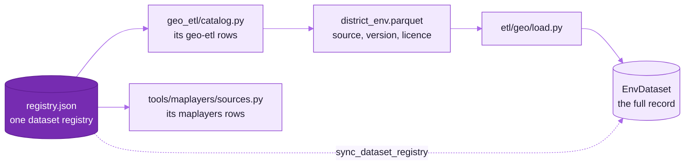

# Data sources

Every per-district environment value and every physical map layer in KalaVigyan comes from one of
the open datasets below; the live sources answers read, the pictures they show, the vendored export
assets and fonts, and the generated media are listed after them. If this page and the dataset
registry disagree, the registry wins and this page is stale. Engineers adding a dataset and
researchers citing KalaVigyan's data read it.

| For | Read |
|---|---|
| The one dataset registry, the source of truth | `backend/app/data/datasets/registry.json` (decision 0114) |
| How a dataset becomes a chart, table, timeline or map layer | [kalavigyan-datasets](../.claude/skills/kalavigyan-datasets/SKILL.md) |
| What the geo lane writes and loads | [contracts/geo.md](contracts/geo.md) |
| KalaVigyan's own knowledge as an open dataset | [contracts/open-data.md](contracts/open-data.md) |

## The registry

The tables mirror the one dataset registry, `backend/app/data/datasets/registry.json` (decision 0114), which is the source of truth: `etl/geo/geo_etl/catalog.py` reads its `geo-etl` rows, `tools/maplayers/sources.py` names its `maplayers` rows by code, each row of `district_env.parquet` repeats its dataset's `source`, `version`, `resolution` and `licence`, and `etl/geo/load.py` writes the full record to `EnvDataset` (`python -m app.scripts.sync_dataset_registry` brings stored rows up to the registry).

Owner direction: open datasets only, nothing that needs registration or a login. Heavy downloads run in GitHub Actions (`.github/workflows/geo-etl.yml`), never on a laptop.

## Datasets

| Code | Title | Publisher | Edition | Period | Native resolution | CRS |
|---|---|---|---|---|---|---|
| `DR_DISTRICT_SHAPES` | Indian district boundaries, matched to LGD codes | Indian districts GeoJSON on Kaggle | 2026 | 2026 | simplified to 0.01 degree, 0.001 degree coordinate grid | EPSG:4326 |
| `SOILGRIDS_2_0` | SoilGrids 2.0 | ISRIC World Soil Information | 2.0 | modelled, 2020 release | 250 m | Interrupted Goode Homolosine (ESRI:54052) |
| `ESA_WORLDCOVER_2021_V200` | ESA WorldCover 10 m 2021 v200 | European Space Agency | v200 | 2021 | 10 m (1/12000 degree) | EPSG:4326 |
| `HANSEN_GFC_2025_V1_13` | Global Forest Change 2000-2025 | University of Maryland, Department of Geographical Sciences | GFC-2025-v1.13 | 2000-2025 | 1 arc-second (about 30 m) | EPSG:4326 |
| `CHELSA_2_1_1981_2010` | CHELSA V2.1 climatologies 1981-2010 | Swiss Federal Institute for Forest, Snow and Landscape Research WSL, via EnviDat | V2.1 | 1981-2010 | 30 arc-seconds (about 1 km) | EPSG:4326 |
| `CHIRPS_3_0` | Climate Hazards Center InfraRed Precipitation with Stations v3.0 | Climate Hazards Center, UC Santa Barbara | 3.0 | set per run: 1981 (the record's first year) to the last complete year | 0.05 degree | EPSG:4326 |
| `GHCN_CAMS_T2M` | GHCN CAMS gridded monthly land surface air temperature | NOAA Climate Prediction Center, distributed by NOAA Physical Sciences Laboratory | air.mon.mean.nc, file version 3.01 | set per run: 1981 to the last complete year in the file | 0.5 degree | EPSG:4326 |
| `COPERNICUS_DEM_GLO90` | Copernicus DEM GLO-90 | European Space Agency, Copernicus Programme | 2021_1 (AWS Open Data COG) | 2011-2015 acquisitions | 3 arc-seconds (about 90 m) | EPSG:4326 (EGM2008 heights) |
| `HYDRORIVERS_1_0` | HydroRIVERS v1.0 (Asia) | WWF HydroSHEDS | v10 | static | 15 arc-second network (reaches with upstream area >= 10 km2 or discharge >= 0.1 m3/s) | EPSG:4326 |
| `USGS_MRDS` | Mineral Resources Data System | U.S. Geological Survey | snapshot at retrieval | compiled to 2011, no longer updated | point locations | EPSG:4326 |
| `ETOPO1_ICE` | ETOPO1 1 Arc-Minute Global Relief Model, ice surface (the relief layer) | NOAA National Centers for Environmental Information | ice surface, grid-registered | 2009 | 1 arc-minute | EPSG:4326 |
| `NATURAL_EARTH_10M_PHYSICAL` | Natural Earth 1:10m physical vectors (rivers, lakes, regions and peaks) | Natural Earth | 1:10m, version 5.0.0 | static | 1:10 million | EPSG:4326 |
| `GLIM_1_0_05DEG` | Global Lithological Map Database v1.0 (gridded to 0.5 degree) | Universitat Hamburg, via PANGAEA | 1.0 | 2012 | 0.5 degree | EPSG:4326 |

## Licence, attribution and redistribution

"Redistributable" means the derived district values may be shown publicly and exported. A dataset marked No may be used for internal analysis but its values or geometry must not be republished until its licence is confirmed.

| Code | Licence | Redistributable | Attribution to display | URL |
|---|---|---|---|---|
| `DR_DISTRICT_SHAPES` | For reference only (no licence URL stored) | No | District boundaries are indicative. | https://www.kaggle.com/datasets/adityaradha007/indian-districts-geojson |
| `SOILGRIDS_2_0` | [CC BY 4.0](https://creativecommons.org/licenses/by/4.0/) | Yes | SoilGrids 2.0, ISRIC World Soil Information | https://files.isric.org/soilgrids/latest/data/ |
| `ESA_WORLDCOVER_2021_V200` | [CC BY 4.0](https://creativecommons.org/licenses/by/4.0/) | Yes | ESA WorldCover project 2021 / Contains modified Copernicus Sentinel data (2021) processed by ESA WorldCover consortium | https://esa-worldcover.s3.eu-central-1.amazonaws.com/v200/2021/map/ |
| `HANSEN_GFC_2025_V1_13` | [CC BY 4.0](https://creativecommons.org/licenses/by/4.0/) | Yes | Hansen/UMD/Google/USGS/NASA | https://storage.googleapis.com/earthenginepartners-hansen/GFC-2025-v1.13/ |
| `CHELSA_2_1_1981_2010` | [CC0 1.0](https://creativecommons.org/publicdomain/zero/1.0/) (EnviDat's record of the dataset, read 2026-11-21) | Yes | CHELSA V2.1, Karger et al. | https://os.zhdk.cloud.switch.ch/chelsav2/GLOBAL/climatologies/1981-2010/ |
| `CHIRPS_3_0` | [CC BY 4.0](https://creativecommons.org/licenses/by/4.0/) | Yes | Climate Hazards Center, UC Santa Barbara (CHIRPS3) | https://data.chc.ucsb.edu/products/CHIRPS/v3.0/ |
| `GHCN_CAMS_T2M` | [Public domain (U.S. Government work on a federal server)](https://psl.noaa.gov/data/help/) (checked 2026-11-18) | Yes | GHCN_CAMS Gridded 2m Temperature (Land) data provided by the NOAA PSL, Boulder, Colorado, USA | https://downloads.psl.noaa.gov/Datasets/ghcncams/air.mon.mean.nc |
| `COPERNICUS_DEM_GLO90` | [Copernicus DEM licence (GLO-90 free worldwide)](https://registry.opendata.aws/copernicus-dem/) | Yes | Produced using Copernicus WorldDEM-90 (c) DLR e.V. 2010-2014 and (c) Airbus Defence and Space GmbH 2014-2018 provided under COPERNICUS by the European Union and ESA; all rights reserved | https://copernicus-dem-90m.s3.amazonaws.com/ |
| `HYDRORIVERS_1_0` | [HydroSHEDS v1 License Agreement](https://data.hydrosheds.org/file/technical-documentation/HydroSHEDS_TechDoc_v1_4.pdf) (Appendix A, checked 2026-11-17): free for non-commercial and commercial use; distributed only inside derived products, never on its own; attribution required | Yes, inside the app; the lines are never a download or export | The Exhibit B statement, below (River lines) | https://data.hydrosheds.org/file/HydroRIVERS/HydroRIVERS_v10_as_shp.zip |
| `USGS_MRDS` | [Public domain (U.S. Government work)](https://www.usgs.gov/information-policies-and-instructions/copyrights-and-credits) | Yes | U.S. Geological Survey Mineral Resources Data System | https://mrdata.usgs.gov/services/wfs/mrds |
| `GLIM_1_0_05DEG` | [CC BY 3.0](https://creativecommons.org/licenses/by/3.0/) | Yes | Hartmann and Moosdorf (2012), GLiM | https://doi.pangaea.de/10.1594/PANGAEA.788537?format=textfile |
| `ETOPO1_ICE` | [Public domain (U.S. Government work)](https://www.ncei.noaa.gov/access/metadata/landing-page/bin/iso?id=gov.noaa.ngdc.mgg.dem:316) | Yes | NOAA National Centers for Environmental Information, ETOPO1 | https://coastwatch.pfeg.noaa.gov/erddap/griddap/etopo180.html |
| `NATURAL_EARTH_10M_PHYSICAL` | [Public domain](https://www.naturalearthdata.com/about/terms-of-use/) | Yes | Made with Natural Earth. | https://naciscdn.org/naturalearth/10m/physical/ |

## Citations

- `DR_DISTRICT_SHAPES`: no citation is stored for readers. Provenance (internal): designer-portal frontend/public/boundaries/district-shapes.json (shapesVersion 791efb62cc30cf5d), built from the Kaggle dataset `adityaradha007/indian-districts-geojson` and joined to LGD codes; the combine step records the file's sha256 in `district_env_summary.json`.
- `SOILGRIDS_2_0`: Poggio, L., de Sousa, L. M., Batjes, N. H., et al. (2021). SoilGrids 2.0: producing soil information for the globe with quantified spatial uncertainty. SOIL 7, 217-240. https://doi.org/10.5194/soil-7-217-2021
- `ESA_WORLDCOVER_2021_V200`: Zanaga, D., Van De Kerchove, R., Daems, D., et al. (2022). ESA WorldCover 10 m 2021 v200. https://doi.org/10.5281/zenodo.7254221
- `HANSEN_GFC_2025_V1_13`: Hansen, M. C., Potapov, P. V., Moore, R., et al. (2013). High-Resolution Global Maps of 21st-Century Forest Cover Change. Science 342, 850-853. https://doi.org/10.1126/science.1244693. Data GFC-2025-v1.13.
- `CHELSA_2_1_1981_2010`: Karger, D. N., Conrad, O., Bohner, J., et al. (2021). Climatologies at high resolution for the earth's land surface areas. EnviDat. https://doi.org/10.16904/envidat.228 (the dataset; the method paper is Scientific Data 4, 170122, 2017, https://doi.org/10.1038/sdata.2017.122)
- `CHIRPS_3_0`: Climate Hazards Center InfraRed Precipitation with Stations version 3 (CHIRPS3) Data Repository (2025). https://doi.org/10.15780/G2JQ0P
- `GHCN_CAMS_T2M`: Fan, Y., van den Dool, H. (2008). A global monthly land surface air temperature analysis for 1948-present. Journal of Geophysical Research 113, D01103. https://doi.org/10.1029/2007JD008470
- `COPERNICUS_DEM_GLO90`: European Space Agency (2024). Copernicus Global Digital Elevation Model. https://doi.org/10.5270/ESA-c5d3d65
- `HYDRORIVERS_1_0`: Lehner, B., Grill, G. (2013). Global river hydrography and network routing: baseline data and new approaches to study the world's large river systems. Hydrological Processes 27(15), 2171-2186. https://doi.org/10.1002/hyp.9740
- `USGS_MRDS`: U.S. Geological Survey. Mineral Resources Data System (MRDS). Reston, Virginia. https://mrdata.usgs.gov/mrds/
- `GLIM_1_0_05DEG`: Hartmann, J., Moosdorf, N. (2012). Global Lithological Map Database v1.0 (gridded to 0.5 degree spatial resolution). PANGAEA. https://doi.org/10.1594/PANGAEA.788537
- `ETOPO1_ICE`: Amante, C. and B.W. Eakins, 2009. ETOPO1 1 Arc-Minute Global Relief Model: Procedures, Data Sources and Analysis. NOAA Technical Memorandum NESDIS NGDC-24. https://doi.org/10.7289/V5C8276M
- `NATURAL_EARTH_10M_PHYSICAL`: Natural Earth. Free vector and raster map data at naturalearthdata.com.

## Unit definitions (decision 0062)

A `measure` block converts a unit exactly defined in metric by its definition and cites one
dataset row, `NIST_SP_811_2008` (`research/measures.UNIT_DEFINITIONS`): Thompson, A., & Taylor,
B. N. (2008), Guide for the Use of the International System of Units (SI), NIST Special
Publication 811, Appendix B (https://www.nist.gov/pml/special-publication-811). Not subject to
copyright in the United States (U.S. Government work). The factors used are its exact ones: inch
2.54 cm, foot 0.3048 m, yard 0.9144 m, mile 1.609344 km, square foot 0.09290304 m2. Local Indian
units (seer, maund, tola, gaj, ...) are never converted by a table: only by a value a cited source
states for the region (owner O5). Pint holds each of them as a dimension of its own, so it has no
value for any of them (decision 0066).

## Places outside India (decisions 0135 and 0136)

`backend/app/data/places_abroad.json` is a hand-kept word list, not a dataset, and nothing in it is
shown to a reader: the United Nations' member and observer states other than India, with Taiwan,
Kosovo, Somaliland and Northern Cyprus, under their English short names, the names Natural Earth
gives them and the adjectives English uses for them, the regions and cultures craft literature
names, and the other senses in which a place word names a material or a sea. A live-research
write-back that names one of them is not filed under an Indian craft. The words left out on
purpose are in its `leftOut`, each with the Indian sense that keeps it out.

`backend/app/data/places_abroad.natural_earth.json` holds the list a test checks it against: the
`SOVEREIGNT` name of every feature of Natural Earth's 1:10m Cultural Vectors, Admin 0 -
Sovereignty layer (`ne_10m_admin_0_sovereignty`, version 5.1.2) whose `TYPE` is Sovereign country,
Sovereignty, Disputed or Breakaway, India left out: 197 names. Natural Earth is in the
[public domain](https://www.naturalearthdata.com/about/terms-of-use/); the file was read from the
release's GeoJSON (`https://raw.githubusercontent.com/nvkelso/natural-earth-vector/v5.1.2/geojson/ne_10m_admin_0_sovereignty.geojson`,
listed at `https://www.naturalearthdata.com/downloads/10m-cultural-vectors/10m-admin-0-sovereignty/`)
on 2026-11-22. A later release is vendored the same way, never edited by hand, and the test then
names any country `places_abroad.json` lacks.

## Live scholarly sources

Live research reads these services through `backend/app/sources/` (decision 0005) and cites each
work by DOI or the service's record URL; only short quoted passages are stored.

| Adapter | Service | Terms that bind us |
|---|---|---|
| `openalex` | OpenAlex works API | Metadata CC0; daily allowance per key or per IP |
| `crossref` | Crossref REST API, polite pool (`mailto`) | Metadata free to reuse; abstracts remain the publishers' |
| `semantic_scholar` | Semantic Scholar Academic Graph | API licence; publishers may elide abstracts |
| `core` | CORE API v3 | Key required; full texts keep their own licences |
| `europe_pmc` | Europe PMC REST | Per-article licence (the `licence` field) |
| `arxiv` | arXiv API | One request every 3 s; papers keep their own licences |
| `doaj` | DOAJ API v4 | Articles under their journals' licences |
| `elsevier`, `springer_nature` | Scopus, Springer Nature open access | Only with keys; quotes and DOI links, never a full copy (PLAN 17.1a) |
| Unpaywall (locator) | Unpaywall DOI API (`email`) | Open-access status and legal copy location only |

## Live reference sources

Read through `backend/app/sources/reference/` (decision 0006). Each item keeps its licence and
attribution; only short quoted passages are stored, with a link back.

| Adapter | Service | Licence and attribution |
|---|---|---|
| `wikipedia` | Wikipedia Action API (English and Indian-language wikis) | CC BY-SA 4.0, read live from each wiki's rightsinfo; attributed to "Wikipedia contributors" with the article title and revision |
| `wikidata` | Wikidata Action API and query service (SPARQL) | Structured data CC0 1.0; cited by item id and revision; an item's coordinate location (P625) places a supply origin, linked by its item id (decision 0047), and a craft page's timeline place, stored in `WikidataPoint` by the chapters job for a dossier place's item (decision 0098) |
| `pubchem` | PubChem PUG REST and PUG View, National Library of Medicine | Compound properties: NCBI places no restrictions (https://www.ncbi.nlm.nih.gov/home/about/policies/). GHS hazards keep the reporting source's terms; for ECHA, non-commercial reuse with "Source: European Chemicals Agency, http://echa.europa.eu/" (https://echa.europa.eu/web/guest/legal-notice) |
| `wikimedia_commons` | Wikimedia Commons file metadata | Each file's own licence (short name and URL) and author, attributed "author, licence, via Wikimedia Commons" |

District other names (`backend/app/data/district_other_names.json`, decision 0098): other names
under which sources name an LGD district, each checked against the register's name on load. Kutch
for Kachchh (449) follows Wikidata's Kutch district item (Q1063417, CC0 1.0), which carries both.

## Seeded reference passages (science engine)

The physical constants behind the stage envelopes (decision 0015) are claims in
`backend/app/data/science_seed.json`, each quoting one pinned Wikipedia revision (retrieved
2026-11-16; CC BY-SA 4.0, attributed "Wikipedia contributors" with title and revision).

| Constant | Article and revision | Value cited |
|---|---|---|
| Water boils at one atmosphere | Water, 1385775442 (Phase transitions) | 100 °C |
| Quartz α to β inversion | Quartz, 1383182792 (Crystal habit and structure) | 573 °C |
| Kaolinite dehydroxylation begins | Kaolinite, 1383311141 (Metakaolin) | 550–600 °C |
| Beeswax melts | Beeswax, 1382937264 (Physical characteristics) | 62 to 64 °C |
| Brass melts | Brass, 1382181158 (Properties) | 900 to 940 °C |

Seeded compounds are matched to PubChem records by `app/scripts/link_compounds` through the
`pubchem` adapter (terms above); each linked compound cites its PubChem record. It runs nightly
in the Coverage enrichment job. A linked compound's 3D conformer (PubChem's computed 3D record,
`record/SDF?record_type=3d`, same terms) is fetched once through the same adapter, at most one
call per 0.25 s, kept in the private bucket and drawn in the explainer citing the compound's
record (decision 0045).

## Live web sources

Found through `backend/app/sources/web/` and read by the fetcher (decision 0007). A web page
keeps its own copyright: only short quoted passages are stored, each with the page title, site
name, final URL, fetch time and, when the page declares one, its licence; robots.txt is
honoured for the agent `KalaVigyan`.

| Adapter | Service | Terms |
|---|---|---|
| `searxng` | Self-hosted SearXNG metasearch on the box | Results come from the engines SearXNG queries; each hit links to its page |
| `brave` | Brave Web Search API (fallback, only with `BRAVE_SEARCH_API_KEY`) | Brave Search API terms; results are used to find pages, and the pages themselves are cited |

## Pictures from the web

Found through the image sources of decision 0034 and shown in an explainer's `images` block. A
picture is never copied into the media bucket: the reader's browser loads it from its own host,
with no referrer, and the card links to its page. The one exception is an exported file (decision
0067): a lesson deck, PPTX or PDF, or an explainer's PDF, embeds the section's first open picture
(CC0, CC BY, CC BY-SA or public domain only, read from `upload.wikimedia.org` or
`api.openverse.org`) with its title, author, licence and page beside it, as those licences ask;
the file sits in the private bucket's `exports/` prefix for seven days and goes only to its
builder.

| Adapter | Service | Terms and credit |
|---|---|---|
| `wikimedia_commons` | Wikimedia Commons file search (`imageinfo`, 960 px thumbnails) | Each file's own licence; shown inline only under CC0, CC BY, CC BY-SA or public domain with its author, credited author, licence (linked) and Wikimedia Commons; otherwise a link card |
| `openverse` | Openverse image search (`api.openverse.org`, anonymous) | Only `by`, `by-sa`, `cc0` and `pdm` results with a creator; credited creator, licence and source site (Flickr, Wikimedia Commons, ...); the Openverse thumbnail is shown |
| `searxng` | SearXNG image results | No licence is known, so always a link card: the source site's own image as thumbnail, the page title and site, opening the page |

## Vendored export assets (decision 0067)

Files the server writes exports with, kept in `backend/app/data/exports/` with their SHA-256
pinned by `tests/learning/test_export_store.py`. Each is redistributed under its own licence,
which travels with it.

| Asset | Source | Licence |
|---|---|---|
| reveal.js 6.0.2 (`reveal.js`, `reveal.css`, `LICENSE.txt`) | the npm package `reveal.js@6.0.2` | MIT; the header and the full licence text are kept in every HTML deck |
| APA 7 CSL style (`csl/apa.csl`, id `http://www.zotero.org/styles/apa`, updated 2026-02-07) | citation-style-language/styles, commit `3c6698d7` (2026-10-02) | CC BY-SA 3.0 (its `rights` element); XML comments removed, nothing else changed |
| Noto Sans, Noto Sans Devanagari, Bengali, Tamil, Telugu, Gujarati, Kannada, Malayalam, Oriya, Gurmukhi and Noto Naskh Arabic, Regular and Bold (unhinted TTF, `fonts/`) | notofonts/notofonts.github.io | SIL Open Font License 1.1 (`fonts/OFL.txt`); embedded as subsets in PDFs |

## Web fonts (decision 0092)

The faces of the design system, self-hosted in `frontend/fonts/` through `next/font/local`
(`app/latinFonts.ts`, `app/scriptFonts.ts`, `app/readingScriptFonts.ts`), fetched on
2026-11-18. Every face is SIL Open Font License 1.1; each licence travels in
`frontend/fonts/licences/`. Only the Plex Sans Latin-1 weights and the Newsreader roman core are
preloaded; every other file loads when its `unicode-range` is used.

| Faces | Source | Processing | Licence file |
|---|---|---|---|
| Newsreader, roman and italic (optical size 6 to 72) | google/fonts `ofl/newsreader`, commit `5bd87dfc`, each source checked against its git blob | built by `tools/webfonts_build.py` (the Web fonts workflow, fontTools 4.68.0 and Brotli 1.2.1): weight limited to 300 to 600, subset to the `latin` range (preloaded) and to `latin-ext`, keeping only the layout features the site uses; the fix-unhinted `prep` and `gasp` added; WOFF2. Newsreader draws no arrow, so neither range claims U+2190 to U+2199: those come from the IBM Plex Sans Pi files, declared under the Newsreader family, and an equation's arrow never fetches `latin-ext`. No Reserved Font Name | `newsreader.txt` |
| IBM Plex Sans 400, 500, 600 and italic 400; IBM Plex Mono 400 and 500 | IBM/plex `packages/plex-sans` and `packages/plex-mono`, `fonts/split/woff2`, commit `bc6a7e4b` | IBM's own Latin1, Latin2, Latin3 and Pi subsets, unmodified, because the licence reserves the name "Plex" | `ibm-plex.txt` (line endings made LF) |
| Noto Serif Devanagari, Bengali, Gujarati, Gurmukhi, Kannada, Malayalam, Oriya, Tamil and Telugu; Noto Nastaliq Urdu; Noto Naskh Arabic; Noto Sans Meetei Mayek and Ol Chiki | google/fonts `ofl/<family>`, commit `5bd87dfc` | width pinned to 100, weight limited to 400 to 600, subset to the script's `unicode-range` with every layout feature kept; the fix-unhinted `prep` added; WOFF2 | `noto-<script>.txt`, `noto-nastaliq.txt`, `noto-naskh-arabic.txt` |
| Noto Sans Devanagari, Bengali, Gujarati, Gurmukhi, Kannada, Malayalam, Oriya, Tamil, Telugu and Arabic (the interface faces) | google/fonts, earlier | unchanged | `noto-<script>.txt`, `noto-arabic.txt` |

An unhinted TrueType face needs the fix-unhinted `prep` program (`PUSHW 511 SCANCTRL PUSHB 4 SCANTYPE`,
as google/fonts ships it): without one, FreeType on Linux, Android and ChromeOS auto-hints the face,
drawing it heavier and snapped to the pixel grid. Subsetting with `--no-hinting` drops it, so add it
back (fontTools `ttProgram.Program.fromAssembly`) after every subset. The hygiene check refuses a web
font under `frontend/` with TrueType outlines and no `prep`.

## Generated media

Nothing generated is evidence: generated pictures, clips and film scores are labelled and never
cited (`docs/contracts/media.md`).

| Service | What | Terms and label |
|---|---|---|
| Gemini (Interactions API) | stage illustrations and silent clips | "AI illustration" with the model and day (decision 0018) |
| ElevenLabs Eleven Music (`/v1/music`) | film mode's instrumental bed | Eleven Music terms: paid plans need no attribution; prompts name no artist, song, label or lyric; outputs are not compiled into a music library. Labelled "AI music and sound" with the models (decision 0058) |
| ElevenLabs Sound Effects (`/v1/sound-generation`) | film mode's cues | ElevenLabs terms of service; same label |
| ElevenLabs Image and Video (`/v1/flows/*`) | further route choices for stage pictures and clips | ElevenLabs terms of service and the underlying model's; "AI illustration" with the model id asked, since flows report none (decision 0058). The finished file is fetched only from the signed `content_url` on `storage.googleapis.com`, the host the reference shows, over https without the key, streamed and cut at 64 MB (decision 0061) |

## Variables and statistics

Each row in `district_env.parquet` is one `(districtLgd, datasetCode, variable, depthOrPeriod, stat)`. Zonal statistics use exactextract with coverage-weighted, spherical-area cell weights, so partly covered edge cells count by the share inside the district. `depthOrPeriod` is `""` where it does not apply.

| Dataset (CLI layer) | Variable | depthOrPeriod | Stats | Unit |
|---|---|---|---|---|
| SoilGrids (`soilgrids`) | `clay`, `sand`, `silt` | `0-5cm`, `5-15cm`, `15-30cm` | `DISTRICT_MEAN`, `DISTRICT_P10`, `DISTRICT_P90`, `UNCERTAINTY_Q05_MEAN`, `UNCERTAINTY_Q95_MEAN` | % |
| | `soc` | same | same | g/kg |
| | `phh2o` | same | same | pH |
| | `cec` | same | same | cmol(c)/kg |
| | `bdod` | same | same | kg/dm3 |
| | `nitrogen` | same | same | g/kg |
| WorldCover (`worldcover`) | `landcover_tree_cover`, `landcover_shrubland`, `landcover_grassland`, `landcover_cropland`, `landcover_built_up`, `landcover_bare_sparse_vegetation`, `landcover_snow_ice`, `landcover_permanent_water`, `landcover_herbaceous_wetland`, `landcover_mangroves`, `landcover_moss_lichen` | `2021` | `SHARE` | fraction |
| Hansen GFC (`hansen`) | `treecover2000` | `2000` | `DISTRICT_MEAN` | % |
| | `forest_canopy30` | `2000` | `SHARE` | fraction of land |
| | `forest_canopy30_area` | `2000` | `TOTAL` | km2 |
| | `forest_loss_canopy30` | each year `2001` to `2025`, and `2001-2025` | `TOTAL` | km2 |
| | `forest_loss_canopy30_share` | `2001-2025` | `SHARE` | fraction of 2000 forest |
| CHELSA (`chelsa`) | `annual_mean_temperature` (bio1), `max_temperature_warmest_month` (bio5), `min_temperature_coldest_month` (bio6) | `1981-2010` | `NORMAL`, `DISTRICT_P10`, `DISTRICT_P90` | degC |
| | `annual_precipitation` (bio12) | `1981-2010` | same | mm/year |
| | `precipitation_seasonality` (bio15) | `1981-2010` | same | coefficient of variation % |
| | `mean_temperature` (tas) | `1981-2010-01` to `1981-2010-12` | same | degC |
| | `precipitation` (pr) | `1981-2010-01` to `1981-2010-12` | same | mm/month |
| CHIRPS (`chirps`) | `annual_precipitation` | each year of the run period | `DISTRICT_MEAN`, `DISTRICT_P10`, `DISTRICT_P90` | mm/year |
| | `annual_precipitation` | run period, e.g. `1981-2025` | `NORMAL` | mm/year |
| | `annual_precipitation` | run period | `TREND_PER_DECADE` | mm/year per decade |
| | `annual_precipitation` | run period | `TREND_P_VALUE` | p-value |
| | `monthly_precipitation` | run period plus month, e.g. `1981-2025-07` | `NORMAL` | mm/month |
| | `monsoon_share_jjas` | run period | `NORMAL` | fraction of annual |
| GHCN CAMS (`ghcncams`) | `annual_mean_temperature` | each year of the run period | `DISTRICT_MEAN` | degC |
| | `annual_mean_temperature` | run period, e.g. `1981-2025` | `NORMAL` | degC |
| | `annual_mean_temperature` | run period | `TREND_PER_DECADE` | degC per decade |
| | `annual_mean_temperature` | run period | `TREND_P_VALUE` | p-value |
| Copernicus DEM (`copdem`) | `elevation` | | `DISTRICT_MEAN`, `DISTRICT_P10`, `DISTRICT_P90`, `DISTRICT_MIN`, `DISTRICT_MAX` | m |
| | `slope` | | `DISTRICT_MEAN`, `DISTRICT_P10`, `DISTRICT_P90` | degree |
| HydroRIVERS (`hydrorivers`) | `river_length`, `major_river_length` | | `TOTAL` | km |
| | `river_density` | | `DENSITY` | km/km2 |
| | `distance_centroid_to_major_river` | | `DISTANCE` | km |
| | `max_strahler_order` | | `DISTRICT_MAX` | Strahler order |
| | `max_discharge` | | `DISTRICT_MAX` | m3/s |
| USGS MRDS (`mrds`) | `mineral_occurrences`, and `mineral_occurrences_<commodity>` per commodity code found | | `COUNT` | sites |
| GLiM (`glim`) | `lithology_<code>` for each GLiM class present (`su`, `vb`, `ss`, `pb`, `sm`, `sc`, `va`, `mt`, `pa`, `vi`, `wb`, `py`, `pi`, `ev`, `nd`, `ig`) | | `SHARE` | fraction |

Method notes carried in each row's `method`:

- SoilGrids is read from the ISRIC WCS at native 250 m in Homolosine; stored integers are divided by the ISRIC conversion factor (10 for clay, sand, silt, soc, phh2o, cec; 100 for bdod and nitrogen). Uncertainty rows are the district mean of the Q0.05 and Q0.95 layers. SoilGrids masks built-up land, water and bare rock; a district masked throughout gets no SoilGrids rows and is listed under `districtsWithoutValues` and `districtsWithoutCells` in the summary (Mumbai, 482: 0 of 2,720 cells unmasked on 2026-11-17).
- WorldCover is read from the 3 degree COG tiles. The workflow can read an overview (`--worldcover-factor`, default 4, so about 40 m, nearest neighbour); the effective resolution is written to each row's `resolution`, loaded into `DistrictEnvValue.resolution` and sent with every region value and layer (decision 0016).
- Hansen forest is `treecover2000 >= 30%`; loss is counted only inside that 2000 forest, by `lossyear`.
- CHIRPS runs from `--climate-first-year` (default 1981, the first year of the CHIRPS record; decision 0065) to the last complete year available, so the dataset row's period, the normals and the trend are one period (`1981-2025`); `monsoon_share_jjas` is June to September over the annual normal. The twelve `monthly_precipitation` normals of a district are written only when every year of the period has every month; they are the rainfall of an explainer's `seasons` block, cited by the CHIRPS dataset row with its period and 0.05 degree grid (decision 0043) and named by its district and state from the LGD register ("Rainfall · Kachchh, Gujarat · monthly normal · 1981-2025", decision 0050).
- GHCN CAMS (decision 0065) is one netCDF file of monthly 2 m air temperature over land in Kelvin (`air`), downloaded whole once a month into the run's cache and read through GDAL's netCDF driver. A cell's annual mean is the mean of its twelve monthly means; a cell missing any month, or outside the file's valid range (150 to 400 K), has no value that year. Values are Kelvin less 273.15. The run starts at `--climate-first-year` (default 1981) and ends at the last year the file holds all twelve months of. On a 0.5 degree grid a small district is one or two cells, so the resolution is shown with every value.
- Trends (decision 0065): for a district whose yearly series is complete over a period of at least 30 years, `TREND_PER_DECADE` is the Theil-Sen slope (the median of the slopes between every pair of years; Theil 1950, Sen 1968) times ten, and `TREND_P_VALUE` the two-sided Mann-Kendall test's p-value (normal approximation with the tie-corrected variance and a continuity correction; Kendall 1975, Gilbert 1987). A trend is significant when p < 0.05. A district missing any year has its yearly values but no normal and no trend. `DistrictEnvValue.value` keeps six decimals, so a p-value below 0.0000005 is stored as 0.
- CHELSA GeoTIFFs are read at their native 30 arc-second grid with the scale and offset the file declares; raw 65535 is no data. District values are exactextract means weighted by each cell's spherical area inside the district (`coverage_weight = area_spherical_km2`), with the 10th and 90th percentiles across the district's cells. The stored method reads, in reader words, `chelsa.METHOD`. Annual rainfall and annual mean temperature normals are shown from the dataset of their trend (CHIRPS, GHCN CAMS); CHELSA's are shown only where that dataset has none for the place (decision 0075).
- Slope is computed from the DEM with central differences, using metres per degree at each row's latitude.
- HydroRIVERS lengths are reaches clipped to the district in WGS 84 / India NSF LCC. A major river is `ORD_FLOW <= 4` (long-term discharge of at least 100 m3/s). Distance is from the district's centre (the centroid of its boundary polygon). The stored method reads, in reader words, `hydrorivers.METHOD`.

`district_geology.parquet` also gets one row per district per source: MRDS as `lithology = mineral_occurrences` with the matching sites as JSON in `mineralOccurrences`, and GLiM as one row per lithology class with `areaShare`.

## Choices and limits

### Geology: USGS MRDS points and GLiM at 0.5 degree

Geology uses two open sources only:

- **USGS MRDS** mineral occurrence points inside India, fetched from the public WFS by bounding box and assigned to districts by point-in-polygon. MRDS was compiled to 2011 and is no longer updated. Its India coverage is sparse and uneven, so a count of zero means "none recorded in MRDS", not "no deposits".
- **GLiM v1.0 gridded to 0.5 degree** (about 55 km), the GLiM product that downloads directly from PANGAEA as one small file. A district usually spans just a few cells, so lithology shares show the broad geological setting, not the rock under a given village. Lakshadweep (553) lies on no GLiM land cell, so it has no GLiM rows (Actions run 43949571146) and is listed under `districtsWithoutCells`.

These sources were considered and not used:

- **GSI Bhukosh / NGDR** (1:2M geology and mineral occurrences): downloads need a registered Bhukosh account, and there is no bulk download without logging in. That breaks the owner's no-registration rule. Revisit if GSI publishes an open bulk download; it would replace both MRDS and GLiM for India.
- **OneGeology**: a portal over national map services, with no bulk download for India. Reading it would mean scraping WMS tiles, which gives pictures, not attributes.

### River lines (decision 0043)

The river story draws HydroRIVERS v1.0 (Asia) lines, not just their district totals.

- **Which reaches.** Every reach with an upstream area of at least 100 km2 (`UPLAND_SKM`), of every basin (`MAIN_RIV`) one of whose reaches of that size crosses a district polygon. The whole basin is kept, from its sources in Tibet, Nepal or Bhutan to its mouth, and so is every reach a kept reach flows into. A river's source as drawn is its first reach of that size, not the dataset's 10 km2 headwater.
- **Files.** One TopoJSON per basin in the private media bucket, under `media/rivers/v10/<MAIN_RIV>/<sha256>/` (the file's own SHA-256, so a stored basin row and its file never drift, and a file that no longer matches its row is not served; decision 0050): each reach simplified on its own at 0.005 degree (about 550 m) with its ends kept, so junctions stay joined, and quantized to 100,000 steps over the basin. Served only to signed-in readers through `GET /api/rivers/<MAIN_RIV>`; never a download or an export.
- **Licence, checked 2026-11-17.** The HydroRIVERS Technical Documentation v1.0 (October 2019, section 4.1) puts the data under the HydroSHEDS License Agreement, which is Appendix A of the [HydroSHEDS Technical Documentation v1.4](https://data.hydrosheds.org/file/technical-documentation/HydroSHEDS_TechDoc_v1_4.pdf) (April 2022). The data are free for non-commercial and commercial use; they may be distributed only incorporated into derived products, never as a stand-alone product (2.1.2); and Exhibit B's statement must go with the product's documentation or metadata. The website's [terms of use](https://www.hydrosheds.org/terms-of-use) cover the site's own pages, not the data. The dataset row carries the statement as its attribution, so every citation of the river shows it:

  > This product KalaVigyan incorporates data from the HydroSHEDS version 1 database which is © World Wildlife Fund, Inc. (2006-2022) and has been used herein under license. WWF has not evaluated the data as altered and incorporated within KalaVigyan, and therefore gives no warranty regarding its accuracy, completeness, currency or suitability for any particular purpose. Portions of the HydroSHEDS v1 database incorporate data which are the intellectual property rights of © USGS (2006-2008), NASA (2000-2005), ESRI (1992-1998), CIAT (2004-2006), UNEP-WCMC (1993), WWF (2004), Commonwealth of Australia (2007), and Her Royal Majesty and the British Crown and are used under license. The HydroSHEDS v1 database and more information are available at https://www.hydrosheds.org.

- **Citation.** HydroRIVERS asks to be cited as Lehner and Grill (2013), above, with a link to https://www.hydrosheds.org.

### Climate: CHELSA chosen over WorldClim

CHELSA V2.1 (1981-2010) was chosen over WorldClim 2.1 (1970-2000). It covers a more recent baseline at the same 30 arc-second resolution, and it handles terrain better through its orographic precipitation correction, which matters in the Himalayan and Western Ghats districts. Its GeoTIFFs are served as individual files from a public object store, so the workflow can read only the window it needs. WorldClim publishes zipped bundles that would have to be downloaded whole.

CHELSA's licence is **unconfirmed**. The files download openly without registration, but on 2026-11-15 we could not find a licence statement on the CHELSA site to cite. The stored `licence` is therefore only the paper CHELSA asks to be cited, "Karger et al. 2017" linked to doi:10.1038/sdata.2017.122, with the full citation in `citation`, so no reader screen carries an admission. Until one is confirmed, `redistributable` is `false` and CHELSA values must stay internal: no public display, no export. If the licence turns out to be CC BY 4.0, change `redistributable` in `catalog.py`, re-run the load and update this page. CHIRPS v3.0 (CC BY 4.0) covers recent rainfall and can be shown publicly now.

### Temperature trends: GHCN CAMS (decision 0065)

The temperature trend needs a monthly series per district from at least 1981 to last year, open
and with no key or registration. GHCN CAMS (NOAA CPC, served by NOAA PSL) is one file updated
monthly, 0.5 degree, 1948 to the present, and in the public domain: PSL's data help page states
that "the information on federal government servers are in the public domain, unless
specifically annotated otherwise" and asks for an acknowledgment (the attribution above), checked
2026-11-18. Considered and not used: CRU TS 4.09 (Open Government Licence, but CRU asks for
downloads through CEDA, which needs an account, and the series ends in 2024); ERA5 and ERA5-Land
(Copernicus Climate Data Store key); Berkeley Earth (CC BY-NC); CHELSA monthly series (licence
unconfirmed, as above, and ends in 2019); IMD gridded temperature (terms of reuse not stated).

### Groundwater

No open district-level groundwater dataset is loaded. The Central Ground Water Board's district
tables (Dynamic Ground Water Resources of India) are published as state PDFs, and the India Data
Portal's machine-readable copies need an API key, so a climate block shows no groundwater value;
groundwater appears only through cited claims. `GroundwaterValue` is ready for an open dataset
when one exists (`docs/TECH_DEBT.md`).

### District boundaries are indicative and not redistributable

District polygons come from the Designer Portal's `district-shapes.json` (shapesVersion `791efb62cc30cf5d`), built from the Kaggle dataset `adityaradha007/indian-districts-geojson` and joined to LGD codes by `scripts/build_boundaries.py`. They are simplified and not the official Survey of India boundaries, and the Kaggle dataset states no licence. So:

- Every value here is a statistic over an **indicative** polygon. Districts created after the shapes were drawn have no polygon and are listed in the summary's `districtsWithoutShapes`.
- The polygons themselves **cannot be redistributed**: no download or export of the geometry. Showing them on a map in the portal must carry "District boundaries are indicative."
- The per-district numbers are derived from the open rasters, and their licence follows the source dataset in the tables above.

## How this document is kept true

| Claim | Kept true by |
|---|---|
| Codes, editions, licences and citations | `backend/app/data/datasets/registry.json`; this page mirrors it and loses to it |
| What is stored | `python -m app.scripts.sync_dataset_registry` brings `EnvDataset` up to the registry |
| What the geo ETL reads | `etl/geo/geo_etl/catalog.py`, tested in the Geo ETL workflow |
| The physical map layers | `tools/maplayers/sources.py`, tested by `tools/tests` |

Re-read it when a dataset is added to the registry, an edition is reloaded, a licence changes, or a
live source or picture source is added or dropped.
