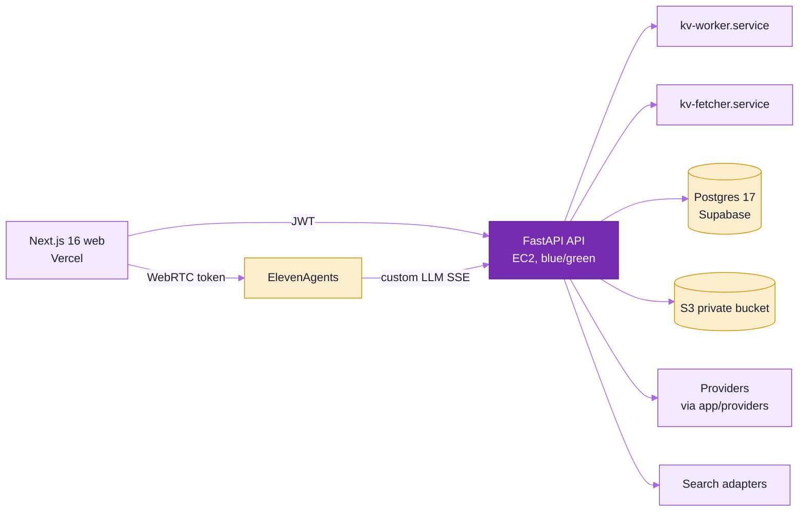

# KalaVigyan AI: implementation plan for science-behind-craft

The product plan: what KalaVigyan is for, who uses it, and how it was designed to be built.
Section 0 is the owner's direction and overrides everything below it; the rest is revision 2 of the
plan of 2026-11-15, which resolves the plan critique of that day. Everyone building KalaVigyan
reads section 0 first; what exists today is [ARCHITECTURE.md](ARCHITECTURE.md).

| For | Read |
|---|---|
| What exists today | [ARCHITECTURE.md](ARCHITECTURE.md) |
| The plans that followed this one | [plans/answer-experience.md](plans/answer-experience.md), [plans/dataset-curation.md](plans/dataset-curation.md), [plans/field-completeness.md](plans/field-completeness.md) |
| Every decision taken since | [decisions/README.md](decisions/README.md) |
| Where the build stands | [PROGRESS.md](PROGRESS.md) |

Repo: `C:/dev/IIT/science-behind-craft`. When this plan was written it held only `.claude/skills/{field-repo-frontend,gsap,motion,naming,security-audit}` and this file. Paths are absolute unless stated. Vendor facts were collected on 2026-11-15 from official docs through fetch summaries. Items marked **(unverified)** must be confirmed live before they go into code constants or budgets.

---


## 0. Owner direction 2026-11-15 (overrides anything below)

- **The knowledge base grows; it is never finished.** Accuracy and precision over speed. A learner can wait: when the stored knowledge cannot answer well, the question runs live research (scholarly APIs, Wikipedia/Wikidata, PubChem, SearXNG with Brave fallback), and what it finds is written back as cited claims so the next answer is faster. A background job keeps widening coverage across all 455 crafts within the monthly ceiling. No one-off bulk pre-build deadline.
- **No review gates.** Nothing waits for approval to be shown. Evidence levels stay as labels (quoted source, model-inferred hypothesis); professors can still correct, retract or mark claims verified, but no answer, claim or media is blocked on them.
- **Research is not limited to the sources named in this plan.** The named APIs are starting points; live research searches the open web and any reachable scholarly, government, museum, archive or institutional source, follows references, and cites whatever it actually used.
- **Every answer is cited.** Each sentence links to its sources, with the quoted passage and a link out so users can read further. A sentence without a source is not shown.
- **Open datasets only** for geography and environment (§17.1). No registration-dependent data.
- **Accuracy checks are small**: 1–2 known-answer questions run at a time, on demand when a change touches answering, not a large suite on every change. The owner corrects answers as they come up.
- **Infrastructure**: new EC2 (ap-south-1), private S3 bucket and new Supabase project, provisioned for this project.
- **No caps for now (owner, 2026-11-18): "no caps for now on anyone, not in terms of money or tokens".** Every spend cap, daily allowance and degrade rule in §9 and §12 defaults to none, and every model call asks for its model's documented maximum output; spend is still recorded and shown on Usage, and each cap can return as a setting (decision 0093).
- **Reading is public; only asking is signed in (owner, 2026-11-18): "add all the information that you have generated, including the image and the other assets to the ajrakh page as well, all the information should be directly accessible from there too, only the query part is to be guarded, the rest of the application is going to be public only".** The craft page is a monograph in chapters carrying every piece answers build, built from stored rows without a question, with All evidence for everyone; Ask, Talk and research lookups stay signed in, and personal data under its own consent terms stays private (decision 0095, `docs/contracts/craft-page.md`).

## 1. Product and users

KalaVigyan is a web research platform on Indian crafts and the science behind them. It is the operational form of the DCH *Science Behind Craft* programme named in `C:/dev/IIT/inferential-system/README.md:4`. Web only; no Android client.

For a question typed or spoken, the platform:

1. Resolves it to a craft on the IIT master list (455 crafts).
2. Pins the craft on the team's India map.
3. Shows the region's soil, forest, geology, climate and water profile.
4. Explains materials, process stages and the chemical or physical reaction at each stage. Every sentence cites claims, and every claim carries a stored evidence level.
5. Offers on-click image and short-video generation, and a two-way voice conversation.

| Role | Who | Primary jobs |
|---|---|---|
| Master admin | Owner / IIT PI | Users, roles, keys, routing, quotas, ceilings, datasets, retractions |
| Admin | Delegated administrators | Everything a professor does; invite professors, change roles and suspend accounts ranked below Admin; usage, audit log, datasets (decision 0024) |
| Professor | Faculty, domain experts | Review and promote claims, curate sources, approve shared media, handle objections |
| Researcher | RAs, PhD scholars | Ask in every mode, run enrichment, propose claims, aliases, sources |
| Student | Invited or allow-listed institution users | Ask (verified, hybrid), voice, limited images, save answers |

Evidence levels are stored on each claim and never inferred from model text.

| Level | Rule (enforced in `evidence/levels.py` and `review/service.py`) |
|---|---|
| verified | A professor `ReviewEvent` set it, and at least one source of reliability A or B has a quote that passed the mechanical check with relation DIRECT. |
| reviewed | A professor `ReviewEvent` set it; support is contextual, analogous or general-principle. |
| provisional | Quote passed the mechanical check; no human review. Imports, enrichment proposals. |
| hypothesis | Researcher or model inference with no direct quote. Never phrased as fact. |
| unavailable | A planned facet with no claim. Rendered as the "No source found" badge on that facet. |

A derived artefact (a balanced equation, a unit conversion) inherits the minimum level of its inputs. `balanced=true` is a check result, not a level. Only a `ReviewEvent` by a PROFESSOR, ADMIN or MASTER_ADMIN raises a level above provisional. There are no exceptions.

---

## 2. What we reuse

| Asset | Path | How |
|---|---|---|
| Craft master list (455 crafts, 9 categories, 36 sub-categories) | `C:/dev/IIT/designer-portal/backend/app/data/craft_master_list.json` (byte-identical in documentation-portal); docs copy `C:/dev/IIT/docs/crafts/IIT_Crafts_2026-10-20_Master-List.json` | Vendor into `backend/app/data/`. sha1 in `shared/craft-master.sha1`. `slug` is the craft key. Live sync in §5.1. |
| Master-list loader | `designer-portal/backend/app/services/craft_master.py:111` (load_master), `:170` (normalise), `:193` (craft_aliases), `:272` (build_catalogue) | Port to `app/services/craft_master.py`; same upsert-by-slug. |
| Craft tables | `designer-portal/backend/prisma/schema.prisma:886-1017` (CraftStatus, CraftCategory, CraftSubCategory, Craft, CraftCode, CraftSpelling) | Same table and column names (§4 naming rule). |
| Alias seeds | `designer-portal/backend/app/data/cross_portal_codes.json` (50 codes, 174 spellings), `craft_master_aliases.json`, `craft_vocabulary.txt` (77 lines) | Seed `CraftCode`, `CraftSpelling`, `CraftAlias`. |
| India outline (Survey of India depiction, checked) | `C:/dev/IIT/cxa-cms/components/map/indiaGeometry.ts:1-34` (provenance), `designer-portal/frontend/components/map/indiaGeometry.ts:1-237` | Copy the DR version (no header comment). Keep the caption. Licence row in §8. |
| National pin map | `C:/dev/IIT/cxa-cms/components/map/{IndiaMap.tsx,IndiaMapStage.tsx,MapHoverCard.tsx,MapPlaceList.tsx,layout.ts,projection.ts}` | Base craft map: one pin per `CraftLocation`, hover card, accessible list. |
| State/district borders and shapes | `designer-portal/frontend/components/map/{borderGeometry.ts,shapeGeometry.ts}`, `designer-portal/frontend/public/boundaries/*` | Drill-down and district choropleths. |
| Boundary build and checks | `designer-portal/scripts/build_boundaries.py:108-110,612-667`; tests `designer-portal/backend/tests/test_boundary_assets.py`, `test_coverage_shapes.py` | Copy into `etl/boundaries/`. Re-point `DISTRICTS_URL` to SoI 1:1M once obtained. |
| LGD register and place resolution | `designer-portal/backend/app/data/lgd_register.json`, `boundaries/district-centroids.json`; `services/lgd.py`, `services/place_atlas.py:308,374` | Key districts by LGD; resolve place text for `CraftLocation`. |
| cxa-cms coordinates | `C:/dev/IIT/cxa-cms/prisma/corpus/crafts.ts` (42 crafts, ~60 regions with lat/lon) | **Not joinable today**: cxa-cms has no craft-code field and its slugs are kebab-case. A researcher authors `shared/cxa-to-master.json` (cxa slug → master `slug`) and a professor accepts it; only mapped rows import. Unmapped rows are never imported. |
| Claim-level evidence corpus | `C:/dev/IIT/immersive-episteme/content/traditions/{ajrakh,bagh,bagru,dabu,machilipatnam-kalamkari,sanganeri}/tradition.json`, `content/shared/craft-science.json`, `content/FORMAT.md`, `content/review/source-manifest.tsv` | Import concepts, claims, sources, quotes as provisional with quote check PASS. Schema pattern `immersive-episteme/db/schema/knowledge.ts:147-330`. |
| Draft science graphs | `C:/dev/IIT/inferential-system/data/seed/{block-printing,terracotta,wood-carving}.json` | Family-level nodes and edges attached to sub-categories; hypothesis, or provisional where an evidence item carries a quote. |
| Wood chains and sources | `C:/dev/IIT/Research/data/paper1/chains/*.json`, `paper1/sources/wood_handbook_pages.jsonl`, `textile_sources.json` | Corpus chunks plus hypothesis claims (P5 wood crafts). Wood Handbook is a US Government work. |
| Hybrid retrieval | `inferential-system/backend/app/retrieval/hybrid.py:1-60` (FTS + pgvector + PPR, RRF k=60), `retrieval/embeddings.py:1-121` | Port into `app/retrieval/`. |
| Review audit pattern | `inferential-system/backend/app/models.py:133-157,411` (Evidence, ValidationEvent), `api/knowledge.py:56-60` | `ReviewEvent` and the guard refusing an unfit promotion. |
| Provider adapters | `inferential-system/backend/app/providers/{base.py:23-76,registry.py:15-81,presets.py:4-61,anthropic_p.py,gemini_p.py,openai_p.py,usage.py,retry_after.py}`, `app/secrets.py:1-67` | Vendor into `app/providers/` (Anthropic, OpenAI, Gemini, DeepSeek via `presets.py:13`). `hf_local.py` stays out. |
| API Key Manager (Settings hub, DR and FR) | Keys: `designer-portal/backend/app/services/managed_secrets.py:26-92,151,204-281,347-384`, `routes/secrets.py:12-66`, web `frontend/app/(protected)/settings/api-keys/page.tsx` → `components/settings/ApiKeysPanel.tsx`. Model catalogue: `backend/app/services/ai_providers.py:9-35` (AiProvider, AiTask, AiModel), `:38-52` (ProviderSpec), `:241-275` (PROVIDERS, spec_for, models_for, supports, default_model_for). Per-task order: `routes/settings.py:264-310` (transcription-providers GET/PUT/test), Android `ui/ProviderOrderPanel.kt`. Per-user keys: `routes/ai_keys.py:41-115`, `UserAiCredential` (`schema.prisma:2840`), `components/settings/MyAiKeysPanel.tsx`. Usage: `settings/usage/page.tsx` | Port as the KalaVigyan Settings hub, same shapes so the portals stay mergeable. Extend AiProvider with DEEPSEEK, AiTask with PLAN, COMPOSE, WEB_READ, EXTRACT, EMBED, IMAGE, VIDEO, VOICE_TURN, EVAL_JUDGE; generalise the transcription-provider order into a per-task order (`RoutePolicy`, §9). The reveal route (`routes/secrets.py:29-38`) is **not** ported (§15). Per-user keys deferred to P5. |
| Auth: password, JWT | `designer-portal/backend/app/core/security.py:37-170`, `routes/auth.py:415-763` | Copy. |
| Google sign-in | `designer-portal/backend/app/api/routes/auth.py:219-235,295`, `frontend/components/GoogleSignInButton.tsx:51-66` | Copy, then add the nonce (§12). Button drawn only when the client ID is configured. |
| TOTP 2FA | `designer-portal/backend/app/services/two_factor.py:60-533`, `routes/two_factor.py:46-119`, `frontend/components/{TwoStepChallengeForm.tsx,TwoStepCodeEntry.tsx}` | Copy. Mandatory for PROFESSOR and MASTER_ADMIN. |
| Role ranks | `designer-portal/backend/app/core/deps.py:31-260` | MASTER_ADMIN 60, PROFESSOR 40, RESEARCHER 30, STUDENT 15 (new). |
| Mail settings | `designer-portal/backend/app/core/config.py:96-104` (MAIL_FROM_ADDRESS, MAIL_FROM_NAME, MAIL_REPLY_TO, MAIL_SES_REGION, MAIL_SES_CONFIGURATION_SET) | Same key names so copied auth mail code works. |
| Query-embedding helper | `designer-portal/backend/app/services/search_embeddings.py:1-40` | LRU cache plus 1.5 s timeout; model gemini-embedding-2 at 1536. |
| S3 media | `designer-portal/backend/app/services/s3.py:28-250` (DR's three-valued `object_exists`, per `C:/dev/IIT/docs/convergence/DRIFT_0016_2026-11-08.md`), `infra/fix-media-bucket-cors.sh` | Private bucket, presigned GET only. |
| Gemini HTTP pattern | `designer-portal/backend/app/services/ai_providers.py:307-340` | Model fallback plus ModelDeclined guard; extend for the Interactions API. |
| Voice orb | `C:/dev/IIT/cxa-cms/components/ui/voice-powered-orb.tsx`, `components/site/ReadAloud.tsx` | Voice panel visual. |
| Hosting and deploy | `designer-portal/backend/DEPLOY_AWS.md:1-40`, `backend/deploy/blue_green.sh`, `infra/terraform/*`, `.github/workflows/{checks.yml,deploy-backend.yml,deploy-frontend.yml,codeql.yml,monitor.yml,keep-supabase-active.yml,backup-db.yml}`, `docs/DEPLOYMENT_VERCEL.md` | Trimmed copies: no Android, questionnaire or parity jobs. |
| Supabase pooler | `designer-portal/backend/app/core/db.py` (build_runtime_database_url), `docs/ENVIRONMENT.md:168-214` | Session pooler :5432 (§3.3 for limits). |
| Cross-portal peer | `designer-portal/backend/app/api/routes/cross_portal.py:314-588`, `services/cross_portal_client.py` | Craft catalogue sync (§5.1). |
| Frontend system | `science-behind-craft/.claude/skills/kalavigyan-design/SKILL.md` (decision 0092; it replaced the portal skills on 2026-11-18) | §14. |
| Naming | `science-behind-craft/.claude/skills/naming/SKILL.md:10-68`, `C:/dev/IIT/docs/conventions/NAMING_2026-10-18.md` | §14.3. |
| Provenance helpers | `C:/dev/IIT/cxa-cms/lib/{citation.ts,provenance.ts}` | Citation formatting. |

---

## 3. Architecture



The planned target, as the plan wrote it:

```
Next.js 16 web (Vercel) --JWT--> FastAPI API (EC2 t3.medium ap-south-1, blue/green 8000/8001, nginx)
   | ElevenLabs React SDK (WebRTC token)            |
   +----> ElevenAgents --custom LLM SSE------------> /voice/v1/chat/completions
                                                     |
  kv-worker.service   : media, enrichment, ingest refresh, purge
  kv-fetcher.service  : URL fetch + parse sandbox (no AWS credentials, rlimits)
  Postgres 17 on Supabase (vector, postgis, pg_trgm, unaccent, citext; RLS on, anon revoked)
  S3 private bucket, presigned GET
  Providers via app/providers: Gemini, Anthropic, OpenAI, DeepSeek; ElevenLabs
  Search adapters: OpenAlex, Crossref, Semantic Scholar, CORE, Unpaywall, Wikipedia/Wikidata, PubChem; SearXNG with Brave fallback
```

Backend modules: `api/`, `core/`, `providers/` (adapters, router, budgets), `crafts/`, `retrieval/`, `websearch/`, `evidence/`, `science/`, `geo/`, `voice/`, `media/`, `enrichment/`, `review/`, `governance/`, `naming.py`, `worker.py`. Job queue is a Postgres table claimed with `SELECT … FOR UPDATE SKIP LOCKED`, woken by `LISTEN/NOTIFY` with a 30 s fallback poll. No Redis.

### 3.1 Text question flow

1. **Intake.** User, role, mode (`verified` / `hybrid` default / `deep`), optional `craftSlug`, language.
2. **Craft match** (§5). Ambiguous → up to 5 pills, pipeline stops.
3. **Planner.** Cheap model, strict JSON schema whose enums are built from the DB: `intent`, `facets[{type,target}]`, `needsRegion`, `language`.
4. **Tiered retrieval** (§6). Stops at the first tier where every facet has a claim at the mode's minimum level.
5. **Evidence verification**, deterministic: quote present in the snapshot or chunk after NFKC, whitespace and hyphenation normalisation; numbers and units parsed with pint; stage-envelope check; reactions rebalanced; conflicting values flagged `sourcesDiffer`. Failures are dropped or downgraded to hypothesis with a reason.
6. **Compose.** Directly in the target language. Input is the candidate set as data in a user-role message: approved claims by `claimId` with their text; web and live candidates by id with the **verbatim quote and source label only**, never the reader's paraphrase. Output JSON `sections[{heading, sentences[{text, claimIds[]}]}]`, `reactions[]`, `followUps[]`. Post-checks per sentence: `claimIds` non-empty and inside the allowed set; every number, unit and formula in the sentence appears in a cited claim or quote. Failure → one retry, then the sentence is dropped. Sentence level = minimum level of its claims, computed server-side. Non-English sentences carry a "Translated" tag when their sources are English.
7. **Payload.** Sentences with badges, sources drawer (quote, locator, licence, attribution), reactions panel, map points, region profile, actions. Persisted to `Answer` and `AnswerTrace`.

### 3.2 Voice flow

Separate reduced pipeline (§10): no planner, no craft match when the session has a craft, retrieval from a claim pack prefetched at session start, one model call per turn.

### 3.3 Database connections

- No request holds a DB session across a provider call or a stream. Read the claim pack, release, call the model, then write `Answer`, `UsageEvent` and `QuotaLedger` in one short transaction.
- API: pool of 5 per colour. Worker: its own DB role, pool of 2. Fetcher: no DB access; it returns results to the worker.
- Load test before P1a exit, on GitHub Actions against a disposable Supabase branch: 20 concurrent asks plus 5 simulated voice sessions; no pool exhaustion, p95 within §16 gates.

---

## 4. Data model

Postgres 17 on Supabase. Extensions `vector`, `postgis`, `pg_trgm`, `unaccent`, `citext`. ORM SQLAlchemy 2 + Alembic + psycopg 3 (decision S1).

**Naming rule.** Tables use DR's Prisma convention: quoted PascalCase table names and camelCase columns (`__tablename__ = "Craft"`, `mapped_column("sourceSerial", …)`). Where DR has a model (`User` at `schema.prisma:218`, the craft models at `:886-1017`, `ManagedSecret` at `:2805-2825`), KalaVigyan copies its columns and enum values exactly and only adds columns. New tables follow the same convention. P0 adds a KalaVigyan section to `C:/dev/IIT/docs/convergence/DATA_MODEL_DIFF_2026-10-18.md` listing every added table and column.

Every table: `id uuid pk default gen_random_uuid()`, `createdAt`, `updatedAt` unless noted. RLS enabled on all tables, no policies for `anon` or `authenticated`. Backend connects as the pooled owner role.

Identity and consent:

| Table | Key columns |
|---|---|
| `User` | DR columns; `role` enum `UserRole` with MASTER_ADMIN, PROFESSOR, RESEARCHER, STUDENT; added `affiliation`, `ageAttestedAt`, `deletedAt` |
| `Invite` | email, role, invitedById, tokenHash, expiresAt, acceptedAt, revokedAt |
| `RoleRequest` | userId, requestedRole, affiliation, profileUrl, note, status (PENDING, APPROVED, REJECTED), decidedById, decidedAt |
| `ConsentRecord` | userId, kind (PRIVACY_NOTICE, VOICE_NOTICE), noticeVersion, acceptedAt |
| `DataRequest` | userId, kind (EXPORT, DELETE), status, completedAt |
| `AuditLog` | actorId, action, targetType, targetId, detail jsonb, ipHash. Append-only trigger. |

AI, keys, quotas:

| Table | Key columns |
|---|---|
| `ManagedSecret` | DR shape |
| `Provider` | name, preset, kind, baseUrl, apiKeySecretKey → ManagedSecret.key, enabled, maxConcurrency, dataClass (PUBLIC_TEXT_ONLY, ANY), extra jsonb |
| `RoutePolicy` | task, ordinal, providerId, model, maxOutputTokens, temperature, enabled; unique(task, ordinal) |
| `UsageEvent` | userId, task, provider, model, inputTokens, outputTokens, cachedTokens, costUsd numeric(10,6), latencyMs, requestId, outcome |
| `QuotaPolicy` | role, resource (TEXT_Q, DEEP_Q, VOICE_SECONDS, IMAGE, VIDEO, ENRICHMENT_USD, USD_DAY), perDay, perMonth |
| `QuotaLedger` | userId, resource, units, refType, refId, idempotencyKey unique |
| `AppSetting` | key unique, value jsonb (global monthly ceiling, media sub-cap, sign-up mode, domain allowlist) |

Crafts and geography:

| Table | Key columns |
|---|---|
| `CraftCategory`, `CraftSubCategory`, `Craft`, `CraftCode`, `CraftSpelling` | DR shape; `Craft` adds `descriptorEmbedding vector(1536)` |
| `CraftAlias` | craftId, alias, aliasNorm (GIN trgm), script, lang, source (MASTER, CROSS_PORTAL_CODE, CURATED, IMMERSIVE, CXA, DR_SYNC, PROPOSED), status (PROPOSED, ACTIVE, REJECTED), addedById. DR keeps per-craft aliases in `Craft.extraMetadata`; recorded in the diff. |
| `CxaCraftMap` | cxaSlug unique, craftSlug, acceptedById, acceptedAt |
| `CraftLocation` | craftId, precision (STATE, DISTRICT, POINT), stateLgd, districtLgd, geom geography(Point,4326) null, placeLabel, sourceId, evidenceLevel |
| `AdminState` | lgd pk, name, geom MultiPolygon 4326 |
| `AdminDistrict` | lgd pk, stateLgd, name, geom, centroid, boundarySource (SOI_1M, KAGGLE_INDICATIVE), indicative |
| `CraftGiRecord` | craftId, applicationNumber, certificateNumber, filedOn, registeredOn, journalIssue, proprietors[], authorisedUserCount, claimIds[] (the curated GI record; `GiRegistration` was dropped, decision 0142) |

Environment:

| Table | Key columns |
|---|---|
| `EnvDataset` | code unique, title, publisher, edition, period, nativeResolution, crs, licence, licenceUrl, attribution, redistributable, retrievedAt, sha256, citation |
| `DistrictEnvValue` | districtLgd, datasetId, variable, depthOrPeriod, stat (DISTRICT_MEAN, DISTRICT_P10, DISTRICT_P90, UNCERTAINTY_Q05_MEAN, UNCERTAINTY_Q95_MEAN, SHARE, CLASS, NORMAL), value, valueText, unit, method (includes CRS and resampling), pixelCount; unique(districtLgd, datasetId, variable, depthOrPeriod, stat) |
| `DistrictGeology` | districtLgd, datasetId, lithology, areaShare, mineralOccurrences jsonb |

Knowledge:

| Table | Key columns |
|---|---|
| `Source` | kind, title, authors jsonb, year, doi, url, publisher, licence, reliability (A–D), storage (FULL_TEXT, EXCERPT, LINK_ONLY), snapshotKey, sha256, retrievedAt, addedById, origin (IMPORT, ENRICHMENT), sensitivity (OPEN, ATTRIBUTE_REQUIRED, RESTRICTED), attribution |
| `Chunk` | sourceId, ordinal, locator, text, tsv generated, embedding vector(1536) HNSW cosine, lang, acl (PUBLIC, RESEARCHER), sensitivity |
| `Concept` | craftId null, subCategoryId null, type (MATERIAL, TOOL, PROCESS_STAGE, MECHANISM, ENVIRONMENTAL_CONDITION, ARTISAN_DECISION, OUTCOME, OPEN_QUESTION), name, description, originRef, sensitivity |
| `ConceptEdge` | srcId, dstId, relation (PRECEDES, USES, PRODUCES, SCIENTIFICALLY_EXPLAINED_BY, AFFECTED_BY, PART_OF) |
| `Process` | craftId, name, variant |
| `ProcessStage` | processId, ordinal, conceptId, name, stageType (PREP, SCOUR, MORDANT, DYE, RESIST, PRINT, WASH, DRY, SHAPE, CARVE, FIRE, CAST, FINISH, OTHER), durationText, tempMinC, tempMaxC, phMin, phMax, medium |
| `Reaction` | stageId, kind, species jsonb, equationInput, equationBalanced, coefficients int[], balanced, conditions jsonb, checkerVersion |
| `Claim` | subjectType, subjectId, predicate, text, textLang, valueNum, valueUnit, evidenceLevel, levelReason, origin (IMPORT, RESEARCHER, ENRICHMENT, MODEL), status (DRAFT, PROPOSED, IN_REVIEW, APPROVED, REJECTED, RETRACTED), version, supersedesId, createdById null, createdByKind (USER, SYSTEM), sensitivity, embedding, tsv |
| `ClaimSource` | claimId, sourceId, chunkId null, locator, quote (≤300 chars), quoteCheck (PASS, FAIL, NA), checkedAt, relation (DIRECT, CONTEXTUAL, ANALOGOUS, GENERAL_PRINCIPLE) |
| `ReviewEvent` | claimId, actorId null, actorKind (USER, SYSTEM), systemActor text null (`import`, `enrichment`), fromStatus, toStatus, fromLevel, toLevel, note. Append-only. |
| `LiveCandidate` | Dropped by decision 0146: live research writes back cited claims (section 0, decision 0011), so no answer keeps an unfiled candidate. |
| `EnrichmentJob` | craftId, requestedById, mode, facets jsonb, budgetUsd, spentUsd, status, error |
| `EnrichmentProposal` | jobId, claimId, dedupeOfClaimId null, checks jsonb |
| `Objection` | craftId, claimId null, mediaAssetId null, raisedById null, contactEmail null, kind (FACTUAL, ATTRIBUTION, SACRED_OR_RESTRICTED, DEPICTION, OTHER), body, status (OPEN, ACKNOWLEDGED, UPHELD, DISMISSED), ackDueAt, decideDueAt, decidedById |

Conversation, media, evaluation:

| Table | Key columns |
|---|---|
| `Conversation` | userId, craftId, mode, channel (TEXT, VOICE), title |
| `Message` | conversationId, role, content jsonb, answerId |
| `Answer` | conversationId, question, mode, craftId, plan, payload, claimIds uuid[], tiersUsed, costUsd, latencyMs, requestId, route |
| `AnswerTrace` | answerId, step, ms, detail jsonb (search queries sent and to which provider; never voice transcripts) |
| `WebFetch` | url, finalUrl, status, contentType, bytes, sha256 unique, snapshotKey, fetchedAt, blockedReason |
| `VoiceSession` | userId, elConversationId unique, agentId, nonceHash, language, craftId, mode, startedAt, endedAt, turnCount, reservedSeconds, billedSeconds, transcriptEnc (Fernet), retentionUntil |
| `MediaJob` | kind, requestedById, craftId, stageId, claimIds (server-derived), prompt, promptHash, model, params, status (QUEUED, RUNNING, SUCCEEDED, FAILED, BLOCKED), attempts, costUsd, billedTokens, idempotencyKey unique, bundle jsonb (tool, args, requester, target, expiry, hmac), providerRef |
| `MediaAsset` | jobId, s3Key, mime, bytes, width, height, durationS, label, visibility (PRIVATE, CRAFT_SHARED), approvedById, depictsNamedCluster |
| `EvalCase`, `EvalRun`, `EvalResult` | §16 |

Indexes: `Claim(subjectType, subjectId, evidenceLevel, status)`; HNSW `vector_cosine_ops` on `Chunk.embedding`, `Claim.embedding`, `Craft.descriptorEmbedding` (1536 < the 2000 HNSW limit); GiST on every geom; GIN on `tsv` and `aliasNorm gin_trgm_ops`.

---

## 5. Craft matching and identity

### 5.1 Identity sync

- P0: vendored JSON plus a scheduled workflow comparing its sha1 with DR's file.
- P1a: DR and FR gain a `/cross-portal/peer/crafts` peer route (in their next batched release; specified in `docs/contracts/portal-craft-feed.md`, decision 0003) returning every craft with status and `mergedInto` slug, with an ETag. KalaVigyan pulls daily with the cross-portal token and upserts by slug, including LEGACY and MERGED redirects and renames (renamed names become `CraftAlias` source DR_SYNC). `GET /crafts/catalogue` (`designer-portal/backend/app/api/routes/crafts.py:134`) is not enough: it returns ACTIVE crafts only.

### 5.2 Matcher (`crafts/matcher.py`)

1. Normalise: NFKC, casefold, `unaccent`; Indic scripts through the naming skill's inherent-vowel pass then `anyascii`; strip stop tokens (`craft`, `work`, `art`, `of`, `the`, `prints`, `kala`); keep place tokens.
2. Exact: ACTIVE `CraftAlias.aliasNorm`, `CraftSpelling`, slugs; MERGED redirect via `mergedIntoId`.
3. Fuzzy: `pg_trgm` similarity ≥ 0.45, top 10. (Built with rapidfuzz at 0.85 and score fusion instead of RRF: decision 0004.)
4. Semantic: cosine on `descriptorEmbedding`, top 10.
5. RRF fusion; boost when a named state or place matches `stateOfPractice` or `CraftLocation`.
6. Decide: top ≥ 0.85 with margin ≥ 0.15 → accept; a family term → sub-category answer listing its crafts; otherwise a model chooses from an enum of the top 5 slugs plus `none`, and on `none` the UI shows 5 pills.
7. Catch-all rows (`isCatchAll`, 35 rows) only when picked.

Alias sources by trust: master names; `cross_portal_codes.json`; `craft_master_aliases.json`; immersive `alt_names`; cxa names via accepted `CxaCraftMap` rows only; DR sync; PROPOSED script forms from enrichment, live only after a researcher accepts.

Gate: 300 match cases, top-1 ≥ 95%, in `checks.yml` on seeded fixtures.

---

## 6. Retrieval modes and web layer

Mode pills render only for modes whose tiers are deployed. Deep appears in P2.

| Mode | Tiers | Minimum level shown | Who | From |
|---|---|---|---|---|
| Verified only | T0, T1 | verified, reviewed; `status='APPROVED'` in SQL | All | P1a |
| Hybrid (default) | T0–T2; T3 then T4 only for empty facets, once deployed | provisional; hypothesis in a collapsed "Open questions" block | All | P1a |
| Deep | T0–T4, 8 queries, 20 fetches, Exa deep | provisional | Researcher+ | P2 |

The verified-only filter lives in the repository signature `claims_for(subject, levels=VERIFIED_LEVELS)`, never in a prompt.

Tiers:
- **T0** craft profile plus district environment rows.
- **T1** approved claims (SQL over subject plus hybrid search on claim text).
- **T2** corpus chunks, ported `hybrid.py`. `acl` and `sensitivity` filtered in SQL.
- **T3** (P1b) OpenAlex (CC0, free key, 30 req/s), Crossref (polite pool, mailto), Semantic Scholar (key, 1 req/s), CORE (~5 requests per 10 s). Metadata, abstract, OA full text.
- **T4** `websearch.SearchProvider.search(query, k, freshness?) -> [Hit]`. Self-hosted SearXNG (open source, Docker on the box, JSON API, Redis limiter) primary; Brave API fallback when SearXNG returns fewer than 3 hits or an upstream engine blocks. Chosen per mode in `RoutePolicy`.

Not used:
- Google Custom Search JSON API: closed to new customers, access ends 2027-01-01, per secondary sources (brave.com/learn/google-api-shutdown, firecrawl.dev, heise.de) **(unverified on Google's own page)**. The decision stands regardless.
- Gemini `google_search` grounding as the search layer: its ToS requires rendering search suggestions and its citations cannot be quote-checked against our snapshots.
- Brave payloads are not persisted (storage needs a custom plan); only our own snapshot of the target page is stored.

Search egress: queries are built only from the resolved craft name, sub-category and schema-enum facet targets. Free text from the user is never sent; when the planner needs an extra term it passes a deterministic scrub (email, phone, Aadhaar-like 12-digit runs, the user's own profile names) first. Each query and its provider is written to `AnswerTrace`.

Live results are written back as cited claims by the answer that found them (section 0, decision 0011); the `LiveCandidate` rows this paragraph first planned were dropped in decision 0146.

Fetcher (`kv-fetcher.service`, P1b for T3 full text, P2 for T4):
- Separate systemd unit, own user, no AWS credentials, `MemoryMax=512M`, `CPUQuota=50%`, `LimitCPU`, 10 s timeout, 3 MB cap.
- https only. DNS resolved; every A/AAAA rejected if private, loopback, link-local, CGNAT, ULA (fc00::/7) or metadata. Custom transport connects to the pinned IP and verifies the certificate against the original hostname (SNI kept). Each of at most 3 redirects re-validated.
- Content types: text/html, application/pdf, text/plain. PDF parse capped at 50 pages and 20 MB decompressed. robots.txt respected.
- Terraform: IMDSv2 required, hop limit 1.
- Tests: DNS rebinding, redirect to 169.254.169.254, IPv6 ULA, decimal-encoded IP, TLS hostname mismatch, PDF bomb.
- Snapshot S3 key per §14.3; `WebFetch.sha256` unique gives dedupe.

Prompt-injection containment (security-audit `AI-AND-LLM.md:9-65`):
1. Fetched text → plain text; scripts, styles and hidden text dropped; length capped.
2. Reader call: no tools, cheap model, output `[{claim, quote, sourceId, facet}]`, page text in a user-role message inside `<document id=…>` fences.
3. Quote must match the snapshot. Reader `claim` text is accepted only if every number and unit in it appears in the quote; imperative and second-person sentences and URLs are stripped.
4. The composer sees only the quote plus source label for web and live items (§3.1 step 6).
5. Web-origin items are capped at provisional in `evidence/levels.py`; only a professor `ReviewEvent` raises them.
6. Output links: scheme allowlist (https, internal routes); Markdown without rehype-raw.
7. Retrieval, prompt-cache and embedding cache keys include role ACL tier, sensitivity tier and mode.

---

## 7. Science engine

Rules:
- `process` and `ProcessStage` seeded from immersive `process_stage` concepts plus `PRECEDES` edges, and from inferential chains.
- Stage envelopes in `science/envelopes.py` (DYE 20–100 °C, pH 2–12; FIRE 500–1300 °C; CAST 700–1200 °C; MORDANT 15–100 °C). Each constant (quartz α→β 573 °C, kaolinite dehydroxylation 400–700 °C, water 100 °C at 1 atm, beeswax 62–64 °C, brass liquidus ~900–940 °C) is its own cited claim.
- `science/balance.py`: species proposed by model or researcher; coefficients never accepted from a model; integer null space with `sympy` rationals; `balanced=true` only for a unique smallest positive integer solution. Unbalanced reactions cap their claims at hypothesis with reason `unbalanced`. A balanced reaction's level is the minimum of its input claims (§1).
- Rendering KaTeX plus mhchem, `trust:false`.
- Seeds: `Fe + 2 CH3COOH → Fe(CH3COO)2 + H2`; alum `KAl(SO4)2·12H2O`; `Al2Si2O5(OH)4 → Al2Si2O7 + 2 H2O`; indigo reduction/oxidation; alizarin–Al lake as COMPLEXATION with species and conditions only.
- pint normalisation; out-of-envelope values go to review; >15% (or >25 °C) disagreement shows "Sources differ" with both citations; ΔH shown only when cited.

---

## 8. Geo layers

ETL in `etl/`, run by `ingest-geo.yml` (`workflow_dispatch`) on GitHub Actions, writing district aggregates to Supabase. Rasters and tiles stay in the Actions cache or S3, never in Postgres. Every value cites dataset, edition, resolution and period.

| Layer | Source | Licence | Phase | Native | Stored as |
|---|---|---|---|---|---|
| Outline, states | DataMeet `india-osm.geojson`, `states.geojson` (via existing assets) | **Unconfirmed**: OSM-derived parts are ODbL, DataMeet-derived usually CC BY 4.0. Confirm in P0; attribution shown either way. | P0 | simplified 0.012° / 0.01° | `EnvDataset` rows `BOUNDARY_OUTLINE`, `BOUNDARY_STATES` |
| Districts | Interim: Kaggle `adityaradha007/indian-districts-geojson`; target SoI 1:1M Admin Boundary DB | Kaggle unknown; SoI: no resale or rebrand, 2021 guidelines | P0 interim, SoI in P1b if received | 1:1M | `AdminDistrict` (`indicative=true` until SoI) |
| Soil, modelled | ISRIC SoilGrids 2.0 via WCS / WebDAV (REST paused) | CC BY 4.0 | P1b | 250 m, Homolosine | pH, SOC, clay, sand, silt, CEC at 0–5, 5–15, 15–30 cm; DISTRICT_MEAN/P10/P90 of the mean layer; UNCERTAINTY_Q05_MEAN/Q95_MEAN; "Modelled" |
| Soil, authoritative | NBSS&LUP 1:250K | ICAR, on written request | When received | 1:250K | CLASS, SHARE; outranks SoilGrids |
| Forest | FSI ISFR 2023 district tables (751 districts) | Government copyright, cite | P1b | District | VDF, MDF, OF, scrub, % |
| Rainfall | IMD gridded daily 0.25°, 1991–2020 | No licence stated; cite Pai et al. 2014 | P1b | 0.25° | Normals, monsoon share |
| Temperature | IMD gridded 1.0°, 1991–2020 | Same | P1b | 1.0° | Monthly Tmax/Tmin, "Coarse grid" |
| Groundwater quality | India-WRIS / CGWB | Registered download; acknowledge CWC/CGWB | P1b | Wells → district | Median fluoride, iron, hardness, EC |
| Geology, minerals | GSI Bhukosh / NGDR 1:2M + mineral occurrences | GSI 2019 policy, free baseline | P1b if download arrives; else P2 | 1:2M | `DistrictGeology` |
| LULC stats | Bhuvan LULC via data.gov.in | GODL | P2 | 1:250K stats | Class shares |
| GI registry | search.ipindia.gov.in/GIRPublic | Public record | P1a, manual curated | — | `CraftGiRecord` |

SoilGrids handling: tile WCS requests per state in native CRS; zonal statistics with exactextract in Actions; CRS and resampling recorded in `method`.

Resolution honesty: every value shows grid and period ("District mean · IMD 0.25° · 1991–2020"); state-only crafts show the state aggregate as "Practised across the state"; the 43 districts without polygons inherit the parent and say so. A region facet with no dataset row is omitted from the panel.

Boundary compliance: the DR SVG outline is the only international border drawn; caption "External boundaries of India as depicted by Survey of India. District boundaries are indicative." (second sentence removed after SoI districts); DataMeet attribution line beneath it; no tile basemap in v1; generated media never shows a map (§11); `build_boundaries.py` checks and tests copied. Bhuvan WMS overlay is optional and post-P5.

---

## 9. AI router on the key store

Decision S2: the "API Key Manager" is the Settings hub of designer-portal and documentation-portal (§2). KalaVigyan ports it rather than building a new one:
- **Keys**: `ManagedSecret` rows (Fernet with `SECRETS_ENCRYPTION_KEY`), env var fallback, test/probe per key, `/admin/api-keys` page from `ApiKeysPanel.tsx` without reveal and copy.
- **Model catalogue**: `ai_providers.py` `ProviderSpec`/`AiModel`/`AiTask` is the source of which model can do which task; `supports()` guards every route. Add DEEPSEEK (OpenAI-compatible base URL) and the KalaVigyan tasks.
- **Routing page**: the admin per-task order generalises `settings/transcription-providers` (ordered list, effective vs verified chain, normalisation note, per-row test) into `/admin/routing`, one ordered list per task, stored in `RoutePolicy`.
- **Wire calls**: DR's Gemini HTTP pattern (`ai_providers.py:307-340`) plus the inferential adapters (`build_adapter`, `Adapter.chat/embed`, `ProviderError.kind/retryable/retry_after`, normalised usage) for Anthropic, OpenAI and DeepSeek, keeping the env-name allowlist from `inferential-system/backend/app/secrets.py`.
- Every extension (DEEPSEEK, new AiTask values, per-task order) is recorded in `C:/dev/IIT/docs/convergence` so DR and FR can adopt it at the merge.

`providers/router.py: run(task, messages, schema?, user, budget, stream=False) -> Result`:
- Walks `RoutePolicy` rows in ordinal order. `rate_limit`/`unavailable`: honour Retry-After up to 2 s, then next row. `auth`: mark secret FAILED, next row. `refusal`/`bad_request`: stop.
- Per-provider semaphores from `maxConcurrency`.
- Quota and dollars reserved before the call, settled from actual usage; one `UsageEvent` per call.
- **Hard ceilings, enforced here as refusals**: global monthly USD ceiling across every task (`AppSetting`), media sub-cap, per-role daily USD cap. At 80% of the global ceiling, deep → hybrid and composer → cheaper route; at 100%, paid calls refuse and the UI shows the verified-only mode.
- Providers with `dataClass=PUBLIC_TEXT_ONLY` (DeepSeek) accept only tasks tagged `public_text`; enforced by a router check and a test.

Providers without a configured key are skipped by the router, so the app runs on Gemini alone; Anthropic, OpenAI and DeepSeek are optional fallbacks that join their rows when a key is added.

Default routes (editable at /admin/routing):

| Task | 1st | 2nd | 3rd |
|---|---|---|---|
| plan / craft_disambiguate | gemini-3.5-flash-lite | claude-haiku-5-5 | gpt-6-luna |
| web_reader (public_text) | gemini-3.5-flash-lite | deepseek-flash | claude-haiku-5-5 |
| compose | claude-sonnet-5-5 | gemini-3.8-flash | gpt-6.1-terra |
| voice_turn | gemini-3.8-flash | claude-haiku-5-5 | gpt-6-luna |
| enrichment_extract (public_text) | claude-sonnet-5-5 | gemini-3.8-flash | deepseek-v4-pro |
| embed | gemini-embedding-2 @1536, `task: search result \| query:` prefix | — | — |
| eval_judge (batch) | claude-opus-5-5 | gemini-4-argon | — |
| image | gemini-3.1-flash-image | gemini-nano-banana-2.1 | — |
| video | gemini-omni-1.2-flash | — | — |

Model ids are pinned in `RoutePolicy`; `monitor.yml` checks the provider model lists weekly and opens an issue when a pinned id is deprecated or rerouted. Price changes in config: Gemini 4 doubles 2026-12-01; 3.8 Flash doubles 2027-01-01; gemini-2.5-* ids are not used.

---

## 10. Voice

ElevenAgents with a custom LLM pointing at our backend. ElevenLabs does STT, turn-taking and TTS; our pipeline writes every word. Built-in LLMs and realtime models are not used (they cannot combine with a custom LLM).

### 10.1 P1a spike (gates P3 scope)

A recorded round trip from GitHub Actions against a test agent confirms, with captured requests:
- `GET /v1/convai/conversation/token?agent_id=…` response shape and access needs **(unverified; seen in a snippet; may need editor access)**.
- Which fields the custom-LLM request carries (conversation id, `custom_llm_extra_body`, dynamic variables) and which the client can override.
- Hindi STT and TTS inside an agent with `eleven_v4_turbo` **(unverified)**; keyterm or keyword support in agents **(unverified; confirmed for Scribe only)**.
- WebRTC and WebSocket hosts for the CSP **(unverified)**.
- Time to first real sentence with the reduced pipeline from ap-south-1.
- Audio storage off and minimum transcript retention available on the plan to be bought **(unverified)**.

If the custom-LLM request cannot carry a server-injected value the client cannot override, voice ships as STT → our text pipeline → TTS through the ElevenLabs APIs instead of an agent, and the voice gates are re-set.

### 10.2 Session binding

1. Web calls `POST /voice/session` (verified email, voice consent recorded, quota available, no other live session for the user).
2. Backend creates `VoiceSession`, mints a single-use HMAC nonce over (userId, voiceSessionId, exp), stores its hash, fetches the conversation token, and injects the nonce server-side through the mechanism the spike proved non-overridable (with client overrides disabled on the agent).
3. Web receives only `{token}`.
4. The custom-LLM endpoint `POST /voice/v1/chat/completions` (OpenAI-compatible SSE ending `data: [DONE]`) requires the agent bearer `VOICE_LLM_BEARER` (rotated quarterly) **and** a valid nonce bound to one conversation id. Missing, expired, reused-by-another-conversation or ended → 401. User, role, mode and craft come from the `VoiceSession` row only.
5. Tests: forged conversation id and forged nonce both get 401.

### 10.3 Grounding and latency

- At session start the backend prefetches the craft's T0/T1 claim pack and its embeddings into memory for the session.
- Per turn: no planner; no craft match when the session has a craft; retrieval from the pack plus T2; one compose call in the target language; per-sentence claim-id and number checks before streaming. No live web mid-turn.
- At most 60 words. Sources spoken as short labels; full citations in the on-screen transcript linked to the same `Answer`.
- A filler phrase ending in `... ` streams when retrieval exceeds 700 ms; the gate measures the first real sentence, not the filler.

### 10.4 Tools and settings

- System tools `end_call`, `language_detection`, `skip_turn`. Client tools (re-validated in the browser): `show_on_map(craftSlug)`, `open_stage(stageId)`, `show_sources(answerId)`, `offer_image(stageId)` (shows the Image button only). No webhook tools.
- `turn_eagerness: normal`, `soft_timeout_config: 3.0`, interruptions on, `turn_timeout: 10`, `max_duration_seconds: 600`, turn cap 40 per conversation.

### 10.5 Cost control

- `VOICE_SECONDS` held in `QuotaLedger` before the provider is called: an agent call holds its whole length at start and the handler emits `end_call` when it is used up; a relay turn holds a minute before speech to text and keeps at least its upload's floor (decision 0022).
- One live session per user; global concurrency held below the plan's concurrent-call limit.
- Worker reconciles `billedSeconds` from the ElevenLabs conversation API in both directions (refund or charge).

### 10.6 Languages and privacy

- MVP English and Hindi; other Indic languages in P4, each behind its eval gate. Written answers
  are offered in English and twelve Indian languages, composed and checked in English and then
  translated (owner 2026-11-16, decision 0023); voice offers the same languages wherever both
  ElevenLabs speech models support them (owner 2026-11-16, decision 0025).
- Transcript stored Fernet-encrypted (`TRANSCRIPT_ENCRYPTION_KEY`), phone and email scrubbed before storage, kept 30 days then purged by the worker; never written to logs, `AnswerTrace` or eval fixtures.
- Consent notice before the first voice session (`ConsentRecord` VOICE_NOTICE).
- ElevenLabs down → Voice button hidden; `Listen` reads aloud with the Gemini voice (`gemini-3.8-flash-tts`) and highlights by sentence only, since it gives no word timings (owner, 2026-11-22; decision 0161). The live call itself is switched off (owner, 2026-11-17).

---

## 11. Media generation

- **Trigger**: explicit click only. `POST /media/jobs {kind, stageId, idempotencyKey}`. The server derives the claim set from `stageId`: APPROVED claims, plus provisional claims with quote check PASS, attached to that stage, visible to the caller's ACL, sensitivity OPEN only. Client-sent claim ids are not accepted.
- **Buttons** render only when the stage has enough claims to build a prompt and the role has quota; otherwise they are absent (hidden, not disabled).
- **Prompt**: versioned server template from claim text. Fixed bans: text, logos, faces of real people, maps, borders, flags, ceremonial or sacred objects, depictions of a community or caste as a group, stereotyped dress or skin tone. Style hint ≤120 chars, filtered.
- **References**: only the generated stage image in v1. No archive photos.
- **Models**: image `gemini-3.1-flash-image` at 1K ($0.067), drafts on `gemini-nano-banana-2.1` ($0.0336). Video `gemini-omni-1.2-flash` via `POST /v1beta/interactions`, 8 s, 720p, 16:9, with `background=true` and polling, silent output requested and any audio track stripped before storage **(confirm the silent-output parameter in the P4 spike)**. Veo and Imagen are not on the Gemini API.
- **Jobs**: separate video queue, concurrency 2; image queue concurrency 4. Outputs over 4 MB via `delivery='uri'` and Files API. 4-minute timeout, 2 retries. Web polls every 3 s with ProgressBar. BLOCKED outputs refunded. `billedTokens` from usage metadata; alert when effective $/s drifts >20% from config.
- **Bundle**: `MediaJob.bundle` holds (tool, args, requester, target, expiry) with an HMAC; the worker refuses a job whose bundle fails.
- **Labelling**: "AI illustration", model, date on every asset; never in the evidence column; alt text from claim texts.
- **Sharing**: `promptHash` cache returns CRAFT_SHARED assets free. Sharing needs a professor; an asset depicting a named cluster needs a second professor's sign-off (`depictsNamedCluster`).
- **Quotas**: §12 table; global media sub-cap via `AppSetting`.

---

## 12. Auth, RBAC, privacy

Sign-in:
- Email and password: DR `security.py` (bcrypt, decoy verify, reset links, email verification).
- Google Identity Services ID-token flow (`auth.py:219`) with a server nonce per attempt passed to `google.accounts.id.initialize({nonce})`; backend verifies nonce (single use), aud, iss, exp, `email_verified`.
- Yahoo (and Microsoft, off until its keys are set): DR's OpenID Connect code flow with PKCE, redeemed by the backend with the client secret; the provider gets the digest of a single-use server nonce; backend verifies signature (provider JWKS), iss, aud, exp and nonce, requires a provider-verified address, and admits through the access roster like Google (decision 0026).
- Linking Google to an existing account: only from a signed-in session after a fresh password or TOTP confirmation, with the Google email verified and matching.
- TOTP mandatory for PROFESSOR, ADMIN and MASTER_ADMIN at first sign-in after promotion.
- JWT with pinned algorithm, `tokenVersion` bumped on password, role, 2FA change and disable. Bearer header (DR pattern).
- Mail: Amazon SES ap-south-1 through DR's `MAIL_*` settings.

Sign-up (owner decision 2026-11-15): port the DR/FR access roster and role management. Roster: `designer-portal/frontend/lib/accessRoster.ts` (ACTIVE/PENDING/REJECTED/SUSPENDED, admitRole, add, approve/reject, suspend, pending-count with queue cap, `x-access-status` refusal header), `frontend/app/(protected)/admin/access/{page.tsx,rosterQuery.ts}`, `components/admin/rosterFilters.ts`, and the matching backend `/access/roster` routes. A Google or password sign-in from an address not on the roster creates a PENDING request; an admin approves it with a role. Role changes and suspension through the ported Manage users screen. Per-IP limit on sign-in attempts. Privacy page and notice acceptance.

Data rights: `/settings/data` exports a user's answers, saved items and transcripts, and deletes the account (`DataRequest`).

| Capability | Student | Researcher | Professor | Admin | Master admin |
|---|---|---|---|---|---|
| Ask verified, hybrid | ✓ | ✓ | ✓ | ✓ | ✓ |
| Ask deep | — | ✓ | ✓ | ✓ | ✓ |
| Voice (verified email) | ✓ 10 min/day | ✓ 30 | ✓ 30 | ✓ 60 | ✓ |
| Images per day | 5 | 30 | 50 | 100 | within ceiling |
| Videos per day | 0 | 5 | 10 | 20 | within ceiling |
| Save, export | ✓ | ✓ | ✓ | ✓ | ✓ |
| RESEARCHER-ACL quotes | — | ✓ | ✓ | ✓ | ✓ |
| Propose claims, aliases, sources; run enrichment; accept aliases | — | ✓ | ✓ | ✓ | ✓ |
| Approve reviewed/verified (not own claims); retract | — | — | ✓ | ✓ | ✓ |
| Share media; handle objections | — | — | ✓ | ✓ | ✓ |
| Invite researchers, students; approve researcher requests | — | — | ✓ | ✓ | ✓ |
| Invite professors; change roles; disable users | — | — | — | ✓ below Admin | ✓ |
| Create, change, suspend or remove an Admin or Master admin | — | — | — | — | ✓ |
| Keys: set, test, rotate (TOTP step-up); routing; quotas; ceilings | — | — | — | — | ✓ |
| Datasets; usage | — | — | — | ✓ | ✓ |
| Evaluation dashboard | — | — | ✓ | ✓ | ✓ |
| Audit log | — | — | — | ✓ | ✓ |

Admin (owner 2026-11-16, decision 0024) ranks 50, between Professor (40) and Master admin (60). An admin assigns roles up to Professor and acts only on accounts and roster entries ranked below Admin; only the master admin assigns Admin. Allowances apply under the global monthly ceiling and media cap.

Enforcement: capability sets in `core/deps.py`; `shared/roles.json` ranks with a CI test against frontend `ROUTE_GUARDS`; tool handlers re-check principal against target; four-eyes uses `Claim.createdById` (imports have `createdByKind=SYSTEM`, so any professor may approve them); master-admin override is audited.

---

## 13. Enrichment and review

1. **Imports** (P1a, Actions, one-off): immersive 6 traditions as provisional with quote check PASS (re-run where source text is reachable; `source-manifest.tsv` hashes); inferential block-printing and terracotta seeds as hypothesis or provisional; cxa records only through accepted `CxaCraftMap`. Every import writes `ReviewEvent` with `actorKind=SYSTEM`, `systemActor=import`.
2. **Gap detection**: per MVP craft, materials ≥3, ordered stages, a mechanism per stage, reactions where chemistry applies, region links. `/review/coverage`.
3. **Enrichment job** (P1b with T3 only; P2 adds T4): researcher-started, $2 default, $10 max. Plan facet queries, search, fetch, reader, quote check, dedupe (cosine ≥0.92 on same subject attaches support), science checks, `EnrichmentProposal` rows with claims PROPOSED/provisional, stop on budget.
4. **Review queue** `/review`: claim, sources with highlighted quotes, check results, conflicts. ActionGroup: `Approve as verified` (only when an A/B DIRECT PASS source exists), `Approve as reviewed`, `Reject` (data-danger, last). Edits create a new version. J/K/A/R shortcuts. Bulk approve within one source only.
5. **Invariants** (tested): only a PROFESSOR/MASTER_ADMIN `ReviewEvent` raises a level above provisional; nothing auto-promotes, including derived equations; retraction marks citing answers "Updated" and recomputes on open; `ReviewEvent` append-only; no `Claim` with origin from a live tier exists.
6. **Throughput**: assumption 30 quote-checked claims per professor-hour, measured in P1a week 1. P1 flagship target ≈120 approvals ≈ 4–6 professor-hours per professor across a panel of ≥2.
7. **Field transcripts** (P5, O8): `C:/dev/IIT/Research/data/field/export/2026-11-15/`, consent-ledger filtered, joined through FR records, speakers removed, excerpts only, `acl=RESEARCHER`, provisional "field testimony".

## 13a. Cultural governance (P1a)

- `sensitivity` on Source, Chunk, Concept, Claim: OPEN, ATTRIBUTE_REQUIRED, RESTRICTED. RESTRICTED never enters retrieval, prompts or media; it is visible only in the review queue. Enforced in retrieval SQL and tested.
- Attribution: craft pages and answers show the practising community or cluster and the GI holder (from `CraftGiRecord`) as named in a cited source. Community and caste names appear only when a source names them, only as practitioners, never inferred by a model, never in media prompts.
- Objections: "Raise a concern" on craft pages, answers and shared media → `Objection` queue at `/review/objections`. Acknowledge within 2 working days, decide within 10 (values pending O5). Upheld → retraction or media unshare, audited.
- Media bans and named-cluster sign-off per §11.
- Policy text approved by the owner (O5) and published at `/about/governance`.

---

## 14. Frontend

Next.js 16 App Router, React 19, Tailwind 4, framer-motion 14 (no GSAP). Latest stable versions at scaffold. Newsreader, IBM Plex Sans, IBM Plex Mono and the Noto script faces via `next/font/local`, per the design system (decision 0092). Single `apiFetch`; client components; JWT from the backend (DR `frontend/proxy.ts`).

| Screen | Route | Roles | From |
|---|---|---|---|
| Landing | `/` | Public | P0 |
| Sign in / up / 2FA | `/login`, `/signup`, `/login/2fa` | Public | P0 |
| Privacy, governance | `/privacy`, `/about/governance` | Public | P0, P1a |
| Ask | `/ask` | All | P1a (voice orb P3) |
| Craft | `/crafts/[slug]` | All | P0 shell, P1a content, P1b region and reactions |
| Map | `/map` | All | P0 pins, P1b choropleths |
| Craft index | `/crafts` | All | P0 |
| Saved | `/saved` | All | P1a |
| Settings, data | `/settings`, `/settings/data` | All | P0 |
| Enrichment | `/enrich` | Researcher+ | P1b |
| Sources | `/sources` | Researcher+ | P1a |
| Review, coverage, objections | `/review`, `/review/coverage`, `/review/objections` | Professor+ | P1a |
| Evaluation | `/admin/eval` | Professor+ | P1a |
| Users and invites | `/admin/users` | Professor (limited), Master admin | P0 |
| API keys | `/admin/keys` | Master admin | P1a |
| Routing, quotas, ceilings | `/admin/routing`, `/admin/quotas` | Master admin | P1a |
| Datasets | `/admin/datasets` | Master admin | P1b |

A route ships only in the phase that makes it work; nav items for later phases do not exist before then.

### 14.1 The design system (kalavigyan-design)

The owner approved the Alum & Indigo design system on 2026-11-18 (decision 0092); it replaces the portal look this section first adopted. The skill `.claude/skills/kalavigyan-design` binds every screen:

- Non-negotiables: indigo the only interactive colour; madder for emphasis, Sources differ and hazards; data ramps never borrow the identity colours; the Rann drawn as salt flat; citations as superscript clusters with margin notes and a phone sheet; one control per job; ActionGroup for every button row (1 centred, 2 on one line, 3+ stacked on phone and pills from sm); concise copy and no gap admissions; motion only to explain, with reduced-motion end states; native-script names only when sourced; pictures credited at standard Commons widths; complete at rest.
- Generated tokens in four themes; `data-theme` and related attributes on html; the pre-hydration boot script allowed by a CSP hash.
- NAV_ITEMS hidden when not entitled; form primitives, dialogs and Markdown without rehype-raw as the skill lists them.
- Evidence: the page states its norm once and a mark appears only where a sentence differs (Inferred, Hypothesis, Sources differ), always as a word, never colour alone.
- Acceptance: board-versus-implementation screenshots per the skill.

### 14.2 Adapted

No Android parity, no ministry ramp, no group tones. Preference key `kalavigyan_preferences`. `useAppReducedMotion` for both reduced-motion switches; no staggered or spring entrances; the process stage list keeps its numbers and hairlines.

### 14.3 Naming

Portal token `KalaVigyan`, added to `C:/dev/IIT/docs/conventions/NAMING_2026-10-18.md` with golden rows in `shared/naming-golden.json`; helpers `backend/app/services/naming.py` and `frontend/lib/naming.ts`.

- Entities: `Research-Answer`, `Generated-Image`, `Generated-Video`, `Voice-Session`, `Source`, `Claim-Export`, `Dataset`, `Database`, `Eval-Run`, `Account`.
- What: `Answer`, `Citation-Export`, `Image`, `Video`, `Transcript`, `Snapshot`, `District-Stats`, `Report`, `Backup`, `Data-Export`.
- Sequence `Step-NN`.

| Object | S3 key or file name |
|---|---|
| Generated media | `media/<requesterUserId>/<uuid32hex>/KalaVigyan_Generated-Image_2026-11-15_1430_Ajrakhpur-Kachchh_Kutch-Ajrakh_Alum-Mordant-Printing_Image_Step-04.png` |
| Web or scholarly snapshot | `media/system/<uuid32hex>/KalaVigyan_Source_2026-11-15_1430_<Publisher>_<Title-40>_Snapshot.html` (the `system` owner segment is a documented exception added to the naming doc; dedupe via `WebFetch.sha256`) |
| ETL output | `media/system/<uuid32hex>/KalaVigyan_Dataset_2026-11-15_SoilGrids-2-0_District-Stats.csv` |
| Database backup | `KalaVigyan_Database_2026-11-15_0300_Backup.sql.gz` |
| Eval report | `KalaVigyan_Eval-Run_2026-11-15_1430_Report.json` |
| User data export | `KalaVigyan_Account_2026-11-15_1430_Data-Export.zip` |

Downloads set `ResponseContentDisposition` with `filename` and `filename*=UTF-8''`.

---

## 15. Security

From security-audit (`AI-AND-LLM.md`, `WEB-PROTOCOL-AND-AUTH.md`, `CLIENT-SIDE.md`).

**Keys**
- Never in bundles, URLs, logs or errors; `redact_secrets` ported from DR `ai.py`.
- No reveal endpoint. Master admin sets, tests and rotates keys with a TOTP step-up and sees only hint and verdict. Each change audited and alerted.
- ElevenLabs only through server-minted tokens; every provider called server-side.

**Secrets** (each goes to GitHub Actions secrets and, where runtime, the box `.env` via `BACKEND_ENV`):

| Group | Names |
|---|---|
| Backend runtime (Actions `BACKEND_ENV` + box `.env`) | `DATABASE_URL`, `JWT_SECRET`, `SECRETS_ENCRYPTION_KEY`, `TWO_FACTOR_ENCRYPTION_KEY`, `TRANSCRIPT_ENCRYPTION_KEY`, `VOICE_SESSION_HMAC_KEY`, `MEDIA_BUNDLE_HMAC_KEY`, `GOOGLE_CLIENT_ID`, `YAHOO_CLIENT_ID`, `YAHOO_CLIENT_SECRET`, `GEMINI_API_KEY`, `ANTHROPIC_API_KEY`, `OPENAI_API_KEY`, `DEEPSEEK_API_KEY`, `ELEVENLABS_API_KEY`, `ELEVENLABS_AGENT_ID`, `VOICE_LLM_BEARER`, `BRAVE_SEARCH_API_KEY`, `EXA_API_KEY`, `TAVILY_API_KEY`, `OPENALEX_API_KEY`, `RESEARCH_CONTACT_EMAIL`, `SEMANTIC_SCHOLAR_API_KEY`, `CORE_API_KEY`, `DATA_GOV_IN_API_KEY`, `TURNSTILE_SECRET_KEY`, `CROSS_PORTAL_TOKEN`, `S3_BUCKET`, `AWS_REGION`, `PUBLIC_WEB_URL`, `MAIL_FROM_ADDRESS`, `MAIL_FROM_NAME`, `MAIL_REPLY_TO`, `MAIL_SES_REGION`, `MAIL_SES_CONFIGURATION_SET` |
| Web (Actions + Vercel env) | `NEXT_PUBLIC_API_URL`, `NEXT_PUBLIC_GOOGLE_CLIENT_ID`, `NEXT_PUBLIC_YAHOO_CLIENT_ID`, `NEXT_PUBLIC_TURNSTILE_SITE_KEY` |
| Deploy-only (Actions only, never on the box) | `EC2_SSH_KEY`, `EC2_HOST`, `VERCEL_TOKEN`, `VERCEL_ORG_ID`, `VERCEL_PROJECT_ID`, `SUPABASE_ACCESS_TOKEN`, `SUPABASE_DATABASE_URL` |
| Eval-only (Actions only) | `EVAL_GEMINI_API_KEY`, `EVAL_ANTHROPIC_API_KEY` (own budget caps) |
| SSM SecureString backups | `SECRETS_ENCRYPTION_KEY`, `TWO_FACTOR_ENCRYPTION_KEY`, `TRANSCRIPT_ENCRYPTION_KEY` |

S3 and SES use the EC2 instance role; no static AWS keys on the box.

**Injection**: §6 containment; composer gets quotes not paraphrases for web items; no retrieved text in system or tool roles; typed history with source labels.

**Agency**: model output never picks a server tool by name; client tools re-validated; media and enrichment bind (tool, args, requester, target, expiry) with an HMAC; per-request budget and cancellation on every paid call.

**SSRF**: §6 fetcher, IMDSv2 hop limit 1.

**Output**: sanitised Markdown, link allowlist, KaTeX `trust:false`. CSP: `default-src 'self'`; `script-src 'self'` plus the boot-script hash; Trusted Types; `connect-src` API and the ElevenLabs hosts confirmed in the spike; `img-src` self plus the S3 presign host. Strict CSP is a release gate.

**Auth**: §12; reset tokens random, single-use, 30 minutes, invalidate sessions; `PUBLIC_WEB_URL` from config, never from Host or X-Forwarded headers.

**Data**: RLS on, anon revoked; ACL and sensitivity tiers in the vector query and every cache key; `Cache-Control: no-store` on private responses; CDN never caches `/api`.

**Abuse**: per-user and per-IP limits on ask, voice session, media, sign-up; router ceilings (§9); Turnstile on sign-up.

**Testing discipline**: PR checks never spend paid quota (recorded fixtures); live evals only on the scheduled workflow with eval keys.

**Supply chain**: lockfiles, Dependabot, CodeQL, main branch only, comment-stripper job.

---

## 16. Evaluation and observability

Eval cases in `eval/cases/*.jsonl`, written by named researchers, approved by a professor. Gates are scoped to the phase that ships the feature; a phase's release is blocked by its own gates and every earlier phase's gates.

| Phase | Cases added | Gates |
|---|---|---|
| P1a | 300 craft-match; 100 Q&A over 7 MVP crafts (materials, stages, out-of-scope) | match top-1 ≥95%; citation support precision ≥95% (judge, 10% human audit); unsupported sentences ≤1%; evidence-level correctness ≥98%; text first token p50 <2.5 s, full p95 <12 s; no LIVE claim leakage across users (invariant test) |
| P1b | 40 reaction, 30 region | equation balance on gold 100%; region values within expected dataset, variable and range |
| P2 | 20 adversarial over a fixture web corpus, including a benign-quote page that coaxes a malicious reader claim | injection success 0; no web item above provisional; no paraphrase shipped for a web item |
| P3 | 40 voice cases, synthetic audio only | first real sentence p50 set from P1a spike data; forged nonce 401; per-turn quota stops the call |
| P4 | 30 multilingual per language | citation precision ≥95% per language; numeric consistency 100% |

Runs: `checks.yml` on every PR (match, science, invariants, replayed-fixture Q&A, no paid calls); `eval-live.yml` weekly and before each release, $15 cap, results in `EvalRun`/`EvalResult` at `/admin/eval`.

Observability: JSON logs with `requestId`; `AnswerTrace` per step; `UsageEvent` spend by task, model, user; health endpoint plus copied `monitor.yml`; api-watchdog.timer and memguard drop-in on the box; daily spend digest; GitHub issue when spend passes 80% of the ceiling, provider error rate passes 5% over 15 minutes, or a pinned model id is deprecated.

---

## 17. One-week build (owner 2026-11-15: all 455 crafts, no pilot)

All 455 crafts are answerable on day 7: stored knowledge where it exists, live research otherwise, with results written back (§0). Lanes run in parallel, each on its own branch and test database, merged once, one release per platform with the full suite and production E2E on GitHub Actions.

| Day | Lanes |
|---|---|
| 1 | Repo scaffold from DR (backend, frontend, CI, deploy); Supabase project with pgvector + PostGIS; schema and migrations; port auth, Google sign-in, 2FA, roles, access roster, Manage users, Settings hub (keys, catalogue, per-task routing); craft seed of 455 + aliases; map port. Open-data ETL starts in Actions (§17.1). |
| 2 | Retrieval (hybrid FTS + pgvector port), craft matcher, router with ceilings, SearXNG on the box, scholarly + Wikipedia/Wikidata + PubChem adapters, fetcher sandbox. Bulk enrichment of all 455 crafts starts (§17.2). |
| 3 | Composer with claim citations and checks, three modes, answer UI, craft page (steps, materials, reactions, evidence chips), region panel with choropleths. |
| 4 | Science engine (ChemPy balancing, Pint units, PubChem compound lookup), review queue, coverage dashboard, governance flags. ElevenLabs voice (custom LLM to our backend, English + Hindi). |
| 5 | Image and video jobs with quotas, usage page, eval harness (questions generated from the enrichment set, spot-checked), security pass (security-audit skill), CSP. |
| 6 | Full suite + production E2E on Actions, fixes. |
| 7 | One release per platform; watch production. |

### 17.1 Open data pulled in (no registration waits)

| Need | Open source | Licence |
|---|---|---|
| Craft descriptions, aliases, regions, images | Wikipedia, Wikidata (SPARQL), Wikimedia Commons | CC BY-SA / CC0 |
| GI status | ipindia GI registry list (public), already merged in the master list | public record |
| Papers | OpenAlex, Crossref, Semantic Scholar, CORE, Unpaywall (legal OA copy by DOI), arXiv, Europe PMC, Zenodo, DOAJ; paywalled papers cited by abstract + DOI | CC0 metadata / OA full text |
| Compounds, formulas, hazards | PubChem PUG REST | public domain |
| Soil | ISRIC SoilGrids 250 m (WCS) | CC BY 4.0 |
| Climate | WorldClim 2.1, CHIRPS rainfall, ERA5-Land | CC BY / open |
| Land cover, forest | ESA WorldCover 10 m, Hansen Global Forest Change, ISFR district tables | CC BY 4.0 / open |
| Geology, minerals | OneGeology / USGS mineral resources, GSI Bhukosh where downloadable | open |
| Elevation, water | Copernicus DEM, HydroSHEDS / HydroRIVERS | open |
| Places | OpenStreetMap, existing DR district boundaries and LGD register | ODbL / existing |

All rasters are reduced to per-district statistics in Actions (rasterio, geopandas, exactextract) and stored in PostGIS; nothing is queried live.

### 17.1a Publisher full text (dormant until keys exist)

Adapters for Elsevier (ScienceDirect/Scopus API), Springer Nature (Open Access + TDM API) and Wiley (TDM token) sit behind `ManagedSecret` keys `ELSEVIER_API_KEY` (+ optional `ELSEVIER_INSTTOKEN`), `SPRINGER_NATURE_API_KEY`, `WILEY_TDM_TOKEN`. With no key set the adapter is skipped silently and nothing in the UI mentions it. With a key: full text is fetched only for DOIs Unpaywall reports as closed, used for quote extraction, and stored as short quoted passages plus DOI link, never as a redistributable full copy. Springer Nature's open-access API key is free and self-serve, so that one is enabled from day one.

### 17.2 Continuous enrichment across all 455

One Actions-driven job per craft (batched, resumable): gather Wikipedia/Wikidata, top OpenAlex/CORE open-access papers, GI journal text where public, SearXNG hits; extract stages, materials, mechanisms, reactions with verbatim quotes; quote-check and dedupe; write claims as `provisional` (quoted) or `hypothesis` (model-inferred). Existing immersive-episteme and inferential seeds load first. Budget about $700–1,000 one-time, counted outside the monthly ceiling. "Others" catch-all rows get category-level pages.

Open-source libraries: SearXNG, trafilatura, Docling (PDF), rapidfuzz, indic-transliteration, pgvector, ChemPy, Pint, RDKit (structures), MapLibre GL, exactextract, KaTeX.

---|---|---|---|
| Prerequisites (before P0 ends) | — | Owner names the professor panel (≥2) and eval authors; approves budget and ceilings (O2), sign-up policy (O4), Supabase project (O6); registers SoI, India-WRIS, data.gov.in, OpenAlex; writes to NBSS&LUP | Recorded in `docs/DECISIONS.md` |
| P0 Foundation | 3 | Layout (`backend/`, `frontend/`, `etl/`, `shared/`, `docs/`, `infra/`, `.github/workflows/`); Supabase with extensions and RLS; auth, 2FA, roles, invites, sign-up controls, consent, privacy page, data export/delete; craft seed, `CraftCode`/`CraftSpelling`/`CraftAlias`; map port with attribution; naming helpers; CI and deploy; convergence diff entry; `docs/{ARCHITECTURE,DATA_SOURCES,EVIDENCE_LEVELS,RUNBOOK,PERMISSIONS,GOVERNANCE}.md` | Sign in, browse 455 crafts on the map |
| P1a Knowledge Q&A | 4 | Imports; matcher; T0–T2; verified and hybrid modes; composer with checks; review queue; cultural governance; router, ceilings, key screens; GI table; DR craft sync route; eval harness; voice spike; load test | P1a gates; every checklist facet of the 7 crafts holds ≥1 provisional PASS claim; ≥40 reviewed-or-verified claims for each flagship craft |
| P1b Region and science | 3 | Science engine; SoilGrids, ISFR 2023, IMD, CGWB groundwater, GSI geology (if received) ETL; region profile and choropleths; T3 scholarly; fetcher service; T3-only enrichment | P1b gates; region panel for all 7 crafts |
| P2 Web | 3 | T4 adapters, Deep mode, T4 enrichment, injection fixtures; Bhuvan LULC stats; SoI districts if received | P2 gates |
| P3 Voice | 3 | ElevenAgents custom LLM (or the fallback from §10.1), session binding, client tools, English and Hindi | P3 gates |
| P4 Media and languages | 3 | Image and video jobs, quotas, sharing; Omni spike; 10 more Indic languages | P4 gates |
| P5 Breadth | ongoing | Nizamabad, Kashmir walnut (Research chains, Wood Handbook), Dhokra via enrichment; next 20 crafts (rest of Hand Block Printing, Terracotta & Pottery 254–269, Brass Metal 108–116); family-level pages for all 455; FR transcripts if O8 yes | Every craft resolves to at least a family-level page |

Web precedes voice because the concept is internet-assisted research first; voice reuses the same grounded pipeline.

---

## 18. Monthly cost at stated usage

Assumed: 300 users, 6,000 text questions (50% reach T3/T4), 1,000 voice minutes, 600 images, 120 videos (8 s, 720p), 4,000 searches plus 500 deep searches, 40 enrichment jobs. Steady state after P4.

| Item | Basis | USD/month |
|---|---|---|
| Compose (claude-sonnet-5-5) | 6,000 × (12k in × $2/M + 1.2k out × $10/M) | 216 |
| Plan and reader (gemini-3.5-flash-lite) | 6,000 × (3k + 0.5k) plus 3,000 × 20k reader input | 30 |
| Voice LLM (gemini-3.8-flash at $1.50/$7.50 from 2027-01-01) | 4,000 turns × (4k in + 0.2k out) | 30 |
| ElevenLabs Pro | 1,238 agent minutes, $0.08/min overage **(tier mapping unverified)** | 99 |
| Enrichment | 40 × $2 | 80 |
| Embeddings (gemini-embedding-2) | ~2M tokens/month at $0.20/M after a ~20M initial load | 1 |
| SearXNG + Brave fallback | self-hosted; Brave ~10% of 4,500 searches | 0–5 |
| Scholarly APIs | free tiers | 0 |
| Images | 600 × $0.067 | 40 |
| Video | 120 × 8 s × ~$0.07/s (Google estimate) | 67 |
| Eval (batch judge) | weekly cap | 60 |
| EC2 t3.medium + 30 GB gp3 | approx., not re-verified | 36 |
| Supabase Pro + Small compute | approx., not re-verified | 40 |
| S3, transfer, SES | approx. | 8 |
| Turnstile | free tier | 0 |
| Vercel | existing team seat assumed | 0–20 |
| **Total** | | **≈ $720–740** |

Levers: composer on gemini-3.8-flash (−$135 before 2027-01-01, −$55 after) if the eval shows parity; prompt caching (10–30% off compose); router ceilings.

---

## 19. Decisions

Stated (engineering, with rationale):

| # | Decision | Why |
|---|---|---|
| S1 | SQLAlchemy 2 + Alembic + psycopg 3, DR table and column names | prisma-client-py has no vector or PostGIS types; inferential retrieval ports directly; names keep the merge path |
| S2 | Port the DR/FR Settings hub (ManagedSecret keys, ai_providers catalogue, per-task order page) + inferential adapters for wire calls, no reveal | It is the owner's API Key Manager; same shapes keep the merge path; inferential adds DeepSeek |
| S3 | Video on gemini-omni-1.2-flash | Veo previews retired 2026-10-22; GA Veo is Vertex-only with unverified price |
| S4 | Composer claude-sonnet-5-5 at launch, switch on eval parity | Citation fidelity first; the eval decides |
| S5 | Portal token `KalaVigyan` | Naming skill prescribes one token per portal; the concept names the product |
| S6 | Phase order web before voice | Concept is internet-assisted research; voice reuses the pipeline |

Owner decisions (approved 2026-11-15):

| # | Decision |
|---|---|
| O1 | All 455 crafts from day one, no pilot; knowledge grows from live research and a background enrichment job; no review gates; every answer cited |
| O2 | Hard AI ceiling $800/month, media sub-cap $150 |
| O3 | Web search: self-hosted SearXNG, Brave fallback |
| O4 | Access: DR/FR access roster and role management |
| O5 | DeepSeek for public-text tasks only |

## How this document is kept true

| Part | Kept true by |
|---|---|
| Section 0 | the owner's words, each dated; a new direction is added there the day it is given |
| Section 7's stage envelopes | `backend/tests/science/test_units_and_envelopes.py` reads them from this file |
| The generated-media key and the boundary caption | `backend/tests/contracts/test_media_contract.py` and `test_region_contract.py` read them from this file |
| Everything else | it is the plan of 2026-11-15, revision 2; what was built instead is in the decisions and `ARCHITECTURE.md` |

Re-read section 0 whenever the owner gives a direction, and the section of the plan a change
touches before starting it.
