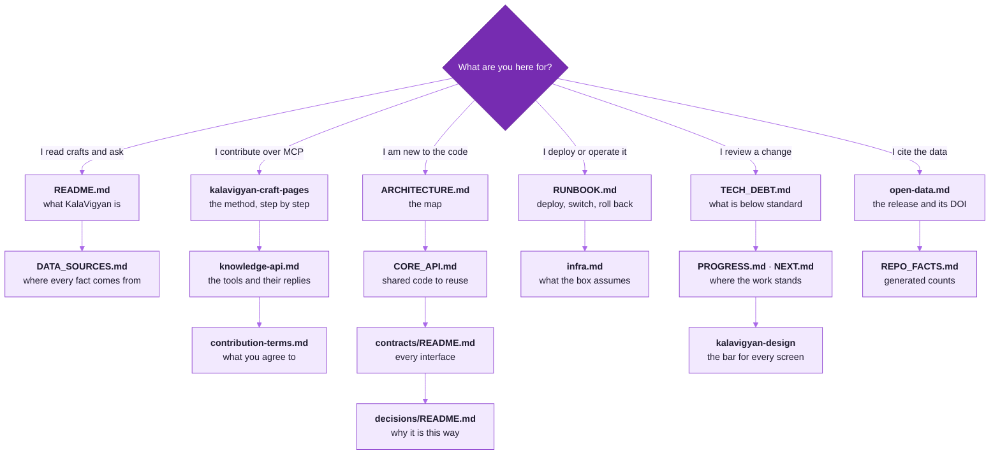

# Documentation

Start here. Every document below ends with a section saying **how it is kept true**: what
regenerates it, what to diff it against, and which changes should make someone re-read it. The
repository's front page is [README.md](../README.md); this is the map behind it.

| For | Read |
|---|---|
| The product in one page | [README.md](../README.md) |
| A count of anything (tables, routes, tools, tests) | [REPO_FACTS.md](REPO_FACTS.md), generated |
| How these pages are drawn | [readme-kit/README_STYLE.md](readme-kit/README_STYLE.md) |

---

## Where to start, by what you are doing

---

## Every document

### Start here

| Document | Answers | Audience |
|---|---|---|
| [README.md](../README.md) | What is KalaVigyan, how does it work, and where is everything? | Everyone |
| [README.md](README.md) | Which document answers my question? (this page) | Everyone |
| [REPO_FACTS.md](REPO_FACTS.md) | **Generated.** How many tables, migrations, routes, MCP tools, tests, records and lines of code? | Engineers, reviewers |

### The system

| Document | Answers | Audience |
|---|---|---|
| [ARCHITECTURE.md](ARCHITECTURE.md) | What are the deployed pieces and the backend layers, which way may imports point, and how does a question, a page, a lesson or a voice call travel through them? | Engineers |
| [CORE_API.md](CORE_API.md) | Which shared code already exists, where does it live, and what does each module promise? | Engineers, before writing any helper |
| [contracts/README.md](contracts/README.md) | What does each interface between lanes promise: routes, files, shapes and rules? One row per contract | Engineers, contributors' agents |
| [decisions/README.md](decisions/README.md) | Why is it built this way? One row per decision record, in the order they were taken | Engineers, reviewers |
| [DATA_SOURCES.md](DATA_SOURCES.md) | Which datasets and live sources does KalaVigyan read, under which licence, and how is each cited? | Engineers, researchers citing the data |

### The plan and the work

| Document | Answers | Audience |
|---|---|---|
| [PLAN.md](PLAN.md) | What is KalaVigyan meant to be? Section 0 is the owner's direction and overrides the rest | Everyone building it |
| [plans/answer-experience.md](plans/answer-experience.md) | How does an answer become an explainer of cited sections, and in which phases was it built? | Engineers |
| [plans/dataset-curation.md](plans/dataset-curation.md) | How is the knowledge base curated without paid model calls: the dossier, verification, the checker and the import? | Curators, engineers |
| [plans/field-completeness.md](plans/field-completeness.md) | How would every field reach every page, and what does the owner decide first? | The owner, the lead |
| [PROGRESS.md](PROGRESS.md) | What is done, what comes next and what waits on the owner? | Everyone |
| [NEXT.md](NEXT.md) | What is live now, what did the owner decide, and how does a new session start? | The lead, a new session |
| [TECH_DEBT.md](TECH_DEBT.md) | What was knowingly left below standard, why, and what would clear it? | Engineers, reviewers |

### Operating it

| Document | Answers | Audience |
|---|---|---|
| [RUNBOOK.md](RUNBOOK.md) | What is provisioned, how is it deployed, switched on and rolled back, and how are the scheduled runs dispatched? Ids and names only, never secret values | Operators |

### Design

| Document | Answers | Audience |
|---|---|---|
| [design/design-system.html](design/design-system.html) | The Alum & Indigo design system drawn: tokens, type, components and their states (decision 0092) | Engineers building screens |
| [design/master-board.html](design/master-board.html) | The board every screen is matched to at 360, 834 and 1440 px in light and dark | Engineers building screens, reviewers |
| [design/ajrakh-critique-2026-11-19.md](design/ajrakh-critique-2026-11-19.md) | How a critic scored the Kutch Ajrakh monograph, which fixes were applied and which wait for the owner | The owner, curators |
| `design/img/` | The open pictures the boards draw (Kutch Ajrakh, Blue Pottery, Dhokra, Madhubani and others) | Engineers building screens |
| `design/monograph-build.zip` | The build scripts of the approved Kutch Ajrakh monograph (decision 0100) | Engineers |

### Contributors' terms

| Document | Answers | Audience |
|---|---|---|
| [legal/contribution-terms.md](legal/contribution-terms.md) | What does a contributor give the Centre and confirm, and what happens to a contribution next? | Contributors |
| [legal/image-declaration.md](legal/image-declaration.md) | What does a contributor confirm when giving a picture? | Contributors |
| [legal/mcp-terms-of-use.md](legal/mcp-terms-of-use.md) | Where are the MCP terms of use served from, and how is a new version made? | Contributors, engineers |

### The README kit

| Document | Answers | Audience |
|---|---|---|
| [readme-kit/README_STYLE.md](readme-kit/README_STYLE.md) | How is a README in the organisation's style drawn: anatomy, tokens, templates, mermaid, tables, motion and CI? Identical in every sibling repository | Anyone editing a README or a document |
| [readme-kit/kit.json](readme-kit/kit.json) | Every word that appears in this repository's README images | Anyone editing the README |
| `readme-kit/assets/` | **Generated** by `node docs/readme-kit/tools/build.mjs`; never edited by hand | |
| `readme-kit/tools/` | The generator, the checks CI runs and the previews, copied unchanged from designer-portal | |
| [readme-kit/LICENSE-lucide.txt](readme-kit/LICENSE-lucide.txt) | The ISC licence of the Lucide icon geometry | |

### Outside `docs/`, read like documents

| Document | Answers | Audience |
|---|---|---|
| [kalavigyan-design](../.claude/skills/kalavigyan-design/SKILL.md) | The design system as rules: principles, tokens, components, templates, copy and acceptance | Anyone touching a screen or reader copy |
| [kalavigyan-craft-pages](../.claude/skills/kalavigyan-craft-pages/SKILL.md) | How a craft, family or category page is brought to the Kutch Ajrakh bar through MCP | Contributors, curators |
| [kalavigyan-datasets](../.claude/skills/kalavigyan-datasets/SKILL.md) | How open datasets become charts, tables, timelines and map layers | Contributors, engineers |
| [kalavigyan-interactives](../.claude/skills/kalavigyan-interactives/SKILL.md) | How each craft family's flagship interactive is chosen, storyboarded and proven | Contributors, engineers |
| [engineering-practices](../.claude/skills/engineering-practices/SKILL.md), [project-bindings.md](../.claude/skills/engineering-practices/references/project-bindings.md) | The house rules for any code, and this repository's folders, budgets, commands and living documents | Engineers |
| [backend-practices](../.claude/skills/backend-practices/SKILL.md), [frontend-practices](../.claude/skills/frontend-practices/SKILL.md) | The Python backend and user-interface specifics | Engineers |
| [naming](../.claude/skills/naming/SKILL.md) | The one naming convention for generated names, keys and files | Engineers |

---

## Known gaps

| Gap | Status |
|---|---|
| The contracts, the decision records and the skills are not yet in the house form | Other lanes edit them in round 7; a later lane restyles them. Their two index pages are in it already |
| Nothing checks that every file under `docs/` has a row here | Compare these tables with `ls -R docs` after each round's merges, until a check does it |

---

## How this document is kept true

It is an index, so it is wrong in two ways only: a document exists and is not listed, or a row names
a document that is gone. Each "Answers" line says what the document answers, not what it is called,
so a row is also wrong when its document's scope moves.

| Change | What to do here |
|---|---|
| A new document under `docs/` | add its row in the same change that adds the file |
| A new contract or decision record | add its row to [contracts/README.md](contracts/README.md) or [decisions/README.md](decisions/README.md) instead |
| A document renamed, merged or retired | change or remove its row in the same change |
| A document's scope moves | rewrite its "Answers" line from the document's own opening |

The README check (`readme-check.yml`) renders this page through GitHub and draws the flowchart above
on github.com, so a broken diagram or a malformed table fails the run.
