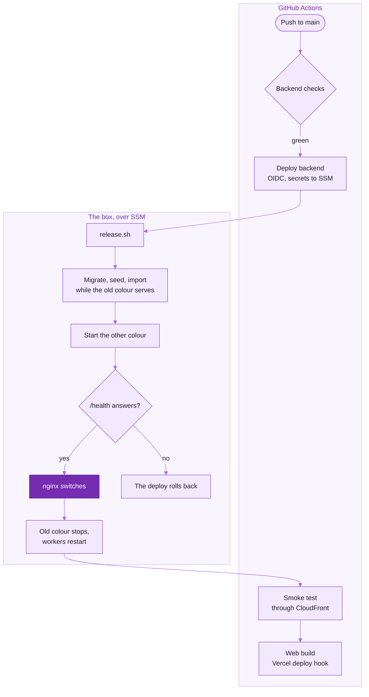

# KalaVigyan runbook

This page lists what is provisioned, how to deploy, and how to roll back. It holds ids and names only. Secret values live in GitHub Actions secrets and SSM Parameter Store, and nowhere else. Operators read it, and anyone switching a feature on.

| For | Read |
|---|---|
| What the box assumes from the code | [contracts/infra.md](contracts/infra.md) |
| The nightly schedule, its bounds and commands | [contracts/nightly-upkeep.md](contracts/nightly-upkeep.md) |
| How the pieces fit | [ARCHITECTURE.md](ARCHITECTURE.md), Deployed pieces |
| Every name in Parameter Store | `infra/.env.example` |

## What exists

| Thing | Id / name |
|---|---|
| AWS account / region | `626159998512` / `ap-south-1` |
| API box | EC2 `i-0a58a2feb528241aa` (`kalavigyan-api`, t3.large, Ubuntu 26.04, 40 GB gp3 encrypted, IMDSv2 only, no key pair) |
| Elastic IP | `13.206.8.117` (`ec2-13-206-8-117.ap-south-1.compute.amazonaws.com`). Port 80 answers CloudFront only. Nothing listens publicly on 22 or 443. |
| Security group | `sg-07ac2689e2bf12426` (`kalavigyan-api`): inbound 80 from prefix list `com.amazonaws.global.cloudfront.origin-facing` only |
| HTTPS API | `https://d89rsltpszebp.cloudfront.net`, CloudFront `E3J72POLWOPQ8T`, origin `kalavigyan-ec2-origin`, http-only to the origin, header `X-Origin-Verify`, CachingDisabled + AllViewerExceptHostHeader, PriceClass_200 |
| Media bucket | `kalavigyan-media-626159998512`: private, public access blocked, versioned, SSE-S3, TLS-only policy, CORS for `https://kalavigyan.vercel.app` + localhost:3000 |
| Terraform state | `s3://kalavigyan-tfstate-626159998512/kalavigyan/infra.tfstate` (versioned, private, S3 lockfile). DR's and FR's state are not touched. |
| IAM | user `kalavigyan-media` (API's S3 key), role + instance profile `kalavigyan-box`, role `kalavigyan-deploy` (GitHub OIDC, `repo:cxacraftecosystem-ui/KalaVigyan:ref:refs/heads/main` only) |
| Parameter Store | `/kalavigyan/env/*` (SecureString, one parameter per env key, the box's source of truth). `/kalavigyan/db-password` (Supabase DB password backup) |
| Database | Supabase project `science-behind-craft`, ref `inqbqiqspgvhfamupwuc`, org `pifvglrcqwrizapmooik`, ap-south-1, Postgres 17.11 on Small compute (`max_connections` 90). Session pooler `aws-1-ap-south-1.pooler.supabase.com:5432`, user `postgres.inqbqiqspgvhfamupwuc`, pool size 30 (`max_client_conn` 400); see Connection budget |
| Web | Vercel project `kalavigyan` (`prj_5hRNy7S9CS4fkhVVBRW5mbmAAUSd`), team `team_pcTf4Alb2DCIwq2IZcdu00dS`, root `frontend`, Node 26.x, no Git link, `https://kalavigyan.vercel.app` |
| Repository | `github.com/cxacraftecosystem-ui/KalaVigyan` (deploys); mirror `github.com/ankits1802/science-behind-craft` (public, no deploys) |

### On the box

| Path / unit | Role |
|---|---|
| `/opt/kalavigyan/releases/<sha>` | One directory per release: `backend/` with its own `.venv`, `infra/deploy/`, `REVISION` |
| `/opt/kalavigyan/slot-8000`, `slot-8001`, `current` | Symlinks used by blue/green. nginx proxies to exactly one port. |
| `/opt/kalavigyan/.env`, `fetcher.env` | Rendered from Parameter Store by `kv-render-env` (0640 root:kalavigyan) |
| `kv-api@8000`, `kv-api@8001` | The two API colours (user `kalavigyan`, MemoryMax 3000M, Restart=always) |
| `kv-worker`, `kv-fetcher` | Started only once a release ships `app.worker` / `app.fetcher`. `app/worker.py` (the media queue, decision 0018) ships with the media backend; `journalctl -u kv-worker` shows its jobs. |
| `api-watchdog.timer` | Restarts a running colour after 2 failed `/health` checks a minute apart (`journalctl -t api-watchdog`) |
| nginx site `kalavigyan` | `:80`. The snippet `kalavigyan-origin-verify.conf` returns 403 without CloudFront's header; loopback is exempt. |
| `redis-server` | `127.0.0.1:6379`, 256 MB LRU |
| Docker `searxng` | `127.0.0.1:8888`, image `searxng/searxng:2026.11.15-2d500cb6b`, settings `/etc/searxng/settings.yml` |
| `/opt/cpython/<version>+<build>` | Standalone CPython (python-build-standalone, sha256-checked), one directory per interpreter a release has pinned in `infra/deploy/python.pin`: `3.15.2+20261110` from round 7 (decision 0118) beside `3.14.10+20261110`, which the box was built with and the releases before it still run. Nothing removes one. uv 0.13.9 in `/usr/local/bin` |
| `/usr/local/sbin/kv-blue-green`, `kv-render-env` | Installed from `infra/deploy/` on every release |
| certbot | Installed, unused: TLS ends at CloudFront. It is there for a custom domain later. |

## Monographs

The served monograph (`frontend/public/monographs/kutch-ajrakh/index.html`) is built from
`backend/app/data/monographs/Kutch-Ajrakh/content.json` and `template.html` (decision 0105). Never
edit the served file: change the content or the template, then run
`cd backend && python -m app.scripts.build_monograph`. `--check` reports a page that differs from its
build, and the backend tests fail until the two agree.

To put a monograph's content into the database (sections by field, the component registry and
its `MonographDocument`), run `python -m app.scripts.load_monograph` on the box after the deploy
that carries it. It can be run again at any time and prints what it wrote and what still waits for
stored facts. The template is a shell plus `fragments/` and the kit in `monographs/kit/`; the build
also writes the kit to `frontend/public/monographs/kit/`. After a change to the content or a spec,
rewrite the golden document with
`python -m app.scripts.build_monograph --document Kutch-Ajrakh --out ../shared/monograph.document.golden.json`.

Each backend deploy rebuilds the stale craft page snapshots after the import (`app.scripts.rebuild_stale_pages`,
at most `PAGES_SECONDS`, 480 by default), because a curated craft's document reads its snapshot and a
stale one is rebuilt on every read (about 9 s), which times the web build out. The nightly upkeep
rebuilds whatever a deploy leaves.

Each curated craft's document is generated from the sections its dossier's claims publish at import
(round 6). The backend deploy's `import_curation` writes them; to write them without a deploy, run
`python -m app.scripts.publish_curated_sections` on the box (it prints written, unchanged, waiting
and refused, and exits 2 only when a dossier does not parse).

Each curated craft's first `PageLayout` comes from its dossier's picture placements: run
`python -m app.scripts.backfill_layouts` on the box once after the deploy that adds migration 0042.

The parity proof of decision 0106 is the **Monograph parity** workflow (Actions, run it by hand,
optionally on a preview URL). It compares `/crafts/Kutch-Ajrakh/monograph` with the approved static
page at 360, 834 and 1440 in light and dark and keeps `text.json`, `pixels.json`,
`interactions.json` and the differing chapters' screenshots as its artifact.

## Connection budget

Every process on the box reaches Postgres through the Supabase session pooler, which holds at most
30 server connections for our user (the dashboard's Database → Settings → Connection pooling;
read with `supabase config pull --remote=inqbqiqspgvhfamupwuc`, and only the dashboard can
change it). Each process's SQLAlchemy pool opens connections as it needs them, up to
`DATABASE_CONNECTION_LIMIT`, and keeps them.

- **Holders:** the serving API slot (up to the limit), the worker (its peak, a few), and a script
  run over SSM (one or two). A deploy stops the worker before the swap, so the old and new slots
  briefly share the budget.
- **The limit is 12** (2026-11-19: 5, then 8, then 12 once the owner raised the pooler from 15 to
  30). During a deploy the old and new slots can hold 24 between them, plus the worker and a
  script, which stays under 30.
- **To go further,** raise the pool size in the dashboard first (Small compute has 90 connections
  in all, and Supabase's own services use some), then `DATABASE_CONNECTION_LIMIT` at
  `/kalavigyan/env/`, then `sudo kv-render-env && sudo kv-blue-green restart`. Never raise the
  limit past what the pooler holds: a slot that cannot connect fails its health check and the
  deploy rolls back.

## Shell on the box

```bash
aws ssm start-session --target i-0a58a2feb528241aa --region ap-south-1
sudo kv-blue-green status
```

## Secrets

Every secret and every repository variable is in GitHub and in Parameter Store (owner, 2026-11-21: "store all the variables in AWS too"). What the box reads is in three places: a GitHub Actions secret, `/kalavigyan/env/<NAME>` in Parameter Store, and `/opt/kalavigyan/.env` on the box. What only CI reads stays outside `/kalavigyan/env/`, so it never reaches the box `.env`: the E2E accounts under `/kalavigyan/e2e/` (the Researcher's `E2E_EMAIL` and `E2E_PASSWORD`, the Professor's and Admin's emails, passwords and two-step secrets; E2E production run, below), `VERCEL_AUTOMATION_BYPASS_SECRET` under `/kalavigyan/ci/`, and every GitHub variable as a plain String under `/kalavigyan/config/<NAME>`. Deploy backend keeps them in step on every run: its step "Mirror the CI secrets and the repository variables into Parameter Store" writes what changed (the deploy role may write only `/kalavigyan/env/*`, `/kalavigyan/e2e/*`, `/kalavigyan/ci/*` and `/kalavigyan/config/*`), and a name not set in GitHub keeps what Parameter Store has.

- GitHub secrets: `DATABASE_URL`, `JWT_SECRET`, `SECRETS_ENCRYPTION_KEY`, `TWO_FACTOR_ENCRYPTION_KEY`, `ORIGIN_VERIFY_SECRET`, `AWS_ACCESS_KEY_ID`, `AWS_SECRET_ACCESS_KEY`, `GEMINI_API_KEY`, `ELEVENLABS_API_KEY`, `GOOGLE_CLIENT_ID`, `MASTER_ADMIN_EMAIL`, `MASTER_ADMIN_NAME`.
- GitHub variables: `AWS_REGION`, `AWS_DEPLOY_ROLE_ARN`, `AWS_RIVER_LOAD_ROLE_ARN` (decision 0050), `EC2_INSTANCE_ID`, `MEDIA_BUCKET`, `API_BASE_URL`, `CLOUDFRONT_DISTRIBUTION_ID`, `WEB_ORIGIN`, `VERCEL_ORG_ID`, `VERCEL_PROJECT_ID`.
- Parameter Store also holds non-secret config (`APP_ENV`, `BACKEND_CORS_ORIGINS`, `FORWARDED_CLIENT_HOPS`, `REDIS_URL`, `SEARXNG_URL`, …). See `infra/.env.example` for every name.
- Copied from the DR box without printing them: `GEMINI_API_KEY`, `ELEVENLABS_API_KEY`, `GOOGLE_CLIENT_ID`, `MASTER_ADMIN_EMAIL`, `MASTER_ADMIN_NAME`.
- `CROSS_PORTAL_TOKEN`: copied without printing from the shared SSM SecureString `/iit/shared/cross-portal-token` (the designer and documentation portals' value) into `/kalavigyan/env/CROSS_PORTAL_TOKEN` and the GitHub secret on 2026-11-16. `DESIGNER_PORTAL_API_URL` and `FIELD_REPOSITORY_API_URL` are in Parameter Store. The box `.env` gets all three at the next deploy's render.

**The owner still has to add these** (none of them were on the DR box):

| Name | Where |
|---|---|
| `ANTHROPIC_API_KEY`, `OPENAI_API_KEY`, `DEEPSEEK_API_KEY`, `BRAVE_SEARCH_API_KEY` | GitHub secrets. The next backend deploy copies them into Parameter Store and the box. |
| `VOYAGE_API_KEY` | Set on 2026-11-21 (the reranker, Voyage `rerank-3`): a GitHub secret and `/kalavigyan/env/VOYAGE_API_KEY`; each deploy keeps them in step. To rotate it, make a new key at dash.voyageai.com and `gh secret set VOYAGE_API_KEY`; the next deploy copies it. Without it (unset, or refused by Voyage, which marks it FAILED under API keys) answers still work: each search that asks for reranking keeps its fused order, still gives each fact one slot, logs one warning (`the search keeps its fused order: reranking failed (no_key)`, or the failure's kind) and is charged nothing (an unset key reserves nothing; a refused one settles its reservation as an error at $0); stored knowledge is then judged by the fused rule (decision 0125). Reranking resumes on the next search once the key is set, here or as a managed key under Settings, API keys. |
| `TURNSTILE_SECRET_KEY`, `TURNSTILE_SITE_KEY` | Create a Cloudflare Turnstile widget for `kalavigyan.vercel.app`. The secret is a GitHub secret and the site key a GitHub variable; each deploy copies both into Parameter Store. Until both exist, production email sign-up is closed and the page offers Google only. |
| `WEB_PROXY_SECRET` | Re-run `seed_secrets.py` once: it generates the value and writes Parameter Store, the GitHub secret and the Vercel env (Sensitive). It also deletes the retired names `AWS_S3_BUCKET`, `BRAVE_API_KEY`, `NEXT_PUBLIC_APP_URL`, `DATABASE_USE_TRANSACTION_POOLER`, `TWO_FACTOR_KEY_REQUIRED` and `MEDIA_PRESIGNED_READS` from Parameter Store. |
| `WEB_REVALIDATE_SECRET` | Set on 2026-11-20 (Parameter Store and the Vercel env, production and preview). To set it from scratch, re-run `seed_secrets.py` once: it generates the value and writes Parameter Store (the box `.env` gets it at the next render; the API sends it as `x-revalidate-secret`) and the Vercel env (Sensitive), where `frontend/app/api/revalidate/route.ts` compares it in constant time. It is not a GitHub secret. Until both sides hold it, hiding a piece or picture, retracting or rejecting a live fact, rejecting testimony and approving structure leave signed-out pages to their daily rebuild, and the API logs that the secret is not set. To rotate it, delete `/kalavigyan/env/WEB_REVALIDATE_SECRET`, re-run the script and redeploy both sides. |
| `VOICE_LLM_BEARER`, `VOICE_SESSION_HMAC_KEY`, `TRANSCRIPT_ENCRYPTION_KEY` | Re-run `seed_secrets.py` once: it generates all three like the other generated keys and writes Parameter Store and the GitHub secrets; Deploy backend keeps them in sync. Voice stays hidden until `TRANSCRIPT_ENCRYPTION_KEY` and `ELEVENLABS_API_KEY` exist. |
| `MEDIA_BUNDLE_HMAC_KEY` | Re-run `seed_secrets.py` once: it generates it like the voice keys and writes Parameter Store and the GitHub secret; Deploy backend keeps it in sync. Media stays hidden and `kv-worker` waits until it exists. |
| `ELEVENLABS_AGENT_ID` | Only for the `AGENT` transport: after the voice agent is provisioned (Voice, below), store the printed agent id as a GitHub secret and deploy. |
| `CORE_API_KEY` | Rotate it with CORE: a settings error on the laptop printed the start of the old value. The backend now hides input values in settings errors. |
| `MAIL_FROM_ADDRESS` | Parameter Store, once an SES identity is chosen for KalaVigyan mail |
| Google OAuth client | Add `https://kalavigyan.vercel.app` to the client's Authorized JavaScript origins |
| `YAHOO_CLIENT_ID`, `YAHOO_CLIENT_SECRET`, `NEXT_PUBLIC_YAHOO_CLIENT_ID` | Register the Yahoo app and set the three names as in Yahoo sign-in, below. Until then there is no "Continue with Yahoo" button. |

To change a secret: `gh secret set NAME --repo cxacraftecosystem-ui/KalaVigyan`, then run **Deploy backend**. The deploy copies changed GitHub secrets into Parameter Store and re-renders the box `.env`. For config that is not a GitHub secret:

```bash
aws ssm put-parameter --region ap-south-1 --name /kalavigyan/env/NAME --type SecureString --overwrite --cli-input-json file://value.json
sudo kv-render-env && sudo kv-blue-green restart     # on the box
```

`infra/scripts/seed_secrets.py` rebuilds the whole set. It keeps existing generated keys, takes the Terraform outputs, and writes Parameter Store, GitHub, Vercel and the box. Run it with a Python that has `boto3` and `cryptography`, passing `--terraform <path to terraform>`. `--copy-from-instance <id>` copies the provider keys from another box's `.env` over an RSA-encrypted SSM channel.

Never rotate `TWO_FACTOR_ENCRYPTION_KEY`, `SECRETS_ENCRYPTION_KEY` or `TRANSCRIPT_ENCRYPTION_KEY` by overwriting them: stored data is encrypted with them.

## Yahoo sign-in

Decision 0026. The backend redeems Yahoo's code with the client secret, so the secret never reaches a browser.

1. Register the app at `https://developer.yahoo.com/apps/create/`, signed in with the project's Yahoo account:
   - Application Name `KalaVigyan`, Homepage URL `https://kalavigyan.vercel.app`.
   - Redirect URI(s): exactly `https://kalavigyan.vercel.app/login/callback`. The backend accepts only `PUBLIC_WEB_URL` + `/login/callback`, so the two must match; a new web domain needs both changed.
   - OAuth Client Type: Confidential Client.
   - API Permissions: OpenID Connect Permissions, with Email and Profile ticked. Without Email the ID token carries no verified address and every sign-in is refused.
   - Create the app and keep the page open: it shows the Client ID (Consumer Key) and Client Secret (Consumer Secret).
2. Backend first: `gh secret set YAHOO_CLIENT_ID --repo cxacraftecosystem-ui/KalaVigyan` and `gh secret set YAHOO_CLIENT_SECRET --repo cxacraftecosystem-ui/KalaVigyan` (paste each value at the prompt, never on the command line), then run **Deploy backend**. It copies both into Parameter Store and the box `.env`. `GET https://kalavigyan.vercel.app/api/auth/config` then answers `yahooEnabled: true`.
3. Then the web: add `NEXT_PUBLIC_YAHOO_CLIENT_ID` (the same Client ID, Encrypted, Production and Preview) to the Vercel project, or re-run `seed_secrets.py`, which sets it from Parameter Store once both Yahoo values are there. Redeploy the web app: the value is read at build time. The login page now shows "Continue with Yahoo".
4. Check: sign in with a Yahoo address that is on the access roster. An address not on the roster becomes a PENDING request, exactly as with Google.

Rotating the secret: create a new secret on the Yahoo app page, `gh secret set YAHOO_CLIENT_SECRET`, deploy. A wrong or retired secret turns every Yahoo sign-in into "Yahoo sign-in didn't work" and the API log shows `oidc: the provider refused the redemption` with `invalid_client`. To switch Yahoo off, delete `NEXT_PUBLIC_YAHOO_CLIENT_ID` in Vercel and redeploy the web, then remove the two backend values from GitHub and `/kalavigyan/env/` and deploy.

Microsoft sign-in is built the same way and stays off: leave `MICROSOFT_CLIENT_ID`, `MICROSOFT_CLIENT_SECRET`, `MICROSOFT_TENANT` and `NEXT_PUBLIC_MICROSOFT_CLIENT_ID` unset.

## Voice

Decision 0017; contract `docs/contracts/voice.md`.

- The live call is off (decision 0035): `VOICE_CALL_ENABLED` defaults to false, so every
  `/api/voice` route answers 404 and no voice button is drawn. Turning it on means adding
  `VOICE_CALL_ENABLED=true` to the environment **Deploy backend** writes to the box `.env` (a
  workflow change and a deploy); the call then starts from the craft page's Talk button only (the
  mic on `/ask` is dictation, decision 0036).
- Signature figures (decision 0086) are off: `SIGNATURE_FIGURES_ENABLED` defaults to false, so
  no lede carries a figure. Switch it on only with the redesigned answer page that draws them: put
  `SIGNATURE_FIGURES_ENABLED=true` at `/kalavigyan/env/SIGNATURE_FIGURES_ENABLED` and re-render the
  box `.env` (`sudo kv-render-env`); no model call or key is needed.
- Listen (decision 0035) needs only `ELEVENLABS_API_KEY` (Settings, API keys) and `S3_BUCKET`. Its
  audio lives under `media/narration/<cacheId>/` in the media bucket (part MP3s, then
  `narration.json`, and a `lease.json` only while one request makes it); deleting a folder only
  makes the next listener synthesise it again, and the bucket's `expire-narration` rule deletes
  every narration object a year after it was written (`narration_days`, decision 0140). The voice
  is `AppSetting` `voice.voice_id`; changing it starts a new cache. A voice call's reply audio is
  kept under `media/voice-replies/` for a day (`expire-voice-replies`, `voice_reply_days`).
- Film scores (decision 0058) use the same key through the media router: Settings, AI routing
  shows Film music (`music_v2_5`) and Film sound effects (`eleven_text_to_sound_v3`), seeded by
  migration `0022_elevenlabs_media`. The restricted key needs the Music and Sound Effects
  permissions; the ElevenLabs image and video choices (`gemini-3.1-flash-image`,
  `veo-3.1-fast-generate-001`, not in any chain until an admin adds them) need the Image and Video
  permission and a Pro plan. Spend counts against a media sub-cap when one is set (none is, decision 0093). Clips live under
  `media/score/<cacheId>/` (MP3 and `clip.json`) and each score's manifest under
  `media/score/<answerId>/<language>/score.json`; deleting either only makes the next ask make it
  again. A finished ElevenLabs image or video is fetched only from `storage.googleapis.com`
  (decision 0061); if a generation fails with "generation link answer is off its documented shape",
  ElevenLabs has moved its downloads: add the new host to
  `providers/elevenlabs_download.DOWNLOAD_HOSTS` after checking the reference.

- Transport, calls at once and voice: a Master Admin sets them on the Settings hub's Voice calls
  block (`GET` and `PUT /api/settings/voice`, decision 0140): `voice.transport` stays `RELAY` until
  the ElevenLabs spike passes; `voice.max_live_sessions` (default 5, 0 to 100) is the bought plan's
  concurrent-call limit; `voice.voice_id` is the ElevenLabs voice. Each save is audited
  (`settings.voice_updated`).
- Agent: `cd /opt/kalavigyan/current/backend && sudo -u kalavigyan bash -c 'set -a; . /opt/kalavigyan/.env; set +a; .venv/bin/python -m app.scripts.provision_voice_agent --dry-run'`
  prints the body; without `--dry-run` it creates or updates the workspace secret
  `KALAVIGYAN_VOICE_LLM_BEARER`, the client tools `show_on_map`, `open_stage`, `show_sources`,
  `offer_image` and the agent `KalaVigyan voice`, and prints the agent id (not a secret). Needs
  `PUBLIC_API_URL`, `VOICE_LLM_BEARER` and `ELEVENLABS_API_KEY`.
- Rotating `VOICE_LLM_BEARER` (quarterly): `gh secret set VOICE_LLM_BEARER`, deploy, then run the
  provisioning script again so the workspace secret matches; calls in progress end with a 401.
- Upkeep: `kv-worker` runs `voice/daily_upkeep.daily_voice_upkeep` when it starts and every 24 hours
  after (decision 0140); its log line `daily voice upkeep` carries the JSON report of closed, purged,
  reconciled and refunded seconds, at error level when a call could not be settled.

## Deploy



Automatic: a push to `main` that touches `backend/**`, `shared/**`, `infra/deploy/**`, `backend-checks.yml` or `deploy-backend.yml` → **Backend checks** → **Deploy backend**. Vercel builds the web app from `main` on its own.

Deploy backend (`.github/workflows/deploy-backend.yml`):

1. Assumes `kalavigyan-deploy` through GitHub OIDC (no static AWS keys in GitHub).
2. Copies changed secrets into `/kalavigyan/env`.
3. Uploads `git archive HEAD backend infra/deploy` to `s3://kalavigyan-media-626159998512/deploy/backend/<sha>/KalaVigyan_API_Release-Build_<sha12>.tar.gz`.
4. Runs `infra/deploy/release.sh <sha>` on the box over SSM `AWS-RunShellScript`, logging to `deploy/logs/<sha>/`. The script installs units, renders the env, installs the CPython that `infra/deploy/python.pin` names into `/opt/cpython/<version>+<build>` unless it is there (over https, checksum checked before it is unpacked, staged then moved, root-owned; decision 0118), builds the venv with uv on that interpreter, then `blue_green.sh release <sha>`:
   1. migrate (`alembic upgrade head`), seed (`seed_crafts`, `seed_claims`, `seed_districts`) and import the curated dossiers (`import_curation`, decision 0053; a refused dossier exits 2 and stops the release like a failed seed) while the old colour serves, then sync crafts from both portals (`sync_portal_crafts`; a failure is a warning, the release goes on) and embed what the seeds and the import wrote (`embed_craft_descriptors`, then `embed_knowledge`, each bounded to 240 seconds; a failure is a warning too);
   2. start the other colour;
   3. wait for `/health`;
   4. switch nginx;
   5. stop the old colour;
   6. restart the worker and fetcher.

   It keeps the newest 5 releases.

   Pages (round 7): after the embeds, `rebuild_stale_pages` (bounded by `PAGES_SECONDS` = 480) rebuilds only the page snapshots whose stamp moved. A stamp hashes the page's data and a fingerprint of the code that builds pages (`services/page_code.py`), not the release, so a deploy that changes no page code rebuilds nothing; the report carries `pageCode`. The first deploy after a change to page code restales every page once.
5. Smoke-tests `https://d89rsltpszebp.cloudfront.net/health`.

Craft sync (`.github/workflows/craft-sync.yml`): daily at 21:37 UTC and on dispatch, runs `app.scripts.sync_portal_crafts` in `/opt/kalavigyan/current/backend` on the box over SSM, logging to `deploy/logs/craft-sync/<run id>/`. It prints one JSON report and fails when a portal did not answer (`docs/contracts/portal-craft-feed.md`).

Field voices sync (`.github/workflows/field-voices-sync.yml`): daily at 22:17 UTC (after the craft sync) and on dispatch, runs `app.scripts.sync_field_voices` on the box over SSM (up to 90 minutes), logging to `deploy/logs/field-voices-sync/<run id>/`. It prints `{ok, enabled, error, portals: [{portal, ok, skipped, error, streams: [{stream, pages, liveApplied, goneApplied, imagesStored, refusedPages, withdrawnUnlisted, portalScrubMisses, caughtUp, reconciled, error}]}]}` and fails when a portal or stream failed. While `FIELD_VOICES_ENABLED` is unset or false it reads nothing and succeeds; a portal that has not shipped the routes answers 404 and is reported `skipped: not_served`. To switch it on: `FIELD_VOICES_ENABLED=true` and `FIELD_VOICES_IMAGE_HOSTS` (both portals' bucket hosts, see `infra/.env.example`) at `/kalavigyan/env/`, with `CROSS_PORTAL_TOKEN`, `DESIGNER_PORTAL_API_URL`, `FIELD_REPOSITORY_API_URL`, `PUBLIC_WEB_URL` and `PUBLIC_API_URL` (https) already set, then `sudo kv-render-env`. Images are stored only when `S3_BUCKET` and an https `PUBLIC_API_URL` are set. Nothing reaches KalaVigyan until a portal has shipped its routes and set its own `CROSS_PORTAL_FIELD_VOICES_ENABLED` (and `FIELD_VOICES_RIGHTS_HOLDER` for images).

Alert digest (`.github/workflows/alert-digest.yml`): Mondays at 03:30 UTC (09:00 India time) and on dispatch, runs `app.scripts.send_alert_digest` on the box over SSM, logging to `deploy/logs/alert-digest/<run id>/`. It prints `{enabled, weekOf, readers, sent, failed, ok}`; while `ALERT_DIGEST_ENABLED` is unset or false it sends nothing and succeeds. To switch it on, after an SES sender identity is verified for `MAIL_FROM_ADDRESS` (region `MAIL_SES_REGION`) and the account is out of the SES sandbox: put `ALERT_DIGEST_ENABLED=true` at `/kalavigyan/env/ALERT_DIGEST_ENABLED` as above and re-render the box `.env` (`sudo kv-render-env`). Enabled without `MAIL_FROM_ADDRESS` it fails without sending. Readers opt in under Settings (decision 0063).

Coverage enrichment (`.github/workflows/coverage-enrichment.yml`): daily at 22:17 UTC and on dispatch, runs `app.scripts.embed_craft_descriptors` (missing craft name-and-alias vectors for the resolver, decision 0016), `app.scripts.embed_knowledge` (fills every missing claim, chunk and knowledge-piece vector, so the backlog is never embedded inside a learner's request, decision 0013), `app.scripts.link_compounds` (links every unlinked compound with a formula to its PubChem record, fills the formula and the PubChem record source of a compound whose CID a curated dossier or the science seed gave, when PubChem holds the same composition, and prints `{linked, filled, notFound, failed, ok}`, decisions 0045 and 0088), `app.scripts.build_craft_chapters` (keeps the 3D conformers of the curated and read crafts' compounds in the media bucket and `Compound.conformerKeptAt`, stores the Wikidata points of dossier places, rebuilds both page snapshots of every curated craft and every craft with a snapshot, logs an error naming a craft whose page changed under an unchanged stamp, and prints `{crafts, conformersKept, conformersWithout3d, pointsKept, pagesRebuilt, pagesChanged, failed, ok}`, decision 0098) and last `app.scripts.recheck_saved` (re-checks every saved explainer for new cited claims in its fields, writes "This answer got better" notes, no model call, prints `{checked, notified, ok}`, decision 0063) in `/opt/kalavigyan/current/backend` on the box over SSM, logging to `deploy/logs/coverage-enrichment/<run id>/`; the step fails when any of them fails. Since commit fdf478c it no longer researches crafts or rebuilds pieces (`app.scripts.rebuild_pieces` and `app.scripts.enrich_coverage` are not run; the dataset is curated by Claude Code, `docs/plans/dataset-curation.md`).

Running the same sha again re-renders the env and restarts the live colour.

Frontend: the API goes first, then the web app. Vercel never builds from Git
(`frontend/vercel.json` turns Git deployments off for every branch); the production build is started through the
Vercel deploy hook (`/kalavigyan/env/VERCEL_DEPLOY_HOOK_URL`) by the action
`.github/actions/build-web-app`, which builds `main` and takes the domain when it is ready.

- A push that changes the API (any of the **Backend checks** push paths): the last step of
  **Deploy backend**, once the API answers through CloudFront, starts the build. A failed backend
  deploy leaves the web app as it is.
- A push that changes only the web app (`frontend/**`): **Deploy web app** starts the build at once. A push that changes only the specs under `frontend/e2e/**` builds nothing; Frontend checks still run them.
  It reads the Backend checks push paths from that workflow and leaves the build to Deploy backend
  when the push touches any of them.
- By hand: run **Deploy web app** from Actions, or **Build pages now** in admin settings.

No watcher or manual promote is needed. The nightly upkeep does not build the site: it refreshes only the pages whose content changed (decision 0119).

To check a branch before it ships, deploy a preview from
the repository root (the root `.vercelignore` uploads only `frontend/`):
`VERCEL_ORG_ID=team_pcTf4Alb2DCIwq2IZcdu00dS VERCEL_PROJECT_ID=prj_5hRNy7S9CS4fkhVVBRW5mbmAAUSd vercel deploy --yes`,
then run **Capture screens** or **Monograph parity** with that preview's address as `base_url`; both
pass the preview protection with `VERCEL_AUTOMATION_BYPASS_SECRET`.

## MCP server

The tools of `docs/contracts/knowledge-api.md` and `docs/contracts/open-work.md` at
`POST <PUBLIC_API_URL>/api/mcp`, the address to give an MCP client (decisions 0103 and 0101). The
same route also answers through the site at `<PUBLIC_WEB_URL>/api/mcp`, anonymously. Signing in
(OAuth 2.1, `docs/contracts/mcp-oauth.md`) needs `PUBLIC_API_URL` and `PUBLIC_WEB_URL` to be https
origins; the issuer is the API origin and the consent page is `<PUBLIC_WEB_URL>/oauth/authorize`.

1. Switch on: put `MCP_SERVER_ENABLED=true` at `/kalavigyan/env/MCP_SERVER_ENABLED`, then
   `sudo kv-render-env` on the box (a deploy also re-renders it).
2. Check: `curl -s -X POST <PUBLIC_API_URL>/api/mcp -H 'content-type: application/json' -d
   '{"jsonrpc":"2.0","id":1,"method":"tools/list"}'` lists the read, proposal and open-work tools.
3. Switch off: `MCP_SERVER_ENABLED=false` and re-render; the route answers 404.

### Open data with a DOI (decisions 0116 and 0130)

`.github/workflows/open-data.yml` (dispatch only, from `main`) builds a release of KalaVigyan's open knowledge on the box (`app.scripts.build_open_data`), deposits it on Zenodo from the runner and records it (`OpenDataRelease`); `/data` and `GET /api/open-data` show it. Before the first release the owner, once:

1. Creates an account on https://sandbox.zenodo.org and one on https://zenodo.org.
2. On each: Account, Applications, Personal access tokens, New token named `kalavigyan-open-data` with the scopes `deposit:write` and `deposit:actions`.
3. Adds them as repository secrets `ZENODO_SANDBOX_TOKEN` and `ZENODO_TOKEN`.

A dispatch without `publish=true` goes to the sandbox; `publish=true` publishes on Zenodo and needs `ZENODO_TOKEN` (the run stops before sending anything without it). The Zenodo token never reaches the box. A published version is never rebuilt.

A craft release (decision 0130): give `craft` its exact slug, for Kutch Ajrakh `Kutch-Ajrakh` (`gh workflow run open-data.yml -R cxacraftecosystem-ui/KalaVigyan --ref main -f craft=Kutch-Ajrakh`, unticked so it goes to the sandbox). Its first run opens a new Zenodo record with its own concept DOI; later runs for the same craft add versions to it, never to the whole-knowledge record. An unknown or merged slug stops the run at `latest`, before anything is sent. Until the owner says otherwise (2026-11-22: "do not publish anything yet, just sandbox it"), craft releases run on the sandbox only.

### Contributions at scale (round 7)

- **Allowances** are counted per account and kind in each clock hour (UTC) in Postgres (`AllowanceBucket`, `core/allowances.py`), so a restart does not reset them and both deploy slots share them; the nightly upkeep deletes buckets over a day old. A refusal saying the call "could not be counted" means the allowance database was unreachable or slow; it lifts in a minute.
- **The release checks**: the post-deploy check reads `E2E_EMAIL` and `E2E_PASSWORD`, takes an optional `base_url`, operates every control of the live site (`frontend/e2e/release/controls.spec.ts`) and skips its page job after a deploy that built no web. Lighthouse on a preview blocks `vercel.live`, whose feedback toolbar otherwise costs best practices; production never carries it.

- **The contribution worker** `kv-contributions` (a systemd unit beside `kv-worker` and `kv-fetcher`,
  restarted by every deploy) takes queued proposals and runs their gates off the request
  (`docs/contracts/knowledge-writes.md`). Read it with `journalctl -u kv-contributions`. Its
  concurrency is `CONTRIBUTION_WORKERS` in `/opt/kalavigyan/.env` (optional). To drain the queue by
  hand: `python -m app.scripts.contribution_worker --once` (Shell on the box).
- **Picture screens** need an enabled CAPTION route (a vision model, Settings, Routing). Without
  one, every picture waits for a person as `UNSCREENED`. After the deploy that adds them, run
  `python -m app.scripts.fingerprint_pictures` once so stored pictures get their perceptual
  hashes, and restart `kv-fetcher` if a deploy did not.
- **Live research write-back** can be checked read-only with `python -m app.scripts.write_back_report`
  (the runs of the last 14 days, their gate checks and states).
- **Where each write-back belongs** (decision 0136): `python -m app.scripts.write_back_filing
  --answer <answer id>` or `--since YYYY-MM-DD` re-runs today's filing on each live-research fact's
  statement, quote, the stored passage and the source's title, and prints where it would be filed
  against where it is, plus the facts with no gate checks. It never writes. A reviewer acts on it in
  the review queue: approve (optionally with `craft` to file a held fact under another craft) or
  reject. Held facts are `DRAFT`, which no reader or search sees.

## Nightly upkeep and page builds

`docs/contracts/nightly-upkeep.md` names the schedule, the bounds and the commands. The nightly
workflow runs `app.scripts.nightly_upkeep` on the box over SSM, which rebuilds stale snapshots and
documents and then refreshes only the pages whose content moved through the web's `/api/revalidate`
(`WEB_REVALIDATE_SECRET`); a night that changed nothing sends nothing and no site build runs
(decision 0119). Releases and "Build pages now" in admin settings still build through the Vercel
deploy hook, read from `/kalavigyan/env/VERCEL_DEPLOY_HOOK_URL` (SecureString; never printed);
without it "Build pages now" answers 503.

## Bulk export

`python -m app.scripts.export_knowledge --out <folder> [--craft <slug> ...]` on the box writes one
JSON file per craft (`docs/contracts/knowledge-api.md`, Bulk export); the same document is served
at `GET /api/knowledge/crafts/{slug}/export`.

## AI spend and token limits

No caps for now, on anyone, in money or tokens (owner, 2026-11-18; decision 0093). Every cap is
still a setting whose default is "none", and every call is still reserved and settled in
`UsageEvent` with its cost, so `/admin/usage` shows all spend; voice seconds and media units are
still written to `QuotaLedger`.

Migration `0029_unlimited_ai_use` is the one data step. The deploy's `alembic upgrade head` runs
it once, while the old colour serves; a second run changes nothing. It changes these production
rows:

- `AppSetting`: deletes `AI_MONTHLY_CEILING_USD`, `AI_MEDIA_CAP_USD`, `AI_ROLE_DAILY_USD`,
  `AI_DEGRADE_AT_FRACTION` and `AI_ANSWER_CAP_USD` (seeded as $800, $150, the per-role daily caps
  and 0.8; the answer caps if a Master Admin had stored them), so the code defaults, none, govern.
  `AI_MODEL_PRICES`, `SIGN_UP_MODE`, `DOMAIN_ALLOWLIST` and the `voice.*` rows are not touched.
  Until the switch the old release reads the missing rows as its own capped defaults and keeps
  answering.
- `QuotaPolicy`: `perDay` and `perMonth` to NULL on every row (the seeded seconds, images and
  videos per role). No code reads this table; `core/roles.DAILY_ALLOWANCES` is what counts, and it
  is unlimited for every role.
- `RoutePolicy`: `maxOutputTokens` to NULL on every row (seeded as 8192 for `TRANSLATE` and 2048
  for `SUMMARISE`, plus any set in AI routing), so each call asks for its model's documented
  maximum: 128,000 for the Claude models, 65,536 for the Gemini text models, 16,384 for Gemini
  3.8 Flash TTS, 128,000 for the OpenAI fallbacks and 384,000 for DeepSeek, so no route asks for
  fewer tokens than the row held.

After the deploy: `GET /api/settings/ai-budget` as the Master Admin answers `null` for the
ceiling, the media cap, the degrade mark, every role's daily cap and every depth's answer cap, and
`/admin/usage` shows "This month" with "No monthly ceiling".

To bring a cap back: `PUT /api/settings/ai-budget` with a step-up code and the values
(`monthlyCeilingUsd`, `mediaCapUsd`, `roleDailyUsd`, `degradeAtFraction`, `answerCapUsd`; an
explicit `null` lifts one again). A per-route output cap is `maxOutputTokens` in AI routing
(never above the model's maximum). Daily seconds and media units are the table
`core/roles.DAILY_ALLOWANCES`, a code change and a deploy. The deploy does not reset any of these.

To undo the data step: `alembic downgrade 0028_roles_and_contributions` from this release puts
back the seeded `QuotaPolicy.perDay` values and the `TRANSLATE` and `SUMMARISE` route caps; it does
not write the AI budget rows back (an earlier release then uses its own capped defaults).

## Geo ETL

**Geo ETL** (`.github/workflows/geo-etl.yml`, dispatch only) first lints and tests `etl/geo`, then extracts the district statistics on a matrix and, for `riverlines`, the river lines and one TopoJSON per basin in a single job. With `load` it upserts the district tables, and uploads the topologies under `media/rivers/<edition>/<mainRiv>/<sha256>/` (content-addressed, decision 0050) then replaces `RiverBasin` and `RiverReach` in one transaction. The load jobs read `DATABASE_URL`; the river load assumes `kalavigyan-river-load` through GitHub OIDC (the variable `AWS_RIVER_LOAD_ROLE_ARN`; the role may only put and read objects under `media/rivers/` and list that prefix) and reads `AWS_REGION` and `MEDIA_BUCKET`. It holds no long-lived AWS key. Contracts: `docs/contracts/geo.md`; datasets and licences: `docs/DATA_SOURCES.md`.

Before the first river load, once: the owner applies `infra/terraform` (it adds the role `kalavigyan-river-load`, its policy and the output `river_load_role_arn`) and sets the repository variable, by re-running `infra/scripts/seed_secrets.py` or directly:

```bash
gh variable set AWS_RIVER_LOAD_ROLE_ARN --repo cxacraftecosystem-ui/KalaVigyan --body "$(terraform -chdir=infra/terraform output -raw river_load_role_arn)"
```

The `load-rivers` job stops with a named error when the variable is unset.

After the backend deploy that carries migration `0016_river_reaches` (decision 0043), dispatch these one at a time (the `geo-etl` concurrency group keeps one pending run):

1. River lines and basin topologies: datasets `riverlines`, load on (states and shards do not apply).
   ```bash
   gh workflow run geo-etl.yml --repo cxacraftecosystem-ui/KalaVigyan -f datasets=riverlines -f load=true
   ```
   The `rivers` job's summary gives the reaches, basins and the largest file; `load-rivers` prints the topologies uploaded and the rows written. Check: `GET /api/rivers/<mainRiv>` for a basin of `RiverBasin` answers 200 with an `ETag`. Re-running is safe: a file already stored under its digest is not uploaded again, and a changed file goes to a new key beside the old one.
2. Rainfall and temperature, 1981 to last year, with their trends (decision 0065): after the backend deploy that carries migration `0021_climate_trend_stats` (the load writes the stats `TREND_PER_DECADE` and `TREND_P_VALUE`, which the database refuses before it). Datasets `chirps,ghcncams`, states `all`, shards `24`, load on, prune on.
   ```bash
   gh workflow run geo-etl.yml --repo cxacraftecosystem-ui/KalaVigyan -f datasets=chirps,ghcncams -f states=all -f shards=24 -f load=true -f prune=true
   ```
   `chirps` runs on 24 shards (45 annual and 540 monthly files a shard, about four times the old ten-year run, so each shard stays well inside the 350-minute limit) and writes the CHIRPS dataset row over `1981-<last year>`: the yearly series, the annual and twelve monthly normals and the trend of every district with all years. `ghcncams` is one job whatever the shards: it downloads the GHCN CAMS file (about 190 MB) once and writes each district's yearly mean temperature, normal and trend over the same years. `prune` deletes each loaded district's older rows of the two datasets, so the ten-year normals of the last CHIRPS load (`2016-2025`) do not linger beside the new ones. Then the seasons blocks credit the rainfall as a monthly normal over `1981-<last year>`, and the climate builder finds trends once `climate_risk` is built. Checks, read-only on the box: `select count(distinct v."districtLgd") from "DistrictEnvValue" v join "EnvDataset" d on d.id = v."datasetId" where d.code = 'CHIRPS_3_0' and v.variable = 'monthly_precipitation' and v."depthOrPeriod" like d.period || '-%'` should be 752, and `select d.code, count(distinct v."districtLgd") from "DistrictEnvValue" v join "EnvDataset" d on d.id = v."datasetId" where d.code in ('CHIRPS_3_0', 'GHCN_CAMS_T2M') and v.stat = 'TREND_PER_DECADE' and v."depthOrPeriod" = d.period group by d.code` should give 752 for CHIRPS and, for GHCN CAMS, 752 less the districts the run summary lists under `districtsWithoutCells` (a district with no 0.5 degree land cell, such as an island). Then replace the placeholder Kachchh trend in `shared/explainer.phase-d.golden.json` with the loaded row (`docs/TECH_DEBT.md`, decision 0062).

## How to curate a craft

The plan is `docs/plans/dataset-curation.md`; the dossier format and every rule are in
`docs/contracts/curation.md` (decision 0051). Run from the repository root on the laptop with the
backend environment (`backend\.venv\Scripts\python.exe` on Windows; `backend/.venv/bin/python`
elsewhere). No model or keyed API is called; `fetch.py` and `verify.py` make plain HTTP requests.

1. Read each source as the verifier will, and copy quotes only from these numbered lines:
   ```bash
   backend/.venv/Scripts/python.exe tools/curation/fetch.py "https://<the source page or PDF>" --out <scratch file>
   ```
   When it prints `read: ARCHIVE ...`, the live page refused and the text came from the Wayback
   Machine: put the printed `archivedUrl` on the source. For each picture, read its Commons file
   page the same way and copy the printed `url`, `width`, `height`, `author`, `licence` and
   `licenceUrl` into the dossier:
   ```bash
   backend/.venv/Scripts/python.exe tools/curation/fetch.py --picture "https://commons.wikimedia.org/wiki/File:<name>"
   ```
2. Write `backend/app/data/curation/<CraftSlug>.json` (`<CraftSlug>` as on the master list or the
   portal craft register `backend/app/data/portal_craft_register.json`, for example
   `Kutch-Ajrakh`), recording every query in `searched`. A catch-all or All India craft is
   `"scope": "FAMILY"`; a category master document is
   `backend/app/data/curation/categories/<CategorySlug>.json` with `"scope": "CATEGORY"` and
   `categorySlug`, and the steps below take its path the same way (contract, Scope).
3. Verify every quote against a fresh fetch; this writes `<CraftSlug>.check.json` beside it and
   prints one line per source that could not be read and per quote not found:
   ```bash
   backend/.venv/Scripts/python.exe tools/curation/verify.py backend/app/data/curation/<CraftSlug>.json
   ```
   Drop each failing quote, each claim left without one, and each unreadable source with its
   claims, then verify again.
4. Run the offline checks; this prints one line per problem and writes nothing (the index is
   the lead's, step 5):
   ```bash
   backend/.venv/Scripts/python.exe tools/curation/check.py backend/app/data/curation/<CraftSlug>.json
   ```
   Fix and repeat steps 3 and 4 until both print nothing. An edit to a source or a quote needs
   step 3 again; prose and structure edits need only step 4. The draft follows the curator
   checklist in `docs/contracts/curation.md`.
5. Once per batch, the lead checks every dossier and regenerates
   `backend/app/data/curation/index.json`, then confirms it as CI will (`--check-index` writes
   nothing and fails on a stale index):
   ```bash
   backend/.venv/Scripts/python.exe tools/curation/check.py --write-index
   backend/.venv/Scripts/python.exe tools/curation/check.py --check-index
   ```

After a change of the dossier schema version (`docs/contracts/curation.md`, Migrating a
dossier), the lead rewrites every dossier once, then runs step 5:

```bash
backend/.venv/Scripts/python.exe tools/curation/migrate.py
```

## Import the curated dossiers again

The deploy imports every checked dossier after the seeds (above). To re-run it on the box by hand
(it is idempotent: a second run reports an empty `changed` for every dossier and withdraws no
more edge sentences):

```bash
cd /opt/kalavigyan/current/backend && sudo -u kalavigyan bash -c 'set -a; . /opt/kalavigyan/.env; set +a; .venv/bin/python -m app.scripts.import_curation'
```

It prints one JSON report: `withdrawnEdgeSentences`, `imported`, `refused`, `waiting`, and per
dossier its `status`, `changed` row counts, `problems` and `droppedSentences` (overview sentences
the prose validator refused). Exit 2 means a dossier was refused; its `problems` are the
checker's lines. `WAITING` is a portal-added craft the portal craft sync has not stored yet.
To see a dossier's craft page without a database, from `backend/` on the laptop:

```bash
.venv/Scripts/python.exe -m app.scripts.import_curation --preview Kutch-Ajrakh --family Textiles-Based-Craft-Category --inputs ../shared/craft.page.inputs.json --out ../shared/craft.page.golden.json
```

`--family` borrows a family dossier's science (its reactions and claims) and `--inputs` adds the
stored rows of a fixture file (geo values, conformers, explainers); without them the chapters show
only what the dossier holds. That command also regenerates the craft page fixture after a change
to the Kutch Ajrakh dossier, the Textiles family dossier, the inputs file or the page; `tests/contracts/test_craft_page_contract.py` fails until it is rerun. The page of a
craft with no dossier, beside the Kutch Ajrakh one, is the second fixture:

```bash
.venv/Scripts/python.exe -m app.scripts.import_curation --register-preview Farrukhabad-Prints --with-dossier Kutch-Ajrakh --family Textiles-Based-Craft-Category --out ../shared/craft.page.register.golden.json
```

The same run imports the category dossiers of `curation/categories/` and reports them under
`categories` (`imported`, `refused`, per dossier `status`, `changed`, `problems`); a refused one
also exits 2. The category goldens are regenerated, from `backend/`, with:

```bash
.venv/Scripts/python.exe -m app.scripts.import_curation --category-page Leather-Craft-Category --dossier tests/curation/fixtures/categories/Leather-Craft-Category.json --out ../shared/category.page.golden.json
.venv/Scripts/python.exe -m app.scripts.import_curation --category-page Paper-Craft-Category --out ../shared/category.page.not-curated.golden.json
.venv/Scripts/python.exe -m app.scripts.import_curation --category-list --dossier tests/curation/fixtures/categories/Leather-Craft-Category.json --out ../shared/category.list.golden.json
```

`tests/contracts/test_category_contract.py` fails until they are rerun after a change to the
fixture or the category page (`docs/contracts/category-page.md`).

## Release gate (round 7)

- **Post-deploy check** (`.github/workflows/post-deploy.yml`): runs after Deploy web app and Deploy
  backend on main, hourly (is production serving the newest main commit?), in full daily at 03:17
  UTC, and by hand: `gh workflow run post-deploy.yml -R cxacraftecosystem-ui/KalaVigyan -f
  commit=<sha>`. It reads 20 key pages and the public MCP tools, and keeps two issues: `Production is
  not serving main` and `Production pages or MCP tools are failing`, each closed when its check
  passes.
- **`/api/version`**: `curl -s https://kalavigyan.vercel.app/api/version` names the commit production
  was built from.
- **MCP client** (`mcp-client.yml`): the official MCP TypeScript SDK signs in through OAuth (dynamic
  registration, PKCE, the consent page with the E2E account) and calls tools against production,
  daily and after each post-deploy check. It needs the secrets `E2E_EMAIL` and `E2E_PASSWORD` and the
  variable `API_BASE_URL`, and keeps the issue `The MCP client cannot sign in to production`.
- **Retrieval evaluation** (`retrieval-eval.yml`): runs `app.scripts.eval_retrieval` on the box,
  weekly and by hand, from main only (the deploy role trusts main):
  `gh workflow run retrieval-eval.yml -R cxacraftecosystem-ui/KalaVigyan --ref main` (`-f cap=<USD>`
  lowers the judge's spend, at most 1 US dollar). It scores the hand-written and generated questions
  in the reranked and the fused order against `backend/app/data/eval/floors.json`, one Voyage rerank
  per question, and keeps the issue `Retrieval fell below its floor`; a run whose rerank failed warns
  and leaves the issue as it is.
  Its artifact holds the judged revision of the generated questions: commit `retrieval_questions.json`
  over `backend/app/data/eval/generated/retrieval_questions.json` when `generatedRevision` rose.
- **Generated retrieval questions** (`eval-questions.yml`): by hand only, from main:
  `gh workflow run eval-questions.yml -R cxacraftecosystem-ui/KalaVigyan --ref main` (`-f cap=<USD>`,
  3 by default). It writes a question for each sampled published fact on the box and keeps the set as
  the `eval-questions-<run id>` artifact; commit its `retrieval_questions.json` as
  `backend/app/data/eval/generated/retrieval_questions.json`. A later run reuses the kept questions
  and pays only for new facts.
- **Re-embed knowledge** (`embed-knowledge.yml`): by hand only, from main, once after a release that
  changes the embedding stamp's recipe (decision 0129):
  `gh workflow run embed-knowledge.yml -R cxacraftecosystem-ui/KalaVigyan --ref main` (`-f seconds=`,
  60 to 3300, 1800 by default). It runs `embed_craft_descriptors` and then `embed_knowledge` on the box
  until every claim and passage vector carries the current stamp or the time is spent; the daily
  Coverage enrichment embeds what is left. About 2.6 million tokens (0.52 US dollars) on 2026-11-22.
- **Answer quality** (`answer-quality.yml`): by hand, from main (`-f limit=`, `-f only=`, `-f cap=`).
  A run that asks every question compares the judge and rubric means with the answer floors and
  keeps the issue `Answers fell below their floor`.
- **Floors**: raise a floor in `backend/app/data/eval/floors.json` (version 2: per question set,
  `handWritten`, `generated` for the weekly whole set and `releaseSample` for the release check's
  sample, and per order, `reranked` and `fused`) as the live numbers improve; a `null` floor is
  reported and never alerts. The release (`blue_green.sh`, `check_retrieval`, within
  `CHECK_SECONDS`, 180) stops below a retrieval floor and warns when it could not compare one,
  including when a rerank failed and kept the fused order.
- **Craft-matching cases**: after the craft master list or `craft_aliases.json` changes, rebuild them
  from `backend/` with `.venv/Scripts/python.exe -m app.scripts.build_craft_cases`;
  `tests/retrieval/test_craft_cases.py` fails until they are rebuilt. `python -m
  app.scripts.eval_retrieval --crafts` on the box scores them with the embedding route.
- **Capture audit**: axe (WCAG A and AA) and Lighthouse at 360 and 1440 on every Capture run;
  `-f audit=false` skips it. To ratchet the budgets, copy `audit-baseline.candidate.json` from a
  production run's artifact over `frontend/e2e/release/audit-baseline.json`. A new axe rule on a
  recorded page is fixed, never accepted by the candidate.

## Roll back

Backend, on the box. This is instant: the previous release is still in the other slot.

```bash
sudo kv-blue-green status
sudo kv-blue-green rollback            # back to whatever the idle slot holds
sudo kv-blue-green rollback <sha>      # or any kept release: ls -t /opt/kalavigyan/releases
```

A rollback does not reverse migrations. If a migration has to be undone, run `alembic downgrade` from the release that added it before rolling back.

A rollback keeps each release on the interpreter it was built with: its `.venv` points into its own `/opt/cpython/<version>+<build>`, and no release removes one. To go back to an older Python for new releases, revert `infra/deploy/python.pin`, `requires-python` and `backend/uv.lock` together and deploy; the release finds that interpreter installed and builds on it (decision 0118). `readlink -f /opt/kalavigyan/releases/*/backend/.venv/bin/python` shows which interpreter each kept release runs on.

Frontend: `vercel rollback --scope cxacraftecosystem-8028s-projects` (or Instant Rollback in the dashboard). A rollback stops automatic domain assignment until the next `vercel promote` or `--prod` deploy.

## Checks

```bash
curl -s -o /dev/null -w '%{http_code}\n' https://d89rsltpszebp.cloudfront.net/health   # 200 once a backend is deployed (502 = nginx up, no API yet)
curl -m 8 http://13.206.8.117/health                                                     # must time out: the origin is CloudFront-only
aws cloudfront get-distribution --id E3J72POLWOPQ8T --query "Distribution.DistributionConfig.Origins.Items[0].CustomHeaders.Items[].HeaderName"
aws ssm get-parameters-by-path --region ap-south-1 --path /kalavigyan/env --query "Parameters[].Name"
```

As provisioned on 2026-11-16, each layer was checked:

- CloudFront → nginx answered 502 from nginx (the origin header was accepted and no API exists yet).
- The Elastic IP gave no answer.
- SearXNG JSON returned results, and Redis answered PONG.
- The box reached Postgres 17.11 through the session pooler, with the five extensions and the RLS event trigger present.

## E2E production run

Decisions 0029 and 0076. **E2E production** (`.github/workflows/e2e-production.yml`, dispatch only, deploy repository only) drives `https://kalavigyan.vercel.app`, or a preview given as `base_url` (below), with Playwright at 1920x1080, 1440x900, 834x1194, 390x844 and 360x800, each in light and dark (projects `production-<width>-<scheme>`), plus a WebKit iPhone on a preview. It visits landing, sign up, forgot password, privacy, session ended and login, signs in through the login form, then visits Ask, Crafts, Kutch Ajrakh (Overview, Process, Region, Shared science, Sources, All evidence), Agra Marble Inlay, Cane Bamboo Craft, Sanganeri Hand Block Printing, an unknown craft, Compare idle and with Kutch Ajrakh and Bagru, Saved, the map with a layer chosen, Settings and the 404 page. Before each capture it scrolls to the end, waits for quiet network, fonts, 3D molecules and finished animations, and returns to the top. A screen fails on console errors, failed requests, sideways scroll, overflowing text, error alerts, gap copy, a menu that does not match the role, a page not in the run's theme, a headline word or the largest element below full opacity, a screen-high tile of one flat colour (judged from captures of at most eight screens, because Chromium stops painting a very tall full-page screenshot and fills the rest with background; where that happens the screen gets a note, not a failure), a citation cluster that repeats a source number, a picture that never loaded, a 3D molecule that never reported ready, Loading, Searching or Checking text left on screen, or a Region tab longer than three screens before "All measurements". With `questions=true` it also asks the four known-answer questions, up to 10 minutes each: at Detailed depth the mordant in English and Hindi (alum) and the water of Kachchh for Kutch Ajrakh, which passes only on a `region_story` with a traced river and every step cited; at Expert depth how indigo turns blue on Kutch Ajrakh cloth (decision 0061), which passes when every generated explainer the stream sends is drawn in a `sandbox="allow-scripts"` frame whose document opens with the sandbox policy, draws something, offers no peer connection, and attempts no network request (each one is aborted and recorded) and no load its policy refuses; when the builder chose no concept the report notes it and does not fail. Until the river lines are loaded, dispatch without `rivers_loaded` and a missing story is written to the report's notes, not failed; from the first run after the Geo ETL `riverlines` load add `-f rivers_loaded=true` (decision 0050). After the questions it opens the English answer's stored explainer (`/ask?explainer=<id>`) and downloads, through its Export menu, the report PDF and the APA, BibTeX, RIS and CSL-JSON citations: each must open (a PDF with pages, a parseable CSL-JSON list) and carry every source the answer streamed (its DOI or URL link in the PDF, APA and BibTeX, its title in RIS and CSL-JSON). An account that may build lesson packs also builds one from that explainer and checks its PPTX and PDF the same way; the Researcher account only notes that step in the report (decision 0070; `docs/PROGRESS.md`, Waiting on the owner). Each answer also fails on a repeated sentence or picture and on the screen gates above, and after the exports every stored answer is opened again at 834 and 390, light and dark (`<width> <scheme> answers` in the summary).

The account is `e2e-researcher@kalavigyan.example`: Researcher (Deep allowed, no two-step), active on the roster, email verified, voice consent unset.

1. Provision it on the box, once a backend deploy has shipped `app.scripts.provision_e2e_account`. It prompts for the password (12 to 200 characters) and never prints it. Running it again resets the password, role, roster row and two-step, and ends the account's sessions.
   ```bash
   aws ssm start-session --target i-0a58a2feb528241aa --region ap-south-1
   cd /opt/kalavigyan/current/backend && sudo -u kalavigyan bash -c 'set -a; . /opt/kalavigyan/.env; set +a; .venv/bin/python -m app.scripts.provision_e2e_account'
   ```
2. Store the address and the same password as GitHub secrets, pasting each value at the prompt:
   ```bash
   gh secret set E2E_EMAIL --repo cxacraftecosystem-ui/KalaVigyan
   gh secret set E2E_PASSWORD --repo cxacraftecosystem-ui/KalaVigyan
   ```
3. Dispatch it (Actions, **E2E production**, Run workflow, or):
   ```bash
   gh workflow run e2e-production.yml --repo cxacraftecosystem-ui/KalaVigyan
   gh workflow run e2e-production.yml --repo cxacraftecosystem-ui/KalaVigyan -f questions=true
   gh workflow run e2e-production.yml --repo cxacraftecosystem-ui/KalaVigyan -f questions=true -f rivers_loaded=true
   ```

### Professor and Admin E2E accounts

Professor and Admin screens (`/lessons`, `/admin`, at 1440 light) run only when all three of a role's secrets exist, and are skipped otherwise: `E2E_PROFESSOR_EMAIL`, `E2E_PROFESSOR_PASSWORD`, `E2E_PROFESSOR_TOTP_SECRET` and `E2E_ADMIN_EMAIL`, `E2E_ADMIN_PASSWORD`, `E2E_ADMIN_TOTP_SECRET`. They run only against production. A preview run gets none of the six secrets and skips both screens, because a preview can be built from any branch's code and must never receive an Admin sign-in. The accounts are `e2e-professor@kalavigyan.example` (Professor) and `e2e-admin@kalavigyan.example` (Admin): active on the roster, email verified, two-step on with a TOTP secret made on the operator's machine, no recovery codes. Each password and secret is kept in two places: a GitHub secret, which E2E production reads, and a SecureString parameter under `/kalavigyan/e2e/`, which the box reads. That path is outside `/kalavigyan/env/`, so the values never reach the box `.env`.

1. Once, let the box role read `/kalavigyan/e2e/*` (`ReadE2EAccountParameters` in `infra/terraform/iam.tf`). The plan must change only `aws_iam_role_policy.box`, in place:
   ```bash
   cd infra/terraform
   terraform init
   terraform plan -target=aws_iam_role_policy.box
   terraform apply -target=aws_iam_role_policy.box
   ```
2. Make the secrets on your machine and store them. Use a Python that has `boto3` (`backend/.venv` has it) and AWS credentials for account `626159998512`. `infra/scripts/seed_e2e_accounts.py` makes each password from 32 random bytes (URL-safe) and each TOTP secret from 20 random bytes (base32). It writes `/kalavigyan/e2e/E2E_<ROLE>_PASSWORD` and `/kalavigyan/e2e/E2E_<ROLE>_TOTP_SECRET` as SecureString, then sends all six GitHub secrets to `gh secret set` on stdin, as `ankits1802`. It prints names and sha256 fingerprints, never a value. Run again, it keeps the stored values and sets the GitHub secrets from them. `--rotate` makes new values. From the repository root on Windows (`backend/.venv/bin/python` elsewhere):
   ```bash
   backend/.venv/Scripts/python infra/scripts/seed_e2e_accounts.py
   ```
3. Once a backend deploy has shipped `app.scripts.provision_e2e_role_accounts`, dispatch **E2E accounts** (`.github/workflows/e2e-accounts.yml`, dispatch only, from `main`). It runs the script on the box as `kalavigyan` over SSM, and no secret is in the command. The script reads the four parameters with the box's instance role, not the media user's keys in the `.env`. It refuses a parameter that is missing or not SecureString, a password outside 12 to 200 characters, and a secret that is not base32 or is under 16 bytes; then nothing is changed. Otherwise it creates or resets both accounts: role, password, verified email, ACTIVE roster row, two-step on with that secret, lockouts cleared, sessions ended. It touches only the two reserved addresses, takes no arguments, and prints `{ok, accounts: [{email, role, outcome, twoStep}]}` to `deploy/logs/e2e-accounts/<run id>/`.
   ```bash
   gh workflow run e2e-accounts.yml --repo cxacraftecosystem-ui/KalaVigyan --ref main
   ```
4. Dispatch **E2E production** as above. The role screens sign in with the password, then type the current code made from the TOTP secret.

After `--rotate`, dispatch E2E accounts again before the next E2E production run, or the role screens fail at sign-in.

### Driving a Vercel preview

The run refuses any site but production and this project's previews, `https://kalavigyan-<9 characters>-cxacraftecosystem-8028s-projects.vercel.app`, because it types the E2E passwords into it. On a preview only the Researcher account signs in; the Professor and Admin screens are skipped. Once per environment:

1. Let the API accept preview origins. Put the two slugs in Parameter Store, either by hand or with `seed_secrets.py --preview-cors`, and run **Deploy backend** (it rewrites the box `.env` and restarts the API):
   ```bash
   aws ssm put-parameter --region ap-south-1 --type SecureString --overwrite --name /kalavigyan/env/BACKEND_CORS_PREVIEW_PROJECT --value kalavigyan
   aws ssm put-parameter --region ap-south-1 --type SecureString --overwrite --name /kalavigyan/env/BACKEND_CORS_PREVIEW_SCOPE --value cxacraftecosystem-8028s-projects
   ```
   `seed_secrets.py` writes them only with `--preview-cors`; a run without it leaves them as they are. The API builds `https://kalavigyan-[a-z0-9]{9}-cxacraftecosystem-8028s-projects\.vercel\.app` from them and accepts nothing else on `vercel.app`; one without the other stops the API at start. Delete both parameters and deploy to stop accepting previews.
2. Let the run past Vercel's deployment protection. In the Vercel project, Settings, Deployment Protection, Protection Bypass for Automation, create a secret, then store it as a GitHub secret, pasting the value at the prompt:
   ```bash
   gh secret set VERCEL_AUTOMATION_BYPASS_SECRET --repo cxacraftecosystem-ui/KalaVigyan
   ```
   The run sends it once, as `x-vercel-protection-bypass` with `x-vercel-set-bypass-cookie`, to the preview origin only, and the browser keeps Vercel's bypass cookie. Without it a protected preview answers 401 and the run warns.

Then dispatch with the preview's deployment URL (a preview uses the production API, through the Preview env vars `seed_secrets.py` sets):
```bash
gh workflow run e2e-production.yml --repo cxacraftecosystem-ui/KalaVigyan -f base_url=https://kalavigyan-<id>-cxacraftecosystem-8028s-projects.vercel.app
```
The media bucket's CORS lists only production and localhost, so media a script fetches is refused on a preview.

Google takes no wildcard in a client's authorised JavaScript origins, so it refuses every preview origin: on a preview the Google button on Login and Sign up does not load. The run expects exactly Google's refusal there (`[GSI_LOGGER]: The given origin is not allowed for the given client ID.` and a failed load under `https://accounts.google.com/gsi/`) and still fails on any other console error; a production run expects neither. The run signs in with its password accounts, so nothing else it checks depends on Google.

The run summary has a table per screen and width, and one per question. Two artifacts carry the run id: `e2e-production-screenshots-<run id>` and `e2e-production-report-<run id>` (`KalaVigyan_Eval-Run_<date>_<time>_<Width>-Screens_Report.json`, `..._Known-Answers_Report.json` with each answer's sentences, citations, sources and timing, and `..._Summary_Report.md`). Each question is one Detailed answer (`HYBRID` research) under the Researcher daily cap.

## Terraform

`infra/terraform`, Terraform ≥ 1.17.2, aws provider ~> 6.73, random ~> 3.9. The lock file is committed for linux/windows/darwin.

```bash
cd infra/terraform
terraform init
terraform plan      # must read "No changes" before any edit
```

- The instance and the bucket have `prevent_destroy`.
- `ami` and `user_data` are ignored after creation, so an edit to `user_data.sh` only affects a rebuilt box.
- State holds the media user's secret and the origin header value. It lives only in the state bucket.

Rebuilding the box:

1. Taint or replace `aws_instance.api` after lifting `prevent_destroy`.
2. Apply. The Elastic IP and CloudFront origin follow.
3. Run `seed_secrets.py --skip-github --skip-vercel` to render the env.
4. Run Deploy backend.

## Supabase lockdown

`infra/supabase/lockdown.sql` was applied through the Management API (`/v1/projects/inqbqiqspgvhfamupwuc/database/query`):

- the extensions in schema `extensions`;
- all privileges in `public` revoked from `anon` and `authenticated`, including default privileges;
- RLS on every public table;
- event trigger `enable_rls_on_new_tables`.

The Data API therefore exposes nothing. Re-run the file after anything recreates the schema.

## How this document is kept true

| Claim | Kept true by |
|---|---|
| Ids and names of what exists | `infra/terraform` (`terraform plan` must read "No changes") and the AWS, Supabase and Vercel consoles |
| The box's units and scripts | `infra/deploy/`, installed on every release |
| The deploy steps | `.github/workflows/deploy-backend.yml`, `infra/deploy/release.sh` and `infra/deploy/blue_green.sh` |
| The names of secrets and variables | `infra/.env.example` and `infra/scripts/seed_secrets.py`; values are never written here |
| The scheduled runs | each workflow's own `schedule` |

Re-read it when a workflow, a box unit, a secret or a provisioned resource is added or changed, and
after every rollback.
