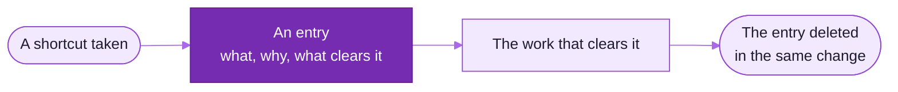

# Technical debt register

What is knowingly below standard, why it was left, and what clears it. Add an entry in the same
change that takes the shortcut; delete it in the change that clears it. Engineers and reviewers read
it before changing an area. The number of entries may only fall: `tools/hygiene_check.py` fails a
change that leaves more `### ` entries than `tools/hygiene_baseline.json` records (decision 0163).

| For | Read |
|---|---|
| Why an area is built the way it is | [decisions/README.md](decisions/README.md) |
| Where the work stands | [PROGRESS.md](PROGRESS.md) |
| The hygiene baseline of files and functions over budget, and of this register's entries | `tools/hygiene_baseline.json` |

Last reviewed: 2026-11-22.

## Infrastructure

### CloudFront to origin is plain HTTP

- **What:** CloudFront reaches nginx on the EC2 box over HTTP on port 80 (`docs/RUNBOOK.md`,
  `infra/terraform/cloudfront.tf`). The origin is protected by the CloudFront-only security
  group and the `X-Origin-Verify` header, but the hop between CloudFront and the box is not
  encrypted. The designer and documentation portals use the same pattern.
- **Why left:** TLS ends at CloudFront; there is no custom domain or origin certificate yet, and
  the pattern matches the portals so they can be changed together. Deferred by the owner on
  2026-11-22 ("we will take care of it later on") as D43 of the cross-portal list of decisions
  deferred to launch (`C:/dev/IIT/docs/DEFERRED_FOR_LAUNCH.md`).
- **Clears it:** an origin certificate (custom domain with certbot, already installed and
  unused on the box) and `https-only` origin protocol, done for all three portals in one change,
  with a certificate-expiry check in each post-deploy run.

## Backend structure

### Python code over budget

- **What:** the counts are in `tools/hygiene_baseline.json`: 6 files over 400 lines, 36 functions
  over 40 lines and 9 functions with more than 5 positional parameters on 2026-11-23 (12, 54 and 9
  on 2026-11-16). The files: `backend/migrations/versions/0001_initial_schema.py` (2853),
  `backend/app/services/two_factor.py` (703), `etl/crafts/seed_claims.py` (642),
  `etl/crafts/aliases.py` (535), `backend/tests/db/test_db_flows.py` (473) and
  `backend/app/data/craft_master_loader.py` (433). The sign-in routes, the AI router and the
  Wikidata linker were split on 2026-11-23 and are no longer among them.
- **Why left:** most were ported from the designer portal with the same shapes so the portals
  stay mergeable; splitting them is a separate restructuring change.
- **Clears it:** split along responsibilities when a file is next changed; run
  `tools/hygiene_check.py --update-baseline` after each clean-up. The initial migration stays
  one file (migrations are not rewritten).

### Scholarly adapters: what waits on keys and the planner (decisions 0005, 0139)

- **What:**
  - Fixtures that are not recordings: `semantic_scholar_search.json` wraps two recorded paper
    records in the search envelope (search answered 429 without a key);
    `springer_nature_search.synthetic.json`, `springer_nature_jats.synthetic.xml`,
    `springer_nature_jats_none.synthetic.xml` and `elsevier_article.synthetic.xml` are hand-written
    from the documented shapes (`backend/tests/sources/fixtures`).
  - The configured `ELSEVIER_API_KEY` may search Scopus but not read abstracts or full text
    without an institution token, so `elsevier` fetch is `not_found` for every record.
  - OpenAlex without `OPENALEX_API_KEY` allows $0.10 a day per address, about 100 searches; after
    that it answers 429 until midnight UTC and the shared hold pauses every process.
  - Publisher full text (`ScholarlySources.publisher`, `sources/scholarly/publishers`) is built
    but nothing asks it: the planner reads only the open-copy locator.
  - Wiley TDM is not read: it serves PDF only, behind a redirect, with its token, and the fetcher
    sends no keys.
- **Why left:** no `OPENALEX_API_KEY`, `SEMANTIC_SCHOLAR_API_KEY` or `SPRINGER_NATURE_API_KEY` and
  no Elsevier institution token exist yet; the planner belonged to the answer-composition lane of
  round 7, which ran beside the sources and providers lane.
- **Clears it:** the owner sets the three keys (Springer Nature's with text-mining terms) and
  `ELSEVIER_INSTTOKEN`, each tested from the settings screen, and the fixtures are recorded then; give `planner/reading.LiveSources` a
  `publisher` field, set it in `services/live_sources` from `scholarly.publisher`, and let
  `DocumentReader.open_access_document` read a closed DOI the publisher holds; read Wiley's PDF
  once the fetcher can carry one host's token.

### Web search and fetcher: recordings and the box (decisions 0007, 0139)

- **What:** the SearXNG and Brave fixtures (`backend/tests/sources/fixtures/*.synthetic.json`) are
  hand-written to the documented shapes, and `kv-fetcher` with its parser processes has not been
  smoke-tested on the box.
- **Why left:** SearXNG runs only on the box, there is no Brave key on the laptop, and the box is
  reached only through a deploy.
- **Clears it:** after the next deploy, check `/health`, one HTML and one PDF fetch, the parser
  processes staying under the 768 MB cap and the `WebFetch` row an answer writes; then record one
  SearXNG and one Brave answer to replace the synthetic fixtures.

### Stored-knowledge retrieval: what is left (decision 0008, round 4)

- **What:** round 4 cleared stamps per embedding model with re-embedding, cleared vectors on a text
  change, embedding after the seeds on every release, the Indic text ranking and the seed import's
  passages (`docs/contracts/retrieval.md`). Left: knowledge pieces carry no stamp, and the
  candidate gates' neighbour search and the piece store's reuse distance compare vectors without
  it; the Wood Handbook import has no passages, because the repository holds no text of the cited
  edition (FPL-GTR-190).
- **Clears it:** stamp pieces and filter the gates' and the piece store's neighbours on the current
  model; vendor the pages of FPL-GTR-190, or give FPL-GTR-282 its own source and re-cite the wood
  claims after a quote check.

## Checks not automated yet

- **Nesting depth** (budget 3) is not measured by the hygiene check.
- **Frontend size budget** (about 150 lines per component file): 33 `.tsx` files are over it on
  2026-11-16, the largest `components/ui/SearchableSelect.tsx` (1243),
  `app/(protected)/admin/access/page.tsx` (813), `components/forms/DateTimeField.tsx` (743).
  Many are ports from the designer portal.
- **Frontend import boundaries** are not linted.
- **Geo ETL tests** (`etl/geo/tests`) run, with ruff, only at the start of a Geo ETL dispatch
  (decision 0043); a push that changes `etl/geo` is not tested until the next dispatch.
- Clears it: a lint rule set for size and boundaries with a baseline for the existing files, a
  nesting count in `tools/hygiene/budgets.py`, and a push-triggered test job for `etl/geo`.

### Planner and tiered research: gaps left on 2026-11-16 (decision 0009)

- **What:** (1) The pack holds documents, not quotes: the `WEB_READ` reader that extracts
  verbatim quotes for the composer is not built. (2) Coverage runs one stored search per facet,
  each embedding its target (up to eight embedding calls per question). (3) References are
  followed only as DOIs written in the text, through Crossref, which returns abstracts only; links
  in pages and reference lists without DOIs are not followed. (4) Facet coverage counts claims
  that share a word with the target; it does not judge whether they answer it. (5) Every query
  runs on every source of its tier, including Commons and PubChem for questions they cannot serve
  (each answers quickly with no hits). Every answer writes its `AnswerTrace` rows since decision
  0146.
- **Why left:** the `WEB_READ` reader is the next lane; a better coverage judgement needs the
  known-answer checks to calibrate against.
- **Clears it:** the reader turns documents into quoted evidence; embed the facet targets in
  one batch; follow reference lists through OpenAlex `referenced_works` when that adapter
  exposes them; route facet types to the sources that can serve them once the checks show
  which do.

## Live research write-back (decision 0011)

### The composer does not yet ask for quote renderings (decisions 0013, 0023, 0139)

- **What:** `research/quote_renderings.english_renderings` renders a draft's non-English quotes into
  English through the TRANSLATE route and keeps a rendering only when `translation_problems`, read
  from the quote's language, finds nothing; `research/composition.sentence_violations(...,
  renderings=)` then measures the overlap, the unrelated-source and the stance checks on the
  rendering while the citation keeps the verbatim quote. Nothing calls it yet: the composer's
  post-check (`composer/drafts.checked_sentence`) passes no renderings and the write-back's quote
  gate (`services/write_back_plan`) compares raw quotes, so a sentence resting only on a Hindi
  passage is still dropped.
- **Why left:** the composer and the write-back plan belonged to the answer-composition and
  write-back lanes of round 7, which ran beside the sources and providers lane.
- **Clears it:** in `composer/drafts`, collect the spans whose evidence item's `language` is not
  English as `QuotedIn`, call `english_renderings` with the TRANSLATE route's `ModelTranslator`
  once per draft, and pass the renderings to `sentence_violations`; let `write_back_plan`'s
  overlap read the same renderings.

## Science, region, voice and media contracts (decision 0014)

### ElevenLabs behaviour not yet verified

- **What:** the voice binding rests on `custom_llm.request_headers` substituting
  `{{system__conversation_id}}` and on `custom_llm.api_key` arriving as a bearer, neither on
  ElevenLabs' official pages; also unverified are the URL suffix, custom-LLM tool calls reaching
  `end_call` and client tools, Hindi in agents, CSP hosts and the plan's retention minimum
  (`docs/contracts/voice.md`). Relay text to speech cannot run with zero retention
  (`enable_logging=false` is enterprise only).
- **Waits on:** the agent spike, which is the switched-off voice call (decision 0035), not another
  paid run: the paid check of 2026-11-23 (run 45112123057) refused its agent turn because no
  ElevenLabs agent, agent key or voice session key is provisioned. Once the spike provisions them,
  the paid check's agent turn settles the header, the bearer and the suffix (commit its
  `agent_turn_events.json` as `backend/tests/voice/fixtures/agent_turn_events.json`;
  `voice.transport` stays `RELAY` until it passes). Tool calls, Hindi in agents, the CSP hosts and
  retention need a browser call on the box; retention also needs an enterprise plan or the Gemini
  voice.

## Voice backend (decision 0017)

### Voice in other languages is not yet heard or read by its speakers (decisions 0025, 0157)

- **What:** what a test can check is checked for every offered language: a relay turn sends Scribe
  and speech their codes and speaks the language's source word, and every phrase whose English says
  no carries its language's negation (decision 0157, item 7). No call with a real key has run in a
  language other than English, and Scribe's published accuracy is Scribe v2's: Urdu's band is
  moderate (25-50% word error), so an Urdu question may often be misheard. The spoken phrases (the
  `voice.*` entries of `backend/app/data/interface_words/`) were written by the voice lane and no
  native speaker has reviewed them. In `AGENT` nothing yet tells the agent a session's language: the
  token takes none and client overrides are off, so the agent hears in its own language until
  `language_detection` switches; the presets are not provisioned.
- **Why left:** a recorded turn needs the owner's ElevenLabs key, and a review needs a reader of
  each language.
- **Clears it:** a reader of each language records a review on the `voice.*` entries of its file,
  correcting any phrase first (decision 0157, item 5); the spike records one relay turn per language
  and one agent call in Hindi; if Urdu misses too often, drop `ur` from `STT_LANGUAGE_CODES` (voice
  then stops offering it) or try `scribe_v3` with Hindi as a `secondary_language_codes` hint; the
  spike decides whether the agent gets an `agent.language` override or one agent per language.

### An agent call cannot be hung up from our side

- **What:** after an `AGENT` call's row ends, the ElevenLabs call can run on to the agent's 600 s,
  which reconciliation charges, so the user may go below zero for the call's day (the settlement
  row counts on that day, decision 0140).
- **Why left:** ending a conversation needs an ElevenLabs endpoint the spike has not confirmed; it
  is bounded by the day's seconds, the turn and replay limits and the 40-turn cap (decision 0022).
- **Clears it:** end the ElevenLabs conversation when the row ends, once the spike shows how.

## Voice UI (decision 0020)

### The live agent call has not run in a browser

- **What:** the release check `e2e/production/voice.spec.ts` drives the dock on `/design/voice`
  at desktop and phone widths in both themes: the notice, a relay turn recorded from Chromium's
  fake microphone, sent, answered from the relay goldens and played, and the end, with the dock
  inside the screen and its contrast checked (decision 0140). The `AGENT` path (the ElevenLabs
  WebRTC call joining a LiveKit room, the server writing each turn to the transcript as it is
  spoken) has not run, nor has the dock above the bottom island, since no page with the island
  mounts it while the call is switched off (decision 0035).
- **Why left:** an `AGENT` call needs a real ElevenLabs agent and conversation (the spike); the
  dock's page comes back with the call.
- **Clears it:** one real `AGENT` call once the spike passes, and the same check run on the page
  that mounts the dock when `VOICE_CALL_ENABLED` brings the call back.

### The dock's recorded bit rate is unmeasured in Safari

- **What:** the relay recorder asks `MediaRecorder` for the session's `audioBitsPerSecond`
  (32 kbit/s) and sends a turn at nine tenths of `maxAudioBytes`, so a full minute fits only at
  36,000 bit/s or less. The browser smoke measures Chromium on every pull request
  (`frontend/e2e/voice-rate.smoke.spec.ts`: `audio/webm` at 28,269 and 28,245 bit/s on 2026-11-23,
  decision 0161); Safari records `audio/mp4` (AAC), and whether it keeps to the asked rate is
  unmeasured.
- **Waits on:** a Safari run, which no GitHub runner has (Playwright's WebKit is not Safari's media
  stack): a person with a Mac runs the smoke spec in Safari once. If it records above 36,000 bit/s,
  raise the `audio/mp4` byte ceiling in `docs/contracts/voice.md` and `schemas/voice.py` by its
  measured rate.

## Science engine (decision 0015)

### Seeded crafts without a cited reaction, a firing stage or a stated temperature

- **What:** reactions now come from the science seed (Kutch Ajrakh, Bagh, Machilipatnam) and
  from the curated dossiers of nine crafts (those three, Bagru, Sanganeri, Bastar Dhokra, Agates
  of Cambay, Firozabad Glass, Cane and Bamboo, through `services/curation_structure`). What is
  left: Dabu (its dossier holds no reaction) and Akola stages have materials and tools but no
  reaction, because no source the seed or a dossier holds states one; no craft has a process with a `FIRE` stage, so kaolinite dehydroxylation has no
  reaction (the terracotta seed is sub-category mechanism chains); stage concepts without an
  upstream ordinal (Akola mud soaking and paste preparation, Machilipatnam and Sanganeri block
  carving) get no stage although `PRECEDES` edges could place them; and no seed claim states a
  temperature or pH, so no seeded reading is checked against an envelope.
- **Why left:** reactions and readings are written only as a cited quote states them; the
  sources still to find are a GI application or a chemistry paper on Dabu mud resist and on
  Akola's mud and indigo work, a curated clay craft's firing schedule, and a dyeing source
  stating a bath temperature or pH. Finding them is research through the KalaVigyan MCP server
  (`search_sources`, `read_source`, then `propose_structure` for a reaction).
- **Clears it:** a dossier or seed reaction for Dabu and Akola from such a source, a curated clay
  craft with a `FIRE` stage and its stated temperature, and `claim_seed.stage_rows` ordering a
  stage by its `PRECEDES` edges when no ordinal is stated.

### Out-of-envelope readings are not in a review queue

- **What:** the contract lists every `OUTSIDE` reading in the review queue; the review queue
  (`services/review_queue*`) now exists but has no readings kind, so an out-of-envelope reading is
  only shown with its status. No stored reading is checked against an envelope yet (the entry
  above), so the queue would list nothing today.
- **Why left:** the review queue's kinds, routes and screen belonged to the MCP and contributors
  lane in round 7's debt round; the place builders lane (decision 0160) did not touch them.
- **Clears it:** a readings kind in the review queue listing the `ConditionReading` rows whose
  `envelope_check` is `OUTSIDE`, decided on the review screen like the other kinds.

## Answers in Indian languages (decision 0023)

### The read-back check is not yet calibrated by readers

- **What:** a translation is read back into English and refused when its reading loses a figure,
  a negation or a hedge, adds one, or keeps fewer than half the English's terms (decision 0157,
  item 1). That half is the quote overlap floor, chosen without a reader: no speaker of Hindi or
  Tamil has yet judged which sentences drifted, so the check may refuse a faithful sentence (it
  then shows in English) or keep a drifted one whose reading happens to share the English words.
- **Why left:** the calibration needs a reader of each language.
- **Clears it:** a reader of Hindi and one of Tamil read a known-answer answer in their language
  (the production E2E's Known Answers report gives each translated sentence beside its English;
  the Tamil one is asked on the site), and for every sentence they record, as a case in
  `backend/tests/research/test_translation_meaning.py`, the English, their own literal English of
  the translation and whether it kept the meaning; `READ_BACK_TERMS_KEPT_MIN` is then set so the
  check decides every recorded case as its reader did.

### Interface words in other languages wait for their readers

- **What:** the fixed words of the answer screen (the provenance rail and the actions), a stored
  answer's headings and follow-ups and the status lines are shown in an answer language only from
  a reviewed entry of `backend/app/data/interface_words/` (decision 0157, items 3 to 6). The Hindi
  and Urdu essay words are sourced from the Kutch Ajrakh monograph and the Urdu board (جواب, ماخذوں
  سے, محفوظ کریں, اس جواب کا حوالہ دیں and the rest) but no entry is reviewed yet, "Saved",
  "Saving", "Removing" and one source have no source, and the other languages, the headings, the
  follow-ups and the status lines have no entries. The not-enough-evidence message and the errors
  are composed in English and have no entries at all. A craft's name stays as it is written in
  English, as the monograph writes it.
- **Why left:** a reviewed word needs a reader of its language; approving a design is not
  reviewing its words (the board and the monograph disagree on two Urdu words).
- **Clears it:** a reader of each language supplies the missing words and records a review on
  each entry they approve (decision 0157, item 5), the Urdu reader first, choosing between the
  board's and the monograph's readings; then the templates of the not-enough-evidence message and
  the errors join the lists the same way.

## Media backend (decision 0018)

### Gemini video not yet seen live

- **What:** the paid check of 2026-11-23 saw an image made live (an unstored interaction with no id,
  a thought step, `image/jpeg` output, usage by modality; `backend/tests/media/fixtures/image_completed.json`,
  decision 0161). Video is still unseen: `DELETE /v1beta/interactions/{id}`, the clip's exact
  duration, the shape of an `image` input that would make the requester's stage image the clip's
  first frame (PLAN 11 allows it; videos are `text_to_video` until the shape is seen, because a wrong
  input fails every clip), and how a safety block reads, which no paid call can be made to show.
  The video fixtures follow the documented shapes, not captured traffic.
- **Waits on:** the owner approving one paid Gemini clip, which the approval of 2026-11-22 does not
  include.

### Community and caste names caught by group words only

- **What:** a claim, stage name or style hint is kept out of a prompt when it uses a group word in
  the singular or plural (`schemas/media.NAMED_GROUP_WORDS`, decision 0022); a community named
  without one (a surname or cluster name alone) still passes, and
  `depictsNamedCluster` compares only the craft's located place names.
- **Why left:** no register of community and caste names exists; PLAN 13a names them only from
  cited sources.
- **Waits on:** the owner's and the governance lane's decision to keep the named practitioners per
  craft as cited data; the claim set and the named-cluster flag then check against it.

## Yahoo sign-in (decision 0026)

### Yahoo sign-in not yet seen running

- **What:** the Yahoo app is registered and live: `YAHOO_CLIENT_ID`, `YAHOO_CLIENT_SECRET` and
  `NEXT_PUBLIC_YAHOO_CLIENT_ID` were set on 2026-11-16 and production's `/auth/config` reports
  `yahooEnabled` (checked 2026-11-23). No account has signed in with Yahoo yet (production has
  password and Google accounts only), so the token endpoint's acceptance of the secret in the form
  body and of the PKCE parameters is still taken from DR, where it has run since 2026-10-10.
- **Clears it:** one sign-in with a rostered Yahoo address on the production login page.

## First-password proof (decision 0028)

### First-password proof not yet seen in a browser

- **What:** the route tests (`backend/tests/db/test_first_password_db.py`, the Google and Yahoo
  proofs, the two-step order, a recovery code and a locked second factor) and the card's unit spec
  (`frontend/e2e/first-password-unit.spec.ts`) run on every push, and migration
  `0011_first_password_proof` runs on Postgres in Backend checks, but no person has yet added a
  password in Settings through the real Google or Yahoo round trip.
- **Why left:** the round trip signs in to Google or Yahoo in a browser with a real account, which
  no check in the repository can do.
- **Clears it:** after a deploy, a person adds a password in Settings from a Google-only account and
  from a Yahoo-only one.

## Understanding and depth (decision 0031)

### Comparison questions research the lead craft only

- **What:** since decision 0064 a comparison sets up to three crafts beside the lead one and each
  section shows a `compare` block, but live research and composition still run for the lead craft;
  the compared crafts' cells come from what is already stored about them.
- **Why left:** researching every compared craft multiplies the answer's spend; the curation run
  fills the stored claims each craft's cells read.
- **Clears it:** a per-craft research share inside the answer's budget for compared crafts with
  few stored claims in the section's field.

### Any-craft claims are read only by any-craft questions

- **What:** research for any craft writes its claims on shared concepts (no craft, no
  sub-category). A later question about a particular craft does not read them, because the craft
  scope reads the craft's and its family's concepts only.
- **Why left:** which shared findings apply to which craft is a curation choice; reading all of
  them in every craft answer would mix crafts.
- **Clears it:** link shared concepts to the crafts they concern (through the concept graph of
  feature 7 or a reviewer's link), and let the craft scope read linked shared concepts.

## Asking screen (decision 0036)

### Dictation languages not yet tried on each browser

- **What:** the plan (2.5) asks for each answer language to be checked on each target browser
  before it is offered. The screen offers dictation in all 13 answer languages (`<code>-IN`
  locales, `lib/dictation.ts`) wherever the browser has the Web Speech API, hides a language the
  browser reports unavailable (`SpeechRecognition.available`) or refuses
  (`language-not-supported`), but nobody has yet dictated in Odia, Punjabi, Assamese or Urdu on
  Chrome, Edge and Safari, or checked Android Chrome's continuous mode, which is known to repeat
  final words.
- **Why left:** nothing runs on the laptop, and the production E2E drives a headless browser with
  no microphone.
- **Clears it:** after the deploy, dictate one sentence per language on Chrome, Edge and Safari
  (desktop and Android Chrome) and record what each does here; switch Android Chrome to
  single-utterance mode if its repeats show.

## Pictures and terms (decision 0034)

### Relevance is by text only

- **What:** plan 2.7 asks for one cheap vision call on the top candidates; every picture is
  chosen by its words against the claim text (`relevance: TEXT`), so a picture whose title and
  description happen to share two words with a claim is shown even if it depicts something else.
- **Why left:** the vision call needs an image route and per-answer spend; text relevance came
  first.
- **Clears it:** a `CAPTION` route call on the top two candidates per section, recorded as
  `VISION` on `MediaRefClaim`, dropping a picture the model says does not show the claim.

### Link cards need the page's own site to serve the picture

- **What:** a SearXNG image result is kept only when its image and page share a registrable name
  (`research/images.same_site`), judged by a short list of second-level labels (`ac`, `co`,
  `gov`, `org`, ...) instead of the Public Suffix List. Sites that serve pictures from a CDN on
  another name are left out, and a public suffix outside the list could pair two unrelated sites.
- **Why left:** owner O2 asks for the thumbnail from the source site; no dependency carries the
  Public Suffix List today.
- **Clears it:** vendor the Public Suffix List (or `tldextract` with a pinned snapshot) and use it
  in `site_of`.

### Brave image results are not used

- **What:** web image results come from SearXNG only; plan section 7 names Brave for image results
  too, and the Brave key already backs web search.
- **Why left:** one image search per service was enough for phase A.
- **Clears it:** an `images` method on `BraveAdapter` (`/res/v1/images/search`) used when SearXNG
  answers fewer than two link cards.

### Local words without a stated meaning are not terms

- **What:** the glossary takes a seed concept's local word only when the concept's name states
  what it means (`Kut (iron-water black paste)`, `Alum (fatakdi)`). Local words listed beside
  other names (`lokhand`, `gud`, `datla`, `mavi`, `gudh`) are not terms, and two spellings of
  one word become one term only when they are at least 80 % alike (`harde`, `harda`).
- **Why left:** the seed records those words without their meaning, and a guessed meaning would
  be an uncited fact.
- **Clears it:** a curated `localTerms` meaning in `etl/crafts` (or claims that define them), then
  the glossary plan reads it.

### The glossary seed never removes a term or link

- **What:** `seed_terms` upserts terms by key and adds craft and concept links; a term or link
  that a later seed no longer produces stays.
- **Why left:** the claim and science seeds behave the same way (see "The science seed never
  deletes"); no removal has been needed yet.
- **Clears it:** a seed step that deletes links the plan no longer has, and terms with no links
  and no cached summary.

### Term summaries never expire while their claims stand

- **What:** a cached `TermSummary` is served until a claim it rests on is hidden, retracted or
  rejected; a better stored claim, or a newer Wikipedia revision, does not replace it.
- **Why left:** plan 2.8 asks for a cache per term and language; claim visibility is the guard
  that matters for accuracy.
- **Clears it:** an age limit (or a stored claim newer than `checkedAt`) after which the next tap
  builds the summary again.

### Image and term enums are check constraints

- **What:** `MediaRef.display`, `MediaRefClaim.relevance` and `TermSummary.basis` are strings with
  `CHECK` constraints built from `models/enums.py`, not Postgres enum types like the other
  vocabularies.
- **Why left:** the schema tests only know enum types the first migration declares, and lanes
  adding tables in the same batch would each have had to change that test machinery.
- **Clears it:** once the tests accept enum types created by later migrations, turn the three
  columns into `pg_enum` types in one migration.

## Pictures and terms in the stream (decision 0039)

### Translated sentences lose the spans the translation rewrites

- **What:** a translated sentence keeps a span only where the English span's text survives
  (`research/terms.spans_still_shown`). A term the translation renders in its own script (alum as
  फिटकरी) is not underlined, although the glossary may hold that local name.
- **Why left:** marking translated text needs word boundaries that hold in Indian scripts (their
  vowel signs are not word characters to Python's `re`) and a check that the local name is the
  translation's word for that term.
- **Clears it:** after translation, mark the glossary's local names in the answer's script with
  grapheme-aware boundaries, next to the spans kept, and check them like English spans.

### Reused sections search for pictures again

- **What:** each reuse of a stored section searches the image services anew, although the
  pictures chosen for the same claims are already stored as `MediaRef` rows with `MediaRefClaim`
  links.
- **Why left:** reading stored pictures needs a lookup by claim and a rule for when a stored
  picture is still current; a search costs no AI spend and is bounded by the 8 s wait.
- **Clears it:** read the `MediaRefClaim` rows of the cited claims first and search only when none
  are stored.

### The stored-only answer shows no pictures or terms

- **What:** when spend is refused, `services/stored_explainer` streams prose blocks with no spans
  and no `images` block.
- **Why left:** step 7 was wired into the sectioned flow; the stored-only answer is its fallback.
- **Clears it:** pass the answer's `Enrichment` to `stream_stored_answer` and mark and search as
  the sectioned flow does.

### The nightly rebuild searches pictures nobody sees

- **What:** `app/scripts/rebuild_pieces` answers through `build_answer_pipeline`, so each rebuilt
  section also searches pictures and stores them as `MediaRef` rows, though its stream is
  discarded.
- **Why left:** the rebuild needs the same term marking so its pieces carry spans; pictures cost
  no AI spend and stored ones serve the craft page later.
- **Clears it:** build the rebuild's pipeline with enrichment tools whose picture step answers
  nothing.

### Pictures and terms in the stream not yet seen running

- **What:** production answers stream pictures (each researched or reused section of the Kutch
  Ajrakh known-answer questions carried an `images` block on 2026-11-17); no browser has yet shown
  the credits, the underlined terms or the term sheet.
- **Why left:** nothing runs on the laptop.
- **Clears it:** after the deploy, load `/ask`, ask the Kutch Ajrakh known-answer questions and
  see each section's pictures with their credits and underlined terms that open their summary.

## Listen and the switched-off call (decision 0035)

### Narration heard in English and Hindi only

- **What:** the paid check of 2026-11-23 heard `eleven_v4` on `/with-timestamps` in English and
  Hindi: accepted, the alignment spelling the text code point for code point, 882 and 765 characters
  a minute (`backend/tests/voice/fixtures/narration_with_timestamps.json` and its Hindi sibling,
  decision 0161). It also showed Hindi skipping square-bracketed words as an audio tag, so Listen now
  sends them as parentheses; that a parenthesis is read in Hindi, and the alignment in the eleven
  other languages, are unheard. A mismatch fails loudly, and Listen then reads with the Gemini voice.
- **Waits on:** the next paid check, whose narration step now sends the text as Listen does and
  reports `parenthesisedSeconds`; the other languages wait on a reviewed sentence in each for
  `paid_check_steps.NARRATIONS`, as interface words are reviewed (decision 0157).

### The Gemini read-aloud has not reached Gemini

- **What:** Listen's fallback voice (`GeminiMediaWire.read_aloud`, decision 0161) follows the
  speech page of the Gemini documentation read on 2026-11-23: `POST /v1beta/interactions` with
  `gemini-3.8-flash-tts`, the voice in `generation_config.speech_config`, and a RIFF WAV of 24 kHz
  mono 16-bit PCM in the last `audio` block of the `model_output` step. No request has reached
  Gemini, so that shape, whether the `Api-Revision` header the media wire sends is accepted, the
  real speaking rate behind the 1,000-characters-a-minute hold, and whether a cited sentence's
  angle brackets are read as text rather than as an inline speech tag are unverified.
- **Waits on:** the paid check run by the lead (`.github/workflows/paid-checks.yml`, decision 0154),
  whose `gemini_speech` step reads one sentence and parses it as Listen does; commit its
  `speech_completed.json` as a fixture of `backend/tests/media/test_gemini_speech.py`. A refusal
  there names what to change in `providers/gemini_media.py`.

## Sectioned composition (decision 0032)

### The voice turn's reply limits are prompt lines

- **What:** the voice turn's one section of three sentences and no follow-ups are lines of its
  prompt only: `voice/compose.voice_composed` calls `parsed_answer` without a form, so a longer
  reply is trimmed to the whole answer's six sections of eight sentences instead. The
  whole-answer composer and the translation are trimmed and checked on our side (decision 0138).
- **Why left:** `backend/app/voice/**` is the voice lane's, and the voice call is switched off.
- **Clears it:** `voice_composed` passes `form=AnswerForm(sections=1, sentences=VOICE_MAX_SENTENCES,
  follow_ups=0)`, with a unit test.

## Stored knowledge pieces (decision 0033)

### Answers never grow the Process tab

- **What:** plan 2.2 wants process stages answers find to land in the science tables. No answer
  writes `Process` or `ProcessStage` rows (decision 0038). The cited-order route (order stages only
  by `PRECEDES` edges from claims that state the sequence, names only from curated or seeded
  concepts) can create nothing: every craft holding curated or seeded stage concepts already has
  its process (checked 2026-11-22: the six seeded crafts with stage concepts each have a seed
  process, every dossier with stages writes its curated process), and the stages answers find carry
  the names a planner chose, which the route may not use.
- **Why left:** an answer-found stage can only join a craft's existing process by a person's
  placing it (decision 0142).
- **Clears it:** the other route this entry named: a review-queue item for an answer-found stage
  concept and a review screen where a Professor places it in the craft's process or rejects it,
  writing the `ProcessStage` with the review's note. It waits on that screen (design and answer UI
  lane) and its review-queue item being scheduled together.

## Reaction player, material cards and 3D molecules (decision 0045)

### The zoom story reads the craft's matter on its own

- **What:** the reaction, card, molecule, what-if, supply-map and generated-explainer builders
  share one read of the craft's matter per answer (`BuildAsk.matter`, decision 0152); the zoom
  story builder (`services/journey_builders.ZoomStoryBuilder`) still calls `craft_matter` itself,
  so an answer whose chemistry or materials section shows a zoom reads the rows once more.
- **Why left:** `journey_builders.py` belonged to the time, market and figures lane in round 7's
  debt round, so this lane left it.
- **Clears it:** `ZoomStoryBuilder.build` reading `await ask.matter.read(self._tools.sessions,
  craft)`, with `tests/journey/test_zoom_story.py` patching `app.services.craft_matter` as
  `tests/matter/test_matter_reads.py` does.

## Expert panel (decision 0046)

### The reading share does not steer queries

- **What:** each seat's preferred kinds take every other early read of what was found, but which
  kinds are found depends on the queries the plan call writes; GI journals and government reports
  come mostly from the web tier and only when a query looks for them.
- **Why left:** the plan call is told each seat's kinds; reserving queries per tier would split an
  already small section share further.
- **Clears it:** a measured look at which kinds Expert sections read, then a tier share in
  `planned_queries` if seats' kinds are missed.

### The panel call has not met Claude Sonnet yet

- **What:** the seat, retake and difference calls are tested on their route (the builder compose
  model, `answer_routes.BUILDER_TUNING`, Claude Sonnet 5.5 on the answer's headroom;
  `tests/experts/test_panel_retakes.py`) and against recorded replies, but no production answer
  has been read for its views and an "Experts differ" card.
- **Why left:** it needs a paid production run, which only the lead dispatches.
- **Clears it:** the production questions run dispatched with `questions=true`: its Expert answer
  carries a note of the panel's views and Experts differ pairs (`e2e/production/expertPanel.ts`),
  read with the `COMPOSE` spend of that answer in Usage.

## Curation tooling (decision 0051)

### The LGD register is read in two places

- **What:** `services/district_seed.py` reads `lgd_register.json` itself to seed states and
  districts; `data/district_register.py` reads it for the curation checker's name lookup.
- **Why left:** the seed also builds geometry and is proven only by the database job; changing it
  was outside the curation lane.
- **Clears it:** `district_seed` taking its state and district names from
  `data/district_register`.

### Two atomic text writers in tools

- **What:** `tools/hygiene/baseline.write_baseline` and `tools/curation/output.write_text_atomically`
  both write through a temporary file and replace.
- **Why left:** `tools/` has no shared module, and the hygiene package should not import curation.
- **Clears it:** one `tools` module both import, when a third writer appears.

### Long HTML and plain-text sources are cut at 200,000 characters

- **What:** `tools/curation/reading.source_text` reuses `app.fetcher.extract`, which caps HTML and
  plain text at `FETCH_TEXT_MAX_CHARS`; a quote past the cap fails and the check file marks the
  source `truncated`. PDFs use curation's own caps (2,000 pages).
- **Why left:** one HTML reader for the live fetcher and curation; long books usually come as PDFs.
- **Clears it:** a cap option on `extract` that curation passes.

## Phase C contract (decision 0054)

### Numbers the explainer computes are not checked

- **What:** the static check reads the numerals a generated explainer writes (decision 0061 added
  figures against letters, list starts and CSS counters), not the numbers its code computes. A
  value worked out from data values and an input's position (the fixture's `n *
  data.fallLowFeet`, which shows 20 to 150 feet as the slider moves), a numeral assembled from
  allowed constants (`'1' + '8' + '6' + '8'`, `1000 + 12 * 12 * 6`) or a unit conversion
  (`data.depth * 9 / 5 + 32`) reaches the reader without being a cited value.
- **Why left:** a frame guard that refused every shown numeral missing from `kv-data` (a
  `MutationObserver` and wrapped `fillText`) would hide the fixture's own explainer the moment
  its slider moves, since 20 is not a data value; telling a derived figure from an invented one at
  run time needs a rule the plan does not have.
- **Clears it:** an owner rule for derived figures (for example, only products of a data value and
  an input step the data object names), then that runtime guard in `lib/sandboxFrame`'s prelude
  posting a refusal that `SandboxFrame` turns into hiding the block. Waits on the owner's rule
  (checked again on 2026-11-22: the static check covers code numerals since decision 0061).

## Generated explainers (decision 0055)

### A redraft can run past the builder's wait

- **What:** the generated explainer drafts within `SIMULATION_BUDGET_SECONDS` (60 s) and redrafts
  only when the time left is at least what the first draft took (decision 0142), so the registry's
  wait no longer cuts a redraft, but a slow route can still leave a section without its explainer:
  the builder then records `OUT_OF_TIME` or `NO_TIME_TO_REDRAFT` under `Answer.plan.builds`.
- **Why left:** how often that happens is a production measurement. Checked 2026-11-23: no
  production answer has `plan.builds` yet, because the record shipped late on 2026-11-22 and no
  answer has finished since (the two later rows are production checks stopped mid-stream).
- **Clears it:** the lead reads `plan->'builds'` of a week of Expert answers on production. If
  `OUT_OF_TIME` and `NO_TIME_TO_REDRAFT` are a large share of the `simulation` outcomes, build the
  explainer after `section_done` as a late block, which needs a stream event the contract does not
  have yet; otherwise delete this entry.

## What-if lab (decision 0056)

### Alternatives are read from English words beside each other

- **What:** a stored text relates two materials only when an alternative word (`or`, `instead`,
  `replaced`, `superseded`, ...) stands within three words between their names
  (`research/alternatives`); "Alizarin, first synthesised in 1868, superseded madder" and "now
  alizarine has taken its place" relate nothing, and texts in other languages are not read. A
  material is named only by its stored name and glossary surfaces, so the seed's "Indian madder"
  is not named by a plain "madder".
- **Why left:** a wider gap joins co-ingredients ("clay, millet flour, gum and alum or lime"),
  which must never be offered as alternatives; the seed's contrast relations and the curated
  dossiers' "madder or al root" cover the crafts held. The what-if inputs already read stored
  `CONTRASTS_WITH` relations (`what_if_offers._contrasted`); what is missing is a curated way to
  write them: the dossier schema and its generator (`tools/curation`) and structure proposals
  belonged to the MCP and monograph lanes in round 7's debt round (checked 2026-11-23, decision
  0160).
- **Clears it:** a material's alternatives in the dossier (and in `propose_structure`), imported
  as `CONTRASTS_WITH` concept edges with their cited claim, so no text has to be read.

### Temperatures and water sources are not offered as inputs

- **What:** inputs are only a stage's stored materials. A temperature (a stage condition's
  readings) or a water source held only as a concept ("Iron content of process water") is never
  an input, so the plan's "temperature" and "river or well water" examples appear only when the
  waters are stored materials with alternatives.
- **Why left:** no stored row relates a condition's stated range, or one water source, to an
  outcome; a what-if over them would need numbers or outcomes a model would have to supply.
  Checked 2026-11-23 (decision 0160): the dossier model holds no stage conditions and the science
  seed's conditions carry readings and no outcome; it waits on condition ranges a source ties to
  outcomes, found and cited through the KalaVigyan MCP research tools and curated.
- **Clears it:** curation storing condition ranges with the outcomes a source ties to each, or
  water sources as materials with their relations; then an input kind over them in a version 2.

## Zoom story and timeline map (decision 0057)

### No open-access paper figure is searched for the fibre level

- **What:** the fibre level comes only from Commons and Openverse micrographs; the contract's
  "open-access figure whose `sourceId` is the stored paper" has no adapter (no figure search in
  Europe PMC or a publisher's open figures), so most crafts show no fibre level.
- **Why left:** no figure source exists to reuse, and a new adapter needs its own recorded tests
  and licence reading per figure.
- **Clears it:** one figures adapter over an open-access full-text source (for example the
  figures of Europe PMC's open-access articles, each with its article's licence), checked on
  recorded responses, and the fibre search asking it after Commons and Openverse.

### Picture levels are read from English words

- **What:** a picture's level is read from its title and description against short English word
  lists (`zoom_pictures.LEVEL_WORDS`), and the craft's fibre from a list of fibre names
  (`FIBRE_NAMES`); a picture titled in another language or with an unlisted word ("hand block
  print", "karigar") finds no level, and a fibre material named only by a local word ("kora")
  gives no fibre level.
- **Why left:** a vision call per candidate would spend from the answer for a picture the reader
  may never open; the lists hold the words the stored pictures use.
- **Clears it:** the glossary's terms tagged with a zoom level, or a vision check of the top
  candidate per level within the answer's headroom.

## ElevenLabs music, sound effects, image and video (decision 0058)

### ElevenLabs prices are unverified

- **What:** the API pricing page, its own FAQ and the scale-tier page disagree (music $0.150 or
  $0.275 a minute, sound effects $0.120 or $0.060 a minute or per generation); image and video
  prices appear only on the scale-tier page. The catalogue keeps the higher figure per second or
  image (`providers/catalogue_specs.py`, `_ELEVENLABS`), so Usage may show more than ElevenLabs bills.
- **Waits on:** the paid check run by the lead and the ElevenLabs invoice of that month: compare
  the invoice with the check's `paid_checks_report.json` and Usage, then set the confirmed prices
  and `price_verified` true, or set admin price overrides.

### Flows content is fetched only from the host the reference shows

- **What:** since decision 0061 a finished image or video is fetched only from
  `storage.googleapis.com` (`providers/elevenlabs_download.DOWNLOAD_HOSTS`), the host of the
  reference's example; the OpenAPI document describes `content_url` only as a signed URL and
  promises no host, so a move to another host fails every ElevenLabs picture and clip loudly.
- **Why left:** an unpinned host could stream any body into the API box; ElevenLabs image and video
  are route choices no seeded chain uses.
- **Waits on:** one paid ElevenLabs image or video, which the owner's approval of 2026-11-22 does
  not include; if it names another host, add it to `DOWNLOAD_HOSTS` after checking the reference.

## Zoom, timeline and film renderers (decision 0060)

### A place beyond the India frame is a signpost, not a pin

- **What:** the timeline draws a placed point outside the India frame (Fustat in the fixture) as
  a signpost at the frame's edge pointing toward it, so the reader sees its direction and its
  Wikidata item but not its distance or neighbourhood.
- **Why left:** the frame is fixed by `components/map/projection.ts`; widening it for one point
  would shrink India on every timeline, and drawing other countries is refused.
- **Clears it:** an inset frame for points abroad (the same projection, its own bounds, the plain
  ground only), chosen by the timeline when it places a point outside the India frame.

### Film volumes on iPhones and iPads not yet heard

- **What:** where a browser fixes `HTMLMediaElement.volume` (iOS Safari), the bed and the cues now
  play through one Web Audio gain each (`components/answer/film/FilmSound.tsx`, decision 0154),
  loaded with CORS from the media bucket (`cors_allowed_origins` holds the site's origin). The unit
  specs check the detection and the levels; the production E2E's Chromium never takes that path.
- **Waits on:** a person playing a film with music on an iPhone or iPad and moving both sliders.

## Phase D contract (decision 0062)

### The phase D fixture shows no price and no Kutch Ajrakh sign of imitation

- **What:** the market blocks show Kutch Ajrakh's GI record and Bagru's GI record with its GI
  journal imitation sign; no seed claim states an Ajrakh price or Ajrakh imitation from GI journal
  text. The curated dossier holds the 1975 Barmer price (C049), which the builder shows
  (`tests/answering/test_market_builder.py` reads it from the dossier); its screen-printing claims
  (C047, C138, C141) cite papers and a web page, not GI journal text, so they are not signs of
  imitation under decision 0066.
- **Why left:** the versions, lesson, quiz and citation goldens of both sides are built from the
  Ajrakh market block, so the price adds a source and renumbers every file built from them; the
  review (0070) fixed its findings and left this fixture refresh whole for one change.
- **Clears it:** add C049's price to `s5.b1` by `curation_keys.curated_id` and regenerate the
  goldens built from it, with the APA text of the new source checked by hand.

### Quizzes mostly vanish in other languages

- **What:** a quiz option is a glossary term marked in its sentence; a translated sentence keeps a
  span only where the English term still occurs, so most questions are dropped outside English.
- **Why left:** translating option terms and re-marking them needs term translations the glossary
  does not hold.
- **Clears it:** local-language names of glossary terms (`Term.localNames` by language) marked in
  translated sentences, then the quiz rebuilt from them.

### Author names are cited as stored

- **What:** citation exports write each stored author as written, so seed sources split on commas
  read oddly (the V&A as "Victoria, & Albert Museum"; the GI journal's applicant note as two
  authors).
- **Why left:** inverting or joining names would guess; the stored values are the seed's.
- **Clears it:** the seed and curated sources store organisation authors whole (the curation
  checker already keeps them whole); the export needs no change.

## Local measures, and market and GI (decision 0066)

### Imitation is a fixed word list

- **What:** a sign of imitation must name one of the listed words (fake, imitation, counterfeit,
  spurious, knock-off, passed off, screen-printed, machine-made, power loom, mill-made);
  "duplicate", "copies" and "substitute" are left out because they also name other things. (A
  price's `per` is read after "per", "a", "an" or "/" since decision 0147.)
- **Why left:** a model choosing would spend on every economics section; the list errs toward
  showing less; a dossier field needs a stored column the curated import writes, and the import
  belongs to the curated-import lane, which was running in the same tree.
- **Clears it:** a dossier `market.imitation` list of claim ids (each citing a GI journal), stored
  by the curated import and read before the word list by `services/market_builder`.

## Climate and risk, and ask the map (decision 0065)

### Groundwater values only for Rajasthan, and not yet loaded

- **What:** `climate_risk.groundwater` can show stored groundwater figures only for Rajasthan's 33
  districts as on 31 March 2023 (`OGD_GW_RESOURCES_RAJASTHAN_2023`); a craft in any other state shows
  groundwater only through cited claims. None is loaded yet: the Geo ETL run of 2026-11-23 (run
  45088759547) could not connect to `api.data.gov.in` from GitHub's runners (`ConnectionError` on
  every try, the part failed as it should), while the same address answers from India.
- **Why left:** the India data portal holds no all-India district table of the Dynamic Ground Water
  Resources assessment as an API resource (searched 2026-11-23): the Ministry of Jal Shakti's
  assessment catalogues there are empty, the National Compilation gives district tables only in PDF
  annexures, and the portal's other district-wise tables are Rajya Sabha answers for single states or
  urban areas (Delhi and Bengaluru by assessment unit).
  The portal refuses connections from GitHub's runners.
- **Clears it:** one `groundwater` extract and load from a network the portal answers (for example a
  self-hosted runner in India, or the portal's allowance for GitHub's addresses); then a district table
  for more states on the portal (each a new dataset row and a table in
  `etl/geo/geo_etl/layers/groundwater.py`), or the owner's choice to load the National Compilation's
  district annexure another way (for example a transcription recorded as its own dataset).

### Ask the map lists every year of the series

- **What:** ask the map lists each district value, so Climate shows 45 years of CHIRPS annual
  means (with their 10th and 90th percentiles) and 45 years of GHCN CAMS means beside the normals
  and trends. The region route no longer does: a place there sends only its facets' headline
  values (`geo/headline.HEADLINE_SERIES`, decision 0153).
- **Why left:** ask the map gives a district's values as stored (contract); folding a series is a
  screen choice.
- **Clears it:** the map screen folds a yearly series into one row with a sparkline (each year a
  dataset value), or a contract change that leaves yearly rows out of its facets.

## Lesson packs and exports (decision 0067)

### Papers from six adapters still name no journal

- **What:** a source now stores the journal it is in (`Source.containerTitle`, decision 0143), and
  a paper's APA, CSL, BibTeX and RIS name it; but only Europe PMC and Semantic Scholar papers carry
  one (their `publisher` is the journal, `JOURNAL_AS_PUBLISHER_ADAPTERS`). Crossref
  (`container-title`, already requested), OpenAlex (`primary_location.source.display_name`), DOAJ
  (`bibjson.journal.title`), Springer Nature (`publicationName`), Elsevier
  (`prism:publicationName`, which it now uses as a fallback publisher) and CORE (`journals[].title`)
  do not fill `EvidenceItem.container_title`, so their papers' references still end without it.
- **Why left:** the adapters (`backend/app/sources/scholarly/`) belonged to the sources lane
  running at the same time (2026-11-22).
- **Clears it:** each scholarly adapter fills `container_title` from the field above (Europe PMC and
  Semantic Scholar too, which retires `JOURNAL_AS_PUBLISHER_ADAPTERS`); sources stored before keep
  no journal until a script reads their DOIs again.

## Public transcripts and share links (decision 0097)

### The `SIGNED_IN` chunk ACL is read by everyone

- **What:** since the full field transcripts became public, `research/retrieval.chunk_acls_for`
  gives every reader `PUBLIC` and `SIGNED_IN`, so the `SIGNED_IN` value of `ChunkAcl` (migration
  `0027_field_voices`, written by `services/field_voices_records.py`) no longer means signed in.
  `OPEN_CHUNK_ACLS`, the loaders' default when no reader is named, still holds `PUBLIC` only.
- **Why left:** folding the value into `PUBLIC` needs a migration of the stored transcript chunks,
  the field voices writer and its tests, and the field voices lane was finishing its own changes.
- **Clears it:** a migration that sets every `SIGNED_IN` chunk to `PUBLIC` and drops the value,
  `field_voices_records` writing `PUBLIC`, and `SIGNED_IN_CHUNK_ACLS` removed.

### The craft page's archive table and `fromQuestion` wait for the next release

- **What:** decision 0162 retired the craft page's archive and a reader's pieces in its chapters,
  but `CraftPageArchive` (table and model) stays, written and read by nothing, and every chapter
  item's `origin.fromQuestion` is still sent, always null.
- **Why left:** a release must be one the live side can read (decision 0151): the release before
  decision 0162's still writes and reads the table, and its web requires `fromQuestion` on every
  chapter item.
- **Clears it:** in the release after decision 0162's is live, a migration dropping
  `CraftPageArchive` with its model, and `ItemOrigin.from_question` with `AskedQuestion` removed
  from `research/craft_origins.py`.

### Kutch Ajrakh's timeline pins and named river are not yet seen, and three why claims describe steps

- **What:** job step 1 (`app.scripts.build_craft_chapters`, nightly from Coverage enrichment) stored
  the curated places' Wikidata points on production on 2026-11-19 (run 44452306889, `pointsKept`
  46; every later run found none missing), so Khavda, Barmer, Sindh and Pethapur have their
  `timeline_map` pins; Ajrakhpur and Dhamadka have no Wikidata item that names them. A region story
  now names its river from the river names datasets and is offered the rivers its statements name
  first (decision 0153), but no capture of Kutch Ajrakh's timeline map or of a Kutch Ajrakh water
  answer's region story has been taken on production. Several curated `whyClaimId`s (C062, C080,
  C088) describe a step rather than explain it.
- **Why left:** a capture needs a browser on production (the production E2E's water question,
  `e2e/production/waterStory.ts`, after the river load of decision 0153); the why claims are dossier
  content a reviewer rewrites (the curation lane, one agent per dossier).
- **Clears it:** the production E2E's capture of the timeline map and the water story after the
  river reload; the three why claims reviewed in the dossier.

### The craft page's film score and its AI media on the monograph

- **What:** AI images and clips now get a page copy, join their craft's chapters as `ai_media` and
  are served at `GET /api/crafts/media/{assetId}` (decision 0154). Left: the page's film score (job
  step 5 and `GET /api/crafts/{slug}/film-score`) is not built, and the monograph document the craft
  page renders for a curated craft does not draw the chapters' `ai_media` part.
- **Why left:** the media-and-film lane of 2026-11-22 built the producer side; the page's film and
  the monograph's picture slots are the craft page's and the monograph's own work.
- **Clears it:** job step 5 with the route, and an AI media slot in the monograph document.

## Track 1, round 1 (decision 0101, 2026-11-19)

### Gate thresholds are first guesses

- **What:** the duplicate gate's 0.8 cosine floor and its neighbour counts (8 compared, 12 for
  novelty) were chosen without data; facts with no embedding are matched only by identical text.
- **Clears it:** tune them on the first month of proposals and record the values in a decision.

### Small gaps in the MCP slices

- **What:** a component card's kicker and title stay English in non-English answers; a failing
  catalogue lookup is caught broadly and offers nothing, like a failing builder. (Browser CORS and
  the clean-up of abandoned registrations were built in round 4.)
- **Clears it:** each in the change that next touches its file.

## Track 1, round 3 (decision 0106, 2026-11-19)

### Cited passages held outside text units

- **What:** 16 cited sentences of the Ajrakh page still sit outside any text unit (round 6 made 28
  of the 43 into units `u1087` to `u1113`). Their page text writes an apostrophe as `&#x27;` while a
  unit renders `'`, so a unit would change the approved page's bytes: the stage player's stage 11
  "Why", four timeline card lines, the shared-science atlas's three sentences, two Suran card lines,
  the climate map's side line and five in the shell. The answer's own sentences in the language
  panels, the generator and the structure diagrams are held too.
- **Clears it:** render a unit's apostrophe as the approved page writes it (or rebuild the approved
  page with plain apostrophes), then make the 16 units and reload.

### Fragments are a bridge

- **What:** 10 of Kutch Ajrakh's 80 components still draw from their fragments (70 are native since
  round 6, `monographs/Kutch-Ajrakh/native.json`): the stage player (its stage 11 "Why" is held
  text), the two structure diagrams (their descriptions are the answer's held sentences), the six
  page tools, whose views draw their own markup on purpose, and the ground figure
  (`kutch-ajrakh/geography/why-here`, decision 0151). The ground figure's fragment is the React
  page's drawing with the app rules that draw it, captured by **Capture screens** with `figure`,
  because its map fills the neighbouring countries and sizes its pins only after it is drawn in
  the browser, so its view's first drawing is not the figure readers see; once the stored document
  carries it, a change to the ground data reaches the page only through a new capture. The kit's
  script still drives the native views' behaviour by ids and classes, and a generated page reuses
  another monograph's fragment for a shared component without a spec.
- **Clears it:** the stage player's held line as a unit, science specs that carry held text, the
  ground map drawing its neighbours and pins in its first drawing (then the figure listed in
  `native.json`), then the kit's behaviour moved into the views and the fragments retired.

### What the document does not carry yet

- **What:** the React page takes chapter names from each chapter's kicker or heading (three differ
  from the approved rail), shows the page's sources as one numbered list (no source groups), and its
  masthead counts every cited source (64) where the approved page says 44 plus 24 for the kin crafts.
- **Clears it:** chapter names, source groups and the masthead counts in the `PageLayout` record or
  the document, found by the parity proof.

### A plate's crop is a class or a focal box

- **What:** three of Ajrakh's plate specs carry a crop class (`natural-dye-materials-photo` `tall`,
  `banni-grasslands-photo` `r32`, `madder-roots-and-dyed-silk-photo` `r43`), which the kit draws as
  the frame's aspect ratio (3 / 4, 3 / 2, 4 / 3, `.ph.tall`, `.ph.r32`, `.ph.r43`); a generated plate
  carries the layout's focal box, which `SpecPicture.focalPosition` draws as `object-position` only
  and which sets no frame. Two ways to say one thing, and a focal box cannot yet say what a class
  says (checked 2026-11-23, monograph follow-up lane).
- **Clears it:** a focal box that also sets its frame's aspect ratio (the box's width and height
  times the picture's), the three crops written as such boxes and `crop` dropped from
  `component_specs_plates` and `PicturePlateView`, proven by Monograph parity (`check=all`) and a
  generated page's capture, since every generated plate with a focal box would then be framed by it.

### Kutch Ajrakh's React page draws the authored shell

- **What:** `MonographDocument.shell` carries the approved page's main markup with every component
  inlined from its fragment, so the React page matches the approved one by construction while the
  React shell and the native views catch up (decision 0106, the first parity run).
- **Clears it:** a component joins `monographs/Kutch-Ajrakh/native.json` when its view passes the
  parity run; the shell retires when the React shell reproduces the masthead, the table of contents,
  the margin notes and the sources chapter.

### The authored shell keeps the app's CSS out by name

- **What:** the React page draws the approved markup inside the app, so the app's CSS reached it:
  Tailwind's preflight (heading sizes, sub and sup, button and list resets) and seven class names
  the shell shares with the app (`kv-btn`, `kv-tabs`, `kv-cite`, `kicker`, `panel` and the
  utilities `grid`, `inline`, `ring`). `components/monograph/authoredShell.css` reverts preflight
  in the base layer and gives the colliding names `all: revert` in a layer above the utilities,
  outside native views (`[data-kind]`). A new app class with a name the shell uses would leak
  again; the parity run's drift finder names it.
- **Clears it:** retire the shell (round 3c: every component a native view, the kit's styles in the
  views), or prefix the kit's classes so no name can collide.

### Curated craft documents: what they do not carry yet

- **What:** a generated craft document draws its curated plates, its contributed plates and its
  record (key facts as the fact grid, the record strip), and its page draws the reviewed field
  photographs and quotes after the chapters (`FieldVoicesPart`, decision 0156), but not its kin
  crafts (`relatives`), which `GET /crafts/{slug}/page` still carries in its chapters. AI images and
  videos made from a craft's claims are not carried either.
- **Why left:** a `related_crafts` spec per generated document needs each kin craft's swatch, shared
  materials and cited sentence from stored rows (Kutch Ajrakh's are authored), and a capture of a
  generated page; AI imagery on a page waits on the owner's ruling on principle 9 (see the production
  E2E defects below).
- **Clears it:** a `related_crafts` component in the kin chapter of a generated document, from the
  page's relatives, with its tests and a capture; the owner's ruling for AI media.

## Round 6 (2026-11-20)

### Structure proposals: what they do not reach yet

- **What:** a category page takes no structure proposals (crafts and families only; decision 0108),
  and the STRUCTURE review card has not been seen in a browser. (An approved glossary term's shared
  entry and an approved reaction's science row are written at approval since decision 0162.)
- **Why left:** a category proposal needs a subject kind and a nullable craft beside a category on
  `StructureProposal` (a migration), the category page's own placing and claim markers
  (`CuratedCategoryClaim`), and the review queue's STRUCTURE listing and MCP `propose_structure`, which
  were the MCP and contributors lane's files while the monograph follow-up lane ran; the capture needs a
  signed-in browser on a release carrying that lane's review card.
- **Clears it:** category structure end to end (contract, migration, writer, export, queue, tool) and
  a signed-in capture of the review screen.

### Defects the production E2E suite found in round 6

- **What:** on Kutch Ajrakh, the labels under the equation's species ("leucoindigo, on the fibre")
  overflow their 15ch box (`white-space: nowrap` on `.bx-chem .eq .side` in the kit's
  `monograph.css`), and at 360 the ion charges spill out of the formula; Kutch Ajrakh's document
  carries aria-labels that begin "AI illustration:", which principle 9 (no AI imagery) may not
  allow. The answer essay check waits for one paid `questions=true` run to save an answer. (The
  Textiles hub draws its science from the category's own monograph, served since round 7.)
- **Why left:** the kit is the owner-approved page's stylesheet, so a fix changes the approved page
  at 360 and needs the owner's sight of it beside the parity run; the labels wait on the owner's
  ruling; the paid run is the lead's.
- **Clears it:** a kit fix shown to the owner at 360 and proven by Monograph parity; the owner's
  ruling on the illustrations' labels; the lead's paid run.

## Round 7 (2026-11-20)

### Live research write-backs skipped the candidate gates

- **What:** on production since 2026-11-21 every live-research write-back is `IN_REVIEW` with
  `CandidateCheck` rows (47 claims, 220 checks), so this is left only for the older approved
  write-backs, stored `APPROVED` with no checks before the write-back went through the gates.
- **Why left:** stored facts on production are a person's to review; no lane changes them.
- **Clears it:** a reviewer re-checks them with the filing report
  (`python -m app.scripts.write_back_filing`, whose summary lists the facts with no `CandidateCheck`
  rows, decision 0136) and `python -m app.scripts.write_back_report --gate-less`, then rejects or
  re-files each in the review queue.

### Speed left after the quality lane

- **What:** on a phone (Lighthouse at 360, median of three, 2026-11-22) Kutch Ajrakh scores 78 with
  an LCP of 5.7 s against the 2.5 s target: about 1 MB is requested before its masthead picture
  paints, namely the six first-screen font files the layout preloads (364 KB, Newsreader italic
  143 KB and roman 128 KB among them), the kit stylesheet (78 KB, render-blocking) and about
  400 KB of scripts. Signed out, `/ask` lands on the sign-in page (83, LCP 4.7 s), whose photograph
  shares the first round with Google's sign-in script (104 KB). The Textiles hub scores 100 (LCP
  1.5 s).
- **Why left:** what the entry named is in: Newsreader subset to weights 300 to 600 and its kept
  features (`tools/webfonts`), the arrow on Plex's symbols face, the uncurated page and (decision
  0145) the answer renderers loaded on demand, curated documents split like Ajrakh's shell, and
  `/ask` drawn before its scripts. Before and after this lane Ajrakh measured 78 and 5.7 s on the
  phone (TBT 112 ms to 83 ms, 1.39 MB to 1.35 MB). What is left is a choice of which first-screen
  bytes wait: the first-screen faces are preloaded by choice (round 7, so the first screen never
  swaps its type), and the kit stylesheet is the owner-approved page's.
- **Clears it:** the owner's or lead's choice of the faces to preload and of a kit stylesheet split
  by chapter, then the change proven by Monograph parity and Lighthouse at 360.

### Source tools: what they do not cover yet

- **What:** the production `LookupStore` (`source_lookup_store.from_live`) has no test, since every
  tool test uses fake adapters. PubChem synonyms come only from a stored Compound, because the
  PubChem adapter has no synonyms call. `kalavigyan://index.md` and the contributor skill are
  written by hand and must name every tool, which the tests enforce; the five contract copies in
  `backend/app/data/contributor/contracts` must stay byte-identical to `docs/contracts`.
- **Clears it:** a contract test of the live store against recorded adapter responses; a synonyms
  call on the PubChem adapter; the index generated from the server's registry.

### No MCP path for a new map layer's dataset

- **What:** a contributor can deliver a `general_map_layer` for one page, but a new layer of the
  site's own maps (groundwater, a soil series) is added only in `etl/geo` or `tools/maplayers` in the
  repository, as the datasets skill says.
- **Clears it:** a dataset proposal over MCP that carries the source, licence, version and the
  simplified geometry, checked by the same rules before an engineer ships it.

### Question anonymising is rules-based

- **What:** questions that become open work (decision 0113) are anonymised by rules with no model, so a lone first name with no honorific or self-introduction is not detected; the rules lean the other way elsewhere (a place outside the gazetteer written in capitals becomes [name], and a title-cased question may be dropped).
- **Clears it:** a named-entity pass with the cheapest model route on the few questions that survive the rules, run in the nightly step, never at request time.

### The geo ETL stays on Python 3.14

- **What:** the backend, the tools and the craft ETL run on Python 3.15 (decision 0118), but
  `etl/geo` and `geo-etl.yml` stay on 3.14, because `exactextract` 0.3.0, its newest release, has
  wheels for cp39 to cp314 only.
- **Why left:** building `exactextract` from source needs GEOS and GDAL headers on every runner.
- **Clears it:** when `exactextract` publishes a cp315 wheel, move `etl/geo/pyproject.toml` and
  `geo-etl.yml` together; `backend/tests/test_python_version.py` keeps the two agreeing.

### Leftovers of the design-conformance lane

- **What:** the Sources differ readings open in a `
` after their paragraph and the claim
  stores what they differ on (`Claim.differsOn`, decision 0156), but three seams are open. An
  answer sentence never receives it, because `knowledge_view.ClaimView` carries no `differs_on`
  (`section_blocks.explainer_sentence` reads it through `DIFFERS_ON_FIELD`), so answers show a plain
  "Sources differ" summary; a flag the write-back's duplicate judge sets stores no subject, because
  the judge names none; and the matter and what-if hosts (`components/answer/matter/
  ReactionStepList.tsx`, `StepDetail.tsx`, `components/answer/play/WhatIfLab.tsx`) draw a flagged
  sentence's tag without its readings. A drawing stored without server variants (the kind fixtures
  on `/design/kinds`) shows a sunk placeholder until it hydrates.
- **Why left:** `knowledge_view.py`, the gates and judges and the matter hosts were other lanes'
  files while decision 0156 ran; the fixtures are delivered specs, which may not carry `themes`
  (`component_specs_general_delivery`), and the page bundles them instead of asking the server,
  which adds the variants.
- **Clears it:** `ClaimView.differs_on: str | None` filled from `Claim.differsOn` in `cited_view`;
  the duplicate judge naming what two facts differ on and passing it as
  `candidate_writes.mark_sources_differ(..., about=)`; `SentencesDiffer` after the paragraph in the
  three hosts; serve the kind preview's specs through the backend, which adds the four variants
  with `services/drawing_themes.themed_spec` as it does for a delivered drawing.

### Goldens that do not yet show every field

- **What:** 177 fields of 38 models the web is served (the craft page's field voices, field photos,
  contributed plates, AI media and searched parts, the people and component blocks, groundwater,
  monthly rain and dataset references, a source's journal name, a translated sentence's original,
  a reaction step's ΔH)
  appear in no golden in `shared/`, so the web's strict parse of the goldens does not test them.
  `backend/tests/contracts/unshown_fields.json` lists them; `test_golden_fields.py` fails on any
  other unshown field, so every field added since decision 0151 is shown (but for the step's ΔH of
  decision 0152, which no source a golden is built from states), and on a listed field that is
  shown, so the list only shrinks.
- **Why left:** the craft page goldens are the Kutch Ajrakh dossier and Farrukhabad Prints as the
  preview builds them, and neither has field voices, contributed or AI pictures, people blocks or a
  journal paper; showing them needs inputs for those builders, a change of its own.
- **Clears it:** give the preview builders inputs that carry each part (a recorded voice and field
  photo in `craft.page.inputs.json`, a contributed and an AI plate, a journal source), add the
  missing block kinds to the explainer fixtures, regenerate the goldens and empty the list.

### The quantities table is dropped where its rows repeat a sentence the section says

- **What:** run 45112746194 (release 1ab422fe, 2026-11-23) measured decision 0147's table on two
  Kutch Ajrakh answers. The indigo answer (85f14b90) built none: no section's cited facts state
  three quantities in digits (PROCESS states "10 to 15 minutes", GEOGRAPHY "40 km"; "about one
  month", "four hours" and "one percent" are number words, which `research/stated_amounts` does not
  read). The water and climate answer (ea19b016) built one in PROCESS (`ADDED` in
  `Answer.plan.builds`) that the claim ledger then dropped: each row's sentence is the text of a
  ladder stage sentence the section had already shown, and a story block never repeats a sentence
  said word for word (`claim_ledger._anchored_repeat`, in every pass). The judge's figures part was
  2 and 3 of 5, and no run has yet shown a table, so `rubricMean` in
  `backend/app/data/eval/floors.json` is still the 0.82 decision 0147 set.
- **Why left:** showing the table means either letting it repeat the section's sentences, which the
  judge marks down as repetition, or drawing its rows under a sentence the section already says
  without saying it again, a change to the ledger, the quantities view and the judge's reading
  together; decision 0165 records the choice as the lead's after the next run.
- **Clears it:** the claim ledger admits a `quantities` table whose row sentences were already shown,
  the quantities view draws such a row group with its citation and without the sentence text, and
  `coverage_answers.shown_field_sentences` skips the same sentences; then the lead runs
  answer-quality on the same questions and raises `rubricMean` to the run's mean less 0.05, rounded
  down.

### Leftovers of the sentence-once lane

- **What:** a ladder stage's Sources differ readings are not checked against the stage
  sentences, so a reading may repeat a sentence the stage says. The supply heading lowers a later
  material name only when a block sentence writes its first word in lower case, so a name met only
  at a sentence's start keeps its capital ("Indigo and Alum"). (The rubric's shown-sentence count
  and the market block's GI and price sentences were cleared by decision 0147.)
- **Why left:** both are rare; the glossary holds no sentence-case name (its labels are title case
  for seeded and curated terms alike), so the payload cannot yet say which names are proper names.
- **Clears it:** `explainerView.stagesSaidOnce` leaves out a differ reading a stage sentence says;
  curation gives each glossary term its sentence-case name (a `Term` field the import fills), the
  supply builder carries it on `SupplyLink.material`, and `namesText` keeps a later name as carried.

### The answer did not name the oxides behind Khurja's blue and turquoise glazes

- **What:** answer 504968ea-49cc-469c-88f9-205a2ea90e8a was asked what gives Khurja's glazes their
  blue and turquoise colours and named no oxide. An open-source search on 2026-11-23 found none that
  names them for Khurja: the GI record (application 178) lists a statement of case of 2009 and a reply
  of 2013 as PDFs the text fetcher does not reach; the RIPA Khurja leaflet names only cupric oxide for
  the hand-painted designs and is all rights reserved; khurjaceramic.com (a maker's site) says
  "cobalt for blue" without a licence; the cobalt and copper account of blue and turquoise (imp-art.org)
  is about Jaipur blue pottery.
- **Why left:** the colourant must come from a source that names it for Khurja and can be cited, and
  Khurja Pottery's facts are written through the MCP server, not a dossier.
- **Clears it:** open the two statement-of-case PDFs of application 178 at search.ipindia.gov.in in a
  browser, read the glaze and colour section, and propose its sentence (cobalt, copper, or whatever it
  names) through `propose_facts` with `supply_source` for the PDF; let the planner search for the
  colourant by its element names when a question asks what gives a colour.

### Write-backs filed before decision 0135

- **What:** the 19 facts answer 504968ea-49cc-469c-88f9-205a2ea90e8a wrote stay under Khurja
  Pottery's concept in the review queue, among them the Khorezm, Nigerian, porcelain, kiln-schedule
  and polymer-clay sentences; earlier live-research facts were filed by the old rule too.
- **Why left:** stored facts on production are a person's to review; no lane changes a stored row.
- **Clears it:** a reviewer runs `python -m app.scripts.write_back_filing --answer
  504968ea-49cc-469c-88f9-205a2ea90e8a` (and `--since` for the older ones), which prints where each
  fact is against where today's rule files it (decision 0136), and approves each under the craft it
  names (approve with `craft`), approves it where it is, or rejects it.

### The review page does not show why a write-back is held

- **What:** a held write-back (decision 0136) waits in the review queue as a `DRAFT` researched fact
  of its suggested craft. Its reason is only in its `ReviewEvent` note and the filing report, and the
  Review page cannot file it under another craft, though the approve route takes `craft`.
- **Why left:** the web's unit specs parse the queue strictly (the production build ignores an
  unknown field since decision 0151), so the field and its shape land together, and frontend files
  were another lane's this round.
- **Clears it:** add `held {reason, suggestedCraft}` to `FactReview` and to `lib/reviewQueueContract.ts`
  in one change, and a craft picker beside Approve that sends `craft`.

### A held write-back found again stays held

- **What:** when research later files a sentence a reviewer has not yet decided, under the craft it
  was held for, the write-back is re-found by its key and keeps its `DRAFT` status: it gains the new
  citations but does not go live as a filed write-back would under the `AUTO` switch.
- **Why left:** a re-found write-back never changes status (decision 0124), and a reviewer sees it in
  the queue anyway.
- **Clears it:** when a filed write-back meets its held twin, move it to the switch's status with a
  `ReviewEvent` by `live_research`.

## How this document is kept true

| Change | What to do here |
|---|---|
| A shortcut is taken | add its entry, with what is wrong, why it was left and what clears it, in the same change, and clear another entry there so the count does not rise; when none can be cleared, that change's decision record says why and raises `registerEntries` in `tools/hygiene_baseline.json` by hand (the check never raises it) |
| A shortcut is cleared | delete its entry in the change that clears it |
| A limit is kept on purpose | move it to a decision record of limits kept by choice (decisions 0137, 0163) |
| A round ends | the lead re-reads the round's entries, updates "Last reviewed" and lowers the recorded count with `tools/hygiene_check.py --update-baseline` |

An entry is true only while its "What" still describes the code; when a change makes it untrue,
rewrite or delete the entry in that change.
