# Answer components

An answer section is offered the registered components that fit it, the composer names the ones to
show by label, and each is placed as a `component` block instead of being built again. Engineers
changing the composer, the catalogue or a builder read it.

| For | Read |
|---|---|
| Why answers reuse components | [decision 0101](../decisions/0101-knowledge-architecture-for-every-craft.md), item 3 and build step 3 (the component half), and item 10's last point |
| The `component` block itself | [explainer.md](explainer.md), phase A kinds |
| The library it draws on (`services/component_library.library_components`) | [knowledge-api.md](knowledge-api.md) |

```mermaid
%%{init: {"theme":"base","fontFamily":"Inter, ui-sans-serif, system-ui, -apple-system, Segoe UI, Roboto, Helvetica, Arial, sans-serif","themeVariables":{"fontSize":"15px","primaryColor":"#F2E9FE","primaryTextColor":"#1E1B2E","primaryBorderColor":"#9148D2","secondaryColor":"#FAEECD","secondaryTextColor":"#1E1B2E","secondaryBorderColor":"#CD9200","tertiaryColor":"#F3F1FA","tertiaryTextColor":"#1E1B2E","tertiaryBorderColor":"#A7A3BC","mainBkg":"#F2E9FE","nodeBorder":"#9148D2","nodeTextColor":"#1E1B2E","lineColor":"#AA69E9","textColor":"#857F9E","edgeLabelBackground":"#F9F5FF","clusterBkg":"#F9F5FF","clusterBorder":"#D6B6FB","titleColor":"#762CB1"}}}%%
flowchart LR
  L["Library<br/>craft, field, question"] --> C["Catalogue<br/>at most six"]
  C --> O["Offered to<br/>the section call"]
  O --> N["Composer names<br/>labels, each once"]
  N --> B["component blocks<br/>after the prose"]
  B -.->|stands for| S["Builder skipped"]
  classDef accent fill:#762CB1,stroke:#5F1C93,color:#FFFFFF
  class N accent
```

## The catalogue (`services/answer_catalogue.py`)

- `catalogue_lookup(sessions)` returns the pipeline's `CatalogueLookup`, called once per composed
  attempt as `lookup(request, field)` with the section's `PlanRequest` and its discipline.
  `no_catalogue` (the default of `AnswerPipeline.catalogue` and `SectionTools.catalogue`) offers
  nothing.
- With no craft nothing is offered. Otherwise `section_catalogue(session, craft_slug, field,
  question)` lists the library for the craft (its own components and every shared one keyed to
  its concepts, compounds and districts), the field (the piece's `facet` or one of its `fields`)
  and the question's words (the English rendering when the request has one), ranked closest
  first. A component another craft holds and does not share is never listed.
- Each listed component is read with its payload and sources. It is offered only when its
  payload's `monograph` names a craft that resolves (followed through merges) and every source it
  rests on is stored and not `RESTRICTED`; one that fails is logged and left out.
- At most `composition.COMPONENTS_OFFERED_MAX` (6) are offered, in the library's order.
- A failing lookup is logged and the section offers none; the section still composes.

`CatalogueEntry {label, kind, title, description, craft: CraftRef, anchor, sources}` is one
offer; `SectionCatalogue.options()` gives the composer's `ComponentOption`s and
`SectionCatalogue.placed(labels, section_id, first)` the blocks and their sources.

## The offer and the reply (`composer/`)

- `ComposeFocus.components: [ComponentOption {label, kind, description}]`, each label once, at
  most six, beside the process stages.
- The section call lists them as data in one `untrusted_source` block (`ref="components"`), one
  line each: `label: kind, description`, whitespace collapsed.
- `section_schema(stage_ids, labels=...)` gains `components`, an array whose items are an enum
  of the offered labels, only when some are offered. The section system prompt says to name only
  offered labels, each once, or none.
- `drafts.parsed_section` keeps offered labels only, once each, in the order chosen. A label that
  was not offered is dropped and counted; `ModelComposer` logs "compose dropped N component
  label(s) that were not offered" beside its dropped sentences. A reply missing `components`
  while some are offered is unusable, like a missing `stages`.
- `ComposedAnswer.component_labels` (at most six, each once) is kept only beside something cited:
  an answer that falls to not-enough-evidence carries none.

## Placement (`services/answer_sections.py`)

- A section places components only when it shows prose: one `component` block per chosen label,
  in the chosen order, right after the prose block, numbered on from it (`s1.b2`, `s1.b3`).
- The components' sources join the section's cited sources, so the stream sends each source
  once and the explainer lists it.
- Builders start after composing (`_built_on`), so a builder of the same purpose is not run for
  that section when a placed component stands for it (`blocks_component.COMPONENT_STANDS_FOR`):
  `reaction_player`, `molecule_3d`, `timeline_map` and `map_layer` stand for their own builder,
  `material_cards` for `material_card`. Every other builder runs as before.
- The block is never kept as a piece (`UNSTORED_BLOCK_KINDS`); the registered component is the
  stored thing.

## Storage

`component` is the last of `models/block_kinds.BLOCK_KINDS` (moved out of `models/enums.py`,
which re-exports it, so every import still reads it). Migration `0035_answer_components`
(down from `0034_component_kinds`) widens `KnowledgePiece_kind_check` by `component`; its
downgrade deletes rows of that kind, of which there are none.

## Open

- One answer may place the same component in two sections when it is keyed to both fields; the
  claim ledger does not yet keep a component to its first section.
- Sections reused from stored pieces are not offered components; only composed sections are.
- The title is shown in English in every answer language, like the kicker.

## How this document is kept true

| Claim | Kept true by |
|---|---|
| The offer, the schema, the parse and dropped labels | `backend/tests/composer/test_component_compose.py` |
| The block, its link, what it stands for, the kinds' home and the migration | `backend/tests/contracts/test_component_block_contract.py` |
| Placement, sources and builders skipped, with fakes | `backend/tests/answering/test_answer_components.py` |
| The catalogue on Postgres | `backend/tests/db/test_answer_catalogue_db.py` |
| The client shape and the card | `frontend/e2e/answer-component-unit.spec.ts` |

Re-read it when a builder gains or loses a component that stands for it, or the offer's limit changes.
