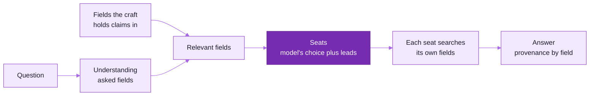

# Answer quality: seats by field and the evaluation

How the ask agent covers every field a question touches, and how that is measured. An answer page
draws on every field its question touches, through one expert seat per field, and its provenance
names the fields it consulted. Engineers changing the planner, the seats or the evaluation read it.

| For | Read |
|---|---|
| Where the rule comes from | round 5, lane fields-and-ask; `kalavigyan-craft-pages` checklist rule 23 ([page-checklist.md](../../.claude/skills/kalavigyan-craft-pages/references/page-checklist.md)) |
| The coverage count the seats read | [coverage.md](coverage.md) |
| The `ask` result that carries the provenance | [mcp-ask-and-upload.md](mcp-ask-and-upload.md) |
| How each seat searches stored knowledge | [retrieval.md](retrieval.md) |
| Why the answer floors follow the judge that judges | [decision 0133](../decisions/0133-the-evaluation-scores-what-answers-read.md) |

## Seats by field

- The understanding step (`planner/understanding.ModelUnderstander`) reads the fields the question
  touches (`disciplines`) and the seats the model chose. With a craft chosen it also reads the fields
  the craft holds cited claims in (`held`, `services/coverage.held_field_lookup`, the coverage count
  of `coverage.md`). The **relevant fields** are the asked fields the craft holds claims in, or every
  asked field when no craft is chosen or the lookup fails (`coverage_seats.relevant_fields`).
- Each relevant field is seated first, in the question's order: by the first seat the model chose
  that speaks for it, else by the seat that leads it (`FIELD_LEADS`: the seat that lists the field
  first, the panel's order breaking ties; the artisan's voice speaks for no field); the model's
  other seats follow in its order, all within the depth's seat limit
  (`depth_policy(depth).max_experts`: 2 Basic, 4 Detailed; decision 0123) (`coverage_seats.covering_seats`,
  `understanding.understood_seats`). Expert depth keeps the model's seats: its panel already widens
  to every seat of each section's field (`expert_panel.panel_seats`).
- Each seat searches stored knowledge with its own fields and source kinds as filters inside the
  search (`services/seat_search.seat_query`, `KnowledgeQuery.fields` and `sourceKinds`), worded by
  the answer's English question and the craft name only ([retrieval.md](retrieval.md), Expert
  seats). Every source kind is read by at least one seat. Each seat keeps its earlier kinds first,
  so the live reading order of decision 0046 is unchanged, and reads these (decision 0122):

  | Seat | Source kinds, most preferred first |
  |---|---|
  | Chemist | paper, book, compound record, encyclopedia, book chapter, GI journal, web page |
  | Physicist | paper, book, encyclopedia, book chapter, GI journal, web page |
  | Materials scientist | paper, book, compound record, book chapter, GI journal, web page, other |
  | Textile or ceramic technologist | paper, government report, GI journal, book, book chapter, web page, other |
  | Geologist | dataset, paper, government report, book chapter, web page |
  | Hydrologist | dataset, government report, paper, book chapter, other |
  | Soil scientist | dataset, paper, book chapter |
  | Climatologist | dataset, paper, government report, book chapter |
  | Ecologist | paper, government report, dataset, book chapter, other |
  | Botanist | paper, book, encyclopedia, book chapter, web page |
  | Toxicologist | compound record, paper, government report, book chapter |
  | Historian | book, paper, GI journal, encyclopedia, book chapter, web page, media, other |
  | Anthropologist | field testimony, paper, book, web page, book chapter, other |
  | Economist | government report, paper, dataset, book chapter, web page, other |
  | Design and art historian | book, paper, web page, book chapter, media, other |
  | Conservator | paper, book, web page, book chapter, other |
  | GI and policy expert | GI journal, government report, web page, other |
  | Artisan's voice | field testimony, web page |
- An answer that leaves a relevant field with stored claims without a speaking seat is a defect;
  `tests/planner/test_field_seats.py` catches it.
- **Provenance**: the MCP `ask` result names the fields it consulted (`AskedAnswer.fields`,
  `ConsultedField {field, sections, sentences, sources, figures, seats[]}`, from the ready sections
  of the stored explainer, `research/coverage_answers.consulted_fields`).

## The evaluation

`python -m app.scripts.eval_answers [--only <id> ...] [--limit N] [--cap USD]` asks each question of
`backend/app/data/eval/answer_questions.json` (`EvalQuestions {schemaVersion 1, questions[{id,
question, craftSlug, depth (DETAILED), fields[]}]}`: 24 questions across all 16 fields and ten
curated crafts; the plans list no minister showcase questions yet, so none are marked) through the
same answer pipeline as the site, as the system (no person's account), each under its own request
id (`answer-eval-<run>-q<NNN>`), then scores the stored explainer.

**The rubric** (`research/coverage_eval.py`), each part 0 to 1, the score their mean:

| Part | Measured |
|---|---|
| fields | the share of the question's fields the answer consulted (a ready section in the field) |
| cited | per question field, cited sentences over 3 (at most 1), averaged over the question's fields; a sentence several items of one block share counts once, as it is shown |
| everyCited | the share of shown sentences whose citations name sources the answer lists and that rest on no passage about another catalogued craft or a place abroad (`offQuestion`, counted with the write-back's naming rule, `services/off_question.explainer_off_question`, decision 0138): (sentences less `unresolved` less `offQuestion`) over sentences, 0 when none is shown; the two counts never overlap, since an answer lists every source it cites (decision 0174; until then 1 only when no sentence failed, which run 45161982883's 0.754 becomes 0.920 under) |
| figures | 1 when the answer shows a figure (any block that is not text) |
| noGaps | 1 when no sentence admits a gap (`research/gap_admissions.GAP_ADMISSION`, the one home the composer's routing also reads: no source or evidence, not enough evidence, could not find, no ... detail, not known or documented, little is known, sources, statements, records, texts, passages, studies or findings do not say, name or give, we do not know, is, are or remains unknown or unclear, and has, have or had not or never been identified, established, determined, documented, recorded or studied) |

**The judge** (the existing `EVAL_JUDGE` route, `router_structured_model(AiTask.EVAL_JUDGE)`) scores
the same five parts 0 to 5 with a note, reading the question and the answer's sentences by field as
untrusted data (`JUDGE_SYSTEM_PROMPT`, `judge_message`, `judge_schema`); its share is the sum over 25.
It reads what a reader sees: each block's sentences once by their English words
(`BlockBase.shown_sentences`, `coverage_answers.shown_field_sentences`), as the client draws a
sentence several items share once (decision 0134), and an expert panel's two mirrored views of one
difference once per pair of seats, as the panel's differ card shows them (decision 0165), and a
quantities table's rows whose sentence the answer already said not again, since the table draws
them under that sentence with its citation only (decision 0168); the rubric counts the same
sentences (decision 0147). A third untrusted block lists each figure by field with its kind and the
quantities it shows, the labels of the figure that state a number (`coverage_answers.field_figures`,
at most 40 lines), so the judge sees which numbers a table or figure carries and which stay in
prose. A judge that fails leaves the measures and says so.

**Spend.** The run stops before a question when the spend so far leaves less than
`EVAL_QUESTION_RESERVE_USD` (2.50) of the cap. The spend, of the run and of each question, is what
its calls settled (`router.tagged_settled_spend` on the request id prefix: the `costUsd` of its
`UsageEvent` rows), never a reservation's estimate: a call the router never settled is not spend
the run can stop on, as in run 45112746194 where one reserved row's 128,000-token estimate (1.28)
more than doubled its first question's 1.05 (decision 0165). The cap is
`services/coverage_eval.EVAL_SPEND_CAP_USD` (30.00 US dollars); `--cap` may lower it, never raise
it. Each answer has the MCP ask's limit, `ASK_TIMEOUT_SECONDS` (600).

**The report** is printed as one JSON line: `EvalReport {schemaVersion 1, startedAt, capUsd,
spentUsd, stopped, asked, answered, rubricMean, judgeMean, questions[{id, craftSlug, depth,
answerId, problem, measures {expected, consulted, missed, sentences, unresolved, figures, gaps,
fields[], offQuestion}, rubric, judge, judgeShare, spentUsd}]}`. A question whose answer fails is kept with its
problem and the run goes on; `rubricMean` and `judgeMean` are the means over the questions each scored.
The exit status is 0 when at least one question was scored.

**The workflow** `.github/workflows/answer-quality.yml` (dispatched by hand, inputs `limit`, `only`,
`cap`, each checked) runs the script on the box over SSM as the other upkeep workflows do, keeps
`report.json` (the report) and `stdout.txt` as the `answer-quality-<run id>` artifact for 90 days,
and writes the asked, answered, means and spend into the run summary.

**The floors.** The printed line also carries `{floorsApplied, floors[{measure, floor, value, held}],
unscored, belowFloor}` (`services/coverage_eval.floor_report`): the judge's and rubric means compared with the
answer floors of `backend/app/data/eval/floors.json` (judge 0.76 and rubric 0.88). The judge floor
was re-based on 2026-11-22 when the judge changed from Gemini 4 Argon to Claude Opus 5.5, a stricter
judge: run 44994632550 scored judge 0.815, less 0.05 and rounded down. The rubric floor was raised on
2026-11-24 from 0.82 to 0.88: run 45230293916 on release aa85ff4c, the first whole run measured with
the shown quantities table (decision 0168) and the everyCited share (decision 0174), answered all 24
questions at rubric 0.930 and judge 0.807, and the rubric's 0.930 less 0.05, rounded down, is 0.88
(decisions 0126, 0133, 0147 and 0174 and [retrieval.md](retrieval.md), Floors). They are compared only for a run that asked every
question and was not stopped by the cap; a mean that is missing breaks its floor, and so does any question
such a run asked and did not score (`unscored`, the ids of the questions with no rubric score or no judge's
share: an answer that failed, timed out or kept no explainer, or one the judge did not score;
`coverage_eval.floors_hold`, decision 0188), since a mean leaves those questions out. The stored run's
`floorsHeld` follows the same rule (`eval_run_store.answers_record`). The workflow then fails
when a floor is broken and keeps one issue, `Answers fell below their floor`, through
`.github/actions/release-issue`: opened or commented on while a floor is broken, closed when a whole
run passes, left as it is after a partial run.

## How this document is kept true

| Claim | Kept true by |
|---|---|
| A relevant field with stored claims always has a speaking seat | `backend/tests/planner/test_field_seats.py` |
| The rubric, the judge's share and the report | `backend/tests/research/test_coverage_eval.py` |
| The judge reads each block's sentences once | `backend/tests/research/test_shown_sentences.py` |
| The run, its spend cap and the consulted fields | `backend/tests/answering/test_answer_eval.py` and `backend/tests/db/test_eval_spend_db.py` (the settled spend) |
| The answer floors and when they are compared | `backend/tests/answering/test_answer_floors.py` and `backend/tests/retrieval/test_eval_workflows.py` |
| The questions | `backend/app/data/eval/answer_questions.json`, read by the script as it runs |

Re-read it when a seat's fields, a depth's seat limit, a rubric part, the spend cap or a floor changes.
