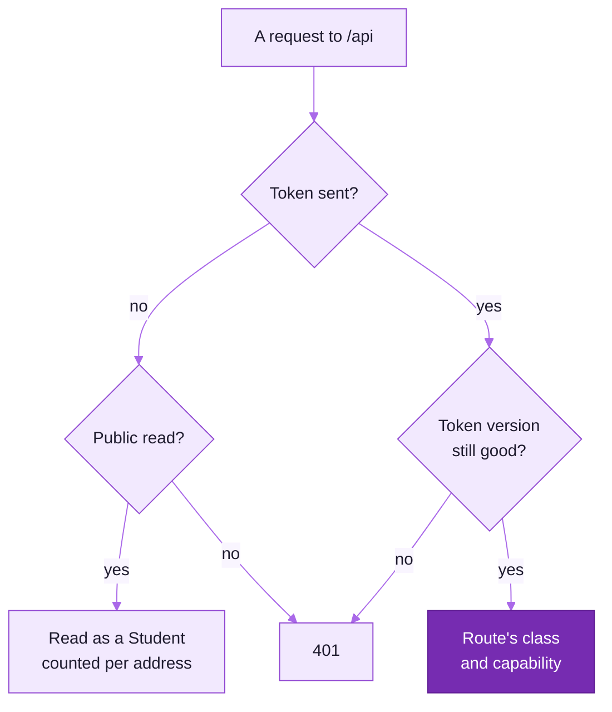

# Backend

What every API route shares (its prefix, body casing, token, headers, errors and which routes read
without signing in), then the foundation's own routes: auth, me, access, users, keys, the craft
catalogue, settings, usage and the AI router. Engineers on the web client or another backend lane
read it before calling or adding a route.

| For | Read |
|---|---|
| What the web client assumes from these routes | [frontend.md](frontend.md) |
| What the box assumes from the backend | [infra.md](infra.md) |
| Why reading needs no account | [decision 0079](../decisions/0079-public-reading.md) and [0097](../decisions/0097-public-reading-everywhere-but-asking.md) |
| The count of routes and tables today | [REPO_FACTS.md](../REPO_FACTS.md), generated |



## What every route shares

Every API route is under `/api`. Health routes are at the root. JSON bodies use camelCase, matching DR (designer-portal) shapes unless a row below says otherwise. Auth is a bearer JWT in `Authorization: Bearer <token>`; the token carries `sub` (user id), `tv` (token version), `email`, `role`. Any password, role, 2FA or suspension change bumps the version, so older tokens answer 401.

Public reads (decisions 0079 and 0097), marked `public` below, answer without a token: everything a reader reads except asking. That is the craft, category, map, district, river, molecule, term and science reads, compare, field voices with full transcripts and photographs, shared answers and lessons (`/shared/...`, `docs/contracts/learning.md`) and `GET /public/summary`. A token that is sent must still be good (401 otherwise, and the pending-step refusals apply). Without a token the reader is read as the lowest role (Student) and sees exactly what a signed-in Student sees, never more: no quote from a `RESTRICTED` chunk for anyone, a `RESEARCHER` chunk (closed-licence full text) quoted only to `READ_RESEARCHER_QUOTES` holders, a claim left with no citation not shown. Anonymous reads are limited per client address to 900 in 10 minutes (30 page views at 30 counted reads), then 429 with `Retry-After`; long-cached reads (`/molecules/{pubchemCid}/conformer`, `/rivers/{mainRiv}`, `/map/layers/{layer}`, `/field-voices/images/{id}`) take `public_asset_reader` and are counted apart, 9,000 per address in the same 10 minutes. Each public read sets `Vary: Authorization` and an `ETag` (the stored version where the row names one, else the SHA-256 of the body) that a matching `If-None-Match` turns into a 304; `Cache-Control` is `public, max-age=300` without a token and `private, no-cache` with one.

Every other route needs a token, and each carries one reason, kept as an inventory in `backend/tests/public/test_route_inventory.py` that fails on a route without a class: `ASKING` (answers, follow-ups and research again, voice calls, artisan conversations, Listen, film and media generation), `OWN_RECORDS` (the reader's account, two-step and passwords, saved items, explainers and their exports, lessons and their files, share links, notifications, preferences, profile, own usage and artisan contributions), `ADMIN` (access, users, keys, routing, usage, testimony review, hiding generated pieces, held field images) and `CONSENT` (the privacy, voice and recording notices and their consent). Open routes that are not public reads are `SIGN_IN_FLOW` (sign in, sign up, set and reset a password, two-step verify, the auth config and the privacy notice) and `SERVICE` (health checks and the voice and artisan custom-LLM endpoints, which check their own secret).

Errors are `{"detail": "<sentence>"}` (FastAPI); validation errors are FastAPI's 422 list. Unhandled errors are `{"detail": "...", "requestId": "..."}` with status 500. Every response carries `X-Request-ID`; send one (8-64 chars of `[A-Za-z0-9._-]`) to correlate.

## Headers the web client must read (all exposed by CORS)

| Header | When | Meaning |
|---|---|---|
| `X-Access-Status` | 403/503 from `/auth/login`, `/auth/two-factor/verify` | `PENDING`, `REJECTED`, `SUSPENDED`, `NOT_RECORDED` (queue full, 503). Same values as DR `lib/accessRoster.ts`. |
| `X-Two-Factor-Setup-Required: 1` | 403 from any route except the 2FA setup routes, `/auth/me`, `/me`, `/auth/change-password`, `/auth/logout` | PROFESSOR, ADMIN or MASTER_ADMIN without TOTP. Send the user to the 2FA setup screen. |
| `X-Password-Change-Required: 1` | 401 from any route except `/auth/me`, `/me`, `/auth/change-password`, `/auth/logout` | `mustChangePassword` is set. |
| `X-Two-Factor-Required: 1` | 401 from key or budget changes; 400 from change-password without a password | Ask for a TOTP code and resend. |
| `X-Confirm-Provider` | 400 from `/auth/change-password` for an account without a password | `GOOGLE`, `MICROSOFT` or `YAHOO`: the account's provider. Sign in with it again (`POST /auth/first-password/nonce`) and resend with the proof (decision 0028). |
| `X-Session-Token` | 200 from `/auth/change-password`, `/auth/two-factor/enable`, `/auth/two-factor/disable` | Replace the stored token with this one. |
| `X-Sign-In-Hint: PASSWORD_NOT_SET` | 401 from password login | Account exists without a password. |
| `X-Sign-In-Hint: EMAIL_UNVERIFIED` | 401 from password login | The address was never confirmed (no emailed link opened, no Google sign-in, no admin-issued password, never signed in). |
| `Retry-After` | 429 | Seconds. |
| `X-Voice-Consent-Required` | 403 from `POST /voice/session` | The voice notice version to accept (`POST /auth/consent` with `kind: VOICE_NOTICE`) before a call. |
| `ETag` | 200/304 from every public read (decision 0079) | Send it back as `If-None-Match`; a match answers 304 with no body. |

## User object (`serialize_user`)

```
{ id, email, name, avatarUrl, role, roleLabel, authProvider, affiliation, mustChangePassword,
  twoFactorEnabled, twoFactorRequired, twoFactorSetupRequired, hasPassword, capabilities: string[],
  accessStatus?, emailVerifiedAt, firstLoginAt, lastLoginAt, passwordSetAt, ageAttestedAt, createdAt, updatedAt }
```
Roles: `MASTER_ADMIN` (60), `ADMIN` (50, label "Admin"), `PROFESSOR` (40), `RESEARCHER` (30), `ARTISAN` (18, decision 0083), `STUDENT` (15). `capabilities` is the list from `app/core/roles.py` (`Capability`): ASK_STANDARD, VOICE, GENERATE_IMAGE, GENERATE_VIDEO, SAVE_EXPORT, READ_RESEARCHER_QUOTES, PROPOSE_KNOWLEDGE, RUN_ENRICHMENT, ACCEPT_ALIASES, MARK_CLAIM_LEVEL, RETRACT_CLAIM, SHARE_MEDIA, HANDLE_OBJECTIONS, MANAGE_ACCESS, LIST_USERS, INVITE_PROFESSORS, CHANGE_ROLES, DISABLE_USERS, MANAGE_KEYS, MANAGE_ROUTING, MANAGE_QUOTAS, MANAGE_CEILINGS, MANAGE_DATASETS, VIEW_USAGE, VIEW_EVALUATION, VIEW_AUDIT_LOG, BUILD_LESSONS (PROFESSOR and above, decision 0062), HIDE_GENERATED (PROFESSOR and above: hide a generated explainer, a piece or an AI asset, decisions 0087, 0095 and 0096), REVIEW_TESTIMONY and CONFIRM_GUARDIAN_CONSENT (PROFESSOR and above), CONTRIBUTE_TESTIMONY (ARTISAN only, never inherited; decision 0083). Gate nav items on capabilities, not on role names. No review gates exist (PLAN §0), except for artisan testimony (decision 0083).

## Health

| Method | Path | Response |
|---|---|---|
| GET | `/health` | `{status:"ok", release, version}` |
| GET | `/health/ready` | `{status:"ready"|"unavailable", database: bool, latencyMs}`; 503 when the database does not answer in 3 s |

## Auth (`/api/auth`)

| Method | Path | Body | Response |
|---|---|---|---|
| GET | `/auth/config` | | `{googleEnabled, googleClientId, microsoftEnabled, microsoftClientId, yahooEnabled, yahooClientId, turnstileRequired, turnstileSiteKey, mailAvailable, signUpOpen}`. Draw the Google button only when `googleEnabled`; Microsoft and Yahoo are enabled only when their client ID and secret are both set (decision 0026); draw the email sign-up form only when `signUpOpen` (mail configured, and in production a Turnstile secret and site key); render the Turnstile widget with `turnstileSiteKey` when `turnstileRequired`. |
| POST | `/auth/google/nonce` | | `{nonce, expiresAt, clientId}`. 404 when Google is off. Pass `nonce` to `google.accounts.id.initialize({nonce})`; the backend checks it once from the ID token's `nonce` claim. |
| POST | `/auth/oidc/nonce` | `{provider:"MICROSOFT"\|"YAHOO"}` | `{nonce, expiresAt, clientId}`. 404 when that provider is off; 429 like the Google nonce. Send `base64url(sha256(nonce))` to the provider as its `nonce` and the raw `nonce` back with the code. Single use, 10 minutes. |
| POST | `/auth/login` | `{email, password}`, `{googleIdToken, googleNonce?}` or `{oidcProvider:"MICROSOFT"\|"YAHOO", oidcCode, oidcCodeVerifier, oidcRedirectUri, oidcNonce}` | `{accessToken, tokenType:"bearer", user}` or `{two_factor_required:true, challenge_token}`. 401 bad credentials or `X-Sign-In-Hint`, 403 + `X-Access-Status`, 429 + `Retry-After`. An unknown Google, Microsoft or Yahoo address creates a PENDING roster request. Google, Microsoft or Yahoo sign-in into an account whose address was never verified first clears any password and 2FA on it (bumping `tokenVersion` and revoking outstanding links), then marks it verified and adopts the roster `admitRole`. Microsoft and Yahoo: 400 when the provider is off; 401 when `oidcRedirectUri` is not `PUBLIC_WEB_URL` + `/login/callback`, the nonce is unknown, spent or expired, the code does not redeem, the ID token fails its checks, or the provider has not verified the address. A new account is recorded with `authProvider` `MICROSOFT` or `YAHOO`; an existing account keeps its provider and avatar, except that a `LOCAL` account without a password takes the new provider. |
| POST | `/auth/two-factor/verify` | `{challenge_token, code}` (6 digits or a recovery code) | Same as a successful login. 401 wrong or dead challenge, 429 locked. |
| POST | `/auth/signup` | `{email, name, affiliation?, requestedRole:"STUDENT"|"RESEARCHER"|"PROFESSOR", profileUrl?, note?, ageAttested:true, privacyNoticeVersion, turnstileToken?}` | 202 `{status:"EMAIL_SENT", email}`, identical whether or not the address already has an account (no enumeration). No password is taken. A new address gets an unverified `User` (default role, no password), a `ConsentRecord` and a PENDING `RoleRequest`; an INVITE link (`/set-password?token=`, 3 days) is mailed. Opening it sets the password and `emailVerifiedAt`, adopts the roster `admitRole` if the row is ACTIVE, and only then adds a PENDING roster row (subject to `ACCESS_PENDING_MAX`). An existing unverified address without a password gets a fresh link; any other existing address gets nothing. 503 when mail is not configured, or in production when Turnstile is not configured; 400 when the Turnstile check fails; 422 without `ageAttested`. |
| POST | `/auth/logout` | | `{ok:true}` (stateless; drop the token) |
| GET | `/auth/me` | | user object with `accessStatus`, `profileRequired` (a student's or artisan's first entry is owed) and `guardianConsentRequired` (decision 0083); booleans only, never a profile value |
| POST | `/auth/consent` | `{kind:"PRIVACY_NOTICE"|"VOICE_NOTICE", noticeVersion}` | `{kind, noticeVersion, acceptedAt}` |
| POST | `/auth/google/link-nonce` | | `{nonce, expiresAt, clientId}` for linking from a signed-in session |
| POST | `/auth/google/link` | `{googleIdToken, password? , twoFactorCode?}` | user object. Needs a fresh password or TOTP; the Google email must match. |
| POST | `/auth/forgot-password` | `{email}` | `{message}` always the same; 429 after 5/hour per IP. Link goes to `${PUBLIC_WEB_URL}/set-password?token=...`, valid 30 min. |
| GET | `/auth/set-password?token=` | | `{valid, reason, purpose}`; reasons `MISSING`, `MALFORMED`, `EXPIRED`, `REVOKED`, `SPENT`, `UNKNOWN_ACCOUNT`; purpose `INVITE`/`RESET` |
| POST | `/auth/set-password/check` | `{token}` | same as above (token out of the URL) |
| POST | `/auth/set-password` | `{token, password (>=10)}` | `{ok:true}`; ends every session |
| POST | `/auth/first-password/nonce` | | `{nonce, expiresAt, provider, clientId}` for the signed-in account's own provider. 409 when the account has a password, 400 when it has no provider (`LOCAL`), 404 when that provider is off. Single use, 10 minutes, bound to the account (purpose `FIRST_PASSWORD`). Google: pass `nonce` to `google.accounts.id.initialize({nonce})`; Microsoft and Yahoo: send `base64url(sha256(nonce))` as at sign-in and the raw `nonce` back with the code. |
| POST | `/auth/change-password` | `{currentPassword, newPassword, twoFactorCode?}`; an account without a password sends `{newPassword, googleIdToken, twoFactorCode?}` or `{newPassword, oidcProvider, oidcCode, oidcCodeVerifier, oidcRedirectUri, oidcNonce, twoFactorCode?}` instead | `{ok:true}` + `X-Session-Token`. A password account needs its current password (400 `Current password is incorrect`) and proof fields change nothing. A first password needs a proof from the account's own provider, verified as at sign-in, with its first-password nonce, issued within 5 minutes, for the account's address; otherwise 400 + `X-Confirm-Provider` and nothing is written. With two-step on, a missing code is asked for (400 + `X-Two-Factor-Required`) before the proof is spent, and a wrong code spends it. 429 + `Retry-After` from the per-account sign-in budget. Bumps `tokenVersion` (decision 0028). |
| POST | `/auth/password-links` | `{userId, delivery:"COPY_LINK"|"EMAIL"}` | 201 `{id, link|null, expiresAt, purpose, deliveredBy}`; MANAGE_ACCESS and a lower-ranked target |
| POST | `/auth/password-links/{id}/revoke` | | `{ok:true}`; MANAGE_ACCESS (403 without it), 404 for an unknown link or a target the actor cannot manage |

### Two-step (`/api/auth/two-factor`), DR shapes

| Method | Path | Body | Response |
|---|---|---|---|
| GET | `/auth/two-factor` | | `{enabled, pending, required, recovery_codes_remaining, enabled_at}` |
| POST | `/auth/two-factor/setup` | | `{secret, otpauth_uri, qr_svg}` (409 if on) |
| POST | `/auth/two-factor/setup/cancel` | | 204 |
| POST | `/auth/two-factor/enable` | `{code}` | `{recovery_codes: string[10], accessToken}` + `X-Session-Token` (the old token stops working) |
| POST | `/auth/two-factor/disable` | `{code}` | `{ok:true, accessToken}`; 409 for PROFESSOR, ADMIN and MASTER_ADMIN (mandatory) |
| POST | `/auth/two-factor/recovery-codes` | `{code}` (TOTP only) | `{recovery_codes}` |

## Me and preferences (`/api`)

| Method | Path | Body | Response |
|---|---|---|---|
| GET | `/me` | | Same as `GET /auth/me`: user object with `accessStatus`. Allowed while a password change or 2FA setup is pending. |
| GET | `/preferences/me` | | `{theme:"system"|"light"|"dark", reducedMotion, largerText, highContrast:"system"|"standard"|"high", answerLanguage, alertDigest, alertDigestOffered, updatedAt}`. `highContrast` is `system` (follow the device's `prefers-contrast`), `standard` or `high`; migration `0046_contrast_preference` turned the old `false` into `system` and `true` into `high`. `answerLanguage` is `auto` (follow the question's script) or an answer language code. `alertDigest` is the reader's opt-in to the weekly digest and `alertDigestOffered` whether the digest is switched on (`ALERT_DIGEST_ENABLED`, `docs/contracts/learning.md`). The row is created with defaults (`system` theme and contrast, all false, `auto`) on first read. |
| PUT | `/preferences/me` | `{theme?, reducedMotion?, largerText?, highContrast?, answerLanguage?, alertDigest?}` | Same shape as GET. Omitted or null fields keep their value; unknown fields, other theme and contrast values and other answer languages are 422; a boolean `highContrast` from an older client is read as `high` (true) or `system` (false). Blocked (401/403 + header) while a password change or 2FA setup is pending. |

## Access roster (`/api/access`), DR `/access/roster` semantics

Capability MANAGE_ACCESS (PROFESSOR and above). A professor admits RESEARCHER and STUDENT only, an admin up to PROFESSOR; the master admin admits any role. The role checked is the one the address joins with, the default role included (`MASTER_ADMIN_EMAIL` joins as MASTER_ADMIN). Below the master admin, any change or decision on an entry whose role, or whose account's role, is at or above the actor's own is 403; restoring a REJECTED or SUSPENDED entry needs DISABLE_USERS (ADMIN and above). Statuses `ACTIVE`, `PENDING`, `REJECTED`, `SUSPENDED`.

Roster row: `{id, email, fullName, affiliation, status, admitRole, joinedAt, requestedAt, attemptCount, lastAttemptAt, decidedAt, decidedById, decidedByName, firstSeenAt, notes, createdAt, updatedAt, addedById, addedByName}`.

| Method | Path | Body / query | Response |
|---|---|---|---|
| GET | `/access/roster/pending-count` | | `{pending, capacity, capReached}` |
| GET | `/access/roster` | `page, pageSize (<=200), search, status (repeatable or comma list), roles (role names or "default"), dateField (added, requested, decided, joined, firstSeen), dateFrom, dateTo, sort (added, email, name, standing, joined, requested, decided, firstSeen, attempts), dir` | `{items, total, page, pageSize, pages, roleMatchTruncated:false, assignableRoles}` |
| POST | `/access/roster` | `{email, fullName?, role?, notes?, affiliation?, password?, mustChangePassword?}` | 201 row + `{accountPromotionHeld, accountCreated}`; 409 if listed |
| POST | `/access/roster/{id}/decision` | `{decision:"APPROVE"|"REJECT", role?, notes?}` | row + `{accountPromotionHeld}`. Approve also sets the role on an existing account (token version bumped). Reject ends sessions. |
| PATCH | `/access/roster/{id}` | `{fullName?, role?, notes?, affiliation?}` | row + `{accountPromotionHeld}` |
| DELETE | `/access/roster/{id}` | | row with `status:"SUSPENDED"`; ends sessions |

## Manage users (`/api/users`)

List and view: LIST_USERS (PROFESSOR+). Role changes: CHANGE_ROLES; suspend, restore, 2FA reset, delete: DISABLE_USERS (both ADMIN and above). Every change to another account is 403 when its role is at or above the actor's (the master admin excepted), and an admin assigns roles up to PROFESSOR only; the account named by `MASTER_ADMIN_EMAIL` is never suspended, deleted or re-roled by anyone else.

| Method | Path | Body / query | Response |
|---|---|---|---|
| GET | `/users` | `search, role, access (ACTIVE, PENDING, REJECTED, SUSPENDED, NOT_LISTED), sort (created, name, email, role, lastLogin), dir, page, pageSize (<=100)` | `{items: user[], total, page, pageSize, pages}`; each item has `accessStatus` |
| GET | `/users/{id}` | | user |
| PATCH | `/users/{id}` | `{name?, role?, affiliation?, mustChangePassword?}` | user |
| POST | `/users/{id}/suspend` | `{reason?}` (optional body) | user with `accessStatus:"SUSPENDED"`; sessions end |
| POST | `/users/{id}/restore` | | user with `accessStatus:"ACTIVE"` |
| POST | `/users/{id}/sign-out-everywhere` | | user |
| DELETE | `/users/{id}/two-factor` | | user (2FA off, sessions end; the user must set it up again at next sign-in if their role requires it) |
| DELETE | `/users/{id}` | | 204 (soft delete, `deletedAt`) |

## API keys (`/api/secrets`), MANAGE_KEYS (master admin)

There is no reveal route. Changes need a TOTP step-up.

Key row: `{key, label, description, group, formatOnly, configured, source:"database"|"environment"|"unset", overrideUnreadable, hint (last 4), lastStatus:"UNKNOWN"|"OK"|"FAILED", lastCheckedAt, lastError, updatedBy, updatedAt}`.

Keys: GEMINI_API_KEY, ANTHROPIC_API_KEY, OPENAI_API_KEY, DEEPSEEK_API_KEY, ELEVENLABS_API_KEY, VOYAGE_API_KEY (format-checked only), BRAVE_SEARCH_API_KEY, EXA_API_KEY, TAVILY_API_KEY, OPENALEX_API_KEY, SEMANTIC_SCHOLAR_API_KEY, CORE_API_KEY, SPRINGER_NATURE_API_KEY, ELSEVIER_API_KEY, ELSEVIER_INSTTOKEN, WILEY_TDM_TOKEN, DATA_GOV_IN_API_KEY, GOOGLE_CLIENT_ID.

| Method | Path | Body | Response |
|---|---|---|---|
| GET | `/secrets` | | key row[] |
| PUT | `/secrets/{key}` | `{value, twoFactorCode}` | key row; 401 + `X-Two-Factor-Required` without a valid code; 404 unknown key |
| DELETE | `/secrets/{key}` | body `{twoFactorCode}` (the web proxy forwards bodies, not this header); header `X-Two-Factor-Code` also accepted | key row; 401 + `X-Two-Factor-Required` without a valid code |
| POST | `/secrets/{key}/test` | | key row with the fresh verdict |

## Craft catalogue (`/api/crafts`)

| Method | Path | Body / query | Response |
|---|---|---|---|
| GET | `/crafts/catalogue` | public; `includeInactive` (bool, PROFESSOR and above; 403 for a signed-in reader below, 401 without a token). Header `If-None-Match` | Catalogue v2 (`research/craft_catalogue.CraftCatalogue`, decision 0082, golden `shared/craft.catalogue.golden.json`), DR's `CraftCatalogue` with fields added: `{schemaVersion: 2, version, summary:{crafts, giRegistered, states, placed, families, kinds}, categories:[{id, slug, name, label, palette, sortOrder, readerCount, subCategories:[{id, slug, name, label, sortOrder, craftCount, readerCount}]}], concepts:[{key, label, names[], craftSlugs[]}], crafts:[{id, slug, name, displayName, localName, categoryId, subCategoryId, familyLabel, kindLabel, palette, sourceSerial, stateOfOrigin[], stateOfPractice[], giStatus: "GI"|"NON_GI"|null, giYear, isCatchAll, craftCode, aliases[], hero:{url, width, height, alt, author, licence, licenceUrl, site, pageUrl}|null, depth:{coverage: "FULL"|"THIN"|null, claims, stages, pictures, places}}]}`. With `includeInactive` each craft also has `status` (`ACTIVE`/`LEGACY`/`MERGED`), `mergedIntoId`, `referenceCount` (null for active crafts). |

- Any reader may read it, signed in or not (decision 0079). Headers `ETag: "<version>"`, `Vary: Authorization` and `Cache-Control: private, no-cache` with a token or `public, max-age=300` without; a matching `If-None-Match` (strong, weak `W/` or `*`, comma lists) answers 304 with the same headers and no body. The list without `includeInactive` is built at most once every 300 seconds per process and kept (`services/craft_catalogue.reader_catalogue`, `core/kept_value.KeptValue`), so a repeat read or a 304 runs no query; the list with `includeInactive` is read fresh every time (decision 0082).
- Read from the database (`CraftCategory`, `CraftSubCategory`, `Craft`, `CraftSpelling`, active `CraftAlias`). Categories by `sortOrder, name`; crafts active first, then category order, sub-category order, `sourceSerial`, name, id. `craftCount` counts active crafts; `readerCount` and every `summary` count leave catch-all rows out, which stay listed with `isCatchAll` (the map's rule). `summary.states` counts the LGD states and union territories in the readers' `stateOfPractice`, `placed` the readers practised in one of them or with a district or point `CraftLocation`.
- Reader fields: `displayName` is the craft's name for readers (`craft_page_family.reader_name`: a catch-all row takes its kind's other name, a spelling fix comes from `data/craft_names.json`, else the master name); `familyLabel`, `kindLabel` and `palette` come from `data/craft_families.json`; `localName` is the stored `Craft.localName`, else the editorial value in `craft_names.json` (`null` hides a wrong one), else an active alias in a non-Latin script whose language is spoken in the craft's first state that has one (`data/state_languages.json`), from the highest-ranked sourced origin (`CURATED`, then `IMMERSIVE`, then `WIKIDATA`) and the shortest within it. `giYear` is the year of the curated `CraftGiRecord.registeredOn`, else the earliest `GiRegistration.registeredOn`. `hero` is the craft page's lead picture (first inline picture of no stage, else the first inline) of a curated craft, with a Wikimedia Commons file whose stored width is over 500 pixels served as its 500-pixel thumbnail (`sources/reference/commons_urls.commons_thumbnail_url`, `width` and `height` scaled to match) and any other picture, including one of unknown width, served as stored (Commons refuses a thumbnail wider than its original). `depth` counts the craft's visible claims (HYBRID mode, open concepts and claims), the stages of its longest process, the curated page's pictures and its district or point locations; `coverage` is the curated coverage or `null`.
- `concepts` are what search falls through to: every glossary `Term` linked to a reader craft except the crafts' own names, and every `Material` of a reader craft keyed on its head word (a trailing gloss in brackets becomes a name), merged by key; most-shared first, then by label. A concept never lists a catch-all row.
- `aliases` are normalised spellings: every `CraftSpelling` sharing the craft's `craftCode` plus every active `CraftAlias.aliasNorm`, minus the craft's own normalised name, sorted.
- `version` is the SHA-256 of the catalogue as served (`core/http_cache.body_version`), so any edit, alias change, import or curation version moves the ETag and nothing else does. The DB-free `craft_master_loader.build_catalogue()` gives DR's fields (not the v2 additions; its `version` differs) for tests and offline fixtures.
- Seeding: run `uv run python -m app.scripts.seed_crafts` in `backend/` after `uv run alembic upgrade head`. It upserts `seed_plan()` from the vendored JSON in `backend/app/data/` (9 categories, 36 sub-categories, 455 crafts, 50 `CraftCode`, 174 `CraftSpelling`, 2170 `CraftAlias`) and prints the counts as JSON. Re-running is safe: rows match on slug, code, spelling and (`craftId`, `aliasNorm`), existing ids and statuses are kept, and nothing is deleted. CI runs it after the migrations in `backend-checks.yml`, and `tests/db/test_craft_seed.py` seeds twice on emptied craft tables and checks the counts and ids do not change. Deploy: `infra/deploy/blue_green.sh` (infra lane) should run `./.venv/bin/python -m app.scripts.seed_crafts` from `backend/` with the env loaded, right after its `alembic upgrade head` and before the new colour starts; a non-zero exit should stop the release like a failed migration.
- Seed knowledge: run `uv run python -m app.scripts.seed_claims` in `backend/` after `seed_crafts`. It loads `backend/app/data/seed_claims.json` (`craft_master_loader.SEED_CLAIMS_FILE`) into `Source` (122, `evidenceKind` from the row, seed id and `importRef` in `externalIds`), `Concept` (582, `originRef` = seed key, `craftId`/`subCategoryId` resolved by slug), `ConceptEdge` (767, `relation` plus the upstream `sourceRelation`; `claimId` points at the edge's first EDGE claim), `Process` ("Seed process", variant `seed_claims`, one per craft with stages) and `ProcessStage` (67 stages that carry an ordinal), `Claim` (1,914, row values as given: `status`, `evidenceLevel`, `levelReason`, `origin=IMPORT`, `createdByKind=SYSTEM`), `ClaimSource` (3,015 citations with `locator`, `quote` up to 300 chars, `quoteCheck`, `relation`) and one `ReviewEvent` per claim (`actorKind=SYSTEM`, `systemActor=import`, `toStatus`/`toLevel` from the claim, `note` = `seed import <seed id>`). Every id is `uuid5(ID_NAMESPACE, "seed-claims:<kind>:<seed id>")` and every insert is `ON CONFLICT DO NOTHING`, so a re-run adds nothing and never overwrites a later correction. It prints `{"total", "inserted", "unresolvedSlugs"}` as JSON and exits 2 when a craft or sub-category slug is missing (run `seed_crafts` first). `--dry-run` builds the plan from the file with no database and prints the totals. Seed claims arrive as `status=PROPOSED` (crafts lane contract); per §0 nothing is gated on status, so retrieval and answering must not filter claims to `APPROVED`, only drop the hidden statuses (`DRAFT`, `REJECTED`, `RETRACTED`, and since decision 0053 `SUPERSEDED` and `WITHDRAWN`; the import withdraws the 557 edge sentences). Edge `ordinal`, `conditions`, `determinism` and concept `localTerms`, `category`, `provenanceKind`, `compares` have no columns and are not stored. `tests/db/test_claim_seed.py` checks the plan without a database (run with `RUN_DB_TESTS=1 -m "not db"`, since the `tests/db` folder name is skipped by default) and, against Postgres, seeds crafts then claims twice on emptied tables. Deploy and CI should run it right after `seed_crafts`.

## Knowledge, privacy and map (`/api`)

| Method | Path | Auth | Response |
|---|---|---|---|
| GET | `/privacy/notice` | public | `{version, title, body (Markdown, from app/data/privacy_notice.md), publishedAt}`. `version` is what signup sends as `privacyNoticeVersion`. |
| GET | `/categories` | public | `CategoryList` of `docs/contracts/category-page.md` (decision 0078): the nine craft categories with labels, sub-categories, craft counts without catch-alls, and for a curated category its hero and cited lede sentence. Anonymous readers are rate limited by address (429 with `Retry-After`); `ETag` with 304 revalidation, `Cache-Control: public, max-age=300` without a session, `private, no-cache` with one, `Vary: Authorization`. |
| GET | `/categories/{slug}` | public | `CategoryPage` of `docs/contracts/category-page.md`: the category's cited overview, key facts, sections, sub-categories with member crafts and the sentence covering each, pictures, glossary, open questions and numbered sources from its imported dossier, or its register facts when it has none; same limits and caching as the list; unknown slug 404 `{detail}`. |
| GET | `/crafts/{slug}/page` | public | `CraftPage` schema version 3 of `docs/contracts/craft-page.md` (decisions 0053, 0095): the masthead, the lede and the chapters (answer blocks and page parts built from stored rows without a question), Cite this, All evidence for every reader and the version 2 flat parts until schema 4. Served from the craft's snapshot for its stamp (`services/craft_page_snapshots.served_page`); the body differs by reader only between the `OPEN` variant (anonymous and signed-in readers alike) and the `RESEARCHER` variant (`READ_RESEARCHER_QUOTES`). `?version=N` answers the archived page of curation version N (404 for a version the craft never had). A MERGED slug answers with its target's page; unknown slug 404 `{detail}`. |
| PUT | `/crafts/{slug}/explainers/{pieceId}/hidden`, `/crafts/{slug}/pieces/{pieceId}/hidden`, `/crafts/{slug}/media/{assetId}/hidden` | `HIDE_GENERATED` | `{hidden}` body; hides or shows a generated explainer, a piece or an AI asset on this craft's page, audited; 404 `{detail}` for one not on the page; 403 when showing a named-cluster picture without both professors' sign-off. |
| GET | `/crafts/{slug}/process` | public | `CraftProcess` of `docs/contracts/science.md` (stages, materials, conditions, reactions, sources), built only from stored rows. A MERGED slug answers with its target's process; unknown slug 404 `{detail}`. |
| GET | `/crafts/{slug}/region` | public | `CraftRegion` of `docs/contracts/region.md` (places, environment values with grid and period, datasets), built only from stored rows. A MERGED slug answers with its target's region; unknown slug 404 `{detail}`. |
| GET | `/map/layers` | public | `MapLayerList` of `docs/contracts/region.md`: the layers with stored values, their datasets and the boundary caption; 404 `{detail}` while no geo load has stored the boundary dataset. |
| GET | `/map/layers/{layer}` | public | `MapLayer`: district values, quantile classes, `version`. `ETag: "<version>"`; a matching `If-None-Match` answers 304; an unknown or empty layer 404 `{detail}`. |
| GET | `/map/districts/{districtLgd}` | public | `DistrictCrafts` of `docs/contracts/learning.md` (ask the map, decision 0065): located crafts, stored land story, the district's land values, read with no model call. 404 `{detail}` for a code outside the register or while no boundary dataset row is stored; 422 below 1. |
| GET | `/rivers/{mainRiv}` | public | One basin's river lines as TopoJSON (`application/json`, object `reaches`, `docs/contracts/region.md` Rivers), read from the private bucket where the geo ETL wrote it (decision 0043). `ETag: "<file SHA-256>"`; a matching `If-None-Match` answers 304; an unknown basin, a missing file or one whose SHA-256 is not the stored row's 404 `{detail}` (decision 0050); 422 for an id outside 1 to 99,999,999; 503 `{detail}` when the bucket is not configured or does not answer. |
| GET | `/map/crafts` | public | `[{key, name, latitude, longitude, total, crafts:[{slug, name, path}]}]`: one point per state of practice (a point on the state's surface, from `AdminState.geom`) plus one per district or point `CraftLocation`. |
| GET | `/answers/config` | signed in | `{depths:[{depth, label}], defaultDepth, voice, listen:{languages}, film:{score}, languages:[{code, label, autonym, script, direction}]}` (English, Hindi, Bengali, Tamil, Telugu, Marathi, Gujarati, Kannada, Malayalam, Odia, Punjabi, Assamese, Urdu; `direction` is `rtl` for Urdu, decision 0023); `voice` is the `VoiceAvailability` of `docs/contracts/voice.md` (hidden while the call is switched off, decision 0035); `listen.languages` are the languages Listen speaks, empty when it cannot work; `film.score` is true when the bucket is set, the reader holds `VOICE` and a 30 s music bed could be made now (decision 0058); `depths` are `BASIC` Basic, `DETAILED` Detailed, `EXPERT` Expert for every known role (none and a null `defaultDepth` for an unknown one); `defaultDepth` is the role's (Student Basic, Researcher and Professor Detailed, Admin and Master Admin Expert; decision 0031). |
| POST | `/answers/stream` | signed in; body `{question (2-1000), depth?, craftSlug?, anyCraft (default false), language?, fresh (default false), conversationId?}`, `craftSlug` and `anyCraft: true` together are 422; `fresh: true` researches every section and reuses no stored piece (decision 0033), so is any other field (`mode` is retired); `depth` defaults to the role's and must be one the role may choose (`ASK_STANDARD` and a known role, else 403); 30 per 10 min per user except Master Admin (429 + `Retry-After`) | `text/event-stream`, the explainer stream of `docs/contracts/explainer.md` (the answering service in `docs/contracts/research.md`): `understood` first (the chosen craft or any craft, the offered crafts, the depth, the language; decision 0031), then `status` steps while it works, `trail` as sources are found, read and quoted, and per section `section_started`, `section_state`, its `source` events, `block`, `open_question` and `section_done` (reused sections first, decision 0033), then `follow_ups` or `not_enough_evidence`; when spend is refused while understanding, the stored findings of the chosen craft as the same events instead; `error` on failure; `done {answerId}` last. `section` and `sentence` are no longer sent. A `: keep-alive` comment after 60 s of silence. Every frame is validated (`research/stream.event_frame`). |
| GET | `/answers/{answerId}/listen` | `VOICE`; `language?` (an answer language), `section?` (`s1`...); 30 per 10 min per user except Master Admin (429 + `Retry-After`) | `ListenScript` of `docs/contracts/voice.md` (Listen): the reader's own explainer, or one section, read aloud with word timings and presigned audio links; 404 `{detail}` for another reader's answer, no explainer, another language or nothing to read; 429 + `Retry-After` when the day's `VOICE_SECONDS` cannot cover new audio; 503 when the bucket, the key or ElevenLabs fail (decision 0035). |
| GET | `/answers/{answerId}/film-score` | `VOICE`; `language` (required, an answer language); 10 per 10 min per user except Master Admin (429 + `Retry-After`) | `FilmScore` of `docs/contracts/explainer.md` (Film mode): a music bed and sound-effect cues for the reader's own explainer, made once through ElevenLabs and the media router and then served from the private bucket with one-hour links; 404 `{detail}` for another reader's answer, no explainer, another language or nothing to play; 422 for a language that is not an answer language; 503 `{detail}` when the router refuses (media sub-cap or monthly ceiling, never for a Master Admin), ElevenLabs or the bucket fails (decision 0058). |
| PUT | `/answers/{answerId}/simulations/{blockId}/hidden` | `HIDE_GENERATED` (Professor, Admin, Master Admin; else 403); body `{hidden: bool}` | `{answerId, blockId, pieceId, hidden}` (`schemas/simulation_hiding.py`): sets or clears `hiddenAt` and `hiddenById` on the knowledge piece the asker's generated explainer was stored as (`uuid5("knowledge-piece:<answer>:<block>")`) or reused from (`reuse.pieceId`), with an audit record (`explainers.simulation_hidden` or `explainers.simulation_shown`) when the mark changes; a hidden piece is never reused or built again (decision 0055). 404 `{detail}` for another's answer, an answer without a kept explainer, a block that is not a simulation or one never kept as a piece; 422 for a block id off `BLOCK_ID_PATTERN` or a body without a boolean `hidden`. |
| GET | `/molecules/{pubchemCid}/conformer` | public | The compound's 3D structure as PubChem's SDF (`chemical/x-mdl-sdfile`, `ETag` the SDF's SHA-256), fetched once through the PubChem adapter and kept in the private bucket (decision 0045); the stored compound is checked and the connection released before the bucket and PubChem (decision 0050). 404 `{detail}` for a CID no stored compound holds or a compound without a 3D conformer; 422 for a CID below 1; 503 when the bucket or PubChem fails. |
| GET | `/terms/{key}` | public; `language` (an answer language, default `en`; else 422); signed in, 60 per 10 min per user except Master Admin (429 + `Retry-After`) | `Term` of `docs/contracts/explainer.md`: the glossary term's 1-3 cited sentences with their sources, `basis` `STORED`, `WIKIPEDIA` or `WEB_SEARCH`, cached per term and language (decision 0034). 404 `{detail}` for an unknown key or a term with no cited summary. Without a token only a kept summary, or for English one built from the term's stored defining claims, is answered: nothing is searched, translated, generated or written, and a term that would need that answers 401 `{"detail": "Sign in to look this term up."}` (decision 0079). |
| GET | `/public/summary` | public | `PublicSummary` (`research/public_summary.py`, golden `shared/public.summary.golden.json`, decision 0079): `{schemaVersion: 1, counts: {crafts, giRegistered, states, placed, families, kinds} (the catalogue's summary), featured: [{craft: {slug, name, path}, localName, hero: {media, caption} \| null (the page's `HERO` picture), lede (an answer sentence with every citation)}] (the curated crafts of Kutch Ajrakh, Bastar Dhokra and Tikuli Painting, in that order), specimen: {craft, sentence} \| null (Kutch Ajrakh's overview sentence citing curated claim `C023`, with every citation and quote), sources (each source the sentences cite, once, in the order first cited), points: [{key, name, latitude, longitude, total, curated: [{slug, name, path}]}] (the map's points with only the crafts the catalogue counts)}`. No reader data. Built at most once a day per process; `Cache-Control: public, max-age=86400` and an `ETag` for every reader. |

## Field voices (`/api`, decision 0091)

| Method | Path | Who | Response |
|---|---|---|---|
| GET | `/crafts/{slug}/field-voices?kind=quotes|images&cursor=<offset>` | public reading (`public_reader`) | `FieldVoicesList {schemaVersion 1, craft, kind, total, cursor, nextCursor, quotes[PageVoice], images[PageFieldPhoto]}`, 25 a page, newest first; quotes merge the portals' field quotes with approved KalaVigyan testimony; `cursor` is the page's offset (a multiple of 25), else 400 `{"detail": "Unknown cursor."}`; 404 for an unknown craft |
| GET | `/field-voices/recordings/{id}` | public (`public_reader`, counted; decision 0097) | `FieldTranscript {schemaVersion 1, id, origin, publisher, title, mediaType, recordedAt, durationMs, crafts[], workshop, context[], stage, speakers[{key, label, role}], lines[{id, position, speakerKey, locator, language, text, english, englishSource, quotable}], english, englishSource, sourceId, citation}`, the same for every reader, with the portals' scrubbing; `ETag`, `Vary: Authorization`, `public, max-age=300` without a token and `private, no-cache` with one; 404 for a recording withdrawn, hidden or stale |
| GET | `/field-voices/images/{id}` | public | 302 to a 15-minute presigned URL of the stored copy (`Cache-Control: private, max-age=300`); 404 when withdrawn, hidden or stale; 503 without the media bucket |

The shapes are `research/field_voices.py` (client `frontend/lib/fieldVoicesContract.ts`). A stream
whose last good contact is over 7 days old serves nothing (`retrieval/field_scope.py`).

## Voice (`/api/voice`)

Every route here answers 404 while `VOICE_CALL_ENABLED` is false, the default (decision 0035). The routes, checks, statuses and streams are the table in `docs/contracts/voice.md` (Routes): the voice notice, starting, ending and reading a session, the custom-LLM endpoint ElevenLabs calls with its bearer, and the relay turn and speech routes. Per user, session starts are limited to 10 in 10 minutes, relay turns to 40 and reply replays to 60 in 10 minutes (429 + `Retry-After`).

## Media (`/api/media`)

The routes, refusals, claim set, prompt, quotas and job view are `docs/contracts/media.md` (lanes 0018 and 0021): `GET /media/options?craftSlug=` lists the kinds and stages a press may make, `POST /media/jobs` creates a job from a stage and an idempotency key (never claim ids), and `GET /media/jobs/{id}` answers its status, failure, polling hint and labelled asset with an expiring link. The sharing route `POST /media/assets/{id}/sharing` belongs to the governance lane and is not served yet.

## Settings hub (`/api/settings`)

`/settings/ai-routing` generalises DR `/settings/transcription-providers` to one ordered list per task (stored in `RoutePolicy`).

Routable tasks (`ai_providers.ROUTABLE_TASKS`, the keys of `DEFAULT_ROUTES`): PLAN, WEB_READ, COMPOSE, VOICE_TURN, INTERVIEW, TESTIMONY, TRANSLATE, EXTRACT, SUMMARISE, EMBED, EVAL_JUDGE, IMAGE, VIDEO, MUSIC, SOUND_EFFECT, RERANK. WEB_READ and EXTRACT are public-text tasks; DeepSeek (PUBLIC_TEXT_ONLY) is offered and accepted only there. RERANK has one model, Voyage `rerank-3` (provider VOYAGE, migration `0060_reranking`, decision 0125).

Task state:
```
{ task, label, publicText, normalised, normalisedNote,
  routes: [{ordinal, provider, providerLabel, model, modelLabel, enabled, maxOutputTokens, temperature, supported,
            dataClass, keyName, keyLabel, configured, keyState:"ABSENT"|"UNTESTED"|"PASSING"|"FAILING",
            rankable, frozenReason, testedAt, testError}],
  effectiveChain: ["PROVIDER:model"], verifiedChain: ["PROVIDER:model"],
  availableModels: [{provider, model, label, priceVerified}] }
```

| Method | Path | Body | Response |
|---|---|---|---|
| GET | `/settings/ai-catalogue` | | `{providers:[{provider, label, managedKey, consoleUrl, pricingUrl, dataClass, defaultModel, models:[{id, label, note, pricePerMTok:[in,out]|null, pricePerUnit, unit, priceVerified, maxOutputTokens|null, tasks}]}], tasks}`; `maxOutputTokens` is the model's documented maximum (decision 0093) |
| GET | `/settings/ai-routing` | | `{tasks: taskState[], providers: [{id, name, keyName, keyState:"ABSENT"|"UNTESTED"|"PASSING"|"FAILING", publicTextOnly, models:[{id, label, tasks[]}]}]}` |
| GET | `/settings/ai-routing/{task}` | | task state |
| PUT | `/settings/ai-routing/{task}` | `{routes:[{provider, model, enabled?, maxOutputTokens?, temperature?}]}` (1-8); `maxOutputTokens` null or absent asks for the model's documented maximum, a number caps the route at it (never above the maximum) | task state; routes whose key has not passed a test sink below passing ones (`normalised`, `normalisedNote`); 422 for an unsupported provider/model pair |
| POST | `/settings/ai-routing/{task}/test` | `{provider, model?}` | task state after testing that provider's key |
| GET | `/settings/ai-budget` | | `{monthlyCeilingUsd: number|null, mediaCapUsd: number|null, roleDailyUsd:{ROLE: number|null}, degradeAtFraction: number|null, answerCapUsd:{BASIC, DETAILED, EXPERT: number|null}, signUpMode, domainAllowlist}` (MANAGE_CEILINGS); `null` is no cap (and, for `degradeAtFraction`, never degrade); `answerCapUsd` is the per-answer cap of each depth, which binds every role but Master Admin when set |
| PUT | `/settings/ai-budget` | any of the above + `twoFactorCode`; a field left out is unchanged, an explicit `null` for `monthlyCeilingUsd`, `mediaCapUsd` or `degradeAtFraction` lifts it; `answerCapUsd` names any of the three depths (0-1000 each, or `null` for no cap) and `roleDailyUsd` any roles, each merged into the stored caps, so a role or depth left out keeps its cap | same shape; 422 if a media cap exceeds a set monthly ceiling, for an unknown role, or for a `MASTER_ADMIN` daily cap that is not null (Master Admins have no caps) |

Defaults (`services/app_settings.DEFAULTS`, decision 0093): no monthly ceiling, no media sub-cap, no per-user daily cap for any role, no per-answer cap at any depth, never degraded. Migration `0029_unlimited_ai_use` removed the stored cap rows, so the defaults govern until a Master Admin sets a cap here. Spend is still reserved, settled and shown on Usage. Budget months and days run on Asia/Kolkata.

## Usage (`/api/usage`)

| Method | Path | Response |
|---|---|---|
| GET | `/usage/summary?month=YYYY-MM` (VIEW_USAGE) | `{month, monthlyCeilingUsd|null, mediaCapUsd|null, spentUsd, mediaSpentUsd, reservedUsd, fraction|null, degraded, calls, refusedCalls, failedCalls, byTask, byProvider, byModel, byRole: [{key, costUsd, calls, inputTokens, outputTokens, ok}], byDay:[{day, costUsd, calls}], topUsers:[{userId, name, email, role, costUsd, calls}]}` |
| GET | `/usage/report?from=ISO&to=ISO` (VIEW_USAGE) | `{from, to, ceilingUsd|null, spentThisMonthUsd, spentUsd, calls, failures, byTask:[{task, label, calls, failures, inputTokens, outputTokens, costUsd}], byProvider:[{provider, name, model, calls, failures, costUsd, p95LatencyMs|null}], byDay:[{day, calls, costUsd}]}`. `from` defaults to the start of the IST month, `to` to now; a date without a zone is read as IST; days are IST. Reserved (unsettled) events are left out. 422 when `to` is before `from`. |
| GET | `/usage/me` | `{todayUsd, dailyCapUsd|null, allowances:{VOICE_SECONDS, IMAGE, VIDEO: number|null}, platformDegraded}`; `null` is no cap, a Master Admin's `dailyCapUsd` always `null` |

## AI router (for the answering, voice, media and enrichment lanes)

`app.providers.router.run(task, *, system, user, json_schema=None, max_tokens=None, temperature=None, texts=None, principal=Principal(user_id, role), request_budget_usd=None) -> RouterResult(text, embeddings, provider, model, cost_usd, degraded, attempts, usage_event_id, ...)`.

- Walks `RoutePolicy` in ordinal order; skips routes the catalogue does not support for the task and PUBLIC_TEXT_ONLY providers on private tasks.
- `rate_limit`/`unavailable` with Retry-After <= 2 s retries the same route once, otherwise moves on; `auth` marks the key FAILED and moves on; `refusal`/`bad_request` raise `RouterError(kind)` at once.
- Before each call it reserves the estimate as a `UsageEvent` (`RESERVED`) under a Postgres advisory lock, refusing with `RouterError(kind="ceiling", reason="MONTHLY_CEILING"|"MEDIA_CAP"|"ROLE_DAILY_CAP"|"REQUEST_BUDGET")` and a `REFUSED_CEILING` row only when that cap is set; with the defaults (decision 0093) no cap is set and nothing is refused, while every reservation and settlement is still written. After the call it settles the row to `OK` with the real cost, or `ERROR`/`REFUSED_PROVIDER`. No DB session is held across a provider call.
- A principal's `answer` is one answer's `AnswerSpend` (its depth's cap, `ANSWER_CAP`) or that spend's `headroom()` (`AnswerHeadroom`, decision 0046): the same holds and spend, but a call is allowed only while the answer keeps half its cap after it, so optional work such as the expert panel spends only within the first half of the cap. Master Admins pass both.
- **Reasoning effort is per route** (decision 0052): `RoutePolicy.params.reasoningEffort` (`low`, `medium`, `high`, `xhigh`, `max`) else the task's default in `TASK_REASONING_EFFORT` (`COMPOSE` is `medium`); only always-thinking models act on it, and a reorder keeps each route's params. An answer's calls may carry a `RouteTuning` (decision 0089, `providers/answer_routes.py`): Expert composes on `claude-opus-5-5` at `high`, add-on builders run on `claude-sonnet-5-5`, and the generated explainer on Opus at `high` for Expert; a tuning swaps the model of its provider's route only, sets the effort, and may raise the route's output cap, never lowering it. No answer tuning sets a cap (decision 0093).
- **Output tokens** (decision 0093): each call asks for the caller's `max_tokens`, else the route's `maxOutputTokens`, else the model's documented maximum from the catalogue (Claude Opus 5.5, Opus 5, Sonnet 5.5, Sonnet 5 and Haiku 5.5 128,000; Gemini 3.8 Flash, 3.7 Flash, 3.5 Flash-Lite, 3.1 Pro preview and 4 Argon 65,536; Gemini 3.8 Flash TTS 16,384; GPT-6 Luna, GPT-6.1 Terra, GPT-5.6 Terra and GPT-5.6 Sol 128,000; DeepSeek Flash and V4 Pro 384,000), else 4096 for a model the catalogue gives no maximum (none of the chat models; the router never routes a model outside the catalogue), and never more than the documented maximum.
- **Callers hold no connection across a router call either** (decision 0040). The router takes its own pooled connection to read routes and spend, so a caller that has already run a query on its session and then calls `router.run` holds one connection while waiting for another; parallel sections then exhaust the pool. Embed first, or `release_connection(session)` (`app.core.db`) before the call.
- `degraded=True` once the month passes the degrade mark (`AI_DEGRADE_AT_FRACTION`) of a set ceiling; COMPOSE, EXTRACT, VOICE_TURN, PLAN and WEB_READ then try the cheapest route first. The caller drops Deep to Hybrid. With no ceiling or no mark (the defaults, decision 0093) nothing degrades.
- EMBED returns 1536-dimension vectors (`texts=[...]`).
- IMAGE and VIDEO are not called through `run`; `providers/media_router.MediaRouter` walks their routes and calls `router.reserve(...)` and `router.settle(...)` around each call so the media sub-cap applies (decision 0018). The media routes are `docs/contracts/media.md`.
- RERANK is not called through `run` either (decision 0125). `providers/rerank_router.RerankRouter(principal=...)`, made by `router_reranker(principal)`, is the `research/reranking.Reranker` the search calls: `await reranker(query, documents) -> [Relevance{index, score}]`, best first. It walks the RERANK routes in ordinal order, skips a route whose key is unset without reserving anything (`RouterError(kind="no_key")` when none has one), reserves the estimate with `router.reserve` (so the answer's `AnswerSpend`, the role's day and the monthly ceiling apply; a refusal is `RouterError(kind="ceiling")` and nothing is called), calls the adapter's `rerank`, and settles `OK` at Voyage's `usage.total_tokens`, or `ERROR`/`REFUSED_PROVIDER` (an `auth` failure marks the key FAILED), giving back the answer's hold; `refusal`/`bad_request` stop, other kinds try the next route, then `RouterError(kind="exhausted")`. Tokens are estimated as Voyage counts them, query tokens times documents plus every document's tokens (each `len // 3`), and priced at $0.05 per million (`rerank-3`; Voyage's first 200 million free tokens are not modelled, so the ledger shows list price). The adapter (`providers/voyage_p.VoyageAdapter`, httpx, no SDK) posts `{query, documents, model, truncation: true}` to `https://api.voyageai.com/v1/rerank` with the key as a bearer (15 s, connect 5 s), waits once for a 429's `Retry-After` of at most 2 s, maps statuses to the shared kinds (400 `bad_request`, 401/403 `auth`, 429 `rate_limit`, 5xx `unavailable`; timeouts and transport errors `unavailable`) and refuses an answer off its contract as `error`; it never logs or returns the key. The search keeps its fused order on any of these failures (`docs/contracts/retrieval.md`, Reranking).
- Unverified prices (gpt-6.1-terra, gemini-4-argon, DeepSeek models, Omni video) are budgeted at $5/$30 per MTok, $0.134/image, $0.15/s until the owner sets `AI_MODEL_PRICES` (`{"model-id": {"in": x, "out": y}}` or `{"unit": z}`) in `AppSetting`.

## Data model

Migration `backend/migrations/versions/0001_initial_schema.py` creates every PLAN §4 table with quoted PascalCase names and camelCase columns, extensions `vector`, `postgis`, `pg_trgm`, `unaccent`, `citext`, RLS on every table with `anon`/`authenticated` revoked when those roles exist, append-only triggers on `AuditLog` and `ReviewEvent`, and seeds for `Provider`, `RoutePolicy` (PLAN §9 defaults), `AppSetting` and `QuotaPolicy`. Added beyond §4: `AuthNonce`, `SecretTestResult`, `SavedItem`, `Compound`, `Material`, `StageMaterial`, `AnswerSentence`, `AnswerCitation` (per-sentence citations with quote, locator, URL), `Job` (queue), `User.tokenVersion`, `User.emailVerifiedAt`. `ClaimOrigin` and `SourceOrigin` gain `LIVE_RESEARCH` so live research can write back cited claims (§0). Claims default to `status=APPROVED` because nothing waits for review; `evidenceLevel` is the label.

DR columns not carried: Aadhaar columns on `User`, `Craft.workshopId` (no Workshop table here). IDs are uuid (`gen_random_uuid()`), not DR's cuid.

## Assumptions about other lanes

- Frontend: the DR screens it ports call these paths with the `/api` prefix. DR's `/secrets/{key}/reveal` and `/settings/transcription-providers` do not exist here; use `/settings/ai-routing` instead. Secrets changes must collect a TOTP code. Suspension of an account is `/users/{id}/suspend`, not a roster DELETE (both work).
- Data/ETL lane: owns the district and environmental tables and the source corpus. The craft seed (455 crafts, `CraftCode`, `CraftSpelling`, `CraftAlias`) belongs to this lane: `app/services/craft_seed.py` and `app/scripts/seed_crafts.py`, fed by the vendored JSON in `backend/app/data/`. The ETL lane reads crafts by slug or `craftCode` and must not insert or rename catalogue rows; changes to the catalogue go through the vendored JSON and the seeder.
- Infra lane: provides `DATABASE_URL` (Supabase session pooler, port 5432) and the names in `backend/.env.example` on the box. `blue_green.sh` runs `seed_crafts`, `seed_claims`, `seed_districts` and `import_curation` (decision 0053) after `alembic upgrade head` and stops the release if one fails, then `sync_portal_crafts` (a warning on failure); `backend-checks.yml` runs the same four before the DB tests. Client IP for rate limits: `x-viewer-address` when `x-web-proxy-secret` matches `WEB_PROXY_SECRET` (hmac compare), otherwise the `FORWARDED_CLIENT_HOPS` rule. Settings errors name fields only (`hide_input_in_errors`, `SettingsError`). The bucket and Brave key are read as `S3_BUCKET` and `BRAVE_SEARCH_API_KEY` (old `AWS_S3_BUCKET` and `BRAVE_API_KEY` still accepted). First master admin: `MASTER_ADMIN_EMAIL` signs in with Google, or the operator runs `python -m app.scripts.seed_admin` (password read from stdin) in `backend/`.
- `shared/roles.json` holds `{"ranks": {ROLE: rank}, "labels": {ROLE: label}}` for all five roles; `backend/tests/test_roles.py` and `frontend/e2e/permissions-unit.spec.ts` check both sides match it.

## How this document is kept true

| Claim | Kept true by |
|---|---|
| Every route has one class, and which read without a token | `backend/tests/public/test_route_inventory.py` fails on a route without a class |
| Roles, ranks and labels on both sides | `backend/tests/test_roles.py` and `frontend/e2e/permissions-unit.spec.ts`, against `shared/roles.json` |
| Public reads: the Student view, counting, `ETag` and `Cache-Control` | `backend/tests/public/` and `backend/tests/db/test_public_reading_db.py` |
| Tokens and their version, passwords and two-step codes | `backend/tests/test_security_and_core.py` |
| Request ids and error bodies | `backend/tests/test_app_and_schema.py` |
| The seeds the release and the checks run | `infra/deploy/blue_green.sh` and `.github/workflows/backend-checks.yml`; `backend/tests/db/test_craft_seed.py` and `test_claim_seed.py` |

Re-read it when a route group is added, a header is exposed, or what reads without signing in changes.
