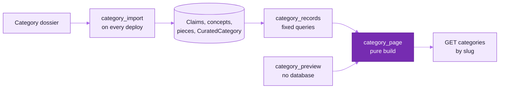

# Category page

What `GET /api/categories` and `GET /api/categories/{slug}` answer: the nine craft categories of
the master list and, for each, its master dossier's cited overview, sub-categories, member crafts,
pictures, glossary and sources, built from stored rows only. Engineers on either side of the two
routes read it, and curators read how a category dossier is stored.

| For | Read |
|---|---|
| Why categories have pages | [decision 0078](../decisions/0078-category-dossiers-in-the-app.md) |
| The category dossier format (scope `CATEGORY`) | [curation.md](curation.md) |
| The plan | [plans/dataset-curation.md](../plans/dataset-curation.md), section 3.16 |
| The page as a monograph document | [monograph-renderer.md](monograph-renderer.md) and [page-layout.md](page-layout.md) |



## Where the code is

The models are `backend/app/research/category_page.py`; the rows are read by
`services/category_records.py` and `services/category_register.py` in a fixed number of queries
however many categories are curated, the page is built by the pure
`services/category_page.py`, and `services/category_preview.py` builds the same page with no
database. The web client parses both answers with `frontend/lib/categoryContract.ts` (spec
`frontend/e2e/category-contract-unit.spec.ts`). Change the models, this page, the goldens and both
sides' tests together.

Last reviewed: 2026-11-18.

## The routes

| Method | Path | Auth | Response |
|---|---|---|---|
| GET | `/api/categories` | none (public reading) | `CategoryList`: all nine categories in master order |
| GET | `/api/categories/{slug}` | none (public reading) | `CategoryPage`; an unknown slug is 404 `{detail}` |

Both use the public reading dependency (`api/public_deps.public_reader`): a reader without a
session is rate limited by address (`core/rate_limit.public_read_attempt`, 429 with
`Retry-After`), a signed-in reader is not. Both answer with `ETag: "<sha256 of the body>"` and
revalidate: `If-None-Match` with the current tag is a 304 with no body. `Cache-Control` is
`public, max-age=300` without a session and `private, no-cache` with one, with
`Vary: Authorization`; the body is the same for every reader, since nothing on a category page
depends on a role. No model, search or HTTP call is made.

## Goldens

| File | What | Generated by (from `backend/`) |
|---|---|---|
| `shared/category.page.golden.json` | Leather, curated from the hand-written fixture `backend/tests/curation/fixtures/categories/Leather-Craft-Category.json` (a THIN subset of the curated Leather dossier, 21 claims) | `python -m app.scripts.import_curation --category-page Leather-Craft-Category --dossier tests/curation/fixtures/categories/Leather-Craft-Category.json --out ../shared/category.page.golden.json` |
| `shared/category.page.not-curated.golden.json` | Paper, with no dossier | `python -m app.scripts.import_curation --category-page Paper-Craft-Category --out ../shared/category.page.not-curated.golden.json` |
| `shared/category.list.golden.json` | the nine categories, Leather curated from the same fixture | `python -m app.scripts.import_curation --category-list --dossier tests/curation/fixtures/categories/Leather-Craft-Category.json --out ../shared/category.list.golden.json` |

Each is a database holding the craft register (the master list and the `ACTIVE` portal-added
crafts of `backend/app/data/portal_craft_register.json`) and that dossier; no member craft is
curated. `tests/contracts/test_category_contract.py` fails until they are regenerated after a
change.

## Shape conventions

camelCase JSON, unknown fields refused, ids are UUID strings, instants carry a zone
(`docs/contracts/research.md`). This contract is separate from the craft page's
(`docs/contracts/craft-page.md`) and versions on its own; it reuses only the shared research
shapes: `Citation`, `SourceRef`, `MediaRef`, `TermSpan`, `AnswerSentence` and `CraftRef`.

## `CategoryPage`

```
CategoryPage {schemaVersion 1, category: CategoryRef, curated, curation: CategoryCuration | null,
              hero: CategoryHero | null, overview: CategoryOverview,
              subCategories[CategorySubCategory], sourcesDiffer[CategoryDiffer],
              glossary[CategoryTerm], pictures[CategoryPicture], openQuestions[CategoryQuestion],
              claims[CategoryClaim], sources[NumberedSource]}
CategoryRef {slug, name, label, palette, path "/categories/<slug>", craftCount}
CategoryCuration {version, curatedAt, coverage FULL | THIN, searched[{query, site}]}
CategoryHero {media: MediaRef, caption}
```

- `name` is the master list's category name; `label` is the short family name and `palette` the
  family colour key, both from `backend/app/data/craft_families.json` (`label` falls back to the
  name and `palette` to null for a category that file does not hold).
- `craftCount` counts the category's `ACTIVE` crafts without the catch-all rows (`isCatchAll`,
  "Other leather footwear"); it is the sum of its sub-categories' counts.
- `curated` is true, and `curation` present, only for a category with an imported dossier. A
  category without one answers its register facts and sub-categories with every curated part
  empty.
- `hero` is the first listed picture shown inline (an open licence), or null.

### Overview

```
CategoryOverview {lede[CategorySentence], keyFacts[CategoryFact], sections[CategorySection]}
CategorySentence {id, text, level (never HYPOTHESIS), claimIds[] (one or more), terms[TermSpan],
                  subCategories[], crafts[]}
CategoryFact {label, value, claimIds[]}
CategorySection {discipline, title, sentences[] (one or more)}
```

- The lede and sections are the stored overview pieces (each sentence passed the answer engine's
  prose validator at import, `terms` underline the dossier's glossary), in the dossier's section
  order, titled by `research/sections.DISCIPLINE_TITLES`. A sentence or key fact whose claims are
  no longer all shown is left out.
- `subCategories` are the sub-categories a sentence covers and `crafts` the member crafts it
  names (by slug, never copied facts), as the dossier gives them; a slug the page does not list
  (a portal-added craft the database does not hold yet) is left out of the sentence.

### Sub-categories and member crafts

```
CategorySubCategory {slug, name, label, craftCount, crafts[MemberCraft],
                     sentence: CategorySentence | null, openQuestion: string | null}
MemberCraft {slug, name, path "/crafts/<slug>", giStatus GI | NON_GI | null, catchAll, curated}
```

- Sub-categories run in master order. `sentence` is the first overview sentence, in reading
  order (lede, then sections), that covers the sub-category; `openQuestion` is the key of the
  first open question that names it (the curator found no source for it). Both may be null.
- `crafts` are the sub-category's `ACTIVE` crafts: curated ones first, then GI-registered ones,
  then by name, with the catch-all rows last. `curated` is true for a craft with an imported
  dossier (`CuratedCraft`).

### Facts beside the overview

| Part | Fields | Notes |
|---|---|---|
| `CategoryDiffer` | `about, claimIds[] (two or more)` | "Sources differ": every claim, never resolved |
| `CategoryTerm` | `key (term key or null), label, names[], meaning, language, script, claimIds[]` | the dossier's glossary; `key` opens `GET /api/terms/{key}` for a signed-in reader |
| `CategoryPicture` | `media: MediaRef, caption, claimIds[] (one or more)` | a picture is shown while one of its claims is |
| `CategoryQuestion` | `key, question, settledBy, claimIds[], subCategories[]` | cites a claim, or names the sub-categories no source was found for |

### Claims and numbered sources

```
CategoryClaim {id, text, level, discipline, sourcesDiffer, citations[Citation] (one or more)}
NumberedSource = SourceRef + {number}
```

- `claims` lists exactly the claims the page's parts cite, each once, in the order the page first
  cites them (lede, key facts, sections, "Sources differ", glossary, pictures, open questions).
- `sources` lists exactly the sources those claims cite, each once, numbered 1 to N in the order
  the page first cites them, so a citation's number is the same wherever the page shows it and
  the client never renumbers. A source keeps its number while the page's reading order does.
- The model refuses a page that names a claim it does not list, lists a claim no part cites,
  misnumbers its sources, cites a source it does not list, names a craft or sub-category it does
  not list, shows a sub-category a sentence that is not an overview sentence covering it, or
  takes its hero from outside its pictures.

## `CategoryList`

```
CategoryList {schemaVersion 1, categories[CategorySummary], sources[SourceRef]}
CategorySummary = CategoryRef + {curated, subCategories[{slug, name, label, craftCount}],
                                 hero: CategoryHero | null, lede: AnswerSentence | null}
```

- `lede` is the first sentence of the curated lede as the category page shows it, with the
  citations of its claims; `hero` is the page's hero. Both are null for a category that is not
  curated.
- `sources` lists exactly the sources the ledes cite, each once, in first-citation order.

## Storage and import

The import is `services/category_import.py`, run by `app.scripts.import_curation` after the craft
dossiers on every deploy and in Backend checks (`docs/contracts/curation.md`, The import). The
category's rows are written the way a craft's are, keyed to the category:

| Dossier part | Stored as |
|---|---|
| sources, claims, quotes | `Source`, `Claim`, `ClaimSource` as for a craft, with ids `uuid5(ID_NAMESPACE, "curation:<categorySlug>:<id>")` |
| the category's mark | `CuratedCategoryClaim {claimId, categoryId, key, discipline}` (migration `0026_curated_categories`) |
| subjects | `Concept` rows with no craft and no sub-category (`craftId` and `subCategoryId` null), `originRef` `curation:<categorySlug>:<key>`: one per discipline for claims about the category itself, and one per place, community, stage, material, tool and term the claims name |
| pictures | `MediaRef` and `MediaRefClaim` |
| glossary | `Term` (inserted only when the key is new) and `TermConcept`; no `TermCraft` |
| overview | `prose` `KnowledgePiece` rows with no craft (`craftId` null), Expert depth, the lede at facet `OVERVIEW` and one per section, topics as answers compute them from the category slug (`craft:leather-craft-category`, `history:leather-craft-category`) |
| the rest | `CuratedCategory {categoryId, version, curatedAt, coverage, digest, page, importedAt}`; `page` is `services/curated_category_index.CuratedCategoryPage`: the overview's piece ids and key facts, which sub-categories and crafts each kept sentence names, conflicts, open questions with their sub-categories, glossary and picture references |

Places, stages, materials, tools, market records and environment links of a category dossier are
claims and concepts only: no `CraftLocation`, `Process` or market row belongs to a category. A new
version supersedes the old exactly as for a craft: a dropped claim becomes `SUPERSEDED` and keeps
its citations, a dropped picture link is removed, replaced overview pieces are superseded and
dropped ones marked stale; a second import of the same files writes nothing.

## How this document is kept true

| Claim | Kept true by |
|---|---|
| Both answers match their goldens | `backend/tests/contracts/test_category_contract.py`, which fails until the goldens are regenerated |
| The client parses both answers | `frontend/e2e/category-contract-unit.spec.ts` |
| The page's rules | `backend/tests/curation/test_category_page.py`, `test_category_records.py` and `test_category_reactions.py` |
| The routes, their caching and counting | `backend/tests/curation/test_category_routes.py` |
| The import and superseding | `backend/tests/db/test_category_import_db.py` |

Re-read it when the category dossier's schema, a stored row or the page's shape changes.
