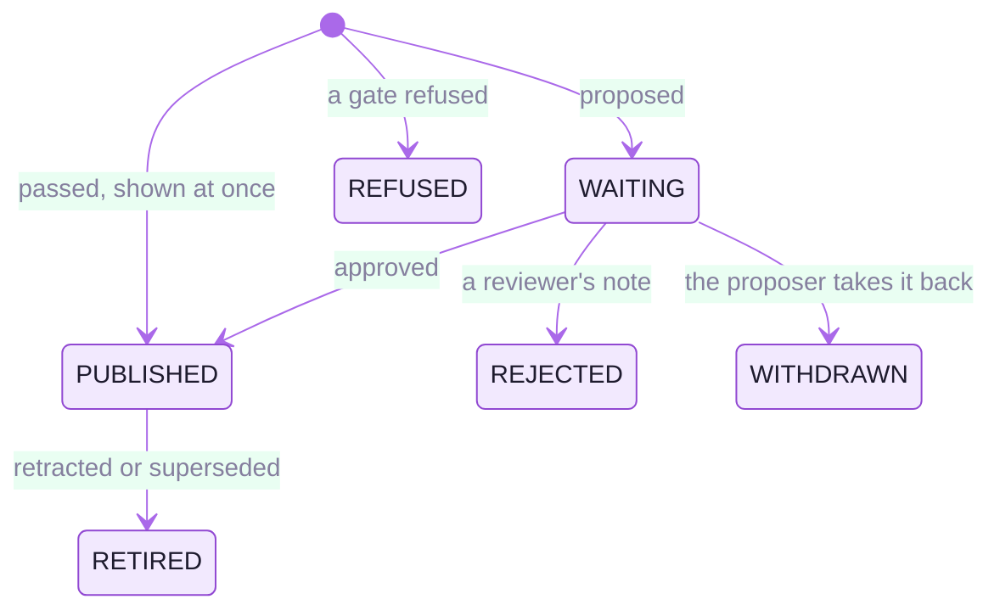

# Contribution screens

The site's screens for proposing a fact and a component, and the contributor's own list of what
they proposed with what happened to each. Facts go through the gates of `knowledge-writes.md`;
components through the library search and duplicate refusal of `open-work.md`. Consent cannot be
revoked: a published contribution stays published, and only what still waits for review can be withdrawn.
Engineers changing a contribution screen or its routes read it.

| For | Read |
|---|---|
| Why the screens are this way | [decision 0101](../decisions/0101-knowledge-architecture-for-every-craft.md), item 8 and build step 7; approval follows item 12 |
| The gates a fact passes | [knowledge-writes.md](knowledge-writes.md) |
| The library search, close matches and component proposals | [open-work.md](open-work.md) |
| The terms' own words | [legal/contribution-terms.md](../legal/contribution-terms.md) |
| How a waiting item is decided | [review-queue.md](review-queue.md) |

The diagram follows a fact; a component waits, then is `APPROVED`, `REJECTED` or `WITHDRAWN`.

## Who may do what

| Action | Capability | Roles |
|---|---|---|
| Read the form, accept the terms, search the library, propose, list own, withdraw | `PROPOSE_KNOWLEDGE` | Researcher and above |

Who proposed what is kept privately (`Claim.createdById`, `ComponentProposal.proposerId`) and is
shown only to the proposer, on their own list.

## Routes (`/api/contributions/proposals`)

| Route | Body | Answer |
|---|---|---|
| `GET /form` | none | `ProposalForm {schemaVersion 1, terms {version, acceptedAt}, fields[{field, title, covers, chapter}], kinds[], subjectKinds[], needs {need: kinds[]}}` |
| `POST /terms` | `{version}`, the current version only (`2026-11-19`) | `TermsStatus {version, acceptedAt}`; accepting twice keeps the first time |
| `GET /library?query=&craftSlug=&field=&kind=` | none | `CraftComponents`, the same search as the MCP tool `list_components` (`component_library.library_components`) |
| `POST /components` | `ComponentProposalBody`, a component of an MCP `propose_page` bundle in camelCase | `ComponentProposalResult {outcome STORED or REFUSED, proposalId, status, label, message, matches[{component, reasons[]}], waysOn[]}` |
| `GET /mine` | none | `OwnProposals {schemaVersion 1, items[]}`, facts and component proposals together, newest first, at most 100 |
| `POST /facts/{id}/withdraw` | none | `OwnProposal`, `WITHDRAWN` |
| `POST /components/{id}/withdraw` | none | `OwnProposal`, `WITHDRAWN` |

A fact is proposed through `POST /api/knowledge/facts` (`knowledge-writes.md`), unchanged.

Refusals: 401 or 403 without the capability; 404 for a proposal that is not the caller's (or does
not exist); 409 `terms_needed` for a component proposed before the terms are accepted, and
`not_waiting` for a withdrawal of something no longer waiting, with the sentence why; 422 for a
malformed body, an unknown craft, kind or field, another terms version, or a check the proposal
service refuses (an unknown subject, a task the proposal does not meet, a label a live proposal
holds). A close match is not an error: it is a 200 with `outcome REFUSED` and the matches.

## The terms

The contribution terms (`docs/legal/contribution-terms.md`, approved at version `2026-11-19`) are
accepted once per version and recorded as the audit entry `contributions.terms_accepted`, target
`ContributionTerms`, target id the version. The form shows the version and its points until they
are accepted, then the date they were. A component proposal on the site needs them on the server
(`propose_on_site`); the fact page accepts them before it sends the fact.

## One proposal as the contributor sees it

`OwnProposal {id, kind FACT or COMPONENT, state, status, text, description?, label?,
componentKind?, field, subjectName, craftSlug, createdAt, reasons[], gates[{gate, passed,
reasons[]}]}`. `text` is the fact's statement or the component's title; `subjectName` is the
fact's concept or the component's owning craft (none for a shared component).

| Kind | Stored status | `state` | `reasons` |
|---|---|---|---|
| Fact | `DRAFT` | `WAITING` | none |
| Fact | `PROPOSED`, `IN_REVIEW`, `APPROVED` | `PUBLISHED` | none |
| Fact | `REJECTED` with a refused gate | `REFUSED` | the refused gate's reasons |
| Fact | `REJECTED` by a reviewer | `REJECTED` | the reviewer's note |
| Fact | `WITHDRAWN` | `WITHDRAWN` | none |
| Fact | `RETRACTED`, `SUPERSEDED` | `RETIRED` | none |
| Component | `PENDING` | `WAITING` | none |
| Component | `APPROVED` | `APPROVED` | none |
| Component | `REJECTED` | `REJECTED` | the reviewer's note |
| Component | `WITHDRAWN` | `WITHDRAWN` | none |

A fact's gates are its stored `CandidateCheck` rows in gate order. The reviewer's note is the
newest `ReviewEvent` to `REJECTED` by an account other than the proposer.

Withdrawing a fact moves it from `DRAFT` to `WITHDRAWN` and records a `ReviewEvent` by the
proposer; withdrawing a component moves it from `PENDING` to `WITHDRAWN`, which frees its label
for another proposal. A published, approved, refused or rejected item is never withdrawn.

## Pages

| Page | Guard | What it does |
|---|---|---|
| `/contributions/facts` | `require(PROPOSE_KNOWLEDGE)` | Open work to start from (`MISSING_FIELD` and `THIN_FIELD` on a craft or category); the craft and the field; one fact in one sentence; each source with its address, title, licence and quotes with their locators; the terms; Send the fact; what the gates said (published, waiting for review, or refused with each gate's reasons); Your facts with Withdraw on what waits |
| `/contributions/components` | `require(PROPOSE_KNOWLEDGE)` | Open work to start from (`MISSING_COMPONENT` on a craft, offering only the kinds its need takes and naming the task); a library search first; then describe a new one, or extend a held one (a subject link keeps its label, a variant takes its own); every component the search showed is sent as considered; on a refusal the close matches with their reasons and the two ways on; Your components with Withdraw on what waits |

The nav carries one entry, Propose knowledge, to the fact page; each page links to the other.

## Code

| What | Where |
|---|---|
| Shapes, states, reasons and the withdrawal rule | `backend/app/research/own_proposals.py` |
| The list, withdrawals, terms and the site's component proposal | `backend/app/services/own_proposals.py` |
| Routes | `backend/app/api/routes/own_proposals.py` |
| Client contracts | `frontend/lib/ownProposalsContract.ts`, `factProposalContract.ts`, `componentProposalContract.ts` |
| Screens | `frontend/app/(protected)/contributions/facts`, `.../components`, `frontend/components/contributions/` |
| Tests | `backend/tests/contributions/`, `backend/tests/db/test_own_proposals_db.py`, `frontend/e2e/contribution-facts-unit.spec.ts`, `contribution-components-unit.spec.ts` |

## How this document is kept true

| Claim | Kept true by |
|---|---|
| States, reasons and the withdrawal rule | `backend/tests/contributions/test_own_proposals_rules.py` |
| The routes and their refusals | `backend/tests/contributions/test_own_proposals_routes.py` |
| The list, withdrawals and terms on Postgres | `backend/tests/db/test_own_proposals_db.py` |
| The two pages | `frontend/e2e/contribution-facts-unit.spec.ts` and `contribution-components-unit.spec.ts` |
| The routes' classes | `backend/tests/public/test_route_inventory.py` |

Re-read it when a stored status, the terms' version or a page's steps change.
