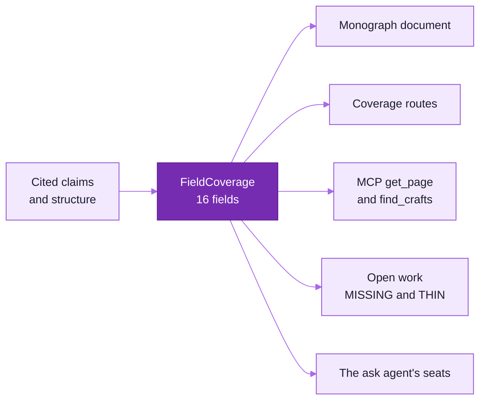

# Field coverage

What a craft, family or category page holds in each of the 16 fields of
`research/sections.DISCIPLINE_FIELDS`, as data. One count serves every reader of it: the monograph
document, the coverage route, the MCP server, open work and the ask agent's seat choice. Engineers
read it before changing the count, and contributors' agents meet it as `get_page`'s coverage.

| For | Read |
|---|---|
| Where the bar comes from | round 5, lane fields-and-ask; the owner's bar of 2026-11-20; `kalavigyan-craft-pages` "Every field, densely" and checklist rules 23 to 26 ([page-checklist.md](../../.claude/skills/kalavigyan-craft-pages/references/page-checklist.md)) |
| What each field covers | `backend/app/data/contributor/references/fields.md` |
| The tasks a missing or thin field becomes | [open-work.md](open-work.md) |
| How the seats use it | [answer-eval.md](answer-eval.md), Seats by field |

| Part | Code |
|---|---|
| The contract and the pure count | `research/coverage.py` (`FieldCoverage`, `FieldCount`, `Holdings`, `field_coverage`) |
| Where each field sits on a generated page (rule 23) | `research/coverage_chapters.py` (`FIELD_CHAPTERS`) |
| The seat that leads each field, and seat choice by field | `research/coverage_seats.py` |
| The fields an answer consulted | `research/coverage_answers.py` |
| The queries | `services/coverage.py` |
| The MCP reads built on it | `services/coverage_reads.py` |
| The route | `api/routes/coverage.py` |

## The count

`FieldCoverage {schemaVersion 1, subjectKind (craft, family, category), subjectSlug, name,
claimsMin, claims, sources, covered[], thin[], missing[], fields[16]}`, the fields in vocabulary
order, each `FieldCount {field, claims, structureClaims, sources, sections, sentences, figures,
standing}`:

| Count | What it counts |
|---|---|
| `claims` | the distinct cited claims filed under the field. A claim is the subject's when it is about one of the craft's open concepts (a category: its `CuratedCategoryClaim` links), shown on the page (`SHOWN_CLAIM_STATUSES`), a fact level (not a hypothesis) and `OPEN`; it is cited when a source that is not `RESTRICTED` cites it. It is filed under its primary field and each secondary field |
| `structureClaims` | claims counted in the field only because structure cites them, as the gap script counts them (`.claude/skills/kalavigyan-craft-pages/scripts/gaps.py`): the curated communities' claims (`CuratedCraft.page.communities[].claimIds`, a category's too) count for `SOCIETY`, the GI record's (`CraftGiRecord.claimIds`) for `POLICY`. Only cited claims of the subject count, and a claim is counted once per field |
| `sources` | the distinct sources citing the field's claims |
| `sections`, `sentences` | 1 and its sentence count when the field has a `PUBLISHED` `ArticleSection`, else 0 and 0 |
| `figures` | the registered components (a label, not hidden, not superseded) filed under the field, primary or secondary, that reach the subject as the component library reaches them (its own, linked, keyed to its concepts, stages, materials, compounds or districts; a category's: those resting on its claims) |
| `standing` | `MISSING` with no cited claim, `THIN` under `claimsMin`, `COVERED` at or above it. `claimsMin` is `curation/limits.DISCIPLINE_CLAIMS_MIN` (3) |

`claims` and `sources` at the top count each claim and source once across fields.

## Where it is served

- **The monograph document**: a generated document carries `coverage` (`MonographDocument.coverage`,
  left out of the body when absent; an authored document stored from files has none). It is counted
  when the document is built, so the document's hash and tag change with it. The web contract is
  `frontend/lib/fieldCoverage.ts`.
- **`GET /api/crafts/{slug}/coverage`** (a craft or a family, its slug resolved as the page's is) and
  **`GET /api/categories/{slug}/coverage`**: the `FieldCoverage`, a public read counted like every
  public read, with its tag and `Cache-Control` (`cached_read`); an unknown or inactive subject is
  404.
- **`GET /api/crafts/coverage`** (decision 0145): `MonographCoverage {schemaVersion 1, crafts
  [FieldCoverage]}`, the coverage of every active craft or family with a curated monograph, each
  once in slug order, counted in one pass (`services/coverage.monograph_coverage`), a public cached
  read like the one above. The landing reads it once, tagged with every monograph's page tag, and
  keeps the monographs its catalogue lists (`components/landing/fieldCoverageServer.ts`); a
  monograph missing from the answer leaves the fields section on its plain list.
- **MCP**: `get_page` with its coverage, and the per-field counts on `find_crafts`
  (`knowledge-api.md`).

## What follows from it

- **Generated pages** place each field that has a published section in the chapter rule 23 names
  (`FIELD_CHAPTERS`): overview in At a glance and history in History and trade; process, materials
  and health with the making; chemistry, physics and botany with the science; geography, geology,
  climate and ecology with the place; economics and policy with the market; society and design with
  the people. A field's components sit in its chapter too. A field without a section has no heading.
  Where two or more of a field's sentences rest on claims with a stored quantity (`Claim.valueNum`
  and `valueUnit`), the field closes with a fact grid: `dt` the claim's subject concept, `dd` the
  quantity, cited by its claim (`services/monograph_generated_grids.py`).
- **Open work**: every field of every craft, family and category with no cited claim is a
  `MISSING_FIELD` task and every field under the bar a `THIN_FIELD` task, ranked by prominence
  (`open-work.md`).
- **Seats**: the ask agent's planner seats an expert for each field the question touches that the
  craft holds claims in (`answer-eval.md`, "Seats by field").
- **The daily coverage enrichment** (`services/coverage_selection.py`, decision 0124) files its gaps
  by field as this count does: a craft's visible claims are counted by their primary field, each
  standard question asks for its facet's field and runs while that field holds fewer than
  `FACET_COVERED_MIN_CLAIMS` (2), and live research files what it finds under the field of the
  section or facet it answers (`research.md`, The writer and the coverage job). A question whose
  last finished run added no claim of its field rests for `FRUITLESS_BACKOFF` (28 days), so a
  gap research cannot fill is not asked again every week.

## How this document is kept true

| Claim | Kept true by |
|---|---|
| The pure count, its standings and the bar | `backend/tests/research/test_coverage.py`, with `DISCIPLINE_CLAIMS_MIN` read from `curation/limits` |
| The queries on Postgres | `backend/tests/db/test_coverage_db.py` |
| The routes | `backend/tests/public/test_coverage_route.py` |
| The MCP reads | `backend/tests/mcp/test_mcp_page_read.py` |
| The enrichment's gaps by field and their rest | `backend/tests/write_back/test_coverage_enrichment.py` and `backend/tests/db/test_coverage_backoff_db.py` |
| Each field's chapter and fact grid on generated pages | `backend/tests/layouts/test_generated_fields.py` |
| The seats | `backend/tests/planner/test_field_seats.py` |
| The same count as the gap script | `backend/tests/mcp/test_reference_limits.py` reads `gaps.py`'s fields and bar against the server's |

Re-read it when a field is added, the bar moves or another reader starts to use the count.
