# Craft page

What `GET /api/crafts/{slug}/page` answers: the craft page as a monograph in chapters, built from
stored rows only, its caching and its snapshots. Since round 6 the web app draws a craft's monograph
document and reads this route for the craft list's record of a craft without one. Engineers changing
a chapter builder, the snapshot or the client's parser read it.

| For | Read |
|---|---|
| Why the page is built this way | [decisions 0053](../decisions/0053-curated-dossier-import.md), [0081](../decisions/0081-craft-page-contract-v2.md), [0095](../decisions/0095-craft-page-chapters.md), [0096](../decisions/0096-reader-question-pieces-join-their-craft-page.md) and [0098](../decisions/0098-craft-page-chapters-build.md) |
| The plan | [plans/dataset-curation.md](../plans/dataset-curation.md), section 9 |
| The dossier it reads | [curation.md](curation.md) |
| How the web app draws a craft | [monograph-renderer.md](monograph-renderer.md) |
| The answer blocks it reuses | [explainer.md](explainer.md) |

```mermaid
%%{init: {"theme":"base","fontFamily":"Inter, ui-sans-serif, system-ui, -apple-system, Segoe UI, Roboto, Helvetica, Arial, sans-serif","themeVariables":{"fontSize":"15px","primaryColor":"#F2E9FE","primaryTextColor":"#1E1B2E","primaryBorderColor":"#9148D2","secondaryColor":"#FAEECD","secondaryTextColor":"#1E1B2E","secondaryBorderColor":"#CD9200","tertiaryColor":"#F3F1FA","tertiaryTextColor":"#1E1B2E","tertiaryBorderColor":"#A7A3BC","mainBkg":"#F2E9FE","nodeBorder":"#9148D2","nodeTextColor":"#1E1B2E","lineColor":"#AA69E9","textColor":"#857F9E","edgeLabelBackground":"#F9F5FF","clusterBkg":"#F9F5FF","clusterBorder":"#D6B6FB","titleColor":"#762CB1"}}}%%
flowchart LR
  ROWS[("Stored rows<br/>dossier, claims, places")] --> REC["craft_page_records<br/>fixed queries"]
  REC --> CH["Chapter builders<br/>one per chapter"]
  CH --> LG["Claim ledger<br/>and source numbers"]
  LG --> SN["Snapshot<br/>per variant and stamp"]
  SN --> RT["GET craft page"]
  classDef accent fill:#762CB1,stroke:#5F1C93,color:#FFFFFF
  class CH accent
```



## Schema and build status

What `GET /api/crafts/{slug}/page` answers: the whole craft page, a monograph in chapters, built
from stored rows only (plan `docs/plans/dataset-curation.md` section 9). Schema version 3
(decision 0095) adds the chapters of the approved monograph: every piece the answer engine builds
for an answer, built for the craft without a question by fixed rules, beside the parts only a page
has, and every piece an answer builds for the craft joins it too, whoever asked (decision 0096).
Version 3 adds fields only. Every version 2 field keeps its meaning so today's screen still
draws; the flat parts the chapters now carry are deprecated and leave in schema version 4, in the
change that moves the screen to chapters and no later than 2026-12-18 ("Version 2 parts", below).

**Build status (2026-11-19).** The route answers version 3. Built: the masthead, the lede, nine of the ten
chapter builders (What if is not built), the claim ledger over the page, source numbering and groups, Cite this
(absolute, with the web route `/crafts/<slug>/v<N>`), the stamp, the per-variant snapshot with its process cache,
single-flight builds, its lazy archive and `?version=N` (archived versions carry no field voice or testimony), the
three hide routes, job steps 1 and 6 (nightly), and both goldens. In the golden, the chapters hold `prose`,
`key_facts` and `register_facts`, plates, `process_ladder` with the stage fields, the signature figures,
`reaction_player` (the family's steps marked borrowed), the stored `simulation`, `molecule_3d`, `material_card`,
`region_story`, `climate_risk` with `series`, `seasons`, `places`, `record`, `sources_differ`, `timeline_map`,
`market_gi`, `communities`, `artisan_voice`, `field_photos`, `relatives`, `source_list`, `open_questions`,
`searched` and `start_research`. A reader's answer pieces join by the minimal rule of
`services/craft_page_answer_assets.py` (debt register). Live pages show `molecule_3d` only once the job has kept
conformers, and Kutch Ajrakh's timeline has no pins until its places carry Wikidata ids. Not built yet (decision
0098 and `docs/TECH_DEBT.md`): `what_if`, `concept_graph`, `zoom_story`, `supply_map` and `measure` on the page;
reaction players cut per mechanism (one player holds every step until `science/mechanisms.craft_concepts` lands);
concept pictures in the database loader; a river in the region story (basins carry no name); the rest of the 0096
merge (cross-craft pieces, the question screen, AI media, `MediaAsset.pageKey`); the media and film-score routes;
and job steps 2 to 5. The goldens are generated as follows.

Modules. Models: `backend/app/research/craft_page.py` (the page), `research/craft_chapters.py`
(chapters, items, figure heads and the rules' constants), `research/craft_parts.py` (the page-only
parts), with `craft_page_process.py` and `craft_page_context.py` (version 2 parts). Rows:
`services/craft_page_records.py` with `craft_page_market.py`, `craft_page_offers.py` and
`craft_page_family.py`, and `services/chapter_records.py` for what the chapters add, each a fixed
number of queries. Builders: one pure module per chapter, `services/chapter_<key>.py`, and
`services/craft_chapters.py`, which orders them, runs the claim ledger and numbers the sources.
Cache: `services/craft_page_stamp.py` and `services/craft_page_snapshots.py`. The job:
`python -m app.scripts.build_craft_chapters`.

Two golden fixtures, both reproduced byte for byte by the backend and parsed by the client:

- `shared/craft.page.golden.json`: Kutch Ajrakh as a database holding the craft register, the
  districts, the Kutch Ajrakh dossier, the Textiles family dossier and the stored rows of
  `shared/craft.page.inputs.json` (the Kachchh district, its datasets and layers, two trends with
  their 45-year series, the kept conformers and one stored generated explainer, the `kut` mechanism of
  `shared/explainer.craft-mechanism.golden.json`, which `tests/simulations/craft_mechanism.py` builds
  through the real builder from a recorded draft over the dossier's C078 and R02) would answer it,
  generated by `python -m app.scripts.import_curation --preview Kutch-Ajrakh --family
  Textiles-Based-Craft-Category --inputs ../shared/craft.page.inputs.json --out
  ../shared/craft.page.golden.json`. The inputs file is a fixture: the yearly series values are
  synthetic, around the stored trend, and its points are those the job stores (none, as no Kutch
  Ajrakh place carries a Wikidata id). Cite this in a preview addresses `https://kalavigyan.vercel.app`
  (`chapter_preview.PREVIEW_SITE`); a served page addresses `PUBLIC_WEB_URL`.
- `shared/craft.page.register.golden.json`: Farrukhabad Prints, a craft with no dossier, as a
  database holding the register, the districts, the Kutch Ajrakh dossier and the Textiles family
  dossier would answer it, generated by `python -m app.scripts.import_curation --register-preview
  Farrukhabad-Prints --with-dossier Kutch-Ajrakh --family Textiles-Based-Craft-Category --out
  ../shared/craft.page.register.golden.json`.

Both commands run from `backend/`. Change the models, this page, the fixtures and both sides'
tests together. The web client parses the page with `frontend/lib/craftPageContract.ts` (the
version 2 parts with `frontend/lib/craftPageContext.ts`, the chapters with
`frontend/lib/craftChapters.ts`, the blocks with the explainer's own parser); its specs are
`frontend/e2e/craft-page-unit.spec.ts`, `craft-page-context-unit.spec.ts` and
`craft-chapters-unit.spec.ts`, and the vocabularies are
pinned in `frontend/e2e/backend-vocabulary-unit.spec.ts`. The contract test also holds the served
Kutch Ajrakh page to 250 KB gzipped.

Last reviewed: 2026-11-19 (schema version 3 served; build status above).

## The routes

| Method | Path | Auth | Response |
|---|---|---|---|
| GET | `/api/crafts/{slug}/page` | public reading (`api/public_deps.public_reader`) | `CraftPage`, the snapshot of the craft's current stamp for the reader's variant (Caching, below), sent as stored with its `ETag` (the SHA-256 of the page as built) and `Vary: Authorization`; a request whose `If-None-Match` names the current tag gets `304` with no body. `Cache-Control` is `public, max-age=300` without a session and `private, no-cache` with one. `?version=N` answers the archived page of curation version `N`, read without its field voices and testimony (404 `{detail}` for a version the craft never had; `N` is compared with the stored curation version first, and the current version answers the live page). The slug matches exactly, else case-insensitively. A MERGED slug answers with its target's page; an unknown slug is 404 `{detail}`. No model, search or HTTP call is made, on a cache hit or a miss. |
| PUT | `/api/crafts/{slug}/explainers/{pieceId}/hidden` | `HIDE_GENERATED` (Professor and above) | `{hidden}` body; hides or shows a generated explainer the job stored for this craft (`KnowledgePiece.hiddenAt`). A hidden explainer is placed on no page and reused by no answer. |
| PUT | `/api/crafts/{slug}/pieces/{pieceId}/hidden`, `/api/crafts/{slug}/media/{assetId}/hidden` | `HIDE_GENERATED` | `{hidden}` body; hides or shows a piece from a reader's question or an AI asset on this page (decision 0096). |
| GET | `/api/crafts/media/{assetId}` | public reading | 302 to a 15-minute presigned GET of the AI asset's page copy (`MediaAsset.pageKey`), as the field image route does; 404 unless the asset is `CRAFT_SHARED` with a page copy; 503 `{detail}` without the bucket. |
| GET | `/api/crafts/contributed/{contributionId}` | public asset (`public_asset_reader`) | The picture of an approved image contribution (`docs/contracts/image-contributions.md`), its bytes with its stored MIME type, `Cache-Control: private, max-age=300`, an `ETag` of the cleaned file's SHA-256 (304 on a match, without reading the bucket) and `X-Content-Type-Options: nosniff`, as the field image route does. 404 `{detail}` for anything not `APPROVED` and shared, or a file the bucket no longer holds; 503 `{detail}` without the bucket or when it fails. Never names the contributor. |
| GET | `/api/crafts/{slug}/film-score` | public reading | The `FilmScore` (`schemas/film.py`) the job stored for the page's current film scenes, with fresh one-hour links; 404 when there is none. Never makes one. |
| GET | `/api/crafts/{slug}/process` | public reading | The science process view (`docs/contracts/science.md`). No web screen calls it since decision 0071; it stays for the voice and science callers and is marked for retirement once nothing reads it. |

## What is public

Everything on the page, for every reader, signed in or not: every chapter and piece, All
evidence, every claim, source and quote the reader may see, and every route a piece reads when it
is drawn (`/api/molecules/{pubchemCid}/conformer`, `/api/map/layers/{layer}`,
`/api/rivers/{mainRiv}`, `/api/field-voices/images/{imageId}`, `/api/crafts/{slug}/field-voices`,
`/api/field-voices/recordings/{recordingId}` behind the `/voices/<id>` page a field quote links to,
`/api/terms/{key}` for a stored summary, `/api/crafts/{slug}/shared-science`,
`/api/shared-science/{termKey}`, `/api/categories/{slug}`, `/api/crafts/media/{assetId}`,
`/api/crafts/contributed/{contributionId}`, `/api/crafts/{slug}/film-score`).

The body depends on the reader in one way only, a licence term, never a role: a reader holding
`READ_RESEARCHER_QUOTES` gets the `RESEARCHER` variant, which may quote closed-licence full text
(chunk ACL `RESEARCHER`, decision 0013); everyone else gets the `OPEN` variant, byte for byte the
same whether anonymous or signed in, since both read the same chunk ACLs, `PUBLIC` and the field
transcripts' `SIGNED_IN` (decision 0097). `READ_ALL_EVIDENCE` is retired.

Asking stays signed in: Ask, the page's questions (start research, open questions), Talk, and a
term lookup that would research (decision 0079 item 4). A signed-out reader who presses one is
taken to sign in and returned to it. The full transcript of a field recording (`/voices/<id>`,
decision 0084) is public since decision 0097, scrubbed and credited as the portals send it. Not on
the page and still signed in, because they are personal data under their own consent terms:
artisan conversation recordings (decision 0083), testimony waiting for review (decision 0083 item
16) and a reader's own records. An answer stays its asker's unless the asker shares a version by
link (decision 0097); what an answer built for the craft joins the page without its asker
(decision 0096).

## Shape conventions

camelCase JSON, unknown fields refused, ids are UUID strings, instants carry a zone
(`docs/contracts/research.md`). Chapter sentences are the explainer's `ExplainerSentence`
(`research/blocks.py`): text, level, `terms[TermSpan]` and their `citations[Citation]` inline, as
in answers, so one citation cluster serves both (decision 0094). `claims` is the index of every
claim of this craft and of its borrowed family science that the page cites or All evidence files;
another craft's claim in a kin piece (`concept_graph`, `relatives`) is cited inline only. The
version 2 parts still name claims by `claimIds` into `claims`. Every citation's source is listed
once in `sources`.

## `CraftPage`

```
CraftPage {schemaVersion 3, craft: PageCraft, curated, curation: CurationHeader | null,
           depth: PageDepth, suggestedQuestions[] (three),
           masthead: Masthead, lede[ExplainerSentence], chapters[Chapter] (1+),
           cite: CiteThis | null, glossary[PageTerm],
           evidence: PageEvidence, claims[PageClaim], sources[PageSource],
           fieldVoicesTotal {quotes, images},
           deprecated until schema 4: tabs, overview, giCard, events, environment, sourcesDiffer,
           places, communities, process, pictures, openQuestions, sameFamily, voices, fieldPhotos}
```

- Every list is present, empty when there is nothing to show. `evidence` is never null.
- `curated` is true, and `curation` present, only for a craft with an imported dossier.
- `PageSource` is the explainer's `SourceRef` with `group`, `from` (`{scope (FAMILY, KIN), slug,
  label}` for a source of another monograph, else null) and `supports` (the number of page
  sentences citing it). Sources are numbered by their place in the list, one numbering for the
  whole page and every reader: in the order a reader meets them (the masthead, the lede, then the
  chapters item by item), then the sources only All evidence cites. The numbering is fixed on the
  `OPEN` variant; a source only the `RESEARCHER` variant cites is numbered after all of them, so
  every number an `OPEN` reader sees is the same number for a researcher.
- The model refuses a page that cites a claim it does not list (outside a kin piece), lists a claim
  twice, leaves a listed claim out of All evidence or files it twice, files a hypothesis among the
  facts (or a fact among the hypotheses), cites a source it does not list, shows one picture twice
  (by media id or file address), repeats a chapter key, or holds a chapter with no item.

## The masthead and the lede

```
Masthead {kicker {family, kind}, name, nativeName: NativeName | null, gi: MastheadGi | null,
          place: string | null, provenance: Provenance, picture: PagePlate | null, palette}
NativeName {text, lang, script, sourceId, sourceKind (DOSSIER, WIKIDATA), reviewed}
MastheadGi {status (REGISTERED, APPLIED), on (YYYY, YYYY-MM or YYYY-MM-DD) | null, citations[]}
Provenance {basis (CURATED, STORED_CLAIMS, REGISTER), sources, reliability {a, b, c, d},
            curatedOn | null}
PagePlate {media: MediaRef, caption, standIn | null, focal {x, y, width, height} | null,
           sentences[ExplainerSentence]}
```

- `kicker` are the editorial labels (`familyLabel`, `kindLabel`); `name` is `displayName`.
- `nativeName` follows the catalogue's local-name rule (decision 0082 item 4) and the design
  system's: shown only with a source and `reviewed`; a dossier's own names (curation schema 2)
  come first.
- `gi` is the curated GI record's status and registration date with the claims that state them;
  for a craft without a dossier, the register's GI status with no date and no citation; null when
  the craft is not registered or applied for.
- `place` is "<district>, <state>" of the first `PRACTISED` or `ORIGIN` place that resolves to an
  LGD district, else the first state of practice.
- `provenance.sources` and `reliability` count the craft's own sources (not its family's or
  kin's); `curatedOn` is the curation date.
- `picture` is the dossier picture placed `MASTHEAD`, else the `HERO` of version 2; null gives the
  typographic plate on `palette` (the family's palette key of `craft_families.json`). The version 2
  `HERO`, a relative's hero and the catalogue's hero are the `MASTHEAD` picture when it is inline.
- A `PagePlate` captions first and credits after; `standIn` says what a picture from elsewhere
  shows ("Tasar silk, not ajrakh"); `focal` is the crop box in fractions of the picture;
  `sentences` are the claims the dossier links to the picture, shown under its caption.
- `lede` is the curated overview's lede; empty for a craft without a dossier.

## Chapters

```
Chapter {key, title, opener: PagePlate | null, items[ChapterItem] (1+)}
ChapterItem {block: Block | null, part: PagePart | null, figure: FigureHead | null,
             origin: ItemOrigin | null, pieceId | null}
FigureHead {kind (FIGURE, TABLE), title, borrowed[{scope (FAMILY, KIN), slug, label}]}
```

Exactly one of `block` (the explainer's `Block` union, `research/explainer.py`, unchanged) and
`part` (below) is set. `figure` marks an item the reader sees as a numbered figure or table; the
client numbers them through the page ("Fig. 3", "Table 1"). A title states its finding for a chart
and describes a diagram or map, from fixed templates in `research/craft_chapters.FIGURE_TITLES`
whose every value comes from the item (no model writes a title; a generated explainer keeps its
own). `borrowed` names the other monographs whose claims the item shows ("From the Textiles family
monograph").

### Order and titles (`CHAPTER_KEYS`)

| Key | Title | Items, in this order |
|---|---|---|
| `glance` | At a glance | `prose` (OVERVIEW, DESIGN sections), `key_facts` or `register_facts`, plates placed here, `start_research` (REGISTER basis only) |
| `made` | How it is made | `prose` (PROCESS, HEALTH), `process_ladder`, `measure`, process `sources_differ` rows no stage holds |
| `chem` | The chemistry | `prose` (CHEMISTRY, PHYSICS, MATERIALS, BOTANY), signature figures, `zoom_story`, then per mechanism its `reaction_player`, its `simulation` or concept `images`, its `molecule_3d` blocks; then the other molecules, `material_card` blocks, chemistry `sources_differ` rows, material plates |
| `why` | Why <place> | `prose` (GEOGRAPHY, GEOLOGY, CLIMATE, ECOLOGY), `record` (the environment links), `region_story`, `climate_risk`, `seasons`, `supply_map`, `measure`, `places`, geography `sources_differ` rows |
| `history` | History and trade | `prose` (HISTORY), `timeline_map`, `record` (dated facts the map does not place), record plates |
| `market` | Market and GI | `prose` (ECONOMICS), `market_gi`, `record` (prices and workforce), `measure` |
| `whatif` | What if | `what_if` blocks |
| `people` | People and voices | `communities`, `artisan_voice`, `field_photos` |
| `kin` | Kin crafts and shared science | `concept_graph`, `relatives` |
| `sources` | Sources | `source_list`, `open_questions`, `searched` (THIN dossier only); All evidence and Cite this are drawn here from `evidence` and `cite` |

- A chapter is present only when it holds an item, and an item only when its builder returns a
  valid piece; nothing is shown to say a chapter or piece is missing. Chapters keep this order and
  are numbered by position among those present. The keys are the anchors (`#chem`); version 2's
  `?tab=` values map to them (overview to `glance`, process to `made`, science to `chem`, region to
  `why`, sharedScience to `kin`, sources and evidence to `sources`).
- `why`'s title names the masthead's district, else its state; with neither it is "Where it is
  made". `market` is "Market" when the craft has no GI status.
- `opener` is a dossier picture placed `OPENER` for the chapter (the Rann over Why Kachchh), never
  chosen by a rule.
- Curated overview sections (and, without a dossier, the `STORED_CLAIMS` sections) become `prose`
  blocks in the chapter of their discipline (`DISCIPLINE_CHAPTERS`): OVERVIEW and DESIGN to
  `glance`; PROCESS and HEALTH to `made`; CHEMISTRY, PHYSICS, MATERIALS and BOTANY to `chem`;
  GEOGRAPHY, GEOLOGY, CLIMATE and ECOLOGY to `why`; HISTORY to `history`; ECONOMICS to `market`.

### Answer blocks on the page, built without a question

Each block keeps its explainer contract (`docs/contracts/explainer.md`) and validators. Where an
answer lets a model choose, the page uses the rule in the last column. Builders read only stored
rows: what needs a search or a lookup is done earlier by the job (Generated explainers and
lookups).

| Block | Chapter | The page's rule |
|---|---|---|
| `prose` | by discipline | the curated section's sentences, or a `STORED_CLAIMS` section of up to eight of the discipline's strongest claims |
| `process_ladder` | `made` | the displayed process (the curated one, else the stored one with most stages), stages in reading order with the fields added below |
| `reaction_player` | `chem` | one per mechanism: every stored reaction of the craft (its curated process and every other stored process of the craft, the seed's included) and each family-dossier reaction a species of which names a material or compound of the craft, grouped as `science/mechanisms` groups them (a shared compound or species word), steps by their stage's reading order, then stageless reactions in stored order, each reaction once |
| signature figures (`indigo_vat`, `mordant_bath`, `lost_wax`, `firing`) | `chem` | every kind whose rules (decision 0086) build from the craft's claims, chosen over the dossier glossary's term keys in order instead of a question's, at most one of each |
| `zoom_story` | `chem` | levels only from kept pictures and stored compounds (no search), each captioned by the first fact no earlier level uses; two levels or none |
| `simulation` | `chem` | the stored explainer the job built for the mechanism, unless hidden |
| `images` | `chem` | the concept pictures the job kept for a mechanism without an explainer, one block per mechanism |
| `molecule_3d` | `chem` | every compound with a CID, a record source and a kept conformer (`Compound.conformerKeptAt`) that a shown reaction, material or figure names, in order of first mention, each once |
| `material_card` | `chem` | each material with a role of `DYE`, `MORDANT`, `RESIST`, `BINDER` or `FLUX`, or with a compound or a botanical name, that has a fact claim, in dossier order; facts: its own fact claims, curated first, then by level and citations, at most 3; handling: its `HEALTH` facts |
| `region_story` | `why` | steps: the dossier's places that resolve to an LGD district, by role (`PRACTISED`, `ORIGIN`, `HISTORIC_CENTRE`, `MIGRATED_FROM`, `MIGRATED_TO`, `MATERIAL_SOURCE`, `MARKET`) then dossier order, each with its first claim; river: an offered basin whose name a step's sentence or quote states, else none (HydroRIVERS basins carry no name, so none today); layers: every registered layer of the factors the environment links name (`FACTOR_LAYERS`), drawn with the view's own classes (decision 0085) |
| `climate_risk` | `why` | trends of the masthead's district and up to three more mapped districts, with `series`; meaning: environment and place claims whose text names `MEANING_WORDS`, dossier order, at most 6 |
| `seasons` | `why` | each stage with a `SEASON` timing in stage order, labelled by the stage; then the craft's own fact claims naming a month or season (`calendar.months_named`, `seasons_named`) in dossier order (`CuratedPage.claimOrder`), labelled by the stage, material or tool they are about, else the season they name first ("Monsoon"), else their months; a row's season is the one its texts name first (`calendar.first_season`); rainfall from the masthead district's monthly normals |
| `supply_map` | `why` | each `MATERIAL_SOURCE` place with a claim naming one of the craft's materials: the material's stored name, the place's name as origin, placed from the place's stored point |
| `measure` | `made`, `why`, `market` | the stated non-metric quantities of the chapter's shown sentences, by decision 0066's rules |
| `timeline_map` | `history` | points: each dated fact (`timeline.years_offered`) whose text or quotes name a stored place, at its earliest span; routes: a dated fact stating a move between two named places (`timeline.states_movement`); in time order; the names are each place's name, its district's and the district's other names (`data/district_other_names.json`, Kutch for Kachchh); a place is pinned from the Wikidata point the job stored for its `wikidataId` (`WikidataPoint`), else unpinned |
| `market_gi` | `market` | imitation: every claim `gi_registry.states_imitation` reads, by level then dossier order, at most `IMITATION_MAX` |
| `what_if` | `whatif` | inputs and outcomes offered as in decision 0056 (`research/alternatives.alternatives_named` over each stage's material groups; `what_if_evidence.OUTCOME_RELATIONS` order, facts before hypotheses); each option takes its first 3 offered outcomes; `changed` is the group's role word and stage name; a block only with two options and a known one; one per input, at most 4 |
| `artisan_voice` | `people` | version 2: the portals' quotes and approved testimony (`voices`, newest first, at most 6) |
| `concept_graph` | `kin` | focus this craft; nodes: its glossary terms shared with at least one other craft, glossary order, at most 8 |

The page builds no `expert_view` (model-composed takes), `quiz` (made per answer), `compare` (its
own route) or `map_layer` (the region story carries the layers), nor the declared kinds; an
answer's kept expert seats join through "Pieces built for readers' questions" (decision 0096).

### Fields added to answer blocks

All optional and left out of the JSON when empty, so every stored piece keeps its content hash;
answers may fill them too.

- **`process_ladder`** `LadderStage` gains `localName`, `unnumbered` (true when no source states the
  stage's place in the sequence; `ordinal` is then its reading position), `after {text,
  colours[] (0-3, the `StepColour` names), citations (1+)}` (the piece after the stage), `why`
  (one `ExplainerSentence`), `tools[{toolId, name, localNames[], citations (1+)}]`,
  `differs[DifferReading]` (its sources-differ rows) and `pictures[{media, caption, standIn}]`;
  `LadderMaterial` gains `botanicalName`, `pubchemCid` and `localNames`. `after` and `why` come from
  the dossier (curation schema 2). A dossier `whyClaimId` is the stage's only why, left out when
  the stage's sentences already show it. Without them, `after` is the colour rule of
  `science/reaction_colours` over the stage's own cited quotes (no text, no colour; a stated change
  longer than 120 characters keeps its last clause from its change verb, `after_phrase`, never a
  cut), and `why` the first fact claim, curated first, about the stage or one of its materials in
  CHEMISTRY, MATERIALS, PHYSICS or BOTANY that the stage's sentences do not already show. A curated
  stage with no fact claim of its own takes the claims the dossier lists for it, its why claim
  excepted, as its sentences, so every curated stage is on the ladder. Conditions carry
  the stage's stated `DURATION` and `SEASON` timing.
- **`reaction_player`** `ReactionStep` gains `formulaBasis` (`STATED`, `COMPOUND_RECORD`): a stored
  word reaction whose every species resolves to a compound record with a formula (by the
  compound's or a linked material's name) is balanced by the science engine and drawn with
  `COMPOUND_RECORD`, marked Inferred, its citations joined by those records; the stored reaction
  is unchanged.
- **`climate_risk`** gains `series[{district: DistrictRef, variable, datasetCode, unit, firstYear,
  values[] (one per year, null for no reading)}]`, the yearly `DISTRICT_MEAN` rows behind each
  trend.

`DifferReading {key, about, weight, readings[{sentence: ExplainerSentence | null, shownIn | null}]
(2+)}`: each reading is the sentence, or, when the page already shows it, the id of that sentence.

### Page parts (`PagePart`, `research/craft_parts.py`)

| Kind | Fields | Built from |
|---|---|---|
| `key_facts` | `facts[{label, value, citations (1+)}]` | the dossier's key facts |
| `register_facts` | `facts[{label, value}]` | the register (family, kind, home state, states of practice, GI status), uncited; only without key facts |
| `plate` | `plate: PagePlate` | a dossier picture placed `PLATE` or `MATERIAL` in this chapter, or placed `RECORD` with no record entry citing its claims (otherwise it is that entry's `plate`) |
| `record` | `entries[{label, start, end, factor, place {key, name} | null, sentences (1+), plate: PagePlate | null}]` | `why`: the environment links in dossier order (`factor` set); `history`: dated facts no point holds; `market`: price and workforce rows. `label` is the span as its text states it ("1989", "Late 1980s"), else the factor's word |
| `sources_differ` | `DifferReading` | a version 2 sources-differ row no stage holds, in the chapter of its first shown claim |
| `places` | `places[PagePlace with sentences]` | the dossier's places, each once with every role |
| `communities` | `communities[PageCommunity with sentences]` | communities and people as published sources name them, with their honours |
| `field_photos` | `photos[PageFieldPhoto] (at most 12), total` | the portals' credited photographs; "Show all N" pages `GET /api/crafts/{slug}/field-voices?kind=images` |
| `relatives` | `crafts[PageRelative] (at most 6), family {label, path} | null` | `sameFamily`, and the family page when the family is curated |
| `source_list` | `groups[{group, title, sourceIds[]}], datasets[DatasetRef], pictures[{mediaId, credit}]` | every listed source by `SOURCE_GROUPS`; every dataset a piece cites; every picture's credit |
| `open_questions` | `questions[{key, question, settledBy, sentences[] (hypotheses)}]` | the dossier's open questions; each opens Ask with its question |
| `searched` | `searched[{query, site}]` | a THIN dossier's searches |
| `start_research` | `questions[] (three)` | `suggestedQuestions`, for a craft with no stored claim |
| `ai_media` | `media[PageAiMedia] (1+)` | AI images and videos made from the craft's claims (decision 0096) |
| `contributed` | `pictures[ContributedPlate] (1 to 6)` | the craft's approved image contributions placed in this chapter (Contributed pictures, below) |

`SOURCE_GROUPS`: `GOVERNMENT`, `SCHOLARSHIP`, `MUSEUM`, `WEB_AND_PRESS` (the craft's own sources by
kind), `FIELD` (field interviews and testimony), `FAMILY` ("From the <family> family monograph"),
`KIN` ("From related monographs"), the family label kept as written ("From the Textiles family monograph"), `LIBRARY` ("From the KalaVigyan compound library", the science
seed's sources), `COMPOUND_RECORDS` ("Compound records, from PubChem").

### One claim, one rendering

`services/claim_ledger.ClaimLedger` (decision 0080) runs over the masthead, the lede and the
chapters in reading order, one admission per chapter, with its rules unchanged: restating text
(`prose`, card facts and handling) drops a sentence whose text or every claim is already shown;
story items (ladder stages, steps, points, rows, record entries, places, communities) drop an item
whose sentence's text is already shown; a sources-differ reading already shown becomes its
`shownIn`; once per page: a card per material, a molecule per CID, a node per term, one of each
craft-level story, an explainer per concept, each picture. A piece left with nothing is not
placed. Source merging (`services/source_merge`) runs as in answers.

## Contributed pictures (decision 0101 item 17, decision 0104)

`craft_page_records` reads the craft's approved pictures (`services/contributed_pictures.approved_pictures`:
`ImageContribution` `APPROVED`, its `MediaAsset` `CRAFT_SHARED` with a PNG, JPEG or WebP file and
its size, in approval order, at most 60) and `services/chapter_contributed.with_contributed` places
each as a `ContributedPlate` (`research/craft_contributed.py`) in one `contributed` part a chapter:

- a picture of a stage goes to `made`, right after its process ladder, carrying its `stageId`;
- a picture for facts goes to the chapter of their field (`DISCIPLINE_CHAPTERS`), the field most
  of its listed facts share, ties to the earlier chapter;
- any other picture goes to `glance`; a chapter the page lacks is added for it;
- a chapter shows at most six, the earliest approved first;
- an AI image is shown only when every fact it was made from is a fact the page lists; a plate
  shows only the listed facts of its picture, as cited sentences.

`ContributedPlate {contributionId, url, mime, width, height, origin, madeWith, caption, altText,
credit, stageId, sentences}`. `url` is `/api/crafts/contributed/{contributionId}`. The credit never
names the contributor (item 13): "Contributed to KalaVigyan" for a photograph or drawing, and for
an AI image always "Illustration, made with <madeWith>", its tool as declared; `madeWith` is set
exactly when an AI made the picture. The models refuse any other credit, a plate whose address is
not its own, a hypothesis among its sentences, and a picture shown twice on a page.

Schema note: the page stays at schema version 3. `contributed` is a new part kind, added beside
the others; a page with no approved picture has no such part and is byte for byte what it was, so
neither golden changed. A client that does not know the kind refuses the page, as for any part.

The web client reads the part in `frontend/lib/craftContributed.ts` (shape, credit rule, and
`contributedPlacement`, which sends a stage's plate to its stage card on Process, `why` and
`people` plates to Region and the rest to Overview, or to Overview when the page offers no
Process). The tabbed screen's `components/craft/ContributedPlates.tsx` was retired with it (round
6); a craft's document draws an approved picture as a `picture_plate` (`image-contributions.md`, On
craft pages). Specs: `frontend/e2e/craft-contributed-unit.spec.ts`.

## Pieces built for readers' questions (decision 0096)

The owner, 2026-11-18: "all the assets and information that is built for each and every question
should be added to their respective craft, no matter who looks it up". Every piece an answer builds
for a craft joins that craft's page, in its chapter, whoever asked and whatever their role, merged
with the chapters' own pieces without repeats, with its provenance shown. The asker is never shown
or stored on the page.

- **What joins.** Every block an answer keeps as a knowledge piece: `prose`, `process_ladder`,
  `reaction_player`, `molecule_3d`, `material_card`, `expert_view`, `region_story`, `seasons`,
  `supply_map`, `zoom_story`, `timeline_map`, `what_if`, `measure`, `market_gi`, `simulation`
  (generated explainers) and `artisan_voice`; the pictures an answer kept (`MediaRef` rows linked to
  claims, concept pictures included); and every AI image and AI video made from the craft's claims
  (AI media, below). Kinds an answer never keeps (`map_layer`, `climate_risk`, `concept_graph`,
  `compare`, `quiz`, the lede and its signature figure) have nothing to join: the page builds its
  own `region_story` layers, `climate_risk`, `concept_graph` and signature figures from rows. A
  student-style piece (`reading_style` set) never joins; the page reads in the standard style.
- **One home.** The whole merge is one async function of `services/craft_page_answer_assets.py`:
  given a session, the craft's id and the page's chapters as the chapter builders made them, it
  answers the chapters with every answer-built piece and AI asset of that craft merged in by the
  rules of this section. `services/craft_chapters.py` calls it before the claim ledger and source
  numbering; the exact signature is recorded here when the build fixes it. No other module reads
  answers' pieces for the page, and the function writes nothing.
- **Which pieces belong to a craft,** decided when the page is built, never stored: a piece whose
  `craftId` is the craft; a cross-craft piece (`craftId` null: a region story, a generated
  explainer) whose answer (`createdFromAnswerId`) was about the craft; and a piece of an answer
  about no craft (any-craft answers) when a claim it cites is about one of the craft's own concepts
  and every claim it cites is one this page lists, else it belongs to no craft. A rebuilt successor
  belongs where its original did (the module's DB test checks that the nightly rebuild keeps its
  craft and answer id). An answer's kept pictures belong to the craft whose page lists a claim they
  illustrate.
- **Readers' or curated.** One rule, shared with supersession and reuse
  (`research/piece_reuse.curated_piece`, decision 0142): a piece is curated when it has no answer id
  and every claim it cites is curated (`CuratedClaim` or `CuratedCategoryClaim`); any other piece
  that is not a registered component (`label` null) is a reader's, including one whose answer was
  deleted (the answer id is set null on delete), which joins the page as a reader's piece.
- **Which show.** A current piece of the craft (`staleSince`, `supersededById` and `hiddenAt` null),
  English, whose every claim is visible as cited for the variant
  (`research/piece_reuse.visible_as_cited`) and is a claim this page lists, and which passes its
  kind's row check when it has one (ladders against the process rows, decision 0045's reaction
  check, decision 0056's what-if check). Anything else leaves the page at its next build.
- **Where.** Kinds with a chapter of their own go there (`process_ladder` and `lost_wax`/`firing`
  to `made`; `reaction_player`, `molecule_3d`, `material_card`, `zoom_story` to `chem`;
  `region_story`, `seasons`, `supply_map` to `why`; `timeline_map` to `history`; `market_gi` to
  `market`; `what_if` to `whatif`; `artisan_voice` to `people`); every other kind, `simulation`,
  `expert_view` and `measure` included, by its piece's facet through `DISCIPLINE_CHAPTERS`. In its
  chapter a reader-question piece follows the page's own items of the same kind, in
  `piece_reuse.PIECE_BLOCK_ORDER`, newest first; a `chem` piece joins the mechanism whose claims it
  shares. An answer's kept pictures become one `images` block per chapter, in the chapter of the
  claims they illustrate, at most 8, after that chapter's plates.
- **One per slot, the best one** (pure functions of the same module). Before the ledger, items of
  a kind are reduced to one per slot: a `reaction_player` per mechanism, a `molecule_3d` per CID, a
  `material_card` per material (the ledger's key), a `simulation` per concept (`term_key`), one
  `process_ladder`, `region_story`, `seasons`, `supply_map`, `zoom_story`, `timeline_map` and
  `market_gi` per page, a `what_if` per input (stage and option set), an `expert_view` set per
  facet (a section's seats move together), a `prose` or `measure` per facet and topic key. Among a
  slot's items: a kind the page rebuilds from rows on every build (`PAGE_REBUILT_KINDS`:
  `process_ladder`, `reaction_player`, `molecule_3d`, `region_story`, `market_gi`, `artisan_voice`,
  the kinds answers rebuild on reuse) keeps the page's own build, since an answer's copy shows the
  same rows, older; otherwise the higher evidence floor wins (the weakest level among the item's
  shown sentences), so a curated piece is never displaced by an answer piece of lower evidence;
  then the item showing more distinct visible claims; then the newer; then the lower piece id. A
  newer or richer answer piece of equal evidence replaces an older one, the curated one included.
  The claim ledger then runs as above, so a sentence or claim already shown leaves the answer piece,
  and a piece left with nothing is not placed.
- **Provenance on the item.** `ChapterItem` gains `origin: ItemOrigin | null` and `pieceId | null`.
  `ItemOrigin {basis (CURATED, STORED, READERS), generated (MODEL, AI_IMAGE, AI_VIDEO) | null, model
  | null, generatedOn (YYYY-MM-DD) | null, fromQuestion {text | null, askedIn (YYYY-MM)} | null}`.
  `basis` is `CURATED` when every claim the item shows is curated, `READERS` when it came from an
  answer or shows a claim answers wrote back, else `STORED`. The client's labels
  (`lib/craftChapters.originLabel`, one home): none for `CURATED` (the masthead states the norm
  once); "From earlier research" for `STORED`; "From a reader's question, November 2026" with the
  question beneath when `fromQuestion.text` is set, else "From a reader's question"; "Model-built
  from cited claims" for `MODEL`; "AI illustration" for `AI_IMAGE` and "AI video" for `AI_VIDEO`,
  each with its model and day. Levels stay as built: write-back claims are `PROVISIONAL`, marked
  only where a sentence differs from the page's norm. The masthead's provenance gains `updatedOn`,
  the IST day of the newest reader-question item or AI asset shown, null when none.
- **The question.** `fromQuestion.askedIn` is the month the answer was made; `text` is the question
  as asked only when the module's question screen passes it, read at build time through
  `KnowledgePiece.createdFromAnswerId` and never copied: English in Latin script, at most
  160 characters, no first- or second-person word, none of `research/evidence`'s personal-data
  patterns, no address, handle, URL or run of six digits; otherwise null. A deleted answer leaves
  `{text: null, askedIn}` from the piece's own `createdAt`. No user id, answer id, role, depth or
  reading style is read for the page or sent.
- **AI media.** An AI image or video (`MediaAsset` of a succeeded `MediaJob`: a stage job's today,
  an answer's illustration once built) joins the page of the job's craft while every claim of its
  claim set is visible as cited, it is `CRAFT_SHARED`, and it has a page copy. On success the media
  worker copies it to `media/craft/<sha256 of the bytes>/<fileName>` (`naming.page_media_key`,
  through the naming skill; the file name as the media contract names it), sets
  `MediaAsset.pageKey`, and sets `CRAFT_SHARED` unless `depictsNamedCluster` holds, which keeps the
  two professors' sign-off; the job copies older assets. The page copy carries no requester id,
  unlike `media/<requesterUserId>/...`. A page part `ai_media {media[PageAiMedia] (1+)}` holds them,
  `PageAiMedia {assetId, kind (IMAGE, VIDEO), url ("/api/crafts/media/<assetId>"), mime, width,
  height, durationSeconds | null, altText, sentences[ExplainerSentence] (the claims it illustrates),
  stageId | null, origin: ItemOrigin}`: in `made` right after the ladder, each drawn in the stage
  its `stageId` names, else in the chapter most of its claims' disciplines belong to; at most one
  image and one video per stage and three items in any other chapter, newest first. Drawn on a sunk
  mat with its label, model and day and a caption naming what it illustrates; never the masthead or
  an opener, never a plate, never an OG image, never captioned as a photograph, never in the
  evidence column, never twice on the page. Its prompt and style hint are not sent.
- **Films.** An answer's film plays its blocks; the page's film plays its chapters' items the same
  way (decision 0058's scenes, English). `film` on the page is true when the job has stored a score
  for the page's current scenes, which `GET /api/crafts/{slug}/film-score` answers; the client plays
  the film without music otherwise.
- **Withdrawal and staleness follow the sources.** A piece whose claims are retracted, hidden or
  stale (the `kv_stale_resting_pieces` trigger), a superseded or hidden piece, an asset whose claims
  leave the page or that is hidden, and a field quote or testimony withdrawn or past 7 days leave
  the page at its next build; an archived version (`?version=N`) is read back through the same
  filters, dropping such items and renumbering sources and figures, as stored explainers are
  (decision 0091 item 10), so a withdrawal reaches every version.
- **Incremental.** The craft's pieces as the rule above finds them, with their stale, superseded
  and hidden marks, and the craft's AI assets with their visibility and page copy, are terms of the
  stamp, so keeping pieces for a craft moves that craft's stamp: its next read rebuilds its page
  (each variant as read), its ETag changes, and no job, model call or other craft's page is
  involved.
- **Hiding.** A Professor or above (`HIDE_GENERATED`) may hide any piece on a page with `PUT
  /api/crafts/{slug}/pieces/{pieceId}/hidden` (which also stops its reuse in answers) and any AI
  asset with `PUT /api/crafts/{slug}/media/{assetId}/hidden` (`visibility` back to `PRIVATE`); each
  answers 404 for one not on this craft's page and is audited (`services/audit`).
- **Fixtures.** The Kutch Ajrakh golden adds, from `shared/craft.page.inputs.json`, the pieces one
  recorded Expert answer on the craft keeps (built by the real builders from the dossier rows with
  recorded model choices, one expert seat among them, its question passing the screen) and one AI
  image with its claim set; the Farrukhabad Prints golden adds the claims and pieces one recorded
  answer about it wrote back and kept, its question failing the screen, so every chapter it shows
  comes from that answer. Both sides check the slots, the labels and that no golden carries a user
  or answer id.
- **Tables** (in the chapters migration): `MediaAsset.pageKey` only; which pieces belong to a craft
  is decided at build time, so no link table is kept.
- **Who builds it.** The merge module and its tests (`tests/curation/test_craft_page_answer_assets.py`
  and a DB test) are one build unit that edits no other file; the CHAPTERS build calls it from
  `services/craft_chapters.py`, adds `origin`, `pieceId`, `ai_media` and `updatedOn` to the payload,
  the stamp terms, the AI media copy and route, the film score route, the hide routes and the
  goldens' inputs.

## Generated explainers and lookups (the job)

`python -m app.scripts.build_craft_chapters [--craft <slug>]` runs from its own workflow after each
deploy's import and nightly, never from a route. Each step is idempotent and keyed, so a rerun does
only what changed.

1. **Lookups, no model (built).** Keeps the 3D conformer of every CID of the crafts' compounds
   with none kept (PubChem adapter through the conformer cache, `Compound.conformerKeptAt`; a CID
   with no 3D record stays unkept) and stores the P625 point of every dossier place's Wikidata id
   with none stored (`WikidataPoint`, one row per item).
2. **Generated explainers, the one model use.** The concepts are
   `science/mechanisms.craft_concepts(records)`: decision 0087's candidates over the whole craft
   (reaction groups whose claims are facts, each stage's resist materials), not placed by
   sentences. One draft per concept that has no current explainer for its claim set, on the Expert
   explainer route (`providers/answer_routes.answer_models("EXPERT", ...)`), with the concept's
   claims as `grounds` and its reactions, through the static check and sealed frame of decision
   0055 unchanged; stored as a knowledge piece in the concept's slot (`concept:<term key>`), so
   answers reuse it too. Built per curation version for a curated craft and per stored claim set
   for another. Spend is recorded under the system principal `craft-chapters`, with no cap
   (decision 0093).
3. **Concept pictures, no model.** A concept left without an explainer (none drafted, or the
   draft declined or failing twice) keeps up to three concept pictures
   (`services/concept_pictures`) as `MediaRef` rows linked to the concept's claims.
4. **AI media copies, no model.** Copies each succeeded AI asset of the craft that has no page copy
   yet (the media worker copies new ones itself; decision 0096).
5. **Film score.** When the music route has a key, makes the score for the page's film scenes
   (decision 0058's rules over the chapters' items in reading order, English) through the media
   router, cached by scenes hash at `media/score/craft/<craftId>/<scenesHash>/score.json`, clips
   content-addressed as for answers, so most clips are reused.
6. **Pages, pure (built).** Rebuilds both snapshots of every curated craft and every craft with a
   snapshot, logging a body that changed under its stamp. Steps 2 to 5 are not built; the job runs
   nightly from the Coverage enrichment workflow, not yet after a deploy's import.

A page built before steps 1 to 3 shows what is stored and gains the rest when the job writes it,
because the stamp moves.

## Caching

- **Stamp.** `craft_page_stamp.page_stamp(session, craft, variant)` reads in one statement what
  the page is built from, each term scoped to the craft (decision 0098 item 11): the fingerprint of
  the code that builds a page (`page_code.page_code_fingerprint()`, below), the site address, the
  schema version, the curation versions of the craft's dossier and
  its family dossier, and for every row class the builders read its count and latest change: the
  craft's concepts, claims, citations and cited sources (the craft claim scope), its family's claims
  and citations, the relatives' crafts, curations and claims, glossary terms, processes, stages,
  reactions, materials and compounds with kept conformers, pictures and media refs linked to its or
  its family's claims, places, GI, price and workforce rows, geo values of its mapped districts,
  dataset rows, the Wikidata points of its dossier places, its pieces (stale, superseded and hidden
  marks) and AI assets, its approved contributed pictures and their files, its field recordings,
  segments and images, the set of portal streams fresh
  as `field_scope.fresh_portals` reads them, the artisan-images setting, and its testimony
  (approvals and withdrawals) and conversations. The stamp is the SHA-256 of that record and the
  variant.
- **Page code.** `services/page_code.page_code_fingerprint()` is computed once per process from the
  files themselves: the SHA-256 of the path and SHA-256 of every source file the page and document
  builders (`craft_page_snapshots`, `monograph_generated`) import, directly or through other
  modules of `app` (not followed into `app.models` and `app.core`, which carry no page content),
  the data files those `app.data` loaders name, and the monograph kit (`data/monographs/kit`). A
  deploy that changes none of them leaves every stamp as it was, so nothing restales; a deploy that
  changes one restales every page once. The deploy's and the nightly rebuild's report carry it as
  `pageCode`.
- **Snapshot.** `CraftPageSnapshot {craftId, variant (OPEN, RESEARCHER), stamp, schemaVersion, body,
  etag, builtAt}`, one row per craft and variant. The route reads the stamp, then the process cache
  (`craft_page_cache.PageCache` on `app.state.craft_pages`, the last 48 pages as served bytes with
  their stamp and tag), then the snapshot: on a match it answers the stored body with its stored
  tag, or 304 when `If-None-Match` names it; otherwise it builds the page from rows, stores it and
  answers it. A build is single-flight: one per craft and variant in a process, and a transaction
  advisory lock across processes, after which the snapshot is read again.
- **ETag** is the SHA-256 of the body as served (decision 0081 item 7). The stamp is only the cache
  key, so two stamps that build the same body give the same tag.
- **Holes are loud.** The nightly run (`build_craft_chapters`, from Coverage enrichment) rebuilds every snapshot under its stamp and compares; a
  different body under the same stamp is logged as an error naming the craft (an input the stamp
  misses), and the new body replaces the old.
- **Versions for Cite this.** When an import supersedes curation version `N`, the last snapshot
  under `N` is copied to `CraftPageArchive {craftId, curationVersion, variant, body, etag,
  frozenAt}` and is answered by `?version=N` from then on. An archived body carries no field voice
  or testimony: `craft_page_archive.without_field_voices` drops `artisan_voice` and `field_photos`
  items, `voices`, `fieldPhotos` and the sources only they cite, and zeroes the totals, when it is
  archived and again when it is read, so a withdrawal or a hold never reaches a frozen version.

`CiteThis {url, version, curatedOn, text, bibtex}`: the lower-case versioned path
(`/crafts/<slug>/v<N>`, which the web app reads with `?version=N`; for a craft without a dossier its
plain path, with `version` and `curatedOn` null), the curation version and date, and the citation as
text and as BibTeX `@misc` (`howpublished = {\url{...}}`), both with the absolute address on the
site (`PUBLIC_WEB_URL`);
the client adds the reader's access date in the one formatter answers use. Null for a page with no
cited sentence.

## A craft without a dossier

It gets the chapters its rows support and never an empty heading: the masthead on its typographic
plate (provenance "From the KalaVigyan craft list" when it has no stored claim), `register_facts`,
its `STORED_CLAIMS` prose, its stored process and reactions with their molecules and explainers,
`why` from its mapped districts and states, its kin, its sources and All evidence where they
exist, and Cite this when a sentence is cited. With no stored claim at all, `glance` carries
`start_research` (the three questions, each opening Ask) and the page has no rail and no Cite this.

## Dossier fields the page reads (curation schema 2)

Curation schema version 2 (`docs/contracts/curation.md`) adds optional fields only; every schema 1
dossier migrates by its `schemaVersion` alone, and the loader then refuses schema 1. The checker
holds each to its claim:

- `stages[].after {text (1-120), colours[] (0-3, the `StepColour` names), claimId}`: a fact claim of
  that stage; every content word of `text` occurs in the claim's text or quotes, and each colour's
  word (or a compound whose last colour word it is, "chocolate-black") occurs in one of its quotes.
- `stages[].whyClaimId`: a fact claim about the stage or one of its materials, in CHEMISTRY,
  MATERIALS, PHYSICS, BOTANY or PROCESS.
- `pictures[]` gain `placement {chapter (a `CHAPTER_KEYS` key), role (MASTHEAD, OPENER, PLATE,
  RECORD, STAGE, MATERIAL), stageId, materialId}`, `focal {x, y, width, height}` (fractions),
  `width` and `height` (the file's, read from Commons by the fetch tool) and `standIn` (what the
  picture shows when it is not this craft or its place). One `MASTHEAD`, one `OPENER` per chapter, a
  `STAGE` with its stage and a `MATERIAL` with its material. At most 16 pictures (was 6).
- `nativeNames[{text, language, script, claimId}]`: a name the claim's quote states the craft is
  called, the text occurring in that quote; these fill `localNames` and the masthead's name.

The Kutch Ajrakh dossier version 2 carries the pictures the approved boards used (the priest-king
bust of Mohenjo-daro, madder roots beside dyed tasar yarn, the Great Rann of Kachchh, a Jaipur
printing block being carved, the Banni grasslands, the 1877 indigo vats and the artisans' cloths),
each credited from its Commons page, the stand-ins saying what they show, with `after` and `why`
for its stages. The Textiles family dossier's reactions (its indigo chain) are stored by the
category import, so they reach every craft whose materials they name.

## Version 2 parts (kept; the flat fields deprecated)

These shapes stay valid in version 3. The flat page fields marked deprecated in `CraftPage` carry
them for today's screen; the chapters reuse their builders.

| Part | Fields | Notes |
|---|---|---|
| `PageCraft` | `slug, name, path, id, displayName, localName, localNames[LocalName], categoryName, subCategoryName, familyLabel, kindLabel, giStatus (GI, NON_GI, null), stateOfPractice[], stateOfOrigin[]` | `CraftRef` plus the register's facts. `displayName` is the reader's name: the register name with the corrections of `data/craft_names.json`, or for a catch-all row its kind's other name ("Other hand block printing"). `familyLabel` and `kindLabel` are the editorial labels of its category and sub-category from `data/craft_families.json`; `categoryName` and `subCategoryName` stay the register's words |
| `LocalName` | `name, language, script, claimIds[] (one or more)` | a name a dossier states the craft itself is called; filled from curation schema 2's names |
| `PageTabs` | `process, region, sharedScience, sources, evidence` | deprecated; `process` when the page has stages or reactions, `region` when the craft has a cited location or a state of practice the LGD register knows, `sharedScience` when the shared-science view has a node, `sources` when a source is listed, `evidence` whenever the page lists a claim |
| `PageDepth` | `basis (CURATED, STORED_CLAIMS, REGISTER), coverage (FULL, THIN) or null, claims, sources, stages, pictures` | counts of the whole page, the same for every reader |
| `CurationHeader` | `version, curatedAt, coverage (FULL, THIN), searched[{query, site}]` | `searched` is what the curator looked for |
| `PageClaim` | `id, text, level, discipline, subject: SubjectRef, provenance, sourcesDiffer, citations[Citation]` | `Citation` is the explainer's (`research/citations.py`) |
| `SubjectRef` | `id (concept id, or null), name, kind` | `kind`: `CRAFT`, `STAGE`, `MATERIAL`, `TOOL`, `PLACE`, `COMMUNITY`, `TERM`, `CONCEPT` |

`provenance` tells the reader where a claim came from: `CURATED` (imported from a dossier, the
family's included), `FROM_ANSWERS` (written back by answers' live research), `SEED` (the seed
import) or `RESEARCHER`. A claim's `discipline` is the dossier's for a curated claim; for any other
claim it follows its concept's type (`craft_page.CONCEPT_TYPE_DISCIPLINES`).

### Overview (deprecated)

```
PageOverview {lede[PageSentence], keyFacts[KeyFact], sections[OverviewSection]}
PageSentence {id, text, level (never HYPOTHESIS), claimIds[] (one or more), terms[TermSpan]}
KeyFact {label, value, claimIds[]}
OverviewSection {discipline, title, basis CURATED | STORED_CLAIMS, sentences[] (one or more)}
```

Curated: `lede` and `sections` are the stored overview pieces in the dossier's section order;
not curated: each discipline with facts is one `STORED_CLAIMS` section of up to eight of its
strongest claims. `suggestedQuestions` (kept) are the three questions `data/craft_families.json`
writes for the craft's kind, with its display name; prompts for Ask, not cited text.

### Placing the craft

| Part | Fields | Notes |
|---|---|---|
| `PageGi` | `status, applicationNumber, certificateNumber, filedOn, registeredOn, journalIssue, proprietors[], authorisedUserCount, claimIds[]` | deprecated (`market_gi` carries it); the dossier's `market.gi` as stored, shown only with claims |
| `PageEvent` | `kind (STATED, GI_FILED, GI_REGISTERED, PRICE, WORKFORCE), start, end, date (YYYY, YYYY-MM or YYYY-MM-DD, or null), place, claimIds[] (one or more)` | deprecated (`record` and `timeline_map` carry it). `GI_FILED` and `GI_REGISTERED` cite the GI claims that state the date (all of them when none does); `PRICE` and `WORKFORCE` are the stored `CraftPrice` and `CraftWorkforce` rows; `STATED` is every other fact whose text states a year (`research/timeline.years_offered`) at its earliest span, a century range being one span (the 11th to 14th century is 1001 to 1400), never a temperature, a sum of money or a multiplied count; a fact reporting an absence is no event; hypotheses never; on a curated page only curated claims. Ordered by `start`, `end`, then kind |
| `EnvironmentStep` | `factor (WATER, SOIL, CLIMATE, LANDFORM, VEGETATION, OTHER), place {key, name} or null, claimIds[]` | deprecated (`why`'s `record` carries it); the dossier's environment links in order |
| `PageRelative` | `craft: CraftRef, displayName, giStatus, stateOfPractice[], basis, coverage, claims, hero {media, caption} or null, lede {text, citations[], sources[]} or null` | up to six other active crafts of the same sub-category, never a catch-all row, richest first: curated (FULL before THIN), then by stored claims, then GI before not, then by name. `claims` is the craft's visible concept claims (`services/craft_claim_counts`, the catalogue's count). A curated relative carries the hero its own page shows (`craft_page_family.shown_pictures`) and the first sentence of its lede whose claims are all visible, with that sentence's own citations and sources |

### Facts beside the overview

| Part | Fields | Notes |
|---|---|---|
| `DifferRow` | `key, about, weight (1 to 3), claimIds[] (two or more)` | deprecated (`DifferReading` carries it); every claim, never resolved; weight 3 for a stage, its timing or a chemistry or physics claim, 2 for another science discipline, 1 otherwise; heaviest first, dossier order within a weight |
| `PagePlace` | `key, name, kind, role, district {lgd, name} or null, state {lgd, name} or null, country, wikidataId, claimIds[]` | `kind` VILLAGE, TOWN, DISTRICT, STATE, COUNTRY, REGION, RIVER; `role` PRACTISED, ORIGIN, HISTORIC_CENTRE, MATERIAL_SOURCE, MARKET, MIGRATED_FROM, MIGRATED_TO |
| `PageCommunity` | `key, kind (COMMUNITY, PERSON, ORGANISATION), name, localNames[], honours[], place, placeKey, claimIds[]` | a person only as a published source names them, with the honours the dossier gives |
| `PageTerm` | `key (term key or null), label, names[], meaning, language, script, claimIds[]` | kept as `glossary`; curated: the dossier's meaning and claims; not curated: `meaning` null |
| `PagePicture` | `media: MediaRef, caption, role (HERO, OVERVIEW, STAGE), stageId, claimIds[]` | deprecated (`PagePlate` carries it); one `HERO` at most, which the public summary reads |
| `PageQuestion` | `key, question, settledBy, claimIds[]` | deprecated (`open_questions` carries it) |
| `PageVoice` | `itemId, origin (DESIGNER, FIELD_REPOSITORY, KALAVIGYAN), speaker {name or null, line, role (ARTISAN, DESIGNER), yearsInCraft, district, state}, quote (600 at most), language, english, englishSource, sourceId, locator, workshop, recordedOn, corroboratedBy[], stage, citation, recordingId` | deprecated (`artisan_voice` carries the same `VoiceQuote`); "Show all N" (`fieldVoicesTotal.quotes`) pages `GET /api/crafts/{slug}/field-voices?kind=quotes`; `recordingId` opens `/voices/<id>` for a signed-in reader |
| `PageFieldPhoto` | `itemId, origin, imageUrl, width, height, caption, alt, credit, credited[], workshop, takenOn, groups[] (one or more), statement, rightsHolder, licence (always null)` | carried by `field_photos`; never offered for reuse or download |

### Process (deprecated; `process_ladder` and `reaction_player` carry it)

```
PageProcess {processId, stages[PageStage], reactions[PageReaction]}
PageStage {id, order (null when no source states the sequence), name, localName, stageType,
           claimIds[], materials[StageItem], tools[StageItem], timing[StageTiming],
           reactions[PageReaction], differ[] (keys of sourcesDiffer rows)}
StageItem {id (Material row), name, kind, role, localNames[], botanicalName, pubchemCid, claimIds[]}
StageTiming {kind DURATION | SEASON, text (as the source states it), claimId}
PageReaction {id, kind, label, species[{role REACTANT | PRODUCT, name, formula, coefficient}],
              balanced, equation (mhchem, only when balanced), claimIds[]}
```

- Stages come in reading order: numbered stages by `order`, then the unnumbered ones. A curated
  craft shows its curated process (`Process.variant` `curation`); another craft its stored process
  with the most stages (the seed's), with durations from stored readings.
- `process.reactions` are reactions the dossier states without a stage; a reaction that does not
  balance has no equation and is shown as text with its citations.
- A stage's `differ` names the sources-differ rows that share a claim with the stage or its timing.
- A material's `botanicalName` and `pubchemCid` are the dossier's; a stored material without a
  dossier carries its linked compound's CID. Timing is only what a source states.

### All evidence (for every reader)

```
PageEvidence {groups[EvidenceGroup], hypotheses[EvidenceEntry]}
EvidenceGroup {discipline, title, subjects[{subject: SubjectRef, entries[EvidenceEntry]}]}
EvidenceEntry {claimId, foldedIds[]}
```

- Every listed claim appears exactly once: as an entry or folded under one. Groups follow the
  disciplines' order; subjects run craft, stages, materials, tools, places, communities, terms,
  other concepts, then by name.
- Duplicates fold by the checker's rule (`curation/duplicates.duplicate_key`), never across facts
  and hypotheses; the entry is the strongest claim: curated, then researcher, then from answers,
  then seed, then by level, number of citations and text.
- `hypotheses` stand apart, in discipline order.

## How this document is kept true

| Claim | Kept true by |
|---|---|
| Both goldens, byte for byte, and the served Kutch Ajrakh page under 250 KB gzipped | `backend/tests/contracts/test_craft_page_contract.py` |
| The chapters, their order and rules | `backend/tests/curation/test_craft_chapters.py`, `test_chapter_rules.py`, `test_chapter_balance.py` and `test_craft_page.py` |
| Contributed pictures | `backend/tests/curation/test_contributed_plates.py`, `test_contributed_placement.py` and `backend/tests/db/test_contributed_plates_db.py` |
| Readers' answer pieces joining the page | `backend/tests/curation/test_craft_page_answer_assets.py` |
| Caching, the stamp and snapshots | `backend/tests/curation/test_craft_page_route.py`, `backend/tests/db/test_craft_page_stamp_db.py` and `test_craft_page_snapshots_db.py` |
| The client parses the page | `frontend/e2e/craft-page-unit.spec.ts`, `craft-page-context-unit.spec.ts`, `craft-chapters-unit.spec.ts` and `craft-contributed-unit.spec.ts`; vocabularies in `backend-vocabulary-unit.spec.ts` |

Re-read it when a chapter is built or retired, the schema version moves (version 2 parts leave by
2026-12-18), or a new part kind is added.
