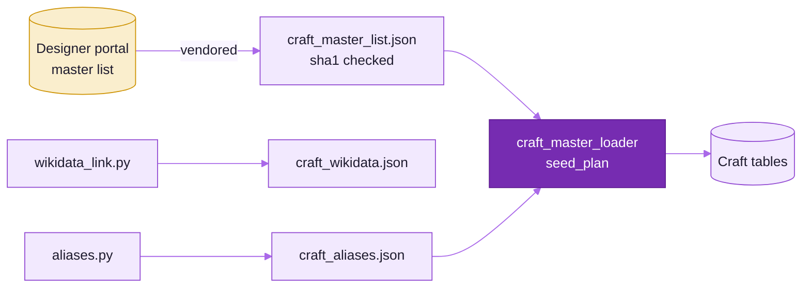

# Craft data

This lane owns `etl/crafts/`, `backend/app/data/`, `shared/` and `.github/workflows/craft-data.yml`. The other lanes read what is listed here and nothing else. Every file below is pure data or pure Python: no database, no network at import time. Engineers seeding crafts, adding an alias source or re-vendoring the master list read it.

| For | Read |
|---|---|
| Crafts either portal added beyond the master list | [portal-craft-feed.md](portal-craft-feed.md) |
| Running the seeds on a release | [infra.md](infra.md), Seeds |
| What a craft's page answers from these rows | [craft-page.md](craft-page.md) |



## Files

| File | What it is | Regenerated by |
|---|---|---|
| `backend/app/data/craft_master_list.json` | The 455 master crafts, byte-identical to DR `backend/app/data/craft_master_list.json` (git blob, LF) | Vendored by hand |
| `backend/app/data/cross_portal_codes.json` | 50 shared craft codes, 174 spellings (DR copy) | Vendored by hand |
| `backend/app/data/craft_master_aliases.json` | DR's curated old-name decisions | Vendored by hand |
| `backend/app/data/craft_vocabulary.txt` | DR's speech-to-text vocabulary (also feeds the Latin-to-Devanagari pass) | Vendored by hand |
| `shared/craft-master.sha1` | `sha1sum` line for the master list. CI runs `sha1sum -c` on it | By hand when the list is re-vendored |
| `backend/app/data/craft_text.py` | Text normalisation shared by the ETL and the matcher | Code |
| `backend/app/data/craft_master_loader.py` | Pure port of DR `services/craft_master.py` (`load_master`, `master_categories`, `normalise`, `craft_aliases`, `with_alias`) and the seed plan; the DB-free `build_catalogue` is in `craft_master_catalogue.py` | Code |
| `backend/app/data/craft_wikidata.json` | Wikidata/Wikipedia links for the 455 crafts | `etl/crafts/wikidata_link.py`, weekly in CI as an artifact |
| `backend/app/data/craft_aliases.json` | Every alias for every craft, deduplicated and normalised | `etl/crafts/aliases.py`, weekly in CI as an artifact |
| `backend/app/data/craft_names.json` | Editorial reader names: `displayName` spelling and case fixes for master crafts (never a catch-all row, which takes its kind's other name) and `localName` overrides (`null` hides a wrong sourced name); loader `craft_names.py` refuses an unknown slug, field, repeated master name or outer space (decision 0082) | By hand |
| `backend/app/data/state_languages.json` | The ISO 639 languages of each LGD state and union territory, in order, used to choose a craft's local name; loader `state_languages.py` refuses a missing or unknown state (decision 0082) | By hand |
| `backend/app/data/seed_claims.json` | Seed knowledge: 1,914 claims, 582 concepts, 767 edges, 122 sources | `etl/crafts/seed_claims.py`, local only (it reads the sibling repos) |

## How the backend seeds crafts

The backend imports `app.data.craft_master_loader` and calls `seed_plan()`. It returns plain dicts keyed by table:

| Key | Rows | Table |
|---|---|---|
| `categories` | `id, masterId, slug, name, sortOrder` | `CraftCategory` |
| `subCategories` | `id, masterId, slug, name, categoryId, sortOrder` | `CraftSubCategory` |
| `crafts` | `id, masterId, slug, name, subCategoryId, category, sourceSerial, stateOfOrigin, stateOfPractice, giStatus, isCatchAll, sourceNotes, status, craftCode, extraMetadata` | `Craft` |
| `codes` | `code, name` | `CraftCode` |
| `spellings` | `spelling, label, craftCode, source` (SHARED) | `CraftSpelling` |
| `aliases` | `craftId, alias, aliasNorm, script, lang, source, status` | `CraftAlias` |

- `id` is `uuid5` of DR's `master_id(kind, slug)` (`seed_uuid`), so every environment gets the same UUIDs. `masterId` is DR's `cm…` id. It has no column; keep it in `extraMetadata.masterId` or drop it.
- Upsert by `slug` for crafts and categories and sub-categories, as DR `sync_master` does. Insert codes before spellings and crafts, then aliases with `ON CONFLICT ("craftId", "aliasNorm") DO NOTHING`.
- `extraMetadata.masterSeed` holds the file's columns, the same as in DR, so the admin-edit/keep logic ports unchanged.
- `build_catalogue()` returns DR's `GET /crafts/catalogue` shape (`version`, `categories[].subCategories[].craftCount`, `crafts[]` with `aliases`) from the files alone. Use it for tests and offline fixtures. The live route should still read the database.
- `master_is_current()` compares the vendored file with `shared/craft-master.sha1`.
- **Dependency:** `normalise` needs `anyascii` (lazy import), which `backend/pyproject.toml` lists. Nothing else in this directory needs a third-party package.

## Enum values the backend must accept

`backend/app/models/enums.py` belongs to the backend lane. These files use values beyond the plan's, and it lists every one of them:

- `AliasSource`: add `WIKIDATA` (labels, aliases and sitelink titles of MATCHED items only) and `TRANSLITERATION` (machine script conversions).
- `ConceptType`: the seeds also use `TRADITION`, `DESIGN_PRINCIPLE`, `HISTORICAL_CONTEXT`, `COMPARISON`, `EXPLANATION`, `ARTISAN_ACTION`, `SENSORY_CUE`, `PROPERTY`, `CHANGE`, `CONCEPT`.
- `ConceptRelation`: the six in the plan plus `DEPENDS_ON`, `CAUSES`, `ENABLES`, `EXPLAINS`, `REQUIRES`, `PRACTITIONER_EXPLAINS`, `HAS_PROPERTY`, `CONTRASTS_WITH`, `ASSOCIATED_WITH`, `SIMILAR_TO`, `USED_FOR`, `PREVENTS`, `MODIFIES`. Each edge also keeps `sourceRelation` (the upstream spelling).
- Evidence levels use the backend's uppercase values (`PROVISIONAL`, `HYPOTHESIS`). Source kinds use `SOURCE_KINDS`. The upstream evidence type is kept in `Source.evidenceKind` (for example `HISTORICAL_DOCUMENTATION`), a nullable text column.

## `craft_aliases.json`

```json
{"version": 1, "summary": {...}, "trustOrder": ["MASTER","CURATED","CROSS_PORTAL_CODE","IMMERSIVE","WIKIDATA","TRANSLITERATION"],
 "codes": {"mapped": {"<code>": {"slug","via","status"}}, "ambiguous": {"<code>": ["slug", ...]}, "unmapped": ["<code>"]},
 "collisions": [{"norm": "...", "slugs": [...]}],
 "crafts": {"<slug>": {"name", "craftCodes": [...], "aliases": [
   {"alias", "norm", "latin", "script", "lang", "source", "sources", "status", "via"}]}}}
```

- `norm`: Latin text is NFKC, accents stripped, lower case, `&` to `and`, punctuation to single spaces (identical to DR `normalise` on Latin). Indic and Arabic text keeps its script, with only case and spacing folded. `latin` is always the ASCII key: the naming skill's inherent-vowel pass, then `anyascii`. `norm` is what goes in `CraftAlias.aliasNorm` (trigram index). `latin` is for rapidfuzz on romanised queries.
- Indic labels gain Latin forms: the inherent-vowel form, a schwa-deleted spoken form (`बगरू` gives `bagaru` and `bagru`), and common romanisations (`c` to `ch`, anusvara `m` to `n`). These are `ACTIVE`.
- Script-to-script conversions (to or from Devanagari only, dropped unless the output is entirely in the target script) and Latin-to-Devanagari of vocabulary words are `PROPOSED`. The matcher must not use `PROPOSED` rows for an exact hit.
- A `norm` under `collisions` names more than one craft. It is never an exact match on its own; the matcher falls through to fuzzy or the pick list. Current collisions: `gond painting`, `others` (catch-all rows), `syahi begar` (Bagru and Sanganeri both do it), and one `PROPOSED` Devanagari kalamkari form.
- Code mapping is exact on any known name. Codes that hit two crafts are listed as `ambiguous` and not applied (`bandhani`, `block-print`, `zardozi`, `nizamabad-black-pottery`). A fuzzy hit (token sort ≥ 90 with a margin of 5) is `PROPOSED`. Today 22 codes map and 24 do not; most of those 24 name crafts the master list spells differently, and a researcher maps them.

## `craft_wikidata.json`

One row per master craft: `status` is `MATCHED` (112), `LOW_CONFIDENCE` (115), `NO_MATCH` (193) or `CATCH_ALL` (35, never searched). `match` is filled only for `MATCHED`. `LOW_CONFIDENCE` keeps its best guess under `candidate`, and nothing downstream uses it as a match. Each match carries `qid`, `label`, `description`, `enwiki`, Indic `sitelinks`, `labels` and `aliases` in 24 Indian languages plus English, `instanceOf`, `country`, `locatedIn` (with place coordinates where Wikidata has them), `coordinates`, `commonsCategory`, `image`, and `gi` (`tagged`, `wikidataCertification` = P1389 Q98399252, `wikipediaCategories`). `masterGiNotTaggedOnWikidata` lists 19 matched GI crafts whose Wikidata item has no GI marker. These are leads for a curated GI record (`CraftGiRecord`), not corrections.

How a match is scored:

- Name similarity: token coverage plus a whole-string ratio.
- Craft-type evidence: P31/P279 labels, the description and Wikipedia categories. A place, person, film, organism or material caps the score.
- India and state agreement.
- A small bonus when both sides say GI.
- Caps that keep a row out of `MATCHED`: no positive type, another country, a name below 0.75, no shared distinctive word, a candidate outside the craft's category family (for example a stadium for a carpet craft), or an item already matched more strongly by another craft.

All lookups go through the Wikidata Query Service, including Wikipedia and Wikidata search through MWAPI. Wikimedia's 2026 rate limit allows an unidentified client 10 requests a minute, and the User-Agent deliberately carries no contact details. One full run is about 120 SPARQL requests.

## `seed_claims.json`

`traditions[]` (6 immersive traditions plus `shared`, each with region, GI and alt names), `domains[]` (3 inferential domains with their chains), and `sources[]`, `concepts[]`, `edges[]`, `claims[]`. A claim row:

```json
{"id": "seed-<sha1[:20]>", "craftSlug": "Kutch-Ajrakh" | null, "subCategorySlug": "Hand-Block-Printing",
 "subjectType": "CONCEPT" | "EDGE", "subjectKey": "ie:ajrakh.process_stage.saaj", "subjectName": "...",
 "predicate": "PROCESS_STAGE", "text": "...", "textLang": "en",
 "stage": {"key", "title", "ordinal", "stageType"} | null,
 "evidenceLevel": "PROVISIONAL" | "HYPOTHESIS", "levelReason": "...", "provenanceKind": "...",
 "origin": "IMPORT", "status": "PROPOSED", "createdByKind": "SYSTEM", "systemActor": "import", "sensitivity": "OPEN",
 "sources": [{"sourceId", "locator", "quote", "quoteClipped", "quoteCheck": "PASS" | "NA", "relation", "note"}],
 "importRef": {...}}
```

- Immersive claims whose concept or relationship passed that repo's mechanical quote check are `PROVISIONAL` with `quoteCheck: PASS` (1,546). A concept the source itself frames as a hypothesis stays `HYPOTHESIS`. Quotes over 300 characters are cut to a verbatim prefix (`quoteClipped: true`), so a quote check still finds them.
- Inferential-system seeds are all `HYPOTHESIS`. They cite textbooks without a fetched passage (reliability C) or the programme's own draft interpretation (D). Their distractor evidence items (`misleading: true`) are dropped. These attach to a sub-category (`craftSlug: null`), as the plan asks for family-level knowledge.
- `BELONGS_TO` relationships become `PART_OF` edges but not claims, because their explanation is boilerplate.
- `stage.stageType` is a keyword guess from the stage title. Researchers correct it.
- Each import writes a `ReviewEvent` with `actorKind=SYSTEM` and `systemActor=import` when the backend loads it (backend lane).

## Crafts synced from the portals

`Craft` also holds every craft the designer and documentation portals added beyond the master
list (`docs/contracts/portal-craft-feed.md`, decision 0003). Such a row has
`extraMetadata.portalOrigin` and `extraMetadata.portalSources`; master rows gain
`portalSources` only and are otherwise untouched. Portal names are `CraftAlias` rows with
source `DR_SYNC` (designer portal) or `FR_SYNC` (documentation portal, migration
`0002_portal_alias_source`). `alias_norm`, `alias_lang` and `SCRIPT_LANG` now live in
`backend/app/data/craft_text.py`; the alias merger imports them. The merger is `etl/crafts/aliases.py`
(its sources and the merge), reading `alias_entries.py` (an alias entry, its trust order and
deduplication), `alias_scripts.py` (romanisations and script-to-script transliteration) and
`alias_codes.py` (cross-portal codes mapped to crafts, exactly or by a fuzzy score of at least 90
leading its rival by 5; decision 0168).

## Matcher expectations (plan §5.2)

The resolver is built: `docs/contracts/research.md` (The resolver) and decision 0004.

- Exact match: ACTIVE `CraftAlias.alias`, `CraftSpelling.label` (through `craftCode`), name and local name, keyed by `craft_text.core_key` of the text and of `craft_text.to_latin_spoken(text)`. A key that names several crafts (a collision) gives each the same exact score, so they become pills, never a single answer.
- Fuzzy: rapidfuzz `ratio` on those keys and on distinctive name tokens, in memory (not `pg_trgm`).

## Workflow

`.github/workflows/craft-data.yml`:

- **checks:** runs on push or PR touching this lane, and on schedule or dispatch. It runs `sha1sum -c`, ruff and the pure tests.
- **regenerate:** runs on schedule (Mondays 02:17 UTC) and dispatch only. It re-runs the Wikidata link with no cache and re-merges aliases, reusing the IMMERSIVE aliases from the committed file because the sibling repos are absent on the runner. It writes a status-diff summary and uploads both files as the artifact `craft-data-<run>`. It never commits or opens a PR.

## How this document is kept true

| Claim | Kept true by |
|---|---|
| The master list is the vendored one | `sha1sum -c shared/craft-master.sha1` in `craft-data.yml` |
| The loader, the seed plan and the catalogue shape | `etl/crafts/tests/test_loader.py` |
| Aliases, `norm`, `latin` and collisions | `etl/crafts/tests/test_aliases.py` and `test_text.py` |
| Wikidata scoring and its caps | `etl/crafts/tests/test_wikidata_scoring.py` |
| The seed claims' rows | `etl/crafts/tests/test_seed_claims.py`, and `backend/tests/db/test_claim_seed.py` and `test_craft_seed.py` on Postgres |
| The seed's stored authors, an organisation whole and people split outside brackets | `etl/crafts/tests/test_source_authors.py` and `test_seed_authors.py`, which reads the committed `seed_claims.json` |
| Editorial names and state languages | their loaders, `craft_names.py` and `state_languages.py`, which refuse the rows named above |

Re-read it when the master list is re-vendored, an alias source or a seed file is added, or the
counts above change after a regenerate run is committed.
