# Curation: dossiers, check files and the index

What a curated craft dossier holds, how its quotes are verified, and what the offline checker
refuses. Curators, the curation skill's agents and the engineers who change the model or the
importer read it.

| For | Read |
|---|---|
| The tooling's design | [decision 0051](../decisions/0051-curation-tooling.md) |
| The plan | [plans/dataset-curation.md](../plans/dataset-curation.md), sections 3, 5, 6 and 10 (its section 0 and the decisions in its section 14 are the owner's) |
| The database as the source, and the dossiers as its export | [dossier-export.md](dossier-export.md) |
| The method a curator follows | [kalavigyan-craft-pages](../../.claude/skills/kalavigyan-craft-pages/SKILL.md) |
| The commands step by step | [RUNBOOK.md](../RUNBOOK.md), How to curate a craft |

```mermaid
%%{init: {"theme":"base","fontFamily":"Inter, ui-sans-serif, system-ui, -apple-system, Segoe UI, Roboto, Helvetica, Arial, sans-serif","themeVariables":{"fontSize":"15px","primaryColor":"#F2E9FE","primaryTextColor":"#1E1B2E","primaryBorderColor":"#9148D2","secondaryColor":"#FAEECD","secondaryTextColor":"#1E1B2E","secondaryBorderColor":"#CD9200","tertiaryColor":"#F3F1FA","tertiaryTextColor":"#1E1B2E","tertiaryBorderColor":"#A7A3BC","mainBkg":"#F2E9FE","nodeBorder":"#9148D2","nodeTextColor":"#1E1B2E","lineColor":"#AA69E9","textColor":"#857F9E","edgeLabelBackground":"#F9F5FF","clusterBkg":"#F9F5FF","clusterBorder":"#D6B6FB","titleColor":"#762CB1"}}}%%
flowchart LR
  SRC["Sources read<br/>quotes kept"] --> DOS["Dossier<br/>CraftSlug.json"]
  DOS --> VER["verify.py<br/>check file"]
  VER --> CHK["check.py<br/>the checks"]
  CHK --> IDX["index.json<br/>once per batch"]
  IDX --> IMP["import_curation<br/>on every deploy"]
  IMP --> DB[("Database")]
  classDef accent fill:#762CB1,stroke:#5F1C93,color:#FFFFFF
  class CHK accent
```



## Where the code is

The plan is `docs/plans/dataset-curation.md` (sections 3, 5, 6 and 10; its section 0 and
the decisions in its section 14 are the owner's). The code is the Pydantic model and the rules in
`backend/app/curation/`, shared by the tools and the importer (below), and the tools in
`tools/curation/`. The JSON Schema generated from the model is
`shared/curation.dossier.schema.json` (`python tools/curation/schema.py` writes it; a backend test
fails when it is stale). Change the model, the schema file, this page and the tests
(`backend/tests/curation/`, `tools/tests/test_curation_*.py`) together.

Last reviewed: 2026-11-18.

## Files

| Path | What | Written by |
|---|---|---|
| `backend/app/data/curation/<CraftSlug>.json` | one dossier per craft, named by its `craftSlug` | the dossier export; by hand only for a bulk import (below) |
| `backend/app/data/curation/<CraftSlug>.check.json` | the quote verification of that dossier | `tools/curation/verify.py` |
| `backend/app/data/curation/categories/<CategorySlug>.json` | one dossier per craft category (scope `CATEGORY`, below), named by its `categorySlug` | the dossier export; by hand only for a bulk import (below) |
| `backend/app/data/curation/categories/<CategorySlug>.check.json` | its quote verification | `tools/curation/verify.py` |
| `backend/app/data/curation/index.json` | per craft and per category: version, coverage, counts, check status | `tools/curation/check.py --write-index`, once per batch by the lead |

Nothing else lives in those folders: the checker reports any other file, and a check file whose
dossier is missing. The importer reads craft and family dossiers from the top folder and
category dossiers from `categories/` (below, and `docs/contracts/category-page.md`). Files are
UTF-8 without a byte-order mark, LF line endings.

## The database is the source of truth (decision 0101, item 6)

Since 2026-11-19 the database holds curated knowledge and these files are its versioned export:
a backup, a diff against the database, and the way to bulk import. A new fact is proposed through
the Knowledge API, where it passes the gates (`tools/curation/propose.py` sends a working
dossier's new facts; an agent on the MCP server uses `propose_facts`). Structure the API does not
take yet (picture placements, a stage's `after` or why, native names, reactions, glossary,
conflicts, open questions, the GI record) and a new craft's first dossier still come in as a new
dossier version, checked as below and imported on deploy. `app.scripts.export_dossiers` writes the
dossiers back from the database and reports what differs from git; the export, its guarantee and
the client are `docs/contracts/dossier-export.md`. The rules on this page apply to every dossier,
exported or written by hand.

## Shape conventions

- Models derive from `research.base.ContractModel` (`docs/contracts/research.md`): JSON in
  camelCase, unknown fields refused, strings stripped, URLs `https://` only, instants with a
  time zone. Lists of ids or names list each entry once.
- Stored vocabularies are read from `backend/app/models/enums.py` through
  `research/vocabulary.py`; the curation-only ones live in `backend/app/curation/vocabulary.py`;
  numeric limits in `backend/app/curation/limits.py`. The schema file carries every enumeration.
- Ids are stable inside the file and become `uuid5(namespace, "curation:<slug>:<id>")` at import,
  so a re-curation updates rows instead of duplicating them.

| Part | Id | Pattern |
|---|---|---|
| sources | `S01` | `^S\d{2,3}$` |
| claims | `C001` | `^C\d{3,4}$` |
| places | `L01` | `^L\d{2,3}$` |
| communities and people | `G01` | `^G\d{2,3}$` |
| process stages | `P01` | `^P\d{2,3}$` |
| materials | `M01` | `^M\d{2,3}$` |
| tools | `T01` | `^T\d{2,3}$` |
| reactions | `R01` | `^R\d{2,3}$` |
| glossary terms | `W01` | `^W\d{2,3}$` |
| pictures | `I01` | `^I\d{2,3}$` |
| open questions | `O01` | `^O\d{2,3}$` |

## The dossier, field by field (`curation/dossier.py`)

### Header

| Field | Rule |
|---|---|
| `schemaVersion` | `2` (decision 0095 item 9). The loader refuses an older version with the command that migrates it (Migrating a dossier, below) |
| `scope` | `CRAFT` (the default), `FAMILY` or `CATEGORY` (below) |
| `craftSlug` | `CRAFT` and `FAMILY` only: a slug of `backend/app/data/craft_master_list.json` or an `ACTIVE` craft of `backend/app/data/portal_craft_register.json` (below), case as stored (`Kutch-Ajrakh`); the file is `<craftSlug>.json` |
| `categorySlug` | `CATEGORY` only, instead of `craftSlug`: a `categorySlug` of the master list (`Stone-Craft-Category`); the file is `categories/<categorySlug>.json` |
| `version` | 1 or more; raised on each re-curation |
| `curatedAt` | instant with a zone |
| `curator` | `claude-code` |
| `coverage` | `FULL` or `THIN` (below) |
| `searched` | at least one `{query, site}`: every query and site tried, kept so a thin dossier shows what was looked for |

### Sources (`sources`, `S..`; `curation/parts.Source`)

| Field | Rule |
|---|---|
| `kind` | a stored `SOURCE_KINDS` value other than `FIELD_TESTIMONY` |
| `subKind` | only with `kind` `OTHER`: `THESIS`, `MUSEUM_RECORD`, `NGO_REPORT` or `NEWS` |
| `title`, `authors[]`, `publisher`, `year` | as the source states them, never guessed; `year` 1000 to 2100 or absent |
| `url` | https, the canonical page: no tracking parameters (`utm_*`, `fbclid`, `gclid`, ...), not a search result or redirect page |
| `doi` | when there is one (`research/evidence.DOI_PATTERN`) |
| `archivedUrl` | a Wayback Machine snapshot (`https://web.archive.org/web/<timestamp>[id_]/<url>`) when the live page blocks automated reading; `fetch.py` prints it |
| `language` | ISO 639 code (`en`, `gu`, `hi`, ...); Indian-language sources are allowed (decision D4) |
| `licence` | as the source states it |
| `access` | `OPEN`, `ABSTRACT_ONLY` or `RESTRICTED`; restricted sources are cited from their open abstract only |
| `reliability` | `A` to `D` by the rubric below |
| `retrievedAt` | the day the curator read it (`YYYY-MM-DD`) |

Every source is quoted by at least one claim; a source that yielded nothing is dropped and its
search stays under `searched`.

### Claims (`claims`, `C..`; `curation/parts.Claim`)

| Field | Rule |
|---|---|
| `discipline` | one of the answer engine's 16 fields (`models/enums.DISCIPLINES`, titled by `research/sections.DISCIPLINE_TITLES`; `SOCIETY` and `POLICY` since migration `0032_knowledge_fields`, decision 0102); the importer also stamps it on the claim as `Claim.field` |
| `subject` | `{type, ref}`: `CRAFT` (no `ref`), or `STAGE` (`P..`), `MATERIAL` (`M..`), `PLACE` (`L..`), `TOOL` (`T..`), `COMMUNITY` (`G..`), `TERM` (`W..`) with that part's id |
| `text` | plain English, one sentence ending in `.`, `!` or `?`, 8 to 40 words |
| `quotes` | at least one `{sourceId, locator, quote}`: `quote` verbatim from the text `fetch.py` shows, in the source's language, 25 to 300 characters once normalised; `locator` a page, section, paragraph, line or timestamp |
| `hypothesis` | true only when the source states it as uncertain, a theory or a legend |
| `sensitivity` | a stored `SENSITIVITIES` value; `OPEN` unless the claim names a living private person beyond what a published source states |

`corroborated` is computed, never written: two or more quotes from different publishers
(`curation/index.corroborated`; the publisher is the source's `publisher`, else its URL's host).

### Places (`places`, `L..`; `curation/entities.Place`)

`name`; `kind` `VILLAGE`, `TOWN`, `DISTRICT`, `STATE`, `COUNTRY`, `REGION` or `RIVER`;
`district` and `state`; `country`; `wikidata` (`Q...`) when one exists; `role` (one of
`PRACTISED`, `ORIGIN`, `HISTORIC_CENTRE`, `MATERIAL_SOURCE`, `MARKET`, `MIGRATED_FROM`,
`MIGRATED_TO`); `claimIds` (one or more) that state the role. A place with two roles (Dhamadka,
practised and a historic centre) is listed once per role, each with its own claims. For
`country` `India`, a village, town or district names its district and state, and both are
written exactly as the LGD register names them (`backend/app/data/lgd_register.json`, its pending districts included; read through
`data/district_register.py`). `district-shapes.json` holds geometry by LGD code only, so names
are matched against the register and the import joins shapes by code. Places outside India are
not checked against a register.

### Communities and people (`communities`, `G..`; `curation/entities.Community`)

`kind` `COMMUNITY`, `PERSON` or `ORGANISATION`; `name`; `localNames[]`; `honours[]` (a `PERSON`
only); `placeId`; `claimIds`. A named person appears only when a published source names them in
connection with the craft, with name, honours and place only (decision D6): a `PERSON` carries a
`placeId`. Never phone numbers, email addresses, identity numbers or home addresses.

### Process stages (`stages`, `P..`; `curation/entities.Stage`)

`name`, `localName`; `stageType` (stored `STAGE_TYPES`); `order` with `orderClaimId` together, or
neither: order is set only when a source states the sequence, and no two stages share one;
`duration` and `season` as `{text, claimId}`, where `text` is stated by that claim or its quotes;
`materials[{materialId, claimId}]` and `tools[{toolId, claimId}]`, each use backed by a claim;
`claimIds` (what happens in the stage and why). Two optional fields the craft page reads
(`docs/contracts/craft-page.md`, "Dossier fields the page reads"; `curation/page_rules.py`):

- `after {text, colours[], claimId}`: the cloth after the stage. `text` is 1 to 120 characters
  (`limits.AFTER_TEXT_MAX_CHARS`); `colours` 0 to 3 distinct `StepColour` words
  (`research/colours.ColourWord`: `RED`, `BLUE`, `BLACK`, `WHITE`, `GREEN`, `YELLOW`, `BROWN`,
  `GREY`, `PINK`, `PURPLE`, `ORANGE`, `MAROON`; `limits.AFTER_COLOURS_MAX`). `claimId` is a fact
  claim of that stage: listed in its `claimIds` or with the stage as its subject. Every content word
  of `text` (`research/quotes.content_words`, compared by stem) occurs in the claim's text or its
  quotes, and each colour is named in one of its quotes by its own word or by a compound whose last
  word it is (`chocolate-black` names `BLACK`; `whiteness` and `reds` name nothing).
- `whyClaimId`: the one-line why, a fact claim about the stage (as above) or about one of its
  materials (with the material as its subject, or listed in the material's `claimIds`), filed under
  `CHEMISTRY`, `MATERIALS`, `PHYSICS`, `BOTANY` or `PROCESS` (`vocabulary.WHY_DISCIPLINES`).

### Materials, tools and reactions (`curation/entities`)

- `materials` (`M..`): `name`; `kind` (stored `MATERIAL_KINDS`); `role` (stored `MATERIAL_ROLES`
  other than `TOOL`); `localNames[]`; `botanicalName` for plants; `pubchemCid` only for a
  well-defined substance, checked against PubChem's own record; `claimIds`.
- `tools` (`T..`): `name`, `localNames[]`, `claimIds`.
- `reactions` (`R..`), only when a source states them: `kind` (stored `REACTION_KINDS`);
  `stageId`; `reactants[]` and `products[]` (`{name, formula?}`, one or more each); `claimIds`.
  Every formula occurs in a quote of those claims. The science engine balances on import; an
  unbalanceable reaction is kept as text with its citation.

### Environment links (`environment`; `curation/records.EnvironmentLink`)

`{factor, placeId?, claimIds}`, `factor` one of `WATER`, `SOIL`, `CLIMATE`, `LANDFORM`,
`VEGETATION`, `OTHER`: claims that tie the craft to its land, water and climate. Dataset values
(rainfall, soil, temperature) are not curated; the geo ETL supplies them per district.

### Market and GI (`market`; `curation/records.Market`)

- `gi`: `applicationNumber`, `certificateNumber`, `filedOn`, `registeredOn` (partial dates),
  `journalIssue`, `proprietors[]`, `authorisedUserCount`, `claimIds`. It cites at least one
  `GI_JOURNAL` or `GOVERNMENT_REPORT` source (the registry's own pages are government records),
  and every number in it (the year of each date) appears in a quote of its claims.
- `prices[{claimId, date, placeId}]`: a price only with its date, place and source.
- `workforce[{claimId, year}]`: numbers of artisans or households only with the year the
  source states, which appears in that claim's quotes.

### Glossary (`glossary`, `W..`; `curation/records.Term`)

`term`, `meaning` (as a source gives it), `language` (ISO 639), `script` (ISO 15924, `Gujr`),
`claimIds`. These feed the `Term` glossary that answers underline.

### Conflicts and open questions (`curation/parts`)

- `conflicts[{claimIds (two or more), about}]`: facts sources state differently, shown as
  "Sources differ" with every citation and never resolved by the curator.
- `openQuestions[{id O.., question, claimIds, settledBy?, subCategories?}]`: what the sources say
  is unknown or disputed, and every hypothesis claim, with what would settle it when a source says
  so. It cites at least one claim, except in a category dossier, where a question with no claim
  names the `subCategories` no source was found for.

### Pictures (`pictures`, `I..`, at most 16; `curation/records.Picture`)

`url`, `pageUrl`, `author`, `licence`, `licenceUrl`, `caption`, and the `claimIds` or `stageId`
it shows (at least one). The licence or licence URL is on the open-licence allow-list
(`research/licences.open_licence`). No screenshots of other sites. At most 16 pictures
(`limits.PICTURES_MAX`; 6 in schema 1). Optional, for the craft page:

- `placement {chapter, role, stageId?, materialId?}`: `chapter` a key of
  `research/chapter_keys.CHAPTER_KEYS` (`glance`, `made`, `chem`, `why`, `history`, `market`,
  `whatif`, `people`, `kin`, `sources`); `role` one of `PICTURE_PLACEMENTS` (`MASTHEAD`, `OPENER`,
  `PLATE`, `RECORD`, `STAGE`, `MATERIAL`). A `STAGE` placement names its `stageId` and a `MATERIAL`
  placement its `materialId`, and no other role names either; both resolve in the dossier, and a
  `STAGE` placement of a picture that names the stage it shows (`stageId`) is that stage. One
  picture per dossier is placed `MASTHEAD` (`PLACED_ONCE_PER_PAGE`) and one per chapter `OPENER`
  (`PLACED_ONCE_PER_CHAPTER`).
- `focal {x, y, width, height}`: the crop box in fractions of the picture, inside it (`x` and `y`
  from 0, `width` and `height` above 0, `x + width` and `y + height` at most 1).
- `width` and `height`: the file's size in pixels, together or neither, read from its Commons page
  with `fetch.py --picture` (Commands, below); the import stores them on the `MediaRef`.
- `standIn`: what a picture from elsewhere shows when it is not this craft or its place ("Tasar silk
  yarn, not ajrakh"), 1 to 300 characters.

### Native names (`nativeNames`; `curation/records.NativeName`)

`[{text, language (ISO 639), script (ISO 15924) | null, claimId}]`: a name the craft itself is
called. The claim is about the craft (subject `CRAFT`); `text` occurs in one of its quotes, and that
quote says the craft is called that: a naming word (`called`, `known as`, `named`, `name`,
`termed`, `spelt`, `spelled`, `referred to as`) or a language label right before the name
(`Ajrak (Sindhi: اجرڪ)`). They fill the page's `localNames` and the masthead's name.

### The overview (`overview`; `curation/overview.py`)

- `lede`: 2 to 4 `{text, claimIds}` sentences: what the craft is, where, by whom, what is
  distinctive.
- `keyFacts`: 1 to 8 `{label, value, claimIds}`.
- `sections`: `{discipline, sentences (3 to 8)}`, one per discipline, each discipline with at
  least 3 non-hypothesis claims.
- A sentence of a category dossier may also carry `subCategories` (the master list's
  `subCategorySlug` values it speaks of) and `crafts` (the member crafts it names, by slug);
  other dossiers carry neither.

Every sentence is one sentence, cites claims (never a hypothesis), carries no number, date,
unit or formula that no quote of its claims holds, and at least half of its content words
occur in its claims and their quotes (`research/quotes.quote_overlap`, the composer's rule).
The import runs the answer engine's prose validator and drops a failing sentence.

### Coverage (`curation/coverage.py`)

| Target | FULL `CRAFT` or `FAMILY` | FULL `CATEGORY` | THIN (any scope) |
|---|---|---|---|
| Sources | 8 or more, 3 or more rated A or B | 12 or more, 5 or more rated A or B | whatever exists |
| Claims | 40 to 150 | 60 to 250 | 5 to the scope's cap (150, or 250 for a category) |
| Disciplines with 3 or more claims (hypotheses not counted) | `OVERVIEW`, `HISTORY`, `PROCESS`, `MATERIALS` and 2 more | `OVERVIEW`, `HISTORY`, `MATERIALS` and 2 more | no minimum |
| Places | at least one centre (`PRACTISED` or `HISTORIC_CENTRE`), each Indian centre with its district; a `FAMILY` centre may be a `STATE` or `REGION` | at least one centre, at the level each source gives (`STATE` or `REGION` need no district) | as found |
| Process | at least one stage | no minimum (stages belong to crafts) | as found |
| Overview | lede, key facts, 3 or more sections | lede, key facts, 3 or more sections | lede and key facts |

A `FULL` dossier must meet every FULL target of its scope (`curation/coverage.SCOPE_TARGETS`). A
`THIN` dossier must meet the THIN targets and must not meet every FULL target (then it is marked
`FULL`). A thin dossier is never padded.

### Scope: crafts, families and categories (`data/curation_scopes.py`, `curation/scope_rules.py`)

One mechanism: the dossier declares its `scope` and the checker checks it against the master
list and the portal craft register, so a curator cannot choose the looser rules.

- **`CRAFT`**: one named craft, on the master list (455) or an `ACTIVE` craft of
  `backend/app/data/portal_craft_register.json`. That register lists the crafts the portals
  added that the master list does not hold, as the portal craft sync stores them in the `Craft`
  table (same slug, no `sourceSerial`, id `seed_uuid("c", slug)`): `slug`, `name`,
  `subCategorySlug`, `stateOfOrigin`, `stateOfPractice`, `giStatus`, `portals`, `status`
  (`ACTIVE` or `MERGED`) and `mergedInto`. A dossier for a `MERGED` craft is refused with the
  craft to curate instead (`Cane-And-Bamboo` is merged into `Cane-Bamboo-Craft`). A craft a
  portal adds is added there; a test pins that no register slug is on the master list, that its
  states are LGD states and that `mergedInto` is a master craft.
- **`FAMILY`**: a catch-all row (its master notes say catch-all: `Other-Stone-Carving`,
  `Stone-Others`) or a craft whose only state of practice is `All India` (`Cane-Bamboo-Craft`,
  `Tie-Dye`; 81 crafts, all `NON_GI`). Such a craft must be curated as `FAMILY` and no other
  craft may be. Its centres may be named as the sources name them, by `STATE` or `REGION`
  without a district (a village, town or district still carries its district); it has no GI
  record; every other rule is the craft rule.
- **`CATEGORY`**: one master document per craft category, for the category pages. The slug is a
  `categorySlug` of the master list (`Textiles-Based-Craft-Category`, `Metal-Craft-Category`,
  `Stone-Craft-Category`, `Wood-Craft-Category`, `Leather-Craft-Category`,
  `Natural-Fibre-Grass-Work`, `Mud-Based-Craft-Category`, `Paper-Craft-Category`,
  `Miscellaneous`), the file lives in `categories/`, and it is curated like a craft (verified
  quotes, the critic) with these rules:
  - every sub-category of the category (the master list's `subCategorySlug` values) is named
    by at least one cited overview sentence's `subCategories`, or by an open question with no
    claim saying no source was found for it;
  - the overview has a section for every discipline with 3 or more non-hypothesis claims;
  - member crafts are referenced by slug in a sentence's `crafts` (master or register crafts
    of that category, merged ones excluded) and never copied: a member craft's own facts belong
    in its dossier, and the category states what its own sources say of the category;
  - places are centres at the level each source gives; no GI record; at most 250 claims
    (`limits.CATEGORY_CLAIMS_MAX`) and the category targets above.

## Reliability rubric (the checker's table)

- **A** primary or authoritative: GI journal and registry, peer-reviewed papers, museum
  collection records, government reports (Textiles Committee, Development Commissioner
  (Handicrafts), state handicraft boards), academic books; a recorded field interview held by a
  portal, for what the speaker says of their own practice (materials, steps, tools, terms,
  quantities, the prices they get). A field interview may be the only support of a `PROCESS`,
  `MATERIALS`, `DESIGN` or `ECONOMICS` claim about the speaker's own practice; any other claim cites
  it only beside an A or B source of another kind. Curated dossiers never cite `FIELD_TESTIMONY`
  (`CURATED_SOURCE_KINDS`); field interviews reach claims only through the answer write-back
  (`docs/contracts/field-voices.md`, decision 0091).
- **B** theses, conference papers, edited encyclopedias, established craft institutions with
  named authors.
- **C** reputable press features; artisan organisations' own pages with a named author; and a
  page a named organisation publishes about its own work, author named or not (Khamir about its
  own programmes, a cooperative about its members).
- **D** other web pages, and any shop, sales or retail page (a page that sells, or links its
  visitors to a shop for, the craft). A claim whose quotes all come from D sources is refused,
  except an `ECONOMICS` claim stating a price in a currency (a dated retailer page as a price on
  that date).

The rating is the curator's; the checker reads it, it does not infer it.

Never used: shadow libraries, AI-generated content farms, social media posts, unattributed blog
spam, anything behind a login.

## Curator checklist

Learned from the wave 0 critics (41 must-fix problems in three pilot dossiers). A first draft
already meets every item; the checker catches some, the critic the rest.

1. **A claim says no more than its quotes.** Every word that carries meaning (a cause, a
   comparison, `faster`, `most`, `completely`, a material, a place) is in a quote of that claim;
   when the supporting sentence sits next to the quoted one, quote it too. Same subject, scope,
   tense and time as the source (`during British rule`, not `after`; `were`, not `are`).
2. **Hedges and qualifiers stay**: about, approximately, believed, said to, probably, barely
   one-third, in the mid 2010s, and their Hindi forms, in the claim, the lede and the key facts.
   Marking a claim a hypothesis does not replace its hedge.
3. **One voice stays one voice.** One artisan's account, an author's or organisation's opinion,
   a GI application's assertion or a judgement of a person is attributed (`one artisan said`,
   `Mongabay reports`, `the GI application describes`), never stated as the craft's general fact.
4. **Counts, prices and dates carry their year, quoted.** An undated `today` or `now` is not a
   date: quote the page's date or drop the present-tense half. Set a source's `year` when it
   states one. A date is what the record says (`Form GI-1 ... is dated 5 November 2012`), never
   inferred from a document's title.
5. **Conflicts are recorded, never settled.** Numbers, dates, names, materials, metals, whether
   a place still works: each version is its own claim, linked in `conflicts`, including a
   discrepancy noticed while searching. The overview names both sides or says sources differ.
6. **One fact, one claim.** A second source is a second quote on the same claim; look for the
   fact before adding it. Ingredient lists and `X is used to prepare Y` belong in stages,
   materials and tools.
7. **General facts stay general.** An encyclopedia definition (bell metal, dammar, beeswax) or a
   statement about the craft across several states is scoped as such, never hung on this craft's
   material or centre unless a source says so. No filler: museum listings, plinth descriptions,
   an event a page only lists.
8. **Quotes are whole.** A quote is the clause the claim rests on, never a fragment of a
   neighbouring sentence that changes its scope. A near-verbatim rewrite of another source is not
   independent support. Every local name in a record appears in a quote.
9. **Ratings follow the rubric above.** No named author is not B; an organisation's page about
   its own work is C; a shop or sales page is D.
10. **Places at district or village level.** Every centre named anywhere (claims, lede, key facts)
    is a place with its district and state as the LGD register writes them, and the district
    comes from a cited quote, not from memory or an uncited lookup; when sources disagree, record
    the conflict. A `FAMILY` or `CATEGORY` dossier may name a state or region where its source
    does.
11. **A GI record for every GI craft** (never for a family or a category), from the registry page and journal: application and
    certificate numbers, filing and registration dates, journal issue, proprietor, authorised-user
    count, validity and area, each quoted (tables are read, so quote the row:
    `Date of Filing | 15-10-2025`). Never an authorised user's name, house number or address.
    What could not be read (a form-only download) goes under `searched`.
12. **The overview adds nothing.** Each sentence cites every claim whose fact it uses and adds no
    duration (`have long been`), degree or link between facts; tense as in the claims.
13. **No dataset values.** Rainfall, forest cover, soil and temperature come from the geo ETL by
    district.
14. **Stop drafting at the claim cap** (150, or 250 for a category), with the coverage targets'
    disciplines filled first.
15. **Leave `index.json` alone**: run `check.py` on your own dossier; the lead writes the index.

## Reading and matching (`tools/curation/reading.py`, `curation/matching.py`)

`fetch.py` and `verify.py` read a source with the same function (`reading.source_text`):

- Plain HTTP (`httpx`) with a browser-like user agent, redirects followed (at most 10), the
  final URL reported; one request per host at a time with 1.5 s between requests to a host; a
  response over 40 MiB is refused, never truncated.
- HTML through the fetcher's own trafilatura extraction (`app.fetcher.extract`: scripts, styles
  and hidden elements dropped; capped at 200,000 characters and marked truncated), PDF through
  pypdf (`app.fetcher.pdf.pdf_text`, up to 2,000 pages), plain text as is. A server's wrong
  content type is corrected by sniffing (`%PDF-`, a leading `<`).
- When the live page refuses (an HTTP error, a failed connection, no extractable text), the
  source's `archivedUrl`, else the latest Wayback Machine capture with status 200 (the CDX
  index), is read in its raw form (`<timestamp>id_`).
- HTML tables (`tools/curation/tables.py`): trafilatura keeps some tables and drops others (the
  GI registry's application table on some pages, its document table on others). Every data
  table on the page, with hidden elements dropped as above, is read row by row: a table with no
  table inside it, at least two rows with two or more filled cells, and no cell over 1,000
  characters. Each row the extracted text does not already hold is added after it as one line,
  cells separated by ` | ` as the extraction writes the tables it keeps (`| Status | Pre
  Examination |`), within the same 200,000-character cap. A page without such a table reads
  exactly as before.
- The text is normalised once (`research/quotes.normalise_quote_lines`): Unicode NFKC, soft
  hyphens removed, hyphenated line breaks joined, curly quotes and dashes folded to ASCII,
  whitespace collapsed inside each line, blank lines dropped. `fetch.py` prints these lines
  numbered, so the curator copies quotes from exactly what the verifier sees.
- A quote passes when, case-folded, it occurs in the case-folded text with whitespace and
  line breaks collapsed and hyphens between letters ignored (`research/quotes.quote_key`),
  starting and ending on a word boundary and never inside a number (`50` does not occur in
  `150`). Case is folded for matching only; the dossier keeps the quote as copied.

## The check file (`curation/check_file.py`)

```
CheckFile {schemaVersion 1, craftSlug | categorySlug, dossierVersion, dossierDigest, checkedAt,
           tool, sources[SourceCheck], quotes[QuoteCheckEntry]}
SourceCheck {sourceId, url, route LIVE|ARCHIVE|null, readUrl, finalUrl, fetchedAt, contentType,
             textSha256, characters, truncated, problem}
QuoteCheckEntry {claimId, sourceId, quote, result PASS|FAIL}
```

- `tool` is `VERIFY_TOOL` (`kalavigyan-curation-verify/2`, raised when tables were read); a check
  file from another version is stale, so a change to reading or matching bumps it and forces
  re-verification.
- A check file names the dossier's `craftSlug`, or its `categorySlug` for a category, never both.
- `dossierDigest` is the SHA-256 of the craft or category slug, every source's id, URL and archived URL, and
  every quote's claim, source and text (`verified_digest`). Prose, overview and structure edits
  keep it; any change to a source or quote makes the check file stale.
- `textSha256` is the SHA-256 of the normalised text the quotes were matched against; a source
  that could not be read has no hash and a `problem` naming both the live and the archive
  failure, and every quote from it is `FAIL`.

A check file is current when its craft and tool match, its digest equals the dossier's, its
`checkedAt` is not before the dossier's `curatedAt` and it covers every source. File times are
not used: a checkout resets them. A claim keeps only quotes that passed; a claim left with none
is dropped, and a source that could not be read is dropped with its claims.

## The checks (`tools/curation/check.py`, `curation/checks.py`)

One line per problem, `<file>: <where>: <message>`, and a non-zero exit on any:

1. Schema and vocabulary (`Dossier.model_validate_json`); a file that does not validate gets
   only these lines. A dossier of an older `schemaVersion` gets one line naming the migration.
2. Every id used once per part; every reference resolves (claims to sources and subjects;
   places, communities, stages (with their `after` and `whyClaimId` claims), materials, tools,
   reactions, environment links, market records, glossary terms, pictures (with their placement's
   stage or material), native names, conflicts, open questions and the overview to claims, places,
   stages, materials and tools). Unresolved references stop the remaining rules; a hypothesis named
   by `after`, `whyClaimId` or a native name is cited as a fact (rule 7).
3. Scope and slug (above): a craft slug on the master list or an `ACTIVE` portal-added craft,
   the declared scope `FAMILY` exactly for family crafts, a category slug on the master list;
   file named `<slug>.json`, a category in `categories/` and no other dossier there; Indian
   districts and states as the LGD register names them (with the closest names suggested).
4. Claims: 8 to 40 words, one sentence; the number rule and the hedge rules (below); no
   relationship sentence (below).
5. Quotes 25 to 300 characters once normalised, none repeated within a claim.
6. No two claims with near-identical texts (rapidfuzz `ratio` or `token_sort_ratio` of the
   case-folded, punctuation-free texts at least 90) unless linked in one conflict.
7. Hypotheses: each cited by an open question; none cited as a fact anywhere else.
8. Reliability: no claim resting on D sources only, prices excepted.
9. Sources: each quoted by a claim; no tracking parameters; no search-result or redirect URL.
10. Stages, reactions, market records and pictures as described above; each stage's `after` and
    `whyClaimId`, the pictures' placements (one `MASTHEAD`, one `OPENER` per chapter, a `STAGE`
    placement at the stage the picture shows) and the native names
    (`curation/page_rules.py`).
11. The overview sentence rule; each section's discipline with 3 or more claims.
12. No personal contact details in any text field (`research/evidence.personal_data_in`:
    email addresses, spoken email addresses, phone-like and Aadhaar-like numbers); URL fields
    are not scanned.
13. Coverage class matches the targets of the dossier's scope; the scope rules (no GI record for
    a family or category; a category's sub-categories, member crafts and sections; no
    `subCategories` or `crafts` outside a category).
14. The check file is current and every kept quote passed (above).

The number rule (`curation/figures.figure_gaps`, used by claims, the overview, key facts, the GI
record and workforce years): every number, date, unit and formula in the text appears in a quote
(`research/quotes.figures_in` and the units of `research/translation.protected_tokens`; native
digits count). A leading zero does not change a number, so `5 May 2008` matches `05-05-2008` and
`05` matches `5` either way; a dotted date matches part by part (`22.4.2008`, `22.04.2008`), while
a decimal keeps its zeros (`1.05` is not `1.5`). A letter-spaced run in a quote (four or more
single characters separated by single spaces, as on a report's title page) also counts with its
digits closed up: `2 0 1 8` states 2018 and `1 6 J U L Y` states 16, while `| 1 | 2 |` keeps its
numbers apart.

The hedge rules (`research/hedges.py`, which the composer's sentence checks share), in English and
Hindi:

- A hedging word in the text (may, might, could, possibly, probably, perhaps, likely, in all
  likelihood, reportedly, allegedly, apparently, presumably, supposedly, purportedly, seemingly,
  believed, said to, thought to) appears in a quote, or a quote carries a Hindi word of doubt
  (शायद, संभवतः or संभवत:, संभव है कि, कहा/माना/बताया जाता है कि, ऐसा माना जाता है, मान्यता है कि,
  हो सकता है कि, प्रतीत होता है), which the English hedge translates. `May` written with a capital
  inside a sentence is the month, not a hedge.
- A hedged quote cannot back a plain claim: when every quote hedges, the text hedges too (one of
  the words above, or about, approximately, around, nearly, almost, roughly, circa, estimated,
  some). A quote hedges with an English hedging word other than may, might and could (in a quote
  they are as often a month, a permission or an ability), a Hindi word of doubt, or a Hindi
  approximation (लगभग, करीब before a number or doubled, तकरीबन, अनुमानतः, अनुमानित). The
  passive `कहा जाता है` without `कि` is "is called", not a hedge.

A relationship sentence is graph structure written out as prose, which belongs in stages,
materials and tools: a demonstrative left without its subject at the end of the sentence
(`uses this material.`, `this tool (`), seed filler (`sequential order`, `(GI method of
production)`, `as documented`), a stored relation name in capitals (`PRECEDES`) or an arrow, or a
bare `X uses Y` / `X precedes Y` / `X is part of Y` sentence: one relation phrase
(`sentences.RELATION_PHRASES`) with at most 6 words on each side, no digit, comma, colon or
parenthesis, and none of the qualifying words (`because`, `when`, `with`, `instead`, `not`, ...)
that make it say something a reader learns.

With no file arguments `check.py` checks every dossier in the folder and in `categories/` and
reports stray files in both;
with file arguments it reports those files only. It writes nothing by default, so parallel
curators never touch the index. `--write-index` regenerates `index.json` from every dossier in
the folder (the lead, once per batch); `--check-index` (CI) writes nothing and reports an index
that differs from what it would write; the two flags exclude each other. `--dir` points at
another folder.

## The index (`curation/index.py`)

```
CurationIndex {schemaVersion 2, crafts[IndexEntry], categories[CategoryIndexEntry]}   each by slug
IndexEntry {craftSlug, scope, file, version, coverage, curatedAt, counts{}, claimsByDiscipline{},
            sourcesByReliability{A, B, C, D}, check {status PASS|FAIL, problems, verifiedAt}}
CategoryIndexEntry {categorySlug, file, ...the same fields}
```

`counts`: `sources`, `claims`, `hypotheses`, `corroborated`, `places`, `communities`, `stages`,
`orderedStages`, `materials`, `tools`, `reactions`, `environment`, `terms`, `conflicts`,
`openQuestions`, `pictures`, `overviewSections`. `claimsByDiscipline` lists the disciplines with
claims in `DISCIPLINES` order. A dossier that does not validate is listed by its file name with
null fields and `FAIL`. The index has no generation time, so it changes only when a dossier or
its check does.

## Commands

From the repository root, with the backend's environment (`backend\.venv\Scripts\python.exe` on
Windows, `backend/.venv/bin/python` on Linux):

| Step | Command |
|---|---|
| read a source as the verifier will | `python tools/curation/fetch.py <https url> [--out <file>]` |
| read a picture's file address, size and credit from its Commons file page (imageinfo) | `python tools/curation/fetch.py --picture https://commons.wikimedia.org/wiki/File:<name>` |
| rewrite every dossier of the previous schema (or the ones named) as the current schema | `python tools/curation/migrate.py [<dossier> ...] [--dir <folder>]` |
| verify every quote of dossiers | `python tools/curation/verify.py backend/app/data/curation/<CraftSlug>.json ...` (a category: `backend/app/data/curation/categories/<CategorySlug>.json`) |
| run the offline checks (writes nothing) | `python tools/curation/check.py [backend/app/data/curation/<CraftSlug>.json ...]` |
| regenerate the index (the lead, once per batch) | `python tools/curation/check.py --write-index` |
| CI form (writes nothing, fails on a stale index) | `python tools/curation/check.py --check-index` |
| regenerate the JSON Schema after a model change | `python tools/curation/schema.py` |

`verify.py` and `fetch.py` use the network; `check.py`, `migrate.py` and the tests never do.

`fetch.py --picture` asks the Commons API (`action=query&prop=imageinfo`, `iiprop=url|size|extmetadata`)
through the same polite client and prints `pageUrl`, `url` (the original upload address, its
query dropped), `width`, `height`, `author`, `licence` and `licenceUrl`, for the curator to copy
into the picture; a page that is not a Commons file page, or a file Commons cannot size, is
refused.

### Migrating a dossier (`tools/curation/migrating.py`)

A schema change that adds optional fields only migrates by `schemaVersion` alone. `migrate.py`
reads each dossier (with no arguments, every dossier of the folder and of `categories/`), refuses
one that is not a dossier or is not of the previous version, and rewrites the version number in
place, keeping every other byte; a file already current is left alone, and when any file is
refused nothing is written. The check files stay current, because the verified digest covers
sources and quotes only, and so does `index.json`. Schema 1 to 2 was run over every dossier on
2026-11-18.

## The import (`app.scripts.import_curation`, decision 0053)

Runs on every deploy right after `seed_crafts`, `seed_claims` and `seed_districts`
(`infra/deploy/blue_green.sh`) and in Backend checks after the database tests. It first withdraws
the seed's edge sentences (claims with `subjectType` `EDGE` and origin `IMPORT` become `WITHDRAWN`,
a review event each; their `ConceptEdge` rows stay), then imports every dossier whose checks pass
(the rules above and a current check file), each whole or not at all, then retires the seed rows of
every craft with a curated dossier (`curation_seed_rows.retire_curated_seed_rows`, decision 0142):
its seed claims (a claim the seed's review event `seed import <id>` marks, on the craft's concepts
or their edges, not hidden) become `SUPERSEDED` with a review event (`systemActor` `curation`, the
status it had kept as `fromStatus`), and its `Seed process` is archived (`Process.archivedAt`), so
no page, search or answer reads them and nothing is deleted. `seed_claims` runs the same step after
it seeds, so a later seed never brings them back. It prints one JSON report
(`withdrawnEdgeSentences`, `retiredSeedRows`, `termSummaries`, `imported`, `refused`, `waiting`, and per dossier its `status`,
`changed` row counts, `problems` and the overview sentences the prose validator dropped) and
exits 2 when a dossier is refused. The craft is found by slug in the database; a portal-added
craft (above) the database does not hold yet is `WAITING`, not refused, until the portal craft
sync stores it. Ids are `uuid5(ID_NAMESPACE, "curation:<slug>:<id>")` for claims and sources and
`curation:<slug>:<kind>:<id>` for the rest; a second run writes nothing. The code is
`backend/app/services/curation_*.py` (the plan is pure: `curation_plan.curation_plan`).

| Dossier part | Stored as |
|---|---|
| sources | `Source`: `origin` `IMPORT`, `storage` `EXCERPT`, `reliability` kept, `externalIds` `{systemActor: "curation", curation: "<slug>:<id>", language, access, archivedUrl?}`, `sha256` the verifier's text hash, `evidenceKind` the `subKind`; a DOI another row already holds is cited through that row |
| claims | `Claim` (`subjectType` `CONCEPT`, `PROVISIONAL` or `HYPOTHESIS`, `APPROVED`, `version` the dossier version that last changed it, `sourcesDiffer` when in a conflict) and `CuratedClaim {claimId, craftId, key, discipline}`, the marker of a curated claim; every change writes a `ReviewEvent` with `systemActor` `curation` |
| quotes | `ClaimSource` (`quoteCheck` `PASS`, `checkedAt` the check file's, `foundBy` `curation`) |
| subjects | `Concept` rows owned by the craft: stages, materials, tools, places (one per place, whatever its roles), communities, terms, and one per discipline for claims about the craft itself (`services/curation_keys.py` names the concept types) |
| places | `CraftLocation` with `role` for places in India where the craft is made (`PRACTISED`, `ORIGIN`, `HISTORIC_CENTRE`, `MIGRATED_FROM`, `MIGRATED_TO`): `DISTRICT` precision with the district and state LGD codes (a village or town in its district), or `STATE` for a state; material sources, markets, pending districts and places abroad are page facts only |
| stages | `Process` (variant `curation`) and `ProcessStage` (`ordered` false and an ordinal after the ordered stages when no source states the order; `durationText`); materials and tools are `Material` rows, their uses `StageMaterial` (tools with role `TOOL`) |
| reactions | `Reaction` balanced by the science engine and `ReactionCitation` to every quote of its claims; no formula, no equation; a reaction without a stage is a page fact |
| pictures | `MediaRef` (provider `curation`, `INLINE` under an open licence with its author, `width` and `height` the dossier's) and `MediaRefClaim`; a stored row of the same file with no size gets the dossier's size, and nothing else of a stored row changes |
| glossary | `Term` (key from the first spelling of a comma list, the rest aliases; inserted only when the key is new), `TermCraft`, `TermConcept`, and the English `TermSummary` with basis `STORED`, written once per import after the dossiers, built from the curated claims every dossier's glossary names for that key (in craft slug order, the fact-level cited ones, `curation_terms.write_curated_term_summaries`, decision 0142), so `GET /terms/{key}` serves the curated meaning; its other languages are dropped when the English changes and translated again on the next ask |
| GI record | `CraftGiRecord {craftId, applicationNumber, certificateNumber, filedOn, registeredOn, journalIssue, proprietors[], authorisedUserCount, claimIds[]}`, one per craft; dates are partial (`YYYY`, `YYYY-MM`, `YYYY-MM-DD`) as the dossier gives them |
| prices | `CraftPrice {id, craftId, claimId, pricedOn (partial date), placeName, stateLgd, districtLgd}` |
| workforce | `CraftWorkforce {id, craftId, claimId, year}` |
| overview | `KnowledgePiece` `prose` blocks, `EXPERT`, no answer id: the lede (facet `OVERVIEW`) and one per section, topic as answers compute it, sentences checked by the answer engine's prose validator (a failing one is dropped) and marked with the dossier's glossary |
| the rest | `CuratedCraft {craftId, version, curatedAt, coverage, digest, page, importedAt}`: `page` is `services/curated_index.CuratedPage`, the references the craft page needs (key facts, conflicts, open questions, places, communities, stage details with each stage's `after` and why claim, picture captions with their placement (dossier stage and material keys), focal box, size and stand-in, the native names, the overview's piece ids, environment links; claim ids are the stored claim ids); `digest` is the SHA-256 of the dossier and its check file |

A new version supersedes the old: a curated claim it no longer holds becomes `SUPERSEDED` and
keeps its citations; a level a person raised or a retraction is never undone; replaced overview
pieces are superseded, dropped ones marked stale; curated locations, stage structure, market rows
and dropped quotes of kept claims are replaced. Claims written by answers are never touched.
Imported claims and pieces get their vectors from the nightly `embed_knowledge`. The craft page
that reads all this is `docs/contracts/craft-page.md`.

A dossier removed from the folder is not un-imported by the deploy, since a craft curated over MCP
waits in the database for its export (`docs/contracts/dossier-export.md`). It is retired
explicitly: `python -m app.scripts.import_curation --retire <craftSlug>` refuses while
`<craftSlug>.json` is still in the folder or the craft has no imported dossier, then supersedes the
craft's curated claims (review note `curated dossier retired, its file left the curation folder`),
marks its overview pieces stale, archives its curated process, deletes its `CuratedCraft` row and
restores the seed rows the dossier had retired (`curation_retire.retire_dossier`, decision 0142).
Importing the dossier again restores its claims (`SUPERSEDED` curated claims return to `APPROVED`)
and its process (the planned process row sets `archivedAt` back to null).

### Category dossiers (`services/category_import.py`, decision 0078)

The same script imports every dossier of `categories/` right after the craft dossiers, each whole
or not at all, under the same checks; its report adds `categories` (`imported`, `refused`, and per
dossier `file` `categories/<slug>.json`, `status`, `categorySlug`, `version`, `changed`,
`problems`, `droppedSentences`), and a refused category dossier also exits 2. The category is
found by `categorySlug` in `CraftCategory` (the seeds hold all nine). Its sources, claims, quotes,
pictures and glossary are stored as a craft's are, with ids `curation:<categorySlug>:...`; claims
are marked by `CuratedCategoryClaim {claimId, categoryId, key, discipline}`; subjects are
`Concept` rows with no craft and no sub-category; the glossary links terms by `TermConcept` only;
the overview is `prose` knowledge pieces with no craft; and `CuratedCategory {categoryId, version,
curatedAt, coverage, digest, page, importedAt}` holds the page index
(`services/curated_category_index.CuratedCategoryPage`). The family's reactions (the Textiles
family's indigo chain, decision 0095 item 9) are stored in that index as `reactions`
(`IndexReaction` with no `reactionId` and no `stageKey`, its species as the dossier names them,
`claimIds` the stored claim ids), so the craft pages whose materials they name can borrow them;
no `Reaction` row is written. `materials` stays empty: the category import writes no `Material`
rows. Places, stages, materials, tools, market records and environment links stay claims and
concepts. Supersession and idempotence are the craft rules. The page that reads it is
`docs/contracts/category-page.md`; without a database,
`services/category_preview.category_dossier_records(slug)` builds the same index with the claim
views and sources of a family dossier.

## Not built yet

The critic's brief (plan section 7).

## How this document is kept true

| Claim | Kept true by |
|---|---|
| The model, its fields and the schema file | `backend/tests/curation/` and `shared/curation.dossier.schema.json`, which a backend test fails on when stale |
| The checks, the check file and the index | `backend/tests/curation/test_dossier_checks.py`, `test_check_file_and_index.py`, `test_curation_claim_rules.py` and `test_text_rules.py`; `tools/tests/test_curation_verify_and_check.py` |
| Reading and matching quotes | `tools/tests/test_curation_reading.py` |
| Migrating a dossier and its pictures | `tools/tests/test_curation_migrate_and_pictures.py` |
| Every committed dossier passes | `tools/curation/check.py --check-index`, run in Backend checks |
| The import, superseding and idempotence | `backend/tests/curation/test_curation_import_plan.py` and `backend/tests/db/test_curation_import_db.py` |
| Category dossiers | `backend/tests/curation/test_category_dossiers.py` and `backend/tests/db/test_category_import_db.py` |

Re-read it when the dossier schema version changes, a check is added, or a kind of structure stops entering by bulk import.
