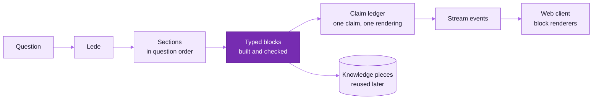

# Explainer

An answer becomes an explainer: ordered sections, each holding typed blocks, streamed as they
are ready and stored as knowledge pieces for later answers. Engineers adding a block kind, a
builder or a renderer, or changing the stream, read it.

| For | Read |
|---|---|
| The plan | [plans/answer-experience.md](../plans/answer-experience.md), sections 2.1 to 2.4, 2.7 and 2.8 |
| The design choices | decisions [0030](../decisions/0030-explainer-contract.md), [0042](../decisions/0042-phase-b-contract.md), [0054](../decisions/0054-phase-c-contract.md) and [0062](../decisions/0062-phase-d-contract.md); the lede and signature figures [0077](../decisions/0077-lede-headings-and-question-order.md); the claim ledger [0080](../decisions/0080-claim-ledger.md) |
| The interfaces that build an answer | [research.md](research.md) |
| Registered components placed in a section | [answer-components.md](answer-components.md) |
| What a reader does with a finished explainer | [learning.md](learning.md) |

## Where the code is

The plan is `docs/plans/answer-experience.md`, sections 2.1 to 2.4, 2.7 and 2.8. The code is the typed models in `backend/app/research/`
(`explainer.py`, `blocks.py`, `blocks_place.py`, `blocks_matter.py`, `blocks_people.py`,
`terms.py`, `media_refs.py`, `subject_keys.py`, `knowledge_pieces.py`, `depth.py`,
`citations.py`, and for phase B `datasets.py`, `rivers.py`, `calendar.py`, `reactions.py`,
`expert_panel.py`, and for phase C `blocks_play.py`, `blocks_journey.py`, `sandbox.py`,
`timeline.py`, `alternatives.py`, with the film score in `backend/app/schemas/film.py`), the block builder registry
`backend/app/services/block_builders.py` and the
interface its builders implement `backend/app/services/builder_interface.py`, and the
client types and runtime shapes in `frontend/lib/explainerContract.ts`, `explainerBlockBase.ts`,
`explainerPlace.ts`, `explainerMatter.ts`, `explainerExperts.ts`, `explainerPlay.ts`,
`explainerStream.ts` and `filmScore.ts` with the renderer registry
`frontend/components/answer/blockRenderers.ts`. Change a type only together with this page, the
fixtures and both sides' tests. Design choices: decisions 0030, 0042, 0054 and 0062; phase D
adds `blocks_learning.py`, `blocks_insight.py` and `measures.py` and, on the client,
`explainerLearning.ts` and `explainerInsight.ts`. The lede, headings, question order and the
signature figures (decision 0077) add `blocks_lede.py`, `blocks_signature.py`,
`question_cues.py` and `trail.py` (the trail event, moved out of `explainer.py`) and, on the
client, `explainerSignature.ts`.

Last reviewed: 2026-11-18.

## Ground rules

- Every fact carries a citation to a source or a dataset row. A block that cites nothing does not
  construct; a section that shows nothing ends `EMPTY` and says what it searched.
- Numbers, coordinates, districts and river paths come from claims or datasets, never from a
  model: a model chooses and orders, the server fills values. A ladder condition's `stated` text
  must occur in one of its citations' quotes; a name a model picks (a river, a supply origin, a
  material word) must be stated by a cited sentence or its quote (`blocks.named_in`).
- A value drawn from a dataset cites the dataset row (`DatasetRef`, `research/datasets.py`, the
  region contract's dataset shape); every map carries `BOUNDARY_CAPTION` word for word and cites
  `DR_DISTRICT_SHAPES`.
- Sentences keep today's contract (`research/citations.AnswerSentence`: verbatim quotes,
  citations, levels computed by the server, the composer's figure checks). Facts only: a
  hypothesis is never a prose, ladder or term sentence; it is an open question.
- A block kind that is not built yet is refused wherever a reader would see it: the `block`
  event, the stored explainer, a stored piece and the client's parser (`BUILT_BLOCK_KINDS`).
- Shapes follow `docs/contracts/research.md`: `ContractModel`, camelCase JSON, unknown fields
  refused, https URLs only, instants with a time zone.

## The document (`Explainer`)

`Explainer {schemaVersion 1, answerId, question, understood, lede?, sections[ExplainerSection]
(at least one), sources[SourceRef], followUps[] (at most 5), createdAt}`. `lede` is the
`LedeBlock` below; an explainer stored before decision 0077 has none and still reads.

A finished explainer is kept on its `Answer` row under `payload.explainer`
(`services/answer_store.EXPLAINER_PAYLOAD_KEY`): this document's JSON, in the answer language, as
the reader saw it, rebuilt once through the claim ledger below. Listen reads it from there
(decision 0035) and refuses one whose `answerId` is another answer's; a `payload` without it (a
voice turn's) holds no explainer.

A stored explainer is served as it may be shown now, never rewritten: every reader (the versions
and their exports and lesson packs, the quiz, Listen and film mode) passes it through
`services/field_voices_readback.current_field_voices` (decision 0091). A citation of a portal field
interview whose recording is no longer shown (withdrawn, deleted, hidden, or its stream not heard
from in 7 days) or whose claim no longer cites it is taken out with its prose sentence, or with its
whole block for any other kind; an image left illustrating no cited claim goes; `sources` is
renumbered; a section left with nothing is `EMPTY` with `searched` "A field interview this section
quoted is no longer shown."; an explainer with no `READY` section left is not served (404).

- `understood` is the `Understood` shape of the stream event below.
- Sections are listed by `order`, 1 to n; ids are `s1`, `s2`, ... and unique. Order is the
  reading order and adapts to the question; section ids are only names.
- Block ids (`^[a-z0-9]+(?:[.-][a-z0-9]+)*$`, at most 80, for example `s1.b2`) are unique across
  the explainer.
- `sources` lists every source the blocks cite, once, in order of first citation: the lede's
  first, then the sections in order (`explainer_blocks` yields the lede first, `cited_source_ids`).
- At least one section is `READY`.

`ExplainerSection {id, discipline, title (1-120), original?, order >= 1, state, blocks[Block],
searched}`. Stored sections are `READY` (at least one block, `searched` null) or `EMPTY` (no
blocks, `searched` the one sentence of what was searched). `original` is the English title when
`title` is a translation. An image block may illustrate only claims another block of the same
section cites. Disciplines (`models/enums.DISCIPLINES`): `OVERVIEW`, `PROCESS`, `CHEMISTRY`,
`PHYSICS`, `MATERIALS`, `GEOGRAPHY` (geography and water), `GEOLOGY` (geology and soil),
`CLIMATE`, `ECOLOGY`, `BOTANY`, `HISTORY`, `ECONOMICS`, `DESIGN`, `HEALTH`.

## One claim, one rendering (the claim ledger, decision 0080)

Every block of an answer passes one `services/claim_ledger.ClaimLedger` before it is sent: the
stream holds it (`ExplainerStream.blocks` sends and returns only what it lets through, and the
section runner, reused sections, pictures and the stored-only answer keep only that), and
`explainer_document` rebuilds the finished answer through a fresh one in reading order
(`services/ledgered_explainer`). Sections that finish out of order can make the stored answer hold
fewer sentences than the live page, never more.

- **Restating blocks** (`RESTATING_KINDS`: `prose`, `material_card` facts and handling,
  `expert_view` takes) drop a sentence whose text is already on the page (folded by
  `data/craft_text.fold`, its English `original` too), whose every claim an earlier block already
  showed, or that restates a shown sentence (below). **Story blocks** (every other kind with
  `SENTENCES`: `region_story` steps, `supply_map` links, `zoom_story` levels, `timeline_map` points
  and routes, `concept_graph` entries, `seasons`, `measure`, `compare`, `what_if`, `market_gi`,
  `climate_risk` and the rest) drop an item when its sentence's text is already shown or it
  restates a shown sentence; a story that would not stand without its restating items keeps the
  first of them (then, if it still does not stand, every one), so a figure is never lost to the
  prose it draws. In one call they are let through before the restating blocks; a
  story block may repeat a sentence within itself, one copy per item it backs (the client says it
  once: Each sentence once, under Block renderers). A
  `process_ladder` is the process's skeleton: a stage drops a sentence said word for word, and a
  restating sentence only while the stage keeps another, so a stage the question names is never
  emptied by another section (decision 0127). **A restatement** (`services/restatements.restates`,
  decision 0127) is a sentence of at least `RESTATED_STEMS_MIN` (4) content stems
  (`quotes.content_stems`) that adds no number to a shown one and keeps its negation, and either
  shares its claim group (its claims, or its citations' source and folded quote, within the shown
  sentence's) with at least `SAME_GROUP_SHARE` (half) of their stems in common, or cites other
  evidence with the same numbers and at least `NEAR_VERBATIM_SHARE` (0.8) of their stems in common:
  a story step that tells the prose's fact in nearly the prose's words, and one fact filed under
  two fields, are said once. An item left with no sentence goes, so a card whose every fact
  was shown is not sent even when it shows a formula; a ladder stage keeps the level of the
  sentences it keeps; a compare cell already shown is left `null` and a row with fewer than two
  crafts goes; a block whose own sentence (an indigo vat's lift) was shown is not sent. Differences
  are exempt from the repeat rule (decision 0120): an `expert_view` difference goes from both seats
  only when the same pair of claims was already shown as a difference, never because one reading
  was already said in prose, and a seat whose every take sentence was shown stays, with its take,
  while it carries a difference (it goes when its differences go). Kinds without
  sentences pass whole. A block left empty or off its contract is not sent; a section left with
  nothing ends `EMPTY` with `COVERED_NOTE` ("Already covered in this answer."), which the client
  does not draw (`lib/explainerView.shownSections`).
- **Calls:** a section's ladder, prose and pictures are admitted alone and its built blocks together
  (`claim_ledger.admission_batches`), for fresh sections, reused sections and the rebuild alike.
  `ExplainerStream.blocks(section_id, blocks, sources, *, in_language)` admits in English, then
  translates what it let through, all at once, then sends it.
- **No gap on the page** (decision 0127): before admission, every sentence of a block (a prose
  sentence, a card fact, a take, a story item) whose English text admits a gap
  (`research/gap_admissions.admits_gap`, the one pattern the answer evaluation's `noGaps` measure
  also reads) leaves its block and is sent as an `open_question` with its citations, translated
  with the section's blocks (`services/gap_routing.routed_gaps`): "the compounds have not been
  identified", "the origins are unknown", "the stored statements do not name the oxides", "no
  rainfall, temperature or seasonal detail" (decision 0138). A section's or a seat's sentence that
  admits what its sources lack (`gap_admissions.SOURCE_GAP`) may carry that admission's negation
  and no other (`composer/drafts.checked_block_sentence`), so it survives grounding to be asked
  here; seats are told a gap is never part of their view. A block left with no sentence or off its contract is not
  sent, and its gap sentences are still asked; nothing is dropped silently. An open question
  citing a source the stream does not hold is left out with a warning.
- **Once per answer:** a material card per material (PubChem CID, compound, material, term or
  folded name), a `molecule_3d` per CID, a concept-graph node per term (a node that loses the
  focus craft or falls below two crafts goes), one each of the craft-level stories
  (`ONCE_PER_ANSWER_KINDS`: `region_story`, `seasons`, `supply_map`, `zoom_story`), one generated
  explainer (`simulation`) per folded concept (decision 0090).
- **Experts:** a seat whose take adds no sentence and no claim not yet shown is not shown; the
  others stop agreeing or differing with it, and a difference whose two views share a claim or a
  source goes.
- **Pictures:** one per images block (a section's own picture, and since decision 0087 up to three
  concept pictures from the generated explainer's builder), the first ranked item that illustrates a claim the section's
  shown blocks cite, was not shown earlier in the answer (media id, page or image address, the
  zoom story's pictures included) and is not from a shop, marketplace or social site
  (`services/picture_sites.blocked_picture`: the maintained `BLOCKED_PICTURE_SITES`, a
  `SHOP_PATH_SEGMENTS` path segment, a `/collections/<name>` store listing
  (`SHOP_LISTING_SEGMENTS`), or a title starting "Buy" or "Shop"). A zoom level whose picture was
  already shown or is blocked is left out of the zoom.
- **Sources** merge (`services/source_merge.SourceMerge`) by DOI (the field or a doi.org link), by
  address (host without `www.`, path without its last slash, query without `utm_`) or by title
  (asides in brackets left out, at least `TITLE_KEY_WORDS_MIN` distinct words, in any order), never
  across two different DOIs, and by title alone never across two different stated years. The first cited keeps its id, kind and title; the others fill its gaps and the
  year is the earliest stated. Citations, pictures, molecules and open questions are remapped to
  it, so `sources` and the `source` events list each work once.
- **The lede** goes through first (`admit_lede`): its sources become the canonical ones and its
  sentences count as shown text, not shown claims, so the sections may still explain them.

## The block envelope

Every block is `{id, kind, version, reuse, ...fields}`; `kind` discriminates the union `Block`,
`version` is a literal per kind (all 1 today; a new version is a new model, never a reinterpreted
old one), `reuse` is null or `ReuseMarker {pieceId, storedAt}` when the block came from a stored
piece ("From earlier research" and its date). Each block says what it rests on:
`cited_claim_ids()`, `cited_source_ids()` (citation sources, then sources cited directly), and
`illustrated_claim_ids()` for images. Sentences in blocks are `ExplainerSentence`, today's
`AnswerSentence` plus `terms[TermSpan]` and `sourcesDiffer`, present (and `true`) only when a
claim the sentence cites is marked sources differ; the client draws the madder Sources differ tag
after such a sentence (`components/answer/ExplainerSentence.tsx`, decision 0120).

| Kind | Phase | Built |
|---|---|---|
| `prose`, `process_ladder`, `images` | A | yes |
| `component` | A | yes (decision 0101, placed by the composer's choice, never a stored piece) |
| `expert_view` | B | yes (0046) |
| `region_story`, `map_layer` | B | yes (0044) |
| `seasons`, `supply_map` | B | yes (0047) |
| `reaction_player`, `material_card`, `molecule_3d` | B | yes (0050) |
| `simulation`, `what_if`, `zoom_story`, `timeline_map` | C | fields fixed (0054), not built; zoom and timeline builders registered (0057); the generated explainer's builder and hide route registered (0055); the what-if builder registered (0056); zoom and timeline renderers built (0060) |
| `compare`, `concept_graph` | D | yes (0064) |
| `quiz` | D | made by its route and in lesson packs (0064), never streamed |
| `climate_risk` | D | yes (0065) |
| `measure`, `market_gi` | D | yes (0066) |
| `in_practice`, `open_questions` | D | declared |
| `artisan_voice` | E | declared |
| `designs` | deferred (owner, 2026-11-17) | declared |
| `indigo_vat`, `mordant_bath`, `lost_wax`, `firing` | `SIGNATURE` (0077) | built as lede figures only (`BUILT_FIGURE_KINDS`, 0086), sent while `SIGNATURE_FIGURES_ENABLED` is on; never in a section |

A phase builds a kind by adding it to `BUILT_BLOCK_KINDS` (server and client, pinned by
`e2e/backend-vocabulary-unit.spec.ts`) and its client shape and renderer; the envelope does not
change. The lane that completes a kind (its builder entry and its renderer both present) adds it
on both sides in one change: `tests/answering/test_block_builders.py` requires a builder entry
for every built later-phase kind and `e2e/explainer-phase-b-unit.spec.ts` a renderer for every
built kind.

Each block model declares `SENTENCES`, the one map of where its sentences sit (for example
`steps[].sentence`, `take[]`, `differs[].thisView`). `cited_sentences()`, the payload walk that
translation and term marking use (`explainer.payload_sentences`, `with_payload_sentences`) and
the stored piece's sentence ids all read it, in reading order. `shown_labels()` are the stored
names a block shows besides sentences (a material, a river, a district); a piece's vector embeds
both.

### Built in phase A

- **`prose`** `{sentences[ExplainerSentence] (at least one)}`. Sentence ids unique in the block;
  levels `VERIFIED`, `REVIEWED` or `PROVISIONAL` only (`FACT_LEVELS`).
- **`process_ladder`** `{craft: CraftRef, processId, stages[LadderStage] (at least one)}`, stages
  by rising `ordinal`. `LadderStage {stageId, ordinal, name, stageType, level, sentences
  (at least one), materials[LadderMaterial], conditions[LadderCondition], reactionIds[]}`: the
  stage's level is the weakest of its sentences; `reactionIds` link the stage to the science
  engine's reactions on the craft page's Process tab (each once). `LadderMaterial {materialId,
  name, kind, role, citations (at least one)}`. `LadderCondition {label, stated, citations (at
  least one)}`: `stated` is the source's own words (`ten to fifteen days`), found by
  `quotes.quote_occurs` in one citation's quote. Ids are the stored `ProcessStage`, `Material`
  and `Reaction` rows of `docs/contracts/science.md`.
- **`images`** `{items[ImageItem] (1-8)}`, each media once. `ImageItem {media: MediaRef, claimIds
  (at least one, once each), relevance: TEXT | VISION}`: the claims the image illustrates and
  how its relevance was checked (claim text, or a vision call for top candidates).
- **`component`** (`research/blocks_component.py`, client `lib/explainerComponent.ts`, decision
  0101 item 3) `{label, componentKind, title, craft: CraftRef, href, sources[{sourceId}] (at least
  one)}`: a registered component of the library (a `KnowledgePiece` with a `label`) placed in an
  answer section instead of being built again. `label` is the registry label
  (`kutch-ajrakh/chemistry/red-alum-madder-player`), `componentKind` the piece's kind (any piece
  kind but `component`), `craft` the craft whose monograph shows the figure (the piece payload's
  `monograph`), and `href` that craft's page, `craft.path`, plus the payload's `anchor` when the
  anchor names an element (`#rp-red`); a selector anchor (`[class="mols"]`) links the page alone.
  `sources` are the sources the component rests on (the piece's `sourceIds`), cited directly, so
  they join the answer's source list and numbering; the block carries no sentence. How a section
  offers and places components is `docs/contracts/answer-components.md`. The kind is in
  `knowledge_pieces.UNSTORED_BLOCK_KINDS`: an answer's component block is never kept as a piece,
  since the registered component is the stored thing. The client draws it as a figure card
  (`components/answer/ComponentFigure.tsx`): the kicker "Figure from the {craft name} monograph",
  the title as an h4 and one indigo link, "Open the figure", to `href`; complete at rest, no
  motion.

### Phase B blocks (decision 0042)

`ExplainerSentence` is written "sentence"; every sentence is a cited fact (never `HYPOTHESIS`),
listed once per block. "Server" is what the builder fills from stored rows or datasets; "model"
is all a model may do. Every validator below fails closed: a block that breaks one does not
construct, and the builder that made it adds nothing.

- **`region_story`** `{river: RiverPath?, districts[DistrictRef] (1+), steps[{districtLgd?,
  sentence}] (1+), layers[layer id], datasets[DatasetRef] (1+), boundaryCaption}`.
  `RiverPath {datasetCode "HYDRORIVERS_1_0", mainRiv, reachIds[] (source to outlet, once each,
  the last is `mainRiv`), districtLgds[] (districts reached, path order, once each), name?}`;
  `DistrictRef {districtLgd, name, stateName}`. Server: the trace (`docs/contracts/region.md`,
  Rivers), the districts (the river's first, in path order, then the story's others) with names
  from the LGD register, the dataset rows (`DR_DISTRICT_SHAPES`, and `HYDRORIVERS_1_0` with a
  river), the caption. Model: which offered basin (by `mainRiv`) or none, which claims become
  steps, their order and district, which offered layers. Rules: the caption is
  `BOUNDARY_CAPTION`; each district, layer and dataset once; steps narrate listed districts, and
  a step names its district only when its sentence or quotes name it (`blocks.named_in`, decision
  0050); the
  river's districts lead `districts` in path order; a river `name` is stated by a step sentence or
  its quote; the builder checks the trace against the stored reaches (`rivers.trace_problems`).
  Cites the steps' claims and the dataset rows. **Piece:** cross-craft (`craftId` null), the
  section's facet, topic `<facet namespace>:basin-<mainRiv>`, else `<namespace>:lgd-<code>` for
  each district (`knowledge_pieces.piece_slot`).
- **`map_layer`** `{layer, layerVersion, title, datasets[DatasetRef] (exactly 2), highlighted[]
  (district LGD codes, 1+), boundaryCaption}`. Server: everything, from `geo/layers.MAP_LAYERS`
  and the layer route (`GET /api/map/layers/{layer}`: id, the version it answered, title, its
  dataset row then `DR_DISTRICT_SHAPES`). Model: which offered layer, which listed districts to
  highlight. The client draws the route's current values and classes under the caption; a newer
  version is still drawn (values are dataset rows, not claims). **Piece:** none (it cites no
  claim); rebuilt each time.
- **`reaction_player`** `{steps[ReactionStep] (1+), notes[ReactionNote]?}`, `ReactionStep {reactionId, stageId?,
  kind, label, species[ReactionSpecies] (2+), equation?, balanced, level, citations (1+), stage?,
  conditions[LadderCondition]?, colours[StepColour]?}`, `StepColour {side (BEFORE, AFTER), colour
  (RED, BLUE, BLACK, WHITE, GREEN, YELLOW, BROWN, GREY, PINK, PURPLE, ORANGE, MAROON), stated,
  citations (1+)}`, `ReactionNote {reactionId, sentence}` (decision 0088; the optional fields are
  left out of the JSON when empty, so a player stored before them keeps its content hash).
  Server: every value from the stored `Reaction` rows and their citations (the Process tab's
  reaction view): `stage` is the stage's stored name, `conditions` the reaction's and its stage's
  stated readings (the ladder's rule, at most `STEP_CONDITIONS_MAX` 4), `colours` only a cited
  quote's own words (`science/reaction_colours`: "at first green ... becomes blue" gives both
  sides, "develops a deep fast chocolate-black colour" the after side by the compound's last colour
  word; a denied or naming use such as "indigo white" gives none), and `notes` the reaction's
  stored fact claims as cited sentences, each claim once per player, at most `NOTES_PER_STEP_MAX`
  (4) per step, ids `<block>.<n>`. Model: none. Rules: a reactant and a product;
  `equation` is `mhchem_equation(species)`; balanced only with every formula; `level` is
  `reaction_level` of the citations (an unbalanced reaction with every formula is capped at
  `HYPOTHESIS`); each reaction once; each colour side once, its colour named in `stated` and
  `stated` in one of its citations' quotes; a note only for a reaction the player plays, facts
  only. `SENTENCES` is the notes' sentences, so the ledger drops a repeated note and keeps every
  step, and translation and term marking walk the notes. The builder re-checks steps and notes
  against the process rows, as ladders are (`reaction_player_problems`, decision 0045): a stage,
  condition or colour list a stored step holds must equal the rows', a note must be a stored claim
  of its reaction. Replaces the stream's `reaction` event,
  which no server path emits and which stays declared until removed (`docs/TECH_DEBT.md`). **Piece:** the section's slot; reuse re-checks against the process rows.
- **`material_card`** `{materialId?, compoundId?, termKey?, name, materialKind?, role?, formula?,
  pubchemCid?, wikidataId?, localNames[], facts[sentence] (1+), handling[sentence]}`. Server: name,
  kind and role from the stored `Material` (and its stage role), formula and CID from its
  `Compound` (CID filled by `link_compounds`), local names and Wikidata id from the glossary
  `Term`. Model: which claims are facts and which are handling. Rules: kind or role only with a
  material id, formula or CID only with a compound id, local names or Wikidata only with a term
  key; local names once each. **Piece:** the section's slot.
- **`molecule_3d`** `{compoundId, pubchemCid, name, formula?, sourceId}`. Server: everything from
  the stored `Compound` and its `COMPOUND_RECORD` source (`compound_lookup.record_source_id`).
  A curated dossier's PubChem CID becomes a `Compound` row at import when none holds it
  (`services/curated_compounds`, named by its first material, no formula until `link_compounds`
  reads the record by its CID; a same-name compound without a CID takes the CID and that record's
  source instead, so the seeded alizarin and indigo stay one row each and a second import changes
  nothing, decision 0088), so its materials link to it.
  Model: which compound of the section's blocks. The conformer comes through the PubChem adapter:
  `GET /api/molecules/{pubchemCid}/conformer` (public, decision 0079) answers the 3D SDF, cached in the
  private media bucket, 404 without a 3D conformer; the builder adds a molecule only for a
  compound with a kept conformer (decision 0045). Cites its record. **Piece:** none (it cites no
  claim).
- **`expert_view`** `{seat, take[sentence] (1+), agreesWith[seat], differs[{seat, thisView,
  otherView}]}`. Server: the seat (from `Understanding.seats`, `expert_panel.speaking_seats` of
  the section's field, widened at Expert; decision 0099), the seat's own stored evidence, the
  take's citations from stored claims, both sides of a difference as the claims stand stored, the
  agreements (a shared cited claim), and the whole `ARTISAN` take, quoted from field transcripts.
  Model: composes each other seat's take (at most 3 sentences) from that seat's brief in a call
  of its own, choosing claims; proposes differences in a final pass, which the server keeps only on
  two stored facts about one subject from two sources (decisions 0046, 0099). Rules: never its own
  seat; each other seat once; a difference rests each view on its own claims and its own
  sources. In a section (`expert_pairing_problems`, checked by `ExplainerSection`): one view per
  seat; an agreement is mutual; a difference is "Experts differ" only when the other seat states
  the mirrored difference (its `thisView` cites this view's `otherView` claims and the other way
  round). The client draws one "Experts differ" card per pair with both citations
  (`expertsDiffer`). **Piece:** the section's slot; the views of a section are one reuse set.
- **`seasons`** `{rows[{stageId?, label, months[], season?, sentence}] (0+; none only with
  rainfall), rainfall:
  MonthlyRain?, datasets[DatasetRef]}`, `MonthlyRain {district: DistrictRef, datasetCode, period,
  millimetres[12]}` (the district by its register name and state, decision 0050). Server: the label (the stored stage's name, else the claim's subject), the
  months and season read from the sentence and its quotes (`calendar.months_named`,
  `seasons_named`: capitalised month names and ranges, `MONSOON`, `WINTER`, `SUMMER` from their
  words), the rainfall from the CHIRPS monthly normals of the craft's district (decision 0043's
  rows, read by `services/monthly_rain.district_rainfall`) and its dataset row. Model: which
  claims become rows, their order. Rules: months 1-12 once each in order; a row has months or a
  season, each named by its sentence or quotes, unless it is a stored stage (`stageId`) listed
  without them (decision 0047); `datasets` is the rainfall's dataset row exactly when there is
  rainfall. **Piece:** the section's slot.
- **`supply_map`** `{links[{material, materialId?, termKey?, origin, wikidataId?, latitude?,
  longitude?, sentence}] (1+)}`. Server: `material` is the glossary term's label or the stored
  material's name, else words the sentence states; coordinates are the Wikidata item's (P625) for
  the origin. Model: which claims, which material and origin words. Rules: the origin is stated
  by the sentence or its quotes; an unstored material too; an origin is placed only with a
  Wikidata id and both coordinates; each origin of a material once. **Piece:** the section's slot.

Pieces of one answer never supersede each other: a section may store several pieces of one kind
(material cards, expert views), and only pieces from earlier answers are superseded
(`piece_store._supersede`, decision 0045).

### The expert panel (`research/expert_panel.py`)

The 18 seats of plan section 4 feature 6 are `EXPERT_PANEL`, in `EXPERT_SEATS` order, each a
`SeatBrief {seat, label, brief, sourceKinds[], fields[]}`: the label the client shows
(`EXPERT_SEAT_LABELS`, pinned to the panel), the role brief a compose prompt gives the seat, the
source kinds it prefers (most preferred first), and the fields (disciplines) it speaks to. Every
field has at least one seat. The understanding step seats experts by the depth's range
(`DepthPolicy`: Basic 2, Detailed 4, Expert 6 to 12; plan 2.4, decision 0099); a seated expert gives
a view in each section whose field it speaks to (`seats_for`).
`panel_seats(discipline, seated, depth=)` is the seats a section hears: at Basic and Detailed the
seated ones once each, the depth's first `max_experts`, those whose fields hold the section's; at
Expert (`WIDENED_DEPTHS`) the seated ones first, then every other panel seat whose fields hold the
section's, up to `max_experts`. `speaking_seats` is those seats without a `TESTIMONY_SEATS` seat;
`voiced_seats` is the testimony seat among them (the artisan's voice, which speaks only from
field transcripts). `PANEL_FIELDS` is every field a speaking seat covers.

### Block builders (`services/block_builders.py`)

`BLOCK_BUILDERS` is the registry; later lanes add `BuilderEntry {kind, disciplines, make,
wait_seconds}` entries and nothing else. The interface a builder implements is
`services/builder_interface.py`, which builder modules import (the registry imports the builders,
so importing the registry from a builder would be a cycle; decision 0045). `make(BuilderTools)`
returns a builder (`async build(BuildAsk) -> Built`); `from_registry` makes builders only for
kinds already in `BUILT_BLOCK_KINDS`, so no builder spends work on a kind no reader can see yet;
`BuilderTools {sessions, live, plan_model, compose_model}` (both models spend only from the
answer's headroom: `compose_model` since decision 0046, `plan_model` since decision 0050); `BuildAsk {answer_id, section,
request (the answer's `PlanRequest`: question, craft, depth, seats, language), blocks (the
section's checked English prose and ladder), cited (their claims and sources)}`; `Built {blocks,
sources}` (the source refs of every source the blocks cite beyond `cited`). An entry adds a
later-phase kind to the fields it names and waits `BUILDER_WAIT_SECONDS` (8 s) unless it raises
it, at most `BUILDER_WAIT_MAX_SECONDS` (180 s, decision 0087) for a model call. Entries are listed in
`PIECE_BLOCK_ORDER`, so a fresh section shows its added blocks in the order a reused one reads
them; `rebuilt_on_reuse` marks the kinds a reused section rebuilds even when its group already
shows the kind (`region_story`, `map_layer`, `climate_risk`, `market_gi`, `reaction_player`,
`molecule_3d`, `artisan_voice`, `compare`, `concept_graph`: never pieces, built per subject, or
refreshed from stored rows with no model call); `replaces_stored` the one of them whose stored block
a reused group leaves out, so the rebuilt one takes its place rather than joining it
(`reaction_player`, decision 0090); `reused_from` the shallowest depth at which a reused section
runs the entry (`EXPERT` for `simulation` and `expert_view`, the two longest model calls; `BASIC`
for the rest); and `places_pieces` the one entry whose builder may return a stored piece placed with
its reuse mark (`simulation`, decision 0055). One answer's builders share a set of the craft-level
kinds already taken (`BlockBuilders.for_answer`, `ONCE_PER_ANSWER_KINDS`: `region_story`,
`seasons`, `supply_map`, `zoom_story`): the first section whose builders start builds one, a
reused section that shows one takes it (`note_shown`), and a builder that adds nothing gives it
back for a later section.

The sectioned flow makes one call: once a section's final attempt is checked, its builders start
together (`SectionBuilds.start`; none when the section has no checked prose or ladder, so it stays
`EMPTY` with what it searched, decision 0050) while the prose and ladder are translated and sent; then the
added blocks are numbered after them (`<section>.b<n>`), term-marked, translated and sent, before
the `images` block (renumbered after them), the open questions and `section_done`. Added blocks
join the stored explainer and, in English, the section's pieces. A builder that fails, overruns
its wait, makes another kind, makes a kind not yet built, carries a reuse mark (unless its entry
`places_pieces`) or cites a source
it did not return adds nothing and is logged; the section is never failed by a builder. A builder
never holds a database connection while it waits on a model, the router or HTTP (decision 0040).
A reused section is enriched like a researched one (decision 0090): it runs every builder of its
field whose kind its group does not already show, and every `rebuilt_on_reuse` one, from the
entry's `reused_from` depth (`BlockBuilders.for_reuse(shown, depth=)`, `reused_sections.ReuseBuilds`),
over its placed pieces and the reused claims, sending what they add after the placed blocks and
before the pictures. Every reused section's builders start at once, before the headings are
awaited; the placed blocks of every section are sent next, and then each section's additions in
reading order, so the slowest builder of the reused sections bounds the wait rather than their
sum. Placed blocks are term-marked again with the answer's glossary
(`reuse_enrichment.placed_section`; a `replaces_stored` kind is left out of the placed blocks and of
the copies), and a reused `PROCESS` section without a stored ladder is led by one built from the
stored stages whose claims its blocks cite (`reuse_enrichment.reused_ladder`, no model call,
checked by `ladder_problems`). When the question names stored stages its reused ladder lacks
(`sections.named_stage_ids`, below), the ladder is rebuilt from the stored rows with them and
leads the section as a block built for this answer (`reused_sections.ReuseBuilds.placed`,
decision 0127). A reused section is kept again as a group of this answer only when it
gained a storable block its group does not already store (`Placed.stores`: same kind and the same
content once sentence ids and term marks are set aside, `knowledge_pieces.shows_alike`): copies of
its craft pieces (not region stories or generated explainers, which keep their own slots) and the
blocks built for it (`reuse_enrichment.kept_with_reuse`), so a rebuilt player equal to the stored
one keeps nothing and a later answer rebuilds only the kinds that are never pieces.

**Curated sections are the Expert floor** (decision 0090). At `EXPERT`, a reused group whose craft
pieces no answer made (a curated dossier's overview, decision 0053) does not settle its field
(`reuse_enrichment.expert_floors`): the section streams those blocks first, then researches the
field as a deepening of them (`SectionContext.floors`, `floor_deepening`: composed sentences whose
claims the floor already cites are left out, the composed heading replaces the fallback), its
builders run over the floor and the new blocks together, and the kept group holds copies of the
floor. Each floor is sent as soon as its section starts, before the section waits for one of the
`SECTION_CONCURRENCY` research slots, and a failure while sending it stops that section alone. A
section whose floor shows something is never researched again on the web for composing nothing
new (`_needs_fresh`). An answer's keep never supersedes a piece no answer made
(`createdFromAnswerId` null): the curated pieces stay current for the craft page, the district page
and compare, and serve reuse again once the answer's group goes stale, while reuse takes a group an
answer made before a curated one of the same field (`piece_reuse.answered_first`), so the next ask
reuses the richer group and an Expert ask is not floored twice. Also at `EXPERT`, every field with at least `FIELD_CLAIMS_MIN` (3) visible curated claims joins
the understanding's fields after those it chose (`stored_fields.with_stored_fields`,
`AnswerStore.fields`). Field reach of the builders: `seasons` `CLIMATE`, `PROCESS`, `GEOGRAPHY`;
`supply_map` `MATERIALS`, `PROCESS`, `ECONOMICS`; `zoom_story` `MATERIALS`, `CHEMISTRY`, `PROCESS`;
`timeline_map` `HISTORY`, `ECONOMICS`, `GEOGRAPHY` (`block_builders.*_FIELDS`).
`region_story` is rebuilt on reuse too, but only for a section that carries no stored story: a
placed `region_story` piece stops the builder before any query or model call. Without it, a
geography section answered from pieces kept before its craft had mapped places (Kutch Ajrakh until
the curated import of 2026-11-18) never showed a story, since only a fresh section stores one.

### Matter builders as built (decision 0045)

Registered in `BLOCK_BUILDERS` from `services/matter_builders.py`; each reads the craft's matter
in one short session first (`services/craft_matter.craft_matter`: the Process tab's rows, the
glossary terms of each material's concept, the compounds of its materials and reaction species,
their PubChem record sources), and an answer for any craft gets none.

- **`reaction_player`** (`CHEMISTRY`, 8 s): the craft's shown reactions in process order, each
  step the Process tab's reaction view (`science/reaction_player`) with its stage, stated
  conditions and colours and the notes above, at most `REACTION_STEPS_MAX`
  (12; past it the reactions the section's claims cite are kept first). No model is asked.
  `reaction_player_problems` refuses a reaction that is not a stored row of the craft, a step
  whose stage, kind, label, species, equation or balance differ from the row, and a citation not
  linked to the reaction, when built and when its piece is reused.
- **`material_card`** (`CHEMISTRY`, `MATERIALS`, 20 s): materials a section sentence marks by a
  glossary term or names, at most 3, each offered with its own stored claims and the section's
  claims naming it (facts, at most 10), never a claim the section's blocks already cite. Materials
  linked to one PubChem CID (or one compound row) are one material (`merged_materials`): named for
  the one whose name is the compound's, else the shortest, with every use and term of the others
  and their names in the brief (decision 0080). One plan-model call (`composer/material_cards`) sorts
  them into facts and handling by ref; an unknown ref is dropped and a card without a fact is not
  shown. `role` only when every stage use agrees; `termKey`, `localNames` and `wikidataId` from
  the linked term whose label the material's name contains; `formula` and `pubchemCid` only from
  a compound the compound lookup linked to its PubChem record.
- **`molecule_3d`** (`CHEMISTRY`, `MATERIALS`, 8 s): the compounds, in order of first mention and
  then (in `CHEMISTRY`, `PLAYED_FIELDS`) those of every stored reaction of the craft, with a
  CID, a stored record source and a 3D conformer, one per CID; at most `MOLECULES_PER_SECTION` (3)
  per section from `MOLECULE_CANDIDATES_MAX` (6) tried, ids `<section>.molecule<n>`, and the claim
  ledger shows one per CID per answer (decisions 0080, 0090).

`GET /api/molecules/{pubchemCid}/conformer` (public; it checks the stored compound on the
request's one session and releases the connection before the bucket and PubChem, decision 0050)
answers the compound's 3D SDF
(`chemical/x-mdl-sdfile`; `Cache-Control: private, no-cache` with a token and
`public, max-age=300` without, `Vary: Authorization`, and an `ETag` of the SDF that a matching
`If-None-Match` turns into a 304, decision 0079) for a CID a stored `Compound`
holds; 404 `{detail}` for any other CID or a compound PubChem has no 3D conformer for, 503 when
the media bucket or PubChem fails, 422 for a CID below 1. The SDF comes from
`PubChemAdapter.conformer` (PUG REST `compound/cid/<cid>/record/SDF?record_type=3d`, paced at
one call per 0.25 s, refused unless it is that CID's terminated 3D molfile of at most 256 KiB)
and is kept with a miss in the private bucket at `media/molecules/<cid>/conformer.json`
(`ConformerRecord {schemaVersion 1, pubchemCid, sdf | null, checkedAt}`); a kept record answers
without calling PubChem.

### Place builders as built (decision 0044)

Registered in `BLOCK_BUILDERS` from `services/place_builders.py`; an answer for any craft, or a
craft with no cited district that has a polygon (`place_offers.mapped_districts`, the region
route's district places), gets neither.

- **`region_story`** (`GEOGRAPHY`, 20 s). Nothing until the river lines are loaded
  (`river_store.rivers_loaded`; logged once per answer). One short session reads the offer
  (`place_offers.region_offer`): the craft's districts; at most 3 rivers crossing them
  (`rivers_crossing`, by the crossing reach's Strahler order, then mean discharge, then upstream
  area), each traced with the 0043 tracer; district names from the register; the registry layers
  of the water, climate, soil, geology and terrain facets with a value in a craft district; their
  dataset rows. Then one plan-model call (`composer/region_story`, every river, district, layer
  and statement in its own untrusted block) answers refs: a river or `none`, at most 8 steps
  `{claim, district | none}` and at most 4 layers. The statements are the fact-level stored claims
  the section's blocks cite, in order of first citation, at most 12, each a step as stored with
  its visible citations; an unknown claim ref drops its step, a district the story does not list
  or the step's sentence and quotes do not name leaves the step unplaced (shown as "Step n" with no
  map focus, decision 0050), an unoffered layer or one whose dataset row is missing is left out.
  `datasets` is `DR_DISTRICT_SHAPES` (no row, no story), `HYDRORIVERS_1_0` with a river (no row,
  no river) and each listed layer's row. `river.name` is always null: HydroRIVERS names no river
  (decision 0044). No chosen step is no story.
- **`map_layer`** (`GEOLOGY`, `CLIMATE`, 8 s, no model): the facet's registry layers
  (`geo/section_layers`: soil, geology and terrain for `GEOLOGY`, climate for `CLIMATE`) in
  registry order, those whose subject words (`LAYER_SUBJECTS`, whole words) a section sentence
  names first; the first with a value in a craft district becomes the block, built from
  `map_layer(layer_values(...))` exactly as the layer route answers it, highlighting the craft's
  districts with a value.
- **Pieces.** A story is stored in `piece_slot`'s cross-craft slot (`region_topic`; a key past
  `TOPIC_KEY_MAX_CHARS` is not stored). A reused facet section also gets the current story keyed
  by a basin crossing the craft's districts or by those districts
  (`services/region_pieces.region_story_pieces`, looked up only when a geography section is asked,
  `REGION_STORY_FACETS`) when it passes the reuse rule as a craft-less
  piece and its river still follows the stored reaches (`river_store.stored_trace_problems`);
  the story kept with that section wins, else the newest (`piece_reuse.with_region_story`).

### Seasons and supply as built (decision 0047)

Registered in `BLOCK_BUILDERS` from `services/season_supply_builders.py`; an answer for any craft
gets neither.

- **`seasons`** (`CLIMATE`, 8 s, no model). One short session reads the craft's Process rows, the
  rainfall and the concept names of the section's claims. Rows (`services/season_rows`), in order:
  each stage in process order whose stored fact claims name a month or a season (its first such
  claim), else whose claim the section cites (listed with no months and no season); then the
  section's fact claims that are no stage's and name a month or a season, labelled by their
  concept's name. Timing is read from the claim's own text: `calendar.year_months` (a month beside
  a day or a year is a date, not a month of the year) and `only_season` (a text naming two seasons
  gives none); a month, range or season whose clause holds a negating or excluding word within
  five words before it (`EXCLUDING_WORDS`: not, never, except, until, ...) times nothing, and Jan,
  Mar or Dec before a capitalised word is a name (decision 0050). At most `SEASON_ROWS_MAX` (12) rows, timed first; no timed row is no block, except in a climate
  section, which then shows its district's CHIRPS rainfall alone (`season_rows.rain_only_block`,
  decision 0138); the climate section builds the block when the answer has one. A row
  with a season and no month takes the months of the one mapping every offered quote agrees on
  (`calendar.season_months`: a season word joined to one month range in a source's quote, with no
  sentence break, clause word or other month or season between; `season_mappings`), and its
  sentence cites that quote after its own, at the weaker level. `rainfall` is the first of the
  craft's mapped districts with twelve CHIRPS normals, with its dataset row; none leaves it null.
- **`supply_map`** (`MATERIALS`, 30 s). The craft's matter (`craft_matter`) gives the materials a
  section sentence names (at most 8) and their own claims; the statements are the section's fact
  claims (at most 12) then those claims (at most 16 in all). One plan-model call
  (`composer/supply_map`, every material and statement in its own untrusted block) answers
  `{links[{statement, material | none, materialWords, origin}]}`; a link whose refs were not
  offered, whose origin or unstored material its sentence and quotes do not state, whose stored
  material's own use claims do not include the statement and whose sentence and quotes name none
  of the material's surfaces (decision 0050), or whose material is its own origin is dropped, each pair once, at most 12. A stored material is shown by
  its glossary term's label, else its name. Origins are placed through the Wikidata adapter:
  `place_candidates` (`wbsearchentities`, the hits whose matched label or alias is the origin) and
  one `place_points` SPARQL query for P625 (Earth points, preferred over normal rank, none when one
  rank holds two points). One matching item is used; of several, only the one whose description
  names a capitalised word of the link's sentence or quotes. Otherwise, or when Wikidata fails, the
  origin is listed without a place.

### Expert panel as built (decisions 0046, 0099)

Registered in `BLOCK_BUILDERS` from `services/expert_views.py` (`expert_view`, every field in
`PANEL_FIELDS`, 90 s). It hears nothing for a section without a checked block, or without a
speaking or voiced seat.

- **Seat evidence.** Each speaking seat searches stored knowledge of its own
  (`services/seat_search.py`, concurrently): one `KnowledgeRetriever.search` (the answer's
  `SessionScopedSearch`, `BuilderTools.retriever`) scoped to the craft, in the answer's mode,
  whose text is the question, the craft name, the seat's label and its fields' descriptions.
  `seat_findings` keeps, in rank order, up to 6 fact-level stored claims the section's blocks do not
  cite and that cite a source of one of the seat's `sourceKinds` (claims read with the `PUBLIC`
  and `SIGNED_IN` chunk ACLs). A failed search leaves the seat the section's evidence only.
- **Offer.** A seat is offered its own claims first, then the section's fact-level stored claims
  (`panel_candidates`: those the blocks do not yet cite, then those they do), each as its claim
  text and its citations' quotes inside an untrusted block. A seat whose offer holds no claim the
  blocks do not cite is not called (decision 0080).
- **One call per seat.** `composer/expert_takes.compose_take`: one `COMPOSE` call per offered
  seat (Claude Sonnet 5.5 on the add-on route, decision 0089), all at once, with the section line,
  that seat's `Expert <SEAT>: <label>. <brief>` line, its statements and the question in untrusted
  blocks, and the compose source rules. Reply `{take[{text, quotes[{source, quote}]}]}`; at most 3
  take sentences are read. A reply off the schema, a failed or a refused call drops that seat's
  view only.
- **Takes.** Every take sentence passes the prose checks (the composer's sentence validator, then
  `section_blocks.prose_problems`) or that seat's view is not shown (`kept_takes`). A view whose
  every claim the section's blocks already cite is not shown either, unless the seat carries a
  difference that is kept (`seated_takes`, decision 0120): the differences are judged over every
  view that passed, so a seat restating the section can still be the other side of one.
- **Experts differ.** A final pass (`composer/expert_differences.compose_differences`), one
  `COMPOSE` call, runs only when two or more seats gave a view and two offered statements on one
  concept cite no common source. It names the seats that spoke and the statements they were offered;
  reply `{differences[{seat, statement, otherSeat, otherStatement}]}`, at most 3 read. A proposed
  pair is kept when its seats differ and both gave a view, both statements are fact-level stored
  claims, they are two claims, no source is cited by both and both claims are stored on one
  concept (`ClaimView.concept_id`); each pair of seats differs once. Both views carry it mirrored,
  each side the claim's own text, level and citations (`difference_refusal` names why a pair is
  refused).
- **The artisan's voice.** When `ARTISAN` is a voiced seat of the section, `FIELD_VOICES_ENABLED`
  is on and the craft's field transcript chunks (`FIELD_TESTIMONY` sources, chunk ACLs `PUBLIC`
  and `SIGNED_IN`, recordings shown for the craft) answer the question, the seat quotes up to 3
  stored claims that quote those chunks, spoken by a speaker recorded as an artisan
  (`services/artisan_seat.py`). Each sentence is one artisan's account, never the craft's general
  fact: `In one artisan's account, <recorded name>, who practises <recorded craft> in <district>
  district, said: "<quoted words>"`, the quoted words checked by `prose_problems` and the
  sentence citing the stored claim and its transcript source. Without such a transcript the seat
  gives no view and no text says so. The model never writes the artisan's view, and the seat never
  takes part in a difference.
- **Agreement.** Two views whose takes cite one stored claim and that do not differ agree, both
  ways.
- **No repetition.** The claim ledger (decision 0080) is unchanged: it drops a take sentence whose
  text was shown or whose every claim an earlier block showed, and a view left with no sentence.
- **Spend.** Every seat call, the difference pass and the seat searches' embeddings are recorded
  as the answer's spend through the builder's compose model and the retriever's embedder; the
  builder adds no cap of its own.
- Block ids are `<section>.<seat>` until the registry numbers them; sentence ids number the take,
  then each difference's two sides.

### Block renderers (`frontend/components/answer/blockRenderers.ts`)

`BLOCK_RENDERERS` maps a kind to its one renderer (`{block}` props); frontend lanes add entries
and their component modules. `ExplainerBlockView` draws a block only through `renderBlock`; a
block whose kind has no renderer is not drawn at all. `BLOCK_SHAPES` in `explainerContract.ts`
types every phase A, B and C kind; `explainerBlockShape` admits the built ones only. The
`component` kind is registered in `blockRenderers.ts` itself (`ComponentFigure`), and
`explainerView.blockSourceIds` reads its `sources`, so they are numbered with the answer's.

The place kinds (decision 0048) enter through `components/answer/place/placeRenderers.tsx`:
`region_story` and `map_layer` load their map code on demand (`lazyBlock`), `seasons` and
`supply_map` are drawn at once and load a pin map only for a placed origin. A region story draws
the river from `GET /api/rivers/{mainRiv}` (`lib/riverTopology.ts`) and the districts from the
district shapes, lights each district as the water reaches it in `river.districtLgds` order, and
outlines a step's district and draws its stretch when the step is chosen; under either
reduced-motion switch the full course, every district and every step show at once. A layer the
reader picks for the story redraws the districts on the map in that layer's values, classed by
inclusive quantiles over the districts drawn (`lib/layerClasses.viewClasses`, the server's
`geo/layers.quantile_classes` rule, decision 0085), with the legend saying so and each story
district's reading listed; the story map and a zoomed district map carry an India locator
(`components/map/IndiaLocator.tsx`) that marks their districts, and the story's frame, on the
India outline and district shapes the client already holds. Every map
carries the block's `boundaryCaption` (the supply pin map the client's identical caption); the
river cites its `HYDRORIVERS_1_0` row and a layer its route's dataset row. A map layer the layer
route answers 404 for is not drawn. `explainerView.blockSentences` and `blockCitations` read the
steps', rows' and links' sentences, so their citations join the answer's one numbering.

The matter kinds (decision 0049) enter through `components/answer/matter/matterRenderers.tsx` and
the expert view through `components/answer/experts/expertRenderers.tsx`. A reaction player shows a
cast of its species with the open step's reactants and products lit by role, and its steps in
order: the open step's badges, its equation through `ChemEquation` (or the species row without
every formula) and its citations; Play advances a step every 4 s and stops on the last, and under
either reduced-motion switch every step is open and there is no playback. A material card shows
its stored name, local names, role, formula (a PubChem link only with a CID) and cited facts and
handling. A molecule loads 3Dmol.js (`lib/moleculeViewer.ts`, the one adapter, imported only when
the block nears the viewport) and the SDF of `GET /api/molecules/{pubchemCid}/conformer`, checked
as the PubChem adapter checks it (`lib/conformer.ts`); without WebGL, on a 404 or an SDF off the
contract it draws nothing, and it cites its record source with a numbered chip
(`explainerView.blockSourceIds`). A section's expert views are one panel where the first one
stands (`lib/expertPanel.sectionRuns`): seat cards, then one "Experts differ" card per pair both
seats state, the two sentences side by side with their citations; pairs that share a sentence are
one card with each side once (`differCards`).

The generated explainer and the what-if lab (decision 0059) enter through
`components/answer/play/playRenderers.tsx`; they draw once their kinds are built. A generated
explainer is the sandboxed frame below with its caption, title, "Built from" values and View code;
Professors and above (`permissions.canHideGenerated`) get Hide explainer once the answer is done
and see a hidden one as a dashed card with Show again, which nobody else sees. A what-if shows the
changed input, its options with their count of cited outcomes (the first chosen) and the chosen
option's cited outcome sentences (a hypothesis with its Hypothesis badge, decision 0056); an option
with none reads "Unknown". Under either reduced-motion
switch the outcomes change in place with no motion. `blockCitations` reads a simulation's values'
citations and `blockSentences` a what-if's outcomes, so both join the one numbering.

The zoom story and the timeline map (decision 0060) enter through
`components/answer/journey/journeyRenderers.tsx`, each loading its code on demand (`lazyBlock`);
they draw once their kinds are built. A zoom shows one level at a time under a rail of its levels,
with Zoom out and Zoom in: the district on `IndiaMap` over the district shapes with the register's
polygon filled, outlined and tagged and the map moving into it (at most 3 times, never past the
frame), a picture with its author, licence and site, the molecule through `MoleculeView` with its
record chip; each level's cited sentence under it. Under either reduced-motion switch every level
is listed in zoom order with no rail or motion. A timeline lists its points and routes in time
order, each with its span as the texts state it (`lib/timelineView.yearSpanText`: `1586`,
`1586–1631`, `1950s`, `15th century`, `11th–14th century`), its places and its cited sentence (a
point and a route one sentence states are one entry with both their lines, past, current or later
over their joint span, `entryGroups`, `groupState`), beside a slider over the distinct first years (opening at the last, so everything shows; an entry
is past, current or later at the chosen year). Placed places are numbered in order of first use
and link their Wikidata item; a place inside the India frame is a pin, one outside it a signpost
at the frame's edge pointing toward it with its number and name, never another country's outline;
a route is a line between two placed ends once its year is reached; the map carries the boundary
caption and the shapes row, and with nothing placed there is no map. `blockSentences` reads a
zoom's levels and a timeline's points, then routes; `blockSourceIds` adds a zoom compound's record
after its citations, so both join the one numbering.

**Each sentence once** (decision 0134). A block says each sentence once, keyed by its English words
(`lib/sentenceGroups.sentenceKey`: the `original` of a translated sentence, else its text), and
the items one sentence backs are drawn together under it, in the order of the first:

| Kind | How a shared sentence is drawn |
|---|---|
| `supply_map` | materials that share a sentence, directly or through another material, are one row (`supplyView.materialRows`, `sentenceGroups.joinedBy`): its heading names them in order in sentence case, "a, b and c", a later name lowered where the sentences write it in lower case (`namesText`); its origins once each; its sentences once each. A material on sentences of its own keeps its own row. Each placed origin is one pin, numbered in reading order, the same number wherever the origin is listed; the pin names the materials it supplies |
| `measure`, `market_gi` prices | the rows of one sentence sit in one item, the sentence beside them once (`bySentence`) |
| `timeline_map` | a point and a route of one sentence are one entry (above) |
| `firing` | the atmosphere and temperature facts of one sentence are one fact, their labels joined with " · " (`answerSignature.factsOnce`) |
| `indigo_vat` | read in order: the dek (the first dip), the three frames, then the facts; a frame keeps its title without a sentence already said, and the contents and later dips of one sentence are one fact, left out when an earlier part said it (`answerVat.vatText`) |
| `process_ladder` | a stage leaves out a sentence, or its why, an earlier stage said, keeping its name, materials and conditions (`explainerView.stagesSaidOnce`) |
| expert views | see the panel above |

Already one item per sentence, by their builders: `region_story` (a step per claim), `seasons` (a
row per claim), `zoom_story` (a caption claim used once), `compare` (a claim shown once across
cells), `quiz` (its pool unique by text), `reaction_player` (a note per claim), `material_card`
(facts and handling share one taken set), `climate_risk` (one meaning per claim), `mordant_bath`
(a sentence names exactly one mordant), `lost_wax` (a used set) and the lede (written sentences).
`what_if` options and `concept_graph` nodes may share a sentence but show one option or node at a
time. The answer evaluation's judge reads each block the same way (`BlockBase.shown_sentences`,
[answer-eval.md](answer-eval.md)).

The phase D kinds (decision 0068) enter through `components/answer/learning/learningRenderers.tsx`
(`quiz`, `compare`, `concept_graph`) and `components/answer/insight/insightRenderers.tsx`
(`measure`, `market_gi`, `climate_risk`); the five built kinds draw in explainers, and the quiz is drawn
from its route (Check yourself, lesson packs), never streamed. A quiz shows each
blanked prompt with its options in alphabetical order (`lib/quizView.optionOrder`), takes a
question's first pick, marks the key and a wrong pick in colour, icon and words, then shows the
keyed sentence with its citation; distractors' sentences are never shown; the score and Start
again follow the picks. Compare is one table: stacked cards on a phone, side by side from `sm`,
`md` or `lg` for two, three or four crafts (`lib/compareView`), names linked, an empty cell a
dash. The concept graph draws the chosen term at a hub with up to seven crafts around it and a
count for the rest (`lib/conceptGraph`), the asked craft outlined, over the accessible list of
every craft linked with its cited sentence (six, then Show all). A measure shows the stated words,
the server's metric value, the conversion with its basis (and its region and citation when
regional) and the definitions' dataset row; the quantities one sentence states sit together under
it. Market and GI shows the status, the registry's facts, proprietors and sentences, signs of
imitation apart, and prices as stated with per, place and date, the prices one sentence states
together under it. Climate and risk draws each variable's trends as slopes per decade from zero (solid when
significant), with the slope, significance, mean, period and resolution in words; groundwater
where loaded; the meaning sentences; each dataset row once with the trend method
(`lib/climateView`). Under either reduced-motion switch the reveal, the graph and the bars are
drawn in their end state. `blockSentences` reads every phase D kind in the server's `SENTENCES`
order and `blockCitations` adds a measure's conversion citations after its sentences, so the
client numbers sources in the fixture's `sources` order.

### Phase C blocks (decision 0054)

The kinds of phase C ("Play", plan section 5) with their final version-1 fields, in
`research/blocks_play.py` (`simulation`, `what_if`) and `research/blocks_journey.py`
(`zoom_story`, `timeline_map`), and on the client in `lib/explainerPlay.ts`. Conventions as in
phase B: "sentence" is a cited fact, "Server" is what the builder fills from stored rows or
datasets, "Model" is all a model may do, and every validator fails closed. Lanes 0055 to 0060 built them, and all four joined
`BUILT_BLOCK_KINDS` on both sides with the review (decision 0061).

- **`simulation`**, the generated explainer of plan 2.6: `{concept, title, model, createdAt, html,
  htmlSha256, values[SimulationValue] (0-40), datasets[DatasetRef], hidden, grounds?[Citation]
  (1-24), reactions?[SimulationReaction] (1-8)}` (decision 0087: `grounds` and `reactions` are left
  out of the JSON when empty, so an explainer stored before them keeps its content hash and reads
  as before; the block cites at least one value, statement or reaction). `SimulationReaction
  {reactionId, label, species[ReactionSpecies] (2+), equation?, balanced, citations (1+)}` is a
  stored reaction exactly as the science engine wrote it (`equation` built from the species,
  `balanced` only with a formula and a coefficient for each); `grounds` are the passages of the
  cited statements the explainer acts out. `SimulationValue
  {key, label, value, unit?, stated?, citations[], datasetCode?}`. Server: each value is a figure
  a cited quote states (`stated` is the quote's own words holding it, found by `quote_occurs`, and
  `value` is one of their figures, `quotes.figures_in`) or the value of a dataset row named by
  `datasetCode` and listed in `datasets`; `model` is the route's model id, `createdAt` the build
  time, `htmlSha256` the SHA-256 of the UTF-8 `html`, `hidden` false when built. Model: which
  offered values it uses, the concept (English), the title, the value labels and the HTML. Rules:
  keys `^[a-z][a-zA-Z0-9]{0,39}$`, once each; a value rests on quotes or on a dataset row, never
  both; no label, title or concept carries a figure no `stated` holds; the concept has a Latin
  letter or digit; `datasets` are exactly the rows the values name; the HTML passes the static
  check below. It holds no sentence: it is not translated (its title and the frame's words stay
  as written, like stage names), not marked and not read by Listen. **Piece:** cross-craft
  (`craftId` null), the section's facet, topic `concept:<term_key(concept)>` (`piece_slot`); it is
  reused only for its own claim set: the section offers every claim its values rest on, as cited,
  so a stored explainer is keyed by its claim set and its concept (decision 0055: a newer one
  supersedes it only for the same concept and the same claims). One resting on dataset rows only
  cites no claim, so it is no piece and is built again each time.
- **`what_if`** `{changed, stageId?, options[WhatIfOption] (2-6)}`, `WhatIfOption {label,
  materialId?, termKey?, outcomes[WhatIfOutcome] (0-3)}`, `WhatIfOutcome {sentence,
  reactionId?}`: one input changed at a time and what each option leads to. Server: a stored
  option's label (the material's name, the term's label); each outcome from a cited relationship,
  a fact-level stored claim on the option's concept or a relation claim naming it
  (`CONTRASTS_WITH`, `AFFECTED_BY`, `DEPENDS_ON`, `ENABLES`, `PRODUCES`, and since decision 0056
  `CAUSES`, `PREVENTS`, `MODIFIES`, `REQUIRES`), or a stored `Reaction`
  whose species hold the option's compound, `reactionId` naming it and the sentence one of its
  citations' claims. Model: the input's words, which options, which offered outcomes each option
  gets. Rules: options once each (case-folded); an option is stored (`materialId` or `termKey`)
  or named by each of its outcomes' sentences or quotes; no option label or input carries a
  figure its outcomes do not state; each outcome once per option; every outcome a stored finding
  at its stored level, each sentence once (`require_findings`): a relationship that is a
  hypothesis keeps `HYPOTHESIS` and is drawn with the Hypothesis badge (decision 0056; the
  builder offers a hypothesis only as a relation or a reaction's claim, never as a claim about the
  option itself). An option with no outcome is unknown and is drawn as "Unknown", never given an
  outcome. The builder re-checks a stored option's outcomes against the rows when built and when
  reused (`science/what_if_check`, decision 0056). **Piece:** the section's slot.
- **`zoom_story`**, the powers-of-ten zoom: `{levels[ZoomLevel] (2-5), datasets[DatasetRef],
  boundaryCaption?}`, `ZoomLevel {level, sentence, district?, media?, relevance?, compound?}`,
  `ZoomCompound {compoundId, pubchemCid, name, formula?, sourceId}`. Levels `DISTRICT`,
  `WORKSHOP`, `CLOTH`, `FIBRE`, `MOLECULE` (`ZOOM_LEVELS`), in that order, each once. Server: the
  district from the LGD register (a craft district with a polygon), drawn from the district
  shapes; a picture per image level (`IMAGE_ZOOM_LEVELS`), an `INLINE` `MediaRef` only, so an open
  licence with its author, credited with licence, author, site and link (a workshop or cloth
  photograph from Commons or Openverse, a fibre micrograph, or an open-access figure whose
  `sourceId` is the stored paper), with how its relevance was checked; the compound from the
  stored `Compound` and its `COMPOUND_RECORD` source, only with a kept 3D conformer (decision
  0045). Model: which claim captions each level. Rules: a level carries exactly its own matter
  (the district; the media and relevance; the compound); a level without a licensed image or a
  compound is left out, never faked and never a link card; the district and the compound are named
  by their sentence or its quotes; with a district level the block cites `DR_DISTRICT_SHAPES` and
  carries `BOUNDARY_CAPTION`, without one neither. Cites its sentences and the compound's record.
  **Piece:** the section's slot. Drawn one level at a time, the molecule through the conformer
  route; under either reduced-motion switch every level shows at once.
- **`timeline_map`**, trade routes through time: `{places[TimelinePlace] (1+),
  points[TimelinePoint], routes[TimelineRoute], datasets[DatasetRef] (exactly 1),
  boundaryCaption}`, `TimelinePlace {name, wikidataId?, latitude?, longitude?}`, `TimelinePoint
  {place, yearFrom, yearTo, sentence}`, `TimelineRoute {start, end, yearFrom, yearTo, sentence}`
  (places by index). Server: the years a sentence and its quotes name
  (`research/timeline.years_named`: four-digit years 1000 to 2099 not followed by BC or BCE, ranges such as
  `1586-1631`, `1855 - ca. 1879`, `1855-79` and `1947 to 2001` with each end named too, decades
  such as `1950s`, ordinal centuries in digits or words such as `15th-century`, `fifteenth century`
  and `mid-18th century`, and century ranges such as `11th-14th century`, `11th to 14th century`,
  `18th and 19th centuries` or `late 16th or early 17th century` as one span from the first
  century's start to the last one's end; "400 years ago" names none); coordinates only from the Wikidata item's
  P625, placed as supply origins are (decision 0047: one exact label or alias match, of several only
  the one whose description names a capitalised word of the stated texts, then one `place_points`
  query), else the place is listed without a pin; `DR_DISTRICT_SHAPES` and the caption. Model:
  which history claims become points and routes, the listed place each names, its years among
  those named. Rules: places once each (name case-folded, Wikidata id), in order of first use
  (points, then routes), each used; placed only with a Wikidata id and both coordinates; a point's
  place is named by its sentence or quotes; every span of years is one its sentence or quotes
  name; points in time order; a route joins two different places and one of its texts states the
  move (`timeline.states_movement`: `from <start>`, the end's name and a `MOVEMENT_WORDS` word such
  as came, migrated, settled, invited or traded, in one sentence or quote); facts only. **Piece:**
  the section's slot. Drawn over the India district shapes under the caption, placed points as
  pins (a point beyond India on the plain ground past the shapes, never another country's
  outline), routes between placed ends, a time slider over every point's and route's years, the
  unplaced points listed beside the map, each point and route with its citation.

### What-if builder as built (decision 0056)

Registered in `BLOCK_BUILDERS` from `services/what_if_builder.py` (`PROCESS`, `CHEMISTRY`,
`GEOGRAPHY`, 20 s); it starts since the review joined `what_if` to `BUILT_BLOCK_KINDS` (decision 0061).

- **Inputs.** The craft's process rows (`craft_matter`) group each stage's materials by role; a
  group is offered only when a section sentence names one of its materials (`first_naming`).
  Two materials of a group are alternatives when a fact-level `CONTRASTS_WITH` relation claim joins
  their concepts, or when a stored text names both with an alternative word within three words
  between them (`research/alternatives.alternatives_named`; a comma list joins a run, as in
  "madder, al or alizarin"). The texts are the stage's name and the fact-level claims of the stage,
  of every material used at it, of the options' concepts and of the section. Each joined part of
  two or more is an input (at most 4, by first mention; at most 6 options, named ones first).
- **Outcomes offered** (at most 8 per option, each claim once): relation claims on an edge
  touching the option's concept, by `what_if_evidence.OUTCOME_RELATIONS` order, facts before
  hypotheses; the fact-level claims on its concept; the claims a stored reaction holding its
  compound cites through a linked passage that name the option or the compound (`reactionId`).
  One short session reads the relation and concept claims (`what_if_evidence`) before the call.
- **The call** (`composer/what_if`, plan model): `{input, changed, options[{option,
  outcomes[]}]}` by ref, every stored text inside untrusted blocks, the server's lines naming only
  refs, relations and hypotheses. The server shows the chosen input's options in its order: an
  option with nothing offered is unknown and always shown; a known option keeps the offered refs
  listed for it (at most 3) or is left out; a ref that is not one of its stored claims is dropped;
  an option of another input refuses the reply (two inputs at once). `changed` is at most 80
  characters and uses only content words the input's own texts use. Fewer than two options or no
  known option adds nothing; options are always stored materials.

### Zoom and timeline builders as built (decision 0057)

Registered in `BLOCK_BUILDERS` from `services/journey_builders.py`; they start since the review
joined both kinds to `BUILT_BLOCK_KINDS` (decision 0061), their renderers being decision 0060's.

- **`zoom_story`** (`MATERIALS`, 20 s, no model). Needs a craft and the section's fact claims (at
  most 16). The craft's matter (`craft_matter`) gives its `FIBRE` materials and the materials
  linked to a compound; their own fact claims join the offer. One short session
  (`zoom_story.zoom_ground`) reads the craft's mapped districts with register names, the
  `DR_DISTRICT_SHAPES` row, the craft's stored fact claims whose sentence or quotes name a mapped
  district (at most 8, by lexical rank; none without the row) with their source refs, and the
  `INLINE` pictures already kept for the offered claims (`media_ref_store.stored_pictures`).
  Levels, each captioned by a stored fact no earlier level uses (`zoom_story.Captions`):
  `DISTRICT`, the first mapped district a claim names; `WORKSHOP`, `CLOTH` and `FIBRE`, a picture
  whose title or description holds that level's words (`zoom_pictures.LEVEL_WORDS`; a fibre
  picture also a micrograph word and the craft's fibre, `fibre_named` over the fibre materials'
  names), the kept ones first, then for missing levels one Commons and one Openverse search (the
  section pictures' text, then the craft name; for the fibre `<fibre> fibre micrograph`), only
  candidates shown inline (open licence and author), relevance as for section pictures (two shared
  content stems with a claim) or, for a fibre, a claim naming the fibre; a chosen picture is kept as
  a `MediaRef` row with its claim links; `MOLECULE`, the first compound `molecule_candidates`
  offers whose name a claim states and whose 3D conformer the PubChem adapter keeps (at most 3
  tried; no media bucket, no molecule). A level without its matter, a licensed picture or a
  distinct caption is left out; fewer than two levels is no zoom. Cites the boundary row only with
  a district level; its added source refs are the district claims', the material claims' and the
  compound record's.
- **`timeline_map`** (`HISTORY`, 30 s). The statements are the section's fact claims whose
  sentence or quotes state a span of years (`timeline.years_offered`: `years_named` without a
  single year whose numeral is followed by a plural noun, "1500 artisans", other than "hundreds",
  "thousands", "millions" or "dozens", and without a temperature, a sum of money or a multiplied
  count, "1250-1280°C", "Rs 2000 crore", "1450 million years"), at most 12, each
  offered with its quotes (at most 3) and its spans by ref (`y1`, ...) in a server line outside
  the untrusted blocks. No dated statement or no `DR_DISTRICT_SHAPES` row asks no model. One
  plan-model call (`composer/timeline_map`) answers `{points[{statement, place, years}],
  routes[{statement, start, end, years}]}`; a point is kept when its statement and span refs were
  offered and its sentence or quotes name the place, a route when its refs were offered, its ends
  differ and one of its texts states the move (`states_movement`); each statement once as a point
  and once as a route, at most 10 points (in time order) and 6 routes. Places are listed in order
  of first use (case-folded) and placed through `supply_places.named_places`, the supply origins'
  rule with the capitalised words of every text using the place; a failed lookup lists every place
  without a pin. Undated statements are not on the timeline: version 1 has no undated point.

### The generated explainer's static check and frame

`research/sandbox.sandbox_problems(html, values)` names every problem as `{rule, detail}`; a
`simulation` constructs only with none, and the builder regenerates once with the problems listed
before it adds nothing. The rules (`SANDBOX_RULES`), each refused case by case by
`shared/sandbox.corpus.golden.json`:

- `SIZE`: at most 204,800 bytes of UTF-8 (`SANDBOX_MAX_BYTES`, 200 KiB).
- `MARKUP`: `html` is a fragment the client wraps: no `<!` (doctype, comment, CDATA) and no `<?`
  anywhere; no `script` element with an attribute (no `src`, `type` or module); no `script` or
  `style` inside `svg`; no element with the id `kv-data`; no self-closed `</head><body>{HTML}</body></html>` (written as one line, the policy the first head
element; `lib/sandboxFrame.sandboxDocument`, decision 0059), `{DATA}` being `JSON.stringify` of
`{key: value}` in `values` order (keys and numbers only, so nothing in it can close the element),
`{GUARD}` the client's fixed `FRAME_GUARD` (decision 0061: it deletes `RTCPeerConnection` and
`webkitRTCPeerConnection`, makes `contentWindow` and `contentDocument` of every frame-making
element read as null, and removes any `iframe`, `frame`, `object`, `embed`, `portal` or
`fencedframe` the code adds, because Chromium ignores the policy's `webrtc` directive and a
nested frame would bring the constructor back), `{SIZER}` the client's fixed `FRAME_SIZER` and
`{HTML}` the stored fragment; the code reads
`JSON.parse(document.getElementById("kv-data").textContent)`. `SANDBOX_CSP` and
`SANDBOX_DATA_ELEMENT_ID` are fixed on both sides and in the phase C fixture. `FRAME_SIZER`
posts `{kvFrameHeight: <px>}` to the parent whenever the document's height changes; the page
takes it only from that frame's own window and only as one finite number, clamped to 120 to
1,200 px (360 px before the first). The frame has no same origin, no forms, popups, modals or top
navigation, and cannot read the page, the account or the network. The site policy's `frame-src`
names only Google's sign-in frames (`https://accounts.google.com/gsi/`, which the sign-in button
needs), so a frame that navigates itself anywhere else loads nothing;
`e2e/sandbox-frame-unit.spec.ts` proves in Chromium, under the site's header, that a `srcdoc`
frame still draws and runs on its data, cannot read the page, storage or network, sends no
request when it navigates away, and opens no peer connection (directly, through a descriptor of
`window`, or through a nested frame made by script or by markup): a STUN server on the test's own
loopback hears nothing, while the same probe without the guard reaches it. The client parses `html` of 1 to 200 KiB only
(`sandboxHtmlShape`) and shows "Generated explainer · <model> · <date>", the title, the frame,
what it was built from (each value's label and value with its `stated` words and citations, or
its dataset row) and View code (the fragment as text); a value resting on neither or both, or a
repeated key, is not drawn at all.

**Hiding.** `PUT /api/answers/{answerId}/simulations/{blockId}/hidden`, body `{hidden: bool}`, the
asker holding `HIDE_GENERATED` (Professor, Admin, Master Admin; built by lane 0055),
answers `{answerId, blockId, pieceId, hidden}`. It sets or clears `hiddenAt` and `hiddenById` on
the piece the block was stored as (`uuid5("knowledge-piece:<answer>:<block>")`) or reused from
(`reuse.pieceId`), else the generated explainer piece with the block's content hash (a block a
later version carries), else it keeps the block as its piece first (decision 0061), and writes an
audit record; 403 without the capability, 404 for another's answer, a block that is not a
simulation or one whose values rest on no claim (no piece can be kept; the client offers no Hide
then). A hidden piece is never
reused (reuse refusal `HIDDEN`, checked after `SUPERSEDED`) and never rebuilt (a draft with the
concept and claim set of a hidden piece adds nothing); the stream never
sends a hidden block, as a fresh one is built with `hidden` false; a stored explainer read back
marks a simulation whose piece, or any hidden generated explainer piece with its content hash, is
hidden `hidden: true` (`services/simulation_hiding.with_hidden_marks`; `GET /api/explainers/{id}`
and `.../versions/{n}` and the film score read through it, decision 0061; the version PDF, its
citations, lesson packs and the quiz route read the same marks through
`services/explainer_history` and leave a hidden block, its sources and its dataset rows out,
decision 0070), which the client draws
collapsed with Show again for Professor and above and leaves out entirely for anyone else (no
block wrapper, no reuse note).

### Generated explainers as built (decision 0055)

Registered in `BLOCK_BUILDERS` from `services/simulation_builder.py` for `piece_reuse.SIMULATION_FACETS`
(`PROCESS`, `CHEMISTRY`, `PHYSICS`, `MATERIALS`, `GEOGRAPHY`, `GEOLOGY`, `CLIMATE`), waiting
`SIMULATION_WAIT_SECONDS` (150 s, within `BUILDER_WAIT_MAX_SECONDS` 180 s), with `places_pieces`
and `adds_pictures` (the one entry that may also return `images` blocks, its concept pictures).

- **Concepts** (decision 0087, `science/mechanisms.section_concepts`, fixed rules, no model): the
  craft's stored reactions whose claims are facts, grouped when they share a compound or a species
  word (generic words such as water, oxygen, acid and mordant left out), so indigo's reduction and
  oxidation are one concept; and each stage's `RESIST` materials. A concept belongs to a section
  when a section sentence cites one of its claims or names one of its species or materials, and
  sections take concepts in the order their sentences first meet them. Per answer
  (`simulation_grounding.EXPLAINERS_PER_ANSWER`): at most 1 explainer at Basic, 2 at Detailed and 3
  at Expert, one per concept and at most one per section; a concept explained in one section is
  neither explained nor pictured in another.
- **Grounding** (`simulation_grounding.grounding_for`): the concept's own claims, then the
  section's fact-level claims, once each, at most `STATEMENTS_MAX` (16), refs `s1`, `s2`, ...; the
  concept's reactions, refs `r1`, `r2`, ..., each given to the model with its species, formulas,
  coefficients and equation, and whether it is balanced. A section with no concept falls back to
  the figures of its quotes as before, and one whose quotes state no figure asks no model.
- **The model** is the answer's explainer route (`BuilderTools.explainer_model`, Claude Opus 5.5 at
  high effort for Expert answers, decision 0089), else the builders' compose model.
- **Concept pictures.** A concept of the section that gets no explainer (past the answer's limit,
  declined by the model, or failing its checks twice) gets its own picture search, at most
  `CONCEPT_PICTURES_PER_SECTION` (3) per section, each its own `images` block searched for the
  concept's compound or material names (`SectionImagesAsk.topic`, then with the craft's name, then
  the craft's name alone) and illustrating the section's claims about that concept; the claim
  ledger keeps one picture per images block, never one already shown, never from a blocked site.

- **Offered values** (`research/simulation_draft.offered_values`): every plain number a quote of
  the section's fact-level claims states (`quotes.numbers_in`, so a formula's digits are not
  offered), once per claim, at most 40, refs `v1`, `v2`, ... in citation order, each with its one
  citation and its stated words: the quote's own words around it, up to `STATED_WORDS_AROUND` (3)
  either side, stopping at a clause mark. A section whose quotes state no figure asks no model.
- **Reuse before any call.** The builder reads, in one short session closed before any model
  call, the stored simulation pieces of the section's facet whose claims the section's checked
  claims hold (`services/simulation_pieces`: `claimIds <@`, current and not stale, and every
  hidden one whatever its field or state).
  The one passing `reuse_refusal` (its own topic, the asked depth) with its claims visible as
  cited, most claims first, then the newest, is placed with its reuse mark and no model is asked,
  and one that plays stored reactions only while each still matches its stored row
  (`simulation_grounding.reactions_hold`); a placed block is never stored again
  (`piece_store.storable`). A reused section gets its stored
  explainer the same way (`piece_reuse.with_simulation`, after the region story).
- **One call** (`composer/simulation`): the explainer route above, spending only from the
  answer's headroom, Master Admins uncapped. The system prompt holds the rules only; the question,
  the concept, the checked statements, the reactions, the offered values and the concepts of
  hidden pieces on offer are inside untrusted blocks. The reply is `{build, concept, title,
  grounds[ref], reactions[ref], values[{ref, key, label, unit}], html}` (portable schema);
  `build: false` adds nothing and, for a concept, sends it to its picture.
- **Checks** (`simulation_draft.checked_draft`): a draft longer than `SIMULATION_HTML_MAX_CHARS`
  (40,000, the prompt's limit; 12,000 before decision 0087) is a `SIZE` problem before anything is
  scanned, and a reply past 200 KiB is off its schema (decision 0061); each value an offered ref,
  used once, its unit words its stated words hold or none, its label no figure (rule `VALUE`);
  each statement and reaction an offered ref, used once (rule `GROUND`); at least one value,
  statement or reaction; then the static check over the data object `{key: value}` together with
  the coefficients of the reactions used (`blocks_play.simulation_data`), so an equation's
  coefficients may be shown and no other figure; then the block's validators (`BLOCK`). On any problem one
  redraft is asked with every failed check listed (inside an untrusted block); a second failure
  adds nothing and logs the rules that failed. `model` is the answering route's model id
  (`StructuredReply.model`); a route that names none fails the build.
- **Hidden stays hidden.** A draft with the concept and claim set of a hidden piece, in any field,
  adds nothing (logged `HIDDEN`), and the hidden concepts on offer are named to the model.
- **Stored** with the section's pieces (`concept:<slug>`, craft null), from every section that
  builds one: an any-craft answer, a facet with no topic and a follow-up's deepened section keep
  their generated explainers too (`piece_store.kept_pieces`, decision 0061); a newer piece
  supersedes an older one only for the same concept and the same claims (`CLAIM_KEYED_KINDS`).

### Film mode (decision 0054)

A film plays an explainer on the client (plan feature 3, lane 0060); no video is generated.

- Offered exactly where Listen is: after `done`, with an answer id, in a language the
  `/answers/config` `listen` offer lists.
- Scenes are the lede, when the answer has one, drawn as its sentences without a heading, then
  the drawn blocks in reading order (sections by `order`, blocks in order), a hidden simulation
  left out (decision 0140). A scene lasts as long as its block's Listen tracks together, else 4 s per
  step of a reaction player or region story, 3 s per picture of an images block and 6 s for any
  other block (`FILM_SCENE_SECONDS`). Each scene plays its block's own animation (the ladder
  filling, the river flowing, the reaction steps, the zoom levels, the time slider) under the
  narration of its tracks, captioned with the sentence being read in the answer language (Listen's
  words), a scene with no narration with its section's title (the lede with its first sentence). Under either reduced-motion switch a
  scene shows its block's static end state and the film advances at the narration's pace.
- The score is optional. `/answers/config` adds `film {score}` (`FilmOffer`): true when the music
  route has a key and media can be made now; absent, off the contract or false, no score control
  is drawn. Starting a film with the score on asks `GET /api/answers/{answerId}/film-score
  ?language=<code>` once; the narration starts at once and the score joins when it arrives; any
  failure plays the film without it and says why under the switch ("Couldn't load the music. Try
  again." or the route's own detail, decision 0061). Mute silences the narration, the bed and the
  cues through `muted`, so it holds on iPhones and iPads, which ignore `volume`. The bed loops under a longer film at a fixed low gain under
  the narration and fades over the last 2 s; a cue plays once at its scene's start plus its offset.

`GET /api/answers/{answerId}/film-score?language=<code>` (the asker, holding `VOICE`; 10 in 10
minutes, Master Admin unlimited) answers `FilmScore` (`schemas/film.py`, `lib/filmScore.ts`,
`shared/film.score.golden.json`): `{schemaVersion 1, answerId, language, music: ScoreMusic?,
cues[ScoreCue] (0-12), label {text "AI music and sound", models[], generatedOn}, urlExpiresAt}`,
`ScoreMusic {audioUrl, durationSeconds (10-300), model}`, `ScoreCue {blockId, offsetSeconds (0+),
audioUrl, durationSeconds (0.5-30), model}`. Music or at least one cue; one cue per scene at most,
in reading order; `label.models` the models that made it, once each, the music's first; audio
links are one-hour presigned GETs on the private bucket, as Listen's. The client refuses a score
for another answer or language (`checkedFilmScore`). 404 for another's answer or one without an
explainer, 422 for a language that is not an answer language, 429 past the limit, 503 `{detail}`
when the router refuses or ElevenLabs or the bucket fails.

- Made on demand by ElevenLabs through the media router (`MUSIC` and `SOUND_EFFECT`,
  `docs/contracts/media.md`; built by decision 0058, `voice/film_scenes.py`,
  `voice/score_prompts.py`, `voice/score_cache.py`, `voice/film_score.py`, `api/routes/film.py`):
  one instrumental bed (no vocals) as long as the film in that language rounded up to 10 s, from
  30 s to 180 s, where the server times a narrated scene by its spoken characters at 1,000 a
  minute (Listen's estimate) and any other scene by `FILM_SCENE_SECONDS` (`schemas/film.py`:
  `step` 4, `picture` 3, `block` 6); at most one sound-effect cue per scene, 2 s by default, for
  the block kinds and section fields the versioned table names (`SCORE_PROMPT_VERSION`
  `film-score/v1`: the process ladder, prose in a geography section, the river story, the
  reaction player, seasons, map layers and molecules), at most 12 in reading order. Prompts are
  fixed text from that table: no claim text, no craft, place, community or person name, never
  model output. Without a sound-effect route the score is the bed alone.
- Cached per explainer and language: a manifest at `media/score/<answerId>/<language>/score.json`
  (`ScoreManifest {schemaVersion 1, answerId, language, scenesHash, music, cues, createdAt}`, with
  object keys, not links) answers again without calling ElevenLabs while `scenesHash` matches:
  the SHA-256 of the compact JSON array of `[blockId, kind]` pairs in scene order. The audio is
  content-addressed: a clip's cache id is the SHA-256 of `kalavigyan-score`, the prompt version,
  the task, the model, the prompt and the length in seconds (`%g`) joined by U+001F, and the clip
  lives at `media/score/<cacheId>/<fileName>` beside its record `clip.json`, named by the naming
  helper (`KalaVigyan_Explainer_<YYYY-MM-DD>_<HHMM>_Music.mp3`, `..._Sound-Effect_Scene-<NN>.mp3`,
  rows in `shared/naming-golden.json`), so a second reader, language or explainer reuses the same
  files. A refused reservation, a failed call or audio more than 1 s from its asked length stores
  no score and no clip for that call; clips made before it stay for the next ask. The making runs
  as shielded work, so a reader who leaves still fills the cache. `label.generatedOn` is the IST
  day the manifest was made; `urlExpiresAt` the links' expiry.

### Phase D blocks (decision 0062)

The kinds of phase D ("Learn and act", plan section 5) with their final version-1 fields, in
`research/blocks_learning.py` (`quiz`, `compare`, `concept_graph`) and
`research/blocks_insight.py` (`measure`, `market_gi`, `climate_risk`, with the unit rules in
`research/measures.py`), and on the client in `lib/explainerLearning.ts` and
`lib/explainerInsight.ts`. `quiz` and `compare` had provisional fields since decision 0030 and no
payload of them ever existed, so version 1 is fixed now; the other four are new kinds
(`models/enums.BLOCK_KINDS`, since decision 0101 defined in `models/block_kinds.py` and
re-exported by `models/enums.py`; migration `0018_learning_block_kinds` widens the
`KnowledgePiece` check, and `0035_answer_components` widens it again by `component`). Conventions as in phase B. Built (decisions 0064 to 0066): `compare`, `concept_graph`,
`climate_risk`, `measure` and `market_gi` are in `BUILT_BLOCK_KINDS` on both sides; `quiz` is not
streamed, only answered by its route and placed in lesson packs.
The routes around them (versions, saved explainers, lessons, exports, the explorer, the map) are
`docs/contracts/learning.md`.

- **`quiz`** `{questions[QuizQuestion] (1-10)}`, `QuizQuestion {prompt, options[QuizOption]
  (2-5), answer}`, `QuizOption {termKey, text, sentence}`. A cloze over the explainer's own cited
  claims: the keyed option's sentence is a cited fact the section's blocks show, and the prompt is
  that sentence's shown text with the first occurrence of the key's text replaced by
  `QUIZ_BLANK` (`_____`, `quiz_prompt`), so after answering the reader sees the sentence and its
  citation. Server: every option is a glossary term the server marked in its sentence (`{text,
  termKey}` is one of the sentence's spans, never a model's word); distractors are terms marked in
  other cited claims of the section (a distractor's sentence cites none of the keyed sentence's
  claims, and the keyed sentence and its quotes do not name the distractor, so it is no right
  answer in disguise). Model: which sentences become questions and which offered distractors (it
  may be asked to drop ones that also fit). Rules: the key is one of the options; options name
  distinct terms and texts (case-folded); each prompt once; every sentence a fact, ids once in the
  block (the builder numbers them `<block>.q<n>.<m>`). In another language the quiz is rebuilt
  from the translated sentences: a question whose options' spans are not all still shown is
  dropped (`terms.spans_still_shown`), and a quiz left with none is not shown. **Piece:** never
  (rebuilt from the section's blocks each time).
- **`compare`** `{crafts[CraftRef] (2-4), rows[CompareRow] (1-12)}`, `CompareRow {facet, term:
  {key, label}?, cells[CompareCell | null]}` (one cell per craft, in the crafts' order),
  `CompareCell {sentence, pieceId?}`. Two or more crafts side by side by facet, from stored claims
  and pieces: a cell is a fact-level stored claim of that craft (with its visible citations), or
  a sentence of a current stored piece of that craft's facet, named by `pieceId` so reuse and
  staleness follow it. Server: the cells, the term's label (the glossary label). Model: which
  facets and shared terms become rows, which offered claim fills each cell. Rules: different
  crafts; every row one cell per craft and at least two filled; a row with a term is named by
  every sentence it shows (`blocks.named_in`), a row without one is titled by its facet; each
  (facet, term) once; no two cells of a row rest on one claim; facts only. A comparison answer has
  several crafts in `Understood.crafts`. **Piece:** never.
- **`concept_graph`** `{focus: CraftRef?, nodes[ConceptNode] (1-8)}`, `ConceptNode {termKey,
  label, crafts[ConceptCraft] (2-100)}`, `ConceptCraft {craft, conceptIds[] (1+), sentence}`. The
  shared-science explorer's unit: a glossary term (`Term`) shared by at least two crafts
  (`TermCraft`), each craft with its own `Concept` rows of that term (`TermConcept`) and one cited
  fact-level claim on one of them that names the term (`named_in(label, sentence)`), linked to the
  craft (`CraftRef.path`). Server: everything. Model: which offered terms the section shows.
  Rules: each term once; each craft and concept once per node; when `focus` is set (the answer's
  craft) every node holds it, listed first, the others by name. **Piece:** never (the crafts
  sharing a term grow as crafts are curated). The explorer's routes answer the same nodes
  (`docs/contracts/learning.md`).
- **`measure`** `{rows[MeasureRow] (1-12)}`, `MeasureRow {stated, low, high?, unitLabel,
  conversion: UnitConversion, metric: {low, high?, unit}, sentence}`, `UnitConversion {unit,
  metricUnit, factor, basis, region?, citation?, dataset?}`. A quantity a cited sentence states in
  a non-metric unit, converted to metric. Server: `stated` (the words as the sentence or its
  quotes state them, `named_in`), `low` and `high` (the numbers of `stated`, in order),
  `unitLabel` (the unit word in `stated`), the conversion, and `metric`
  (`measures.metric_value`: the stated number times the factor in decimal arithmetic, three
  significant figures, half up). Two bases (`CONVERSION_BASES`): `DEFINED`, a unit exactly
  defined in metric (`DEFINED_UNITS`: inch, foot, yard, mile, square foot), with no region, citing
  the definitions' dataset row (`UNIT_DEFINITIONS`, NIST Special Publication 811, Appendix B);
  `REGIONAL`, a local unit (seer, maund, tola, gaj, ...), only with the region it holds in
  (`MeasureRegion {stateLgd, stateName, districtLgd?, districtName?}`) and the citation of a
  stored claim whose quote states that very factor (owner O5: only conversions a source states for
  that region are shown; a factor derived through another unit is refused). Model: nothing (lane
  0066 reads the units from the sentence with fixed unit words). Rules as above; each stated
  quantity of a sentence once. **Piece:** the section's slot.
- **`market_gi`** `{craft, gi: GiStatus?, imitation[sentence], prices[PriceRange]}`.
  `GiStatus {status, applicationNumber?, certificateNumber?, filedOn?, registeredOn?,
  journalIssue?, proprietors[], authorisedUserCount?, sentences (1+)}` is the craft's registry
  record (the curated `CraftGiRecord` of decision 0053, else the stored claims citing the GI
  registry or journal): `GI_STATUSES` `REGISTERED` (a certificate number or registration date),
  `APPLIED` (an application without either), `WITHDRAWN` (an application). Every number in it
  occurs in its sentences or their quotes, and each date is one they state at the precision shown
  (a day only from a stated day, a month from a stated month or day, a year from a stated year;
  `research/stated_dates.py`, decision 0070); every proprietor is named
  by one, a filing precedes the registration; its sentences cite `GI_JOURNAL` or
  `GOVERNMENT_REPORT` sources. `imitation`: fact-level claims citing GI journal text that state
  imitation or substitution. `PriceRange {stated, low, high?, currency, scale?, per?, pricedOn,
  place, districtLgd?, sentence}` (the curated `CraftPrice` rows): `stated` is the price as the
  sentence or quotes state it, `low` and `high` its numbers, the currency (`CURRENCIES`) and any
  scale word (`PRICE_SCALES`: thousand, lakh, crore) are in `stated`, `per` and `place` are named
  by the sentence, and `pricedOn` is a date the sentence or quotes state at its precision. A curated
  date is cut to the precision its texts state before it is checked (2024-04-02 against a quote of
  22-04-2024 shows April 2024), and dropped when they state none. Model: only which
  imitation claims. Facts only; a block with nothing cites nothing and is refused. **Piece:** the
  section's slot when its craft is the answer's craft; a comparison's other crafts' market blocks
  are rebuilt.
- **`climate_risk`** `{trends[ClimateTrend], groundwater[GroundwaterValue], meaning[sentence],
  datasets[DatasetRef] (1+)}`. `ClimateTrend {district: DistrictRef, variable, datasetCode,
  period, resolution, mean, meanUnit, slopePerDecade, slopeUnit, pValue, significant}`: a
  district's trend of `annual_precipitation` (CHIRPS annual totals) or `annual_mean_temperature`
  (`TREND_VARIABLES`) over at least 30 years (`TREND_YEARS_MIN`), in the variable's units
  (`TREND_UNITS`: mm/year and mm/year per decade, degC and degC per decade), the Theil-Sen slope
  per decade with the Mann-Kendall p-value, significant exactly when p < 0.05 (`TREND_METHOD`,
  `TREND_SIGNIFICANCE`). The geo ETL (lane 0065) writes them per district as `DistrictEnvValue`
  rows (`NORMAL` over the trend period, and the stats `TREND_PER_DECADE` and `TREND_P_VALUE` it
  adds to `ENV_STATS` with its migration), the dataset row's period the trend's; the temperature
  dataset is an open one the lane names in `docs/DATA_SOURCES.md`. `GroundwaterValue {district,
  datasetCode, variable, period, value?, valueText?, unit?, resolution}` is shown only where an
  open groundwater dataset is loaded (a unit exactly with a number). `meaning`: fact-level claims
  of the craft about water, rainfall, heat or groundwater that say what the values mean for the
  craft. Model: which offered claims are meaning sentences. Rules: a trend or a groundwater value;
  each district's trend of a variable once; `datasets` are exactly the rows the values name, once
  each, and a trend's period is its row's. No map is drawn here (a trend layer, if any, is a
  `map_layer`); notes for policy and NGOs stay `in_practice`'s. **Piece:** never (dataset values
  move with each ETL load).

**Climate and risk as built (decision 0065).** `services/climate_risk.ClimateRiskBuilder`, in the
registry for `CLIMATE` sections after `seasons` (`PIECE_BLOCK_ORDER`) and rebuilt on reuse, since
it is never a piece. It reads the trends of the craft's first four mapped districts
(`place_offers.mapped_districts`, `services/climate_store.craft_climate`) through
`geo/climate.climate_trends`: a trend is a district's `NORMAL`, `TREND_PER_DECADE` and
`TREND_P_VALUE` rows of its variable's dataset (`TREND_DATASETS`: `annual_precipitation` from
`CHIRPS_3_0`, `annual_mean_temperature` from `GHCN_CAMS_T2M`) over the dataset row's period, in
`TREND_UNITS` (the p-value's unit is `p-value`); a district missing any row, another period or
unit, or a period under 30 years has no trend. No trend, no block. Meaning: the section's
fact-level cited claims (`builder_evidence.section_facts`) whose text names water, rain, monsoon,
drought, groundwater, wells, rivers, floods, heat, temperature, humidity, climate, aquifers,
salinity or dryness (`MEANING_WORDS`), at most 12, offered as untrusted blocks to one plan-model
call (`composer/climate_meaning`, within the answer's headroom) that returns at most six refs; a
ref not offered adds nothing, a claim twice once, and a failed call shows the trends without
meaning. Sentence ids are `<block>.<n>`; no groundwater value is loaded yet (`docs/DATA_SOURCES.md`,
Groundwater). The geo ETL writes the trend rows (Theil-Sen slope times ten, two-sided Mann-Kendall
p-value with the tie-corrected variance and continuity correction, only for a complete series of
at least 30 years; `etl/geo/geo_etl/trend.py`, its constants pinned to these by
`tests/contracts/test_climate_contract.py`). With its renderer (decision 0068) present, the kind
joined `BUILT_BLOCK_KINDS` on both sides in this lane.

`knowledge_pieces.UNSTORED_BLOCK_KINDS` (`quiz`, `compare`, `concept_graph`, `climate_risk`,
`artisan_voice` and, since decision 0101, `component`) are refused by `KnowledgePiece` and left
out by `piece_store.storable`; `piece_reuse.PIECE_BLOCK_ORDER`
places `climate_risk` after `seasons`, `measure` and `market_gi` after `supply_map`, and `compare`
and `concept_graph` after `timeline_map`.

### Local measures, and market and GI as built (decision 0066)

Neither builder asks a model, so neither spends; both read stored rows in one short session.

- **`measure`** (`services/measure_builder.MeasureBuilder`, every field, a piece in its section's
  slot, not rebuilt on reuse): the stated quantities of the section's fact-level cited claims
  (`research/stated_quantities.stated_quantities`: a number or range directly before one of the
  fixed unit words, `DEFINED_UNITS[...].words` and `LOCAL_UNITS` in `research/measures`). A
  defined unit converts by its definition cited to `UNIT_DEFINITIONS`. A local unit converts only
  by a `REGIONAL` factor (`services/measure_store.regional_factors`): a stored claim whose quote
  states "a <unit> ... is/equals/weighs <number> <metric unit>" or "<number> <metric unit> make a
  <unit>" (`stated_factors`; the metric unit read by the one Pint registry,
  `research/unit_registry`, and of the quantity the unit measures; never through another unit),
  whose quote and text name one LGD register district or state
  (`services/measure_regions.stated_region`) holding the craft's places; a district's value beats
  its state's and two different values convert nothing. Pint defines each local unit as a
  dimension of its own, so it never converts one by itself. A quantity without a factor stays as
  its sentence states it. At most `MEASURE_ROWS_MAX` rows, sentence ids `<block>.<n>`.
- **`market_gi`** (`services/market_builder.MarketGiBuilder`, `ECONOMICS`, one block per craft:
  the answer's craft and each compared craft; rebuilt on reuse for the crafts a reused section
  does not show; `piece_store.kept_for` keeps only the answer craft's block as a piece). Rows:
  `services/market_store.market_offers` (the craft's `CraftGiRecord`, `CraftPrice` rows and up to
  80 claims about its own concepts citing `GI_JOURNAL` or `GOVERNMENT_REPORT` sources). GI: the
  curated record with its claims whose every citation is a registry source, else the registry
  fields `research/gi_registry.gi_fields` reads by label from each registry claim's text and
  quotes (different values across claims give none); the status by `gi_status_name`, none when a
  sentence says registered without a certificate or date. Imitation: up to `IMITATION_MAX` (3)
  fact-level claims citing a GI journal whose text names imitation or passing off
  (`states_imitation`; "substitute" alone is not a sign). Prices: the curated rows only, each
  stated price of the row's claim (`research/stated_prices`; `per` only after "per" or "/"), up
  to `PRICES_MAX` (6); a row whose year or place its sentence does not state is dropped. Sentence
  ids number GI, imitation and prices in that order; a block with nothing is not added.

### Quiz, compare and concept graph as built (decision 0064)

`piece_store.storable` leaves out every `UNSTORED_BLOCK_KINDS` block; `compare` and
`concept_graph` follow `timeline_map` in `PIECE_BLOCK_ORDER`. Neither builder asks a model, so
neither spends: the server chooses by fixed rules and fills every value.

- **`compare`** (`services/learning_builders.CompareBuilder`, every field, rebuilt on reuse): only
  in a comparison answer (`PlanRequest.compared`, set by the understanding step, research
  contract). Each section gets the rows of its own field for the lead craft and the compared ones
  (`research/craft_compare.compare_block`, at most `COMPARE_SECTION_ROWS` (4); the rules are those
  of the compare route in `docs/contracts/learning.md`), read from stored claims and pieces in one
  short session; a field with claims on fewer than two sides adds nothing. Research and
  composition still run for the lead craft only.
- **`concept_graph`** (`ConceptGraphBuilder`, `CHEMISTRY`, `PHYSICS`, `MATERIALS`, `GEOGRAPHY`,
  rebuilt on reuse): the glossary terms the section's sentences mark, in order of first mention,
  each a node around the answer's craft (`focus`) when that craft and at least one other have a
  cited claim about the term's concepts naming it (the explorer's rules), at most
  `CONCEPT_GRAPH_SECTION_NODES` (4); sentence ids `<block>.<termKey>.<n>`. An answer for any
  craft gets none.
- **`quiz`** has no builder: it is made on request for an explainer the reader has (`GET
  /api/answers/{answerId}/quiz`) and inside lesson packs, by `research/quiz.quiz_block`
  (`docs/contracts/learning.md`). A finished stream says in `done.quizAvailable` whether the route
  has one, so Check yourself asks only then (`services/answer_quiz.with_quiz_offer`).

`compare` and `concept_graph` joined `BUILT_BLOCK_KINDS` on both sides with this lane, their
renderers being in place (decision 0068). `quiz` is never streamed in an answer, so it stays out
of `BUILT_BLOCK_KINDS`: its route and the lesson pack carry a `QuizBlock` that the client reads
with the quiz shape.

### The lede and the signature figures (decision 0077)

- **`LedeBlock`** `{id "lede", kind "lede", version 1, reuse null, headline, sentences
  (2-3), figure}` opens the explainer, outside every section and never a stored piece. `headline`
  is the question as asked (`Explainer.question`, word for word). The sentences answer this
  question directly: facts only, each holding the prose rules (the composer's quote, figure and
  overlap checks, then `section_blocks.prose_problems`). `figure` is null or one signature block
  of a kind in `BUILT_FIGURE_KINDS` (all four, server and client, pinned by
  `e2e/backend-vocabulary-unit.spec.ts`); the document, the `lede` event and the client refuse any
  other, and a signature kind in a section is refused as not built (it is not one of
  `BUILT_BLOCK_KINDS`). Sentence ids
  are `lede.<n>`; translation and term marking walk the lede and its figure through
  `explainer.payload_sentences`.
- **How the server writes it** (`services/answer_lede.py`, `services/lede_evidence.py`): at the
  start of the answer, from the claims the answer's own hybrid search finds for the question in
  English (the plan's `english`, which `lede_plan` reads from `Understanding.englishQuestion`, else
  the question as asked: the one rendering every search of the answer reads, so the lede makes no
  rendering call of its own; `LedeTools.retriever`, the answer's `SessionScopedSearch`: one `KnowledgeQuery` for the
  craft at the depth's mode, `LEDE_SEARCH_LIMIT` 24, read in its order with `OpeningStore.cited`;
  hypotheses left out, `LEDE_CLAIMS_MAX` 16; decision 0120) and the claims of each reused section
  (`HEADING_CLAIMS_MAX` 8, in reading order), one `LedeRequest` to the COMPOSE route
  (`ModelComposer.lede`, `LEDE_SYSTEM_PROMPT`, `lede_schema`) returns 2-3 sentences, the model
  marking the one that names the answer (`answer: true`), one heading per reused section and the
  questions the answer leaves open. The marked sentence leads the lede. A failing sentence is
  regenerated once like any section's; a sentence still failing is dropped and fewer than two is no
  lede. When the answer sentence fails, is not marked, or a section already says it, there is no
  lede, whatever the others say (decision 0120).
  Blocks are held until the lede settles (`ExplainerStream.hold_blocks_for_lede`), so `lede` comes
  before the first `block`; sections without a stored piece research meanwhile. `LEDE_WAIT_SECONDS`
  (30 s) bounds the whole opening: the search, the call and the lede's translation. Only when the opening found no stored finding (`Opening.deferred`) is the
  lede written once the sections are checked, from the claims they cite, without any sentence a
  section already states, and sent before `follow_ups`. A failure, a refusal or the wait leaves the
  answer without a lede; it is never tried a second time.
- **Signature figures** (`research/blocks_signature.py`) are hand-built figures for mechanisms that
  recur across crafts, fed by claims and chosen by `chosen_signature` from the answer's glossary
  terms in order (`SIGNATURE_TERMS`), never by a model. Every value a figure shows is stated by its
  own cited sentence (`blocks.named_in`), and every sentence is a fact.
- **How the server builds a figure** (decision 0086, `services/signature_blocks.py` with the rules
  in `signature_rules.py` and the word lists in `signature_words.py`): only while the setting
  `SIGNATURE_FIGURES_ENABLED` is on (default off: `LedeTools.figures` is `None` and the wire is
  unchanged). After the lede's sentences are marked, the kind is `chosen_signature` over the term
  keys of the question (as rendered in English) and then of the lede's sentences, in order. The
  figure is built by fixed rules, with no model call, from the lede's evidence (the craft's stored
  claims at the depth's mode, ranked for the question; hypotheses are never offered), each sentence
  being one claim's own text and citations: a `mordant_bath` swatch is a claim naming exactly one
  mordant (alum, iron; tin or chrome only beside the word mordant) and one mordant colour, with no
  negation, a claim whose own text names a dye, then one naming tannin or a mordant, preferred; the dye is the one most named by the swatch
  sentences, the fibre the first fibre word they name, a no-mordant swatch only from a sentence
  naming that dye, and at least two swatches. An `indigo_vat` needs a lift (blue with oxygen, air or
  oxidising, green preferred), at least one form (its name, colour and solubility stated together,
  its `compound` the craft's compound row of that name with a PubChem CID and record source) and a
  vat kind a claim about the vat states (fermenting, or hydrosulphite, caustic soda or
  dithionite); dips are counts a claim about indigo states as times, dips or immersions, contents
  the vat kind's named ingredients. A `lost_wax` step is the first claim whose words tell that step
  (a claim telling only that step preferred), at least two, with the metal its sentences name most.
  A `firing` atmosphere is a firing or kiln claim stating its cue and exactly one colour, with a
  temperature only as a sentence writes it. A figure that breaks a rule is not built; the lede goes
  out without one. The figure's citation sources and its compound record join the lede's sources.
  Its sentences count as shown text in the claim ledger, so a later block's sentence with the same
  text is left out. Goldens: `shared/explainer.signature.golden.json` (one figure of each kind from
  the Kutch Ajrakh, Bastar Dhokra and Nizamabad Black Pottery dossiers) and
  `explainer.signature-lede.golden.json` (a lede carrying the Ajrakh mordant bath); the redesign
  draws them, and today's `LedeBlock.tsx` leaves a figure it has no renderer for undrawn.

| Kind | Fields | Rules |
|---|---|---|
| `indigo_vat` | `vat` (`FERMENTED`, `CHEMICAL`), `lift` sentence, `forms[{form (KETO, LEUCO), name, colour, soluble, compound?{compoundId, pubchemCid, formula?, sourceId}, sentence}]`, `dips[{dips 1-8, stated, shade?, sentence}]`, `contents[{name, sentence}]` | each form and content once; dips by rising count, each once, `stated` naming the count in digits or words; a compound's record is a direct source |
| `mordant_bath` | `dye`, `fibre`, `swatches[{mordant?, colour, sentence}]` (1-4) | each mordant (or none) once; dye and fibre named by a swatch sentence |
| `lost_wax` | `metal`, `steps[{step, sentence}]` (1-5) | steps `MODEL`, `JACKET`, `BURNOUT`, `POUR`, `BREAK_OUT`, each once, in that order; the metal named by a step sentence |
| `firing` | `body`, `atmospheres[{atmosphere, colour, sentence}]` (1-2), `temperature?{stated, sentence}` | `OXIDISING`, `REDUCING` each once; the body named by a sentence; a temperature only as stated |

### Declared for later phases

Fields are fixed now so the phases fill them without changing the envelope. `ExplainerSentence`
is written "sentence" below; every sentence is cited.

| Kind | Fields | Rules |
|---|---|---|
| `in_practice` | `notes[{audience, sentences}]` | one note per audience (`AUDIENCES`) |
| `open_questions` | `items[{sentence, howToFindOut?}]` | a hypothesis; the way to find out carries no figures |
| `artisan_voice` | `quotes[{artisan {name, credentials[], village?, district?, state?, address?}, quote, language, sourceId, locator}]` | artisans quoted by name with their credentials and place (owner O4); no phone number, email address or identity number anywhere (`personal_data_in`) |
| `designs` | `designs[{id, title, workshop?, madeOn?, url, image?, sourceId}]` | deferred until the workshops hold designs |

## Terms and images

- **`TermSpan {text (1-120), termKey}`** marks a term in a sentence: `text` is found in the shown
  text (the first occurrence is underlined), each term once per sentence, spans never overlap.
  In a translated sentence the spans mark the translated text: the server keeps a span of the
  English sentence where its `text` still occurs in the translation, or else where the term's
  own rendering does: each distinct span text is translated in the same call as its sentences
  (segments `term:<n>`, `answer_translation.TERM_SEGMENT_PREFIX`) and the span moves to that
  rendering (saaj to साज) when the translated sentence shows it; a first occurrence that overlaps
  a span kept before it is dropped (`research/terms.spans_still_shown`), and no other term is
  marked anew (decisions 0039 and 0089).
- **`Term {schemaVersion 1, key, label, language, localNames[], craftSlugs[], wikidataId?, basis,
  summary[AnswerSentence] (1-3), sources[SourceRef], checkedAt}`** is the glossary row a tap
  opens, cached per key and language. `basis` is `STORED` (cited claims already held), else
  `WIKIPEDIA`, else `WEB_SEARCH`; the summary states facts only, and `sources` lists the cited
  ones in order of first citation. Local names and crafts are listed once each. `checkedAt` is,
  for `STORED`, the latest change of the cited claims and citations, else when the summary was
  researched. A kept summary is answered only while every citation it quotes is still shown to
  the reader, chunk ACLs included (decision 0079).
- **`MediaRef {id, display, provider, pageUrl, imageUrl, width?, height?, title, alt, author?,
  site, credit?, licence?, licenceUrl?, sourceId?, retrievedAt}`** is one stored picture.
  `INLINE` needs an open licence (`licences.open_licence` of the licence or its URL) and the
  author; anything else is a `LINK_CARD` with the source site's thumbnail as `imageUrl`, its
  `site` and `credit`, opening `pageUrl` (owner O2). `width` and `height` (the image's pixels)
  come together or not at all; `sourceId` names the stored source when the page is one.

### Pictures and terms as served (decision 0034)

- **Image sources.** Wikimedia Commons, Openverse (open licences with a creator only) and SearXNG
  image results, each an `ImageSource` (`research/images`). A SearXNG picture is kept only when
  the page's own site serves it (`same_site`: the page and `img_src` share a registrable name),
  never a search engine's thumbnail, never over http; it has no licence, so it is a link card.
- **Choosing.** A picture illustrates the claims (cited by the section's other blocks) whose
  content stems it shares at least two of, craft-name words left out (`image_relevance`); a
  section shows at most 4, inline first, at most 2 link cards, each original image once; no
  relevant picture is no `images` block. Each picture is stored once as a `MediaRef` row with its
  `MediaRefClaim` links.
- **Drawing.** Every picture loads with `referrerPolicy="no-referrer"`; a link card shows
  `imageUrl`, `title`, `site` and `credit` and opens `pageUrl`; an inline picture shows `alt`,
  `author`, `licence` (linked to `licenceUrl`) and `site`, and opens `pageUrl`. A picture that
  fails to load is not drawn. The site-wide CSP's `img-src` is the app, `data:`, the
  media bucket and `https:` (`IMAGE_SOURCES` in `frontend/next.config.ts`, decision 0039), so a
  move to `/ask` inside the app still shows pictures; no page allows plain http.
- **Glossary.** `Term` rows (seeded by `seed_claims`) hold the label, local names, the Latin
  spellings used to find the term, the matched Wikidata id and the crafts and concepts it belongs
  to. Spans are marked by the server (`research/term_marking.TermMarker`), never chosen by a model.
- **In the stream** (decision 0039, `services/section_enrichment`). Once per answer the craft's
  glossary (`glossary_entries`, the craft's own names left out) becomes one `TermMarker`; an
  answer for any craft reads none and marks nothing, and a glossary that cannot be read leaves
  the answer unmarked. Every English sentence of a section's `prose` and `process_ladder` blocks
  is marked before translation, and stored pieces keep the marked blocks. While those blocks are
  sent, the section's pictures are searched from the claims they cite (in order of first
  citation); the `images` block follows them as one more `block` (`<section>.b<n+1>`), before the
  open questions and `section_done`. Each image service has 6 s (`IMAGE_SEARCH_SECONDS`), the
  whole step 8 s (`PICTURES_WAIT_SECONDS`); a failure, a timeout or no relevant picture sends no
  `images` block and the section is still `READY`. Reused sections get pictures the same way from
  their placed blocks' claims. An `images` block is never stored as a piece. A fresh section
  searches from the blocks the claim ledger let through, a candidate from a shop, marketplace or
  social site is never chosen (`section_images.shown_candidates`), and the ledger keeps one
  picture per section (decision 0080).
- **`GET /api/terms/{key}?language=`** (public, decision 0079: without a token only a kept summary, or
  for English one built from stored defining claims, never a search, model call, translation or
  write, else 401 "Sign in to look this term up."; signed in, 60 in 10 minutes, Master Admin unlimited)
  answers a `Term`: the cached summary while every claim it cites is visible, else `STORED`
  (each concept's defining claim), else `WIKIPEDIA` (verbatim lead sentences of the article for
  the term's Wikidata item or one of its names), else `WEB_SEARCH` (one search, up to 2 pages
  read, one `SUMMARISE` call whose sentences quote the pages). What was found is stored as quoted
  claims first, so every sentence cites stored claims. `language` is an answer language (default
  `en`); other languages translate the English summary sentence by sentence (a sentence that fails
  stays English). 404 for an unknown key or no cited summary; the client then shows no underline
  popover. 422 for an unknown language.

## Stream events (`research/stream.py`)

The explainer stream is the answer stream (`docs/contracts/research.md`) with ten more events,
validated by `event_frame` like every other: a payload off the contract never reaches the wire.

| Event | Payload | Notes |
|---|---|---|
| `understood` | `Understood {crafts[CraftRef] (0-5), candidates[CraftRef] (0-5), depth, language, basis?}` | first. `crafts` empty is "Any craft"; several crafts is a comparison; `candidates` are the others offered, one tap to change. Each craft appears once across both lists. `basis` (`UNDERSTANDING_BASES`: `MODEL` or `RESOLVER`) says whether the model's reply or the craft resolver's fallback read the question (`Understanding.basis`); every answer sends it, for diagnosis and the answer evaluation, and the client shows nothing for it. An explainer stored before it has none and still reads |
| `trail` | `{key, stage, group, title, url?, publisher?, year?, sourceId?, storedAt?}` | a source found, read or quoted. `key` is the evidence id (`openalex:W...`), `source:<uuid>` for stored sources or `piece:<uuid>` for a reused piece; stored keys are group `STORED` and never `READ`; a piece carries `storedAt`; a stored source names `sourceId`. Groups: `PAPERS`, `ENCYCLOPAEDIA`, `DATASETS`, `WEB`, `STORED` (`TRAIL_GROUP_OF_SOURCE` maps every source type). A key's stage only moves forward: `FOUND`, `READ`, `QUOTED` |
| `paced` | `{services: [{service, waitedSeconds, waitedRequests, refusals, unsent}]}` | what the scholarly services' shared pace cost this answer so far (decision 0139): per service, the seconds its requests waited for their turn and how many waited, the service's own refusals (429 or 403) and the requests not sent because the service was paused or its queue was full. Sent after a `trail` `FOUND` or `READ` whenever the record changed; only services that held a request back are listed. A client that does not draw it ignores it |
| `section_started` | `{id, discipline, title, original?, order, state}` | `state` `RESEARCHING`, `WRITING` or `CHECKING` |
| `section_state` | `{sectionId, state}` | a later working state of a started section |
| `block` | `{sectionId, block}` | a built block only; every source it cites was sent as `source` first |
| `section_done` | `{sectionId, state, searched}` | `READY`, or `EMPTY` with what was searched |
| `builds_on` | `BuildsOnEvent {explainerId, version, sections[{id, order}]}` | a follow-up only, right after `understood`: the explainer and version it extends (decision 0062, `docs/contracts/learning.md`) |
| `version` | `VersionMark {explainerId, version, answerId, basedOn, question, changes[], createdAt}` | a follow-up only, before `done`: the version it stored |
| `lede` | `{block: LedeBlock}` | once at most, before the first `block`; every source it cites was sent as `source` first. Without a stored finding it comes after the sections, before `follow_ups` (decision 0077) |
| `section_heading` | `{sectionId, title, original?}` | the heading written for a started section, before its first block; `original` is the English heading when `title` is a translation |

Order: `understood`; every researched section is started (`RESEARCHING`) and researches while the
`lede` is written (decision 0077: blocks wait for it, and reused sections wait for their headings
from it); reused pieces then stream (their `trail` with `storedAt`, `section_started`, `block`,
`section_done`) while the researched sections run in parallel, so events of different sections
interleave and `order` places them
(within a section: its trail, `WRITING`, `CHECKING`, sources and blocks, open questions,
`section_done`, then `trail` `QUOTED` for what it quoted; a section researching again goes back
to `RESEARCHING`); `follow_ups` or `not_enough_evidence`; `done {answerId, quizAvailable?}` last,
`quizAvailable` saying whether the quiz route has a quiz for the asker at that moment (absent
when it could not be read; decision 0141). A section's
`images` block, when it has one, is its last block. The researched
and stored answers no longer send `section` or `sentence` (decision 0032). The heartbeat stays: an
SSE comment after 60 s of silence (`HEARTBEAT_SECONDS`).

How today's events map:

| Today | In the explainer stream |
|---|---|
| `match` | `understood`: `RESOLVED` is `crafts=[craft]`; `AMBIGUOUS` no longer stops (the model's pick proceeds, the best candidate when there is no reply, the rest are `candidates`; a question about no single craft is `crafts=[]` with every candidate offered, decision 0123); `NONE` is `crafts=[]` (any craft) |
| `status` | kept for the one progress line; steps unchanged |
| `source` | kept; sent before the first block citing it |
| `section` | `section_started` |
| `sentence` | a sentence inside a `prose` or `process_ladder` block |
| `open_question` | kept until `open_questions` is built (phase D) |
| `reaction` | kept until `reaction_player` is built (phase B) |
| `follow_ups`, `not_enough_evidence`, `done`, `error` | kept |

## Depth by role (`research/depth.py`)

| Depth | Label | Research mode | Queries, documents | Sections | Experts | Default for |
|---|---|---|---|---|---|---|
| `BASIC` | Basic | `HYBRID` (stored first, light) | 2, 5 | 3-4 | 2 | Student |
| `DETAILED` | Detailed | `HYBRID` | 4, 10 | 5-7 | 4 | Researcher, Professor |
| `EXPERT` | Expert | `DEEP` | 8, 20 | all relevant (1-16, one per field) | 6-10 | Admin, Master Admin |

- `VERIFIED`, `HYBRID` and `DEEP` stay internal (`ANSWER_MODES`, `MODE_POLICIES`). `VERIFIED` is
  the stored-only answer that still works when spend is refused.
- Every known role may choose every depth (`selectable_depths`); an unknown role none.
- The ask screen draws `/answers/config`'s `depths` and starts at its `defaultDepth`, and sends
  the reader's choice as `depth` (null before the config is read: the role's default); it never
  sends `mode` (decision 0036).
- A depth researches within its mode: `research_budget(mode, depth)` is the smaller of the
  depth's and the mode's query and document limits, so a degraded Expert answer keeps Hybrid's.
- `core/roles.UNCAPPED_ROLES` is `MASTER_ADMIN` only: no per-answer cap, no daily cap, and the
  monthly ceiling never refuses or degrades their answers, and the ask, term and Listen
  throttles skip them (`is_uncapped`, decision 0038); their spend still shows on Usage. For
  every other role, past a set degrade mark of a set monthly ceiling `EXPERT` becomes
  `DETAILED` (`effective_depth`, applied by the understanding step), and each answer is held to
  its depth's cap in the AI budget when one is set (`AI_ANSWER_CAP_USD`, `answerCapUsd` on
  `/settings/ai-budget`; decisions 0031 and 0089). For now no cap, ceiling or mark is set, for any
  role or depth (decision 0093): no answer is refused, cut short or degraded for spend, and every
  call asks for its model's documented maximum output. An Expert answer researches with 24
  queries and 48 documents, composes up to 16 sentences per section on Claude Opus 5.5 at high
  effort and builds its add-on blocks on Claude Sonnet 5.5 (`providers/answer_routes.py`).
- The understanding step (`docs/contracts/research.md`, decision 0031) sends `understood` and
  keeps the fields the question touches and the expert seats on `Answer.understanding`.

## Stored pieces (`research/knowledge_pieces.py`)

`KnowledgePiece {schemaVersion 1, id, craftId?, kind, facet, topicKey, language, depth,
payload: Block, claimIds[] (sorted), sourceIds[] (sorted), contentHash, createdFromAnswerId?,
createdAt, staleSince?, supersededById?, hiddenAt?}` is one finished block kept for reuse. The
table also holds `embedding` (1536 dimensions, filled like claims, never sent) and `hiddenById`
(who hid a generated explainer; migration `0019_hidden_generated_explainers`, decision 0055).

- `craftId` is null for a cross-craft piece (a district's water story). `facet` is a
  discipline. `language` is always `en`; translations are cached apart, as today.
- The payload is stored as built: no reuse mark, a built kind, and `claimIds` and `sourceIds`
  exactly what it cites. `contentHash` is the SHA-256 of the payload's JSON without its placement
  fields (`id`, `reuse`), keys sorted, compact separators, UTF-8.
- Reusing places the payload in the new explainer: a new block `id` and `reuse {pieceId,
  storedAt = createdAt}`; everything else is unchanged.
- **Topic keys** (`subject_keys.topic_key(namespace, *subjects)`): `<namespace>:<subjects>`,
  namespace one of `TOPIC_NAMESPACES` (`craft`, `process`, `stage`, `material`, `reaction`,
  `compound`, `water`, `soil`, `climate`, `region`, `history`, `design`, `economy`, `health`,
  `ecology`, `concept`); each subject NFKD-decomposed, marks dropped, case-folded, every run of
  anything but `a-z0-9` one hyphen, ends trimmed; subjects deduplicated, sorted and joined by
  `+` (`water:kachchh`, `reaction:alizarin+alum`). A subject with no Latin letter or digit is
  refused. `term_key(label)` is the same slug without a namespace (`iron-acetate`).
- **Reuse rule** (`reuse_refusal(piece, ask, visible_claim_ids)`): a piece is reused for
  `ReuseAsk {craftId, facet, topicKey, depth}` when craft, facet and topic match, its depth is at
  least the asked depth, it is not stale, superseded or hidden, and every claim it rests on is
  still visible; otherwise the first failing reason (`CRAFT`, `FACET`, `TOPIC`, `DEPTH`, `STALE`,
  `SUPERSEDED`, `HIDDEN`, `CLAIM_NOT_VISIBLE`). Research runs only for facets with no reusable piece, or
  when the reader asks for fresh research.
- **Staleness**: when a claim is retracted, hidden, changes level or changes text
  (`PIECE_STALE_CHANGES`), every piece that `rests_on` it gets `staleSince`; the next answer that
  would reuse it rebuilds the block instead, and the nightly job rebuilds stale pieces of the
  most-asked crafts.

### Stored pieces as served (decision 0033)

- **Table.** `KnowledgePiece` (migration `0015_knowledge_pieces`): the fields above, `claimIds`
  `uuid[]` (GIN), `sourceIds` `text[]`, both non-empty, `embedding` (1536). The trigger
  `kv_stale_resting_pieces` on `Claim` sets `staleSince` when a claim's status moves into `DRAFT`,
  `REJECTED`, `RETRACTED`, `SUPERSEDED` or `WITHDRAWN` (migration `0017_curated_dossiers`), or its
  level, text or sensitivity changes, or it is deleted. Curated dossiers add Expert `prose` pieces
  with no answer id, one for the lede (facet `OVERVIEW`) and one per overview section (decision 0053).
- **Component registry** (migration `0032_knowledge_fields`, decisions 0101 and 0102): a piece may
  carry a stable `label` (`<owner>/<field>/<name>`, lower-case words joined by hyphens, unique),
  with a `title` and a `description` of at most 600 characters written for a model, and secondary
  `fields` besides its `facet`. `KnowledgePieceSubject {pieceId, kind (CRAFT, CONCEPT, PLACE,
  COMPOUND), craftId | conceptId | placeKey (`lgd:<code>` or `basin:<id>`) | compoundId}` links it
  to each subject it shows, exactly one column per kind, once per piece.
- **Topic keys** (`research/piece_topics`): the facet's namespace (`FACET_NAMESPACES`) and as
  subjects the glossary terms the question names (`TermMarker` over the craft's glossary), else for
  `GEOGRAPHY`, `GEOLOGY` and `CLIMATE` the craft's districts, else the craft's slug. A key longer
  than `TOPIC_KEY_MAX_CHARS` is no key: that facet neither reuses nor stores.
- **Storing** (`services/piece_store.SqlPieceStore.keep`, shielded): every English block of a
  researched section that cites claims and sources (`prose`, `process_ladder` and the blocks its
  builders added; an `images` block rests on illustrated claims and is not a piece), id `uuid5("knowledge-piece:<answer>:<block>")`,
  sentence ids renumbered `p<first 12 hex of the piece id>.<n>` in reading order, then embedded
  (a failure is logged; `embed_knowledge` fills it). It supersedes every earlier current piece of
  the same craft, facet, topic and kind at the same or a lower depth. Storing writes no process
  rows: stage concepts a `PROCESS` section's prose cites stay concepts (decision 0038).
- **Reusing** (`reusable`): for a craft (any-craft answers reuse nothing), unless `fresh`, the
  pieces of that craft with the asked facets and topics; a set is the pieces one answer stored for
  one facet, placed by kind (`piece_reuse.PIECE_BLOCK_ORDER`: `process_ladder`, `prose`, the phase B kinds, then `what_if`, `simulation`, `zoom_story`, `timeline_map`, `images`), then in the order first shown, and it is reused only when every piece
  passes `reuse_refusal` with the claims visible as cited (`piece_reuse.visible_as_cited`: visible
  now, every shown citation still stored, at the shown level) and every ladder passes
  `science/ladder.ladder_problems` against the craft's process rows. Among several sets, the one
  whose piece is nearest the question's embedding (`task: search result | query:`), else the newest.
- **Streaming**: the open sections are started first and research while the lede is written
  (decision 0077); then each reused section, `trail FOUND` per piece (`piece:<id>`, the shown
  section title, `storedAt`), `section_started WRITING`, sources, the placed blocks (block ids
  `<section>.b<n>`, translated like any block), its `images` block when pictures are found (no
  reuse mark: the pictures are searched for this answer), `section_done READY`. An answer made
  only of reused sections offers what any answer offers (`follow_ups.left_open`, decision 0077):
  the questions the lede call says the sources leave open, then one per field the question
  touched that the answer did not show.

## Listen (read by the explainer UI, decision 0037)

The explainer UI reads Listen as below (`frontend/lib/listen.ts`); the route that serves it is
Listen's lane (0035). `shared/listen.script.golden.json` is the script both sides check.

- `/answers/config` adds `listen {languages[code]}`: the answer languages Listen can speak. The
  Listen control is drawn only after `done`, with an answer id, in a listed language; absent or
  off the contract, it is not drawn.
- `GET /api/answers/{answerId}/listen?language=<code>` (the asker) answers `ListenScript
  {schemaVersion 1, answerId, language, tracks[ListenTrack] (at least one)}`, refused by the
  client unless `answerId` and `language` are the ones asked.
- `ListenTrack {blockId, audioUrl (https; the private media bucket's presigned URL), durationSeconds
  > 0, words[ListenWord] (at least one)}`, one per part of each `prose` or `process_ladder` block
  in reading order (sections by `order`, blocks in order); a block over 2,000 characters, or with
  sentences in two languages, has several tracks with the same `blockId`, in order (decision
  0035); the client plays them one after another. `?section=<id>` reads one section.
- `ListenWord {sentenceId, text, start, end}`: seconds from the track's start, `start` never
  decreasing, `end` at least `start`, `start` within the track. `text` is a word of the
  sentence's shown text in the answer language, found there in order from where the previous
  word of the same sentence ended (text, not character offsets, as term spans; decision 0030
  point 4). The sentence being read is highlighted, and the word too when it is found.

## Fixtures (`shared/`)

Hand-written from the seed claims and sources, so every citation resolves to a seeded claim
source (ids by `claim_seed.seed_id`), and from the science golden's stage, material and reaction
ids:

- `explainer.document.golden.json`: Kutch Ajrakh at Expert depth; a process ladder (stages 4,
  5, 6, 11), an image block (a CC BY-SA Commons photograph inline, a V&A link card), a reused
  water `prose` block and a chemistry `prose` block.
- `explainer.piece.golden.json`: the stored piece the water block was reused from.
- `explainer.term.golden.json`: the term `kut`, summarised from its stored claim.
- `explainer.stream.golden.sse`: the stream that reduces to the document.

The backend reproduces each byte for byte (`tests/contracts/test_explainer_*.py`,
`test_knowledge_piece_contract.py`); the client parses them (`e2e/explainer-contract-unit.spec.ts`)
and reduces the stream to the document (`e2e/explainer-view-unit.spec.ts`).

`explainer.phase-b.golden.json` (decision 0042) holds every phase B kind for Kutch Ajrakh in six
sections: a region story for Kachchh (four cited steps on the Dhamadka stream, the Saran, the move
to Ajrakhpur and iron in groundwater; the `river-density` layer; the boundary and HydroRIVERS
dataset rows), a map layer (`soil-ph-0-5cm` from `region.layer.golden.json`, Kachchh highlighted),
seasons (two monsoon rows, no rainfall), a reaction player (the four seeded Ajrakh reactions from
the science seed plan), a material card (the seeded Alum with potassium alum and the `alum`
glossary term), a molecule (the seeded Alizarin compound, PubChem CID 6293 as the recorded
adapter response gives it, its record source `record_source_id(6293)`), two expert views
(Historian and Anthropologist, who differ on when the Khatris came to Kutch: the GI journal's
400 years against Khamir's seventh century) and a supply map (indigo from Shikarpur and Dhamadka,
blocks from Pethapur, unplaced). It also lists how each block is stored (`pieces`; map layer and
molecule are none) and its sources in order of first citation. The river's `reachIds` and
`mainRiv` are placeholders, named under `placeholders`, until lane 0043 loads HydroRIVERS; every
other id resolves to a seed row, a seeded science row, the LGD register, a golden or the recorded
PubChem response (`tests/contracts/test_explainer_phase_b.py`). The client parses each block with
its kind's shape and refuses it in the built-only parser and the stream
(`e2e/explainer-phase-b-unit.spec.ts`), and draws the place, matter and expert blocks from it
(`e2e/place-renderers-unit.spec.ts`, `matter-renderers-unit.spec.ts`,
`expert-panel-unit.spec.ts`).

`explainer.phase-c.golden.json` (decision 0054) holds every phase C kind for Kutch Ajrakh in four
sections, with the frame's constants under `sandbox`: a generated explainer of the falling water
table (Khamir's "10-15 feet every year", the two figures its only values, and HTML that passes
the static check), a what-if on the red dye (the red-dyeing stage's madder and synthetic
alizarin with the seeded claims relating them to the result, one outcome resting on the alizarin
lake reaction, and "Al root" with no evidence, so unknown), a zoom story (Kachchh from the LGD
register, the phase A fixture's CC BY-SA Commons photograph as the workshop, the seeded
alizarin compound; cloth and fibre left out because no licensed picture of them is held) and a
timeline (Fustat in the fifteenth century, placed from the recorded Wikidata response, Dhamadka
in 1586, Ajrakhpur in 2001, unplaced because Wikidata holds no match, and the move from Sindh to
Kutch under Rao Bharmalji I, 1586 to 1631). It lists how each block is stored and its sources in
order of first citation; every citation resolves to a seed row, every id to a seed or science
row, the LGD register, a golden or a recorded response (`tests/contracts/test_explainer_phase_c.py`,
`tests/research/test_play_blocks.py`). `sandbox.corpus.golden.json` holds 86 escape attempts, each
refused by exactly its named rule, and 8 ordinary explainers the check accepts
(`tests/contracts/test_sandbox_contract.py`). `film.score.golden.json` is the score the server
makes for the phase A document (a 90 s bed for its 82 s film, the ladder's tapping and the water
section's running water, made at 10:30 IST and served from the cache at 16:00 IST;
`tests/contracts/test_film_score_contract.py`, `tests/voice/test_film_score.py`). The client parses every phase C block
with its kind's shape, refuses each in the built-only parser and the stream, and checks the frame
constants and the score (`e2e/explainer-phase-c-unit.spec.ts`).

`explainer.lede.golden.json` (decision 0077) is the answer to "Which mordant fixes the red in
Kutch Ajrakh block printing?" at Detailed depth: a lede of three composed sentences naming alum and
myrobalan (harde), each citing seeded claims, then chemistry, materials and the process, in the
order `question_order` gives for that question, under written headings. `explainer.lede.golden.sse`
is its stream: the fallback headings in `section_started`, the lede's sources, the `lede`, then
each section's `section_heading`, sources, block and `section_done`, `follow_ups` and `done`. The
backend reproduces both byte for byte and holds the lede to the prose checks
(`tests/contracts/test_explainer_lede_contract.py`); the client parses both and reduces the stream
to the document (`e2e/explainer-contract-unit.spec.ts`, `e2e/explainer-view-unit.spec.ts`).

`explainer.phase-d.golden.json` (decision 0062) holds every phase D kind for Kutch Ajrakh,
compared with Bagru Hand Block Print, in six sections: a quiz (three cloze questions on alum,
kut and indigo, each keyed to a GI journal claim, the distractors glossary terms of other Ajrakh
claims), a concept graph (alum shared with Bagru, Machilipatnam and Sanganeri; indigo with Bagru,
Akola, Machilipatnam and Sanganeri; each craft's seeded concepts and one claim naming the term), a
comparison (alum, indigo, water, history and GI rows; the Ajrakh water cell read from the stored
water piece of `explainer.piece.golden.json`), a measure (the falling water table's "10-15 feet"
as 3.05 to 4.57 m by the exact foot), the GI records of both crafts (Bagru's with the GI journal's
sign of fake screen-printed Bagru textiles) and climate and risk for Kachchh (the CHIRPS row over
1981-2025 and two meaning sentences on the water table and iron in groundwater). Terms are marked
with the two crafts' seed glossary. The trend is the loaded Kachchh `CHIRPS_3_0` row (Geo ETL
run 44204618054); every other id resolves to a seed claim and source, a seed concept, the LGD
register, the geo ETL catalogue or a golden (`tests/contracts/test_explainer_phase_d.py`). It also lists how each block is stored (`pieces`:
the measure and the Ajrakh market block) and its sources in order of first citation. The client
parses each block with its kind's shape and refuses it in the built-only parser, the stream and
the renderers (`e2e/explainer-phase-d-unit.spec.ts`). The routes' fixtures are listed in
`docs/contracts/learning.md`.

## Build status

Phase A is built against this page: the understanding step and depth (0031), the asking UI
(0036), pictures and terms (0034: adapters, tables, the glossary, the term route; called from the
answer stream since 0039), the explainer UI (0037: the explainer stream, the built blocks, the
term sheet and the Listen client), Listen's route and audio (0035: `GET
/api/answers/{answerId}/listen`, `docs/contracts/voice.md` Listen,
`shared/listen.script.golden.json`), sectioned composition (0032: sections researched and composed
in parallel, `prose` and `process_ladder` blocks built by the server and checked, the trail,
per-block translation, the explainer kept under `Answer.payload.explainer`; the flow is
`docs/contracts/research.md`, the answering service) and stored pieces with reuse (0033: the
table, staleness, topic keys, reuse before planning, Research again, the nightly rebuild). The
kinds of later phases stay declared until their phase builds them. Phase B's contract (0042): the
kinds' final fields and validators, the builder and renderer registries (empty and wired), the
expert panel, the river data contract and the fixture; lanes 0043 to 0049 build the rest. Every
phase B kind has its renderer (0048, 0049), and the matter kinds have their builders (0045).
`expert_view` is built (0046): the panel builder, its renderer and both built lists.
`region_story` and `map_layer` are built (0044): their builders, the cross-craft region pieces and
both built lists. Phase C's contract (0054): the four kinds' final fields and validators, the
static check and its corpus, the frame, the hide route, film mode and its score, the simulation's
piece slot and the phase C reading order (`PIECE_BLOCK_ORDER`); lanes 0055 to 0060 build the rest
and 0061 reviews. The generated explainer's builder, its stored pieces and reuse, the
`HIDE_GENERATED` capability and the hide route are built (0055); `simulation` joins the built
kinds once its renderer (0059) is in. The film score is built (0058): its route, the music and
sound-effect routes through ElevenLabs, both caches and `/answers/config` `film`; film mode's
renderer is lane 0060's. Phase D's contract (0062): the six kinds' final fields and validators, the
rebuilt-each-time kinds, the stream's `builds_on` and `version`, the learning routes
(`docs/contracts/learning.md`), the `BUILD_LESSONS` capability and the fixtures; lanes 0063 to
0069 build the rest and 0070 reviews.

### How the server fills the phase A blocks (decision 0032)

- A section is a field the question touches (`Understanding.disciplines`, most important first,
  at most the depth's `maxSections`, keeping the fields the question asks about before the others;
  `OVERVIEW` when the understanding names none). The understanding tops its fields up to the
  depth's `minSections` with the fields the craft holds cited claims in, and a failed reply's
  fields are those the question's words name (decision 0123, `docs/contracts/research.md`). Since decision
  0077 the chosen fields are read in the order the question needs (`sections.question_order`: the
  fields its words ask about first, by `research/question_cues.py` in English and Hindi with the
  craft's own name left out, then the rest, and the full process last unless the question asks
  how the craft is made). A section starts under its fallback heading
  (`sections.fallback_heading`, which names the craft and is never a field's label) and takes the
  heading its COMPOSE reply writes (or, for a reused section, the lede call) once the composer
  (`drafts.checked_heading`) and the server (`services/section_headings`) accept it: no figure,
  link or personal data, not a field's label, no place, month or season its section does not
  state, and at least one content word of its section. `DISCIPLINE_TITLES` names the field on the
  composer's Section line only.
- Follow-ups (decision 0077, `follow_ups.left_open`): the questions the lede call and the section
  calls say the sources leave open, then one per field the question touched that the answer did
  not show, never the question again (as asked or as rendered in English, `Opening.asked`), at
  most five. The stored-only answer of a spent budget heads a concept group named by a field's
  label with that field's fallback heading (`stored_explainer.stored_heading`).
- `prose`: the composer's sentences that passed its checks, each with the visible citations of
  the stored claims it rests on (written back first for live evidence); the whole block is refused
  when one sentence cites no stored claim, is not a fact or states a figure that none of its
  claims' texts and quotes holds.
- `process_ladder`: only in a `PROCESS` section of a known craft. The model chooses stage ids from
  the stored stages offered to it, and the stages a process question names are added whatever it
  chose (`research/sections.named_stage_ids`, decision 0127): a question the `PROCESS` cues ask
  names a stage when a content stem of the stage's name (the craft's name and `GENERIC_STAGE_WORDS`
  such as making, stage and step set aside) is in the question, and a question running "from" one
  named stage "to" another names every stage between them; the server builds every stage from the stored rows
  (`science/ladder`) and refuses the ladder unless each stage, sentence (a stored claim of that
  stage, as stored or as its translation's `original`), material, condition and reaction is a
  stored row of that stage.
- `images`: after the section's other blocks, from the claims they cite (decision 0039, above).
- A refused block is dropped and logged; a section left without blocks ends `EMPTY` with what it
  searched. Translation runs per checked block; ladder names and conditions stay as stored; an
  `images` block is not translated.

## How this document is kept true

| Claim | Kept true by |
|---|---|
| The document, the stream and every phase's kinds against their goldens (`shared/explainer.*`) | `backend/tests/contracts/test_explainer_contract.py`, `test_explainer_stream.py`, `test_explainer_lede_contract.py`, `test_explainer_signature_contract.py`, `test_explainer_phase_b.py`, `test_explainer_phase_c.py` and `test_explainer_phase_d.py` |
| Stored pieces | `backend/tests/contracts/test_knowledge_piece_contract.py` and `backend/tests/db/test_knowledge_pieces_db.py` |
| The client's shapes and the stream reduced to the document | `frontend/e2e/explainer-contract-unit.spec.ts`, `explainer-phase-b-unit.spec.ts`, `explainer-phase-c-unit.spec.ts`, `explainer-phase-d-unit.spec.ts` and `explainer-view-unit.spec.ts` |
| Each kind's renderer | `frontend/e2e/place-renderers-unit.spec.ts`, `matter-renderers-unit.spec.ts`, `expert-panel-unit.spec.ts`, `journey-renderers-unit.spec.ts`, `learning-renderers-unit.spec.ts`, `insight-renderers-unit.spec.ts` and `sandbox-frame-unit.spec.ts` |
| Each sentence once in a block, on the page and for the judge | `frontend/e2e/sentence-once-unit.spec.ts`, `sentence-once-figures-unit.spec.ts` and `backend/tests/research/test_shown_sentences.py` |
| The block builders and their checks | `backend/tests/answering/test_block_builders.py`, `test_section_blocks.py` and `backend/tests/research/test_explainer_blocks.py` |
| One claim, one rendering | `backend/tests/ledger/test_ledger_rules.py`, `test_ledger_kinds.py` and `test_restated_facts.py` |
| No gap on the page, and a question's named stages on its ladder | `backend/tests/ledger/test_gap_routing.py`, `backend/tests/research/test_gap_admissions.py`, `test_named_stages.py` and `backend/tests/answering/test_reused_stages.py` |
| The lede's search, its answer sentence, a sentence's Sources differ flag and its tag | `backend/tests/answering/test_lede_answer.py`, `test_lede_flow.py`, `test_grounded_blocks.py`, `test_lede_english.py`, `backend/tests/composer/test_lede_compose.py`, `backend/tests/db/test_claim_view_reads_db.py` (a stored claim's flag reaching its sentence) and `frontend/e2e/sentence-differ-unit.spec.ts` |
| The understood event's `basis` | `backend/tests/research/test_understanding_contract.py`, `backend/tests/answering/test_answer_flow.py` and `frontend/e2e/explainer-contract-unit.spec.ts` |

Re-read it when a block kind is built or retired, a stream event is added, or a depth rule changes.
