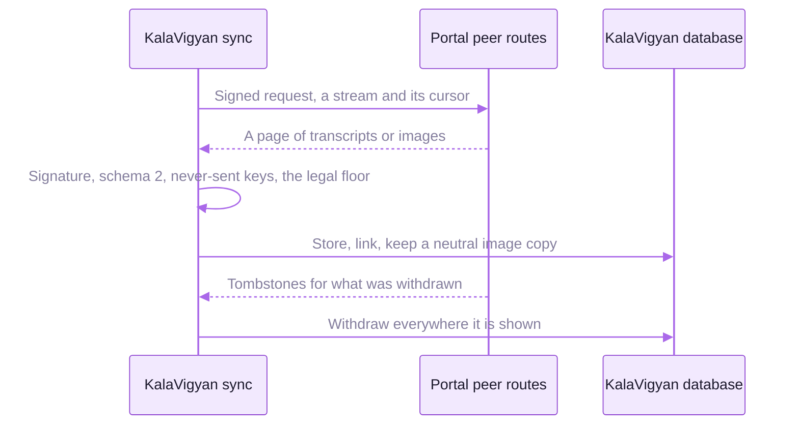

# Field voices, version 2

What both portals, the designer portal (DesignWorkshop, `designer-portal`, portal `DESIGNER`) and
the documentation portal (Field Repository, `documentation-portal`, portal `FIELD_REPOSITORY`),
serve so KalaVigyan holds their transcripts and their craft images, and how KalaVigyan reads,
stores, links, cites, shows and withdraws them. Engineers in all three repositories read it before
changing either side of the routes.

| For | Read |
|---|---|
| Version 2's design choices | [decision 0084](../decisions/0084-field-voices-v2.md), which amends [0072](../decisions/0072-field-voices-contract.md) (version 1) |
| The KalaVigyan side as built | [decision 0091](../decisions/0091-field-voices-kalavigyan-side.md) |
| Reviewed field photographs | [decision 0112](../decisions/0112-reviewed-field-photographs.md) |
| The portals' craft list, over the same peer mechanism | [portal-craft-feed.md](portal-craft-feed.md) |
| Artisans' own testimony, sharing the `artisan_voice` block | [roles-and-contributions.md](roles-and-contributions.md) |



## The owner's decisions

Owner decisions: O4 of 2026-11-17 (artisans are quoted by name); 2026-11-18 (consented quotes and
process photographs may be published, credited, never with contact or identity details; craft
pages are public); and the direction of 2026-11-18 that brings the transcripts and the images of
**both** portals into KalaVigyan: everything in those applications is already consented for
(recorded consent for all existing transcriptions, `docs/plans/answer-experience.md` section 4,
feature 9), and the portal side is to be built. Later on 2026-11-18 the owner loosened it: "Everything
is consented for already. There is no one over there that is under the age of 18 in terms of
artisans. ... I need all of the recordings from there. ... I need each and everything that is
present over there with me as well", and full transcripts are public on KalaVigyan. Every recording
with a transcript and every image now comes across, above the legal floor below (decision 0084,
amendment of 2026-11-18). The same night the owner added, for images filed on artisans: "Bring it,
but do not show, we will figure out something later, but do not close the path" (`artisanLinked`,
below).

Last reviewed: 2026-11-21 (reviewed field photographs, decision 0112).

Status: the KalaVigyan side of version 2 is built (decision 0091), behind `FIELD_VOICES_ENABLED`
(default off). The portal side is built in both portals, loosened as below, and not yet deployed;
until a portal ships and turns `CROSS_PORTAL_FIELD_VOICES_ENABLED` on, it answers 404 and its
streams are skipped.
No portal ever served version 1; its routes are withdrawn and never built. KalaVigyan's version 1
reader, its models and its recorded answers are gone. Where the build differs from the text below,
"As built in KalaVigyan" at the end of this contract says so.

## What changed from version 1

| Area | Version 1 | Version 2 |
|---|---|---|
| Portals | documentation portal only | both portals, identical routes and JSON; `portal` names the one that answered |
| Transcripts | single artisan turns as quotes; researchers, other speakers and full transcripts never sent | the **full transcript** of every listed recording, every speaker credited as recorded, timings, original language and English; KalaVigyan publishes artisan and designer segments as quotes and the full text as a public reading page (signed-in readers only until decision 0097) |
| Images | process photographs of the documentation portal | every image of both portals wherever it is filed, above the legal floor; images filed on artisans are marked `artisanLinked` and held hidden by KalaVigyan |
| Consent | a `PUBLICATION` grant required per item; an owner-attestation script; a per-artisan credit row (`ArtisanPublicationCredit`) | the owner's direction covers every record; an item is sent unless a refusal is recorded; `PUBLICATION` stays as the purpose that withdraws from KalaVigyan; no attestation script, no credit row |
| Credit | named or unnamed by the artisan's choice | the name the portal records (`Artisan.name`, the designer's profile or account name), scrubbed like text; null only when nothing but a placeholder is left |
| Personal data in text | the turn was withheld | phone numbers, email addresses and identity numbers are **scrubbed** (replaced) from all text and labels, the legal floor; village and place names are kept; the recording is still sent |
| Paging | per-craft index, per-craft pages, a digest per craft, withdrawal by absence | two global streams (transcripts, images) paged by an `updatedAt` cursor, with **tombstones** for deletions, withdrawals, replacements and merges; a stream digest for reconciliation |
| Under 18 | not sent | sent: the owner states that every artisan in both portals is an adult; no age rule remains and no date of birth is read |
| Never sent | documentation portal fields | both portals' fields, extended (designer contact details, Aadhaar verification, signatures, identity photographs, bank details, consent evidence images, credentials) |
| Chunk ACL | quotes `PUBLIC` | quotes `PUBLIC`; full transcript `SIGNED_IN` (a new ACL, read by every reader since decision 0097) |

Kept from version 1 and restated below: the signed peer mechanism and its headers, the gate
default off, the access log, the 600-calls-in-10-minutes limit, the echoed request, revisions,
district and state as the finest place in structured fields, the derived
metadata-free image copy under `field-voices/<sha256>.<ext>`, the 15-minute presigned URL, the
`FIELD_TESTIMONY` source kind, the 7-day staleness rule and the withdrawal cascade in KalaVigyan.

## What comes across

For each portal, two streams:

- **Transcripts:** one item per audio or video recording that holds a transcript, whatever it
  answers (identity and contact questions, whole sessions, consent and dictation clips included):
  who spoke (credited as the portal records them), what was asked (session, section and question,
  or the design workshop stage), where at district level, when, for which crafts, the original
  text with segment timings and languages, and the English the portal holds. Never the audio or
  video.
- **Images:** one item per image, wherever it is filed: what it shows in the portal's own words,
  which product, tool, process step, prototype, design stage field, artisan, session, workshop or
  designer it belongs to, whether it is artisan-linked, the crafts, the workshop and date, the
  credit, and a 15-minute link to a neutral, metadata-free copy. Never the original file.

## The legal floor (law, not policy)

The Aadhaar (Targeted Delivery of Financial and Other Subsidies, Benefits and Services) Act, 2016,
section 29(4), prohibits publishing, displaying or posting an Aadhaar number publicly; identity
documents, signatures, bank or payment details and account credentials are never craft content. These hold whatever any direction or setting
says, in both portals and in KalaVigyan:

1. **Scrubbed from all text**, never left in it: transcript text and its English, titles,
   captions, names and every label. Email addresses, written or spoken, become `[email]`; these
   become `[number]`: Aadhaar-like numbers (twelve digits grouped by spaces, hyphens or dots),
   phone-like runs of ten or more digits (bank account numbers of that length included), PAN-like
   (`ABCDE1234F`), voter ID-like (`ABC1234567`) and IFSC-like (`SBIN0001234`) codes, and the linked
   people's own phone and Pehchan card numbers. No pattern catches a number spoken in words, the
   Pehchan number of someone the item does not link to, or a nine-digit account number; the owner
   accepted that on 2026-11-18.
2. **Never sent as an image, wherever the portal can recognise it:** identity documents (Aadhaar,
   Pehchan, voter, PAN or other identity cards, passports, licences; any
   `extraMetadata.identityPhotograph` mark, the designer portal's `PENDING` mark included, which
   its card reader writes on the server the moment a photograph's card is read, before the
   designer keeps or deletes it), signatures (`signatureMediaId`,
   `workshopPlan.designerSignature`, `certificate.signatureImage`, signed certificates
   `certificate.certificateFile`, consent evidence images `Consent.evidenceMediaId`, which are
   signed or thumb-printed forms), bank or payment details (passbooks, cheques, bank statements,
   UPI or IFSC), fingerprints and thumb impressions, and documents that carry contact details that
   cannot be scrubbed from a picture (`cvMediaId`, `workshopPlan.designerCv`). An image is withheld
   when its own caption, the caption of any stage field it sits in, the caption it would be sent
   with or its original file name matches
   `aadha+r|pehchan|identity[\s_-]*(?:cards?|documents?|proofs?)|(?<![a-z])id[\s_-]*(?:cards?|proofs?)(?![a-z])|voter|(?<![a-z])pan[\s_-]*cards?(?![a-z])|passport|licen[cs]e|signature|consent|finger ?print|thumb ?(?:print|impression)|passbook|cheque|bank ?(?:account|details|statement)|\bifsc\b|\bupi\b`
   (case-insensitive). "Brand identity", "craft identity" and "a valid card" do not match
   (`identityImage` in the scrub vectors).
3. **An identity document no portal can recognise is held, never shown.** A card photographed
   with no mark and no caption or file name that names it looks like any other photograph:
   researchers have filed such cards on artisan profiles, the documentation portal has no identity
   mark at all, and a designer portal card read before the `PENDING` mark shipped carries none.
   Such a picture is filed on an artisan, a session or a participant field, so it is sent
   `artisanLinked` (below), under the owner's direction for those images: "Bring it, but do not
   show". KalaVigyan stores it privately and shows it in no public or signed-in payload, page,
   list or image route; section 29(4) forbids publishing, displaying or posting an Aadhaar number,
   and a held copy does none of these. Each held image is screened for identity documents and
   faces and is shown only after a person's decision on it (decision 0112): one the screen flags as
   an identity document is shown only by a Master Admin who clears the flag or crops it out, and an
   identity document found there is also withdrawn or removed in its portal (the queue names the
   portal and the file's id), which sends its tombstone.
4. **Never sent in any field:** Aadhaar numbers, last four digits, the Aadhaar verification and
   fingerprint fields and Aadhaar logs; Pehchan card numbers; phone numbers and email addresses;
   bank details; passwords, sessions, two-step codes and every other account credential.

Both streams carry tombstones, so a record deleted, withdrawn, replaced or merged in a portal
leaves KalaVigyan at its next sync.

## Why peer routes (kept)

| Existing route | Why it is not enough |
|---|---|
| `GET /api/data/transcripts/recordings.ndjson`, `turns.ndjson` | Needs a signed-in account, so KalaVigyan would hold a portal password, which is never done. Returns uploader names, file names and summaries, and withholds only on the outside-processing verdict. |
| `POST /api/cross-portal/peer/search`, `/search/record` | Search snippets for a signed-in person, gated by the identity switch, not a feed. |
| `GET /api/cross-portal/peer/crafts` | The craft list only. It is the pattern these routes follow (`docs/contracts/portal-craft-feed.md`). |

The portal decides what may leave and sends only that. Nothing that must never leave is sent and
then dropped by KalaVigyan. No route here, and nothing in KalaVigyan, uses, requests or stores any
person's sign-in credentials, sessions or two-step codes; the "sync account" line of
`docs/plans/answer-experience.md` section 8 is superseded.

## Consent and withdrawal (changed)

The owner's direction of 2026-11-18 is the consent for every record in both applications, and the
owner states that no artisan in either is under 18: an item needs no grant and no age is checked.
Recorded refusals still win, and a refusal anywhere on an item withholds the whole item (fail
closed). The portal's one consent store is the `Consent` ledger (`app/transcription/
ledger.py`, shared by both portals); the documentation portal also holds two older stores.

An item is **withheld** when any of these holds:

| Check | Where it is read |
|---|---|
| A transcript's outside-processing verdict is `REFUSED` | `ports.consent_gate.verdict_details` (the function the transcript export uses; `services/questionnaire_consent.py` in the designer portal, `services/consent_gate.py` in the documentation portal, wired by each portal's questionnaire ports) |
| The current `PUBLICATION` state of the item is `REFUSED` | subject `RECORDING`, keyed by the `MediaFile.id` (any media type, images included) |
| The current `PUBLICATION` or `CROSS_PORTAL_SHARING` state of any linked artisan is `REFUSED` | subject `ARTISAN`; linked means a subject of the recording, a mapped speaker, or a credited artisan of the image |
| The current `PUBLICATION` state of its workshop or design workshop is `REFUSED` | subject `WORKSHOP`, keyed by `Workshop.id` or `DesignWorkshop.id` |
| The current `PUBLICATION` state of a credited designer or mapped researcher is `REFUSED` | subject `USER`, keyed by `User.id` |
| Documentation portal only: a linked artisan's `ArtisanSharingConsent.granted` is false | `ArtisanSharingConsent` |

"Current state" is `ledger.current_states(db, subject_type, ids, purpose=...)`. An unreadable
consent store withholds everything in that refresh (the export's rule).

- **`PUBLICATION` joins `ConsentPurpose`** in both portals (`shared/enums.json`,
  `app/transcription/ledger.PURPOSES`, a migration `ALTER TYPE "ConsentPurpose" ADD VALUE
  'PUBLICATION'`). It is the purpose that withdraws from KalaVigyan only. A `GRANTED` row after a
  `REFUSED` one lists the item again.
- **Withdrawing** is a web control for admins (`ADMIN`, `MASTER_ADMIN`) in both portals, on an
  artisan, a media item (recording or image), a workshop or design workshop, and a designer or
  researcher account: "Shown on KalaVigyan" with "Withdraw" and, once withdrawn, "Show again". It
  writes a `PUBLICATION` row through `ledger` with the basis the admin picks (`VERBAL_RECORDED`,
  `VERBAL_WITNESSED`, `SIGNED_FORM`) and an optional note. Web only, like the other admin
  surfaces.
- **Deleting** a record in a portal (a media item removed, a session, workshop, design workshop or
  stage row deleted, an artisan deleted without a merge) also takes the item out.

## What is never sent (changed)

Never sent, by either portal, in any field, and refused by KalaVigyan as a whole page when any key
names it (`field_voices_never_sent`; a key is lower-cased and stripped to letters and digits):

- **Whole keys** (version 1's list plus the version 2 additions in bold): age, agegroup, ageyears,
  dob, gender, mobile, whatsapp, lat, lng, lon, long, gps, coordinates, geo, geolocation, altitude,
  accuracy, village, placename, place, locality, **city, venue, clustername, ifsc, upi, otp**.
- **Key parts** anywhere in a key: phone, email, aadhaar, pehchan, fingerprint, birth, address,
  pincode, postcode, latitude, longitude, **bank, password, signature, empanelment**. KalaVigyan's
  scan also treats mobile and whatsapp as key parts (so `mobileNumber` is refused too).
- **No exemption:** the scrub counts are sent as a list of `{"kind", "count"}` (below), so the kind
  names `EMAIL` and `NUMBER` are values, never keys. A count keyed by its kind would name `email`
  and is refused like any other never-sent key, by the portals' self-check and by KalaVigyan's scan
  alike. (Before the loosening the list also held `PLACE`; KalaVigyan still accepts it.)

What the portals never send as a field, whatever the key (the legal floor above, and the
structured personal fields that are not craft content):

- **Identity:** Aadhaar numbers, last four digits, fingerprints and every `aadhaarVerify*` column
  and Aadhaar log; Pehchan card numbers and availability; dates of birth, ages and gender as fields;
  empanelment numbers; artisan cards and their codes; the images of the legal floor.
- **Contact:** phone numbers and country codes, email addresses (`Artisan`, `User`,
  `DesignerProfile`, `DesignerRoster`), websites of people.
- **Structured place finer than district:** postal addresses, PIN codes, villages, localities,
  place names, venues, cities, cluster names as a place, `Workshop.place`, `Artisan.place`,
  `QuestionnaireInterview.place`, coordinates of any kind (device fix, subject pin, altitude,
  accuracy). Place is district and state only, and only when the portal's LGD register knows them.
  A village or place named inside transcript text, a title, a caption, a name or a label is sent as
  written.
- **Money and accounts:** bank details of any kind, prices and costs (no route carries them),
  passwords and every other credential.
- **Records around the content:** notes, review notes, dos and don'ts, remarks, summaries, insights,
  glossaries, AI layers, word timings and confidence, consent notes, the match basis of
  cross-portal links, file names, object keys (an image URL names only its neutral copy), the
  original audio, video and image files, market-survey respondents' structured answers, the names
  of uploaders, reviewers and the accounts that mapped speakers (a researcher who **speaks** in a
  recording is a speaker, credited as recorded, and nothing else about them is sent).

A schema version may gain fields the reader ignores, except those keys. Removing or renaming a
field or changing a meaning is the next version and needs a KalaVigyan change first.

## The routes (changed)

Both portals serve the same three peer routes, from one shared route module
`api/routes/cross_portal_field_voices.py` on `APIRouter(prefix="/cross-portal/peer")`:

```
GET /api/cross-portal/peer/field-voices
GET /api/cross-portal/peer/field-voices/transcripts?cursor=<opaque>&view=<all|gone>
GET /api/cross-portal/peer/field-voices/images?cursor=<opaque>&view=<all|gone>
```

### Who may call them (kept, with the version 2 settings)

- **Gate:** `cross_portal.field_voices_active(settings)`: the setting
  `CROSS_PORTAL_FIELD_VOICES_ENABLED` (`cross_portal_field_voices_enabled`, default `false`) and
  `CROSS_PORTAL_TOKEN` of at least `MIN_SECRET_LENGTH` (32) characters. It does not need
  `CROSS_PORTAL_IDENTITY_ENABLED` or `AADHAAR_FINGERPRINT_KEY`. The images route also needs
  `FIELD_VOICES_RIGHTS_HOLDER` (`field_voices_rights_holder`, no default, at most 200
  characters). Gate off: 404 `{"detail": "Not Found"}`, as the other peer routes answer.
- **Pinned from Actions variables:** each portal's `deploy-backend.yml` gains a step "Pin the field
  voices settings", a copy of "Pin the craft feed switch", that writes
  `CROSS_PORTAL_FIELD_VOICES_ENABLED` (true or false; unset changes nothing; anything else fails the
  deploy) and `FIELD_VOICES_RIGHTS_HOLDER` (unset changes nothing) from the Actions variables of the
  same names into the release's `.env`.
- **Request:** `Authorization: Bearer <CROSS_PORTAL_TOKEN>`, `X-Cross-Portal-Nonce` (16-128
  characters), `X-Cross-Portal-Requested-By: kalavigyan-field-voices`. A new
  `cross_portal_peer.require_field_voices_peer` calls `_admit` with `field_voices_active`; a wrong
  bearer or nonce is 401 `{"detail": "Not authorised."}`.
- **Answer:** `cross_portal_peer.signed(settings, request, payload)`: `X-Cross-Portal-Signature` is
  HMAC-SHA256 with the token over `"GET\n" + peer_path + "\n" + nonce + "\n" + body`
  (`cross_portal.sign`). The signed path has no query string, so every page **echoes** its
  `stream`, `view` and `cursor`, and KalaVigyan refuses a page that names others. Every answer has
  `Cache-Control: no-store`.
- **Errors (signed):** a cursor the portal did not issue, one issued for the other stream or
  view, or longer than 512 characters: 400 `{"detail": "Unknown cursor."}`; a `view` other than
  `all` or `gone`: 400 `{"detail": "Unknown view."}`; more than 600 calls in 10 minutes from one
  requested-by value (an in-process window; each portal runs one API process): 429 `{"detail":
  "Too many requests."}` with `Retry-After` in seconds; the ledger lock not taken within 10 seconds
  (below): 503 `{"detail": "Busy, try again."}` with `Retry-After: 30`.
- **Access log:** one `CrossPortalAccessLog` row per call: `action` `FIELD_VOICES_STATE`,
  `FIELD_VOICES_TRANSCRIPTS` or `FIELD_VOICES_IMAGES`; `outcome` `OK`, `BAD_CURSOR`, `BAD_VIEW`,
  `RATE_LIMITED` or `BUSY`; `remoteUserId` the requested-by value; `entityType` `STREAM` and
  `entityId` `transcripts` or `images` on the stream routes; `resultCount` the changes sent.
  `action` is a plain string in both schemas, so no migration.

### State (new)

```json
{
  "schemaVersion": 2,
  "portal": "FIELD_REPOSITORY",
  "generatedAt": "2026-11-18T02:00:00Z",
  "refreshedAt": "2026-11-18T01:45:12Z",
  "streams": {
    "transcripts": {"enabled": true, "live": 412, "gone": 9, "digest": "1dafe00e…52ed4",
                    "latestCursor": "eyJ…"},
    "images": {"enabled": true, "live": 2310, "gone": 41, "digest": "9c0a…77b1",
               "latestCursor": "eyJ…"}
  }
}
```

| Field | Rule |
|---|---|
| `refreshedAt` | when the last complete refresh (below) finished, or null before the first |
| `enabled` | images: false when `FIELD_VOICES_RIGHTS_HOLDER` is unset (its route then answers 404) |
| `live`, `gone` | ledger rows of the stream in each state |
| `digest` | lower-case hex SHA-256 of the UTF-8 text made of one line `"<id> <revision>\n"` per live item, sorted by code point and joined with nothing between (version 1's digest, per stream) |
| `latestCursor` | the cursor after the stream's newest change, or null when the stream is empty |

Before answering, the state route runs the **gone pass** (below) under the ledger lock, so a
deletion or withdrawal made since the last refresh is a tombstone before KalaVigyan reads.

### Pages, cursors and tombstones (new)

```json
{
  "schemaVersion": 2, "portal": "FIELD_REPOSITORY", "generatedAt": "2026-11-18T02:00:01Z",
  "stream": "transcripts", "view": "all", "cursor": null, "nextCursor": "eyJ…", "hasMore": true,
  "changes": [
    {"state": "LIVE", "id": "cm1…", "revision": "91bdd4e889f5d9736c6c2fbd944dfd73",
     "updatedAt": "2026-11-17T12:00:00.000001Z", "…": "the item, below"},
    {"state": "GONE", "id": "cm2…", "updatedAt": "2026-11-17T12:00:00.000002Z",
     "reason": "REPLACED", "successorId": "cm3…"}
  ]
}
```

| Field | Rule |
|---|---|
| `changes` | ledger rows of the stream after `cursor`, ordered by `updatedAt` then `id` by code point (`COLLATE "C"`); view `all` gives live and gone rows, view `gone` gives only rows that are gone now |
| page size | transcripts: at most 20 changes and at most 8 MiB of body (always at least one change when any is left); images: at most 100 changes |
| `cursor` | the cursor asked for, echoed; absent means the start of the stream |
| `nextCursor` | the cursor after the last change on the page; the echoed cursor when the page is empty (null when the empty page was asked for without a cursor) |
| `hasMore` | whether changes exist after `nextCursor` at the time of the answer |
| cursor format | opaque to KalaVigyan: base64url of `{"s": stream, "v": view, "u": updatedAt with microseconds, "i": id}` followed by `.` and the first 32 hex characters of HMAC-SHA256 with the token over `"field-voices-cursor\n" + that base64url` |
| `updatedAt` | the ledger stamp (below), strictly increasing in the stream's order |
| `revision` | the first 32 hex characters of SHA-256 over the item as sent, without `state`, `revision`, `updatedAt`, `image.url` and `image.expiresAt`, serialised as `json.dumps(item, sort_keys=True, separators=(",", ":"), ensure_ascii=False)` in UTF-8; KalaVigyan recomputes it and refuses a page where it differs |
| `reason` | `DELETED` (the record or the media is gone, removed, rejected, or its session, workshop, design workshop or stage row deleted, or a linked artisan deleted without a merge), `WITHDRAWN` (a refusal above), `REPLACED` (a take replaced by another: the old `QuestionnaireRecording` soft-removed with the reason "replaced by …"), `MERGED` (an image whose content is the same as another listed image), `UNLISTED` (no longer meets a listing rule: lost its transcript, every craft or every placement, or became a legal-floor image) |
| `successorId` | for `REPLACED` and `MERGED`: the item that takes its place, else null |

### The ledger behind the pages (new, portal side)

Answers are read from a ledger, so paging is stable and a deletion leaves a tombstone. The same
two models in both schemas (also in `shared/field-voices.prisma`, compared by the parity test):

```prisma
model FieldVoiceItem {
  stream        String
  itemId        String
  state         String
  revision      String?
  reason        String?
  successorId   String?
  payload       Json?
  copyKey       String?
  copyOf        String?
  updatedAt     DateTime
  firstListedAt DateTime @default(now())

  @@id([stream, itemId])
  @@index([stream, updatedAt, itemId])
  @@index([stream, state, updatedAt, itemId])
}

model FieldVoiceRefresh {
  id         Int       @id @default(1)
  startedAt  DateTime?
  finishedAt DateTime?
  counts     Json      @default("{}")
}
```

- **One writer at a time.** Every ledger write is one short transaction holding
  `pg_advisory_xact_lock(hashtext('field-voices'))` (at most 50 items per transaction). Inside it
  the writer reads `max("updatedAt")` of the stream and stamps each changed row in turn
  `greatest(clock_timestamp(), the previous stamp + 1 microsecond)`, so stamps only grow and a
  reader never skips a row committed after its cursor.
- **The refresh** runs in each portal's worker (`app/worker.py`, the box service `python -m
  app.worker`) every 15 minutes while the gate is on: list the candidates of both streams, build
  each item, compare its revision with the ledger, write the changed ones (`LIVE`, payload without
  the image URL), and turn every live row that is no longer a candidate into `GONE` with its
  reason, `payload` and `revision` set to null. It makes at most 200 image copies per run, one at a
  time; an image without its copy is not listed yet. `FieldVoiceRefresh` records the run and its
  counts (listed, changed, gone, copies made, images that could not be decoded, items withheld by
  reason).
- **The gone pass** (state route and the end of every refresh) checks only the live rows'
  deletions and refusals, builds no payload, and writes tombstones. It takes the lock with a
  10-second `lock_timeout`; on a timeout the state route answers 503.
- **Copies** are content-addressed: when the last live row naming a `copyKey` goes, the copy object
  is deleted. `copyOf` records `"<objectKey> <contentSha256 or sizeBytes>"` of the original the copy
  was made from, so an unchanged original is never copied twice.
- A `GONE` row keeps only `stream`, `itemId`, `state`, `reason`, `successorId` and `updatedAt`;
  nothing of the deleted content stays in the ledger.
- `app/scripts/refresh_field_voices.py` runs one refresh by hand (`--dry-run` prints the counts
  without writing) for the first fill after deploy.

## Common objects

### Craft

```json
{"id": "cm…", "slug": "Kutch-Ajrakh", "code": "ajrakh", "name": "Ajrakh Print of Kutch"}
```

The portal's `Craft` row, followed through `mergedIntoId` to the end of the chain; the same ids
and slugs the craft feed sends. An item's crafts are the first non-empty set of:

1. the media's own craft (`MediaFile.craftId`);
2. its records' crafts: the product's `craftId`, the tool's `craftId` and `ToolCraft` rows, a
   process's or step's product's craft, the design workshop's `craftId`, a stage row's product or
   tool reference's craft;
3. the session's or workshop's craft when it has exactly one (`WorkshopCraft`, or the design
   workshop's `craftId`);
4. the crafts of the linked artisans (`Artisan.craftId`).

An item with no craft is not listed.

### Area

```json
{"state": "Gujarat", "district": "Kachchh", "stateLgd": 24, "districtLgd": 449}
```

`lgd.lgd_for_unit(state, district)` (shared `services/lgd.py`) over the stated columns only:
`Location.state` and `Location.district` (artisan, workshop, session), `DesignWorkshop.state` and
`district`. `state` and `district` are the register's canonical names; a district the register
does not know is sent as null with a null `districtLgd`; never a village, address, PIN code,
place name or coordinate.

### Workshop

```json
{"kind": "DESIGN_WORKSHOP", "id": "cm…", "code": "DW-RJ-0012",
 "title": "Hand block printing design workshop", "startsOn": "2026-06-18", "endsOn": "2026-06-30",
 "area": {"state": "Rajasthan", "district": "Jaipur", "stateLgd": 8, "districtLgd": 102}}
```

The item's design workshop (`DesignWorkshop`, `kind` `DESIGN_WORKSHOP`, `code` its
`workshopCode`) when it belongs to one, else its workshop (`Workshop`, `kind` `WORKSHOP`, `code`
null), reached through the media, its session, or its product, tool or process; null when none.
`title` passes the free-text screen or is null. `startsOn` and `endsOn` are `startDate` (or
`Workshop.date`) and `endDate` as dates in India time. A deleted design workshop is never named.

### People

```json
{"id": "cm…", "kind": "ARTISAN", "name": "Ismail Mohammad Khatri", "localName": "ઇસ્માઇલ મોહમ્મદ ખત્રી",
 "craft": {"id": "cm…", "slug": "Kutch-Ajrakh", "code": "ajrakh", "name": "Ajrakh Print of Kutch"},
 "yearsInCraft": 31, "area": {"state": "Gujarat", "district": "Kachchh", "stateLgd": 24, "districtLgd": 449},
 "samePersonIn": [{"portal": "DESIGNER", "id": "cm…"}], "mergedIds": ["cm…"]}
```

| Field | Rule |
|---|---|
| `id` | `Artisan.id` for an artisan, `User.id` for a designer or researcher; an artisan id is first followed through completed merges to the survivor (designer portal: `ArtisanMerge` with `undoneAt` null; documentation portal: `status` `DONE`) |
| `kind` | `ARTISAN`; `DESIGNER` for a designer portal account whose role is `DESIGNER` or who designs the item's design workshop (its creator or a `DesignWorkshopViewer`); `RESEARCHER` for any other account |
| `name` | artisan: `Artisan.name`; designer: `DesignerProfile.displayName`, else `User.name`; researcher: `User.name`. Scrubbed like text (a phone number in it becomes `[number]`); null when empty or when nothing but placeholders is left |
| `localName` | artisan: `Artisan.localName`; designer: `DesignerProfile.localName`; else null; scrubbed like `name` |
| `craft` | artisans only: the artisan's own craft (`Artisan.craftId`, followed through `mergedIntoId`) as a craft object, or null; null for designers and researchers. KalaVigyan reads it as an unknown key and ignores it for now |
| `yearsInCraft` | artisans only: `records.derive_experience_years` on the item's date (from `craftStartDate`, else `experienceYears`), 0-90, or null |
| `area` | artisans only, from their `Location` |
| `samePersonIn` | artisans only: the other portal's ids from `CrossPortalArtisanLink.remoteArtisanId` (never `matchedBy` or a card code) |
| `mergedIds` | artisans only: the ids of completed merges into this artisan, so KalaVigyan can re-key |

No age rule applies: the owner states that every artisan in both portals is an adult, and the
portals no longer read `Artisan.dateOfBirth`. A linked artisan id that resolves to no artisan and
no merge makes the item `DELETED`.

## Transcripts (new)

### Which recordings

A `MediaFile` of type `AUDIO` or `VIDEO` with `removedAt` null and `status` not `DRAFT` or
`REJECTED`, whose session (if any) has `deletedAt` null (a merged session is followed to its
survivor), whose `QuestionnaireRecording` (if any) has `removedAt` null, whose design workshop (if
any) has `deletedAt` null, that has a transcript (below), at least one craft, and passes the
consent checks. Nothing else keeps a recording out: takes that answer identity or contact
questions (the respondent section, age, gender, phone, village and the like), whole-section and
whole-session takes and session recordings with no take record, consent clips (media named by
`Consent.evidenceMediaId`), dictation clips (`linkedRecordType` `dictation`), and on the designer
portal market-survey voice notes, the closing event video, designer-defined (`_custom`) fields and
media inside rich text are all listed, their numbers and email addresses scrubbed. Spoken numbers
in words cannot be caught by any pattern; the owner accepted that on 2026-11-18.

Designer portal stage media with a typed transcript field (used only when the media has no
transcript of its own):

| Stage · entity | Media field | Typed transcript field |
|---|---|---|
| `TRADITIONAL_PROCESS_BASELINE` · `traditionalProcess` | `artisanAudio` | `artisanAudioTranscript` |
| `TRADITIONAL_PROCESS_BASELINE` · `processStep` | `stepAudio` | `stepAudioTranscript` |
| `MARKET_SURVEY_CAPTURE` · `surveyResponse` | `voiceNote` | `voiceTranscript` |
| `PROTOTYPE_DEVELOPMENT` · `prototype` | `audioNarration` | `audioTranscript` |
| `SKETCH_REVIEW` · `sketchReview` | `voiceFeedback` | `voiceFeedbackTranscript` |
| `WORKSHOP_OUTCOMES` · `outcomes` | `feedbackAudio` | `feedbackTranscript` |

The stage row must have `deletedAt` null. Questionnaire session recordings and media linked to a
product, tool, process, step, craft, workshop or artisan are listed in both portals by the same
rules.

**The transcript**, in order of preference:

1. `TURNS`: the current `TranscriptVersion` (`supersededAt` null) with at least one
   `TranscriptTurn`;
2. `TEXT`: else a non-empty `MediaFile.transcriptText`, split into turns by
   `transcription.transcript.preview.turns_from_markdown` (the export's reading);
3. `TYPED`: else, for designer portal stage media only, the paired typed transcript field of its
   stage row, flattened from rich text to plain paragraphs.

### Transcript item

```json
{
  "state": "LIVE", "id": "cm1…", "revision": "91bdd4e889f5d9736c6c2fbd944dfd73",
  "updatedAt": "2026-11-17T12:00:00.000001Z",
  "recordingId": "cmr…", "mediaType": "AUDIO",
  "recordedAt": "2026-03-14T10:22:00+05:30", "durationMs": 1832000,
  "crafts": [{"id": "cm…", "slug": "Kutch-Ajrakh", "code": "ajrakh", "name": "Ajrakh Print of Kutch"}],
  "workshop": {"kind": "WORKSHOP", "id": "cmw…", "code": null, "title": "Ajrakh documentation visit",
               "startsOn": "2026-03-12", "endsOn": "2026-03-16",
               "area": {"state": "Gujarat", "district": "Kachchh", "stateLgd": 24, "districtLgd": 449}},
  "session": {"id": "cms…", "title": "Interview_2026-03-14_Dhamadka-Kachchh_Ajrakh", "date": "2026-03-14", "purpose": "FIRST_SITTING",
              "questionnaire": {"id": "cmq…", "title": "Craft documentation questionnaire"}},
  "topics": [{"sectionId": "cmx…", "sectionCode": "C", "sectionTitle": "Process",
              "questionId": "cmy…", "questionCode": "C-Q03",
              "question": "How do you prepare the mordant paste?"}],
  "stage": null,
  "record": {"kind": "PRODUCT", "id": "cmp…", "name": "Ajrakh stole", "localName": null},
  "area": {"state": "Gujarat", "district": "Kachchh", "stateLgd": 24, "districtLgd": 449},
  "people": [{"id": "cma…", "kind": "ARTISAN", "name": "…", "localName": "…", "craft": {"id": "cm…", "slug": "Kutch-Ajrakh", "code": "ajrakh", "name": "Ajrakh Print of Kutch"}, "yearsInCraft": 31,
              "area": {"state": "Gujarat", "district": "Kachchh", "stateLgd": 24, "districtLgd": 449},
              "samePersonIn": [], "mergedIds": []},
             {"id": "cmu…", "kind": "RESEARCHER", "name": "…", "localName": null, "craft": null, "yearsInCraft": null,
              "area": null, "samePersonIn": [], "mergedIds": []}],
  "speakers": [{"key": "speaker_0", "label": "…", "role": "ARTISAN", "personId": "cma…"},
               {"key": "speaker_1", "label": "…", "role": "RESEARCHER", "personId": "cmu…"},
               {"key": "speaker_2", "label": "Speaker 3", "role": null, "personId": null}],
  "transcript": {
    "source": "TURNS", "version": 2, "languages": ["gu", "hi"], "detectedLanguage": "gu",
    "segments": [
      {"id": "cmt1…", "position": 0, "speakerKey": "speaker_1", "startMs": 0, "endMs": 6100,
       "language": "hi", "text": "…", "textSource": "EDITED",
       "english": "How do you prepare the mordant?", "englishSource": "EDITED", "scrubbed": []},
      {"id": "cmt2…", "position": 1, "speakerKey": "speaker_0", "startMs": 6400, "endMs": 33000,
       "language": "gu", "text": "… [number] …", "textSource": "MACHINE",
       "english": "We grind the alum with tamarind seed, and the paste must rest overnight. Call me on [number].",
       "englishSource": "MACHINE", "scrubbed": ["NUMBER"]}
    ],
    "english": null
  },
  "scrubbing": {"version": 2,
                "replaced": [{"kind": "EMAIL", "count": 0}, {"kind": "NUMBER", "count": 2}],
                "nulled": []}
}
```

| Field | Rule |
|---|---|
| `id`, `mediaType` | `MediaFile.id` and its `mediaType` (`AUDIO` or `VIDEO`) |
| `recordingId` | `QuestionnaireRecording.id` for the media, or null |
| `recordedAt` | `QuestionnaireRecording.capturedAt`, else `MediaFile.recordedAt`, with the offset of `recordedTimezone` |
| `durationMs` | `TranscriptVersion.durationMs`, else `QuestionnaireRecording.durationMs`, else null; no segment ends after it |
| `session` | the `QuestionnaireInterview` (followed through `mergedIntoId`): `title` screened or null, `date` its `sessionDate` (else `interviewDate`) as a date, `purpose`, and its questionnaire's `id` and `title`; null when none |
| `topics` | one per `QuestionnaireRecordingTarget`: the section's `id`, `code` and `title`, and the asked question's `id`, `displayCode` (else `questionCode`) and `prompt`; a `question` or `sectionTitle` the screen matches is null; empty when none |
| `stage` | designer portal stage media: `{"key", "title", "entity", "entityLabel", "rowId", "rowLabel", "field", "fieldLabel"}` from the stage registry (`StageSpec.key` and title, `EntitySpec.key` and `title`, the `DwStageEntry.id`, its `label_field` value screened or null, the field key and label); null otherwise |
| `record` | the product, tool, process or step the media is linked to: `{"kind": "PRODUCT" or "TOOL" or "PROCESS" or "PROCESS_STEP", "id", "name", "localName"}` (`productName`, `toolkitName`, `Process.name`, `ProcessStep.name`), screened; or null |
| `area` | the session's location, else the workshop's area, else null |
| `people` | every person a speaker maps to, every subject of the recording (`QuestionnaireRecordingSubject`), and nobody else |
| `speakers` | one per speaker key of the transcript: `TURNS` from `TranscriptSpeaker` (`label` its `name` as recorded, `role` its `role` (`ARTISAN`, `RESEARCHER`, `OTHER`), `personId` its `personId` resolved through merges); an unmapped key is `"Speaker <n>"` in order of first appearance with null role and person; `TEXT` keys `L1`, `L2`, … per distinct label with null role and person; `TYPED` has no speakers. A `label` the screen matches is replaced by `"Speaker <n>"` |
| `transcript.version` | the `TranscriptVersion.version` for `TURNS`, else null |
| `languages`, `detectedLanguage` | from the version (BCP 47 tags or `und`); `TEXT` from `MediaFile.transcriptLanguage`; `TYPED` `["und"]` |
| segment `id` | `TranscriptTurn.id`; `TEXT` and `TYPED`: `"<media id>.<position>"` |
| `speakerKey` | the turn's `speakerKey`, or null |
| `startMs`, `endMs` | the turn's times when `endMs` is after `startMs`, else both null (untimed); `TEXT` and `TYPED` are untimed |
| `text`, `textSource` | `editedText` (`EDITED`), else `machineText` (`MACHINE`); `TEXT`: `EDITED` when `transcriptEditedAt` is set, else `MACHINE`; `TYPED`: `TYPED`. Scrubbed, at most 20,000 characters (a longer turn is cut at sentence ends into segments `"<turn id>.<n>"` from 1, timed from the turn's words) |
| `english`, `englishSource` | `editedEnglish` (`EDITED`); else the text when `translationStatus` is `ALREADY_ENGLISH` (`ORIGINAL`); else `machineEnglish` when `TRANSLATED` (`MACHINE`); else both null. Scrubbed |
| `transcript.english` | `TEXT` only: the current `TranscriptInsight` (`supersededAt` null) English `translationText` when its `translationStatus` is `COMPLETED` (`source` `EDITED` when `editedAt` is set, else `MACHINE`), scrubbed; else null |
| `scrubbed` | the kinds replaced in that segment (`EMAIL`, `NUMBER`) |
| `scrubbing` | `version` of the scrub rules (2 since the loosening); `replaced`, the counts replaced across the item's text and labels as a list of `{"kind", "count"}` with each of `EMAIL` and `NUMBER` once, in that order; and `nulled`, the dotted paths of every label left with nothing but placeholders and so sent as null |

### Scrubbing (new)

Transcript text (`text`, `english`, `transcript.english`) and every label (below) are scrubbed,
never withheld. Only the legal floor is scrubbed:

1. **Patterns**, copied verbatim from KalaVigyan's field voices screen,
   `services/field_voices_screen.FIELD_PERSONAL_DATA`, in its order: email address and spoken
   email address become `[email]`; Aadhaar-like numbers (twelve digits grouped by spaces, hyphens
   or dots), phone-like numbers (ten or more digits), PAN-like, voter ID-like and IFSC-like codes
   become `[number]` (the same replacement function, which keeps a trailing space or hyphen). The
   email, spoken email and phone-like patterns are `research/evidence.PERSONAL_DATA`'s own; the
   dotted Aadhaar form and the three codes are kept out of that shared list, which also screens
   research URLs and identifiers (a Europe PMC id such as `PMC1234567` has the voter ID shape).
2. **Held-back numbers and email addresses of the item's linked people**: their phone numbers
   (digits, with and without the country code, with spaces, dots or hyphens between digits) and
   Pehchan card numbers become `[number]`, their email addresses `[email]`. The linked people are
   every artisan the item is linked to (the take's subjects, the mapped speakers, the session's
   participants (`QuestionnaireInterviewArtisan`), the media's own artisan, stage row artisans and
   the artisans of a stage row's products, and the artisans of every product, tool (its
   `artisanId` and `ToolArtisan` rows), process or step the media is filed on, by `productId`,
   `toolId` or `linkedRecordType`) and the design workshop's designers and the mapped researchers.
   Of these, only the take's subjects and mapped speakers are credited in `people`.

Village and place names are not held back (owner direction, 2026-11-18): they stay in the text.
Spelled-out numbers ("nine eight two …") cannot be caught; the owner accepted that, so takes that
answer identity or contact questions are listed. Test vectors live in
`shared/field-voices-scrub-vectors.json` (both portals, version 2) and the same file in
KalaVigyan's `backend/tests/field_voices/recorded/`.

## Images (changed)

### Which images

Every `MediaFile` of type `IMAGE` with `removedAt` null and `status` not `DRAFT` or `REJECTED`,
wherever it is filed, that has at least one placement, at least one craft, passes the consent
checks and is not a legal-floor image (the legal floor above: an identity photograph mark of any
decision, consent evidence, a designer's signature or CV, one of the designer portal's never
fields, or a media caption, stage field caption, sent caption or original file name matching the
legal floor's pattern; one such use withholds the image wherever else it is used).

**Placements, both portals**, in this order:

1. **Records:** a product (`productId`, or `linkedRecordType` `product` with `linkedRecordId`, or a
   product's `measurementImageId`), a tool (`toolId`, or `tool`), a process (`process`), a process
   step (`processstep`).
2. **Designer portal stage fields:** every media, rich-text and designer-defined (`_custom`) value
   of a `DwStageEntry` (row `deletedAt` null, design workshop `deletedAt` null): event, opening,
   cover, participant, mood board, market, closing, follow-up and logo images as much as craft,
   process, product, sketch and prototype images. Only the never fields
   `workshopPlan.designerSignature`, `workshopPlan.designerCv`, `certificate.signatureImage` and
   `certificate.certificateFile` are not placements. A designer-defined field is named by its
   stage, the entity label "Designer-defined fields" and the field label "Designer-defined field".
3. **A designer's profile photograph** (`DesignerProfile.photoMediaId`): `DESIGNER`.
4. **Where the image is filed, when it has none of the above:** its artisan (`artisanId`, or
   `linkedRecordType` `artisan`): `ARTISAN`; its session (`questionnaireInterviewId`, followed
   through merges, not deleted): `SESSION`; its workshop (`workshopId`, or `linkedRecordType`
   `workshop`): `WORKSHOP`; and when none of these, the design workshop it reaches:
   `DESIGN_WORKSHOP`.
5. **Only a craft** (`craftId` or `linkedRecordType` `craft` and no other link): `CRAFT`.

**Artisan-linked:** an image whose `MediaFile.artisanId` is set or whose `linkedRecordType` is
`artisan`, an image filed on a questionnaire session (`questionnaireInterviewId` set, or
`linkedRecordType` `questionnaire`, `questionnaireinterview` or `questionnaire_session`: a
session's pictures are its participants'), whatever else it links to, or one that sits in a
designer portal `participant` field, is sent with `"artisanLinked": true`. These are where an
identity card the portals cannot recognise would be filed (legal floor, item 3). Every other image
is sent with `"artisanLinked": false`. KalaVigyan stores an artisan-linked image like any other and
keeps it hidden (below).

Two listed images with the same verified content (`contentSha256` with `shaVerifiedAt` set) are one
item: the earliest created is listed with every placement, the others are `GONE` `MERGED` with it
as `successorId`.

### Image item

```json
{
  "state": "LIVE", "id": "cmi…", "revision": "7b44d54b1fb4b16a9fd145c5fc893613",
  "updatedAt": "2026-11-17T12:00:01.000003Z",
  "takenAt": "2026-06-24T11:40:00+05:30",
  "caption": "Second prototype after the colour trial",
  "artisanLinked": false,
  "crafts": [{"id": "cm…", "slug": "Bagru-Hand-Block-Print", "code": null, "name": "Bagru Hand Block Print"}],
  "belongsTo": [
    {"kind": "DESIGN_STAGE", "stage": {"key": "PROTOTYPE_DEVELOPMENT", "title": "Prototype Development"},
     "entity": {"key": "prototype", "label": "Prototypes"}, "row": {"id": "cme…", "label": "Indigo dabu table runner"},
     "field": {"key": "prototypePhotos", "label": "Prototype photographs"}, "prototypeId": "cme…"},
    {"kind": "PRODUCT", "id": "cmp…", "name": "Dabu table runner", "localName": null, "productType": "FINISHED_GOOD"}
  ],
  "workshop": {"kind": "DESIGN_WORKSHOP", "id": "cmd…", "code": "DW-RJ-0012", "title": null,
               "startsOn": "2026-06-18", "endsOn": "2026-06-30",
               "area": {"state": "Rajasthan", "district": "Jaipur", "stateLgd": 8, "districtLgd": 102}},
  "people": [{"id": "cma…", "kind": "ARTISAN", "name": "…", "localName": null, "craft": {"id": "cm…", "slug": "Bagru-Hand-Block-Print", "code": null, "name": "Bagru Hand Block Print"}, "yearsInCraft": 22,
              "area": {"state": "Rajasthan", "district": "Jaipur", "stateLgd": 8, "districtLgd": 102},
              "samePersonIn": [], "mergedIds": []},
             {"id": "cmu…", "kind": "DESIGNER", "name": "…", "localName": null, "craft": null, "yearsInCraft": null,
              "area": null, "samePersonIn": [], "mergedIds": []}],
  "credits": [{"personId": "cma…", "as": "ARTISAN"}, {"personId": "cmu…", "as": "DESIGNER"}],
  "permission": {"statement": "Shown on KalaVigyan with the consent of the people pictured. Not openly licensed: ask the rights holder before any other use.",
                 "rightsHolder": "…", "licence": null},
  "image": {"url": "https://designrepo-media-626159998512.s3.dualstack.ap-south-1.amazonaws.com/field-voices/ac43…ad91.jpg?response-content-disposition=inline…&X-Amz-Expires=900&…",
            "expiresAt": "2026-11-18T02:15:03Z", "mimeType": "image/jpeg",
            "width": 2400, "height": 1600, "bytes": 812345, "sha256": "ac43…ad91"},
  "scrubbing": {"version": 2,
                "replaced": [{"kind": "EMAIL", "count": 0}, {"kind": "NUMBER", "count": 0}],
                "nulled": []}
}
```

| Field | Rule |
|---|---|
| `id` | `MediaFile.id` |
| `takenAt` | `MediaFile.recordedAt` with its offset, or null |
| `caption` | `MediaFile.caption`, else the placement's caption field (`<field>Caption`) when exactly one placement has one; scrubbed like a label; or null. An image whose caption, any stage caption or the caption it would be sent with matches the legal floor's pattern is not listed, so KalaVigyan's caption check never refuses a page a portal built |
| `artisanLinked` | `true` for an image filed on an artisan, on a questionnaire session or in a participant field (above), else `false` |
| `belongsTo` | every listed placement: `PRODUCT` (`id`, `name` `productName`, `localName`, `productType`), `TOOL` (`id`, `name` `toolkitName`, `localName`, `englishName`), `PROCESS` (`id`, `name`, `productId`), `PROCESS_STEP` (`id`, `processId`, `process` the process name, `name`, `order` `sortOrder`), `CRAFT` (no more fields), `DESIGN_STAGE` (the stage's key and title, the entity's key and `title`, the row's `DwStageEntry.id` and its `label_field` value, the field's key and label, and `prototypeId`: the row's id for a `prototype` row, else its `prototypeRef`, else for a `finalProduct` its `prototypeRef`, else null), `ARTISAN` (`id` the survivor, `name`, `localName`), `DESIGNER` (`id` the `User.id`, `name`), `SESSION` (`id`, `name` the session title), `WORKSHOP` and `DESIGN_WORKSHOP` (`id`, `name` the title). Every name and label is scrubbed like text |
| `workshop` | as above |
| `people`, `credits` | artisans: the product's `artisanId`, the tool's `artisanId` and `ToolArtisan` rows, a process's product's artisan, the media's `artisanId`, a stage row's `artisanRef` (through `participant.artisanRef` for `DwParticipant`), an `ARTISAN` placement's artisan, a `SESSION` placement's participants; designers: the design workshop's designers for `DESIGN_STAGE` placements in stages `DESIGN_BRIEF` to `COSTING_MARKET_LINKAGE` and for `workshopPlan.designerPhoto`, and a `DESIGNER` placement's designer. Uploaders are never credited |
| `permission` | `statement` the fixed sentence above (the shared contract module holds it), `rightsHolder` the portal's `FIELD_VOICES_RIGHTS_HOLDER`, `licence` null (not openly licensed) |
| `image` | the neutral copy, below; `url` and `expiresAt` are made per answer and are not in the revision |

### The neutral copy (kept)

A derived copy, never the original object: orientation applied, long edge at most 2,400 px,
re-encoded as JPEG (PNG when the source has transparency) with **no EXIF, XMP, IPTC, ICC-embedded
text or GPS data**, at most 8 MiB, `width`, `height`, `bytes` and `sha256` of the copy. The
original is read with `s3.get_object_bytes(objectKey, max_bytes=50 MiB)`; a source Pillow cannot
open, or over 60 megapixels, is not listed (and counted in the refresh). Stored once in the
portal's own media bucket under the opaque key `field-voices/<sha256>.<ext>` with
`s3.put_object_bytes`: no user id, uuid, file name, place, craft or name. This is the one deliberate
exception to the naming convention (whose `media/<userId>/<uuid>/<FileName>` keys carry the
uploader, the place and the subject); each portal's naming documentation records it.

`url` is `s3.presign_get_url_aged(key, filename="<sha256>.<ext>", mime_type=…, expires_in=900,
disposition="inline")`. Its path is exactly `/field-voices/<sha256>.<ext>` and any file name in its
query is that same leaf. Its host is the bucket's own (virtual-hosted, dual-stack, what
`s3._client()` signs for when `AWS_S3_ENDPOINT` is unset): in production
`designrepo-media-626159998512.s3.dualstack.ap-south-1.amazonaws.com` and
`fieldrepo-media-626159998512.s3.dualstack.ap-south-1.amazonaws.com`. `expiresAt` is now plus the
window `presign_get_url_aged` returns plus 450 seconds (its cache reuses a URL for the first half
of its 900 seconds).

## Labels (changed: scrubbed like text)

Free text written about a record (titles, captions, row labels, names of products, tools,
processes and steps, section titles and question prompts, speaker labels, placement names and
people's names) is **scrubbed** by the same rules as transcript text (above): the patterns and the
linked people's numbers and email addresses. A label is sent as null, and its dotted path listed in
`scrubbing.nulled`, only when nothing but placeholders is left (a label that was only a phone
number); every other label is sent with its placeholders, so everyone is credited by the name the
portal records. Village and place names in labels are sent as written (a generated title such as
`Workshop_2026-06-18_Bagru-Jaipur_…` is sent whole). A speaker label left null is sent as
`"Speaker <n>"`. KalaVigyan composes "a workshop in <district>, <state>, <month and year>" whenever
a title is null.

## How KalaVigyan reads it (built)

Code: `backend/app/services/portal_peer.py` (`PortalPeer.signed_json`, unchanged),
`field_voices_feed.py` (the typed version 2 answers, revision and digest functions),
`field_voices_never_sent.py` (the extended key scan), `field_voices_reader.py`
(`field_voices_reader(settings, portal)`, `.state()`, `.pages(stream, view, cursor)`),
`field_voices_sync.py` (database writes), `app/scripts/sync_field_voices.py` (the entry point).
Tests: `backend/tests/field_voices/` against recorded version 2 answers of both portals.

- **Settings:** `FIELD_VOICES_ENABLED` (default `false`; off, the reader refuses to start with
  `NotConfigured`), `FIELD_VOICES_IMAGE_HOSTS` (both production hosts above, comma-separated bare
  host names; required when on), `CROSS_PORTAL_TOKEN`, `DESIGNER_PORTAL_API_URL`,
  `FIELD_REPOSITORY_API_URL`.
- **Every answer:** the signature over the path and nonce (else `Refused("unsigned_answer")`);
  `schemaVersion` 2; the portal it called; no never-sent key; the contract's types and limits
  (aware datetimes, BCP 47 languages or `und`, segment times inside the duration, every
  `speakerKey`, `personId` and `credits[].personId` resolving inside the item, a signed URL that is
  https, expires within 15 minutes of `generatedAt`, is on a listed host with no port, has the path
  `/field-voices/<sha256>.<ext>` for its own `sha256` and `mimeType`, and names no other file); a
  `DESIGN_STAGE` image placement outside the legal floor's never fields and no image caption
  matching the legal floor's pattern (`field_voices_placements`, a second line behind the portal's
  own rules; any transcript `stage` is read); the echoed stream, view
  and cursor; changes strictly increasing by (`updatedAt`, `id`) within a page and across the pages
  of one view in a run; each `revision` recomputed. A failed check refuses the page and stops that
  stream for the run. A 429 or 503 is an `ExternalFailure` carrying the portal's `Retry-After`.
- **Its own screen:** `field_voices_screen.field_personal_data_in` over every text and label. A
  hit in transcript text is scrubbed again with `without_field_personal_data` and a hit in a label
  nulls it; both are counted as `portalScrubMisses` in the run's output, a portal bug to fix. It
  looks for the legal floor's patterns only (`FIELD_PERSONAL_DATA`: email addresses, Aadhaar-like
  and phone-like numbers, PAN-, voter ID- and IFSC-like codes), so a village or place name, an
  identity-question topic or a portrait is never withheld again.

### A sync run

Daily from its own workflow, `.github/workflows/field-voices-sync.yml` (22:17 UTC, after the craft
sync of `craft-sync.yml` at 21:37 UTC, and on dispatch). It is not a deploy step: a first fill can
take far longer than a release may wait. For each portal, then each stream:

1. Read the state. A stream with `enabled` false is skipped and its stored items are hidden.
2. Read view `gone` from the stream's gone cursor to `hasMore` false and apply every tombstone, so
   deletions and withdrawals land on every run, however far the full view has got.
3. Read view `all` from the stream's cursor and apply each page in one transaction (live: insert,
   or replace when the revision differs; gone: withdraw), storing `nextCursor` after each commit.
   Images are downloaded inside the page's 15 minutes before its transaction; a page whose URLs
   expired is read again at the same cursor (at most 3 times). A run spends at most 20 minutes per
   stream and resumes at the stored cursor next time.
4. When the run reaches `hasMore` false, read the state again; when its `latestCursor` equals the
   stored cursor, compare the stored live set's digest with the state's. A mismatch clears the
   cursor so the next run reads the stream from the start, and items that read does not list live
   are withdrawn.
5. Calls are spaced at least one second apart; on a 429 or 503 the run waits the `retry_after`
   (at most 60 seconds) and asks again, up to 3 times.

The script prints one JSON line per run (per portal and stream: pages, live applied, gone applied,
images stored, refused pages, `portalScrubMisses`) and exits 1 when any stream failed.

## How KalaVigyan stores, links, cites and shows it (built)

### Tables (one migration)

| Table | Columns |
|---|---|
| `FieldVoiceStream` | `portal`, `stream` (`TRANSCRIPTS`, `IMAGES`), `cursor`, `goneCursor`, `lastContactAt`, `lastCaughtUpAt`, `lastReconciledAt`, `live`, `digest`; primary key (`portal`, `stream`) |
| `FieldRecording` | `id`, `portal`, `portalMediaId`, `portalRecordingId`, `revision`, `portalUpdatedAt`, `mediaType`, `recordedAt`, `durationMs`, `context` (JSONB: workshop, session, topics, stage, record, area), `people` (JSONB), `speakers` (JSONB), `transcriptSource`, `languages`, `english` (JSONB), `scrubbing` (JSONB), `unresolvedCrafts` (JSONB), `sourceId` (FK `Source`, cascade), `hiddenAt`; unique (`portal`, `portalMediaId`) |
| `FieldSegment` | `id`, `recordingId` (FK, cascade), `portalSegmentId`, `position`, `speakerKey`, `personId`, `role`, `startMs`, `endMs`, `language`, `text`, `textSource`, `english`, `englishSource`, `quotable`; unique (`recordingId`, `portalSegmentId`) |
| `FieldRecordingCraft` | `recordingId`, `craftId`; primary key both |
| `FieldImage` | `id`, `portal`, `portalMediaId`, `revision`, `portalUpdatedAt`, `takenAt`, `caption`, `belongsTo` (JSONB), `context` (JSONB: workshop), `people` (JSONB), `credits` (JSONB), `statement`, `rightsHolder`, `licence`, `portalSha256`, `objectKey`, `mimeType`, `width`, `height`, `bytes`, `sha256`, `unresolvedCrafts` (JSONB), `mediaRefId` (FK `MediaRef`, set null), `hiddenAt`; unique (`portal`, `portalMediaId`) |
| `FieldImageCraft` | `imageId`, `craftId`; primary key both |

Enum and column changes in the same migration: `ChunkAcl` gains `SIGNED_IN`; `MediaRef` gains a
nullable `objectKey`. `SourceKind` already has `FIELD_TESTIMONY`.

### Links to crafts

An item's crafts are matched by portal and portal craft id through the craft sync's
`Craft.extraMetadata.portalSources[portal].id` (`docs/contracts/portal-craft-feed.md`), else by
slug, and followed through `MERGED` redirects. A craft not yet known is kept in
`unresolvedCrafts`; the item is stored but not shown until a later craft sync resolves it (each
field-voices run re-links them first).

### A recording is a primary source

One `Source` per recording: `kind` `FIELD_TESTIMONY`; `title` "Field interview, <workshop>,
<recording date>" for a questionnaire session, "Design workshop recording, <workshop>, <recording
date>" for a designer portal stage media, "Field recording, <workshop>, <recording date>"
otherwise (without a workshop, the area: "…, <district>, <state>, <date>"); `authors` the named
artisans and designers who speak or are subjects; `year` of `recordedAt`; `publisher`
"DesignWorkshop" or "Field Repository"; `url` the signed-in reading page
`<PUBLIC_WEB_URL>/voices/<recording id>` when `PUBLIC_WEB_URL` is https, else none (the write-back
finds the recording's source by it); `storage` `FULL_TEXT`; `sha256` of the canonical
transcript text; `reliability` `A`; `sensitivity` `ATTRIBUTE_REQUIRED`; `origin` `IMPORT`;
`evidenceKind` `FIELD_INTERVIEW`; `attribution` the credit line; `externalIds.designerPortal` or
`.fieldRepository` `{mediaId, recordingId, revision}`; `retrievedAt` the sync time.

**Reliability per the curation rubric:** `docs/contracts/curation.md` gains a line under **A**: "a
recorded field interview held by a portal, for what the speaker says of their own practice
(materials, steps, tools, terms, quantities, the prices they get)". A field interview may be the
only support of a `PROCESS`, `MATERIALS`, `DESIGN` or `ECONOMICS` claim about the speaker's own
practice; a `CHEMISTRY`, `PHYSICS`, `GEOGRAPHY`, `GEOLOGY`, `CLIMATE`, `ECOLOGY`, `BOTANY`, `HEALTH` or
`HISTORY` claim may cite it only beside an A or B source of another kind. A claim drawn from a
segment starts `PROVISIONAL` until a reviewer raises it (kept from version 1). Curated dossiers
still never cite `FIELD_TESTIMONY` (`CURATED_SOURCE_KINDS`).

### Chunks and their ACL

- **Quotes (`PUBLIC`):** one chunk per quotable segment (its speaker maps to an `ARTISAN` or
  `DESIGNER` person; at least 40 characters after trimming), split at sentence ends past 1,500
  characters; the original with `lang` its language, and the English as a second chunk with `lang`
  `en`. These may appear on public craft pages.
- **Full transcript (`SIGNED_IN`):** windows of consecutive segments up to 1,500 characters, each
  line "<speaker>: <text>", original and English as separate chunks. Researchers', other and
  unmapped speakers, and `TEXT` and `TYPED` transcripts, are only here.
- Every chunk: `sensitivity` `ATTRIBUTE_REQUIRED`; `locator` `m:ss–m:ss` (`h:mm:ss` past an hour)
  from the segment or window times, or "paragraphs <a>–<b>" when untimed.
- **Who reads what:** `research/retrieval.chunk_acls_for(reader)`: every reader, anonymous or
  signed in, `PUBLIC` and `SIGNED_IN`; a `READ_RESEARCHER_QUOTES` holder every ACL. Since decision
  0097 the full transcript is public, so an anonymous reader reads exactly what a signed-in
  Student reads again (decision 0079 point 3 as first written); the ACL keeps its name until a
  migration folds it into `PUBLIC` (`docs/TECH_DEBT.md`). Existing `readable_citations` hides a
  citation of a chunk the viewer may not read, wherever the explainer is shown.

### Citations

"<name>, interview recorded <d Month yyyy>, <workshop>, <publisher>, <locator>", for example
"Ismail Mohammad Khatri, interview recorded 14 March 2026, Ajrakh documentation visit, Field
Repository, 12:04–12:31". A person whose name is null reads "An artisan of <craft>, <district>,
<state>" (or "A designer of …"). `<workshop>` is the title when the answer kept one, else "a
workshop in <district>, <state>, <month and year of startsOn>". A machine English is labelled a
machine translation, and the original text is always shown beside it. Exports
(`citation_export`) keep `FIELD_TESTIMONY` as interview, misc and PCOMM.

### What readers see

- **Craft pages (public):** a Voices part, headed "In the artisan's words", with quotes (name,
  workshop and date, the original and English, the locator), shared with KalaVigyan's own artisan
  testimony (decision 0083, `docs/contracts/roles-and-contributions.md` section 9.3) and told apart
  by `origin`; and a "From the workshops" gallery of the craft's images grouped by product, process
  step and prototype, each credited. Both show a first page and "Show all N", which opens
  `GET /api/crafts/{slug}/field-voices?kind=quotes|images&cursor=` (public reading, 25 a page,
  newest recording or image first), so the last record is always reachable.
- **The `artisan_voice` block moves to version 2:** `speaker {name, role (ARTISAN or DESIGNER),
  yearsInCraft?, district?, state?}`, `quote` (at most 600 characters, cut at sentence ends),
  `language` any BCP 47 tag or `und`, `english?`, `englishSource?`, `sourceId`, `locator`,
  `workshop?`, `recordedOn`; `village` and `address` go. Decision 0083 adds per quote `origin`
  (here `DESIGNER` or `FIELD_REPOSITORY`; `KALAVIGYAN` for its testimony) and `itemId` (here
  `"<portal>:<media id>:<segment id>"`, so a served explainer drops a quote whose item was
  withdrawn), `corroboratedBy[]`, and per block `removed`.
- **The full transcript (public, decision 0097):** `GET /api/field-voices/recordings/{id}`
  (public reading: `public_reader`, counted per address, `ETag` with 304 revalidation,
  `Cache-Control: public, max-age=300` without a session, `Vary: Authorization`) answers the
  recording's context, speakers and every segment with its English, and the citation, scrubbed
  and credited exactly as before; the web page `/voices/<id>` shows it, and every public quote
  links to it with "Read the full interview".
- **The expert panel's artisan seat** speaks from quote chunks and from the full-transcript
  chunks.

### Images become credited media

Each live image is downloaded once per revision within its URL's 15 minutes (a plain GET to a
`FIELD_VOICES_IMAGE_HOSTS` host; the cross-portal token is never sent to an image host), checked
against `mimeType`, `bytes`, `sha256`, `width` and `height`, re-encoded without metadata, and stored
in KalaVigyan's media bucket under `media/field-voices/<sha256 of KalaVigyan's copy>/<leaf>`, with
`<leaf>` from a new `naming.field_voice_file_name`:
`KalaVigyan_Field-Image_<YYYY-MM-DD>_<HHMM>_<District>_<Craft>_Photo.<ext>` (IST capture time,
left out when unknown; place the district, else the state; no person's name, no finer place), and
the key from a new `naming.field_voice_key(sha256, leaf)`, both with golden rows. A `MediaRef`
points at it: `display` `INLINE`, `provider` `designer_portal` or `field_repository`, `objectKey`
the stored key (a read presigns it for 900 seconds, inline, with its leaf name, in place of
`imageUrl`), `pageUrl` and `imageUrl` the stable `https://<API host>/api/field-voices/images/<id>`
(public; 302 to a fresh presigned URL), `title` and `alt` the caption or the placement's labels,
`author` the credited names, `site` the publisher, `credit` "<names> · <workshop>, <date> ·
<publisher>", `licence` null, the statement and rights holder shown. Field images join the
illustration candidates of their crafts' claims (`MediaRefClaim`, relevance `TEXT` from caption
and labels). Not openly licensed: never offered for reuse, download or export.

**Artisan-linked images are brought, screened and shown one by one after a person's decision**
(owner, 2026-11-18: "Bring it, but do not show, we will figure out something later, but do not
close the path"; 2026-11-21: "the admins, and master admins should be able to review the images and
add them here"; decision 0112). An image sent with `"artisanLinked": true` is copied, stored and
given its `FieldImage` row (`artisanLinked` true) and `MediaRef` like any other, and is left out of
every reading until its own decision shows it:

- **Screens.** After each sync, `app.scripts.sync_field_voices` runs the picture screens of decision
  0109 on up to 200 held photographs (`services/field_photo_screens.screen_held_photos`): a 64-bit
  perceptual fingerprint compared with every stored picture and every other field photograph (12
  bits or fewer is `NEAR_DUPLICATE`), then one call to the cheapest CAPTION route
  (`providers/picture_vision.py`, `VisionRequest.faces` true) flagging `ID_DOCUMENT`, `FACE` (any
  face) and `UNSAFE`. The result is one `FieldPhotoScreen` row per photograph for its current copy
  (`imageSha256`), with the route, tokens and cost; a copy the screen could not read or look at
  (`UNSCREENED`) is screened again on the next run. `POST /api/field-photos/screen` screens ten at
  once for an Admin.
- **The queue.** `GET /api/field-photos/review?state=WAITING|SHOWN|HIDDEN&cursor=` (capability
  `REVIEW_CONTRIBUTIONS`: Admin and Master Admin) answers `FieldPhotoQueue` of
  `research/field_photo_reviews.py`, 25 a page: the switch, the three counts, and each photograph
  with its caption, description, crafts, placements, people named, credit, workshop, rights
  statement, rights holder, licence, portal and file id, date taken, size and type, a 600-second
  presigned link to the stored copy, its risk (`IDENTITY`, `FACE`, `CHECK`, `CLEAR`), whether only a
  Master Admin may show it, what the screen found, the decision on record (with a link to its crop)
  and the last five decisions. Waiting photographs (no decision, or one made on an earlier copy) are
  sorted identity documents first, then faces, then flagged or unscreened, then clear.
- **A decision.** `POST /api/field-photos/{id}/decision` `{decision: SHOW | HIDE | CROP, seenSha256,
  reason?, note?, crop?: {left, top, width, height}, clearFlags?}`. `HIDE` names a reason
  (`IDENTITY_DOCUMENT`, `NOT_AGREED`, `PRIVATE_PLACE`, `POOR_QUALITY`, `NOT_THIS_CRAFT`, `OTHER` with
  a note); `CROP` keeps a region of at least 64 pixels a side that leaves part of the photograph out,
  made by `research/image_intake_pixels.cropped` in the photograph's format and stored at
  `naming.field_voice_key(<crop sha256>, <the copy's leaf>)`; showing needs a screen of the current
  copy; a photograph flagged `ID_DOCUMENT`, or `FACE` when its record names no one, is shown only by
  a Master Admin, with `clearFlags` and a note or as a crop. A decision on another copy than
  `seenSha256` is refused (409). The decision is one `FieldPhotoReview` row (decider, role, time,
  reason, note, flags cleared, crop) and an `AuditLog` row `field_photo.decided`; it moves the craft
  page stamp (`fieldPhotoDecidedAt`) and asks the web to refresh the photograph's craft pages. The
  admin screen is `/admin/field-photos`.
- **What is shown.** `services/field_photo_scope.shown_field_photos` is
  `retrieval/field_scope.shown_images` (hidden, stale or unlinked photographs stay out; the setting
  `field_voices.artisan_images` must be `SHOWN` for an artisan-linked one) plus: a photograph is
  shown when it is not artisan-linked and has no decision, or when its decision on its current copy
  is `SHOW` or `CROP`. The craft page's photographs and totals, the "Show all" list and the image
  route read through it; for a `CROP` decision the image route serves the crop and never the
  original, and the page gives the crop's size. `field_voices.artisan_images` is the master kill
  switch: `HIDDEN` (the default) hides every artisan-linked photograph whatever its decision, and a
  Master Admin sets it with `PUT /api/field-voices/held-images/visibility` (audited, and the pages of
  every craft with a held photograph are refreshed). `GET /api/field-voices/held-images` still lists
  what is held, without file links.
- **Withdrawal wins.** A tombstone deletes the `FieldImage` (its screen goes with it); its review
  loses the photograph (`imageId` set to null), is never served, and is deleted with its crop by
  `services/field_photo_crops.sweep_withdrawn_reviews` at the end of the same sync run. The same
  photograph sent again waits for a new decision.

## How KalaVigyan withdraws (changed)

- **A tombstone** (`DELETED`, `WITHDRAWN`, `REPLACED`, `MERGED`, `UNLISTED`) withdraws the item at
  once: its segments, chunks, claims that cite only it, its `Source`, its craft links, the image
  copy, its object and its `MediaRef` are deleted; knowledge pieces and stored explainers that hold
  it are rebuilt without it, and a saved explainer that quoted it says a quote was withdrawn. For
  `REPLACED` and `MERGED` nothing else changes: the successor arrives as its own live change.
- **A changed revision** replaces the stored item. The recording's chunks are deleted and made
  again (new ids, so no citation points at other text), and every claim citing its `Source` is
  checked again: a citation whose quote no longer occurs in a `PUBLIC` quote chunk is deleted, one
  whose quote still occurs points at that chunk, and a claim left with no citation is deleted. A
  person re-keyed by `mergedIds` is re-keyed in every stored item's `people`, recordings' `speakers`
  and images' `credits`.
- **Staleness:** nothing of a stream is served when its `lastContactAt` (a verified state and gone
  view) is older than 7 days; it shows again after the next good run. "Nothing" includes the claims
  written back from its recordings: a citation of a hidden, stale or unlinked recording is not
  readable, a claim with no other citation is not shown, and the recording's chunks are not
  retrieved (`retrieval/field_scope.withheld_field_sources`).
- **A failed run** (unreachable, 404 with the gate off, unsigned, refused) changes nothing beyond
  the 7-day rule.

## Build split

### Identical in both portals (shared files)

Recorded in a new manifest `shared/field-voices.sha256`, written by `scripts/sync_field_voices.py`
(run in `designer-portal` with `--to ../documentation-portal`, as `sync_transcription.py` does), and
checked by `backend/tests/test_field_voices_parity.py`, a copy of `test_transcription_parity.py`
(every file matches the manifest, every package file is listed, the sibling's manifest is the
same). Checks run it in the job that checks out the other portal (`CROSS_PORTAL_PEER_REPO`), and a
skip there is an error, as for the questionnaire parity job.

| File | What it holds |
|---|---|
| `backend/app/services/field_voices/contract.py` | schema version, portals, streams, views, reasons, page sizes, the never-sent keys (a self-check the page builder runs before signing), the permission statement, the cursor format |
| `backend/app/services/field_voices/scrub.py` | the scrub patterns (KalaVigyan's `FIELD_PERSONAL_DATA`, verbatim), the held-back numbers and email addresses, `Labels` (labels scrubbed like text), the legal floor's image pattern (KalaVigyan's `IDENTITY_CAPTION`, verbatim) |
| `backend/app/services/field_voices/people.py` | artisan, designer and researcher credits, area through `lgd`, merges through the portal adapter, the linked people's numbers and email addresses |
| `backend/app/services/field_voices/sources.py`, `items.py`, `stages.py`, `gone.py`, `refresh.py` | the rows an item is built from (sessions' participants included), crafts, workshops, consent refusals, stage placements, the gone pass, the refresh |
| `backend/app/services/field_voices/transcripts.py` | candidates and transcript items from `MediaFile`, `QuestionnaireRecording*`, `QuestionnaireInterview`, `TranscriptVersion`, `TranscriptTurn`, `TranscriptSpeaker`, `TranscriptInsight` |
| `backend/app/services/field_voices/images.py` | candidates (every live image) and image items from `MediaFile`, the product, tool, process and step records, stage fields, artisans, sessions, workshops and designer photographs; the `artisanLinked` mark; the copy (Pillow), its key and its presigned URL |
| `backend/app/services/field_voices/ledger.py` | refresh, gone pass, lock and stamps, revision, digest, cursor signing |
| `backend/app/services/field_voices/pages.py` | state and page answers, the rate window, the access log rows |
| `backend/app/services/field_voices/withdrawals.py` | the `PUBLICATION` writes for the admin control |
| `backend/app/api/routes/cross_portal_field_voices.py` | the three peer routes; the portal name comes from the adapter |
| `backend/app/api/routes/field_voices_admin.py` | `GET`/`POST /api/field-voices/withdrawals/{subjectType}/{subjectId}` (admins) |
| `backend/app/scripts/refresh_field_voices.py` | one refresh by hand, `--dry-run` |
| `backend/prisma/migrations/20261218100000_field_voices/migration.sql` | `PUBLICATION`, `FieldVoiceItem`, `FieldVoiceRefresh`, `FieldVoiceCopyRelease` |
| `shared/field-voices.prisma` | the models, compared with each schema |
| `shared/field-voices-scrub-vectors.json` | the scrub and label vectors (version 2) |
| `frontend/lib/fieldVoices/strings.json`, `frontend/lib/fieldVoices/withdrawals.ts`, `frontend/components/fieldVoices/FieldVoicesPanel.tsx`, `frontend/e2e/field-voices-unit.spec.ts` | the admin control and its strings (the web is built from `frontend/` alone, so the strings live there, not in `shared/strings/`) |
| `backend/tests/test_field_voices_units.py` | DB-free tests: scrub vectors, labels, the legal-floor images, recordings and images that come across, placements and the artisan-linked mark, revision, digest, cursor, page assembly, never-sent self-check |
| `backend/tests/test_field_voices_parity.py` | the parity test |
| `backend/tests/test_cross_portal_field_voices.py` | the database tests: one byte-identical file in both portals, each test on its own event loop, run only on GitHub Actions against a local Postgres; the one designer-only test skips in the documentation portal |
| `docs/FIELD_VOICES.md`, `scripts/sync_field_voices.py` | what leaves the portal, the legal floor, how to withdraw, a pointer to this contract; the sync |

Edited shared files: `backend/app/services/cross_portal.py` (`field_voices_active`) and
`cross_portal_peer.py` (`require_field_voices_peer`) in the `SHARED` list of
`test_cross_portal_shared_modules.py`; `backend/app/transcription/ledger.py` (`PUBLICATION` in
`PURPOSES`) in `shared/transcription.sha256`; `shared/enums.json` (`PUBLICATION`).

### Different per portal

| Area | Designer portal | Documentation portal |
|---|---|---|
| `backend/app/services/field_voices_portal.py` (the adapter; one interface: `PORTAL`, `survivors`, `extra_refusals`, `designer_profiles`, `never_media`, `designer_photos`, `design_workshops`, `designers`, `media_design_workshops`, `stage_rows_gone`, `stage_media`, `stage_images`) | `PORTAL = "DESIGNER"`; merges from `ArtisanMerge` with `undoneAt` null; design workshops, every stage field but the legal floor's never fields, typed transcripts, designers from the creator, `DesignWorkshopViewer` and `DesignerProfile`, the profile photograph as a `DESIGNER` placement, the signature and CV as never media | `PORTAL = "FIELD_REPOSITORY"`; merges from `ArtisanMerge` with `status` `DONE`; `ArtisanSharingConsent` refusals; no stages, designers or profile photographs (empty answers) |
| `backend/app/core/config.py` | `cross_portal_field_voices_enabled`, `field_voices_rights_holder` | the same two settings |
| `backend/app/api/router.py` | includes the two route modules | the same |
| `backend/app/worker.py` | one lane: the refresh every 15 minutes while the gate is on | the same lane |
| `backend/prisma/schema.prisma` | the two models and `PUBLICATION`, as in `shared/field-voices.prisma` | the same |
| `.github/workflows/deploy-backend.yml` | "Pin the field voices settings" writes `releases/$SHA/backend/.env` | writes `next/.env` |
| `.github/workflows/checks.yml` | runs the parity test in the job with the other portal checked out | the same |
| Web admin control | artisan, media, design workshop and designer pages | artisan, media and workshop pages |
| Identity photograph mark | the card reader marks a photograph `extraMetadata.identityPhotograph` `{"decision": "PENDING"}` on the server before its card is read (`POST /api/design-workshops/ocr/identity/read`, or `mediaId` on `POST /api/design-workshops/ocr/identity`); keeping (`STORE`) replaces the mark, deleting removes the file. Android keeps a card photograph only on the artisan record, captioned "Identity card — kept on this record by the designer's decision" | none: no card photograph is kept and nothing writes the mark, so its identity cards are recognised by caption or file name only, else held as `artisanLinked` (legal floor, item 3) |

The differences are recorded in `C:/dev/IIT/docs/convergence/DRIFT_<release>_FIELD_VOICES_2026-11-18.md`
(the release the batch ships in, as `DRIFT_0007_CRAFT_FEED_2026-11-16.md`). The DB tests pin every
never-sent field and key, the consent and deletion rules, each tombstone reason, the identity-question
takes and portraits that now come across, the legal-floor images, the scrub of text and labels,
place names kept, the image key, URL path and file name,
the order and stamps across concurrent writers, the digest, paging in both views, and a signature
computed with `cross_portal.sign`.

### KalaVigyan builds

1. The version 2 reader: `field_voices_feed.py` (schema 2 models, revision and digest),
   `field_voices_never_sent.py` (the added keys), `field_voices_reader.py` (both portals, state,
   views, cursors), recorded answers of both portals in `backend/tests/field_voices/recorded/` with
   the scrub vectors; the version 1 models and answers removed.
2. The migration (six tables, `ChunkAcl` `SIGNED_IN`, `MediaRef.objectKey`), `field_voices_sync.py`
   and `app/scripts/sync_field_voices.py`, scheduled in its own `field-voices-sync.yml` after the
   craft sync; DB tests on GitHub only.
3. Sources, segments, chunks and quotes; `chunk_acls_for` and `reading_acls` by reader; the curation
   rubric line and the claim rules for field testimony.
4. Image copies: `naming.field_voice_file_name` and `field_voice_key` with golden rows, `MediaRef`
   with `objectKey`, the public image route, the illustration candidates.
5. Reading: the craft page's Voices part and gallery (`docs/contracts/craft-page.md`, merged with
   decision 0083's testimony) and its public "Show all" route, the `artisan_voice` block version 2
   (`docs/contracts/explainer.md`), the signed-in transcript route and page, the artisan seat.
6. Withdrawal: the cascade, re-keying on merges, the 7-day rule, the "quote withdrawn" note.
7. Documents: `docs/plans/answer-experience.md` feature 9 (both portals, full transcripts), feature
   10 (prototype and sketch images now arrive), section 8's sync account superseded; `docs/PLAN.md`
   section 13 item 7 superseded; `ARCHITECTURE.md`, `CORE_API.md`, `contracts/backend.md`,
   `contracts/media.md`, `contracts/curation.md`.

### Switches, in order

Nothing reaches KalaVigyan from a portal until that portal ships the routes, its refresh has filled
the ledger, and `CROSS_PORTAL_FIELD_VOICES_ENABLED` (and, for images, `FIELD_VOICES_RIGHTS_HOLDER`)
is set as an Actions variable in its repository; and nothing is read until `FIELD_VOICES_ENABLED`
and `FIELD_VOICES_IMAGE_HOSTS` are set for KalaVigyan. Either portal can ship first: the other
answers 404 and its streams are skipped.

## As built in KalaVigyan (2026-11-18)

| Part | Where | Differs from the text above |
|---|---|---|
| Reader | `services/field_voices_feed.py` (state and page envelopes, tombstones, revision, digest), `field_voices_items.py` (the item models; `scrubbing.replaced` is a list of `{kind, count}`, each kind once), `field_voices_never_sent.py` (the extended key scan, no exemption), `field_voices_placements.py` (the legal floor's never stage fields and caption pattern, refusing the page), `field_voices_screen.py` (KalaVigyan's own screen, counted as `portalScrubMisses`), `field_voices_reader.py`; `ImageItem.artisan_linked` is required, so an image page without `artisanLinked` is refused | the order of changes is checked within a page and across the pages of one view in a run; a run does not keep the last stamp for the next run, whose first page is checked against its own cursor only |
| Recorded answers | `backend/tests/field_voices/recorded/`: hand-written pages of both portals, `portal-built-designer-transcripts.json` and `portal-built-designer-images.json` (made on 2026-11-18, after the loosening, by the designer portal's own `transcripts.build`, `images.build` and `pages.page` over in-memory rows, so the shape a portal really sends is pinned: a stage recording that names its village, a take that answers "Your phone number" with the number scrubbed, a prototype photograph, a portrait filed on its artisan sent `artisanLinked` and an event photograph; KalaVigyan's own screen finds nothing in them), and `field-voices-scrub-vectors.json` (the portals' shared vectors, byte for byte, its hash pinned to the line of the portals' `shared/field-voices.sha256`; the pattern-only cases are run through `field_voices_screen.without_field_personal_data` and the `identityImage` cases through `field_voices_placements.IDENTITY_CAPTION`) | none |
| Sync | `services/field_voices_sync.py` (the run over both views, retries, 20-minute budget, reconciliation), `field_voices_ledger.py` (database writes), `field_voices_run.py`, `app/scripts/sync_field_voices.py`, `.github/workflows/field-voices-sync.yml` (daily 22:17 UTC and dispatch) | none |
| Storage | migration `0027_field_voices` (the six tables, `ChunkAcl` `SIGNED_IN`, `MediaRef.objectKey`, `FieldImage.artisanLinked` with its index); `services/field_voices_store.py`, `field_voices_records.py`, `field_voices_image_store.py`, `field_voices_images.py`, `field_voices_photos.py`, `field_voices_credit.py` | `FieldVoiceStream.rereadFrom` and `seenAt` on both item tables mark a re-read after a digest mismatch, so items that read does not list are withdrawn at its end |
| Images | the neutral copy is made again in KalaVigyan (orientation applied, re-encoded, no metadata) and stored at `naming.field_voice_key` | `MediaRef.imageUrl` and `pageUrl` are the stable `/api/field-voices/images/{id}` route, which answers 302 to a fresh 15-minute presigned URL; reads never presign. `objectKey` names the stored copy for the cascade. Field images are not yet illustration candidates of their crafts' claims (no `MediaRefClaim` rows; `docs/TECH_DEBT.md`) |
| Retrieval | `retrieval/field_scope.py` adds the chunks of shown field recordings of the craft to stored-knowledge chunk retrieval, and `withheld_field_sources` (recordings hidden, stale or linked to no craft) is left out of `claim_conditions`, `readable_citations` and `chunk_conditions`; `composer/candidates.field_candidate` offers each as an `EVIDENCE` candidate labelled "field interview: …"; `services/field_voices_citations.py` turns a cited passage into the write-back's document, so the sentence becomes a `PROVISIONAL` claim citing the recording's `Source` and chunk | answers read `PUBLIC` quote chunks only (the stored pack is read with `OPEN_CHUNK_ACLS`). The rubric's limit is enforced by `write_back_plan`, which cannot tell which facet a sentence is about: a sentence citing only field interviews is written back only when every facet the section planned is `PROCESS`, `MATERIALS`, `DESIGN` or `ECONOMICS` (by `CONCEPT_TYPE_DISCIPLINES`), filed under the first such facet; a sentence citing field interviews beside other sources is filed under the facet of its first other source and, when that facet is of another discipline, written back only when an other source is A or B |
| Withdrawal | `field_voices_store.withdraw_recording` and `recheck_quoted_claims`; `services/field_voices_readback.py` (`current_field_voices`), applied wherever a stored explainer is read: the explainer versions and their exports and lesson packs, the quiz, Listen and film mode | a stored explainer is filtered when it is read, not rewritten: a citation of a portal interview is shown only while its recording is shown and its claim still cites it; a prose sentence carrying such a citation is dropped, any other block carrying one is dropped, images left illustrating no cited claim go, the sources are renumbered, and a section left with nothing is shown `EMPTY` with "A field interview this section quoted is no longer shown."; an explainer left with no ready section is not shown. A section only partly affected carries no "quote withdrawn" note (`docs/TECH_DEBT.md`) |
| Craft page | `voices` (`PageVoice`: the `VoiceQuote` of `research/voices.py` with `stage`, `citation`, `recordingId`), `fieldPhotos` (`PageFieldPhoto`), `fieldVoicesTotal {quotes, images}`; each quote's `Source` is listed in `sources`; KalaVigyan testimony is merged from `services/testimony_store` | portal quotes and testimony are paged in one SQL order (`field_voices_view.quote_order`): newest recording or conversation first, then portal quotes before testimony, then the recording and the turn's position (testimony: approval time and id); a page loads only its own 25 rows. `recordedOn` is a partial date: `YYYY-MM-DD` for portal quotes, `YYYY-MM` for testimony. The Voices and gallery components are not drawn yet |
| Reading | `GET /api/crafts/{slug}/field-voices?kind=quotes|images&cursor=<offset>` (public, 25 a page), `GET /api/field-voices/recordings/{id}` (public since decision 0097), `GET /api/field-voices/images/{id}` (public 302), web page `/voices/<id>` | the list cursor is the offset of the page, a multiple of 25 |
| Held images | `FieldImage.artisanLinked`; `models/field_photo_reviews.py` (`FieldPhotoReview`, `FieldPhotoScreen`, migration `0054_field_photo_reviews`); `services/field_photo_scope.py`, `field_photo_screens.py`, `field_photo_decisions.py`, `field_photo_crops.py`, `field_photo_queue.py`, `field_photo_items.py`, `field_voices_held.py`; `api/routes/field_photo_reviews.py` and `field_voices_held.py`; the web's `/admin/field-photos` | decided one photograph at a time (decision 0112); the setting is the master kill switch |
| Speaker | `VoiceSpeaker {name: str | null, line, role, yearsInCraft, district, state}` | `line` is the credit as shown, "An artisan of <craft>, <district>, <state>" when `name` is null |

## How this document is kept true

| Claim | Kept true by |
|---|---|
| Every answer's checks, against recorded pages of both portals | `backend/tests/field_voices/test_feed.py`, `test_reader.py` and `test_portal_built_pages.py`, over `backend/tests/field_voices/recorded/` |
| The legal floor's scrubbing and labels | `backend/tests/field_voices/test_scrub_vectors.py`, over `field-voices-scrub-vectors.json`, byte-identical in both portals |
| Placements, image names and copies | `backend/tests/field_voices/test_placements.py`, `test_field_image_names.py` and `test_image_copies.py` |
| Sync, storage and withdrawal | `backend/tests/field_voices/test_sync.py`, `test_records.py`, `test_readback.py`, `backend/tests/db/test_field_voices_db.py` and `test_field_voices_withdrawal_db.py` |
| Citing and the routes | `backend/tests/field_voices/test_citing_rules.py` and `test_routes.py` |
| Held images and reviewed field photographs | `backend/tests/field_voices/test_held_images.py`, `test_field_photo_rules.py`, `backend/tests/db/test_field_photo_reviews_db.py` and `test_field_photo_decisions_db.py` |
| The web client | `frontend/e2e/field-voices-unit.spec.ts` |
| The portals' side | each portal's own tests, which ship there |

Re-read it when a portal ships its routes, the legal floor or a never-sent key changes, or the owner's direction on what comes across changes.
