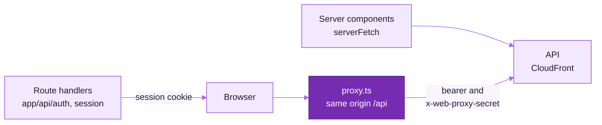

# Frontend

The web client (`frontend/`, Next.js 16 App Router, React 19, Tailwind 4) is a port of the designer-portal (DR) shell. Wherever DR already has a route, the client calls it in DR's exact shape; the backend lane ports those routes unchanged. This file lists what the client assumes, and every route that is new for KalaVigyan. Engineers on either side of the web client's calls read it.

| For | Read |
|---|---|
| Every API route's prefix, body casing, headers and errors | [backend.md](backend.md) |
| How a monograph document is drawn | [monograph-renderer.md](monograph-renderer.md) |
| The design system every screen follows | [kalavigyan-design](../../.claude/skills/kalavigyan-design/SKILL.md) |
| How the web app is built and deployed | [infra.md](infra.md), Frontend |

## 1. Transport and session

- Every call goes to the same origin under `/api/*`. `frontend/proxy.ts` rewrites it to `API_ORIGIN` (falls back to `NEXT_PUBLIC_API_URL`) and adds the session token as `Authorization: Bearer` plus the shared proxy secret header `x-web-proxy-secret` (env `WEB_PROXY_SECRET`, same value on the API). This is DR's `lib/server/apiProxy.ts` unchanged.
- Server components call the API through `lib/server/serverFetch.ts` (decision 0082): `publicFetch` sends no cookie, no `Authorization` and no viewer address, only the proxy secret, so the API counts it in the web server's own allowance of public reads, and caches the answer in Next's data cache under its tags for `PUBLIC_REVALIDATE_SECONDS` (300, the API's public `max-age`); `signedInFetch` forwards the reader's `__Host-session` (or `session` off HTTPS) as `Authorization: Bearer` with the viewer address and is never cached. Every proxied browser call and every `signedInFetch` carries `x-viewer-address`, `unknown` (`apiProxy.UNKNOWN_VIEWER`) when the platform gave no address, so only the server's own reads arrive without one. Both fetches give up after `SERVER_FETCH_TIMEOUT_MS` (4 s) and answer `{ok: false, failure}` (`unconfigured`, `timeout`, `unreachable`, `refused`, `failed`, `invalid`), so a page renders its fallback instead of waiting. The landing reads its craft count from `/public/summary` (`lib/server/publicSummary.publicSummary`, tag `public-summary`).
- Every write under `/api/auth` goes through the Next route handlers in `frontend/app/api/{auth,session}/*` (`apiProxy.isAccountWrite`; a read there is rewritten like any other call), which set and clear the `__Host-session` / `__Host-session-marker` cookies (DR shape): sign-in and two-step verify (`handleSignIn`) send no session, logout clears it, and every other write (`app/api/auth/[...path]`, `handleAccountWrite`) is relayed with it. Whatever token the API answers, in the `X-Session-Token` header (change-password, two-step on and off) or as `accessToken` in the body (sign-in, two-step verify, two-step on and off), becomes the cookie with a new marker and `x-session-rotated: 1`, and is taken out of the header and the body, so no bearer token reaches page JavaScript (decision 0172). The two-step card reads the account again when its recovery codes are put away, not when they appear, so the two-step gate keeps them on screen.
- Headers the client reads: `x-access-status` (`PENDING`, `REJECTED`, `SUSPENDED`, `NOT_RECORDED`) on a refused sign-in, `x-sign-in-hint`, `x-password-change-required: 1`, `x-two-factor-required`, `x-confirm-provider`.
- Env names (values never in the repo): `API_ORIGIN`, `NEXT_PUBLIC_API_URL`, `WEB_PROXY_SECRET`, `NEXT_PUBLIC_GOOGLE_CLIENT_ID`, `NEXT_PUBLIC_MICROSOFT_CLIENT_ID`, `NEXT_PUBLIC_MICROSOFT_TENANT`, `NEXT_PUBLIC_YAHOO_CLIENT_ID`, `NEXT_PUBLIC_APP_VERSION`, `NEXT_PUBLIC_BUILD_NUMBER`. See `frontend/.env.example`.

## 1a. Reading without signing in (decisions 0079, 0097)

Everything a reader reads opens without signing in; only asking and the reader's own tools need an account.

- **Two route groups.** `app/(reading)/` holds the reading pages: `/crafts`, `/crafts/[slug]`, `/map`, `/compare`, `/voices/[id]` (a field transcript), `/shared/answers/[token]` and `/shared/lessons/[token]`. Its layout is `components/shell/ReadingShell.tsx`, which never redirects: signed out it draws `components/nav/ReadingBar.tsx` (the brand, Crafts, Map, Compare from 640px, and Sign in), signed in the island nav. `app/(protected)/` keeps `/ask`, `/saved`, `/lessons`, `/settings`, `/admin` and `/contribute` behind `components/AppShell.tsx`, which sends a signed-out reader to `/login?next=<the page>`. Both shells share the account gates (`components/shell/AccountGate.tsx`, which asks nothing of a reader not yet known, and `lib/accountGate.accountStepFor`: first password, two-step, first-entry profile, guardian hold) and the frame (`components/shell/ShellFrame.tsx`: skip link, nav, main, the reconnecting line), always in that order (`readingFrame`, `appFrame`), so a page drawn before the account is known is not drawn again when it arrives. `lib/readingRoutes.READING_ROUTES` lists the reading prefixes. A page moved between the groups moves its entry there and in `e2e/public-reading-unit.spec.ts`.
- **No signed-in call from a signed-out reading page.** `lib/session.mayHoldSession` skips the `/me` probe on a reading route unless the session marker or a legacy token is present. `useVoiceAvailability` asks `GET /answers/config` only for a signed-in reader, so Talk shows only to one. No reading page mounts the media client (`/media/options`). `apiFetch` ends a session on a 401 only when it sent a session, so a 401 from a public read sent without one (a term lookup that would research) is shown on the spot: the term sheet then offers Sign in (`components/auth/SignInLink.tsx`) in place of Try again.
- **Asking sends a signed-out reader to sign in and back.** Every Ask entry point takes its link from `components/ask/useAskHref` (`lib/askEntry`): `/ask?q=<question>&craft=<slug>` for a signed-in reader, `/login?next=<that address>` for a signed-out one, so the question and the craft survive sign-in. The craft header's Ask, the shared answer's "Ask your own question" and, when the monograph lands, its suggested and open questions use it.
- **First paint from the server.** `/crafts/[slug]` and `/crafts` are server components. A craft page draws its monograph document (`serverCraftDocument`, `components/monograph/MonographPage`), or without one the craft list's record from `GET /crafts/{slug}/page` (`craftRecordPage`, tag `craft-page:<slug>`, `components/craft/CraftWithoutMonograph.tsx`), as `monograph-renderer.md` sets out; the tabbed craft screen is retired (round 6). A generated document and a craft without one also draw the craft's field voices (`components/craft/FieldVoicesPart.tsx`: "In the artisan's words" and "From the workshops", from the first page of each kind of `GET /crafts/{slug}/field-voices` read on the server by `craftFieldVoices`, tag `craft-page:<slug>`; nothing when the craft has none). The page's reads, its document, record, field voices and languages, are absent only on a 404 (`serverFetch.bodyOrAbsent`); any other failure fails the render, so a regeneration keeps the last good page rather than caching one without a part for a week (decision 0172); an authored document (`shell`, Kutch Ajrakh, decision 0100) draws exactly its approved page and reads no field voices. `/crafts` reads `GET /crafts/catalogue` through `lib/server/readingPages` (`publicFetch`, tag `craft-catalogue`) and hands it to `components/crafts/CraftAtlas.tsx`; the atlas shows the server's catalogue until its stored copy (`useCraftCatalogue`) answers. `generateMetadata` gives a document's metadata (`lib/monographMetadata`), and for a craft without one `lib/readingMetadata` gives the craft's name, its first lede sentence, its canonical path and its hero plate at the standard Commons width 1280 with "caption. Photo: author, licence, via Wikimedia Commons" as the image's alt text; the atlas gives the catalogue's craft count. Shared pages are `noindex`.
- **Share links.** On an explainer version (`components/learn/ExplainerTools.tsx`) and on a lesson (`app/(protected)/lessons/[id]`), `components/learn/ShareControl.tsx` reads, starts and stops the share (`GET`, `PUT`, `DELETE .../share`, `lib/shareContract.ts`, `ShareLink` schema 1 of `docs/contracts/learning.md`) and copies `origin + path`; it starts one only after a confirmation that names what becomes readable (`lib/shareNotice.SHARE_NOTICE`, by its `kind`, `answer` or `lesson`); the public pages read `GET /shared/answers/{token}` and `GET /shared/lessons/{token}` and draw them with the explainer view and the lesson view, with no follow-up, Listen or film. A link that no longer opens says so.
- **Signed-out production run.** `e2e/production/anonymous.spec.ts` (projects `production-anonymous-small-phone`, `-tablet`, `-desktop`: 360, 834 and 1440 px, light) opens the atlas, Kutch Ajrakh, the map and compare without a session and fails on a redirect to sign-in, a missing Sign in, or any 401 or 403 under `/api/`; it presses Ask on Kutch Ajrakh, expects `/login?next=/ask?craft=Kutch-Ajrakh`, and with `E2E_EMAIL` and `E2E_PASSWORD` signs in and expects to land on `/ask?craft=Kutch-Ajrakh`.
- **The voice dock's release check.** `/design/voice` (`app/design/voice`, `lib/voiceBoard.ts`, signed out, `noindex`) mounts the real `VoicePanel` with a relay availability in English and its notice. `e2e/production/voice.spec.ts` (projects `production-voice-desktop-light`, `-dark`, `production-voice-phone-light`, `-dark`; Chromium with `--use-fake-ui-for-media-stream` and `--use-fake-device-for-media-stream` and the microphone granted) answers the voice routes from `shared/voice.*.golden.*` (`e2e/production/voiceDock.ts`), agrees to the notice, records a relay turn from the fake microphone, sends it as multipart form data, reads the heard sentence, plays a silent WAV reply and ends the call, checking that the dock stays inside the screen, the page never scrolls sideways and the dock's contrast passes axe in both themes (decision 0140).

## 2. Roles

`UserRole` = `MASTER_ADMIN` (60), `ADMIN` (50, "Admin"), `PROFESSOR` (40), `RESEARCHER` (30), `STUDENT` (15), mirrored in `frontend/lib/permissions.ts` (`ROLE_RANK`, `ROLE_LABELS`) and checked against `shared/roles.json`. Route guards and the backend dependency each one mirrors:

| Path | Who | Backend dependency name |
|---|---|---|
| `/admin` | Admin and above | `require_admin` (the hub itself calls no route) |
| `/admin/keys`, `/admin/routing` | Master admin | `require_master_admin` |
| `/admin/budget` (the AI budget: monthly, media and degrade mark, each depth's answer cap, each role's daily cap and daily allowances, an empty field being no cap, saved with a two-step code) | Master admin | `require(MANAGE_CEILINGS)` |
| `/admin/usage` | Admin and above | `require_view_usage` |
| `/admin/users` | Professor and above | `require_professor` |
| `/admin/access` | Professor and above | `require_access_roster_manager` |
| `/lessons` | Professor and above | `require(BUILD_LESSONS)` |

A professor assigns only `RESEARCHER` and `STUDENT`; an admin assigns up to `PROFESSOR`, changes roles, suspends and restores accounts and resets two-step verification for accounts ranked below Admin; only the master admin assigns `ADMIN` or acts on an admin. Each admin nav item is shown by its own route guard (`routeAllows`), and the hub lists the areas whose guard admits the viewer. The access roster shows exactly the actions the server offers on each entry (`accessEntryOffers`, reading the row's `offers`, which the routes' own guards compute from the entry and the account at its address); a row without `offers` shows none (decision 0155). The admin view toggle stays with the master admin (`hasAdminView`).

## 3. Routes ported from DR, called in DR's shape

`GET /me`, `GET|PUT /preferences/me`, `POST /auth/login` (`{email,password}`, `{googleIdToken, googleNonce}` or the five `oidc*` fields of §4.1), `POST /auth/logout`, `POST /auth/change-password` (a first password with the proof fields of decision 0028), `POST /auth/first-password/nonce`, `POST /auth/forgot-password`, `GET /auth/set-password`, `POST /auth/set-password/check`, `POST /auth/set-password`, `POST /auth/password-links`, `GET /auth/two-factor`, `POST /auth/two-factor/setup`, `POST /auth/two-factor/setup/cancel`, `POST /auth/two-factor/enable`, `POST /auth/two-factor/disable`, `POST /auth/two-factor/recovery-codes`, `POST /auth/two-factor/verify`, `GET /access/roster` (`page,pageSize,search,status` and the roster filter params), `GET /access/roster/pending-count`, `POST /access/roster`, `POST /access/roster/{id}/decision`, `PATCH /access/roster/{id}`, `DELETE /access/roster/{id}`, `GET /users` (`search,role,page,pageSize`), `PATCH /users/{id}` (`{role}`), `DELETE /users/{id}/two-factor`, `POST /users/{id}/sign-out-everywhere`, `GET /secrets`, `PUT /secrets/{key}`, `DELETE /secrets/{key}`, `POST /secrets/{key}/test`, `GET /crafts/catalogue` (ETag, `If-None-Match`, catalogue v2 body: DR's `CraftCatalogue` with fields added, parsed by `lib/craftCatalogueContract.ts` and refused when off the contract, cached in `localStorage` under `kalavigyan_craft_catalogue_v2`).

Not called, by design: `GET /secrets/{key}/reveal` (PLAN §9, §15).

Changes to DR shapes the client assumes:

- `PUT /secrets/{key}` body is `{value, twoFactorCode}` and `DELETE /secrets/{key}` carries `{twoFactorCode}`: a six-digit TOTP step-up (PLAN §12, keys rotate with TOTP step-up). A wrong or missing code is a 401 with `x-two-factor-required: 1` and a sentence in `detail`; `apiFetch` keeps the session for that 401.
- `User` adds `affiliation`, `twoFactorRequired` (true for PROFESSOR, ADMIN and MASTER_ADMIN until two-step is on; the shell then shows only the setup card), `isActive`, `suspendedAt`.
- `POST /auth/login` with Google also takes `googleNonce`, the value from §4.1; the API verifies it once, with `aud`, `iss`, `exp` and `email_verified`.

## 4. New routes

### 4.1 Auth and sign-up

- `POST /auth/google/nonce` → `{nonce}`. Public. A fresh single-use nonce per attempt; the client passes it to `google.accounts.id.initialize({nonce})` and back with the ID token.
- `POST /auth/oidc/nonce` body `{provider}` → `{nonce}`. Public. The login page asks for it when "Continue with Yahoo" (or Microsoft) is pressed, sends its SHA-256 digest (base64url) to the provider with a PKCE S256 challenge, keeps the raw value and the verifier in `sessionStorage` (`kalavigyan_oidc_pending`, 10 minutes), and posts `{oidcProvider, oidcCode, oidcCodeVerifier, oidcRedirectUri, oidcNonce}` to `/auth/login` when the provider returns. The provider returns to `/login/callback` (a route handler, `Cache-Control: no-store`, `Referrer-Policy: no-referrer`), which forwards only `code`, `state` and `error` to `/login` in the fragment; the page strips the fragment before using it. The return address survives the trip only in `sessionStorage`, so the login page resolves where to go once (`sessionReturn.signInReturnOnce`) and every way it leaves goes there (decision 0172). The buttons are drawn from `NEXT_PUBLIC_YAHOO_CLIENT_ID` and `NEXT_PUBLIC_MICROSOFT_CLIENT_ID` (with `NEXT_PUBLIC_MICROSOFT_TENANT`); blank means no button (decision 0026).
- `GET /auth/config` → `{signUpOpen, turnstileRequired, turnstileSiteKey|null, googleEnabled, googleClientId|null, microsoftEnabled, microsoftClientId|null, yahooEnabled, yahooClientId|null, mailAvailable}`. The sign-up page draws the email form only when `signUpOpen`, and the Turnstile widget when `turnstileRequired` and a site key is given; otherwise it offers Google only.
- `POST /auth/signup` body `{name, email, affiliation, requestedRole, profileUrl|null, ageAttested: true, privacyNoticeVersion|null, turnstileToken|null}` → `202 {status: "EMAIL_SENT", email}`, the same for every address. No password: the emailed link (`/set-password?token=`) confirms the address and sets it, and only then is the PENDING request recorded. `requestedRole` is one of `STUDENT`, `RESEARCHER`, `PROFESSOR`. Password sign-in into a never-confirmed account answers 401 with `x-sign-in-hint: EMAIL_UNVERIFIED`.
- `GET /privacy/notice` → `{version, title, body (Markdown), publishedAt|null}`. Public.

### 4.2 Manage users

- `POST /users/{id}/suspend` → `User` (with `suspendedAt` set; the account's sessions end).
- `POST /users/{id}/restore` → `User` (DR's name; admin and above, for accounts ranked below them).

### 4.3 AI routing (generalised DR transcription-provider order)

- `GET /settings/ai-routing` → `{tasks: TaskRoute[], providers: RouteProvider[]}` (DR's path; the backend task state carries more fields than listed here)
  - `TaskRoute = {task, label, publicText, routes: RouteRow[], effectiveChain: string[], normalisedNote|null}`
  - `RouteRow = {provider, model, enabled, keyState, testedAt|null, testError|null}`, order = ordinal
  - `RouteProvider = {id, name, keyName, keyState, publicTextOnly, models: [{id, label, tasks: string[]}]}`
  - `provider` ∈ `GEMINI`, `ANTHROPIC`, `OPENAI`, `DEEPSEEK`, `ELEVENLABS`; `keyState` ∈ `ABSENT`, `UNTESTED`, `PASSING`, `FAILING`
- `PUT /settings/ai-routing/{task}` body `{routes: [{provider, model, enabled}]}` → `TaskRoute`. The server may normalise (drop an unsupported model, a public-text-only provider on a private task) and say so in `normalisedNote`.
- `POST /settings/ai-routing/{task}/test` body `{provider, model}` → `TaskRoute` with that row's verdict (the backend tests the provider's key).

### 4.4 Usage

`GET /usage/report?from=ISO&to=ISO` → `{from, to, ceilingUsd|null, spentThisMonthUsd, spentUsd, calls, failures, byTask: [{task,label,calls,failures,inputTokens,outputTokens,costUsd}], byProvider: [{provider,name,model,calls,failures,costUsd,p95LatencyMs|null}], byDay: [{day,calls,costUsd}]}`. Money fields may be Decimal strings. With `ceilingUsd` null (no monthly ceiling, decision 0093) the Usage page shows the month's spend as "This month" with no share or progress bar; with a ceiling it shows the spend of the ceiling and the share used (`lib/usage.monthlyCeiling`, `ceilingShare`).

### 4.5 Asking

- `GET /answers/config` → `{depths: [{depth, label}], defaultDepth|null, voice: VoiceAvailability, languages: [{code, label, autonym, script, direction, words?}], listen?: {languages: [code], voice?}, film?: {score: bool}}` (`listen` absent or off the contract draws no Listen control, `lib/listen.listenLanguagesOf`; `film` absent or off the contract draws no Music and sound switch, `lib/filmScore.filmScoreOffered`) (`VoiceAvailability` is `docs/contracts/voice.md`; `languages` is checked by `lib/answerLanguages.answerLanguagesOf`, English always offered, an off-contract list falls back to English and is logged; a language's `words` are its reviewed interface words, drawn by `lib/interfaceWords.wordedIn` in the essay's provenance rail and actions only while every word of the group is there and the essay is shown translated, decision 0157; `depths` and `defaultDepth` by `lib/askConfig.askDepthsOf`, which logs an off-contract list and draws no depth choice). `voice` feeds the craft page's dock only.
- The ask screen (decision 0036): the question box, dictation, and under it the craft (a searchable picker over `GET /crafts/catalogue` with Any craft, never required), the depth (the config's `depths`, starting at its `defaultDepth`, the role's) and the answer language. Dictation is the browser's Web Speech API (`SpeechRecognition`, else `webkitSpeechRecognition`) in the answer language's `<code>-IN` locale with live interim words (`lib/dictation.ts`, the one adapter); the mic is drawn only where the browser has the API and has not refused that language. No speech reaches the server: the question is sent as text.
- `POST /answers/stream` body `{question (2-1000), depth|null, craftSlug|null, anyCraft?, language|null, fresh?}` → `text/event-stream`. `fresh: true` is sent only by Research again, which the explainer draws once a done answer shows a block from earlier research (`lib/explainerView.showsEarlierResearch`); it asks the same question with the same choices and reuses no stored piece (decision 0033). `depth` is `BASIC`, `DETAILED` or `EXPERT` (the reader's choice, starting at the config's default), or null before the config is read (the server applies the role's default); the server runs it as its mode (`research/depth.DEPTH_POLICIES`). `anyCraft: true` is sent only when the reader chose Any craft over a detected craft, for that question. The client no longer sends `mode`. Each event is `event: <name>` + one JSON `data:` line, blank-line separated. The stream is the explainer stream of `docs/contracts/explainer.md`: `lib/explainerStream.streamExplainer` parses every frame with the contract's shapes (a frame off the contract is logged and dropped; the retired `match`, `section`, `sentence` and `reaction` are skipped), `lib/explainerState.reduceExplainer` keeps the answer's state and `components/answer/ExplainerView.tsx` draws it (decision 0037). Events:
  - `understood`: the `Understood` of `docs/contracts/explainer.md`, kept as `ExplainerState.understood` and drawn first as the understood line ("Answering for Kutch Ajrakh · Expert · in English"); each part the reader can change is a button that moves focus to its control under the question box. With no craft picked, the craft picker's Any craft row reads `<crafts> · detected`, an explicit Any craft row (`anyCraft`) is offered above the list, and the `candidates` are one-tap buttons that ask again with that `craftSlug` (`lib/askCraft.craftOffer`). Changing the craft, depth or language while the asked question is still in the box asks again (`reasksOnChange`).
  - `source`: `SourceRef` = `{id, kind, title, authors[], year, doi, url, publisher, licence, attribution, reliability}`. Sent before the first citation that names it.
  - `trail`: the research trail. While the answer streams it shows the counts per group and the five latest sources with their stage (Found, Read, Quoted); after `done` it is the counts and Replay the trail, which plays every entry in arrival order (at once under either reduced-motion switch). A key only moves forward; a reused piece reads "From earlier research · date".
  - `lede`: `{block: LedeBlock}` (decision 0077), kept as `ExplainerState.lede` and drawn by `components/answer/LedeBlock.tsx` below the understood line and its actions, above the research trail and the section bar, as soon as it arrives and once the answer is done: the question as asked as its heading, then its two or three sentences cited exactly as prose sentences are (chips, the source dialog, term spans, a translated sentence's English original and every `lang` and `dir`). A stored explainer opened at `/ask?explainer=` draws its stored lede; an explainer stored before decision 0077, or an answer whose lede failed, opens with its sections. Listen, film, the quiz and lesson packs read sections only (`docs/TECH_DEBT.md`).
  - `section_started`, `section_state`, `block`, `section_done`: sections are drawn in `order` with a section bar to jump between them; a working section shows its state (Researching, Writing, Checking) while the answer streams; blocks render as they arrive (`prose`, `process_ladder`, `images`, and once built the place kinds `region_story`, `map_layer`, `seasons` and `supply_map` of decision 0048, whose maps load on demand and read `GET /rivers/{mainRiv}` and `GET /map/layers[/{layer}]`, and the matter and expert kinds `reaction_player`, `material_card`, `molecule_3d` (3Dmol.js loaded on demand over `GET /molecules/{pubchemCid}/conformer`) and `expert_view` (a section's views as one panel with "Experts differ" cards) of decision 0049; a reused block carries "From earlier research · date"); an `EMPTY` section shows what was searched; a `READY` section with no block to draw is hidden. A translated sentence (and a translated section title) carries its English `original`; every sentence, title and paragraph sets `lang` and `dir` (`rtl` for Urdu), and a segmented control shows the English original (decision 0023). The request's `language` is the Ask picker's choice, or the language of the question's script when it is Auto, remembered as `answerLanguage` in `kalavigyan_preferences`.
  - Prose and ladder sentences carry citation chips (one numbering per answer, in the order of first citation walking the lede and then the sections (`lib/explainerView.explainerSourceNumbers`), the order of the explainer's `sources`, the report PDF and the citations export; one cluster of numerals per sentence, a source once, numbers ascending, opening every quoted passage behind the sentence in a popover, a margin note from 1200px or a phone sheet, decisions 0075 and 0094), a Verified, Reviewed or Hypothesis badge where the level is one of those (a hypothesis reaches an explainer only as a what-if outcome, decision 0056), and their term spans underlined at the first occurrence; a tap opens the term's summary (`GET /terms/{key}?language=` → `Term`; a 404 removes that term's underline for the answer). The ladder fills as the reader scrolls and is drawn filled under either reduced-motion switch.
  - `open_question`: `{sectionId, heading?, sentence}` (hypothesis-level sentences, shown collapsed)
  - `follow_ups`: `{items: string[]}`
  - `done`: `{answerId|null}`; `error`: `{message}` (shown verbatim)
  - `status`: `{step, message}`, progress while the answer is worked out (`step` one of PLANNING, SEARCHING_STORED, RESEARCHING, READING, COMPOSING, WRITING_BACK, TRANSLATING). The client shows `message` as the progress line (`AnswerProgress`, `role="status"`) and clears it on `done`, `error` or `not_enough_evidence`.
  - `not_enough_evidence`: `{message}`, nothing cited could be shown; `message` lists what was searched. The client's empty state (`NotEnoughEvidence`), not an error. Only `done` follows.
  - Depths: `/answers/config` lists the depths the asker may choose (every known role all three); a depth the role may not choose is a 403 with a sentence in `detail`.
  - Data states of the answer: loading (`asking`/`streaming` with the status line), empty (`empty`), error (`failed`, shown verbatim with Try again), success (`done`).
  - Listen: drawn after `done` only when `/answers/config` lists the answer's language in `listen.languages`; it reads `GET /answers/{answerId}/listen?language=` (the Listen section of `docs/contracts/explainer.md`), plays the tracks in order in a dock and highlights the sentence and word being read from the timings, or the sentence alone when the Gemini voice read it and the track is timed by sentences (`lib/listen.trackMark`, decision 0161).
  - Film: drawn beside Listen under the same conditions; it plays the explainer's drawn blocks as scenes timed by the same Listen script, captioned in the answer language, in a dialog loaded on demand (`components/answer/film/`, decision 0060). `/answers/config` `film {score}` draws the Music and sound switch, which asks `GET /answers/{answerId}/film-score?language=` once when turned on (`docs/contracts/explainer.md`, Film mode).
  - Heartbeat: an SSE comment `: keep-alive` after 60 s without an event; the parser already skips comments.
  - The backend side of this stream, with the models every event is validated against, is `docs/contracts/research.md` and `docs/contracts/explainer.md`; the client reduces `shared/explainer.stream.golden.sse` to `explainer.document.golden.json` (`e2e/explainer-view-unit.spec.ts`) and the answering flow's goldens (`e2e/answer-stream-golden-unit.spec.ts`).
  - `Citation = {id, claimId, sourceId, quote|null (≤300 chars), locator|null, context|null (the surrounding passage the quote sits in), evidence: "QUOTED"|"INFERRED", level}`
  - `level` ∈ `VERIFIED`, `REVIEWED`, `PROVISIONAL`, `HYPOTHESIS`, `UNAVAILABLE` (uppercase enum values of `evidenceLevel`).
  - Outbound links are drawn only for `https:` URLs; a DOI without a URL becomes `https://doi.org/<doi>`.

### 4.6 Crafts and map

- The craft page (decision 0071) reads `GET /crafts/{slug}/page` → `CraftPage` of `docs/contracts/craft-page.md`, parsed and cross-checked by `lib/craftPageContract.ts` with `lib/craftPageContext.ts` (schema version 2, decision 0081: every named claim and cited source listed, hypotheses apart, every claim filed once in All evidence, or with `evidence` null only claims a shown part cites; one hero picture at most, stage disagreements that resolve, a coverage class only on a curated page, events inside their span, at most six relatives and never the craft itself; the tab flags it carries are final at first paint); unknown slug → 404, shown as the page's load failure. It also reads `GET /crafts/{slug}/region` for the map highlight and the district datasets (`lib/craftRegion.ts`, `docs/contracts/region.md`). It no longer calls `/profile` or `/process`.
  - Tabs, in order: Overview; Process when the page has stages or reactions; Region; Sources when a source is listed; All evidence whenever the page carries `evidence`, for every reader, signed in or not (decisions 0095 and 0097 retire `canReadAllEvidence`). `?tab=` keeps the tab; a tab the page does not offer falls back to Overview.
  - Overview: the lede and key facts (or the register's facts when the page has neither), pictures with author, licence and a link, the discipline sections (each sentence the explainer's, with its chips and tappable terms that open `GET /terms/{key}`), "Where sources differ" with every side and its citations, open questions, the glossary, and for a `THIN` dossier what was searched.
  - Process: stages numbered by `order` only, unordered stages listed apart and unnumbered; materials, tools, timing, reactions and the stage's pictures. No Image, Video or research control.
  - Region: districts where the craft is made filled on the district outlines and every named district tagged, places once each with all their roles, people and groups, then the region route's environment and datasets.
  - Sources by reliability A to D; one source numbering per page in reading order, then the region route's sources.
  - All evidence: every claim once by discipline and subject, near-duplicates folded under the strongest, hypotheses apart, each tagged Curated, Seed, From answers or Researcher.
- The crafts index, the map header and the landing count crafts only from the catalogue's `summary` (readers: active, not catch-all rows; decision 0082); no screen states a count of its own, which `e2e/craft-catalogue-unit.spec.ts` checks. The index's status line counts the readers shown and names the catch-all rows apart ("Showing 3 of 420 crafts and 1 “Other” entry", `shownCountLine`), and each group's header counts its readers (none shown when a group holds only a catch-all row). A category filter narrows each concept to its crafts in that category and drops a concept left with none (`withinCategory`), so the concept panel never names a craft the list hides. Search (`lib/craftCatalogue.searchCatalogue`) answers the matching `concepts` first, each with the crafts it links, then the crafts that match by name, alias, local name, state or family, then the concept-linked crafts.
- `GET /map/crafts` → `[{key, name, latitude, longitude, total, crafts: [{slug, name}]}]`, one point per place with the crafts practised there.
- `/map` reads `GET /map/layers` and `GET /map/layers/{layer}` (`?layer=` in the URL; `If-None-Match` through the browser cache), as `docs/contracts/region.md` describes (decision 0019).

### 4.7 Media (decision 0021)

Since decision 0071 no screen mounts this client: the craft page offers no generator. When mounted, it reads `GET /media/options?craftSlug=` once per page and draws Image or Video on a stage only for the kinds listed for it with units left (`offeredKinds`, `lib/mediaContract.ts`); a failed or off-contract answer draws none. A press sends `POST /media/jobs` with a fresh `media:<uuid>` idempotency key, polls `GET /media/jobs/{id}` after each `pollAfterSeconds` with the ProgressBar, and draws the asset after the stage's evidence with its label, model, day and alt text, a Download that saves `fileName`, and for professors the sharing step the asset lists (`POST /media/assets/{id}/sharing`, not served yet). The store is `lib/craftMedia.ts`; routes, rules and the sharing shape are `docs/contracts/media.md`.

### 4.8 Learning (decision 0062)

Follow-ups and versions, saved explainers and notifications, lesson packs, the PDF and citation exports, the shared-science explorer and ask the map are `docs/contracts/learning.md`, with their client shapes and paths in `lib/learningContract.ts`, `lib/lessonContract.ts`, `lib/sharedScienceContract.ts` and `lib/districtCraftsContract.ts`. Lesson packs are offered only where `canBuildLessons` (Professor and above, the backend's `BUILD_LESSONS`) holds, and Save and Export where `canSaveExport` (`SAVE_EXPORT`) does. The screens (decision 0069): the explainer's Save, Export (`GET .../versions/{n}/pdf`, an `ExportLink` whose signed file is saved under its `fileName`, and `.../citations/{format}`, saved under the server's `Content-Disposition` name; lesson files are `ExportLink`s too, decision 0067), Make a lesson, the version picker over `GET /explainers/{id}/versions`, and "Ask a follow-up" (`POST /answers/stream` with `buildsOn` and no craft, depth or language, reading `builds_on` and `version`); `/ask?explainer=<id>[&version=<n>][&update=<facets>]` opens a stored version and, with `update`, asks the version 1 question as a follow-up for those facets; `/saved` (`GET /notifications`, `POST /notifications/{id}/read`, `/read-all`, `GET` and `DELETE /saved-explainers`), with the unread count on the Saved nav entry; `/lessons`, `/lessons/new?explainer=&version=` and `/lessons/{id}` (`GET`, `POST`, `DELETE /lessons`, `GET /lessons/{id}/files/{format}`); `/map?district=<lgd>` (`GET /map/districts/{lgd}`); `/compare?crafts=a&crafts=b` (`GET /compare`); Check yourself (`GET /answers/{answerId}/quiz`); and the weekly email switch on Settings, drawn only while `GET /preferences/me` says `alertDigestOffered` (`PUT` with `alertDigest`).

## 5. Voice (decision 0020)

`frontend/components/voice/VoicePanel.tsx` is the mount point: a non-modal dock, mounted only when voice is offered, which it never is while the call is switched off (`configured` false, decision 0035); since the tabbed craft screen and its Talk button were retired (round 6) no page mounts it. The ask box's mic is dictation (decision 0036) and no longer opens the dock. Props: `{open, onClose, craftSlug, mode, question?, availability, host?, onTranscript?}`; the call's language is the Ask preference (`answerLanguage`, Auto following `question`'s script) resolved over `availability.languages` (decision 0025); `host` is what the page can show for the client tools: `{stages (id to name, the craft page's stages), showOnMap, openStage}`. The call itself is `lib/voiceCall.ts` with its transports (`voiceRelay.ts`, `voiceAgent.ts`) and adapters (`voiceSession.ts` for the routes, `elevenLabsAgent.ts` for the SDK, `voiceDevice.ts` for the microphone and speech).

The voice routes, session shapes, client tools and the relay turn stream are `docs/contracts/voice.md`, typed and parsed by `frontend/lib/voiceContract.ts`. The craft page is `docs/contracts/craft-page.md` (`lib/craftPageContract.ts`); its region answer and the map layers are `docs/contracts/region.md` (`lib/regionContract.ts`), and the process vocabulary `docs/contracts/science.md` (`lib/scienceContract.ts`); generated media is `docs/contracts/media.md` (`lib/mediaContract.ts`); the explainer document, its blocks, terms and stream events are `docs/contracts/explainer.md` (`lib/explainerContract.ts` with `lib/explainerBlockBase.ts`, `explainerPlace.ts`, `explainerMatter.ts`, `explainerExperts.ts`, and `lib/explainerStream.ts`), whose shapes refuse a block kind that is not built yet; each built kind is drawn by its one renderer in `components/answer/blockRenderers.ts` (decision 0042). Each parses its response with `parseShape`, which refuses values outside a field's shape and vocabulary everywhere, and refuses unknown fields everywhere but in the production build, which ignores them (`frontend/lib/shape.ts`, `BUILD_UNKNOWN_FIELDS` from `NODE_ENV`, decision 0151): a release ships the backend first, so the live web meets a field the backend adds before its own build lands, while the unit specs and the development server still refuse it and catch the drift. The review
page reads its `kinds` and `items` through `knownOnly(shape, isKnown)`, which in the production
build drops a review kind, or a structure item's kind, it does not know and parses the rest
(decision 0167), so the page renders its known items while the API is a release ahead.

## 6. Naming

`frontend/lib/naming.ts` is DR's helper with `PORTAL = "KalaVigyan"` (recovery codes download as `KalaVigyan_Account_<date>_Recovery-Codes.txt`). Golden rows belong in `shared/naming-golden.json` (shared lane).

## How this document is kept true

| Claim | Kept true by |
|---|---|
| Every response is parsed by its shape, refusing unknown fields | `frontend/e2e/contracts-unit.spec.ts` and `backend-vocabulary-unit.spec.ts`, against the `shared/*.golden.*` files; `golden-files-unit.spec.ts` holds every golden the web reads to a unit spec, and `backend/tests/contracts/test_golden_fields.py` holds every field of the served payloads to a golden, but for what the web never parses: the craft page's chapters, which it drops, and the block kinds a served explainer refuses as not built (decision 0168) |
| The production build ignores a field it does not know, and the review page a kind it does not know | `frontend/e2e/shape-unknown-fields-unit.spec.ts`, `review-unknown-kinds-unit.spec.ts`, and `later-backend.smoke.spec.ts` against the built site with the API stub `e2e/smokeApi.ts` |
| What the roles may see and do | `frontend/e2e/permissions-unit.spec.ts` and `backend/tests/test_roles.py`, both against `shared/roles.json` |
| Reading without signing in | `frontend/e2e/public-reading-unit.spec.ts`, and `e2e/production/anonymous.spec.ts` on the live site |
| The voice dock in a browser | `frontend/e2e/voice-dock-board-unit.spec.ts`, and `e2e/production/voice.spec.ts` on the live site |
| The stream and the explainer views | `frontend/e2e/answer-stream-golden-unit.spec.ts` and `explainer-view-unit.spec.ts` |
| The atlas | `frontend/e2e/craft-catalogue-unit.spec.ts` |

Re-read it when a route is added on either side, a screen changes what it reads, or a header is added.
