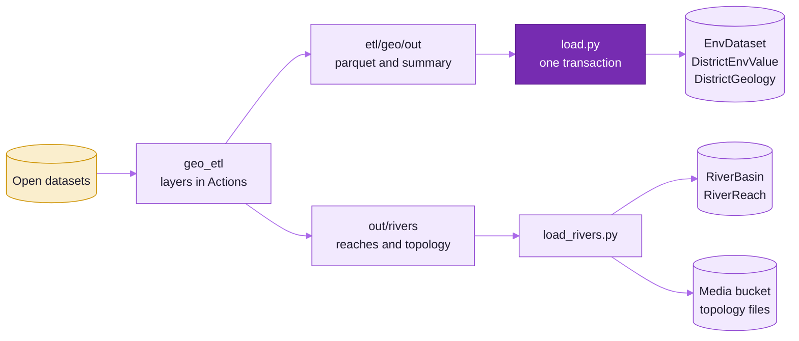

# Geo

The geo lane owns `etl/geo/`, `.github/workflows/geo-etl.yml` and `docs/DATA_SOURCES.md`. It writes per-district environment statistics to `etl/geo/out/` and `etl/geo/load.py` upserts them into the backend tables below. This file lists what `load.py` assumes about those tables and the backend changes it needs. Engineers changing a layer, the loader or the tables it writes read it.

| For | Read |
|---|---|
| Every dataset, its edition and licence | [DATA_SOURCES.md](../DATA_SOURCES.md) and `backend/app/data/datasets/registry.json` |
| What the region panel and the map receive from these tables | [region.md](region.md) |
| Running the ETL and the river load | [RUNBOOK.md](../RUNBOOK.md), Geo ETL |



## Backend changes required

Rows 1 and 2 are done: `ENV_STATS` and the `EnvStat` type in migration 0001 carry the six values, and `DistrictGeology` has `UniqueConstraint("districtLgd", "datasetId", "lithology")`, so `load.py` takes the `ON CONFLICT` path. Rows 3 and 5 are done by migration `0005_region_profile` (decision 0016), which also adds `DistrictEnvValue.resolution` (now loaded) and fills the grid of earlier WorldCover and Copernicus DEM rows and the names of earlier GLiM rows. Row 6 is done by migration `0021_climate_trend_stats` (decision 0065). Row 4 is still open.

| # | Where | Change | Why |
|---|---|---|---|
| 1 | `backend/app/models/enums.py` `ENV_STATS` plus an Alembic migration (`ALTER TYPE "EnvStat" ADD VALUE ...`) | Add `DISTRICT_MIN`, `DISTRICT_MAX`, `TOTAL`, `DENSITY`, `DISTANCE`, `COUNT` | The layers emit them (`geo_etl/rows.py` `STATS`). Without them the copy into the staging table fails on the enum cast and the whole load rolls back. |
| 2 | `DistrictGeology` model and migration | `UniqueConstraint("districtLgd", "datasetId", "lithology")` | `load.py` uses `ON CONFLICT ("districtLgd", "datasetId", "lithology")`. Without the constraint it falls back to delete-then-insert in the same transaction, which works but is not safe against a concurrent load. |
| 3 | `DistrictGeology` model and migration (optional) | `lithologyName: String(300) NULL`, `method: Text NULL` | The geology parquet carries both. `load.py` writes only columns that exist, so they are dropped silently until added. |
| 4 | `DistrictEnvValue.pixelCount` | Keep `Integer`, or change to `Numeric(18, 3)` | The layers emit coverage-weighted pixel counts as floats. `load.py` rounds them to integers (`fit_values`), so `Integer` works today; `Numeric` would keep the fractional coverage. |
| 5 | `EnvDataset` (optional) | `url: Text NULL` | Every dataset row carries a landing URL; it is skipped while the column is absent. |
| 6 | `backend/app/models/enums.py` `ENV_STATS` plus a migration | Add `TREND_PER_DECADE`, `TREND_P_VALUE` | The CHIRPS and GHCN CAMS layers write each district's trend (`geo_etl/trend.py`); a load before the migration fails on the enum cast. |

## Tables load.py assumes

Column names are the quoted camelCase names in Postgres. `load.py` reads `information_schema.columns` and writes only the columns present, but stops with a pointer to this file when a required column or table is missing.

### EnvDataset

- Required: `code` (unique), `title`, `licence`. `ON CONFLICT (code)` upserts and `RETURNING id, code` maps codes to ids.
- Written when present: `publisher`, `edition`, `period`, `nativeResolution`, `crs`, `licenceUrl`, `attribution`, `redistributable`, `retrievedAt`, `sha256`, `citation`, `url`, `createdAt`, `updatedAt` (`updatedAt` set to `now()` on update).
- Rows come from the summary JSON: `boundaries` (code `DR_DISTRICT_SHAPES`, with `sha256` of the shapes file) and every entry of `datasets`.

### DistrictEnvValue

- Key and unique constraint (already in the model): `districtLgd`, `datasetId`, `variable`, `depthOrPeriod`, `stat`.
- Required: the key plus `value`. Written when present: `valueText`, `unit`, `method`, `resolution`, `pixelCount`, `createdAt`, `updatedAt`.
- `depthOrPeriod` is never null; layers without a depth or period write `""`, matching the column's server default.
- `id` is filled with `gen_random_uuid()`.

### DistrictGeology

- Key: `districtLgd`, `datasetId`, `lithology`. Required: the key.
- Written when present: `lithologyName`, `areaShare`, `mineralOccurrences` (JSON text into `JSONB`), `method`, `createdAt`, `updatedAt`.

### AdminDistrict

- Read only: `select lgd`. Values and geology rows for districts not in this table are skipped and reported on stderr, so the foreign keys never fail. When the table does not exist, nothing is filtered. When it exists but is empty, `load.py` rolls back and exits 3.
- Filled by the backend: `python -m app.scripts.seed_districts` (in `backend/`, `app/services/district_seed.py`) upserts `AdminState` and `AdminDistrict` from `backend/app/data/lgd_register.json` and `district-shapes.json` (byte-identical to `etl/geo/data/`, sha256-checked). `backend-checks.yml` runs it after the migrations and `infra/deploy/blue_green.sh` runs it on every release after `seed_crafts` and `seed_claims`, so production has all districts before a `geo-etl` load.

## Output files

All in `etl/geo/out/` (or `--out`).

### district_env.parquet (`geo_etl/rows.py` `COLUMNS`)

| Column | Type | Loaded into |
|---|---|---|
| `districtLgd` | int | `DistrictEnvValue.districtLgd` |
| `stateLgd` | int | not loaded |
| `districtName` | str | not loaded |
| `datasetCode` | str | mapped to `DistrictEnvValue.datasetId` through `EnvDataset.code` |
| `variable` | str | `variable` |
| `depthOrPeriod` | str | `depthOrPeriod` |
| `stat` | str, one of `EnvStat` | `stat` |
| `value` | float or null | `value` |
| `valueText` | str or null | `valueText` |
| `unit` | str | `unit` |
| `method` | str | `method` |
| `pixelCount` | float or null | `pixelCount`, rounded |
| `resolution` | str | `resolution`: the grid the value was read at (WorldCover at its overview factor) |
| `source`, `version`, `licence` | str | not loaded; carried per row for audit and duplicated in `EnvDataset` |

`EnvStat` values the layers emit: `DISTRICT_MEAN`, `DISTRICT_P10`, `DISTRICT_P90`, `DISTRICT_MIN`, `DISTRICT_MAX`, `UNCERTAINTY_Q05_MEAN`, `UNCERTAINTY_Q95_MEAN`, `SHARE`, `CLASS`, `NORMAL`, `TOTAL`, `DENSITY`, `DISTANCE`, `COUNT`.

### district_geology.parquet (`geo_etl/layers/geology.py` `GEOLOGY_COLUMNS`)

`districtLgd`, `stateLgd`, `districtName`, `datasetCode`, `lithology`, `lithologyName`, `areaShare`, `mineralOccurrences` (list of objects), `method`, `source`, `version`, `resolution`, `licence`. Only `districtLgd`, `datasetCode` (as `datasetId`), `lithology`, `lithologyName`, `areaShare`, `mineralOccurrences` and `method` are loaded. The file is optional; `load.py` skips geology when it is absent.

### district_env_summary.json

`generatedAt`, `boundaries` (one dataset row), `datasets` (dataset rows with `code`, `title`, `publisher`, `edition`, `period`, `nativeResolution`, `crs`, `licence`, `licenceUrl`, `attribution`, `redistributable`, `citation`, `url`, `retrievedAt`), `layers` (per layer and shard: rows, geology rows, seconds, notes, options, failures, `districtsWithoutValues`, `districtsWithoutCells` (those of them measured with no valid cell) and `lostStates`, decision 0027 and its addendum), `rows`, `geologyRows`, `districts`, `variables` (distinct variables per dataset code), `districtsWithoutShapes`.

## Running load.py

```
python etl/geo/load.py --dry-run
python etl/geo/load.py
python etl/geo/load.py --prune
```

- Reads the database URL from the env var `DATABASE_URL` (override the name with `--dsn-env`). Never pass the value on the command line.
- `--out` points at another output directory (default `etl/geo/out`).
- `--dry-run` reads and validates the files (dataset codes known, no duplicate keys, every row has a value or text, geology keys unique) and prints the counts without connecting.
- `--prune` deletes rows for each `(datasetId, districtLgd)` pair in this load that are no longer in the files. Districts and datasets absent from the load are untouched.
- Exit codes: 0 loaded, 1 validation failed, 2 env var not set, 3 `AdminDistrict` empty. Everything runs in one transaction; any failure rolls back.
- Needs `psycopg` (v3) and `pandas` with `pyarrow`, all in `etl/geo/pyproject.toml`.

## River lines (decision 0043)

`python -m geo_etl rivers --out out/rivers` (the `riverlines` dataset of `geo-etl.yml`) reads every HydroRIVERS v1.0 Asia reach with `UPLAND_SKM >= 100` (`geo_etl/rivers.LINE_UPLAND_MIN_SKM`), keeps the whole basin of every reach that crosses a district polygon, checks the network (`network_problems`) and writes nothing when it finds a problem. It writes, in `out/rivers/`:

| File | Content |
|---|---|
| `river_reaches.parquet` | GeoParquet, one row per reach: `hyrivId`, `nextDown`, `mainRiv`, `ordStra`, `uplandSkm`, `disAvCms`, `lengthKm` and the line (EPSG:4326) |
| `topology/<mainRiv>.json` | One TopoJSON per basin (`geo_etl/topology.py`, the contract in `docs/contracts/region.md`, Rivers) |
| `river_basins.json` | `generatedAt`, `dataset` (the `HYDRORIVERS_1_0` row with `retrievedAt`), `uplandMinSkm`, `simplifyDegrees`, `reaches`, `basins` (`mainRiv`, `reaches`, `file`, `sha256`, `bytes`) |

`python load_rivers.py --out out/rivers [--dry-run]` checks the files again (network, counts, hashes), uploads each topology to the media bucket under `geo_etl/rivers.topology_key(edition, mainRiv, sha256)`, `media/rivers/<edition>/<mainRiv>/<sha256>/<file>` (`ContentType` `application/json`, SSE-S3, metadata `sha256`; an object already stored under its digest is left alone, and a changed file lands beside the old one; decision 0050), then in one transaction upserts the dataset row and replaces every row of:

- `RiverBasin`: `mainRiv` (key), `datasetId`, `reachCount`, `topologySha256`.
- `RiverReach`: `hyrivId` (key), `nextDown`, `mainRiv`, `ordStra`, `uplandSkm`, `disAvCms`, `lengthKm`, `geom` (written as hex EWKB).

It reads the database URL from `DATABASE_URL` (`--dsn-env`) and the bucket from `S3_BUCKET` (`--bucket-env`), AWS credentials from the standard `AWS_*` variables (on GitHub Actions the short-lived ones of the `kalavigyan-river-load` role, decision 0050), and never takes a value on the command line. Exit codes: 0 loaded, 1 validation failed, 2 an env var not set; a missing table stops it with a pointer to this file. `backend/tests/contracts/test_river_contract.py` pins these column lists, the topology object name and the key to the backend's models and `services/naming`.

## How this document is kept true

| Claim | Kept true by |
|---|---|
| The output columns, stats and summary | `etl/geo/tests/test_rows.py`, `test_layers.py` and `test_trend.py`, run by `geo-etl.yml` |
| What `load.py` validates, writes and refuses, and its exit codes | `etl/geo/tests/test_load.py` |
| The river network, its files and the river load | `etl/geo/tests/test_rivers.py` and `test_load_rivers.py` |
| The river columns, the topology object and its key against the backend | `backend/tests/contracts/test_river_contract.py` |
| The datasets' codes and editions | `etl/geo/geo_etl/catalog.py` reads them from the one registry (`etl/geo/tests/test_catalog.py`) |

Re-read it when a layer adds a stat or column, a backend table gains a column `load.py` writes, or row 4 above is decided.
