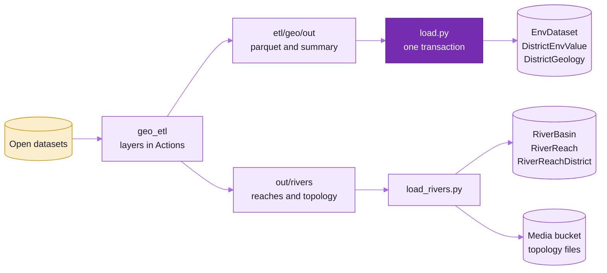

# Geo

The geo lane owns `etl/geo/`, `.github/workflows/geo-etl.yml` and `docs/DATA_SOURCES.md`. It writes per-district environment statistics to `etl/geo/out/` and `etl/geo/load.py` upserts them into the backend tables below. This file lists what `load.py` assumes about those tables and the backend changes it needs. Engineers changing a layer, the loader or the tables it writes read it.

| For | Read |
|---|---|
| Every dataset, its edition and licence | [DATA_SOURCES.md](../DATA_SOURCES.md) and `backend/app/data/datasets/registry.json` |
| What the region panel and the map receive from these tables | [region.md](region.md) |
| Running the ETL and the river load | [RUNBOOK.md](../RUNBOOK.md), Geo ETL |



## Backend changes required

Rows 1 and 2 are done: `ENV_STATS` and the `EnvStat` type in migration 0001 carry the six values, and `DistrictGeology` has `UniqueConstraint("districtLgd", "datasetId", "lithology")`, so `load.py` takes the `ON CONFLICT` path. Rows 3 and 5 are done by migration `0005_region_profile` (decision 0016), which also adds `DistrictEnvValue.resolution` (now loaded) and fills the grid of earlier WorldCover and Copernicus DEM rows and the names of earlier GLiM rows. Row 6 is done by migration `0021_climate_trend_stats` (decision 0065). Row 4 is still open.

| # | Where | Change | Why |
|---|---|---|---|
| 1 | `backend/app/models/enums.py` `ENV_STATS` plus an Alembic migration (`ALTER TYPE "EnvStat" ADD VALUE ...`) | Add `DISTRICT_MIN`, `DISTRICT_MAX`, `TOTAL`, `DENSITY`, `DISTANCE`, `COUNT` | The layers emit them (`geo_etl/rows.py` `STATS`). Without them the copy into the staging table fails on the enum cast and the whole load rolls back. |
| 2 | `DistrictGeology` model and migration | `UniqueConstraint("districtLgd", "datasetId", "lithology")` | `load.py` uses `ON CONFLICT ("districtLgd", "datasetId", "lithology")`. Without the constraint it falls back to delete-then-insert in the same transaction, which works but is not safe against a concurrent load. |
| 3 | `DistrictGeology` model and migration (optional) | `lithologyName: String(300) NULL`, `method: Text NULL` | The geology parquet carries both. `load.py` writes only columns that exist, so they are dropped silently until added. |
| 4 | `DistrictEnvValue.pixelCount` | Keep `Integer`, or change to `Numeric(18, 3)` | The layers emit coverage-weighted pixel counts as floats. `load.py` rounds them to integers (`fit_values`), so `Integer` works today; `Numeric` would keep the fractional coverage. |
| 5 | `EnvDataset` (optional) | `url: Text NULL` | Every dataset row carries a landing URL; it is skipped while the column is absent. |
| 6 | `backend/app/models/enums.py` `ENV_STATS` plus a migration | Add `TREND_PER_DECADE`, `TREND_P_VALUE` | The CHIRPS and GHCN CAMS layers write each district's trend (`geo_etl/trend.py`); a load before the migration fails on the enum cast. |

## Tables load.py assumes

Column names are the quoted camelCase names in Postgres. `load.py` reads `information_schema.columns` and writes only the columns present, but stops with a pointer to this file when a required column or table is missing.

### EnvDataset

- Required: `code` (unique), `title`, `licence`. `ON CONFLICT (code)` upserts and `RETURNING id, code` maps codes to ids.
- Written when present: `publisher`, `edition`, `period`, `nativeResolution`, `crs`, `licenceUrl`, `attribution`, `redistributable`, `retrievedAt`, `sha256`, `citation`, `url`, `createdAt`, `updatedAt` (`updatedAt` set to `now()` on update).
- Rows come from the summary JSON: `boundaries` (code `DR_DISTRICT_SHAPES`, with `sha256` of the shapes file) and every entry of `datasets`.

### DistrictEnvValue

- Key and unique constraint (already in the model): `districtLgd`, `datasetId`, `variable`, `depthOrPeriod`, `stat`.
- Required: the key plus `value`. Written when present: `valueText`, `unit`, `method`, `resolution`, `pixelCount`, `createdAt`, `updatedAt`.
- `depthOrPeriod` is never null; layers without a depth or period write `""`, matching the column's server default.
- `id` is filled with `gen_random_uuid()`.

### DistrictGeology

- Key: `districtLgd`, `datasetId`, `lithology`. Required: the key.
- Written when present: `lithologyName`, `areaShare`, `mineralOccurrences` (JSON text into `JSONB`), `method`, `createdAt`, `updatedAt`.

### AdminDistrict

- Read only: `select lgd`. Values and geology rows for districts not in this table are skipped and reported on stderr, so the foreign keys never fail. When the table does not exist, nothing is filtered. When it exists but is empty, `load.py` rolls back and exits 3.
- Filled by the backend: `python -m app.scripts.seed_districts` (in `backend/`, `app/services/district_seed.py`) upserts `AdminState` and `AdminDistrict` from `backend/app/data/lgd_register.json` and `district-shapes.json` (byte-identical to `etl/geo/data/`, sha256-checked). `backend-checks.yml` runs it after the migrations and `infra/deploy/blue_green.sh` runs it on every release after `seed_crafts` and `seed_claims`, so production has all districts before a `geo-etl` load.

## Output files

All in `etl/geo/out/` (or `--out`).

### district_env.parquet (`geo_etl/rows.py` `COLUMNS`)

| Column | Type | Loaded into |
|---|---|---|
| `districtLgd` | int | `DistrictEnvValue.districtLgd` |
| `stateLgd` | int | not loaded |
| `districtName` | str | not loaded |
| `datasetCode` | str | mapped to `DistrictEnvValue.datasetId` through `EnvDataset.code` |
| `variable` | str | `variable` |
| `depthOrPeriod` | str | `depthOrPeriod` |
| `stat` | str, one of `EnvStat` | `stat` |
| `value` | float or null | `value` |
| `valueText` | str or null | `valueText` |
| `unit` | str | `unit` |
| `method` | str | `method` |
| `pixelCount` | float or null | `pixelCount`, rounded |
| `resolution` | str | `resolution`: the grid the value was read at (WorldCover at its overview factor) |
| `source`, `version`, `licence` | str | not loaded; carried per row for audit and duplicated in `EnvDataset` |

`EnvStat` values the layers emit: `DISTRICT_MEAN`, `DISTRICT_P10`, `DISTRICT_P90`, `DISTRICT_MIN`, `DISTRICT_MAX`, `UNCERTAINTY_Q05_MEAN`, `UNCERTAINTY_Q95_MEAN`, `SHARE`, `CLASS`, `NORMAL`, `TOTAL`, `DENSITY`, `DISTANCE`, `COUNT`.

### district_geology.parquet (`geo_etl/layers/geology.py` `GEOLOGY_COLUMNS`)

`districtLgd`, `stateLgd`, `districtName`, `datasetCode`, `lithology`, `lithologyName`, `areaShare`, `mineralOccurrences` (list of objects), `method`, `source`, `version`, `resolution`, `licence`. Only `districtLgd`, `datasetCode` (as `datasetId`), `lithology`, `lithologyName`, `areaShare`, `mineralOccurrences` and `method` are loaded. The file is optional; `load.py` skips geology when it is absent.

### Part files (`out/parts/<layer>[-shard<k>of<n>].json`) and coverage

`python -m geo_etl extract` writes one parquet and one JSON per layer and shard. The JSON holds the layer, stem, shard, the `dataset` row, `retrievedAt`, the counts, `failures`, `notes`, `options`, `seconds` and the coverage `geo_etl/coverage.coverage_of` gives (decision 0027 and its addendum):

| Key | Districts or states listed |
|---|---|
| `districtsWithoutValues` | selected districts with no value or geology row |
| `districtsWithoutCells` | those of them the layer measured with no valid cell (`Result.districts_without_cells`) |
| `unexpectedWithoutCells` | those of them not in the reviewed list `coverage.EXPECTED_WITHOUT_CELLS` for the dataset: Lakshadweep (553) in GLiM, Mumbai (482) in SoilGrids |
| `silentDistricts` | selected districts with no row, no listing without cells and no failure |
| `lostStates` | states none of whose districts has a row or a listing without cells, or whose districts one failure names |

A part with any `lostStates`, `silentDistricts` or `unexpectedWithoutCells` exits 1, with or without `--allow-failures`; without the flag any failure exits 1 too. A district that is truly without cells in a new dataset is added to `EXPECTED_WITHOUT_CELLS` with its evidence, after a look at the grid. A layer whose dataset covers named states only sets `Result.states`; `coverage_of` then judges only the selected districts of those states (the groundwater layer: Rajasthan).

Remote files are probed with a HEAD first (`geo_etl/remote.found`: 4 attempts, waits of 5, 10 and 15 s); only 404 or 410 means the file or tile is absent, any other persisting answer makes it unreachable. Each read of present files must finish within `remote.FILE_DEADLINE_S` (600 s, the ten-minute worst case decision 0027 set for the CHIRPS year lookup) per file, whatever GDAL's own retries. An unreachable file fails its step; in the per-district layers (WorldCover, Hansen, Copernicus DEM) the failure names that district and every later one of the shard, and in CHELSA and CHIRPS it ends the shard's reads, since every later file is on the same server. Local files (a downloaded archive) are opened without a probe.

The CHIRPS period ends at `--chirps-last-year`; the workflow's plan job resolves it once (`python -m geo_etl chirps-last-year`) and gives it to every CHIRPS shard. Without the option the layer finds the newest annual file itself (decision 0027, point 4). `combine` refuses parts of one dataset whose `dataset` rows differ, so one combined table never holds two periods of a dataset.

### district_env_summary.json

`generatedAt`, `boundaries` (one dataset row), `datasets` (dataset rows with `code`, `title`, `publisher`, `edition`, `period`, `nativeResolution`, `crs`, `licence`, `licenceUrl`, `attribution`, `redistributable`, `citation`, `url`, `retrievedAt`), `layers` (per layer and shard: rows, geology rows, seconds, notes, options, failures and the five coverage keys above), `rows`, `geologyRows`, `districts`, `variables` (distinct variables per dataset code), `districtsWithoutShapes`. The workflow's summary table counts, per part, the districts without values, those without valid cells, those of them not reviewed, and the silent districts.

## Running load.py

```
python etl/geo/load.py --dry-run
python etl/geo/load.py
python etl/geo/load.py --prune
```

- Reads the database URL from the env var `DATABASE_URL` (override the name with `--dsn-env`). Never pass the value on the command line.
- `--out` points at another output directory (default `etl/geo/out`).
- `--dry-run` reads and validates the files (dataset codes known, no duplicate keys, every row has a value or text, geology keys unique) and prints the counts without connecting.
- `--prune` deletes rows for each `(datasetId, districtLgd)` pair in this load that are no longer in the files. Districts and datasets absent from the load are untouched.
- Exit codes: 0 loaded, 1 validation failed, 2 env var not set, 3 `AdminDistrict` empty. Everything runs in one transaction; any failure rolls back.
- Needs `psycopg` (v3) and `pandas` with `pyarrow`, all in `etl/geo/pyproject.toml`.

## Groundwater (decision 0153)

`geo_etl/layers/groundwater.py` (layer `groundwater`, dataset `OGD_GW_RESOURCES_RAJASTHAN_2023`) reads
the India data portal's table "District-wise Details of Ground Water Resources of Rajasthan as on
31-03-2023" (API resource `1dc76140-9468-4507-a1a2-2abb19e79782`) with the key in the environment
variable `DATA_GOV_IN_API_KEY`: pages of `PAGE_ROWS` (100) rows one second apart (`PAGE_PAUSE_S`); a
429 or 5xx answer or no answer is asked again (`remote.with_retries`: 4 attempts, waits of 5, 10 and
15 s), any other answer is refused at once. No failure, note or log names the key or an address that
holds it. Per Rajasthan district it writes, with `depthOrPeriod` `2023`:

| Variable | Stat | Unit | Table field |
|---|---|---|---|
| `annual_groundwater_recharge` | `TOTAL` | ham | Total Annual Ground Water Recharge |
| `annual_extractable_groundwater` | `TOTAL` | ham | Annual Extractable Ground Water Resource |
| `annual_groundwater_extraction_irrigation` | `TOTAL` | ham | Current Annual Ground Water Extraction - Irrigation |
| `annual_groundwater_extraction_industrial` | `TOTAL` | ham | Current Annual Ground Water Extraction - Industrial |
| `annual_groundwater_extraction_domestic` | `TOTAL` | ham | Current Annual Ground Water Extraction - Domestic |
| `annual_groundwater_extraction` | `TOTAL` | ham | Current Annual Ground Water Extraction - Total |
| `stage_of_groundwater_extraction` | `SHARE` | % | Stage of Ground Water Extraction (%) |

The table states no category, so no `CLASS` row is written. A row names the LGD district of state 8
whose name is equal after folding case, spacing and punctuation (`name_key`); five spellings go
through `SPELLINGS` and are named in the row's `method`; the row `Total` is skipped and counted
(`notes.stateTotalRows`). Step `groundwater match` fails for a row matching no district or more than
one, a district named by two rows, a selected Rajasthan district with no row and a figure that is not
a number. Step `groundwater read` fails for every selected Rajasthan district (so the state is lost)
when the key is unset, a page is refused or never answered, a field is missing or fewer rows come
than the portal states. `Result.states` is `{8}`: `coverage_of` judges only the selected districts of
those states, and `notes.districtsOutsideTable` counts the others. A selection with no Rajasthan
district reads nothing and needs no key.

## River lines (decisions 0043 and 0153)

`python -m geo_etl rivers --out out/rivers` (the `riverlines` dataset of `geo-etl.yml`) reads every HydroRIVERS v1.0 Asia reach with `UPLAND_SKM >= 100` (`geo_etl/rivers.LINE_UPLAND_MIN_SKM`), keeps the whole basin of every reach that crosses a district polygon, checks the network (`network_problems`) and writes nothing when it finds a problem. It intersects every kept reach, on its full line, with the district shapes (`geo_etl/river_districts.reach_districts`; the same `district-shapes.json` the backend seeds `AdminDistrict` from): a reach enters a district at the smallest fraction of its length, from its upstream end, at which a point or line of the intersection starts, rounded to four decimals (`ENTRY_DECIMALS`). It writes, in `out/rivers/`:

| File | Content |
|---|---|
| `river_reaches.parquet` | GeoParquet, one row per reach: `hyrivId`, `nextDown`, `mainRiv`, `ordStra`, `uplandSkm`, `disAvCms`, `lengthKm` and the line (EPSG:4326) |
| `river_reach_districts.parquet` | One row per reach and district it crosses: `hyrivId`, `districtLgd`, `entry` (`river_districts.HIT_COLUMNS`) |
| `topology/<mainRiv>.json` | One TopoJSON per basin (`geo_etl/topology.py`, the contract in `docs/contracts/region.md`, Rivers); each reach's `properties` are `nextDown`, `ordStra` and `districts`, its `[districtLgd, entry]` pairs by entry |
| `river_basins.json` | `generatedAt`, `dataset` (the `HYDRORIVERS_1_0` row with `retrievedAt`), `uplandMinSkm`, `simplifyDegrees`, `reaches`, `reachDistricts`, `basins` (`mainRiv`, `reaches`, `file`, `sha256`, `bytes`) |
| `river_names.wikidata.json`, `river_names.osm.json`, `river_names_summary.json` | Written by `python -m geo_etl river-names --rivers out/rivers --scratch <dir>` after the lines: the river names of `WIKIDATA_RIVER_NAMES` and `OSM_RIVER_NAMES` (`geo_etl/river_names_files.py`, schema version 1: `dataset` with `retrievedAt` and `sha256`, `hydrorivers`, `rules`, `rivers[]` of `name`, `refs`, `mainRiv`, `reachIds` source to mouth, `districtLgds`), and the counts the job summary shows; the rules are in `docs/DATA_SOURCES.md`, River names. The two names files are copied unchanged into `backend/app/data/rivers/` |

`python load_rivers.py --out out/rivers [--dry-run]` checks the files again (network, counts, hashes), uploads each topology to the media bucket under `geo_etl/rivers.topology_key(edition, mainRiv, sha256)`, `media/rivers/<edition>/<mainRiv>/<sha256>/<file>` (`ContentType` `application/json`, SSE-S3, metadata `sha256`; an object already stored under its digest is left alone, and a changed file lands beside the old one; decision 0050), then in one transaction upserts the dataset row and replaces every row of:

- `RiverBasin`: `mainRiv` (key), `datasetId`, `reachCount`, `topologySha256`.
- `RiverReach`: `hyrivId` (key), `nextDown`, `mainRiv`, `ordStra`, `uplandSkm`, `disAvCms`, `lengthKm`, `geom` (written as hex EWKB).
- `RiverReachDistrict`: `hyrivId` and `districtLgd` (key, each a foreign key that cascades), `entry` (0 to 1), from `river_reach_districts.parquet`, keeping only districts `AdminDistrict` holds (an empty `AdminDistrict` stops the load: seed the districts first); migration `0077_state_and_reach_districts`. The backend reads it for every trace and crossing (`services/river_store`), so a load that changes the district shapes needs the river load again.

It reads the database URL from `DATABASE_URL` (`--dsn-env`) and the bucket from `S3_BUCKET` (`--bucket-env`), AWS credentials from the standard `AWS_*` variables (on GitHub Actions the short-lived ones of the `kalavigyan-river-load` role, decision 0050), and never takes a value on the command line. Exit codes: 0 loaded, 1 validation failed, 2 an env var not set; a missing table stops it with a pointer to this file. `backend/tests/contracts/test_river_contract.py` pins these column lists, the topology object name and the key to the backend's models and `services/naming`.

## How this document is kept true

| Claim | Kept true by |
|---|---|
| The output columns, stats and summary | `etl/geo/tests/test_rows.py`, `test_layers.py` and `test_trend.py`, run by `geo-etl.yml` |
| The part coverage keys, the reviewed list, the probe, the deadline and the CHIRPS period | `etl/geo/tests/test_coverage.py`, `test_cli.py`, `test_remote.py`, `test_raster.py`, `test_layers.py` and `test_chirps_normals.py` |
| What `load.py` validates, writes and refuses, and its exit codes | `etl/geo/tests/test_load.py` |
| The river network, its files, the districts each reach crosses and the river load | `etl/geo/tests/test_rivers.py` and `test_load_rivers.py` |
| The river names: the Wikidata and OpenStreetMap matching, the files and the command | `etl/geo/tests/test_river_names.py` and `test_osm_rivers.py` |
| The river and reach district columns, the topology object, its key and the names datasets against the backend | `backend/tests/contracts/test_river_contract.py` |
| The datasets' codes and editions | `etl/geo/geo_etl/catalog.py` reads them from the one registry (`etl/geo/tests/test_catalog.py`) |

Re-read it when a layer adds a stat or column, a backend table gains a column `load.py` writes, or row 4 above is decided.
