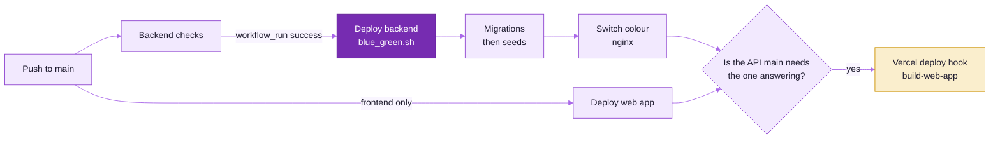

# Provisioning and deploy

What the box and the deploy workflows assume from the backend, frontend and CI lanes. If one of these is wrong, change it here and in `infra/` together. Engineers read it before they change how the API starts, what it reads from its environment, or how a release reaches the box.

| For | Read |
|---|---|
| Ids, names, the deploy sequence and the box's units | [RUNBOOK.md](../RUNBOOK.md), What exists and Deploy |
| How the pieces fit | [ARCHITECTURE.md](../ARCHITECTURE.md), Deployed pieces |
| Every name in Parameter Store | `infra/.env.example` |
| The fetcher's own rules | [research.md](research.md), the fetcher service |

## CI

- `Backend checks` (`.github/workflows/backend-checks.yml`) runs on `push` to `main` and the round branches when `backend/**`, `shared/**`, `infra/deploy/**`, `backend-checks.yml` or `deploy-backend.yml` changes. `Deploy backend` starts from its `workflow_run`, only for a `push` on `main` of this repository that concluded `success`, so every one of its three database shards must pass. A push that changes only `infra/deploy/**` therefore still deploys.
- Vercel never builds from Git (`frontend/vercel.json` turns Git deployments off for every branch). The production build is started through the Vercel deploy hook by `.github/actions/build-web-app`: from the last step of `Deploy backend`, or from `Deploy web app` (`.github/workflows/deploy-web.yml`) for a push that changes only `frontend/**`; a push that changes only `frontend/e2e/**` starts no build. The hook builds the head of `main`, so the action's `api_ready.sh` first reads the commit the API names at `/health` and calls the hook only when the head of `main` changes no `Backend checks` push path since that commit; otherwise it builds nothing and leaves the build to the Deploy backend that ships the missing API (decision 0173).

## Backend

| Assumption | Detail |
|---|---|
| Packaging | `backend/pyproject.toml` with uv. Commit `backend/uv.lock`; without it the box resolves dependencies itself and the deploy warns. Installed with `uv sync --no-dev --no-editable --frozen` on the CPython that `infra/deploy/python.pin` names (3.15.2, a python-build-standalone build): the release installs it into `/opt/cpython/<version>+<build>` when it is missing, after its SHA-256 is checked, beside every older one, and builds the venv on it, so a rollback keeps each release on its own interpreter (decision 0118). |
| ASGI app | `app.main:app`, started from `backend/` as `python -m uvicorn app.main:app --host 127.0.0.1 --port 8000|8001 --workers ${API_WORKERS} --no-proxy-headers`. `API_WORKERS` defaults to 1. |
| Liveness and readiness | `GET /health` answers 200 without touching the database and names the release commit in `release`, which the API colour reads from its slot's `release.env` (`EnvironmentFile=-/opt/kalavigyan/slot-%i/release.env`, written by `release.sh`); the watchdog, nginx's check right after a switch and the web build's gate call it. `GET /health/ready` answers 200 only when the database answers: a new colour must answer it before nginx switches to it (a release, a rollback, a restart), and `release.sh`'s last check and the CloudFront smoke test call it, the smoke also waiting until `/health` names the deployed commit (decision 0173). |
| Migrations | `backend/alembic.ini` present → `python -m alembic upgrade head` runs from `backend/` with the env loaded, before the new colour starts. No `alembic.ini` → no migrations. After three failed tries the live colour is stopped to free its pooler sessions and five more follow; once one passes the live colour starts again and serves through the seeds and checks, which every migration allows (below). A release stopped after its migration (a failed seed, the retrieval check) leaves the release before serving the migrated database, so every migration stays readable and writable by the release before it (decision 0151): every PostgreSQL enum is declared through `models.base.pg_enum`, whose `OpenEnum` reads a label it does not list as its text, so a label is added only after a release that reads it has shipped; a required column the release before does not map has a default or is filled by a `BEFORE INSERT` row trigger, dropped in the first release after the one that maps the column (migration `0075_mcp_call_name_filled` filled `McpToolCall.clientName` from the grant's client for the release before 0074, and `0086_mcp_call_name_required` dropped it once that release was live); a renamed value or re-stamped row keeps its old form current until the switch. Backend checks loads every table through the release before's models after `alembic upgrade head` and checks its enum labels and required columns (`backend/tests/db/test_previous_release_db.py`). |
| Seeds | Right after the migration, `blue_green.sh` runs `python -m app.scripts.seed_crafts`, `app.scripts.seed_claims`, `app.scripts.seed_districts`, `app.scripts.sync_dataset_registry` (decision 0114), `app.scripts.import_curation` (decision 0053) and `app.scripts.refresh_shared_terms` (`docs/contracts/learning.md`), in that order, from `backend/` with the env loaded. All six are idempotent. A non-zero exit of any of them stops the release with "seeding failed" and nginx keeps the live colour. Then it runs `app.scripts.sync_portal_crafts` (`docs/contracts/portal-craft-feed.md`), `app.scripts.embed_craft_descriptors` and `app.scripts.embed_knowledge` (missing or re-stamped craft, claim and chunk vectors, each bounded to 240 seconds inside a 300-second timeout, reports logged) and `app.scripts.rebuild_stale_pages` (480 seconds); after the switch, `app.scripts.refresh_served_pages` (300 seconds). A failure or time-out of any of these later steps is a warning only. |
| Worker | `app.worker` (`app/worker.py` or `app/worker/__main__.py`). systemd starts `kv-worker` only if one exists. Stopped during migrations, restarted after the switch. `app/worker.py` exists since decision 0018: it runs the media queue, needs `DATABASE_URL`, `S3_BUCKET`, `MEDIA_BUNDLE_HMAC_KEY`, the AWS keys and the provider keys from the same `.env`, drains for 25 s on SIGTERM (`TimeoutStopSec=30`), and without its bucket or bundle key logs the missing name and waits. |
| Fetcher | `app.fetcher` (`app/fetcher.py` or `app/fetcher/__main__.py`), listening on `FETCHER_HOST:FETCHER_PORT` (127.0.0.1:8090). It gets only `/opt/kalavigyan/fetcher.env`: keys starting with `FETCHER_` plus `APP_ENV` and `LOG_LEVEL`. It has no AWS keys or database URL, and cannot read the processes that do: it runs as a user of its own that systemd makes for it (`DynamicUser=yes`), outside the `kalavigyan` group that may read `.env`, and with `ProtectProc=invisible` it sees no other user's processes in `/proc`, so their `environ` is closed to it (decision 0173). The release tree and the interpreter stay world-readable (directories 0755, `chmod -R go-w` only) so it can run them. systemd blocks link-local (instance metadata) and private ranges. It does **not** block loopback, so the fetcher must refuse loopback targets itself (it does: `docs/contracts/research.md`, the fetcher service). Memory cap 768 MB, 64 tasks. The API reaches it at `FETCHER_URL` (`http://127.0.0.1:8090`), `POST /fetch`, `GET /health`. |
| Env file | `/opt/kalavigyan/.env`, rendered from SSM `/kalavigyan/env/*` as `NAME='value'` lines. It is symlinked as `backend/.env` in every release, so pydantic-settings and Alembic find it. Values never contain `'` or line breaks. |
| Database | `DATABASE_URL` is `postgresql://postgres.<ref>:<pw>@aws-1-ap-south-1.pooler.supabase.com:5432/postgres?sslmode=require` (Supabase **session** pooler). SQLAlchemy code converts the scheme to `postgresql+psycopg` itself. Each process on the box takes its connection budget from the `KV_PROCESS` its unit names, a script from the script budget (`core/connection_budget`, decision 0163; RUNBOOK, Connection budget), not from `DATABASE_CONNECTION_LIMIT`, which only an unnamed process off the box reads; answers research through `core/db.research_sessionmaker()`, which holds at most the pool less two connections, so a sign-in or page read always finds one (decision 0146). Extensions vector, postgis, pg_trgm, unaccent and citext are in schema `extensions`. Every new `public` table gets RLS from an event trigger. The app connects as `postgres`, which bypasses RLS. anon and authenticated have no grants. |
| Media | `AWS_ACCESS_KEY_ID` / `AWS_SECRET_ACCESS_KEY` belong to IAM user `kalavigyan-media`. It may Put/Get/Delete/AbortMultipart on `media/*` and Put/Get on `exports/*`, and ListBucket only within those two prefixes. Keys follow the naming skill: `media/<userId>/<uuid32hex>/<FileName>`. `exports/` expires after 7 days. The bucket is private: presigned GET/PUT only, SSE-S3 (`AES256`). |
| Client address | Chain is browser → Vercel proxy → CloudFront → nginx → uvicorn. The Vercel proxy sends `x-web-proxy-secret` and `x-viewer-address`; when the secret matches `WEB_PROXY_SECRET` (constant-time compare) the backend uses `x-viewer-address` as the client. Otherwise, with `FORWARDED_CLIENT_HOPS=2`, the client is the 2nd `X-Forwarded-For` entry from the right. `WEB_PROXY_SECRET` is generated by `seed_secrets.py` into Parameter Store, the GitHub secrets and the Vercel project (Sensitive, server-only). `X-Forwarded-Proto` is `https` for viewer traffic. |
| Names | Media bucket `S3_BUCKET`, Brave key `BRAVE_SEARCH_API_KEY`, web origin for emailed links `PUBLIC_WEB_URL=https://kalavigyan.vercel.app`. The backend still accepts the old `AWS_S3_BUCKET` and `BRAVE_API_KEY` until Parameter Store is reseeded; `seed_secrets.py` deletes the old names. Deploy backend writes `PUBLIC_WEB_URL` and `S3_BUCKET` from the `WEB_ORIGIN` and `MEDIA_BUCKET` variables on every run. |
| Sign-up | `TURNSTILE_SECRET_KEY` (GitHub secret) and `TURNSTILE_SITE_KEY` (GitHub variable), both copied to Parameter Store by Deploy backend, from a Cloudflare Turnstile widget for `kalavigyan.vercel.app`. With `APP_ENV=production` and either missing, email sign-up answers 503 and the page offers Google only. |
| Streaming | nginx has `proxy_buffering off`. CloudFront's origin read timeout is 120 s between bytes, so SSE answers send a heartbeat at least every 60 s. |
| CORS | `BACKEND_CORS_ORIGINS=https://kalavigyan.vercel.app` (comma-separated list). `BACKEND_CORS_PREVIEW_PROJECT=kalavigyan` with `BACKEND_CORS_PREVIEW_SCOPE=cxacraftecosystem-8028s-projects` also accepts this project's Vercel previews, `https://kalavigyan-<9 characters>-cxacraftecosystem-8028s-projects.vercel.app` and nothing else on `vercel.app`; both or neither, off unless set (decision 0076). `seed_secrets.py` writes the pair only with `--preview-cors`; deleting both and deploying turns previews off again. The bucket's CORS also allows `http://localhost:3000` and `http://127.0.0.1:3000` for local dev. |
| Search | SearXNG at `SEARXNG_URL` (`http://127.0.0.1:8888`) with JSON enabled: `/search?q=…&format=json`. The API process calls it (`sources/web/searxng.py`); Brave is the fallback when `BRAVE_SEARCH_API_KEY` is set. |
| Redis | `REDIS_URL` (`redis://127.0.0.1:6379/0`), loopback only, 256 MB LRU. Treat it as a cache. The job queue stays in Postgres (PLAN §3). |
| Request body | nginx accepts up to 200 MB. Large media goes to S3 directly. |
| Logs | Each process logs JSON lines to stdout (`core/logging.configure_logging`), never a secret, statement parameter or request body (`redact_secrets`, the engine's `hide_parameters`, the request line's masked capability tokens). Each unit names itself with `SyslogIdentifier` (`kv-api`, `kv-worker`, `kv-fetcher`, `kv-contributions`); journald forwards to rsyslog, which writes `/var/log/kalavigyan/<identifier>.log`, and the CloudWatch agent ships those and nginx's `kalavigyan-access.log` and `error.log` to `/kalavigyan/<service>` (30 days). A new process's identifier needs its line in `infra/deploy/logs/rsyslog.conf`, `cloudwatch-agent.json` and `infra/terraform/logs.tf` (decision 0150, RUNBOOK Logs). |

## Frontend

| Assumption | Detail |
|---|---|
| Project | Vercel project `kalavigyan` (team `cxacraftecosystem-8028s-projects`), Root Directory `frontend`, Node 26.x, built from `main` through the deploy hook (CI, above). Production URL `https://kalavigyan.vercel.app` |
| API origin | `NEXT_PUBLIC_API_URL=https://d89rsltpszebp.cloudfront.net` (origin only, no trailing slash, no path). The frontend adds whatever prefix the backend mounts its routes under |
| Other variables | `NEXT_PUBLIC_APP_URL`, `NEXT_PUBLIC_GOOGLE_CLIENT_ID` and, once the backend has the Yahoo secret, `NEXT_PUBLIC_YAHOO_CLIENT_ID` (Encrypted) and `WEB_PROXY_SECRET` (Sensitive, server-only, read by `lib/server/apiProxy.ts`) |
| Build | The app must build with `vercel build --prod` from the repository root; the root `.vercelignore` uploads only `frontend/` |

## How this document is kept true

| Claim | Kept true by |
|---|---|
| When checks run and deploys start | `.github/workflows/backend-checks.yml`, `deploy-backend.yml` and `deploy-web.yml`, and `frontend/vercel.json` |
| How a release starts, migrates, seeds and switches | `infra/deploy/release.sh` and `infra/deploy/blue_green.sh`; `backend/tests/test_deploy_page_order.py` holds the order of its page steps; `backend/tests/deploy/test_blue_green.py` runs `blue_green.sh` on a fake box (a retried migration, a failed release, a rollback, a restart, a colour that cannot reach its database, a release that runs out of time); `backend/tests/deploy/test_release_wiring.py` holds its limits against the workflow's, the readiness gates and the fetcher's isolation |
| When the web app may build | `.github/actions/build-web-app/api_ready.sh`, run against a real history by `backend/tests/deploy/test_web_build_gate.py` |
| The box's processes | `infra/deploy/units/` (`kv-api@`, `kv-worker`, `kv-fetcher`, `kv-contributions`, the watchdog), installed on every release |
| What the box logs and ships | `backend/tests/test_log_shipping.py` (units, rsyslog, the agent, Terraform and nginx agree; capability tokens masked), `backend/tests/test_log_redaction.py` and `backend/tests/db/test_log_safety_db.py` |
| The environment's names | `infra/.env.example` and `infra/scripts/seed_secrets.py` |

Re-read it when a workflow's trigger, a box unit, an environment name or the web build changes.
