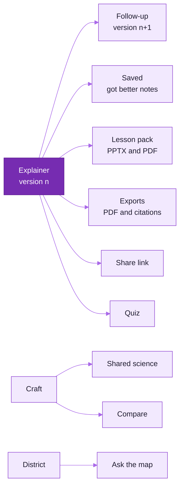

# Learning: follow-ups, versions, saved answers, alerts, lessons, exports, shared science and the map

What a reader does with an answer once it is written: ask a follow-up that builds on it, keep and
compare its versions, save it and hear when it got better, build a lesson, export it, share it,
explore the science it shares with other crafts, take its quiz, compare crafts and ask the map.
Engineers changing any of these routes or screens read it.

| For | Read |
|---|---|
| The plan | [plans/answer-experience.md](../plans/answer-experience.md), phase D, "Learn and act" (features 7, 11, 14, 15, 16, export) |
| The explainer these act on, and the phase D blocks | [explainer.md](explainer.md) |
| The design choices | [decision 0062](../decisions/0062-phase-d-contract.md) |
| The lanes that built it | [0063](../decisions/0063-follow-ups-versions-and-alerts.md), [0064](../decisions/0064-quiz-compare-and-shared-science.md), [0065](../decisions/0065-climate-risk-and-ask-the-map.md), [0066](../decisions/0066-local-measures-and-market-gi.md), [0067](../decisions/0067-lessons-and-exports.md), [0068](../decisions/0068-learning-block-renderers.md), [0069](../decisions/0069-learning-screens.md), [0070](../decisions/0070-phase-d-review-fixes.md) |

## Where the code is

Phase D of `docs/plans/answer-experience.md` ("Learn and act", features 7, 11, 14, 15, 16, export)
around the explainer of `docs/contracts/explainer.md`. The code is the typed models in
`backend/app/research/` (`explainer_versions.py`, `alerts.py`, `lessons.py`,
`citation_export.py`, `shared_science.py`, `quiz.py`, `craft_compare.py`) and
`backend/app/schemas/district_crafts.py`, and the client shapes in
`frontend/lib/learningContract.ts`, `lessonContract.ts`, `sharedScienceContract.ts`,
`quizContract.ts`, `compareContract.ts` and `districtCraftsContract.ts`. The phase D blocks (quiz, compare,
concept graph, measure, market and GI, climate and risk) are in the explainer contract. Change a
shape only together with this page, the fixtures and both sides' tests. Design choices: decision
0062; the lanes that build it: 0063 (follow-ups, versions, saved explainers and alerts), 0064
(quiz, compare and the shared-science explorer), 0065 (climate and risk, ask the map), 0066 (local
measures, market and GI), 0067 (lesson builder, PDF and citation export), 0068 (block renderers),
0069 (screens), 0070 (review).

Last reviewed: 2026-11-18.

## Ground rules

- Shapes follow `docs/contracts/research.md`: `ContractModel`, camelCase JSON, unknown fields
  refused, https URLs only, instants with a time zone. Every response here is `schemaVersion 1`.
- Every fact a reader sees carries its citation: a sentence its claims' citations, a value its
  dataset row. Nothing here is written by a model; a model may only choose and order.
- An explainer is its asker's. Every explainer, version, saved entry, notification and lesson
  route answers 404 to anyone else, Master Admins included, so a stranger learns nothing. The one
  way out is a share link the asker (or, for a lesson, its builder) makes (Share links, below).
- Routes are thin (`docs/contracts/backend.md`): read on one short session, release it before any
  model, bucket or HTTP call (decision 0040).
- The paths below are under `/api`; the client's constants omit the prefix like every other
  contract (`EXPLAINER_PATH`, `LESSON_FILE_PATH`, ...).

## Follow-ups that build (decision 0063 builds it)

An explainer is named by the answer that first made it: `explainerId` is version 1's `answerId`.
A follow-up is a new answer that adds or deepens sections of the same explainer and is stored as
the next version; earlier versions are never changed.

- **Asking.** `POST /api/answers/stream` takes `buildsOn: BuildsOn {explainerId, version, facets[]}`
  beside the question. `version` must be the latest (else 409 `{detail}`, the client reloads);
  `facets` (each once, at most 14), when given, are exactly the fields researched whatever the
  question asks (the alert's "Update" sends the facets with news); empty lets the question decide,
  capped by the depth's section count. The follow-up keeps the explainer's crafts, depth and
  language (`Understood` as version 1 had it), so a request with `buildsOn` sends no `craftSlug`,
  `anyCraft`, `depth` or `language` (422 otherwise); 403 when the reader's role no longer offers
  that depth. 404 for an explainer that is not the asker's.
- **Stream.** After `understood`: `builds_on` `BuildsOnEvent {explainerId, version, sections[{id,
  order}]}` (the base version's sections by order). Sections then stream as usual: a section the
  base has (same id) is deepened, its new blocks numbered after the base's (`s2.b2` after `s2.b1`);
  a new section takes the next id and an order after the base's. A deepened section only adds:
  sentences whose claims the explainer already cites are dropped, and what it already shows is not
  built again: a block of a kind with an identity (`research/block_identity.block_keys`: a map
  layer's layer, a region story's river or else its districts, a reaction player's reactions, a
  molecule's compound, a material card's material, compound, term or name) is dropped only when
  everything it shows is shown already, so a second layer is added; any other kind it shows (a
  ladder, a picture strip, a seasons strip, an expert view) is not built again
  (`services/section_deepening.Deepening`). One that finds nothing new ends `EMPTY` in the
  stream and stays as the base shows it. Every section of a follow-up, new or deepened, is also
  held to what the whole explainer shows, as a later section of a first answer is (decision 0174):
  the stream's claim ledger starts from the base's blocks (`ExplainerStream.shown_before`) and the
  answer's builders from the kinds they show, so a sentence whose claims are all shown or that
  restates a shown one, a material, molecule or picture already shown, and a craft-level story the
  base shows (a region story, seasons strip, supply map or zoom story,
  `claim_ledger.ONCE_PER_ANSWER_KINDS`, never built again) are left out, and a composed heading
  never takes a base section's title. A new section whose every block is left out ends `EMPTY` as
  already covered, with no further research. Before `done`: `version` `VersionMark` of the stored
  version; a follow-up that added nothing stores no version and sends no `version`. When another
  follow-up stored that version meanwhile, the follow-up is merged again onto the newer version
  (`version_merge.remerged_version`, `services/version_race`, up to three tries): each section goes
  to the newer version's section of its field (deepened, its blocks and their sentence ids
  renumbered after that section's, true repeats dropped by the same rule) or is added after the
  newer version's sections; `version` then names the version it was stored as (`basedOn` the newer
  one, `changes` the renumbered blocks). Only when it no longer fits (nothing new is left, or
  `version_problems` refuses it) does the stream end with an `error` and `done {answerId: null}`;
  its claims are written back either way. Both events are in `research/stream.STREAM_EVENTS`
  (`explainer_versions.VERSION_EVENTS`); the client reads them (`lib/explainerVersions`, decision
  0069): it keeps the base's sections, adds a deepened section's blocks before its pictures and
  shows a deepened section that ended `EMPTY` as the base does. A `version` whose `basedOn` is not
  the version the follow-up built on (`lib/explainerVersions.lostRace`) marks the state `reload`,
  and once the stream is `done` the client opens the stored version in place of what it streamed,
  so the merged blocks show under their stored numbers (decision 0160).
- **The stored version.** The follow-up's `Answer.payload.explainer` holds the whole merged
  explainer (`answerId` the follow-up's, `question` the follow-up's), so Listen and every reader
  keep working on one document; `payload.version` holds its `VersionMark`. `Answer.explainerId`
  and `Answer.explainerVersion` index every version (version 1 is the explainer's own answer; the
  pair is unique), and a version's `claimIds` are every claim its document cites. An added section
  that found nothing is left out of the stored version and later added sections close up its
  order. Deepened sections are never reused from or stored as knowledge pieces; added ones are.
- **`VersionMark {explainerId, version >= 1, answerId, basedOn, question, changes[SectionChange],
  createdAt}`**: version 1 is the explainer's own answer (`answerId == explainerId`, `basedOn`
  null, no changes); version n builds on n-1 and changes at least one section, each section once.
  `SectionChange {sectionId, change: ADDED | DEEPENED, blockIds[] (1+)}`.
- **`version_problems(base, latest, changes)`** is the one rule, empty when the follow-up is
  sound: the crafts, depth and language are kept; every base section is kept with its discipline,
  title, original title and order; its blocks are kept unchanged and in order, the added blocks
  follow them, and its pictures (`images`) stay last; added blocks are numbered after the
  section's own; added sections come after the base's; the changes name exactly the added
  sections (all their blocks) and the deepened ones (the blocks added); something changed.
- **Old versions keep their citations.** Each version's document is kept whole on its answer and
  never rewritten; claims are never deleted (superseded and withdrawn claims keep their rows), so
  every citation of an old version still resolves.

| Method | Path | Who | Answer |
|---|---|---|---|
| GET | `/api/explainers/{explainerId}` | the asker | `ExplainerVersionDocument {schemaVersion 1, mark, explainer}` of the latest version |
| GET | `/api/explainers/{explainerId}/versions` | the asker | `ExplainerHistory {schemaVersion 1, explainerId, versions[VersionMark] (1..n in order)}` |
| GET | `/api/explainers/{explainerId}/versions/{version}` | the asker | `ExplainerVersionDocument` of that version |

Both documents mark a generated explainer whose piece is hidden `hidden: true`
(`docs/contracts/explainer.md`, Hiding; decision 0061).

404 for an unknown explainer or version, or another asker's; 422 for an id that is not a uuid or a
version below 1. Fixture: `shared/learning.versions.golden.json` (`history`, `latest`, the
`request` and the `buildsOn` event): version 1 is `explainer.document.golden.json`; version 2 asks
"Why did water push Ajrakh printers from Dhamadka to Ajrakhpur?", deepens `s2` with a prose block
on iron in the water (Khamir, Mongabay) and adds `s4` History on the move to Ajrakhpur.

## Saved explainers and "This answer got better" (decision 0063 builds it)

- **Saving** (`SAVE_EXPORT`, every role): the reader saves an explainer, not a version.
  `SavedExplainer {explainerId, question (version 1's), craft | null, facets[] (the latest
  version's section fields in order, 1+), depth, language, latestVersion, seenVersion (the
  latest the reader opened, at most latestVersion), savedAt, checkedAt | null}`. At most
  `SAVED_EXPLAINERS_MAX` (200) per reader; 409 `{detail}` past it. A saved explainer is a
  `SavedItem` row with `answerId` (version 1), `seenVersion` (the latest version when saved) and
  `checkedAt`.
- **Re-check** (`app.scripts.recheck_saved`, the last module of the nightly **Coverage
  enrichment** box job, so after the coverage modules and any deploy's curation import; no model
  call): for each saved explainer of a known craft, the fact-level claims of that craft that the
  saved depth's mode can see (`retrieval/statements` scope), created or raised in level (a
  `ReviewEvent` moving it to a stronger level) since
  `checkedAt` (else since the latest version), that its latest version does not cite, counted in
  every field the claim is filed under: `Claim.field`, then each of `Claim.fields`, as the
  curation import, the seed and answers write them (`saved_recheck.claim_facets`); a claim filed
  under no field is news nowhere. Facets outside the saved ones are ignored.
  When any count is at least one, one `ANSWER_IMPROVED` notification is written (at most one
  unread per explainer: an unread one is replaced, and when it named the same version its counts
  are added, so nothing unread is lost) and `checkedAt` moves on either way.
- **Update.** The note's action asks a follow-up with `buildsOn {explainerId, version: latest,
  facets: the facets with news}` and the version 1 question; it runs as the reader, under the
  reader's own depth caps, and makes the next version. Nothing is rebuilt at night on anyone's
  behalf.
- **Notification** `{id, kind: ANSWER_IMPROVED, createdAt, readAt | null, payload: AnswerImproved
  {explainerId, version (the latest checked), question, craft, news[FacetNews {facet, newClaims
  >= 1}] (each facet once), checkedAt}}` (`models/enums.NOTIFICATION_KINDS`). Lists are newest
  first, at most `NOTIFICATIONS_SHOWN_MAX` (50), with the reader's `unread` count.
- **Weekly email digest** (off until the owner verifies a sender): `WeeklyDigest {schemaVersion
  1, weekOf (the Monday, India time), items[AnswerImproved] (1-20, each explainer once),
  settingsUrl (PUBLIC_WEB_URL + /settings)}`, sent by `app.scripts.send_alert_digest` on Mondays at
  09:00 India time through the existing SES mailer (`services/mailer`, `MAIL_FROM_ADDRESS`) only
  when `ALERT_DIGEST_ENABLED` is true (default false) and the reader opted in
  (`PreferencesUpdate.alertDigest`, default false), with the week's unread notes (created in the
  seven days before the send, newest first). No digest with nothing in it; never a second one for
  a week (the send is recorded per reader and week before the mail goes, and released when SES
  refuses it). Only active readers (roster `ACTIVE`, not deleted) get one. The mail is plain
  text: each explainer's question, craft, new findings per field and its own link
  (`PUBLIC_WEB_URL/ask?explainer=<explainerId>`, decision 0070), then the settings link. It is
  written in the reader's answer language (`UserPreference.answerLanguage`; `auto` reads English):
  the subject, the opening line, each item's findings line and the settings line
  (`alert_digest.digest_texts`) are translated through the answer translator once per language in
  a run (`services/digest_language.DigestTranslations`), and a line that comes back with no
  translation stays in English; the question is the reader's own words and the craft its name.
  `GET /api/preferences/me` answers `alertDigest` and `alertDigestOffered` (the
  setting), and the client draws the opt-in only when it is offered.

| Method | Path | Who | Answer |
|---|---|---|---|
| GET | `/api/saved-explainers` | signed in | `SavedExplainerList {schemaVersion 1, items}` newest saved first |
| PUT | `/api/saved-explainers/{explainerId}` | `SAVE_EXPORT`, the asker | 200 `SavedExplainer` (saving twice keeps the first `savedAt`); 404 not the asker's; 409 at the cap |
| DELETE | `/api/saved-explainers/{explainerId}` | the saver | 204; 404 when not saved |
| GET | `/api/notifications` | signed in | `NotificationList {schemaVersion 1, items, unread}` |
| POST | `/api/notifications/{id}/read` | the recipient | 204; 404 for another reader's |
| POST | `/api/notifications/read-all` | signed in | 204 |

Opening a version sets `seenVersion` (GET of a version by its saver). Fixture:
`shared/learning.alerts.golden.json` (`saved`, `notifications`, `digest`) for the versions
fixture's explainer: three new Geography findings and one History.

## Lesson packs (decision 0067 builds it)

A professor turns one version of their explainer into a lesson: slides, a reading list and a
quiz, downloadable as an HTML deck, PPTX and PDF. Capability `BUILD_LESSONS` (`core/roles`,
Professor and above; the client's `canBuildLessons`); a pack is its builder's alone.

- **`LessonRequest {explainerId, version, title | null (the version's question when null),
  sectionIds[] (1 to one per field, 16, each once, READY sections of that version, in the order wanted), quiz}`.**
- **`LessonPack {schemaVersion 1, id, explainerId, version, title, craft | null, language,
  createdAt, slides[Slide] (3-60), readingList[ReadingItem] (1+), quiz: QuizBlock | null,
  sources[SourceRef]}`.** Built by the server from the stored version, no model: slides run
  `TITLE`, then `SECTION` slides in the chosen order (a section's cited sentences in reading order,
  at most `LESSON_BULLETS_MAX` (5) per slide, continued on the next slide under the same title;
  the first slide of a section shows its first `INLINE` picture, never a link card), one `QUIZ`
  slide per quiz question in order, `READING`, `SOURCES` (`SLIDE_KINDS`). `Slide {number, kind,
  title, sectionId, blockIds, bullets[ExplainerSentence], image: MediaRef | null, question}`:
  only a `SECTION` slide has a section, blocks and bullets (and maybe a picture); the `TITLE`
  slide opens with the version's lede when it has one, as bullets (its fact sentences whose claims
  are all still shown, at most 5) under `blockIds ["lede"]`, and has no section (decision 0143);
  only a `QUIZ` slide has a question (its index). The quiz is a `QuizBlock` (id `lesson.quiz`) built from the
  chosen sections' cited sentences by the quiz rules (explainer contract), at most 10 questions;
  none can be built, or `quiz` false, is `null`. `sources` is every source the bullets (the
  lede's among them) and the quiz cite, in order of first citation; `readingList` is each of them once with `citedBy` (how
  many shown sentences cite it), by reliability A to D (none last), then most cited, then first
  cited (`lessons.reading_list`). Titles of the fixed slides are the pack language's ("Question
  1", "Reading list", "Sources" in English).
- **Files.** `GET /api/lessons/{id}/files/{format}`, `LESSON_FORMATS`: `html` (one offline file:
  reveal.js inlined from a vendored copy at an exact version the lane pins and records, MIT
  licence kept in the file; no CDN, no script but reveal's), `pptx` (python-pptx), `pdf` (the
  slides as pages, then the reading list and the quiz with its answer key). Every bullet keeps its
  numbered citation and the `SOURCES` slide lists them; a picture shows its author and licence. No
  headless browser, LibreOffice or other heavy native package on the server: the PDF is written by
  a pure-Python library with vendored open fonts (decision 0067 names them). File names come from
  `services/naming.py` (`KalaVigyan_Lesson_<date>_<craft>_<title>_Slides.pptx`, `_Slides.html`,
  `_Lesson.pdf`; golden rows in `shared/naming-golden.json`). A file is made on its first request,
  kept in the private bucket at `exports/<builder>/<sha256>/<name>` (the hash of the rendering
  version, the format, the stored pack and its sources' access days, so it is made once and made
  again only when one of them changes; the bucket's `exports/` rule expires it after seven days;
  a file made while one of its pictures could not be read is filed under the hash of the same
  inputs and the unread pictures' ids, never reused, so the next request reads the pictures again;
  at most `EXPORT_BUILDS_AT_ONCE` (2) files are made at once in a process, and a request for a
  file being made waits and takes it, decision 0143), and answered as `ExportLink {schemaVersion 1, format, fileName, url, expiresAt}`: a signed GET
  valid for `EXPORT_LINK_SECONDS` (300) whose `Content-Disposition` is `attachment` with that
  name (`research/export_links.py`; the client's `exportLinkShape`).

| Method | Path | Who | Answer |
|---|---|---|---|
| POST | `/api/lessons` | `BUILD_LESSONS`, the explainer's asker | 201 `LessonPack`; 403 without the capability; 404 for an explainer, version or section that is not theirs; 422 for a section that is not `READY` |
| GET | `/api/lessons` | `BUILD_LESSONS` | `LessonList {schemaVersion 1, items[LessonSummary {id, title, explainerId, version, craft, createdAt, slideCount}]}` newest first |
| GET | `/api/lessons/{id}` | the builder | `LessonPack`; 404 otherwise |
| DELETE | `/api/lessons/{id}` | the builder | 204 (its routes stop at once; its files expire with the `exports/` rule) |
| GET | `/api/lessons/{id}/files/{format}` | the builder | `ExportLink`; 404 otherwise; 422 for another format; 503 when the bucket fails |

Fixture: `shared/learning.lesson.golden.json` (`request`, `pack`, `list`): version 1 of the
document golden, its three sections in four section slides (the ladder runs over two, the first
with the Commons picture), the nine questions of `learning.quiz.golden.json` under `lesson.quiz`,
reading list and sources: 16 slides. The builder reproduces it byte for byte
(`tests/learning/test_lesson_pack.py`).

**As built (decision 0067, `research/lesson_builder.py`, `services/lesson_packs.py`,
`services/export_files.py`, `api/routes/lessons.py`).** The pack is read and stored on the
request's session with no model or outside call: bullets are the chosen sections' cited fact
sentences whose claims are all still shown (`services/visible_claims.py`), quiz blocks left out;
the quiz is `quiz.quiz_block` over the same sentences. A section the version lacks answers 404;
an unfinished section, a pack left with no bullet, or one past 60 slides answers 422 with the
reason. Fixed slide titles come from `research/lesson_words.py` per answer language; a question
longer than 120 characters is cut at a word with `…`. The files: the HTML deck inlines reveal.js
6.0.2 and its stylesheet (MIT, `app/data/exports/reveal/`) under a `default-src 'none'` policy
with `data:` pictures only and quiz answers as fragments; the PPTX (python-pptx) is 16:9 with
answers in the speaker notes, each text box at the largest size of its ladder at which its lines,
wrapped by fpdf2 with HarfBuzz and the pack script's Noto font at 1.5 lines a point size, fit the
box (`services/slide_text.py`); a section's bullets or a reading or sources list that fits at no
size runs onto further slides titled `<title> (n/k)` (decision 0143); the PDF (fpdf2 with HarfBuzz shaping and the Noto fonts of every
answer script, `app/data/exports/fonts/`) is the slides as A4 landscape pages, then the answers
with each keyed sentence. References on the reading and sources slides are the APA text of the
citation export. A slide's open picture is read only from `upload.wikimedia.org` or
`api.openverse.org`, flattened to a JPEG of at most 1,600 px; one that cannot be read is left out
with its credit.

## Exports (decision 0067 builds it)

- **PDF.** `GET /api/explainers/{explainerId}/versions/{version}/pdf` (`SAVE_EXPORT`, the asker)
  answers an `ExportLink` (as lesson files: made once into `exports/`, a 300-second signed link):
  the version as stored with its hidden marks (a hidden generated explainer, its sources and dataset
  rows are left out of the PDF and the citations, decision 0070), its `READY` sections in order, each with its first open picture and
  credit, every block's drawing from its own values (`services/export_pdf_figures.draw_figure`), then
  every cited sentence of every block in reading order with its numbered citations, each
  dataset row a block draws credited under it with its number, then the numbered references
  (sources, then dataset rows, as the citation export numbers them); same writer and fonts as the
  lesson PDF. The drawings, in the screen's English words: a climate block's trend bars (slope per
  decade, significance, mean, period), yearly series and groundwater readings; a seasons block's
  monthly rainfall bars with values and month strip; a map layer, region story or zoom story's
  districts filled over the outlines of their states (`data/district-shapes.json`, the shapes the
  client draws) with the district names and the boundary caption; a reaction player's or generated
  explainer's labels and equations, and the explainer's values; a molecule's or material's name,
  formula and PubChem id; a supply map's materials with their origins; a measure's stated and
  metric amounts with their basis; a timeline map's places and routes with their years (no map is
  drawn for it). Nothing a block does not carry is drawn. Name
  `KalaVigyan_Explainer_<date>_<craft>_<question>_Report_v<version>.pdf` (the version's day).
- **Citations.** `GET /api/explainers/{explainerId}/versions/{version}/citations` (`SAVE_EXPORT`,
  the asker) answers `CitationExport {schemaVersion 1, explainerId, version, entries[CitationEntry]
  (1+)}`: one entry per cited source, then per dataset row the blocks cite, numbered as the
  explainer numbers them. `CitationEntry {number, sourceId | datasetCode (exactly one), csl,
  apa, bibtex, ris}`, every format keyed `kv<number>`. `GET .../citations/{format}`
  (`CITATION_FORMATS`: `bib`, `ris`, `txt` for APA, `json` for CSL-JSON) answers the joined file
  (`application/x-bibtex`, `application/x-research-info-systems`, `text/plain`,
  `application/vnd.citationstyles.csl+json`; UTF-8) with `Content-Disposition: attachment` and the
  name `KalaVigyan_Explainer_<date>_<craft>_<question>_Citations_v<version>.<format>`: BibTeX
  entries one blank line apart, RIS records back to back, APA one `[n] reference` a line, CSL-JSON
  the items' array.
- **CSL item** (`CslItem`): `id`, `type` (`CSL_TYPES` by source kind; a dataset row is
  `dataset`), `title`, `author[{literal}]` (each stored author as written: names are never
  inverted or guessed; a dataset row's publisher), `issued {"date-parts": [[year]]}` when there is
  a year, `accessed {"date-parts": [[year, month, day]]}` (the India-time day the source or the
  dataset row was retrieved, `retrievedAt`, when stored), `container-title` (the journal a paper
  is in, `Source.containerTitle`), `publisher` (left out when it is the container title),
  `version` (a dataset row's edition), `DOI`, `URL`; absent fields are left out.
- **APA** (APA 7 reference text, plain): the CSL items processed by citeproc-py with the official
  APA 7 CSL style (`app/data/exports/csl/apa.csl`, id `http://www.zotero.org/styles/apa`, updated
  2026-02-07; decision 0067), in the order given. For the stored fields this gives `Authors.
  (Year). Title. Publisher. Link`, and for a paper with its journal `Authors. (Year). Title.
  Journal. Link`: one author as written, two `A, & B`, three to twenty `A, B,
  & C`, more than twenty the first nineteen, `, . . . ` and the last; no year is `(n.d.)` and an
  undated item with a link adds `Retrieved <Month D, YYYY>, from` its access day; a dataset adds
  `(Version <edition>) [Data set]` to its title; the link is `https://doi.org/<doi>` when there is
  a DOI, else the URL. A dataset row with its own `citation` text uses that text.
- **BibTeX**: `@<type>{kv<n>,` (`BIBTEX_TYPES`: article, book, incollection, techreport, else
  misc), then one `  name = {value},` line each in this order: `author` (each name in braces,
  joined by ` and `), `title` (in double braces), the container title (`journal` for an article,
  `booktitle` for a chapter), the venue (`publisher` for an article, book or chapter,
  `institution` for a report, `howpublished` otherwise) from the publisher unless it is the
  container title shown, `year`, `doi`, `url`; then `}` and a line end. Text fields escape `% & $ # _` with a
  backslash and write `\` `{` `}` `~` `^` as `\textbackslash{}`, `\textbraceleft{}`,
  `\textbraceright{}`, `\textasciitilde{}`, `\textasciicircum{}` (BibTeX and biber count `\{` when
  matching braces, so a stored brace could close a field; decision 0070); `doi` and `url` are as
  stored except `\` `{` `}`, written `%5C` `%7B` `%7D`.
- **RIS**: `TY` (`RIS_TYPES`), one `AU` per author, `TI`, `PY`, `T2` (the container title), `PB`
  (unless it is the container title), `DO`, `UR`, `ID kv<n>`, `ER`,
  each `<tag>  - <value>` ending CRLF, the record ending `ER  - ` CRLF.

Fixture: `shared/learning.citations.golden.json`, the six sources of the versions fixture's
version 2, each read on 2026-10-14 (the seed sources' `retrievedAt`). The BibTeX and RIS strings
are the rules above applied by hand, the APA strings the style's output checked by hand against
the rules; `research/citation_formats.py` and `services/apa_references.py` reproduce them byte
for byte (`tests/learning/test_citation_formats.py`), and bibtexparser and rispy read the BibTeX
and RIS back to the same fields.

Every file, the report PDF and the lesson files alike, writes its APA references and renders in one
worker thread after the request's connection is released, as the citation routes do; python-pptx,
fpdf2, uharfbuzz, citeproc-py and Pillow load on the first file a process makes, never at start-up
(decision 0070).

## Share links (decision 0097)

An asker may make one version of an answer readable by anyone who has its link, and a lesson's
builder a lesson pack. Nothing is shared until its owner asks; unshared answers and lessons stay
404 to everyone else. Code: `research/share_links.py` (the shape), `services/share_links.py`,
`services/public_explainer.py`, `api/routes/shared.py`; the token and its time are
`Answer.shareToken` and `sharedAt`, `LessonPack.shareToken` and `sharedAt` (the
`models/sharing.SharedByLink` mixin, migration `0030_share_links`).

`ShareLink {schemaVersion 1, shared, path, sharedAt}`: `path` is the web page of the share,
`/shared/answers/<token>` or `/shared/lessons/<token>`, and `path` and `sharedAt` are null exactly
while it is not shared. The token is 32 URL-safe characters from `secrets.token_urlsafe(24)`
(`SHARE_TOKEN_PATTERN` accepts 22 to 64), stored as it is, since it gives only reading of what its
owner chose to publish; sharing again keeps the token, and stopping and sharing again makes a new
one.

| Method | Path | Auth | Response |
|---|---|---|---|
| GET | `/api/explainers/{explainerId}/versions/{version}/share` | the asker | `ShareLink`; 404 not theirs |
| PUT | `/api/explainers/{explainerId}/versions/{version}/share` | the asker | `ShareLink`; 404 not theirs; 422 `{detail}` when nothing in the version may be shown publicly |
| DELETE | `/api/explainers/{explainerId}/versions/{version}/share` | the asker | 204; 404 not theirs |
| PUT | `/api/lessons/{id}/share` | `BUILD_LESSONS`, the builder | as above for the lesson |
| GET, DELETE | `/api/lessons/{id}/share` | the builder, with or without `BUILD_LESSONS` | as above for the lesson |
| GET | `/api/shared/answers/{token}` | public reading | `ExplainerVersionDocument` of the shared version, as public |
| GET | `/api/shared/answers/{token}/citations`, `.../citations/{format}` | public reading | the version's `CitationExport` and files, as the asker's exports |
| GET | `/api/shared/answers/{token}/pdf` | public reading | `ExportLink` of the version's report |
| GET | `/api/shared/lessons/{token}` | public reading | `LessonPack`, as public |
| GET | `/api/shared/lessons/{token}/files/{format}` | public reading | `ExportLink` of the pack's `html`, `pptx` or `pdf` |

Owner routes answer `private, no-cache`. Public reads count against the anonymous per-address
limit and set `Vary: Authorization` and an `ETag` (the body's SHA-256) with 304 revalidation;
`Cache-Control` is `public, max-age=300` without a session and `private, no-cache` with one, the
file links always `private, no-cache`. An unknown or unshared token is 404 `{"detail": "Nothing is
shared at that address. Its owner may have stopped sharing it."}`, a malformed one 422. A shared
cache may keep a stopped share for up to the 300 seconds of its `max-age`.

**While its owner may publish.** A token opens only while its owner's account is not deleted and
has no `REJECTED` or `SUSPENDED` access row (`services/access_roster.account_in_good_standing`).
Deleting or suspending the account, and suspending or refusing its access, set every
`shareToken` and `sharedAt` of the account to null in the same transaction, audited as
`shares.withdrawn` with `{cause, answers, lessons}`; a role change that loses `BUILD_LESSONS` does
the same for its lessons. A restored account shares again with a new token. The web app asks before
it shares (`lib/shareNotice.SHARE_NOTICE`): the question, the version with its citations and its
PDF report for an answer, the lesson with its citations, slides and handout for a lesson.

**As public.** The shared version is the asker's stored version read as the asker reads it
(`explainer_history.shown_version`: hidden generated explainers, withdrawn testimony and withdrawn
field voices left out), then `public_explainer.public_version`: every citation whose claim and
source have no `ClaimSource` an anonymous reader may quote (chunk ACL outside `OPEN_CHUNK_ACLS`,
a `RESTRICTED` chunk or source, a withheld field source, a hidden claim status or a
non-`OPEN` claim) is withdrawn with `field_voices_readback.without_withdrawn`, so a prose sentence
citing it, or any other block citing it, leaves, and a section left with nothing is `EMPTY`. A
Researcher's answer therefore never publishes its closed-licence quotes. A share whose public
reading is empty is refused at `PUT` and answers 404 if it empties later. The body carries no user
id, email address or role of the asker (the answer's own depth and language stay, as parts of the
answer); its question is the asker's own words, which the asker sees before sharing. A shared lesson is rebuilt on every read from the public reading of
its explainer with the stored pack's title, sections (those still `READY`) and quiz choice, its id
and `createdAt` kept (`share_links.public_lesson`), so it never shows more than the shared answer
would. Files of a share are filed under the neutral owner id `00000000-0000-0000-0000-000000000000`
(`shared_files.SHARED_EXPORT_OWNER`), so no signed link names the asker. Each key a reader is given
a link to is recorded against the share's token (`SharedExportFile`, migration
`0079_shared_export_files`); whenever a share stops (its owner stops it, deletes the lesson, or the
account is suspended, refused, deleted or loses `BUILD_LESSONS`), the files no live share holds are
deleted from the bucket in the same transaction, a file the bucket refuses to delete is kept for the
next sweep, and a file recorded after its share stopped is deleted at once
(`services/shared_files`, decision 0155). The `exports/` rule still removes any file after it.

## Shared-science explorer (decision 0064 builds it)

`GET /api/crafts/{slug}/shared-science` (public, decision 0079) answers `SharedScience {schemaVersion 1, craft,
nodes[ConceptNode] (0-24), sources}`: the glossary terms the craft shares with at least one other
craft (`TermCraft`), each a `ConceptNode` (explainer contract, concept graph) listing every craft
that shares it with its concept ids (`TermConcept`, that craft's `Concept` rows) and one cited
fact-level claim of that craft about one of them that names the term; a craft whose claims name it
nowhere is left out, a term left with fewer than two crafts is dropped. Nodes by label; the
craft's own entry first in each node, the others by name. 404 for an
unknown slug; a `MERGED` slug answers for its target. `GET /api/shared-science/{termKey}`
(public) answers `SharedConcept {schemaVersion 1, node, sources}` for one term across every craft,
the crafts by name, or with `?craft=<slug>` that craft first (404 when it does not share the
term); 404 for an unknown term or one fewer than two crafts share. Each node carries `craftCount`,
how many crafts' own claims name the term, and lists the first 100 of them; `GET
/api/shared-science/{termKey}/crafts?craft=&offset=` (public, decision 0161) pages on in the same
order: `ConceptCraftsPage {schemaVersion 1, termKey, label, craftCount, offset, crafts[ConceptCraft]
(1-100), sources}` from `offset` (0 or more), its sentences numbered on from the node's; 404 for an
unknown term, one fewer than two crafts share, a focus craft that does not share it or an offset at
or past `craftCount`, 422 for a negative offset. Sentence ids are `<termKey>.<n>`. The routes quote
only chunks the reader may read (decision 0079) and answer
`Cache-Control: private, no-cache` with a token and `public, max-age=300` without, with
`Vary: Authorization` and an `ETag` of the body that a matching `If-None-Match` turns into a 304.
Fixture:
`shared/learning.shared-science.golden.json` (`craft` for Kutch Ajrakh, `concept` for alum seen
from Kutch Ajrakh, `crafts` the page of alum's crafts from offset 2), the nodes of the phase D
concept graph.

The craft page drew the craft route as its Shared science tab (decision 0070) until the tabbed
craft screen and `components/craft/CraftSharedScience.tsx` were retired (round 6); the atlas's
search reads the concept route (`lib/atlasSearch.ts`) and says how many crafts name the term from
its `craftCount`. A concept graph's Show all N (`components/answer/learning/useConceptCrafts.ts`,
`lib/conceptGraph.restOfCrafts`) counts N from `craftCount`, reads every later page of the crafts
route in order when the node lists fewer, refuses a page that does not move on, and numbers the
pages' sources after the answer's own.

**As built (decision 0064, `services/shared_concepts.py`, `research/shared_science.py`).** Read
on the request's one session, no model call. Both routes read the stored per-term summary
`SharedTermCraft` whole (`services/shared_term_crafts.stored_term_crafts`): one row per term and
craft whose own claims name the term, with that craft's concept ids for the term (`TermConcept`
rows owned by a `TermCraft` craft that is not `MERGED`, visible concepts, family concepts left out,
by concept name) and every fact-level, visible claim about them whose text or any quote not
`FAIL` names the label (`blocks.named_in_texts`), for terms at least two crafts share. It is
rebuilt whole by `refresh_shared_terms`: on every release after the curation import
(`app.scripts.refresh_shared_terms`, `infra/deploy/blue_green.sh`) and each night (step 5c of
`nightly-upkeep.md`); a claim written in between joins the explorer at the next refresh, and a
claim hidden, held or lowered in between leaves at once, since the route reads the stored claims
through `knowledge_view.claims_by_id` with the reader's chunks. A craft's sentence is chosen among
those claims that still name the label in what the reader may read (`blocks.named_in`): the
strongest level, then the most reliable source, then the most distinct sources, then the text
(`offered_facts.fact_rank`). Limits: the craft route looks at the first `SHARED_TERMS_SCANNED`
(48) of its stored shared terms by label and keeps at most 24 nodes; a node lists at most
`CONCEPT_CRAFTS_MAX` (100) crafts (the focus craft first, then by name), chosen among every
stored craft, and counts them all; a page of the crafts route holds at most 100
(`research/shared_science.concept_crafts_page`). A craft with no such claim has no edge; a term left with fewer than two crafts is
no node.

## Quiz of an explainer (decision 0064)

`GET /api/answers/{answerId}/quiz?sections=<id>&sections=<id>` (the asker) answers `ExplainerQuiz
{schemaVersion 1, answerId, language, quiz: QuizBlock (id `quiz`), sources}` built from the
stored explainer of that answer (any version: each version's answer row holds the whole merged
document) by the quiz rules below, from the chosen sections (each once, every section when none
is given, and then the lede's sentences first, decision 0140), read with the hidden marks of its generated explainers (a hidden one adds nothing,
decision 0070); `sources` are the sources its sentences cite, in order of first citation. 404 for an
answer that is not the asker's or holds no explainer; 204 with no body for an explainer that yields
no question (decision 0089; the client reads it as no quiz and draws no Check yourself); 422 for a
section the explainer lacks or one asked twice. `Cache-Control: private, no-cache`. No model call.

- **The rules** (`research/quiz.py`, `quiz_block`, used by lesson packs too): the pool is the
  sections' fact sentences in reading order (quiz blocks left out, a sentence text once), each
  kept only while every claim it cites is still shown (`claims_by_id`); questions are tried
  section by section in turn, one per sentence, each term keyed once: the key is the first term
  the sentence marks with at least `QUIZ_TERM_MIN_CHARS` (3) letters that has at least
  `QUIZ_DISTRACTORS_MIN` (2) distractors; distractors are taken walking the pool from the keyed
  sentence onwards (wrapping), the first fitting term of each sentence that cites none of the
  keyed claims, is another term with another text, has three letters or more and is not named by
  the keyed sentence or its quotes, at most `QUIZ_DISTRACTORS_MAX` (3). Options are sorted by text
  and `answer` is the key's place; a prompt that reads like an earlier one is not asked again. At
  most 10 questions.

Fixture: `shared/learning.quiz.golden.json`, the nine questions of the document golden's quiz.

## Compare crafts (decision 0064)

`GET /api/compare?crafts=<slug>&crafts=<slug>[&facets=<DISCIPLINE>...]` (public, decision 0079) answers
`CraftComparison {schemaVersion 1, comparison: CompareBlock (id `compare`), sources (1+)}`: two to
four crafts side by side, in the order asked, by field (every field in `DISCIPLINES` order unless
`facets` names some), read on one session with no model call. 422 for fewer than two or more than
four crafts, or two slugs of one craft; 404 `No craft has that address.` for an unknown slug; 204
with no body when no field has claims on two sides (decision 0070). Quotes are those the reader
may read (decision 0079). `Cache-Control: private, no-cache` with a token and
`public, max-age=300` without, with `Vary: Authorization`; a body also carries an `ETag` of
itself that a matching `If-None-Match` turns into a 304.

- **The rows** (`research/craft_compare.compare_block`, the same rows the `compare` builder adds
  to a comparison answer's sections): per field, up to `COMPARE_TERM_ROWS_MAX` (3) term rows for
  the glossary terms at least two of the crafts share (`TermCraft`), by label, each cell the
  craft's best fact naming the term (claims about the term's own concepts first), then one row of
  the field's best remaining fact per craft; a row needs two filled cells, a craft without one
  leaves `null`, no claim is shown twice, at most 12 rows. A craft's facts are its own concepts'
  fact-level claims (family concepts and relations left out) placed in each field the claim is
  filed under (`Claim.field`, then `Claim.fields`, as the import, the seed and answers write them;
  `services/craft_compare.claim_fields`), a claim filed under none placed nowhere, and the first fully visible sentence of the newest current English prose piece of
  each craft and field, which leads its field and carries `pieceId`. Ranked by
  `offered_facts.fact_rank`.

Fixture: `shared/learning.compare.golden.json`, the phase D comparison of Kutch Ajrakh and Bagru on
its own screen.

## Ask the map (decision 0065 builds it)

`GET /api/map/districts/{districtLgd}` (public, decision 0079) answers `DistrictCrafts {schemaVersion 1,
district: DistrictRef, crafts[DistrictCraft], land: LandStory | null, sources, datasets,
boundaryCaption}`, read with no model call:

- **Crafts** practised there: each craft with a cited `CraftLocation` in the district (a district
  location, or a point in its polygon, as the region route places it), `{craft, roles[] (the
  locations' `role`s, `PRACTISED` when none is stored; `models/enums.PLACE_ROLES`), basis:
  PlaceBasis (CRAFT_LOCATION only, the strongest location, as the region route chooses it)}`,
  by name. A state of practice alone does not place a craft in a district.
- **Land** (why the land suits them): `LandStory {blocks[Block] (0-4), facets[RegionFacet]}`.
  Blocks are stored pieces placed with their reuse mark, never built on the tap: the current
  cross-craft region story of the district (one told over districts that include it, or a basin
  crossing it) and the
  `GEOGRAPHY`, `GEOLOGY` and `CLIMATE` prose pieces of the crafts listed whose topic names the
  district, at most four, each passing the reuse rule. Facets are the district's own values of
  the land facets (`LAND_FACETS`: `SOIL`, `CLIMATE`, `WATER`, `TERRAIN`), exactly as the region route
  gives a district place, every stored year of a yearly series included. Neither is `land: null`.
  The screen folds a yearly series (three or more values of one dataset, variable, depth,
  statistic, aggregation and unit whose period is a single year, `lib/yearlySeries.foldedRows`)
  into one row where its first year stood: the variable and its years, a finding naming the
  highest and the lowest year, a sparkline in the variable's series token (`--series-rain`,
  `--series-heat`, else `--chart-series`) with those two years marked in `--chart-emph` and a
  break at a missing year, the provenance line, and every year in its table behind "All N values"
  (`components/map/YearlySeriesRow`, decision 0180). The route's shape does not change.
- `sources`: the crafts' basis sources, then every source the blocks cite, once each, in that
  order. `datasets`: `DR_DISTRICT_SHAPES`, then each value's dataset row once, by code.
  `boundaryCaption` is `BOUNDARY_CAPTION`; the client draws the district from the shapes it has.
- 404 for an LGD code the register does not hold or while no `DR_DISTRICT_SHAPES` row is stored;
  422 below 1. A piece quoting a chunk the reader may not read fails the reuse rule for that
  reader (decision 0079). `Cache-Control: private, no-cache` with a token and
  `public, max-age=300` without, with `Vary: Authorization` and an `ETag` of the body that a
  matching `If-None-Match` turns into a 304.

Fixture: `shared/map.district-crafts.golden.json`: Kachchh (449), Kutch Ajrakh placed by the GI
journal, the phase B region story placed from its basin piece, and the region golden's soil,
climate, water and terrain values (real Geo ETL rows, `backend/tests/geo/geo_district_env_extract.json`;
`backend/tests/geo/test_district_view.py` rebuilds the file byte for byte).

**As built (decision 0065, `api/routes/map_districts.py`, `services/district_crafts.py`,
`geo/district_view.py`).** Read on the request's one session, no model, HTTP or bucket call. The
register row (`place_offers.district_refs`) and the `DR_DISTRICT_SHAPES` dataset row must exist,
else 404 `{detail}`. Crafts: `ACTIVE`, not catch-all crafts with a `DISTRICT` or `POINT`
`CraftLocation` placed in the district as the region route places it (`region_records.
located_places`: a point by the polygon covering it, lowest LGD first, else its stored district)
whose source is visible; curated places are such rows (decision 0053). Each craft once by name,
its roles in `PLACE_ROLES` order, its basis the strongest location (level, then id). Land blocks,
at most four: the newest current region story with no craft whose `districtLgds` include the
district or keyed by a basin crossing it (`region_pieces.district_story_pieces`, its river still
stored), then for each listed craft and each of `GEOGRAPHY`, `GEOLOGY`, `CLIMATE` the newest English
`prose` piece whose topic key's subjects include the district's code (`lgd-<code>`, decision 0160),
so a district named alike in two states never lends its pieces, by craft name then facet; every
piece passes the reuse rule at any depth (`reuse_refusal` with `BASIC`) and cites only visible
sources. Blocks are `land.b<n>` with sentences `land.b<n>.<m>` and their reuse marks. Facets are
the district's stored values of `SOIL`, `CLIMATE`, `WATER` and `TERRAIN` built by
`region_view.district_value` and `region_facets`, so the climate facet also lists the CHIRPS and
GHCN CAMS series, normals and trends. The assembler reproduces the fixture from the region
golden's rows (`tests/geo/test_district_view.py`).

## How this document is kept true

| Claim | Kept true by |
|---|---|
| Every shape against its golden (`shared/learning.*.golden.json`) | `backend/tests/contracts/test_learning_contract.py`, `test_learning_exports_contract.py` and `test_learning_views_contract.py`; `frontend/e2e/learning-contract-unit.spec.ts` |
| Follow-ups, versions, saved explainers and alerts | `backend/tests/alerts/`, `backend/tests/answering/test_follow_up_flow.py` and `test_follow_up_race.py`, `backend/tests/db/test_explainer_versions_db.py`, `test_version_race_db.py`, `test_alerts_db.py` and `test_alert_digest_language_db.py` |
| Lesson packs and their files | `backend/tests/learning/test_lesson_pack.py`, `test_lesson_files.py`, `test_lesson_routes.py`, `test_lesson_lede.py`, `test_slide_text.py` and `backend/tests/db/test_lessons_db.py` |
| Exports and citation formats | `backend/tests/learning/test_citation_formats.py`, `test_paper_journals.py`, `test_export_store.py`, `test_export_threads.py`, `test_hidden_exports.py` and `test_lede_export.py` |
| Share links | `backend/tests/learning/test_share_links.py`, `test_share_owners.py` and `backend/tests/db/test_share_links_db.py` |
| Compare and the shared-science explorer | `backend/tests/research/test_craft_compare.py`, `test_shared_science_nodes.py`, `backend/tests/learning/test_shared_term_crafts.py` and `backend/tests/db/test_learning_views_db.py` |
| Ask the map | `backend/tests/geo/test_district_view.py` |
| The screens and renderers | `frontend/e2e/learning-screens-unit.spec.ts`, `learning-renderers-unit.spec.ts`, `learning-views-unit.spec.ts`, `lesson-exports-unit.spec.ts` and `compare-state-unit.spec.ts` |

Re-read it when a learning shape gains a field, an export format is added, or a screen changes what it reads.
