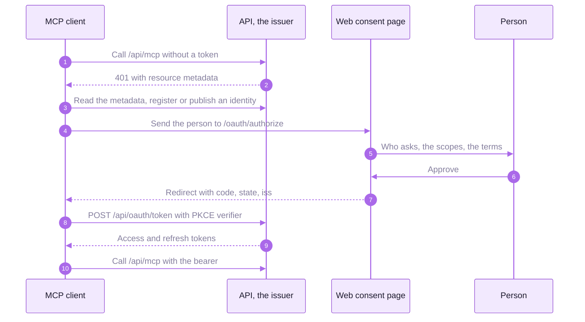

# MCP sign-in (OAuth 2.1)

How an agent's MCP client signs a person in, what each scope lets it do, and how a connection is
listed and revoked. Engineers changing sign-in, a scope or the consent screen read it, and so do
the people who connect a client.

| For | Read |
|---|---|
| Why sign-in works this way | [decision 0101](../decisions/0101-knowledge-architecture-for-every-craft.md), item 15, "Authentication" and "Guards" (slice 2 of the MCP server) |
| Published identities | [decision 0115](../decisions/0115-client-id-metadata-documents.md) |
| The read tools and the protocol, unchanged for a call without a token | [knowledge-api.md](knowledge-api.md) |
| The terms a person accepts | [legal/mcp-terms-of-use.md](../legal/mcp-terms-of-use.md) |
| Abandoned registrations removed every night | [nightly-upkeep.md](nightly-upkeep.md), 3a |
| What each call keeps, how long, and the MCP activity screen | [decision 0150](../decisions/0150-mcp-activity-and-box-logs.md); [nightly-upkeep.md](nightly-upkeep.md), 3d |
| The review scope, its short tokens and the admin tools it lists | [decision 0170](../decisions/0170-review-over-mcp-staged-and-pages-refreshed-now.md); [review-queue.md](review-queue.md), Staged over MCP |

An agent's MCP client signs a person in with OAuth 2.1 as the MCP authorization specification defines
(2025-06-18 and 2025-11-25): protected resource metadata (RFC 9728), authorization server
metadata (RFC 8414), client ID metadata documents (draft-ietf-oauth-client-id-metadata-document,
decision 0115), dynamic client registration (RFC 7591), the authorization code grant with
PKCE S256 only, rotating refresh tokens, token revocation (RFC 7009), resource indicators
(RFC 8707) and the `iss` response parameter (RFC 9207). The read tools and the protocol are in
`docs/contracts/knowledge-api.md`; nothing there changes for a call without a token.

## Hosts

- **The API** is `PUBLIC_API_URL` (CloudFront in front of nginx, which forwards every path to
  FastAPI). It is the issuer and serves the metadata, registration, token and revocation
  endpoints, and the MCP server itself at `/api/mcp`.
- **The web app** is `PUBLIC_WEB_URL` (Vercel). It serves the consent screen at
  `/oauth/authorize`, the one step a person sees. Its proxy (`frontend/proxy.ts`) forwards only
  `/api/*` and refuses a POST that is not same-origin, so an agent's server-to-server token call
  cannot pass through it, and `next.config.ts` rewrites nothing under `/.well-known`. That is why
  the issuer and its endpoints live on the API origin while the authorization endpoint is the web
  page.
- Both must be an https origin (http only on a loopback host, for development). Without them the
  metadata, token and bearer paths answer 503 and anonymous reads go on as before.
- Everything is off while `MCP_SERVER_ENABLED` is false (404), except Settings' list of connected
  apps and Revoke, which always work.

| What | URL |
|---|---|
| MCP server (the resource) | `<API>/api/mcp` |
| Protected resource metadata | `<API>/.well-known/oauth-protected-resource/api/mcp`, also at `<API>/.well-known/oauth-protected-resource` |
| Authorization server metadata (issuer `<API>`) | `<API>/.well-known/oauth-authorization-server` |
| Authorization endpoint | `<WEB>/oauth/authorize` |
| Token endpoint | `<API>/api/oauth/token` |
| Registration endpoint | `<API>/api/oauth/register` |
| Revocation endpoint | `<API>/api/oauth/revoke` |

The metadata documents are public and cached five minutes. They, the registration, token and
revocation endpoints and `/api/mcp` answer browser clients from any origin without credentials,
preflight included (`api/mcp_cors.py`, `knowledge-api.md`), as the MCP authorization specification
expects of clients that run in a browser; the consent routes keep the site's configured origins. The authorization server metadata lists `scopes_supported`
(read, ask, contribute, review), `response_types_supported` `code`, `grant_types_supported`
`authorization_code` and `refresh_token`, `token_endpoint_auth_methods_supported` and
`revocation_endpoint_auth_methods_supported` `none`, `code_challenge_methods_supported` `S256`,
`authorization_response_iss_parameter_supported` true and `client_id_metadata_document_supported`
true.

## Published identities (client ID metadata documents)

A client may skip registration and use an https URL as its `client_id`: the address of a JSON
document that names it (decision 0115). Claude's is
`https://claude.ai/oauth/mcp-oauth-client-metadata` ("Use Claude's published identity" in its
connector dialog), VS Code's `https://vscode.dev/oauth/client-metadata.json`. A `client_id` holding
`://` is read this way.

- **The address** is https on port 443 with a host, a path other than `/` and no `.` or `..`
  segments, no user name, password or fragment, at most 2,048 characters; else `invalid_client`
  and nothing is fetched (`research/oauth_client_documents.client_id_problem`).
- **Reading** goes through the fetcher (`POST <FETCHER_URL>/fetch-client-document`,
  `fetcher/client_documents.py`), never the API: every address of the host must be public (no
  private, loopback, link-local or metadata address), the connection is pinned to the vetted
  address, at most 5 KB, at most 5 seconds, `Accept: application/json`, no redirect followed (any
  redirect refuses the document), only a 200 accepted. The fetcher passes the document's
  `Cache-Control` back in `X-Client-Document-Cache-Control`.
- **The document** is a JSON object with `client_id` exactly the address it was read from,
  `client_name` (1 to 120 characters), 1 to 10 `redirect_uris` that each pass the registration
  rule below, no `client_secret` or `client_secret_expires_at`, and a way to sign in as a public
  client: `token_endpoint_auth_methods_supported`, when given, includes `none` (it decides,
  whatever the preferred `token_endpoint_auth_method`, so ChatGPT's document, which prefers
  `private_key_jwt` and lists `none`, signs in with PKCE as a public client; decision 0148);
  without it, `token_endpoint_auth_method` is absent or `none`. Other
  fields, `grant_types` and `response_types` included, are ignored
  (`research/oauth_client_documents.metadata_client`).
- **Held** in the API process for its `max-age`, at least 60 seconds and at most a day; no
  `max-age` is ten minutes, `no-store` or `no-cache` a minute; at most 256 documents, least
  recently used out first. A refusal, a failure or a broken document is never held
  (`services/oauth_client_documents.py`).
- **Refusals** stop on the consent page, never at the client's redirect URI: 400 for an
  `invalid_client` (a refused address, a private address, over 5 KB, a redirect, a missing
  document, a document that breaks a rule), 503 for `temporarily_unavailable` (too slow, the host
  failing or rate limiting, the fetcher unreachable).
- **Stored** at approval as the `OAuthClient` row whose id is `uuid5(NAMESPACE_URL, client_id)`,
  with the document's name and redirect URIs and the `client_id` in `clientUri`, refreshed (with
  `createdAt`) at each approval; the 30-day upkeep removes it only when nobody approved it for a
  month. The token and revocation endpoints take the address as `client_id`; the row's UUID is
  refused there. Everyone who connects one published client shares the row; their connections stay
  their own.

## Registration

`POST /api/oauth/register`, JSON (RFC 7591). Public clients only.

- `redirect_uris` (1 to 10) each must be https with a host, http on 127.0.0.1, [::1] or
  localhost, or a native app's own scheme (`cursor://…`). No fragment, no user name, never
  `javascript`, `data`, `file`, `vbscript`, `about`, `blob`, `filesystem` or `ftp`.
- `grant_types` within `authorization_code`, `refresh_token`; `response_types` within `code`;
  `token_endpoint_auth_method` absent or `none`; `client_uri` https. Unknown fields are ignored.
- `201` with `client_id` (a UUID), `client_id_issued_at`, `client_name` (the first redirect's
  host when none is given), `redirect_uris`, `grant_types` (both), `response_types`,
  `token_endpoint_auth_method: none`.
- Errors are `400 {error, error_description}` with `invalid_redirect_uri` or
  `invalid_client_metadata`. At most 20 registrations an hour from one address
  (`core/rate_limit.client_registration_attempt`), then 429 with `Retry-After`.
- A client registered more than 30 days ago that never completed a sign-in (no connection, so no
  token; an unexchanged code goes with it) is removed by the nightly upkeep, at most 1,000 a night
  (`services/upkeep_clients.py`, `ABANDONED_CLIENT_AGE`, `ABANDONED_CLIENTS_PER_NIGHT`; counted in
  the report's `clients.abandonedRemoved`, `nightly-upkeep.md`). Its `client_id` then answers as an
  unknown client.

## Authorization

The client sends the person to `<WEB>/oauth/authorize` with `response_type=code`, `client_id`,
`redirect_uri`, `code_challenge`, `code_challenge_method=S256`, `state`, `scope` and `resource`.

1. The page sits in the signed-in shell: a signed-out person signs in with today's sign-in
   (including two-step verification and a forced password change) and comes back to the same URL.
2. It sends the OAuth parameters, and only those, to `GET /api/oauth/authorize/request`.
   - An unknown `client_id`, or a `redirect_uri` the client did not register or its document does
     not list, answers 400 and the page stops there: nothing is sent to an address nobody vouched
     for. A loopback redirect may differ from the registered one only in its port (RFC 8252). A
     published identity that cannot be used answers 400 or 503 as above.
   - Any other fault (`response_type` not `code`, no S256 challenge, a malformed challenge,
     `state` over 1,024 characters, an unknown scope, a `resource` that is not this server)
     answers `{kind: "redirect", redirectTo}` carrying `error`, `error_description`, `state` and
     `iss`. The page shows that nothing was connected and returns only when the person presses
     Return to the app, so a registered client cannot use the page as an open redirector
     (RFC 9700, 4.11).
   - Otherwise `{kind: "prompt", clientName, clientIdHost, redirectHost, scopes[{scope, title,
     description, allowed, needs}], terms{version, acceptedAt}}`; `clientIdHost` is the host of a
     published identity's `client_id` and null for a registered client.
3. The page shows who is asking (`components/oauth/ClientIdentity.tsx`): the app's name, its
   identity ("Published at claude.ai" or "Registered by the app itself"), the host it returns to
   and the scopes it asks for, with a warning when it returns to a program on this computer
   (localhost, 127.x, [::1]). The person reads the scopes (read is always given; a scope their role cannot hold is shown
   with what it needs and cannot be ticked; `review` is given only by an Admin or Master Admin with
   two-step verification on whose session proved them within the last 15 minutes, read from the
   session token's `iat`, which a sign-in, a password change and a two-step change set), reads and accepts the MCP terms of use when this
   version is not yet accepted, and presses Approve or Cancel (an `ActionGroup`).
4. Approve posts `POST /api/oauth/authorize/approve {request, scopes, termsVersion}`. The request
   is checked again; a scope not asked for or not held by the role, or `review` without two-step
   verification or a sign-in within 15 minutes, is 422, a terms version that
   is not the current one 409. The acceptance is recorded, a code is stored and the reply is
   `{kind: "redirect", redirectTo: <redirect_uri>?code&state&iss}`, which the page opens.
   Cancel posts `POST /api/oauth/authorize/deny {request}` and returns `error=access_denied`.

A missing `scope` asks for read. `resource`, when sent, must be `<API>/api/mcp` (a trailing slash
is ignored); when absent it is taken to be that.

## Tokens

`POST /api/oauth/token`, `application/x-www-form-urlencoded`, each parameter at most once, an
empty value treated as absent. `client_id` is required and `client_secret` refused; a request
without `client_id` that carries a `client_assertion` of type
`urn:ietf:params:oauth:client-assertion-type:jwt-bearer` is named by the assertion's `sub`, when
it equals its `iss` (the assertion is otherwise not read; decision 0148).

- `grant_type=authorization_code` with `code`, `redirect_uri` (exactly the one the code was
  issued for), `code_verifier` (43 to 128 unreserved characters whose base64url SHA-256 is the
  challenge) and optional `resource`. A code lives 5 minutes and works once: a second use is
  refused and revokes the connection it made.
- `grant_type=refresh_token` with `refresh_token`, optional `scope` (narrower only, else
  `invalid_scope`) and optional `resource`. Every refresh rotates: the old refresh token is
  spent, and presenting a spent one revokes the whole connection.
- The reply is `{access_token, token_type: "Bearer", expires_in: 3600, refresh_token, scope}`
  with `Cache-Control: no-store` and `Pragma: no-cache`. Access tokens live an hour, refresh
  tokens 30 days from their issue, so a connection used at least monthly stays. An access token
  holding `review` lives 15 minutes (`expires_in: 900`), and `review` lasts 8 hours from the
  connection's grant: a token issued after that leaves it out, and the connection goes on with its
  other scopes (`research/oauth_rules.live_scopes`, `access_token_seconds`).
- Errors are RFC 6749 JSON: `invalid_request`, `invalid_client` (401), `invalid_grant`,
  `unsupported_grant_type`, `invalid_scope`, `invalid_target`.
- A second connection of the same app by the same person revokes the first, so Settings lists one
  row per app.

`POST /api/oauth/revoke` (RFC 7009), form, `token` and `client_id`: a refresh token revokes its
connection, an access token only itself. An unknown token, or one of another client, answers
200 and changes nothing.

## The bearer on the MCP server

`POST /api/mcp` with `Authorization: Bearer <access token>`:

- The token must be ours, unrevoked, unexpired, issued for `<API>/api/mcp` and its account still
  live: not deleted, and its `tokenVersion` and `sessionsValidFrom` unchanged since the
  connection was made, so a password change, Sign out everywhere or a suspension ends every
  connection (`core/deps.token_matches_user`).
- Anything else is `401` with
  `WWW-Authenticate: Bearer error="invalid_token", error_description="…", resource_metadata="<API>/.well-known/oauth-protected-resource/api/mcp"`,
  and the attempt counts against the address's anonymous limit. A header that is not Bearer is
  refused the same way.
- The account and its scopes go on `ToolContext` (`user`, `scopes`). The scopes are the token's,
  less any the account's role no longer holds.
- A tool needing more than read: without a token the call is `401` with
  `WWW-Authenticate: Bearer scope="read <scope>", resource_metadata="…"`, which starts the
  client's sign-in; with a token lacking the scope it is `403` with
  `error="insufficient_scope"` and the scopes to ask for.
- No token stays an anonymous read, counted per address as today.

## Scopes and roles

| Scope | Who may give it | Lets the agent |
|---|---|---|
| `read` | everyone, always given | read what a signed-out reader sees |
| `ask` | `ASK_STANDARD` (every role) | ask and receive cited answers in the person's name |
| `contribute` | `PROPOSE_KNOWLEDGE` (Researcher and above) | propose facts (one to 25 at once) and follow them (`get_proposal`), sources, structure, pages and their parts (`edit_draft`, `preview_page`, `propose_page`) and pictures (`give_pictures`); search and read sources (`search_sources`, `read_source`, `supply_source`); claim and release tasks (`reserve_tasks`) and list its own work (`my_work`); steward crafts (`steward_craft`) |
| `review` | `REVIEW_CONTRIBUTIONS` (Admin and Master Admin) with two-step verification on, signed in within the last 15 minutes when it is given | the admin tools, listed in `tools/list` only to a token holding it: read the review queue and open one item (`review_queue`), stage review decisions and source corrections for a person to confirm on the Review page (`stage_reviews`), refresh the pages that changed (`refresh_pages`) and read the admin reports (`admin_reports`); the review tasks of `list_open_work` |

The rule is `research/oauth_rules.may_hold` (what a token holds on every call: the role and
two-step verification) and `Grantor.may_grant` (what a person may give: that, and for `review` the
recent sign-in); the words shown are `research/oauth_contract.SCOPE_TEXT`. A Professor's connection
made before decision 0170 keeps its other scopes and no longer holds `review`. Nothing a review
tool stages is applied by the server: a person confirms it on the Review page
([review-queue.md](review-queue.md), Staged over MCP).

## Terms of use

- The one copy of the text is `backend/app/data/mcp_terms_of_use.md`, version `MCP_TERMS_VERSION`
  (`2026-11-19`, `research/oauth_rules.py`); `docs/legal/mcp-terms-of-use.md` keeps the approval and
  points to it, and `tests/mcp/test_mcp_terms_copy.py` holds the pointer and keeps the text out of
  it. `GET /api/oauth/terms` answers `{version, title, body}`.
- Acceptance is a `McpTermsAcceptance` row per account and version. A new version is asked for at
  the next authorization; a connection already made is not ended by it.

## Settings

`GET /api/oauth/connections` answers `{serverUrl, connections[{id, clientName, clientHost,
scopes, connectedAt, lastUsedAt}]}`, the person's unrevoked, unexpired connections that the server
still serves (a password, two-step or role change, a suspension and Sign out everywhere end every
connection made before them, `oauth_tokens.grant_matches_user`, and with it `review`), each with the
scopes its next token holds (`held_scopes`, then `live_scopes`), newest first
(`clientHost` is the `client_id` host of a published identity, else the first redirect URI's host);
`serverUrl` is the MCP server's URL while it is on and null otherwise.
`DELETE /api/oauth/connections/{id}` revokes one of the person's own (204), else 404. The card
is `components/settings/ConnectedClientsCard.tsx`; it hides itself while the server is off and
nothing is connected.

## The connection guide

`<WEB>/connect` ("Connect your AI", linked from the account menu and from Connected apps in
Settings) is a signed-in page that a person follows to connect their AI. It reads the address from
`<API>/.well-known/oauth-protected-resource/api/mcp` (`resource`) and the tools and prompts from
anonymous `tools/list` and `prompts/list` calls to `<API>/api/mcp`, both on the server and cached
five minutes, and through the site (`/api/oauth/connections` for the address, `/api/mcp` for the
lists) when the server could not read them. Nothing on the page is a typed address or a hand list:
a tool the server adds is grouped by its name (`lib/connectCatalogue.ts`), and the role's scopes
follow `may_hold` (`lib/connectRoles.ts`). Code: `app/(protected)/connect/page.tsx`,
`components/connect/*`, `lib/server/mcpGuide.ts`, `lib/connectClients.ts` (each client's steps as
its own documentation gives them).

## Guards

- **Rate limit per connection**: 1,200 calls in 10 minutes for one connection, counted across its
  rotated tokens so a refresh does not reset it, and across every API process and both slots
  (decision 0139), then 429 with `Retry-After`
  (`core/rate_limit.mcp_connection_attempt`). It protects the service and is not a spend cap.
- **Audit**: each `tools/call` with a token writes `McpToolCall {grantId, tokenId, clientName,
  tool, outcome, reason, calledAt}`, outcome `OK`, `TOOL_ERROR` or `PROTOCOL_ERROR`, and
  `clientName` the connection's `OAuthClient.name` (decision 0150). A name that is not a tool is
  stored as `(unknown)`. Arguments and results are never stored. `OAuthGrant.lastUsedAt` moves at
  most once a minute.
- **The reason of a failed call** (`api/mcp_auth.call_reason`, `research/mcp_activity.failure_reason`)
  is the refusal's own message: a tool error's text, a protocol error's `message`, or "The call was
  sent as a notification, so it had no reply." for a `tools/call` sent without an id. Every string
  the call sent as an argument (and the name of a tool that does not exist) is replaced by `…`,
  email addresses and phone or Aadhaar-like numbers become `[email]` and `[number]`
  (`research/evidence.without_personal_data`), key and token shapes become `[redacted]`
  (`core/logging.redact_secrets`), and the text is cut to 300 characters ending in `…`. A call
  the server failed while answering is rolled back and recorded as `PROTOCOL_ERROR` with "The
  server failed while answering; call the tool again." (`record_failed_call`), then the failure
  goes on as before (a 500, or the streamed JSON-RPC error). A call that succeeded keeps no reason,
  which the table's check holds.
- **Kept**: a call is kept 180 days; every night the finished India days are counted into
  `McpToolCallDay {day, clientName, tool, outcome, calls}`, kept for good, and the counted calls
  older than 180 days are deleted (`nightly-upkeep.md`, 3d).

## MCP activity

`GET /api/settings/mcp-activity?days=7|30|180[&client=<name>|&connection=<id>]`, Master Admin only
(`require_master_admin`), answers `McpActivity {schemaVersion 1, days, firstDay, lastDay, unit
(day, or week for 180 days), client, connection, keptDays, series[{start, ok, toolErrors,
protocolErrors}], tools[{tool, …}], clients[{clientName, connections, lastUsedAt, …}],
connections[{id, clientName, accountName, accountEmail, scopes, connectedAt, lastUsedAt, ended,
…}], failures[{calledAt, clientName, connectionId, tool, outcome, reason}]}`, golden
`shared/mcp.activity.golden.json`; any other period, or a client and a connection together, is 422.
Days are India days (`core/clock`). The series and tools follow the scope: by client they read
the daily counts for counted days and the calls of the days not yet counted; by connection they read
the calls (180 days). Clients and connections are the whole period; a connection is listed while it
is live or made a call in the period, at most 200, by last use. Failures are the newest 50 in the
scope. The screen is `<WEB>/admin/mcp` (`app/(protected)/admin/mcp/*`, `lib/mcpActivityContract.ts`,
`lib/mcpActivityView.ts`), linked from the settings hub; the period and the scope live in its
address.

## Storage

Migration `0037_oauth`: `OAuthClient`, `OAuthGrant` (a connection: client, account, scopes,
resource, the account's token version, connected, last used, expires, revoked), `OAuthCode`,
`OAuthToken` (`ACCESS` or `REFRESH`, with its scopes), `McpTermsAcceptance`, `McpToolCall`, all
with row-level security on and no grants to `anon` or `authenticated`. Migration
`0074_mcp_activity` adds `McpToolCall.clientName` (filled from each call's connection) and
`reason` (300 characters, only on a failure) and the table `McpToolCallDay` (primary key day,
client name, tool and outcome; `calls` at least 1), the same way protected. Codes and tokens are
random (`kvmcp_ac_`, `kvmcp_at_`, `kvmcp_rt_` and 32 random bytes) and stored only as their
SHA-256; they are never logged, and `redact_secrets` masks their shape in any log line.

## Code

- Contracts: `research/oauth_rules.py` (PKCE, redirect URIs, scopes, lifetimes, errors),
  `research/oauth_contract.py` (bodies and replies), `research/oauth_authorization.py` (checking a
  request, granting scopes, the redirects), `research/oauth_metadata.py` (the two documents and
  the challenge header), `research/oauth_client_documents.py` (client ID addresses, documents,
  holding times, the fetcher route's contract).
- Services: `oauth_clients` (registered and published clients), `oauth_client_documents` (reading
  through the fetcher and holding documents), `oauth_consent`, `oauth_tokens`, `oauth_bearer`,
  `oauth_connections`; the activity: `research/mcp_activity.py` (the reason rule, the series and
  the contract), `services/mcp_activity.py` and `mcp_activity_connections.py` (the reads),
  `mcp_activity_days.py` (India days) and `mcp_activity_upkeep.py` (the night). Fetcher:
  `fetcher/client_documents.py`.
- Routes: `api/routes/oauth_well_known.py`, `api/routes/oauth.py`, `api/routes/oauth_consent.py`,
  `api/routes/mcp.py`, `api/routes/mcp_activity.py`; `api/oauth_hosts.py` (paths and URLs),
  `api/oauth_wire.py` (form and error bodies), `api/mcp_auth.py` (the bearer, the challenges, the
  audit and the reason), `api/mcp_cors.py` (browser clients); the clean-up
  `services/upkeep_clients.py`.
- Web: `app/oauth/authorize/page.tsx`, `components/oauth/*`, `lib/oauthContract.ts`,
  `lib/oauthConsent.ts`; the activity screen `app/(protected)/admin/mcp/*`.
- Tests: `tests/mcp/test_oauth_client_documents.py` (the rules on hand-written documents),
  `tests/fetcher/test_client_documents.py` (the fetcher route),
  `tests/mcp/test_oauth_client_document_reads.py` (through the fetcher to the API, held and
  refused), `tests/db/test_oauth_metadata_clients_db.py` (sign-in end to end beside registration).

## How this document is kept true

| Claim | Kept true by |
|---|---|
| Metadata, registration, authorization, tokens and revocation | `backend/tests/mcp/test_oauth_rules.py` and `test_oauth_routes.py` |
| Sessions, rotation and the token version | `backend/tests/mcp/test_oauth_sessions.py` and `backend/tests/db/test_oauth_db.py` |
| The bearer on the MCP server and its challenges | `backend/tests/mcp/test_mcp_bearer_route.py` |
| A failed call's reason, its client, and a call the server failed | `backend/tests/mcp/test_mcp_activity_reason.py` and `backend/tests/db/test_mcp_activity_db.py` |
| The activity route, its golden and its series | `backend/tests/mcp/test_mcp_activity_route.py`, `frontend/e2e/mcp-activity-unit.spec.ts` and `backend/tests/db/test_mcp_activity_db.py` |
| Browser clients from any origin | `backend/tests/mcp/test_mcp_cors.py` |
| Published identities, on hand-written documents, through the fetcher and end to end | `backend/tests/mcp/test_oauth_client_documents.py`, `backend/tests/fetcher/test_client_documents.py`, `backend/tests/mcp/test_oauth_client_document_reads.py` and `backend/tests/db/test_oauth_metadata_clients_db.py` |
| The terms of use as the consent screen shows them | `backend/tests/mcp/test_mcp_terms_copy.py` |
| The consent screen | `frontend/e2e/oauth-consent-unit.spec.ts` |
| Who may give `review`, its short tokens and its eight hours; Connected apps listing only live connections with the scopes they hold | `backend/tests/mcp/test_oauth_rules.py` and `backend/tests/db/test_review_scope_db.py` |
| The admin tools hidden from a token without `review`, and both lists' budgets | `backend/tests/mcp/test_review_tools.py` and `backend/tests/mcp/test_tool_budget.py` |
| A real client signing in | `.github/workflows/mcp-client.yml` |

Re-read it when the MCP authorization specification gains a revision, a scope is added, or a token lifetime changes.
