# Media: generated stage images and videos

How a learner asks for an illustration of a process stage, what the server builds it from, how
it is queued, billed, labelled, named and served. Engineers changing the media queue, a provider
route or the client's shapes read it.

| For | Read |
|---|---|
| Why the contract has this shape | [decision 0014](../decisions/0014-science-region-voice-media-contracts.md) |
| The media backend and the queue | [decision 0018](../decisions/0018-media-backend.md) |
| The client | [decision 0021](../decisions/0021-media-ui.md) |
| The ElevenLabs routes | [decision 0054](../decisions/0054-phase-c-contract.md) and [0058](../decisions/0058-elevenlabs-music-sound-image-video.md) |
| The names of stored files | the naming skill, [naming](../../.claude/skills/naming/SKILL.md) |

```mermaid
%%{init: {"theme":"base","fontFamily":"Inter, ui-sans-serif, system-ui, -apple-system, Segoe UI, Roboto, Helvetica, Arial, sans-serif","themeVariables":{"fontSize":"15px","primaryColor":"#F2E9FE","primaryTextColor":"#1E1B2E","primaryBorderColor":"#9148D2","secondaryColor":"#FAEECD","secondaryTextColor":"#1E1B2E","secondaryBorderColor":"#CD9200","tertiaryColor":"#F3F1FA","tertiaryTextColor":"#1E1B2E","tertiaryBorderColor":"#A7A3BC","mainBkg":"#F2E9FE","nodeBorder":"#9148D2","nodeTextColor":"#1E1B2E","lineColor":"#AA69E9","textColor":"#857F9E","edgeLabelBackground":"#F9F5FF","clusterBkg":"#F9F5FF","clusterBorder":"#D6B6FB","titleColor":"#762CB1"}}}%%
flowchart LR
  O["GET options<br/>kinds left today"] --> J["POST jobs<br/>one key a press"]
  J --> CS["Claim set<br/>server-derived"]
  CS --> PR["Prompt"]
  PR --> QU["kv-worker queue"]
  QU --> MD["Model route"]
  MD --> CK["MP4 and PNG checks"]
  CK --> S3[("Media bucket<br/>presigned")]
  classDef accent fill:#762CB1,stroke:#5F1C93,color:#FFFFFF
  classDef gold fill:#FAEECD,stroke:#CD9200,color:#1E1B2E
  class CS accent
  class S3 gold
```

## Where the code is

The models are `backend/app/schemas/media.py`;
the client's types and shapes are `frontend/lib/mediaContract.ts`; the golden answers are
`shared/media.job.golden.json` and `shared/media.options.golden.json`. Change them together with
`backend/tests/contracts/test_media_contract.py` and `frontend/e2e/contracts-unit.spec.ts`. PLAN
11 is the specification (PLAN 0 overrides it). Design choices: decisions 0014, 0018 (backend)
and 0021 (client).

Last reviewed: 2026-11-18.

## Routes

| Method | Path | Who | Answer |
|---|---|---|---|
| GET | `/api/media/options?craftSlug=<slug>` | signed in | `MediaOptions`: the kinds the asker may still make today and the stages that can be illustrated |
| POST | `/api/media/jobs` | `GENERATE_IMAGE` / `GENERATE_VIDEO` | body `MediaJobRequest`; 202 `MediaJobView` for a new job, 200 for a repeat of the same key or a shared asset |
| GET | `/api/media/jobs/{id}` | the requester | `MediaJobView`; 404 for anyone else |

### Options

`MediaOptions {craft, kinds: [{kind, remainingToday|null}], stages: [{stageId, kinds}]}`. A kind
is listed only when the role holds its capability and has units left today (`null` means no
daily limit), and media can be made now (the bundle key and bucket are set, a route has a key, and
the budget allows one more); a stage only when its claim set (below) has at least `MEDIA_MIN_CLAIMS` (2) claims,
and only with listed kinds. The client draws an Image or Video button exactly for what is listed
and nothing else: an absent button, never a disabled one (PLAN 11).

### Request

`MediaJobRequest {kind: IMAGE|VIDEO, stageId, idempotencyKey, styleHint?}`.

- Claim ids are never accepted from the client (the model refuses unknown fields).
- `idempotencyKey`: 16-160 characters of `[A-Za-z0-9._:-]` (`IDEMPOTENCY_KEY_PATTERN`), made by
  the client per click. The same key with the same body answers the existing job; with another
  body 409.
- `styleHint`: at most 120 characters of letters, digits, spaces, commas, full stops,
  apostrophes and hyphens, with none of `STYLE_HINT_BANNED_WORDS`: the group words below, writing
  (text, letters, captions, numbers, logos, script), people (faces, persons, men, women, children,
  portraits, dress, skin), maps, borders and flags, sacred and ritual words (temples, deities,
  gods, idols, worship) and words that try to override the prompt (ignore, rules, instructions,
  prompt, system). A word matches in the singular or plural (`castes`, `deities`, `rules`);
  else 422 with the sentence from `style_hint_problem`.

| Refusal | Status |
|---|---|
| missing capability | 403 with a sentence |
| unknown stage, or a stage of a craft the asker cannot see | 404 |
| fewer than `MEDIA_MIN_CLAIMS` claims in the claim set | 409 with a sentence |
| no units left today | 429 with `Retry-After` until midnight IST |
| `MAX_ACTIVE_JOBS_PER_USER` (3) jobs queued or running | 429 with `Retry-After: 30` |
| media sub-cap or monthly ceiling reached (`providers/budget`) | 503 with the router's sentence |

## The claim set (server-derived)

From `stageId` alone: claims whose subject is the stage's concept or one of its
`StageMaterial` claims, visible to the asker's ACL, sensitivity `OPEN`, cited by no `RESTRICTED`
source, status not `DRAFT`, `REJECTED` or `RETRACTED`, and either level `VERIFIED` or `REVIEWED`,
or level `PROVISIONAL` with at least one citation whose `quoteCheck` is `PASS`. "Visible to the
asker's ACL" is retrieval's one rule for reading a citation (`retrieval/citation_access.readable_citation`,
decision 0121): a linked citation follows its passage, an unquoted one is readable, and an unlinked
quote takes the most closed passage of its source and the source's own sensitivity, so a quote of a
closed-licence page whose passages are for researchers only enters only a researcher's claim set.
The store reads each citation's access as the ACL of the most open reader tier that may read it
(`services/citation_tiers.reading_acl` over `READER_TIERS`: `PUBLIC` for anyone, who reads the open
ACLs, and `RESEARCHER` for `READ_RESEARCHER_QUOTES` holders; decision 0179), or none when no reader may, and the claim set
counts a citation only when that ACL is among the asker's (`chunk_acls_for`); a `RESTRICTED`
source or linked chunk counts as a restricted source. A claim
using a group word (community, caste, jati, samaj, tribe, tribal, clan, gotra, biradari, adivasi) is left
out (PLAN 13a, decision 0018); the list is `schemas/media.NAMED_GROUP_WORDS`, matched in the
singular or plural (`names_a_group`, decision 0022). So is a claim naming a community or person on
the craft's own list (`CraftGroupName`, decision 0181): each name a quote of the craft's dossier
states for one of its `COMMUNITY` or `PERSON` groups, written by the dossier import
(`services/group_names.keep_dossier_group_names`), and each name a reviewer approved as a `GROUP_NAME`
structure proposal (`knowledge-writes.md`). Readers never see the list. A name is matched case-folded,
as whole words with its spaces collapsed, in the singular or plural (`research/named_groups.names_a_listed_group`).
Hypotheses never enter a prompt. At most `MEDIA_MAX_CLAIMS` (8), strongest level first, then the
stage's own claims, then id. The ids are stored on the job (`MediaJob.claimIds`) and returned as `claimIds`.

## Prompt

- Template `MEDIA_PROMPT_VERSION` (`media-prompt/v2`), kept in the media package and versioned on
  any change: a fixed instruction to draw the craft stage as a neutral process illustration, the
  stage name, the filtered style hint framed as the requester's description and not an
  instruction, the claim texts as numbered facts, and the bans last, so nothing the requester
  wrote is the model's final instruction (decision 0022).
- Fixed bans (`MEDIA_PROMPT_BANS`): no text, letters or numbers; no logos or brand marks; no faces
  of real people; no maps, borders or flags; no ceremonial or sacred objects; no depiction of a
  community or caste as a group; no stereotyped dress or skin tone. Community and caste names never
  enter a prompt (PLAN 13a): a stage name naming a group word or a listed name is left out, a style
  hint naming a listed name is refused (422, `prompt.NAMED_HINT`), and a prompt whose facts name one
  is refused as a last guard (`prompt.NAMED_CLAIM`). The worker checks the queued prompt against the
  craft's list again before it calls a model and ends a job naming a name listed since as `BLOCKED`
  (`runner.NAMED_GROUP_REASON`, refunded), so no generated asset depicts a listed name; the
  `depictsNamedCluster` flag below therefore still compares the craft's located place names only.
- References: only a generated image of the same stage (the video's first frame) in v1; no
  archive photos.
- `promptHash` is the SHA-256 of the canonical JSON (sorted keys, no spaces) of the template
  version, kind, the first route's model, the claim ids with their texts and the style hint. A
  `CRAFT_SHARED` asset whose producing job has the same hash is returned at once: a new job with
  `cached` true, `status` `SUCCEEDED`, `attempts` 0, no unit and no cost (`MediaJob.assetId` names
  the shared asset). If the asset is unshared later, that job answers 404.

## Models, queues and limits

| | Image | Video |
|---|---|---|
| Model (`RoutePolicy` `IMAGE` / `VIDEO`) | `gemini-3.1-flash-image` at 1K, drafts `gemini-nano-banana-2.1` | `gemini-omni-1.2-flash` via `POST /v1beta/interactions`, `background=true`, polled |
| Output (`MEDIA_OUTPUT`) | `image/png`; Gemini answers `image/jpeg` (paid check, 2026-11-23), which `media/output.checked_output` converts to PNG losslessly from its pixels (`research/image_intake_pixels.converted`), metadata dropped; any other type is refused | `video/mp4`, 8 s, 720p, 16:9, no audio (any track stripped before storage) |
| Queue concurrency (`QUEUE_CONCURRENCY`) | 4 | 2 |

Each attempt has `JOB_TIMEOUT_SECONDS` (240); a failed attempt is retried at most `JOB_RETRIES`
(2) times, 15 s × attempts later; a refusal (BLOCKED), a bad request, a budget refusal or a
missing route is final. Images are one synchronous interaction (`store: false`); video runs with
`background: true`, is polled every 5 s and deleted once read. A polled interaction carries the
clip inline (a `uri` block is downloaded from the Files API host only). Omni documents no
silent-output option, so any audio track is removed from the MP4 before storage. The paid checks'
`gemini_video` step (`scripts/paid_check_video.py`, decision 0179) makes one 8 s clip through this
adapter with the job's requested output and records the start, the first open poll and the
finished interaction, the `DELETE` reply, the clip's exact duration and size, whether it came
silent, how long it took and whether `checked_output` would store it. Jobs run in
`kv-worker` (`python -m app.worker`) from the `Job` queue (`media.image`, `media.video`;
`SELECT … FOR UPDATE SKIP LOCKED` under a per-queue lock that counts running rows); a `RUNNING`
row older than 6 minutes is handed back as a spent attempt. `MediaJob.bundle` holds tool
(`media.generate/v1`), args (kind, stage, claim ids, prompt hash, the prompt's SHA-256, model,
hint), requester (user and role), target (job and stage) and expiry (24 h) with a base64url
HMAC-SHA256 under `MEDIA_BUNDLE_HMAC_KEY`; the worker refuses a missing, forged, changed or
expired bundle before any model call, and refunds the unit. Unverified provider behaviour is
listed in decision 0018.

## ElevenLabs routes (decisions 0054, 0058)

ElevenLabs makes the film score's music and sound effects (`docs/contracts/explainer.md`, Film
mode) and is a further `IMAGE` and `VIDEO` route choice through its public Image and Video
("Flows") API. Every call goes through the media router's reserve and settle, so the media
sub-cap and the monthly ceiling apply and Master Admins are never refused; their spend still
shows on Usage. The official reference was read on 2026-11-18 (decision 0058 lists the pages).

| Task | Route (seeded first) | Endpoint | Output |
|---|---|---|---|
| `MUSIC` | ElevenLabs `music_v2_5` (also `music_v2`) | `POST /v1/music?output_format=mp3_44100_128`, `{prompt, music_length_ms, model_id, force_instrumental: true}` | `audio/mpeg`, instrumental, 30 to 180 s here (the API takes 3 to 300 s) |
| `SOUND_EFFECT` | ElevenLabs `eleven_text_to_sound_v3` | `POST /v1/sound-generation?output_format=mp3_44100_128`, `{text, duration_seconds, prompt_influence: 0.5, model_id, loop: false}` | `audio/mpeg`, 0.5 to 30 s (2 s by default) |
| `IMAGE` | Gemini (seeded); ElevenLabs `gemini-3.1-flash-image` as a choice | `POST /v1/flows/image` `{model_id, prompt, aspect_ratio: "1:1", resolution: "1K"}`, then `GET /v1/flows/image/{id}` every 2 s (90 polls at most) | `image/png` at 1K, as above |
| `VIDEO` | Gemini (seeded); ElevenLabs `veo-3.1-fast-generate-001` as a choice | `POST /v1/flows/video` `{model_id, prompt, aspect_ratio: "16:9", resolution: "720p", duration_secs: "8", generate_audio: false, enhance_prompt: false}`, then `GET /v1/flows/video/{id}` every 10 s | `video/mp4`, 8 s, 720p, 16:9, any audio stripped, as above |

- `MUSIC` and `SOUND_EFFECT` are in `AiTask` (`providers/catalogue_types.py`), the `AiTask` database
  enum and `MEDIA_TASKS` (with `AUDIO_TASKS`), so `budget.evaluate` counts them as media; they
  appear on the routing page (Film music, Film sound effects) and on Usage. `ELEVENLABS` is in
  `AiProvider` with the managed key `ELEVENLABS_API_KEY` (the Listen key). Migration
  `0022_elevenlabs_media` seeds the provider row and the two score routes.
- Prices are per unit and unverified because the published pages disagree; the catalogue keeps
  the higher figure: music $0.275 a minute and sound effects $0.12 a minute, both billed per
  second asked; $0.07 an image; $0.10 a second of video. Admin price overrides apply.
- One adapter per service: `providers/elevenlabs.py` (`music`, `sound_effect`,
  `start_generation`, `generation`, `download`); the media router reaches it through the registry
  (preset and kind `elevenlabs`, `providers/elevenlabs_media.ElevenLabsMediaAdapter`, the hook
  `Adapter.generate_audio`). A refused body is `bad_request` and stops the route walk; a
  `moderated` generation is a `refusal`; `timeout`, `dependency_failed` and `internal_error` are
  retryable `unavailable`; other failures try the next route. A finished generation's signed
  `content_url` is fetched over https only, from `storage.googleapis.com` only (the host the
  reference shows; any other host, a port or credentials in the link fail before a request),
  without the key, following no redirect, streamed and cut as soon as it passes 64 MB (a larger
  declared `Content-Length` is refused before the body is read; decision 0061), then checked as
  Gemini's output is.
- The ElevenLabs flows report no model, so the `AI illustration` label names the requested model
  id. Flows need a Pro plan and a key holding the Image and Video permission; below that ElevenLabs
  answers 402, which tries the next route.
- Licence (Eleven Music terms): paid plans need no attribution; prompts never name artists,
  songs, labels or lyrics (the score's prompts are fixed and name nothing); the stored clips are
  played only under their films and never offered as a library.
- Score prompts are fixed text from a versioned table (`voice/score_prompts.py`,
  `SCORE_PROMPT_VERSION` `film-score/v2`): never a claim, a craft, place, community or person
  name, a style hint or model output. The audio is checked before it is stored: MP3, non-empty and
  within 1 s of the asked length at 128 kbps (`voice/film_score.checked_score_audio`).

## Quotas, spend and refunds

- Units per day by role (`QuotaPolicy.perDay`, read by `core/daily_allowances`, set on the AI
  budget screen, decision 0146): none for now, for every role (decision 0093); `remainingToday` is
  then `null` and no job is refused for units. An allowance set again there
  (PLAN 12 had images student 5, researcher 30, professor 50; videos 0, 5, 10) is enforced by the
  same code.
- One unit is recorded when the job is created (`QuotaLedger` key `media:<jobId>`); dollars are
  reserved and settled through `providers/router.reserve` and `settle`, so a media sub-cap or
  monthly ceiling set in the AI budget applies (none is set by default); `billedTokens` comes from
  the usage metadata. A model with a media rate (`AiModel.media_price_per_mtok`: the image models,
  $60 and $30 a million image tokens beside $3 and $7.50 for text and thinking) is billed its image
  tokens (`output_tokens_by_modality`) at that rate and the rest of its output at the text rate; when
  a reply gives no breakdown, every output token is billed at the media rate. An admin override may
  set `media` beside `in` and `out` (decision 0161).
- A job that ends `FAILED` (after its retries) or `BLOCKED` (the provider refused the content) is
  refunded: one `media-refund:<jobId>` row returns the unit and the reservation is released.
  `refunded` is true exactly then. The refund row is dated to the job's creation, so a job failing
  after midnight IST returns its unit to the day that spent it (decision 0154).
- The creation hold counts against the budget while it is fresh (15 minutes); the worker renews
  the hold of every queued job older than half that, once a minute, until the job starts
  (`media/queue.py`, `queue_store.renew_holds`). `MediaJob.costUsd` holds the call that made the
  asset; every call, failed or abandoned too, is in `UsageEvent`.
- The worker writes a heartbeat (`AppSetting` `worker.heartbeat`, every 60 s) and pings systemd's
  watchdog (`kv-worker.service` `WatchdogSec=300`); options offer no kind and a new job is refused
  `not_configured` while the last beat is more than 5 minutes old (`media/heartbeat.py`).

## Job view

`MediaJobView {id, kind, status, craft, stage {id, ordinal, name}, claimIds, cached, attempts,
refunded, pollAfterSeconds, createdAt, updatedAt, asset|null, failure|null}`.

| Status | `asset` | `failure` | `pollAfterSeconds` |
|---|---|---|---|
| `QUEUED`, `RUNNING` | null | null | 3 (`POLL_SECONDS`): the client polls with a ProgressBar |
| `SUCCEEDED` | the asset | null | null |
| `FAILED`, `BLOCKED` | null | `{reason, message}` with `reason` the status | null |

`MediaAssetView {id, mime, width, height, durationSeconds|null, url, urlExpiresAt, fileName,
label {text, model, generatedOn}, altText, visibility}`.

- `label.text` is always `AI illustration` (`ASSET_LABEL`), with the id of the model that made
  the asset (`MediaAsset.model`) and the IST date it was stored.
  Every asset is drawn with its label and never in the evidence column.
- `altText` is written from the claim texts the prompt used.
- `visibility` `PRIVATE` until shared; an asset that depicts a named cluster
  (`depictsNamedCluster`) needs two professors' sign-off. Sharing is decided on the craft page
  (below).

## Sharing on the craft page (decision 0154)

- On success the worker stores a second, requester-free copy at
  `media/craft/<sha256 of the bytes>/<fileName>` (`naming.page_media_key`), sets
  `MediaAsset.pageKey` and shares the asset (`CRAFT_SHARED`) unless `depictsNamedCluster` holds;
  the chapters job copies older assets the same way (`services/craft_ai_media.py`). A shared asset
  joins its craft's chapters as `ai_media` and is read at `GET /api/crafts/media/{assetId}`
  (`docs/contracts/craft-page.md`).
- A Professor or above hides or shows it with `PUT /api/crafts/{slug}/media/{assetId}/hidden`.
  Showing an asset that depicts a named cluster records the first professor's sign-off
  (`approvedById`) and keeps it hidden; a second, different professor's show records
  `secondApprovedById` and shares it. Hiding withdraws both sign-offs. Each step is audited.
- The client sends no sharing request and `MediaAssetView` carries no sharing field.

## Naming and storage (PLAN 14.3, the naming skill)

- Field images (`docs/contracts/field-voices.md`): KalaVigyan's own metadata-free copy of a portal
  image at `media/field-voices/<sha256 of the copy>/<leaf>` (`naming.field_voice_key`), leaf
  `KalaVigyan_Field-Image_<YYYY-MM-DD>_<HHMM>_<District>_<Craft>_Photo.<jpg|png>`
  (`naming.field_voice_file_name`: IST capture time left out when unknown; the district, else the
  state; no person's name, no finer place), golden rows `fieldVoiceFiles` in
  `shared/naming-golden.json`. Its `MediaRef` (`provider` `designer_portal` or `field_repository`,
  `display` `INLINE`, `licence` null, `objectKey` the key) points at
  `GET /api/field-voices/images/{id}`, which answers 302 to a 15-minute presigned URL. Shown inline
  with its credit; never offered for reuse, download or export.

- S3 key `media/<requesterUserId>/<uuid32hex>/<fileName>` (`MEDIA_S3_KEY_PATTERN`), private
  bucket `S3_BUCKET`, SSE-S3, written by the worker with the instance role.
- `fileName` (`MEDIA_FILE_NAME_PATTERN`, at most 150 characters):
  `KalaVigyan_Generated-Image_<YYYY-MM-DD>_<HHMM>_<Place>_<Craft>_<Subject>_Image_Step-<NN>.png`
  (`Generated-Video` … `_Video_Step-<NN>.mp4`): IST generation time; Place `Locality-District`
  from the craft's location, else the state; Craft the craft name in Title-Case words; Subject the
  stage name (at most 40 characters); `NN` the stage ordinal. Built by the naming helper
  (`services/naming.py`, golden rows in `shared/naming-golden.json`), never inline.
- `url` is a presigned GET valid `PRESIGNED_GET_SECONDS` (900 s), with
  `ResponseContentDisposition` `inline; filename="<fileName>"; filename*=UTF-8''<fileName>`;
  `urlExpiresAt` says when; the client asks for the job again for a fresh URL. Presigned URLs use
  the regional virtual-hosted host `https://<S3_BUCKET>.s3.<region>.amazonaws.com` (today
  `https://kalavigyan-media-626159998512.s3.ap-south-1.amazonaws.com`); the web CSP names exactly
  that host in `connect-src`, `img-src` and `media-src` (`frontend/next.config.ts`, checked against
  `infra/terraform/variables.tf`), so a URL on another host is blocked.

## Client (lane 0021, decision 0021)

Since decision 0071 the craft page offers no generator, and the store that held this client
(`frontend/lib/craftMedia.ts`) was deleted with the tabbed craft screen (round 6); the client's
shapes stay in `frontend/lib/mediaContract.ts`. A client that mounts the routes again follows these
rules:

- One store for the options and one slot per
  stage and kind; Image and Video are drawn exactly for `offeredKinds(options, stageId)` and show
  the units left. Options are re-read after a job settles and after a refused press.
- One idempotency key per press (`media:<uuid>`); a press without an answer (network, 500, 502,
  504) is sent again with the same key; a refusal shows the server's sentence.
- An open job is polled after its `pollAfterSeconds`; two missed polls are retried, the third
  asks to try again; polling stops after 15 minutes until the reader checks again.
- The figure is drawn after the stage's evidence with `label.text`, the model and the generation
  day, and `altText`; downloads fetch the asset and save it as `fileName`; a URL with a minute or
  less left is renewed first. Job ids are kept per craft in session storage so a reload shows
  the job again.

## How this document is kept true

| Claim | Kept true by |
|---|---|
| The goldens and the models' rules | `backend/tests/contracts/test_media_contract.py`, against `shared/media.job.golden.json` and `shared/media.options.golden.json` |
| The client's shapes | `frontend/e2e/contracts-unit.spec.ts` |
| The claim set and the prompt | `backend/tests/media/test_claim_set.py`, `test_prompt.py` and `backend/tests/db/test_media_citation_access_db.py` (a closed-licence quote left out) |
| Jobs, the queue, the runner and refunds | `backend/tests/media/test_jobs.py`, `test_queue.py`, `test_runner.py` and `backend/tests/db/test_media_store_db.py` |
| Model routes, ElevenLabs and Gemini | `backend/tests/media/test_media_router.py`, `test_media_router_audio.py`, `test_elevenlabs_media.py`, `test_gemini_media.py` and `backend/tests/db/test_media_router_db.py` |
| The MP4 and bundle checks | `backend/tests/media/test_mp4.py` and `test_bundle.py` |
| Names of stored files | `backend/tests/media/test_naming.py` |
| The routes and views | `backend/tests/media/test_media_routes.py` and `test_views.py` |

Re-read it when a kind, a model route, a limit or the naming of a stored file changes, or a screen
mounts the client again.
