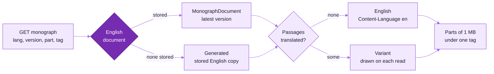
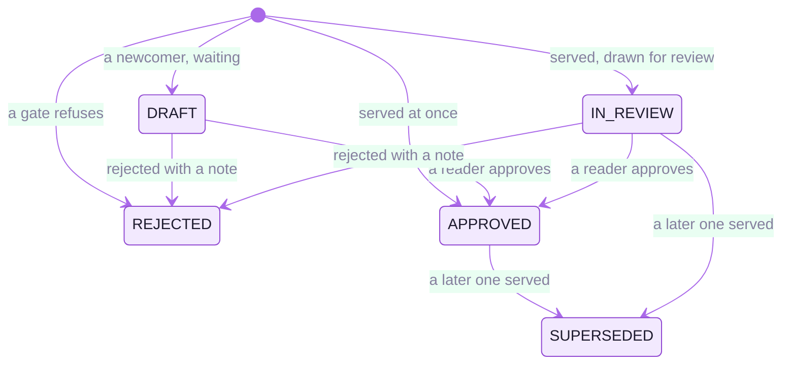
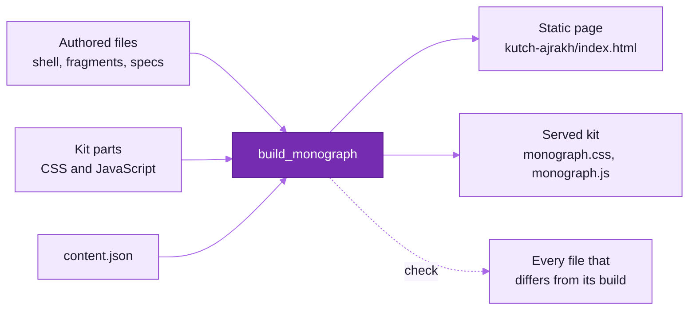

# The monograph document

A page in the monograph form is a document: `research/monograph_document.MonographDocument`
(schema 1), which one React renderer draws. The approved Kutch Ajrakh page (decisions 0100 and
0105) is split into a shell, one fragment per component and a page-wide kit, and its static build
reassembles them so the served page stays byte for byte what the owner approved. This contract
holds the document and its route, its versions, the generated document, the page in other
languages, the authored files, the split, the kit and the golden (decision 0106, items 1 and 2);
engineers changing any of them, the renderer or a page's translations read it.

| For | Read |
|---|---|
| Why one document and one renderer draw every page | [decision 0106](../decisions/0106-one-monograph-template-for-every-page.md), items 1 and 2; [0100](../decisions/0100-ajrakh-monograph-served-as-built.md); [0105](../decisions/0105-ajrakh-page-as-structured-content.md) |
| Why articles are written in English, and how a page is translated | [decision 0107](../decisions/0107-craft-articles-in-english-with-room-for-translation.md); [0117](../decisions/0117-pages-in-other-languages.md) |
| How the web draws the document | [monograph-renderer.md](monograph-renderer.md) |
| A page's layout record and its generated document | [page-layout.md](page-layout.md) |
| The field coverage a generated document carries | [coverage.md](coverage.md) |
| A delivered component's spec | [component-specs-general.md](component-specs-general.md) |
| `TRANSLATE` tasks and the bundle's `translation` part | [open-work.md](open-work.md), Pages in other languages |
| Stored documents rebuilt, and pages refreshed, every night | [nightly-upkeep.md](nightly-upkeep.md) |



## Where the code is

| Part | Code |
|---|---|
| The slots, `render_page`, `render_fragment`, `assemble_template` and the kit file format | `research/monograph_page.py` |
| The document, `spec_file_name`, `fragment_file_name` | `research/monograph_document.py` |
| The authored files, the document builder, storing and reading versions | `services/monograph_document.py` |
| Storing the document when it changed | `services/monograph_load.py` |
| The table | `models/monograph_documents.py` and migration `0041_monograph_documents`; migration `0045_document_language` keys stored documents by language (all rows English) |
| The route | `api/routes/craft_monograph.py`; the family and category routes `api/routes/page_documents.py` |
| The stored English copy of a generated document, its parts and tags | `services/stored_documents.py`, table `StoredDocument` (`models/stored_documents.py`, migration `0058_stored_documents`); `research/document_parts.py` and `api/document_reads.py` |
| The static page, the served kit and the golden | `scripts/build_monograph.py` |
| The split | `scripts/split_monograph.py` |
| The web shapes | `frontend/lib/monographDocument.ts` and `frontend/lib/componentViewContract.ts` |
| A curated craft's structure | `services/document_components.py` (the structure read from the craft page), `document_components_parts.py` (its records as text units), `document_components_store.py` (the page it reads), `monograph_generated_structure.py` (placing it), `research/component_specs_blocks.py` (the `answer_block` kind) |
| The sections | `services/monograph_generated_sections.py` (the one writer), `services/curation_sections.py` and `scripts/publish_curated_sections.py` |
| Pages in other languages | the code table of that section, below |

## GET /api/crafts/{slug}/monograph

Public (`public_reader`, the anonymous read limit). The slug resolves like the craft page's (case,
merges); an unknown craft is 404 with the craft page's detail. Query: `lang` (optional, a language
tag of at most 16 characters) and `version` (optional, from 1).

- **200**: the latest stored document of that craft in the served language as JSON
  (`MonographDocument`, by alias, its `language` the row's), or, with nothing stored, the generated
  one from its stored copy (`generated_fallback(session, craft)`, the route's one adapter, which
  calls `services.stored_documents.generated_read(session, kind, slug)`) with the tag of its own
  hash and stored version. With `ETag: "v<version>-<contentHash>"`, `Content-Language`,
  `Cache-Control: public, max-age=300` for a signed-out reader (`private, no-cache` signed in) and
  `Vary: Authorization`, as every public read.
- **A language** (decision 0117): `served_language(lang)` names one of `SERVED_LANGUAGES`, the
  thirteen answer languages, and anything else asks for English. The route always resolves the
  English document first (stored, else generated); for another language it serves that page's
  variant (Pages in other languages, below) with `Content-Language` the language and the tag
  `"v<version>-<hash>-<language>-<16 hex of the served translations' digest>"`, or the English
  document with `Content-Language: en` while no passage of it is translated into that language.
  The family and category routes (`page_documents.py`) take `lang` the same way. Articles are
  written in English (decision 0107); a variant is the same page translated, never another
  article.
- **`version`**: that stored version, or the generated document when its version is that number;
  otherwise 404 `This craft's monograph has no such version.`. The web app's `/crafts/<slug>/v<N>`
  reads it, the address Cite this monograph gives.
- **`part`** (0 to 64) and **`tag`**: the served document, English or a variant, cut into parts of
  at most 1 MB (`research.document_parts`): `{schemaVersion 1, version, part, parts, tag, body}`,
  the content in part 0, then the shell, specs and fragments in order, under the tag
  `"<served tag>-p<part>"`. `tag` is the served document's own tag, a variant's when a language is
  served, so every part of one reading carries it. The web reads part 0, then the others with
  `version` and `tag` as part 0 named them and joins only parts of one tag; a `tag` that is no
  longer the served one is 404 `This monograph has changed since its first part was read; read it
  again from part 0.`, so an English part never joins a translated one. A part beyond the last is
  404 `This monograph has no such part.`. The family and category routes take both the same way.
- **Stored, then translated**: a generated document is read
  from its stored English copy (`services.stored_documents`), and a variant is drawn from that copy
  on each read, never stored; only the English row is kept per subject, its version and tag moving
  with the English content alone, and an approved translation moves only the variant's tag.
- **304**: `If-None-Match` names the current tag (with `Content-Language`).
- **404** `This craft's page is not a monograph document yet.`: nothing is stored and nothing is
  generated. A craft needs `CRAFT_SECTIONS_MIN` (3) published sections for a generated document
  (`enough_sections`; a family or category needs one). The web app then draws the craft without a
  monograph.

## The document

| Field | Holds |
|---|---|
| `schemaVersion` | 1 |
| `subjectKind`, `subjectSlug` | `craft` (or `family`, `category`) and its canonical slug |
| `language` | the document's language, a BCP 47 tag (`LANGUAGE_TAG`), `en` unless written otherwise |
| `title` | the subject's name (`Craft.name`; the master list's name offline) |
| `version` | the stored version, from 1; a document built but not stored is version 1 |
| `content` | the page's `MonographContent` (decision 0105): sources, citations, citation facts, data, text units, components and layout |
| `specs` | for each component whose spec file exists, that spec (a JSON object) |
| `fragments` | for every other component, its markup with its unit and data slots filled |
| `pageUrl` | `<site>/crafts/<slug>`; the site is `PUBLIC_WEB_URL` when stored, `PREVIEW_SITE` offline |
| `coverage` | a generated document's field coverage (`coverage.md`); left out when absent, as in an authored document |

Every component is drawn exactly once, from its spec or its fragment; a spec or fragment for a
component the content lacks is refused (`MonographDocument`'s validator). A fragment's unit slots
hold exactly the markup `render_nodes` writes (sentences, citation buttons, marks), so the
renderer's text units and the fragments agree.

**Components inside components.** A component whose element lies inside another component's
element stays inside the outer fragment as its own slot, `<kv-slot component="<label>"></kv-slot>`,
and its layout entry's `within` names the outer component (27 on the Ajrakh page). The renderer
draws the inner component (from its spec or fragment) where that slot is, and never at top level.
A fragment holds no other slot.

## Versions

`MonographDocument` (table): `id`, `subjectKind`, `subjectSlug`, `language` (default `en`),
`version` (unique per subject and language, at least 1), `document` (JSONB, the document with its
version and language), `contentHash`, `createdAt`. One row per version of a language; rows are
never changed. Migration `0045_document_language` added `language` (existing rows `en`, also
written into their JSON) and moved the unique key to subject, slug, language and version; its
downgrade keeps only the English rows.

| Function | Does |
|---|---|
| `store_document(session, document)` | the one writer. `contentHash` is the SHA-256 of the document's JSON (by alias, keys sorted, compact) without `version` and `language`, the row's key. When it equals the latest row's of that language, nothing is stored and it returns `None`; otherwise it stores the next version of that language and returns its number |
| `stored_document(session, subject_kind, slug, language="en")` | the latest version as a `MonographDocument`, or `None` |
| `document_row(session, kind, slug, language=, version=)` | the latest row, or that version's (the route serves its JSON without validating it again); `latest_document_row` is the latest |
| `load_monograph` (`python -m app.scripts.load_monograph`, and the nightly reload) | stores the document of a craft with authored content after its sections and components; its report's `documentVersion` is the version it stored, or `null` when the document was unchanged or the craft has no authored folder. A folder named by another slug than the craft's is refused |

## The generated document

`services/monograph_generated_assembly.assembled_document` builds a page without authored content
from its published sections, registered components, curated pictures and `PageLayout`:

| Chapter | Holds |
|---|---|
| `opening`, first | the masthead picture (the HERO role, its caption and credit units within it), the label units (`masthead-kicker` `p` with the "Monograph" and family spans, `masthead-title` `h1`, then `dt`/`dd` pairs `Place` and `GI`) and the lede: the first three sentences of the OVERVIEW section that the layout does not place elsewhere |
| every other chapter | its title, an `h2` unit `chapter-<key>` (`chapter_title`: "`Why <first state>`" or "Where it is made", "Market and GI" only with a GI), then its pictures, its sections (an `h3` section title unless it repeats the chapter's; a field's section, its fact grid and its components sit in the chapter `coverage_chapters.FIELD_CHAPTERS` names, rule 23 of the page checklist, `coverage.md`) and its components |
| `sources`, closing | its `h2`, under which the renderer lists the sources |

A registered component a contributor delivered (`component-specs-general.md`) is drawn from the
spec it was approved with: its units become the page's units `u5001` and on, held within it and
cited from the facts they rest on, so its numerals are the page's like every sentence's.

A picture's spec is the full `PicturePlateSpec` (`checked_spec`, every field written); a picture
whose file is off the picture contract is left out.

### Facts no section cites

A field's facts that a reader can see (`retrieval.md`, A fact a reader can see) and that no published
section or curated structure of the page cites are listed in the field's chapter until a
section is written (`services/craft_page_unwritten.py`, decision 0149): after the field's written
sentences and fact grid, or under the field's `h3` title when it has no section, up to twelve facts
(`UNWRITTEN_PER_FIELD`, the strongest level first, then by text), each an `li` unit `fact-<field>-<id>`
whose text is the fact's statement, carrying its claim id and cited like every sentence (a closed
page's quote is left out, as everywhere). The renderer draws consecutive `li` units as a list. The
facts are the subject's own fact-level facts filed under the field (`open_work_counts.owned_facts`, the
facts coverage counts), so a field the coverage counts is never empty on the page. A field with only
listed facts is carried as a section of version 0, so the document's version still sums its written
sections. A fact stops being listed when a section cites it. A curated craft's page already draws every fact it shows as a sentence of its field (`monograph_generated_structure.with_page_claims`), so its list holds only what that page leaves out. The authored Kutch Ajrakh page lists
none: its chapters are written by hand.

### A curated craft's sections

The curation import (`import_dossier`, and `import_category` for a category) publishes one
`ArticleSection` per field its dossier covers, after the claims are written
(`curation_sections.publish_dossier_sections`): the dossier's claims in dossier order, each
sentence the stored claim's text citing that one claim (`claimIds: [curated_id(slug, key)]`), for
every claim that is visible and cited (`knowledge_view.claims_by_id`) and not a hypothesis. The
writer is `monograph_generated_sections.publish_section`, which `load_monograph` shares: an equal
section is left alone, a changed one is `SUPERSEDED` by the next version, and a field the dossier no
longer covers has its section superseded (`retire_sections`). A craft with authored content (Kutch
Ajrakh) is skipped: its monograph writes its sections. The outcome's `changed` counts `sections`
written or retired, so a second import changes nothing. `python -m app.scripts.publish_curated_sections`
(optional `--directory`) publishes them for every dossier file without importing it again (the
backfill of the live database); it prints `{written, unchanged, waiting, refused}` (waiting: a
subject the database does not hold yet) and exits 2 when a file does not parse.

### A curated craft's structure

A curated craft's generated document also carries what its craft page draws from the dossier's
structure (`document_components_store.subject_structure`): the page's stored `OPEN` snapshot when
its stamp is current, else the page built from the stored rows (`craft_page_snapshots.built_page`),
read into a `DocumentStructure` (`document_components.document_structure`). Items an answer or a
contribution brought (`origin`) are left out.

- **Figures**: each block of a kind the web draws (`DRAWN_BLOCK_KINDS`: the process ladder, reaction
  player, region story, climate, seasons, supply map, timeline map, market and GI record, material
  cards, molecules, measures, concept graph, zoom story and the four signature figures) becomes one
  component of kind `answer_block` (`research/component_specs_blocks.AnswerBlockSpec`): `block`
  (the answer `Block`), `figure` (`{kind FIGURE or TABLE, number, title}` from the chapter item's
  figure head, numbered through the page in layout order, figures and tables apart, or null) and
  `sources` (`[{key, ref}]`: every source any citation inside the block names, as the
  `SourceRef`, and its key in the document's source book, so the block's numerals are the page's).
  A source the page does not list is read from `Source` (never a restricted one); a block citing a
  source that cannot be read is left out. The label is `<slug>/blocks/<block id>`, in the chapter
  the page puts it; `answer_block` is a document kind (`component_kinds.DOCUMENT_KINDS`), never a
  stored piece.
- **Records as text**: key facts (`dt` label, `dd` cited value) lead At a glance; the record
  ("In the record", or "The place and its resources" when its entries name a factor), places,
  communities, where the sources differ and open questions follow their chapter's prose under one
  `h3` each, as `dt`/`dd` runs (a repeated label is written once); each `dd` cites the claims its
  sentence cites. Hypotheses no figure shows close the sources chapter as `li` units under
  "Hypotheses". A run whose claims are not all visible is dropped, with its label and heading.
- **No repetition**: a section sentence whose claims a figure or record already shows is not
  repeated in its field's prose (the lede keeps its three); a picture a figure shows is not placed
  again as a plate, unless it is the masthead photograph.
- **Every claim the page shows**: a cited claim of the page that no section and no structure
  shows is added to its field's text (`with_page_claims`), so the document shows every cited claim
  the tabbed page showed.

## Pages in other languages (decision 0117)

| Part | Code |
|---|---|
| Passages, their hash, their texts | `research/translation_passages.py` |
| The gates | `research/page_translation_gates.py` |
| The variant | `research/page_translation_variant.py` |
| The document's `translation` | `research/document_translation.py` |
| The bundle's `translation` part, statuses, `task_problem` | `research/page_translations.py` |
| The site's views | `research/page_translation_views.py` |
| The tables (`PageTranslation`, `PageTextUnit`, `TranslationReader`) | `models/page_translations.py` and migration `0059_page_translations` |
| Proposing, previewing, serving | `services/page_translations.py`, `services/page_translation_preview.py`, `services/page_translation_serving.py` |
| Review | `services/page_translation_review.py` and `services/translation_readers.py` |
| The routes | `api/routes/page_translations.py` |
| The web side | `frontend/lib/documentLanguages.ts`, `lib/translationContract.ts`, `lib/documentVariant.ts` (a draft's variant, for the preview page) and `components/monograph/DocumentLanguages.tsx` |



- **A passage** is a text unit with a letter outside a fixed mark (`i`, `sub`, `sup`: names in
  italic, botanical names, verbatim quotes, formula parts), the masthead title aside: a name is
  never translated. Its **texts** are its string leaves in document order, `fixed` the indices
  inside a fixed mark, `cited` those inside a `cite` mark. Its **hash** (`unit_hash`) is the
  SHA-256 of `{"claims": sorted claim ids, "nodes": the nodes with each cite mark's g and key
  removed}` (JSON, keys sorted, compact): the words and the claims a sentence rests on, not how
  its sources happen to be numbered.
- **A translation** is one text for each English text, in order, for a passage named by its key and
  the hash of the English it translates. The gates run in order, each stopping the rest when it
  fails:

  | Gate | Passes when |
  |---|---|
  | `CURRENT` | the hash is the current English passage's |
  | `SHAPE` | one text for each, every fixed text exactly as it stands, the cited text not empty |
  | `KEPT` | `research/translation.translation_problems`, the answers' rule: every number, unit, formula and pH kept, none added, the prose written in the language's script |
  | `ADDED` | at most 3 times the English prose plus 40 characters, and no link the English lacks |

  Citations are never translated: the served passage takes every mark, citation and attribute from
  the current English passage and only its texts from the translation, so it keeps that sentence's
  citations whatever the translator sent; quotes stay in the popover in their source's language.
- **Placed by trust tiers** (`trust_tiers.tier_placement` with the review switch of the bundle's
  origin); `APPROVED` and `IN_REVIEW` are served:

  | Who translated | Placed |
  |---|---|
  | a Professor or above who reads the language (`TranslationReader`) | `APPROVED` at once |
  | a proven account | `APPROVED`, or drawn `IN_REVIEW` |
  | a newcomer | `DRAFT` (waiting) |
  | the rest | as the switch says |

  A refused passage is kept `REJECTED` with its checks. A served translation supersedes the earlier
  served one of the same passage and hash (`SUPERSEDED`).
- **Review.** `GET /api/knowledge/translations/review` (Professor and above) lists `DRAFT` and
  `IN_REVIEW` translations in the languages the reviewer reads, oldest first, each with its English,
  its texts, its checks and whether its English is still current; `POST .../{id}/approve` and
  `.../reject` (a note required) decide one and refresh its page. A reviewer never decides their
  own translation, nor one in a language they do not read; `GET`/`PUT
  /api/knowledge/translations/languages` read and set the languages a Professor or above reads.
- **The variant** (`variant_content`): each passage whose current hash has a served translation
  is drawn from its texts with `lang` the language; every other passage keeps its English and
  `lang: "en"`, and is counted `held` when its key had a served translation of an earlier English
  passage (the English changed, so the translation is held until the passage is translated again).
  Units that are not passages keep no `lang`. The document's `language` is the language and its
  `translation` is `{sourceLanguage "en", sourceVersion, script, direction, passages, translated,
  held}`; specs, fragments, data and the source book are the English document's. An authored
  page's shell is drawn again from its template with the variant's units (`authored_document`);
  `render_nodes` wraps a unit with a `lang` in `<span lang dir data-script>` (`data-script` `Aran`
  for Urdu, else the language's script) or `<span lang="en" dir="ltr" data-fallback="en">`, and
  the web's `UnitView` sets the same attributes, so a reader and a screen reader always know which
  language a passage is in and the page marks each English passage with the word English.
- **The index** (`PageTextUnit`): every passage of a page's English document, its position, hash,
  chapter, tag and leaves, under the document's tag (`v<version>-<content hash>`). The monograph
  routes, the translation view and every translation part write it again when the tag changed, so
  open work counts passages without building documents.
- **Reads.** `GET /api/pages/{kind}/{slug}/languages` (public): each answer language the page is
  offered in or translated into, with its label, autonym, script, direction, passages, translated
  (served) and offered. `GET /api/pages/{kind}/{slug}/translations/{language}` (public; `state`,
  `offset`, `limit` up to 200): the page's passages with their state (`TO_TRANSLATE`, `HELD` with the
  earlier translation, `WAITING`, `TRANSLATED` with its texts) and counts, for the site's form.
- **Proposing** is a page bundle's `translation` part (`page_proposals.PageTranslationPart`:
  `language`, up to 40 `passages` of `{key, source_hash, texts}`, `task_key`, `note`), through
  `preview_page` (drawn in place, authored pages too, each passage `SHOWN` or `REFUSED`, nothing
  stored) and `propose_page` (one report per passage, `ACCEPTED` or `REFUSED`), over MCP and from
  the site (`POST /api/knowledge/pages`, `/preview`).
- **On the web**: `/crafts/<slug>/<language>` and `/categories/<slug>/<language>` draw the page
  in that language (an untranslated language redirects to the English page), every document page
  lists its translated languages as links (`DocumentLanguages`, its note saying how many passages
  read in the language), the page's metadata names them as `hreflang` alternates with `x-default`
  English, and `/contributions/translations` is the site's form and the reviewers' queue.
  `/preview/translation` draws Kutch Bandhani with a Hindi draft of its three lede sentences
  (`lib/translationPreview.ts`), the capture of decision 0117.

## The authored files

```
backend/app/data/monographs/
  kit/monograph.css, kit/monograph.js       the page-wide styles and scripts, in parts
  <Slug>/content.json                       MonographContent
  <Slug>/template.html                      the shell
  <Slug>/fragments/<label>.html             one per component, "/" in the label as "__"
  <Slug>/specs/<label>.json                 a component's spec, when its kind has a view
```

**Slots.** `<kv-slot unit="u0001">`, `<kv-slot data="kv-cites">` (decision 0105),
`<kv-slot component="<label>">` (a component's fragment) and `<kv-slot kit="<file>#<part>">` (a
kit part), each followed by `</kv-slot>`. The shell holds the slots of the top-level components and
of the kit; a fragment holds unit and data slots and the slots of the components inside it, never a
kit slot.

**The kit.** Every `<style>` outside the components (the page styles and `kv-release-fixes`) and
every inline `<script>` of the body without `type` or `src` (the page script and the boxes' boots)
moved into the kit; the head's theme script, which runs before paint, stays in the shell, and the
model explainer's own `<style>` stays in its fragment. A kit file is its parts in order, each a
marker line (`@kv-part <name>;` in CSS, `"kv-part <name>";` in JavaScript), the part's text and a
newline that is not part of it. A part may not hold a marker line.



**The static page.** `python -m app.scripts.build_monograph` (from `backend`) writes
`frontend/public/monographs/kutch-ajrakh/index.html` from the shell, the fragments, the kit and the
content, and the served kit `frontend/public/monographs/kit/monograph.css` and `monograph.js`:
each the file's parts joined, without markers. The served `monograph.js` opens with one line,
`/* eslint-disable react-hooks/rules-of-hooks -- ... */`, because the web app's lint reads the
kit's plain `useSpeech` function as a React hook. `--check` lists every page or kit file that
differs from its build, and the backend tests fail until they agree. Never edit the served files.

**The split.** `python -m app.scripts.split_monograph Kutch-Ajrakh` ran once to cut the approved
template into the shell, fragments and kit. It reads the template the current files assemble, so it
can be run again and writes the same files. It refuses an anchor that is not `#id` or
`[attribute="value"]` or does not select exactly one element, a layout whose `within` differs from
where the page puts a unit or component, and a page whose page-wide blocks the kit does not name.
For the split two anchors were corrected to select the component's whole element (the GI card,
`[class="label-card gi"]`; how this answer was made, `[class="kv-made-fold"]`) and the nested
components' layout entries got their `within`.

## The golden

`shared/monograph.document.golden.json` is Kutch Ajrakh's document as the builder writes it, with
the preview site:

```
cd backend
python -m app.scripts.build_monograph --document Kutch-Ajrakh --out ../shared/monograph.document.golden.json
```

`tests/research/test_monograph_authored.py` fails until it matches; write it again whenever the
content, a fragment or a spec changes (a kind's spec landing moves that component from `fragments`
to `specs`).

## How this document is kept true

| Claim | Kept true by |
|---|---|
| The answer block spec | `tests/research/test_component_specs_blocks.py` |
| The structure from Kutch Ajrakh's golden craft page, every claim of the page in the document | `tests/layouts/test_document_structure.py` and `tests/layouts/test_generated_structure.py` |
| Sections at import, in order, a supersede, a category, the backfill | `tests/db/test_curated_sections_db.py` |
| Every cited claim and figure of the craft page of Bastar Dhokra, Kutch Bandhani and Bagru in its document | `tests/db/test_curated_documents_db.py` |
| The slots and the kit format | `tests/research/test_monograph_slots.py` |
| The split's rules, its round trip on Ajrakh, one fragment per component that is the element its anchor selects, every slot where the layout puts it, the kit equal in the page and the served files | `tests/research/test_monograph_split.py` |
| The builder, specs over fragments, the hash, the golden | `tests/research/test_monograph_authored.py` |
| The static build byte for byte | `tests/research/test_monograph_page.py` |
| The route | `tests/public/test_craft_monograph_route.py` |
| A new version stored, an unchanged one not, each language its own versions, the load | `tests/db/test_monograph_document_db.py` |
| The key | `tests/test_document_language_migration.py` |
| Parts, their budget and their tag | `tests/test_document_parts.py` and `tests/layouts/test_page_document_routes.py` |
| A generated document stored, served and rebuilt, and a variant drawn from its stored English copy | `tests/db/test_stored_documents_db.py` and `tests/db/test_translated_documents_db.py` |
| The documents of a craft, a family and a category | `tests/db/test_generated_documents_db.py` |
| The generated layout, chapter titles, the lede, the section minimum, the picture specs | `tests/layouts/test_generated_document.py` and `tests/layouts/test_generated_chapters.py` |
| Texts, fixed and cited, the hash | `tests/research/test_translation_passages.py` |
| Each gate | `tests/research/test_page_translation_gates.py` |
| The fallback, citations from the English, the hold, the marks the renderer writes | `tests/research/test_page_translation_variant.py` |
| Languages, priority, the task key, the part | `tests/research/test_translation_regions.py` |
| The web's codes, scripts and names are the server's | `tests/research/test_document_language_seam.py` |
| The translations' tables | `tests/test_page_translations_migration.py` |
| Placement, the variant, the hold on change, the preview | `tests/db/test_page_translations_db.py` |
| The tasks, a claim completed, review | `tests/db/test_translation_work_db.py` |
| The languages on the web | `frontend/e2e/document-languages-unit.spec.ts` |

Test paths are relative to `backend/`, but the web's, which is relative to the repository. Last
reviewed: 2026-11-20, and every path here checked against the code on 2026-11-22. Re-read it when a document field, the route's answers, a slot, the
kit format, a translation gate or the golden changes.
