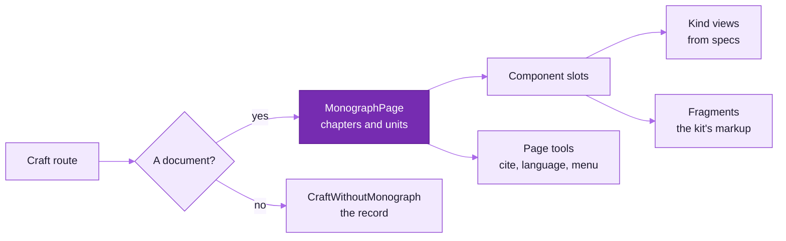

# The monograph renderer and the page-tool kinds

The web app draws a `MonographDocument` (`lib/monographDocument.ts`, mirrored from
`research/monograph_document.py`) with one React renderer, so the approved Kutch Ajrakh page can
become the template for every craft, family and category page. Every craft page is its document
now (decision 0106, round 3c); curated crafts too since round 6, whose documents carry their
structure, so the tabbed craft screen is retired. Engineers changing the renderer, a native view or
a page tool read it.

Last reviewed: 2026-11-20.

| For | Read |
|---|---|
| Why one renderer | [decision 0106](../decisions/0106-one-monograph-template-for-every-page.md), item 3 |
| The document it draws, the template split and the kit | [monograph-document.md](monograph-document.md) |
| Generated documents and their layout | [page-layout.md](page-layout.md) |
| The component kinds and their views | [component-specs-science.md](component-specs-science.md), [component-specs-data.md](component-specs-data.md), [component-specs-plates.md](component-specs-plates.md), [component-specs-general.md](component-specs-general.md) |
| The design system | [kalavigyan-design](../../.claude/skills/kalavigyan-design/SKILL.md) |

## Where the code is

| Part | Code |
|---|---|
| The runtime shape | `lib/monographDocumentShape.ts` |
| The marks, as `render_nodes` writes them | `lib/monographRender.ts` |
| The same marks as React elements | `lib/monographRenderElements.ts` |
| The page plan | `lib/monographRenderLayout.ts` |
| What the kit's script reads | `lib/monographRenderKit.ts` |
| The server fetch and the preview metadata | `lib/monographRenderServer.ts` |
| The generated label masthead | `lib/monographMasthead.ts` |
| The kit scope of each kind | `lib/monographScopes.ts` |
| Cite this | `lib/monographCite.ts`, `components/craft/CiteThis.tsx` |
| A craft page's metadata | `lib/monographMetadata.ts` |
| The craft without a monograph | `lib/craftRecord.ts` and `lib/craftPlate.ts`, `components/craft/CraftWithoutMonograph.tsx`, `app/(reading)/crafts/[slug]/craftRecordPage.ts` (the craft list's record) |
| The page | `components/monograph/` |
| The page-tool views | `components/monograph/kinds/tools/` |
| The answer block kind | `components/monograph/kinds/blocks/` |
| The tool specs | `lib/componentSpecsTools.ts` and `backend/app/research/component_specs_tools.py` |
| Ajrakh's tool specs from its template | `backend/app/scripts/extract_specs_tools.py` with `extract_specs_tools_markup.py` |

## Addresses

| Page | Route | Reads |
|---|---|---|
| a craft | `/crafts/<slug>` | `GET /api/crafts/{slug}/monograph`, else the record of `GET /api/crafts/{slug}/page` |
| a craft's cited edition | `/crafts/<slug>/v<N>` | `GET /api/crafts/{slug}/monograph?version=N` |
| a craft's monograph (alias) | `/crafts/<slug>/monograph` | `GET /api/crafts/{slug}/monograph` |
| a category's monograph | `/categories/<slug>/monograph` | `GET /api/categories/{slug}/monograph` |
| a bundle's private preview | `/preview/<token>` | `GET /api/knowledge/pages/previews/{token}` with the reader's session (`open-work.md`, Previews before submitting) |

All are server components in `app/(reading)`, read through `publicFetch` (tag
`monograph-document:<subject>:<slug>`, revalidated daily, static params from `/site/pages`),
except the preview, read per request through `signedInFetch` (`app/(reading)/preview/[token]/
previewDocument.ts`: a token off its pattern, 403, 404 or 422 is the not-found page, 401 sends the
reader to sign in and back, any other failure is thrown), titled "Preview: <title>" and `noindex`.

- **`/crafts/<slug>`**: a craft with a document (stored or generated; Kutch Ajrakh since the parity
  proof passed, 2026-11-20; every curated craft since round 6) draws it with `MonographPage`
  (`serverCraftDocument`: 404 is "no document", any other failure is thrown so a cached page
  stands); without one, the craft list's record from the craft page endpoint (`craftRecordPage`,
  read the same way: 404 is an unknown craft, any other failure is thrown) draws
  `CraftWithoutMonograph`; an unknown craft is a 404. The tabbed `CraftScreen`, `CraftTabs` and
  the components, hooks, lib files and specs only they used are deleted (round 6); the craft page
  endpoints stay.
  Metadata: `monographMetadata` (title, the lede as description, the canonical `/crafts/<slug>`,
  the masthead photograph at 1280 with its caption and credit as Open Graph and Twitter image), or
  `craftPageMetadata` for a craft without a monograph.
- **`/crafts/<slug>/v<N>`**: that version of the document, or a 404.
- The alias and the category preview keep the document's title and `robots: { index: false,
  follow: false }`. A document off its shape (`parseMonographDocument`, which also holds the
  backend's rule that a component is drawn from a spec or a fragment, never both) is a 404.
- Pages are English (`lang="en"` on the page) and offer no language picker; a document carries its
  `language` (owner, 2026-11-20).

## The page

`MonographPage` draws, in this order, with the approved page's landmarks and classes so the kit's
stylesheet (`MONOGRAPH_KIT_CSS`, loaded once as a React 19 stylesheet) styles it:

1. the chapter rail `nav.kv-rail` (the first chapter unnumbered, the rest numbered 1 to N; a
   generated document's opening chapter is left out), the phone menubar and the `#kv-menu` dialog
   with the reader's display tools;
2. `#kv-main` with one `section.kv-ch` per chapter (`id` the chapter key, `data-ch` its number,
   `data-label` and `aria-label` its name);
3. the coda line `footer.kv-foot`, the citation popover `#kv-pop`, `#kv-scrim`, the toast zone, the
   listen player `#kv-player`, a hidden `div.bx.bx-<scope>` for each of `chem`, `pt`, `mb`, `rm` with
   the controls their scripts look up, each data block of `content.data` as
   `script[type=application/json]` in the scope its script reads (`mol-data` chem, `rs-data` pt,
   `kv-data` and `film-subs` rm, any other at the top), and `#kv-cites`, the citations as the page
   script reads them (`{s: {key: [number, title, fullTitle, publisher, year, grade, url, extra]},
   c: {key: [[source, locator, quote]]}}`); every JSON block escapes `<`;
4. the kit's script (`MONOGRAPH_KIT_JS`), added once after the page has mounted. A page reached by
   the app's router after the kit has already run in that document reloads, so the script binds a
   fresh page.

The plan (`pagePlan`) is pure and tested:

- **Chapters** follow the layout's first appearance of each chapter key. A chapter's name is its
  kicker (the `p` without a sentence right before its first `h2`), else that `h2`, else its key;
  the first chapter is named from its key.
- **Masthead**: the first chapter's leading `p` units up to its first cited one: the first uncited
  is the kicker over the `h1` (the document's title), the others the standfirst, the cited one the
  lede (`p.t-lede.ans-lede`); a `picture_plate` component right after them is the masthead
  picture, drawn in `.kv-open-grid`. Then "Drawn from N sources" and the A to D strip, counted from
  the sources the units cite; a Listen button when the document has an `audio_player`, and a link
  to the `citation_tool` component's anchor. A document without a picture keeps the masthead text.
- **Passages**: runs of top-level units (layout `within` null) between components, each in
  `div.bx.bx-pt > div.screen`. The first passage holding the chapter's `h2` or numeral is the head:
  `section.sec.wrap > div.spread.railed.sec-head` with `span.numeral` in the rail. Roles: the
  numeral `p` (its text is the chapter number) `p.chapter-no.in-main`; the kicker
  `p.kicker.sec-kicker`; the first `h2` `h2.t-h2#<chapter>-h`; cited `p` right after it
  `p.t-lede`; an uncited `p` of 60 characters or fewer `p.kicker`; other `p` `p.t-body`; `li` runs
  one cited list (`CitedList`: `ul.kv-list` under a hairline, each item a hairline row in reading
  text at body-sm with its sentence's citation cluster, as a field's listed facts are drawn,
  `monograph-document.md`); `dt`/`dd` runs `dl.kv-terms`. An `li` that starts with a bold source number is a
  margin note: `aside.margin.note > ul > li[data-g=<source key>]`.
- **Label masthead** (`labelMasthead`, a generated document): when the first chapter holds an
  `h1` unit, the `p` before it is the kicker, the `dt`/`dd` run after it the place and GI, the
  cited `p` run after those the lede, and the first `picture_plate` the photograph.
  `DocumentMasthead` draws it with the editorial `Masthead`: the `SpecimenLabel` (masthead variant,
  the name as `h1`, "Drawn from N sources" with the A to D strip) over the 16:7.4 photograph cropped
  from its focal box with its caption and credit under it, the 4:3 photograph first and the label
  after on paper below 1024px; the typographic plate on the family's ground when there is no
  photograph. The lede follows in the reading column (`div.spread.mast-lede`, "The monograph" in
  the rail, its sources as margin notes).
- **Components** keep their layout place, except one another component places (layout `within`,
  a label named anywhere in a spec, or a `<kv-slot component="<label>"></kv-slot>` in a fragment),
  which its owner draws. A top-level component drawn from its spec sits in the frame its kind has
  on the approved page (`componentPlace`: `div.bx.bx-<scope>`, then `div.screen` and `div.wrap` as
  the template has them, a plate in the reading column); a fragment brings its own.
- **Sources**: the chapter keyed `sources` draws every source a unit cites, in number order
  (`div.sources.kv-sources`, rows `li.kv-src-li` with `button.src[data-g][aria-pressed]`, byline,
  grade in words, "Supports N sentences here", "Open the source"). The document does not say which
  group a source belongs to, so a passage of bare headings in that chapter (Ajrakh's five group
  names) is replaced by the one list. A generated document's list (`MonographSources`) groups its
  sources by reliability, A first, those without a grade last, under a line counting them, with
  `#kv-src-status` for the kit's lighting; then Cite this monograph (`CiteThis`: Text or BibTeX, the
  lower-case versioned address `/crafts/<slug>/v<N>`, one Copy citation button, the access date of
  the reader's day).
- **A head passage** without a numeral unit gets `p.chapter-no.in-main` with the chapter number.

## A craft without a monograph

`CraftWithoutMonograph` (SYSTEM.md section 4, the master board's fifth screen) draws the craft
list's record (`craftRecordView` of the craft page response): the typographic plate at the masthead
ratio on the family's ground (`plateMaterial`), the masthead label (kicker "Craft", family and
sub-family, the name as `h1` with its own-script name only when sourced and reviewed, the GI line,
the place, "From the KalaVigyan craft list" and the name's source), "What the craft list records"
as a `FactGrid` (family, sub-family, home state, practised in) and an `EmptyState` "Start the
research on {craft}" with the craft's plate and its three suggested questions as an `ActionGroup`
of links to the ask screen. No chapter rail, no Cite this, no gap admissions.

## Units

`renderNodes(nodes, sources)` is `research/monograph_page.render_nodes` ported: the same tags,
classes and attributes for `s` (`data-src`, `data-sid`, `data-pair`), `cite` (`span.nw` and the
`button.kcite` cluster with `data-c`, `data-g`, `aria-haspopup`, `aria-expanded`, `aria-label`
"Source 1" or "Sources 1, 2 and 11", `aria-description` the titles), `i` (roles `loc`, `bot`,
`ring`, `on`), `b`, `sub`, `sup`, `mark`, `link` (class, or `rel`, `target`, `data-ask`, `lang`),
`figref` and `span`; text escapes `&`, `<`, `>` and attributes also quotes, as Python's `html.escape`
does. It refuses what the backend refuses (an unknown mark, an unknown source, a role outside the
set) and, on the web, a link that is not `#`, `/`, `http(s)` or `mailto`, and a class with
characters a class name cannot have. Parity is tested on fifteen Ajrakh units covering every mark,
whose expected markup the backend wrote (`e2e/monographParityCases.ts`).

`UnitView` draws a unit as React elements in its own tag, or the tag and class its place asks for.
A component view's `renderUnit(ref)` returns the unit's inline content, to fill the view's own
element as a `kv-slot` was filled.

## Component slots

`ComponentSlot` draws a component:

- **natively** when the document has its spec and `componentViews.COMPONENT_VIEWS` has a view for
  its kind: a client `SlotRoot` holds the component's bundle (component, spec, its units, and the
  bundles of the components it places, with only the sources they cite) and `BundleView` calls the
  view with `ComponentViewProps`. `PlacedComponent` draws a placed component inside a view;
- **from its fragment** otherwise: the fragment's HTML as written, inside
  `div.kv-slot.contents#kv-slot-<label with / as __>` that React never re-renders. A placed
  component's `kv-slot` is filled after mount by a portal;
- **not at all** when it has neither, or a spec whose kind has no view yet.

A fragment carries everything its markup needs to look and act as on the approved page: the shell
drawn here does not reproduce the template's per-chapter wrappers, so a fragment brings its
`div.bx.bx-<scope>` (and any ancestor its styles or script select through).

## The answer block kind

A curated craft's figures arrive as components of kind `answer_block` (`monograph-document.md`, "A
curated craft's structure"). `kinds/blocks/answerBlockSpec.ts` parses the spec (`block` by the
craft page's `pageBlockShape`, `figure` or null, `sources` `[{key, ref}]`); a spec off its shape
draws nothing. `AnswerBlockView` draws the block with the answer's own renderer
(`blockRenderers.renderBlock`, or `SignatureFigure` for the four signature figures) inside
`CitedReading`, whose numerals are the document's: each listed source's number is the slot's source
under its key (`sourceNumbers`), and its popover the answer's. A block with a figure head sits in
`ui/Figure` ("Fig. N" or "Table N" and its title); the region story and seasons, which title
themselves, get the numeral only. The block sits in the spread (`div.spread`): a map or a series
(`WIDE_KINDS`: region story, timeline map, zoom story, supply map, climate, seasons, concept graph)
in `div.wide`, across the reading column and its margin from 1200px, any other in `div.main`, the
reading column. The kind has no kit place of its own (`mb`, `wrap`), and
`answerBlock.css` gives the block's elements back the app's own margins, padding, colour, fonts and
lists (`revert-layer` over the kit's scope resets), so it is drawn as on the answer page.

## The general kinds

`components/monograph/kinds/general/` draws the five general kinds a contributor can deliver for
anything the 42 kinds do not show (`component-specs-general.md`): `DrawingView`, `ChartView` (with
`ChartLine`), `TableView`, `TimelineView` and `MapLayerView`, each in `GeneralFigure` (the
`kv-figure` frame, the kind as its kicker, the title and caption units, "All N values" where the
values are not all on show). Specs parse with `lib/componentSpecsGeneral.ts`; a spec off its shape
draws nothing. Colours are the chart and map tokens (`general.css`): `--chart-series`, the
emphasised mark `--chart-emph`, tracks `--chart-grid`, India's outline `--map-land` and `--map-coast`
without state lines, discs `--map-marker` ringed `--map-marker-ring`. SVG text scales with the
drawing's fit (`useFitScale`, `--k`) so it stays at the caption size. A drawing is an image of its
cleaned SVG on cloth white (`--dye-cloth`) inside a specimen mat, in every theme.

## Native views on the authored page

Kutch Ajrakh's document carries its authored shell (decision 0106, the first parity run): the
approved main markup with every unit filled and every component inlined from its fragment, except
the components listed in `backend/app/data/monographs/Kutch-Ajrakh/native.json`. Those are drawn
by their native views from their specs, and the shell keeps a `<kv-slot component="<label>">` where
each one stands (one placed by another native view has no slot: its owner draws it).

- **The shell is React elements.** `AuthoredShell` reads the shell with `shellTree`
  (`lib/monographShellTree.ts`): each element on the way to a native slot becomes a React element
  (its attributes as `shellProps` converts them, `lib/monographShellProps.ts`), every other element
  keeps its inner HTML as written (`dangerouslySetInnerHTML`, which React never re-renders), and the
  slot itself becomes the native view. `components/monograph/ShellTree.tsx` draws the plan.
- **A native view is server-rendered where its fragment stood, with no wrapper.** `SlotRoot bare`
  makes `BundleView` draw the view without `div.kv-slot.contents`, so the page's DOM is the
  fragment's DOM, `authoredShell.css` treats it as the rest of the shell, and the kit's script,
  which runs after hydration, binds it as it binds a fragment. The kinds drawn natively here are
  pure markup: their behaviour stays the kit's until the views take it over (debt "Fragments are a
  bridge").
- **A native view's placed components are native too**, since the shell holds no fragment for
  them.
- **Proof.** `e2e/monograph-native-unit.spec.ts` renders the whole shell from
  `shared/monograph.document.golden.json` and compares it with the approved page's `main`, element
  by element and text node by text node, for each native component and for the whole page.
  `e2e/monograph-native.smoke.spec.ts` runs in the smoke job against the built site with a local API
  that serves the golden document, and as edition 2 the same document drawn entirely from fragments.
  At 360, 834 and 1440 in light and dark it checks that the page reads as the approved page (every
  line of `#kv-main`), that the first citation's popover and Fig. 1 answer as there, and that each
  native view looks as its fragment does on the same React page. A Vercel preview cannot show a
  branch's `native.json`, because it reads the production API's stored document.
- **Native (70 of 79, 2026-11-20).** All except: the stage player
  `kutch-ajrakh/process/cloth-after-each-stage` (one "Why" line, stage 11, is still held text); the
  two structure diagrams (their cited descriptions are the answer's held sentences); and the six
  page tools (`explainer`, `quiz`, `ask_next`, `language_switch`, `reading_level`, `generator`), whose
  views draw their own markup and behaviour on purpose.
- **To serve it**, after the deploy that carries `native.json` and the content, run
  `python -m app.scripts.load_monograph` on the box (RUNBOOK, Monographs), then run **Monograph
  parity** on production.

### Cited passages held outside text units

28 of the cited sentences the template held outside text units are text units now (27 units, ids
`u1087` to `u1113`): each stage's "Cloth after" line and the stage player's sources-differ notes,
the what-if vat's differs note, the six comic captions, the masthead's GI line, the Suran card's
differs note, and the two quote attributions. The specs name them (`afterSentence`, `differs.body`,
and `caption`, `registration`, `attribution` and `body` as a unit id or held text), the database
loads them with the other units, and the sources chapter's "Supports N sentences" counts
(`sentenceCounts`) take them in (`e2e/monograph-units-unit.spec.ts`). Still held: 16 sentences whose
page text writes an apostrophe as `&#x27;` (a unit renders it as `'`, so making them units would
change the approved page's bytes; the stage player's stage 11 "Why", the timeline's four card
lines, the shared-science atlas's three sentences, two lines of the Suran cards, the climate map's
side line, and five in the shell), and the answer's own sentences in the language panels, the
generator and the structure diagrams.

## The page-tool kinds

| Kind | Spec (`component_specs_tools`, `componentSpecsTools`) | View |
|---|---|---|
| `explainer` | kicker, title, sentence and key unit refs; `cardsLabel`; cards `{source, byline, quote or quoteUnit, locator, keyed}` | how to read a page: the keys a to d and the quote cards, title and grade from the source |
| `quiz` | title, dek, score, status unit refs; kicker; `nextLabel`; questions `{before, after, cite {key, sources}, choices [{term, right, sentence nodes}]}`, one right choice each | one question at a time; a choice reveals each choice's cited sentence; the score is the reader's own (the `score` unit is the template's placeholder) |
| `ask_next` | `craft`, `action`, questions | links to the app's ask screen (`/ask?q=…&craft=…`), through sign-in for a reader who is signed out |
| `language_switch` | label; options `{lang, name, direction, status}`; the English unit; one panel per other language `{lang, direction, provenance, lede nodes, actions, section {kind, title unit, body nodes}, figure label, note units, plate}` | a segmented choice with each name in its language; every panel stays in the page, the others `hidden` |
| `reading_level` | level, summary, detail, title and lede unit refs | a closed `details` that opens to the version |
| `generator` | stage, switch, replay, status; sections `{number, title or titleUnit, kind, text nodes or textUnit, media labels, split}`; `film` label; rail title and detail units; jobs | rests finished; "Watch it being made" replays one section at a time unless motion is reduced; the switch hides the AI media |

Every unit the layout places within a tool component is named by its spec, and nothing else is
(`tests/research/test_component_specs_tools.py`). `python -m app.scripts.extract_specs_tools`
writes `backend/app/data/monographs/Kutch-Ajrakh/specs/<label with / as __>.json`; `--check` reports
a spec file that differs from its extraction. The frontend parses those files with its shapes
(`e2e/monograph-tools-unit.spec.ts`).

A native view sits in its legacy scope (`LegacyScope`: `div.bx.bx-<scope> > div.screen`, `mb` for
the explainer, `sa` for the reading level, `rm` for the others) so the kit's styles reach it, and
uses none of the ids and hooks the kit's scripts bind (`#quiz*`, `#lang-*`, `.lang-seg`, `#gen*`),
so no script drives it twice.

## Reader settings

The page reads theme, high contrast, larger text and reduced motion from the attributes the app's
settings set on `<html>` (`data-theme`, `data-high-contrast`, `data-larger-text`,
`data-reduced-motion`; `lib/preferences.ts`), as the approved page reads them, and tells the kit
when any of them changes (`kv-prefs`). The menu's display tools change the app's own settings
(`useThemePreferences().update`) and carry no `data-kv-tool`, so the kit never toggles them too.

## How this document is kept true

| Claim | Kept true by |
|---|---|
| The document's runtime shape refuses what the backend refuses | `frontend/e2e/monograph-document-shape-unit.spec.ts` |
| Marks, units, slots and the page plan | `frontend/e2e/monograph-render-unit.spec.ts`, `monograph-units-unit.spec.ts`, `monograph-slot-unit.spec.ts` and `monograph-layout-unit.spec.ts` |
| A craft's route draws its document or its record | `frontend/e2e/craft-monograph-unit.spec.ts` and `craft-without-monograph-unit.spec.ts` |
| Generated documents and the answer block kind | `frontend/e2e/monograph-generated-unit.spec.ts` and `monograph-blocks-unit.spec.ts` |
| A chapter's listed facts drawn as one cited list after its prose | `frontend/e2e/cited-list-unit.spec.ts` |
| Native views and the whole shell | `frontend/e2e/monograph-native-unit.spec.ts`, and `monograph-native.smoke.spec.ts` against the built site |
| The page tools | `frontend/e2e/monograph-tools-unit.spec.ts` and `backend/tests/research/test_component_specs_tools.py` |
| The served page against the approved board | the Monograph parity run (`.github/workflows/monograph-parity.yml`) |

Re-read it when a route draws another subject, a native view replaces a fragment, or a page tool is added.
