# Nightly upkeep and the nightly page refresh

Every night the database looks after what it already holds, then the pages that changed are refreshed:
quotes are re-verified against their sources, a fact none of whose quotes is found any more is held
from its pages until a quote is found again, a link that keeps failing gets its archived copy or
becomes work, live open sources are archived before their links rot, orphaned research concepts are
swept, MCP client registrations that never signed anyone in are
removed, the monograph sections and components and the craft
page snapshots and stored documents whose facts moved are rebuilt, and only the pages whose content
moved are refreshed on the CDN; a night that changed nothing sends nothing. Answers stay live. Every step is bounded per night by a named
constant, so a night's work and its load on other sites are known in advance.
Operators and the engineers who add a step read it.

Last reviewed: 2026-11-20.

| For | Read |
|---|---|
| Why the knowledge heals itself every night | [decision 0101](../decisions/0101-knowledge-architecture-for-every-craft.md), items 5 and 11 |
| The healing tasks open work computes from these verdicts | [open-work.md](open-work.md) |
| How a fact repaired by a new source returns to its pages | [knowledge-writes.md](knowledge-writes.md), Source proposals and Pages follow their facts |
| Why answers leave a held fact out | [decision 0121](../decisions/0121-quote-visibility.md) |
| The box, the deploy hook and the secrets | [RUNBOOK.md](../RUNBOOK.md), Nightly upkeep and page builds |

```mermaid
%%{init: {"theme":"base","fontFamily":"Inter, ui-sans-serif, system-ui, -apple-system, Segoe UI, Roboto, Helvetica, Arial, sans-serif","themeVariables":{"fontSize":"15px","primaryColor":"#F2E9FE","primaryTextColor":"#1E1B2E","primaryBorderColor":"#9148D2","secondaryColor":"#FAEECD","secondaryTextColor":"#1E1B2E","secondaryBorderColor":"#CD9200","tertiaryColor":"#F3F1FA","tertiaryTextColor":"#1E1B2E","tertiaryBorderColor":"#A7A3BC","mainBkg":"#F2E9FE","nodeBorder":"#9148D2","nodeTextColor":"#1E1B2E","lineColor":"#AA69E9","textColor":"#857F9E","edgeLabelBackground":"#F9F5FF","clusterBkg":"#F9F5FF","clusterBorder":"#D6B6FB","titleColor":"#762CB1"}}}%%
flowchart LR
  Q["1 Re-verify quotes"] --> H["1a Hold and heal"]
  H --> A["2 Archive sources"]
  A --> O["3 Sweep orphans<br/>clients, buckets"]
  O --> M["4 Reload monographs"]
  M --> P["5 Rebuild stale pages<br/>refresh work and gaps"]
  P --> B["6 Refresh the changed pages"]
  B --> V[("Vercel<br/>cached pages")]
  classDef accent fill:#762CB1,stroke:#5F1C93,color:#FFFFFF
  classDef gold fill:#FAEECD,stroke:#CD9200,color:#1E1B2E
  class H accent
  class V gold
```



## Schedule

| What | Where | When |
|---|---|---|
| The upkeep and the page refresh | `.github/workflows/nightly-upkeep.yml` (GitHub Actions, run on the box through SSM like Coverage enrichment) | 23:45 UTC every day (05:15 IST), after Coverage enrichment (22:17 UTC, at most 67 minutes) |
| The same run by hand | the workflow's Run workflow button, with `dry_run` to report only | any time |
| The build alone | an Admin's Start a build on the admin settings page (`/admin`), or `POST /api/site/build` | any time, at most once in 10 minutes |

The workflow runs `python -m app.scripts.nightly_upkeep` as the `kalavigyan` user with the box's
`.env`; the job fails when the report's `ok` is false, and the report is printed in the run's log.

## The steps, in order, and their bounds

| Step | Module | Bound (constant) | Records |
|---|---|---|---|
| 1. Re-verify quotes | `services/upkeep_quotes.py` | `QUOTE_SOURCES_PER_NIGHT` = 50 sources; a source is due again after `QUOTE_RECHECK_AFTER` = 30 days, or after `FAILING_RECHECK_AFTER` = 7 days when its last fetch failed or one of its quotes failed | `ClaimSource.quoteCheck` (`PASS`/`FAIL`) and `checkedAt`; `SourceUpkeep` (outcome, failures, problem) |
| 1a. Hold and heal | `services/upkeep_healing.py`, `services/claim_holds.py`, `services/upkeep_links.py` | every claim, once; `ARCHIVES_ATTACHED_PER_NIGHT` = 200 | `AuditLog` actions `upkeep.claims_held` and `upkeep.claims_lifted` with the ids; `Source.externalIds.archivedUrl` for a rotten source with a saved snapshot |
| 2. Archive sources at risk | `services/upkeep_archive.py`, adapter `sources/wayback_save.py` | `ARCHIVES_PER_NIGHT` = 10; a failed save is retried after `ARCHIVE_RETRY_AFTER` = 30 days | `SourceUpkeep.archiveUrl`, `archivedAt`, `archiveTriedAt` |
| 3. Sweep orphaned concepts | `services/orphan_concepts.py` | `ORPHANS_PER_NIGHT` = 500; a concept stands at least `ORPHAN_MIN_AGE` = 7 days | `AuditLog` action `upkeep.orphans_reported` with the ids reported |
| 3a. Remove abandoned MCP client registrations | `services/upkeep_clients.py` | `ABANDONED_CLIENTS_PER_NIGHT` = 1,000, oldest first; a client is abandoned `ABANDONED_CLIENT_AGE` = 30 days after registering | the `OAuthClient` rows deleted (their unexchanged codes go with them) |
| 3b. Delete old allowance buckets | `services/upkeep_allowances.py`, `core/allowances.delete_old_buckets` | the allowance and rate-limit buckets (decision 0139) whose window started more than `KEPT_HOURS` = 24 hours before the current hour | the `AllowanceBucket` rows deleted |
| 4. Reload monographs | `services/upkeep_pages.py` through `services/monograph_load.py` | `MONOGRAPHS_PER_NIGHT` = 20, a window that rotates by night | `ArticleSection`, `KnowledgePiece` (only what changed) |
| 5. Rebuild stale craft pages | `services/upkeep_pages.py` through `services/craft_page_snapshots.py` | `PAGES_PER_NIGHT` = 60, oldest snapshot first | `CraftPageSnapshot` |
| 5a. Refresh the field work | `services/open_work_refresh.py` | every subject, once | `TaskReservation.ending` `COMPLETED` for a live reservation of a `MISSING_FIELD` or `THIN_FIELD` task no longer open (`open-work.md`) |
| 5b. Questions become work | `services/answer_gap_refresh.py` | the thin and unanswered answers of the last 90 days, once | `AnswerGap` groups by craft and meaning, anonymised; `TaskReservation.ending` `COMPLETED` for an `ANSWER_GAP` task whose acceptance holds (`open-work.md`, Questions readers asked; decision 0113) |
| 6. Refresh the changed pages | `services/page_revalidation.nightly_refresh`, with the pages from `upkeep_pages.PagesReport.changed_owners` | the crafts whose monograph or snapshot changed and the documents that moved, in batches of `REVALIDATE_TARGETS_MAX` = 40 targets; none when nothing changed | nothing stored; the web's `/api/revalidate` drops those pages' cached copies |

The orchestration is `services/nightly_upkeep.py` (`run_nightly_upkeep`, and the read-only
`plan_nightly_upkeep` behind `--dry-run`).

### 1. Quotes

- **Which sources:** every source with an `https://` address cited by at least one claim, never
  checked first, then the longest unchecked; a source checked within 30 days waits.
- **How:** the page is fetched through the fetcher (`sources/fetcher_client.py`, the same limits
  as live research) and each stored quote is looked for in its text with the curation matcher
  (`curation/matching.py`, built on `research/quotes.py`): case, typographic dashes and quotes,
  soft hyphens and line breaks are folded.
- **Verdicts:** found is `PASS`; not found in a complete text is `FAIL`; not found in a text the
  fetcher cut short (`truncated`) is left as it was. Both set `checkedAt`.
- **A fetch that fails** changes no quote. A refusal (robots, content type, size, an address the
  fetcher will not read) records `REFUSED` and its reason; a failure (gone, unreachable, rate
  limited) records `FAILED` with its kind and status and adds one to `failures`, which returns to
  0 at the next good fetch. `failures` is the link-rot signal.
- **A night when the fetcher itself is away** blames no source: when every one of at least
  `FETCHER_OUTAGE_MIN` = 3 due sources failed as unreachable with no HTTP status, nothing is
  recorded, the report says `fetcherUnavailable`, and the run is not `ok`. The night's results are
  written together at the end of the step.

### 1a. Holds, corroboration and link rot (round 7)

- **Held**: a claim is held when it cites at least one quote and every quote it cites is `FAIL`
  (`retrieval/citation_access.held_claim`, the one rule: `services/claim_holds` re-exports it and
  its `held_claim_ids` reads through it). The hold is derived from the stored verdicts, so it needs no
  table and lifts by itself the moment one quote is `PASS` again: a later re-check that finds it, a
  research write-back that re-finds the claim with a quoted citation, or a quote added with
  `propose_source` (`knowledge-writes.md`). A held claim is not deleted and keeps its status.
- **What a hold does**: the craft page (`craft_page_records`, `craft_page_family`), the category
  page (`category_records`) and the generated document (`monograph_generated`) leave it out, as
  they leave out a retracted claim; the field coverage and open work stop counting it
  (`open_work_counts.owned_facts`); it waits in the `FACTS` review queue whatever its status, with
  the night's evidence as its `QUOTES` check (`services/claim_holds_review.py`, one reason per
  failing quote: the day, the quote and the page), and a reviewer may retract it there; and it
  becomes a `RESOURCE_FACT` task (`open-work.md`). Since decision 0121 answers never find it
  either: stored search leaves it out in every mode (`retrieval/statements.claim_conditions`), and
  so do the views facts are read through (`knowledge_view.claims_for` and `claims_by_id`), so no
  answer, page, component check or public reading of a stored answer rests on it. The reads a
  contributor re-sources it from keep it (`knowledge_view.contributor_claims_for`, and
  `claim_conditions(..., held=HELD_KEPT)`), its failed quotes shown as unquoted citations: MCP
  `get_facts` (`knowledge_api.craft_facts`) reads a craft's or family's facts through it for a
  Researcher or above (`knowledge_api.held_facts_for`: `PROPOSE_KNOWLEDGE`), so a contributor
  finds the held fact there to re-source it, and through `claims_for` for anyone else.
- **A failed quote is never shown as a quote**: a view drops the words of a citation whose last
  check is `FAIL` and labels it `INFERRED` (`knowledge_view.shown_quote`), so a corroborated fact
  shows its standing quotes and names the failing source without its dead words.
- **Corroborate**: a shown claim with a `FAIL` quote and at least one quote that is not `FAIL`
  keeps showing and becomes a `CORROBORATE_FACT` task.
- **The night**: the held claims are read before the re-check and again after it
  (`hold_changes`); the newly held and the lifted are audited, committed, and their pages refreshed
  at once (`services/claim_pages.refresh_claim_pages`, the revalidation route of `review-queue.md`),
  so they do not wait for step 5's bound. The verdict update moves `ClaimSource.updatedAt`, so the
  page stamp moves too.
- **Link rot**: a source is rotten when `SourceUpkeep.failures` reaches `ROTTEN_AFTER_FAILURES` = 3
  (three failed fetches in a row, a week apart at least) and it has no archived copy. A rotten source
  whose Wayback save succeeded earlier (`SourceUpkeep.archiveUrl`) gets that snapshot attached as
  `Source.externalIds.archivedUrl`, the curation convention, so the dossier export carries it and it
  is no longer unarchived. The facts that rest only on rotten sources become a
  `FIND_ANOTHER_SOURCE` task.
- **A re-import keeps the night's verdict**: the curated import rewrites a quote's `quoteCheck` and
  `checkedAt` only when the dossier's check is later than the stored verdict
  (`claim_holds.with_kept_verdicts`, called from `curation_store.write_evidence`), so a deploy no
  longer resets a failed quote to `PASS`.

### 2. Archives

- **At risk:** an `OPEN` source (sensitivity), with an `https://` address that is not already a
  Wayback address, no DOI (a DOI is a persistent identifier), no archived copy (neither
  `Source.externalIds.archivedUrl` from curation nor `SourceUpkeep.archiveUrl`), whose last fetch
  succeeded (only a live page is worth saving). Most recently seen alive first.
- **How:** `GET https://web.archive.org/save/<url>` (the Save Page Now endpoint, anonymous); the
  snapshot is the redirect's `Location` or the `Content-Location`, and is kept only when it
  matches the curation Wayback pattern (`curation/parts.WAYBACK_SNAPSHOT_PATTERN`).
- A source whose sensitivity is not `OPEN` (`ATTRIBUTE_REQUIRED`, `RESTRICTED`) is never sent to a
  public archive.

### 3. Orphaned concepts

A concept is an orphan when all of these hold:

- it was written by live research (`originRef` is `live_research`); curated concepts
  (`curation:...`), seeded ones and any other origin are never removed;
- it is at least 7 days old;
- no claim is about it (`Claim.subjectType = 'CONCEPT'`), no concept edge starts or ends at it,
  and no process stage, material, registered component (`KnowledgePieceSubject`) or glossary term
  (`TermConcept`) links to it.

Report first, then delete: a night lists every orphan it finds and records the new ones in the
audit log; the next night removes only those an earlier night reported that are orphans still.
The delete re-checks the rule in the same statement, so a concept linked in between is kept.
Artisan testimony concepts keep their own removal (`services/testimony_claims.drop_orphans`).

### 3a. Abandoned client registrations

An MCP client registered more than 30 days ago that never completed a sign-in (no `OAuthGrant`, so
no token) is deleted; the delete re-checks the rule in the same statement, so a client that connects
in between is kept. A client with a connection, even an expired or revoked one, stays: Settings and
the audit still name it (`mcp-oauth.md`).

### 4 and 5. Pages

- Monographs (today Kutch Ajrakh, `scripts/build_monograph.SERVED_FOLDERS`) are reloaded from
  their content; `load_monograph` writes a new section version only for a field whose sentences
  changed and rewrites only components whose content hash changed. Their static HTML is built
  from git (`build_monograph`), not here.
- Every other curated or snapshotted craft is stale when a variant has no snapshot, an older
  schema or a stamp other than the current one (`craft_page_stamp.page_stamp`, which moves with
  the craft's facts, pictures, places and the code that builds a page, not with each release).
  The oldest stale pages are rebuilt.

### 6. The page refresh

The night never rebuilds the site (decision 0119): a build would discard every cached page and
re-render each one on its next visit, changed or not. Instead the run collects the pages whose
content moved, the crafts whose monograph sections or components were written in step 4 or whose
snapshot changed in step 5 and every stored document rebuilt as changed or removed, and asks the web
to refresh exactly those (`/api/revalidate`, in batches). A night that changed nothing sends
nothing. Without `WEB_REVALIDATE_SECRET` the report names the pages and is not a failure; those
pages then refresh on their own schedule. A production build still pre-renders `/crafts/{slug}`
for every slug of `GET /api/site/pages` (except the static monograph) and `/categories/{slug}`
for every category it lists, and keeps each page for a week (`revalidate = 604800`), but only when a
release ships or an Admin starts one; any other craft renders on its first visit and is kept the
same way. Signed-in readers still load their own variant in the browser, and answers are never
cached. A change that must reach readers who are not signed in at once (a hidden piece, a
retracted claim) refreshes its pages when it is written, and an Admin's Start a build remains for
anything else; the admin control refuses a second build within 10 minutes (429 with `Retry-After`).

## Routes

| Method | Path | Who | Answer |
|---|---|---|---|
| GET | `/api/site/pages` | anyone (public reading limits) | `StaticPages {schemaVersion 1, crafts[slug], categories[slug]}`: crafts with an `OPEN` snapshot by slug, categories in master order; golden `shared/site.pages.golden.json` |
| GET | `/api/site/build` | Admin, Master Admin | `SiteBuildState {configured, lastTriggeredAt, nextAllowedAt}` |
| POST | `/api/site/build` | Admin, Master Admin | 202 `SiteBuildState`; 503 when the hook is not set, 429 within 10 minutes of the last build, 502 when the hook refuses |

The web client parses both shapes with `frontend/lib/sitePagesContract.ts` (spec
`frontend/e2e/site-pages-unit.spec.ts`); the control is `components/admin/SiteBuildCard.tsx`.

## The report

`python -m app.scripts.nightly_upkeep` prints one JSON object and exits 1 when `ok` is false:

```
{ok, quotes {sourcesChecked, fetched, refused, unreachable, quotesPassed, quotesFailed, quotesUndecided,
         fetcherUnavailable},
 healing {claimsHeld, claimsLifted, heldNow, corroborate, sourcesRotten, archivesAttached, pagesRefreshed},
 archive {archived, archiveFailed},
 orphans {orphansFound, orphansRemoved, orphansReported, orphans[{id, name, type, craftId}]},
 clients {abandonedRemoved},
 pages {monographs[load report], pagesStale, pagesRebuilt, pagesChanged, pagesFailed[]},
 fieldWork {subjects, tasks {MISSING_FIELD, THIN_FIELD}, priorities {HIGH, MEDIUM, LOW}, reservationsClosed},
 allowances {bucketsDeleted},
 answerGaps {questions, dropped, embedded, embeddingError, joined, opened, answered, lapsed, open, reservationsClosed},
 refresh {ok, pages, refreshed, unrefreshed[], reason?}}
```

`ok` is false when a monograph or page failed to rebuild, the fetcher was away or a changed page
could not be refreshed; an unreachable source or a failed archive is expected and only counted. An
unset `WEB_REVALIDATE_SECRET` is reported (`reason`) and is not a failure. `--dry-run` prints `{ok, dryRun, sourcesDue,
sourcesAtRisk, claimsHeld, sourcesRotten, monographs, pagesStale, clientsAbandoned, orphans[]}` and writes
nothing.

## What the owner sets

| Name | Where | What |
|---|---|---|
| `VERCEL_DEPLOY_HOOK_URL` | Parameter Store `/kalavigyan/env/VERCEL_DEPLOY_HOOK_URL` (SecureString) | a deploy hook of the Vercel project `kalavigyan` for branch `main` (Vercel, Settings, Git, Deploy Hooks). The address is the secret: it is never printed, logged or returned, and the HTTP client's request log is filtered while it is called |

Then `sudo kv-render-env && sudo kv-blue-green restart` on the box (the nightly job reads the
`.env` at each run; the API reads it at start). Until it is set the upkeep still runs and reports
the build as not triggered, and the admin control says so.

## Commands an operator runs

| Purpose | Command |
|---|---|
| See what tonight would do (writes nothing) | `gh workflow run nightly-upkeep.yml -f dry_run=true`, or on the box `cd /opt/kalavigyan/current/backend && sudo runuser -u kalavigyan -- bash -c "set -a; . /opt/kalavigyan/.env; set +a; exec ./.venv/bin/python -m app.scripts.nightly_upkeep --dry-run"` |
| Run the upkeep now, with the page refresh | `gh workflow run nightly-upkeep.yml` |
| Run the upkeep on the box without the refresh | the box command above with `--no-refresh` in place of `--dry-run` |
| Start only the build | Start a build on `/admin` (Admin), or `POST /api/site/build` with an Admin's token |

## Not covered yet

- Coverage gaps turned into research tasks (item 5's third point) belong to open work
  (`list_open_work`), not to this job; so do the healing tasks, which open work computes from the
  verdicts and the link counts this job records.
- A page whose facts move between nights (a published, approved, retracted or re-sourced fact) is
  refreshed when the fact moves (`knowledge-writes.md`, Pages follow their facts); step 5's bound of
  60 pages is for the backlog only.

## How this document is kept true

| Claim | Kept true by |
|---|---|
| Re-verifying quotes and their bounds | `backend/tests/upkeep/test_quote_recheck.py` |
| Holds, healing and link rot | `backend/tests/upkeep/test_healing_rules.py`, `test_healing_tasks.py` and `backend/tests/db/test_claim_holds_db.py` |
| A held fact left out of search and views, and failed quotes never shown | `backend/tests/db/test_quote_visibility_db.py` and `backend/tests/retrieval/test_statements.py` |
| A contributor's `get_facts` keeps a held fact and a reader's leaves it out; one hold rule | `backend/tests/db/test_claim_view_reads_db.py`, `backend/tests/mcp/test_held_fact_reads.py` and `backend/tests/upkeep/test_one_hold_rule.py` |
| Archives and orphaned concepts | `backend/tests/upkeep/test_archive_and_orphans.py` and `backend/tests/db/test_orphan_concepts_db.py` |
| Abandoned client registrations | `backend/tests/db/test_upkeep_clients_db.py` |
| The rotating monograph window and stale page rebuilds | `backend/tests/upkeep/test_rotation.py` and `test_page_rebuilds.py` |
| The build route and its throttle | `backend/tests/upkeep/test_site_build_routes.py` |
| The changed pages and their refresh | `backend/tests/upkeep/test_page_rebuilds.py` and `backend/tests/test_page_batches.py` |
| The whole run and its report on Postgres | `backend/tests/db/test_nightly_upkeep_db.py` |
| The pages the build pre-renders | `frontend/e2e/site-pages-unit.spec.ts`, against `shared/site.pages.golden.json` |

Re-read it when a step is added, a bound changes, or the build pre-renders another route.
