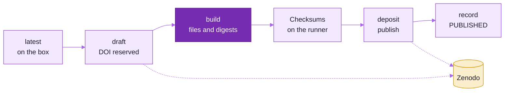

# Open data releases

KalaVigyan's published knowledge as a versioned, citable dataset under CC BY 4.0, deposited on
Zenodo with a DOI for every version and a concept DOI for all of them, either whole or scoped to
one craft as that craft's own record. Engineers changing a table or a release step read it, and so
does the operator who runs a release.

Last reviewed: 2026-11-22.

| For | Read |
|---|---|
| Why the data is released this way | [decision 0116](../decisions/0116-open-data-with-a-doi.md) |
| Why one craft can be released as its own dataset | [decision 0130](../decisions/0130-a-craft-release.md) |
| Which citations an anonymous reader may read | [decision 0121](../decisions/0121-quote-visibility.md) |
| Running a release | [RUNBOOK.md](../RUNBOOK.md), Open data with a DOI |
| The datasets behind the maps, whose records (never values) are released | [DATA_SOURCES.md](../DATA_SOURCES.md) |

## Where the code is

| Part | Code |
|---|---|
| The tables and their fields: one home, read by the files, the descriptor, the README, the API and the page | `services/open_data_tables.py` and `open_data_structure_tables.py` |
| The column and table types | `open_data_schema.py` |
| Reading every table and checking its rows | `open_data_rows.py` |
| Facts, citations, sources | `open_data_claims.py` |
| Crafts, places, categories, families | `open_data_crafts.py` |
| Stages, materials, reactions, native names, GI records | `open_data_structure.py` |
| Components, datasets | `open_data_catalogue.py` |
| Value formats | `open_data_values.py` |
| Row digests and changes | `open_data_changes.py` |
| The files and their words | `open_data_files.py`, `open_data_descriptor.py`, `open_data_readme.py`, `open_data_text.py` |
| Version, DOI and target rules | `open_data_release.py` |
| A release's scope and the words that name it (title, summary, keywords, citation, the craft's page) | `open_data_scope.py` |
| One craft's slice: the craft, its claim scope and the rows a craft release keeps | `open_data_slice.py` |
| Build, record, list | `open_data.py` |
| The public listing | `open_data_listing.py` |
| The Zenodo adapter | `open_data_zenodo.py` |
| Checking a release folder and depositing it | `open_data_deposit.py` |
| Rows, the command, the route, the workflow | `models/open_data.py` and migrations `0057_open_data_releases` and `0062_open_data_scope`; `scripts/build_open_data.py`; `api/routes/open_data.py`; `.github/workflows/open-data.yml` |
| The web client | `lib/openDataContract.ts`, `lib/openDataView.ts`, `lib/openDataCrafts.ts`, `lib/openData.ts`, `lib/server/openDataServer.ts`, `components/openData/*`, `app/(reading)/data` and the DOI line in `components/craft/CiteThis.tsx` |

## What a release holds

| Table | Key | Rows |
|---|---|---|
| `claims` | `id` | every published fact: status shown, sensitivity OPEN, not held, a visible subject concept, and at least one exportable citation |
| `citations` | `id` | the exportable citations of those facts: no quote text, only `quoted` and `quote_check` |
| `sources` | `id` | the sources those citations name |
| `crafts` | `slug` | every craft that is not merged into another, with its Wikidata item (matched with confidence only) |
| `craft_places` | `id` | the places of those crafts by LGD state and district code |
| `categories`, `families` | `slug` | the craft list's categories and sub-categories |
| `stages`, `materials`, `reactions` | `craft`, `key` | the curated page index's entries that rest on at least one released fact |
| `native_names` | `craft`, `claim_id`, `text` | native names whose fact is released |
| `gi_records` | `craft` | GI records that rest on at least one released fact |
| `components` | `label` | the component catalogue's metadata and the released facts each rests on |
| `datasets` | `code` | the records of the datasets behind the maps, never their values |

An exportable citation is one an anonymous reader may read (`retrieval/citation_access.readable_citation`
with `PUBLIC`, decision 0121): a PUBLIC chunk that is not RESTRICTED; or no chunk and no quote; or no
chunk, a quote, and every passage of its source PUBLIC and not RESTRICTED, so a quote of a page kept
for researchers is never released through a missing link. It also has a source that is not RESTRICTED
and not `FIELD_TESTIMONY`, and a source that is not a withheld field recording. Every
claim id a structure, component or GI row lists is a released fact; others are dropped. Every
field, its type, whether it may be empty and its meaning are in `datapackage.json`, the README and
`GET /api/open-data` (`tables`).

Never in a release: the verbatim quote of a cited work, a user's name or e-mail or any `createdById`
or `addedById`, a held fact, a supplied source's text, a field recording, photograph or personal
account, a restricted source or passage, a dataset's values or geometry.

### A craft release

A release has a scope: none (the whole knowledge base) or one craft's slug, stored on its row
(`OpenDataRelease.scope`). A craft release holds the same 14 tables with the same columns, under
the same licence and the same rules of what is left out; a table may be empty. It reads only the
craft's slice (`open_data_slice.py`):

| Table | A craft release keeps |
|---|---|
| `claims`, `citations`, `sources` | the released facts an answer about the craft reads, through the craft scope stored search uses (`retrieval/hybrid.craft_scope` and `retrieval/statements.scope_claims`, decision 0122): its own concepts and those of the crafts merged into it, its sub-category's shared concepts, and its category's science; then their exportable citations and the sources they name |
| `crafts`, `craft_places` | the craft's row and its places |
| `categories`, `families` | the craft's category and sub-category |
| `stages`, `materials`, `reactions`, `native_names`, `gi_records` | the craft's own rows, keeping only claim ids of the slice |
| `components` | the components of the craft or of no craft that rest on at least one fact of the slice |
| `datasets` | the records of the datasets those components cite (each `datasets` list of a component's stored payload) |

The craft is named by its exact slug; a slug no craft has, or a craft merged into another, is
refused before anything is built or sent. Its name is the craft's display name
(`data/craft_names.py`), never typed.

## The files

`<table>.jsonl` and `<table>.csv` for each of the 14 tables, `datapackage.json`, `README.md`,
`CITATION.cff`, `CHANGES.md` and `SHA256SUMS` (33 files, flat names). JSON Lines are compact,
UTF-8, one record per line with every column present in the table's order; CSV writes lists and
objects as JSON, `true` and `false`, and an empty cell for no value. Dates are `YYYY-MM-DD`, times
`YYYY-MM-DDTHH:MM:SSZ` in UTC. `SHA256SUMS` is `<sha256>  <name>` per file but itself, in name
order (`sha256sum -c SHA256SUMS`).

**Same data, same bytes**: building twice from the same database with the same arguments writes
identical files, for the whole knowledge base and for each craft (tested on a seeded database).

A craft release's files name it: `datapackage.json` has the name `kalavigyan-open-knowledge-<slug in
lower case>`, the title "<craft name>: KalaVigyan open knowledge", the craft's summary, the craft's
name as a last keyword and a `craft` property `{slug, name, path}` (its monograph page, which the
deposit reads back); the README opens with that title, says it is the slice of KalaVigyan's
knowledge about the craft, cites it, counts its rows, lists what is left out and links the craft's
monograph and the whole release's page; `CITATION.cff` carries the title, the summary, the keyword
and the monograph page as a `url` identifier. The BibTeX key is `kalavigyan_<slug>_<version>`.

## The command

From `backend`: `python -m app.scripts.build_open_data <step> --target SANDBOX|ZENODO [--craft
<slug>] ...`. Every step takes `--craft`; without it the step works on the whole knowledge base.
Each step prints one line `OPEN_DATA_RESULT <json>`.

| Step | Arguments | Does |
|---|---|---|
| `latest` | | prints the latest published release of the target and scope, or `null`, and `craft {slug, name, title}` for a craft (refusing an unknown or merged craft) |
| `draft` | `--version`, `--site`, `--latest-record` when the scope has one, `--craft-name` with `--craft` | opens a Zenodo draft (a new version of the scope's latest record, its inherited files deleted; for a scope with none, a new record and so a new concept DOI), sets the first metadata, reserves the DOI; prints `record_id`, `concept_record_id`, `doi`, `concept_doi`, `bucket`. It refuses, before changing the draft, a new version whose inherited title is not the one it sets, so a craft release is never a version of the whole-knowledge record. On SANDBOX the DOI and concept DOI take the sandbox's test prefix `10.5072` (`SANDBOX_DOI_PREFIX`), because the sandbox reserves under Zenodo's `10.5281` but mints under `10.5072`; on ZENODO they are the DOI Zenodo reserves. Reads `ZENODO_TOKEN` |
| `build` | `--version`, `--doi`, `--concept-doi`, `--record-id`, `--concept-record-id`, `--out` | reads the database (the craft's slice with `--craft`), writes the files to `--out`, and stores the release as DRAFT with its scope, files, counts, changes and row digests; refuses a version already PUBLISHED on that target and scope |
| `deposit` | `--record-id`, `--files`, `--site`, `--publish` | refuses a folder whose files do not match `SHA256SUMS`, whose DOI is not the draft's, or whose scope (read from `datapackage.json`) is not the one `--craft` names; uploads every file, sets the final metadata, and publishes only with `--publish`; refuses a published DOI other than the reserved one. Reads `ZENODO_TOKEN` |
| `record` | `--version`, `--doi`, `--record-url`, `--published-at` (with its offset) | marks the release of that target, scope and version PUBLISHED; refuses a DOI other than the one its build used |

The version is `YYYY.MM.DD` or `YYYY.MM.DD.N` (N from 1 to 99); the release day is the version's
day. A version is unique per target and scope (`NULLS NOT DISTINCT`), so a craft release may share
the whole release's version. `CHANGES.md` compares with the latest PUBLISHED release of the same
target and scope, by each row's key and a 16-hex-digit SHA-256 of its sorted compact JSON.

## The workflow

`.github/workflows/open-data.yml`, dispatch only, from main (the deploy role trusts main). Inputs:
`version` (empty: today in India), `publish` (default false) and `craft` (empty: the whole
knowledge base; else a craft's slug of letters, digits and hyphens, checked before anything is
sent). Unticked: target SANDBOX and `ZENODO_SANDBOX_TOKEN`; ticked: target ZENODO and
`ZENODO_TOKEN`. A missing token stops the run before anything is sent. Steps: `latest` on the box
(which names the craft), `draft` on the runner, `build` on the box with the files copied to
`s3://<media bucket>/deploy/logs/open-data/<run>/files/`, the checksums checked on the runner,
`deposit --publish` on the runner, `record` on the box; each takes the craft. The run's summary
names the scope, the title, both DOIs and the record.

Zenodo metadata: upload type dataset, title "KalaVigyan open knowledge" (a craft release: "<craft
name>: KalaVigyan open knowledge"), creator "KalaVigyan, Centre of Excellence for Unified
AI-Enabled Craft Ecosystem Platform, IIT Kharagpur", licence `cc-by-4.0`, open access, English,
keywords (a craft release adds the craft's name), a description with the scope's summary, the row
counts and what is left out, and related identifiers: the dataset page (`isDocumentedBy`), for a
craft release its monograph page `<site>/crafts/<slug>` (`isDocumentedBy`), and the code
(`isSupplementedBy`, software).

## The public listing

`GET /api/open-data` (public read, counted, ETag): `schemaVersion` 1, `title`, `summary`, `creator`,
`licence {id, name, url}`, `attribution`, `citedWorks`, `leftOut`, `codeUrl`, `pageUrl`,
`conceptDoi`, `conceptDoiUrl`, `citation` and `bibtex` (the newest version's, or the dataset page's
before the first release), `latest`, `releases` (ZENODO and PUBLISHED only, newest first:
`version`, `releasedOn`, `doi`, `doiUrl`, `recordUrl`, `publishedAt`, `totalBytes`, `files [{path,
bytes, downloadUrl}]`, `counts`, `changes`, `citation`, `bibtex`), `craftReleases` (the craft
releases, ZENODO and PUBLISHED only, by craft slug and newest first within a craft: every field of
a release, then `craft`, `craftName`, `title`, `conceptDoi`, `conceptDoiUrl`, with the citation
and BibTeX of that craft's title) and `tables` (the data dictionary: `name`, `title`,
`description`, `key`, `files`, `fields [{name, type, description, required}]`). The top-level
fields and `releases` are the whole knowledge base's only. The golden is
`shared/open-data.golden.json`. Row digests never leave the database.

## The page

`/data` (a reading route, no sign-in): the title and summary beside Cite this dataset (text or
BibTeX, both DOIs, the attribution, Copy citation), at a glance (licence, version, DOIs, facts,
sources, crafts, size), what it holds (each table with its rows, download links and fields), reuse
and its limits (the licence, cited works, what stays out, the code), every release, and, when one
is published, Releases of one craft (each craft linked to its page, its version, day, DOI, concept
DOI, facts and size). The site footers link it as "Cite this dataset".

A craft page's Cite this monograph (`components/craft/CiteThis.tsx`) shows one more line, "Its open
data, version <version>" with the newest craft release's DOI, when the listing has one for that
craft; it reads the listing once per visit in the browser and shows nothing new for a craft without
one, or when the listing cannot be read.

## Versioning

The listing is schema 1, the files are described by their own `datapackage.json`. Adding a table or
a column changes the descriptor, the README, this page and the golden in the same change; removing
or renaming one is a new schema.

## How this document is kept true

| Claim | Kept true by |
|---|---|
| What each table releases and leaves out, and same data, same bytes | `backend/tests/db/test_open_data_db.py`, on a seeded database |
| What a craft release holds and leaves out, same bytes per scope, and the latest per target and scope | `backend/tests/db/test_open_data_scope_db.py`, on a seeded database, and `backend/tests/open_data/test_open_data_scope.py` |
| The files, the descriptor and the checksums | `backend/tests/open_data/test_open_data_files.py` and, for a craft, `test_open_data_craft_files.py` |
| Versions, DOIs and target rules | `backend/tests/open_data/test_open_data_identity.py` |
| Changes against the latest release | `backend/tests/open_data/test_open_data_changes.py` |
| The command's steps and the workflow's inputs | `backend/tests/open_data/test_build_open_data_script.py` and `test_open_data_workflow.py` |
| The Zenodo adapter and the deposit's refusals | `backend/tests/open_data/test_open_data_zenodo.py` and `test_open_data_craft_deposit.py` |
| The scope column, its uniqueness and its migration | `backend/tests/test_open_data_scope_migration.py` |
| The public listing and its golden | `backend/tests/open_data/test_open_data_listing.py` and `shared/open-data.golden.json` |
| The page and the craft page's DOI line | `frontend/e2e/open-data-unit.spec.ts` and `frontend/e2e/open-data-crafts-unit.spec.ts` |

Re-read it when a table or column is added, a release step changes, a craft scope changes, or
Zenodo's metadata rules move.
