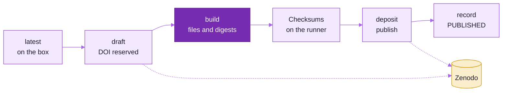

# Open data releases

KalaVigyan's published knowledge as a versioned, citable dataset under CC BY 4.0, deposited on
Zenodo with a DOI for every version and a concept DOI for all of them. Engineers changing a table
or a release step read it, and so does the operator who runs a release.

Last reviewed: 2026-11-21.

| For | Read |
|---|---|
| Why the data is released this way | [decision 0116](../decisions/0116-open-data-with-a-doi.md) |
| Running a release | [RUNBOOK.md](../RUNBOOK.md), Open data with a DOI |
| The datasets behind the maps, whose records (never values) are released | [DATA_SOURCES.md](../DATA_SOURCES.md) |

## Where the code is

| Part | Code |
|---|---|
| The tables and their fields: one home, read by the files, the descriptor, the README, the API and the page | `services/open_data_tables.py` and `open_data_structure_tables.py` |
| The column and table types | `open_data_schema.py` |
| Reading every table and checking its rows | `open_data_rows.py` |
| Facts, citations, sources | `open_data_claims.py` |
| Crafts, places, categories, families | `open_data_crafts.py` |
| Stages, materials, reactions, native names, GI records | `open_data_structure.py` |
| Components, datasets | `open_data_catalogue.py` |
| Value formats | `open_data_values.py` |
| Row digests and changes | `open_data_changes.py` |
| The files and their words | `open_data_files.py`, `open_data_descriptor.py`, `open_data_readme.py`, `open_data_text.py` |
| Version, DOI and target rules | `open_data_release.py` |
| Build, record, list | `open_data.py` |
| The public listing | `open_data_listing.py` |
| The Zenodo adapter | `open_data_zenodo.py` |
| Checking a release folder and depositing it | `open_data_deposit.py` |
| Rows, the command, the route, the workflow | `models/open_data.py` and migration `0057_open_data_releases`; `scripts/build_open_data.py`; `api/routes/open_data.py`; `.github/workflows/open-data.yml` |
| The web client | `lib/openDataContract.ts`, `lib/openDataView.ts`, `lib/openData.ts`, `lib/server/openDataServer.ts`, `components/openData/*` and `app/(reading)/data` |

## What a release holds

| Table | Key | Rows |
|---|---|---|
| `claims` | `id` | every published fact: status shown, sensitivity OPEN, not held, a visible subject concept, and at least one exportable citation |
| `citations` | `id` | the exportable citations of those facts: no quote text, only `quoted` and `quote_check` |
| `sources` | `id` | the sources those citations name |
| `crafts` | `slug` | every craft that is not merged into another, with its Wikidata item (matched with confidence only) |
| `craft_places` | `id` | the places of those crafts by LGD state and district code |
| `categories`, `families` | `slug` | the craft list's categories and sub-categories |
| `stages`, `materials`, `reactions` | `craft`, `key` | the curated page index's entries that rest on at least one released fact |
| `native_names` | `craft`, `claim_id`, `text` | native names whose fact is released |
| `gi_records` | `craft` | GI records that rest on at least one released fact |
| `components` | `label` | the component catalogue's metadata and the released facts each rests on |
| `datasets` | `code` | the records of the datasets behind the maps, never their values |

An exportable citation has no chunk or a PUBLIC chunk that is not RESTRICTED, a source that is not
RESTRICTED and not `FIELD_TESTIMONY`, and a source that is not a withheld field recording. Every
claim id a structure, component or GI row lists is a released fact; others are dropped. Every
field, its type, whether it may be empty and its meaning are in `datapackage.json`, the README and
`GET /api/open-data` (`tables`).

Never in a release: the verbatim quote of a cited work, a user's name or e-mail or any `createdById`
or `addedById`, a held fact, a supplied source's text, a field recording, photograph or personal
account, a restricted source or passage, a dataset's values or geometry.

## The files

`<table>.jsonl` and `<table>.csv` for each of the 14 tables, `datapackage.json`, `README.md`,
`CITATION.cff`, `CHANGES.md` and `SHA256SUMS` (33 files, flat names). JSON Lines are compact,
UTF-8, one record per line with every column present in the table's order; CSV writes lists and
objects as JSON, `true` and `false`, and an empty cell for no value. Dates are `YYYY-MM-DD`, times
`YYYY-MM-DDTHH:MM:SSZ` in UTC. `SHA256SUMS` is `<sha256>  <name>` per file but itself, in name
order (`sha256sum -c SHA256SUMS`).

**Same data, same bytes**: building twice from the same database with the same arguments writes
identical files (tested on a seeded database).

## The command

From `backend`: `python -m app.scripts.build_open_data <step> --target SANDBOX|ZENODO ...`. Each step
prints one line `OPEN_DATA_RESULT <json>`.

| Step | Arguments | Does |
|---|---|---|
| `latest` | | prints the latest published release of the target, or `null` |
| `draft` | `--version`, `--site`, `--latest-record` when there is one | opens a Zenodo draft (a new version of the latest record, its inherited files deleted), sets the first metadata, reserves the DOI; prints `record_id`, `concept_record_id`, `doi`, `concept_doi`, `bucket`. On SANDBOX the DOI and concept DOI take the sandbox's test prefix `10.5072` (`SANDBOX_DOI_PREFIX`), because the sandbox reserves under Zenodo's `10.5281` but mints under `10.5072`; on ZENODO they are the DOI Zenodo reserves. Reads `ZENODO_TOKEN` |
| `build` | `--version`, `--doi`, `--concept-doi`, `--record-id`, `--concept-record-id`, `--out` | reads the database, writes the files to `--out`, and stores the release as DRAFT with its files, counts, changes and row digests; refuses a version already PUBLISHED on that target |
| `deposit` | `--record-id`, `--files`, `--site`, `--publish` | refuses a folder whose files do not match `SHA256SUMS` or whose DOI is not the draft's, uploads every file, sets the final metadata, and publishes only with `--publish`; refuses a published DOI other than the reserved one. Reads `ZENODO_TOKEN` |
| `record` | `--version`, `--doi`, `--record-url`, `--published-at` (with its offset) | marks the release PUBLISHED; refuses a DOI other than the one its build used |

The version is `YYYY.MM.DD` or `YYYY.MM.DD.N` (N from 1 to 99); the release day is the version's
day. `CHANGES.md` compares with the latest PUBLISHED release of the same target, by each row's key
and a 16-hex-digit SHA-256 of its sorted compact JSON.

## The workflow

`.github/workflows/open-data.yml`, dispatch only, from main (the deploy role trusts main). Inputs:
`version` (empty: today in India) and `publish` (default false). Unticked: target SANDBOX and
`ZENODO_SANDBOX_TOKEN`; ticked: target ZENODO and `ZENODO_TOKEN`. A missing token stops the run
before anything is sent. Steps: `latest` on the box, `draft` on the runner, `build` on the box with
the files copied to `s3://<media bucket>/deploy/logs/open-data/<run>/files/`, the checksums checked
on the runner, `deposit --publish` on the runner, `record` on the box. The run's summary names both
DOIs and the record.

Zenodo metadata: upload type dataset, title "KalaVigyan open knowledge", creator "KalaVigyan, Centre
of Excellence for Unified AI-Enabled Craft Ecosystem Platform, IIT Kharagpur", licence `cc-by-4.0`,
open access, English, keywords, a description with the row counts and what is left out, and related
identifiers: the dataset page (`isDocumentedBy`) and the code (`isSupplementedBy`, software).

## The public listing

`GET /api/open-data` (public read, counted, ETag): `schemaVersion` 1, `title`, `summary`, `creator`,
`licence {id, name, url}`, `attribution`, `citedWorks`, `leftOut`, `codeUrl`, `pageUrl`,
`conceptDoi`, `conceptDoiUrl`, `citation` and `bibtex` (the newest version's, or the dataset page's
before the first release), `latest`, `releases` (ZENODO and PUBLISHED only, newest first:
`version`, `releasedOn`, `doi`, `doiUrl`, `recordUrl`, `publishedAt`, `totalBytes`, `files [{path,
bytes, downloadUrl}]`, `counts`, `changes`, `citation`, `bibtex`) and `tables` (the data dictionary:
`name`, `title`, `description`, `key`, `files`, `fields [{name, type, description, required}]`).
The golden is `shared/open-data.golden.json`. Row digests never leave the database.

## The page

`/data` (a reading route, no sign-in): the title and summary beside Cite this dataset (text or
BibTeX, both DOIs, the attribution, Copy citation), at a glance (licence, version, DOIs, facts,
sources, crafts, size), what it holds (each table with its rows, download links and fields), reuse
and its limits (the licence, cited works, what stays out, the code) and every release. The site
footers link it as "Cite this dataset".

## Versioning

The listing is schema 1, the files are described by their own `datapackage.json`. Adding a table or
a column changes the descriptor, the README, this page and the golden in the same change; removing
or renaming one is a new schema.

## How this document is kept true

| Claim | Kept true by |
|---|---|
| What each table releases and leaves out, and same data, same bytes | `backend/tests/db/test_open_data_db.py`, on a seeded database |
| The files, the descriptor and the checksums | `backend/tests/open_data/test_open_data_files.py` |
| Versions, DOIs and target rules | `backend/tests/open_data/test_open_data_identity.py` |
| Changes against the latest release | `backend/tests/open_data/test_open_data_changes.py` |
| The command's steps | `backend/tests/open_data/test_build_open_data_script.py` |
| The Zenodo adapter and the deposit's refusals | `backend/tests/open_data/test_open_data_zenodo.py` |
| The public listing and its golden | `backend/tests/open_data/test_open_data_listing.py` and `shared/open-data.golden.json` |
| The page | `frontend/e2e/open-data-unit.spec.ts` |

Re-read it when a table or column is added, a release step changes, or Zenodo's metadata rules move.
