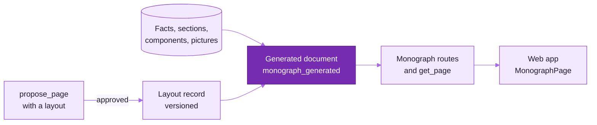

# Page layout and generated monograph documents

Formatting is its own layer. A page's layout record says where each text unit and component of the
page sits and how a picture is cropped; it refers to them by unit id and component label only and
never holds a fact. Every craft, family and category without authored content gets a monograph
document generated from what the database holds, ordered by its layout record.

| For | Read |
|---|---|
| Why formatting is its own layer | [decision 0106](../decisions/0106-one-monograph-template-for-every-page.md), item 6; [decision 0101](../decisions/0101-knowledge-architecture-for-every-craft.md), items 4 and 14 |
| Proposing a layout and how it is reviewed | [knowledge-writes.md](knowledge-writes.md), Layout proposals; [review-queue.md](review-queue.md) |
| The document the layout orders | [monograph-document.md](monograph-document.md) |
| How the web app draws it | [monograph-renderer.md](monograph-renderer.md) |
| What each field contributes to a generated page | [coverage.md](coverage.md) |

Editing a fact never breaks a layout, and editing a layout never touches a fact. Engineers changing
a generated page, and a contributor's agent proposing a layout, read it.

## The layout record (`research/page_layout.py`)

`PageLayout {schemaVersion 1, subjectKind (craft, family, category), subjectSlug, version (from 1),
entries[]}`, at most 4,000 entries. Each entry:

| Field | Rule |
|---|---|
| `ref` | a component label (`research/monograph_page.COMPONENT_LABEL_PATTERN`, it holds a `/`) or a unit id (`[A-Za-z0-9._-]+`, the slot key of the template) |
| `chapter` | a chapter key, `^[a-z][a-z0-9-]{0,39}$`: decision 0095's keys for generated pages, the approved page's own chapter ids for Kutch Ajrakh |
| `order` | from 1; no two entries share a chapter and an order |
| `role` | `HERO`, `OPENER`, `PLATE`, `FIGURE`, `SIDEBAR`, `PULL_QUOTE` or `BODY` |
| `crop` | optional focal box `{x, y, width, height}` in fractions of the picture, inside it (`research/craft_parts.Focal`) |
| `size` | optional `MARGIN` (the right margin of the spread), `COLUMN` (the measure), `WIDE` (the content width) or `BLEED` (full bleed); absent means the role's default |
| `caption` | optional caption override, 1 to 300 characters |

Rules, checked on every record and every write:
- each unit or component is placed once;
- a page has at most one `HERO`, and a chapter at most one `OPENER`;
- `HERO`, `OPENER`, `PLATE` and `FIGURE` place a component; `PULL_QUOTE` places a text unit;
  `SIDEBAR` and `BODY` place either;
- only a component takes a crop or a caption override.

**How a document is ordered** (`arranged_layout(default, layout)`): chapters come in decision 0095's
order (`research/chapter_keys.CHAPTER_KEYS`, with `reading` and `media` before `sources` since
decision 0233), then any other chapter a layout names. In each chapter
the entries the layout names come first, by `order`; then everything it does not name, in the
document's default order. An entry moves its unit or component to its `chapter`. Units that sit
within a component (`within`) travel with it; the layout orders top-level entries only. A layout
entry naming something the document does not hold is ignored, so a removed fact never breaks a
layout, and a new unit or component lands at the end of its chapter until a layout places it
(decision 0101 item 14). A published layout naming a component that does not exist draws the page
without it, never broken; the web client reads the stored layout only to size, crop and set what
the document holds (`monographPlacement.ts`). A proposed layout may not name one: `propose_page` and
`preview_page` refuse a layout placing a label that no registered component, no live proposal, no
component the same bundle makes and nothing the page draws holds, and `preview_page` names those
of the published layout when its bundle carries none (`open-work.md`, Previews before submitting;
decision 0254).

## Storage, writes and the backfill

- Table `PageLayout` (migration `0042_page_layouts`, after `0041_monograph_documents`): `id`,
  `craftId` or `categoryId` (exactly one; a family is a `Craft` row), `version`, `entries` (JSONB,
  the entries without absent fields), `writtenByKind` (`USER`, `SYSTEM`), `writtenById`,
  `createdAt`. Unique per subject and version; append only. The newest version is the layout.
- `services/page_layouts`: `page_layout(session, kind, slug)` and `layout_of(session, subject)` read
  the newest version (`None` when there is none); `write_layout(session, kind, slug, LayoutWrite,
  actor=)` stores the next version only when `baseVersion` is the current one (0 when there is
  none), else refuses with `Refused("stale_layout")`; every stored version writes the audit record
  `PAGE_LAYOUT_WRITTEN` (target `PageLayout`, detail `subjectKind`, `subjectSlug`, `version`,
  `entries`). The subject is found by `services/open_work_subjects.subject_by_key`, so a family
  asked for as a craft, or the reverse, is refused like an unknown slug.
- A component registered in the place of another (`replaces`, decision 0193) writes the next version
  of every layout whose newest version names the old label, with the new label in the old one's
  entry (chapter, order, role, crop, size and caption kept), or without the old entry when the
  layout already names the new one (`services/component_layout_swaps.swap_in_layouts`), each one
  `PAGE_LAYOUT_WRITTEN` by the approver. A withdrawn, hidden or unlinked component keeps its entry:
  a layout orders only what the page draws, so the entry places nothing until the component is
  shown again.
- `services/page_layouts_backfill.backfill_page_layouts(session)` gives every curated craft, family
  and category with pictures and no layout its first version, written as `SYSTEM`, from the
  dossier's pictures (schema 2, `docs/contracts/curation.md`), and reports `{written, kept}`:

| Dossier placement | Layout role | Chapter |
|---|---|---|
| `MASTHEAD` | `HERO` | `glance` |
| `OPENER` | `OPENER` | its chapter |
| `PLATE`, `MATERIAL` | `PLATE` | its chapter |
| `RECORD`, `STAGE` | `FIGURE` | its chapter |
| none, with a stage | `FIGURE` | `made` |
| none | `PLATE` | `glance` |

  In each chapter the hero or opener is order 1 and the other pictures follow in dossier order. The
  focal box becomes the crop. A picture's ref is its component label
  `<craft or category slug, lower case>/pictures/<dossier key, lower case>` (`picture_label`), for
  example `bagh-print/pictures/i02`.

**Field photographs** (decision 0233). A craft's field photograph from the portals is placed by a
layout entry naming its label `<craft slug, lower case>/pictures/field-<first 12 hex of its id>`
(`services/field_photo_plates.field_key`), with any role, size, crop or caption. Only a photograph
the craft's page already publishes (`field_photo_scope.shown_field_photos`) and that names no
artisan (`FieldImage.artisanLinked` false, whatever `field_voices.artisan_images` says) is offered
(`cleared_photos`, the `list_field_photos` tool) and drawn (`field_plates`); a label of any other is
ignored as an entry naming nothing. Its plate's picture is `/api/field-voices/images/<id>`, its
caption the layout's, the portal's or its alt text, and its credit "Photo: <credited people>, via
<portal>" (`photo_credit`). `list_field_photos` (12 a page by default, 24 at most) gives each its
`pictureUrl` on the site and shows each as a 320 px thumbnail captioned with its label, read from its
shown copy (`services/field_photo_thumbnails`), and says how many it could not show; a preview's
renderer reads the placed photograph through its pass (`open-work.md`, Drawn as a reader sees it), so
the preview's pictures and its drawing checks see it as a reader does. On a generated page the
masthead's photograph is drawn in a figure that names its label (`data-component`), where the drawing
checks look for the masthead picture (decision 0252).

## Routes and the MCP tool

| Method | Path | Who | Answer |
|---|---|---|---|
| GET | `/api/pages/{kind}/{slug}/layout` | anyone (public reading limits, ETag) | the newest `PageLayout`; 404 for an unknown page or one with no layout; 422 for another kind |
| PUT | `/api/pages/{kind}/{slug}/layout` | Admin, Master Admin | body `{baseVersion, entries}`; 200 the stored version; 409 when `baseVersion` is not the current version; 404 for an unknown page; 422 when an entry breaks a rule |
| GET | `/api/categories/{slug}/monograph` | anyone (public reading limits, ETag) | the generated `MonographDocument`, with `lang`, `version`, `part` and `tag` as the craft route takes them (`monograph-document.md`); a `version` a rebuild replaced is read from the kept copy, in `lang` (decision 0219); 404 for an unknown category or one with nothing published, and `That category's monograph has no such version.` for a version never kept |
| GET | `/api/families/{slug}/monograph` | anyone (public reading limits, ETag) | the same for a family |
| GET | `/api/categories/{slug}/monograph/{fmt}`, `/api/families/{slug}/monograph/{fmt}` | anyone (public reading limits, and 10 new files in 10 minutes per caller) | the page as `pdf` or `docx`, an `ExportLink` (`monograph-document.md`, Exports; decision 0208, routes in `api/routes/page_exports.py`); 503 with `Retry-After` when no build slot frees within 5 s, 429 with `Retry-After` over the caller's builds; a stale page's rebuild queued whatever it answers (decision 0214) |

`kind` is `craft`, `family` or `category`. The routes are `api/routes/page_documents.py`, and the two exports `api/routes/page_exports.py`.

MCP read tool `get_page {subject {kind, slug}, parts ["layout"]}` (`api/mcp_page_read.py`, any connection):
its `PageRead` carries `layout` (PageLayout or null) and `pageUrl` (`knowledge-api.md`); an
unknown slug or a wrong kind is a tool error naming `find_crafts`.

## Generated documents (`services/monograph_generated*.py`)

`generated_document(session, subject_kind, slug) -> MonographDocument | None` builds the document
of a craft without authored content, a family or a category. An unknown subject or a wrong kind
raises `InvalidInput`; a subject with no published sentence whose facts are all public gives
`None`. The craft monograph route calls it for every craft without authored content.

What it holds (`MonographDocument`, `docs/decisions/0106`):
- **Text units, one paragraph per section sentence.** The published `ArticleSection` of each field
  gives one `p` unit per sentence whose every claim is public and cited
  (`knowledge_view.claims_by_id`); a sentence resting on a hidden or uncited claim is left out.
  Unit id `<field, lower case>-<first 10 hex of the SHA-256 of its sorted claim ids>` (a `-2`, `-3`
  suffix when two sentences of a field rest on the same claims), so an id survives rewording and a
  layout keeps pointing at it. Each field with a sentence opens with an `h3` unit `h-<field>` holding
  its title (`research/sections.DISCIPLINE_TITLES`). A unit sits in its field's chapter
  (`research/chapter_keys.DISCIPLINE_CHAPTERS`); `claimIds` are the stored claim ids.
- **Citation marks** in the shape `render_nodes` reads: `[{"m": "s", "c": ["<sentence but its last
  word> ", {"m": "cite", "key": "<unit id>", "g": ["g2", "g1"], "c": ["<last word>"]}]}]`.
  `citations[<unit id>]` lists `{source, locator, quote}` for each quote of its claims and
  `citationClaims[<unit id>]` its claim ids.
- **Sources** are the stored claims' sources (`CitedSource`, `grade` the source's reliability),
  keyed `g1`, `g2`... and numbered in reading order, after the layout is applied; one source cited
  by two sentences keeps one number. A reused fragment's sources follow, matched to the page's by
  URL (or title).
- **Masthead and label card** from the subject's record, in `glance`: `masthead-kicker`
  (`Monograph` and the family and kind labels), `masthead-title` (`h1`, the reader's name of the
  craft), and the label card as `dt`/`dd` pairs `label-place-term`/`label-place` (states of
  practice) and `label-gi-term`/`label-gi` (`Registered geographical indication`, for a GI craft
  only). They sit within the hero picture when there is one, as on the approved page.
- **Pictures** are the curated dossier's inline pictures, each a `picture_plate` component labelled
  as in the backfill, in its placement's chapter with its role, drawn from a spec: `{media
  (MediaRef), caption (the layout's override or the dossier's), standIn, focal (the layout's crop or
  the dossier's focal box), role, size, claimIds}`. A spec names its units by the one unit id
  pattern every document's specs use, `u` and four digits (`research/unit_ids.py`, decision 0145),
  in ranges by origin: an authored page's own units `u0001` to `u5000`, delivered components'
  `u5001` to `u8900`, the site-drawn colour key's `u8901` to `u8999` (decision 0197), generated
  pictures' captions and credits `u9001` to `u9999`.
- **Registered components** that apply: for a craft or family
  `services/component_library.library_components` with its slug; for a category every labelled,
  visible component keyed to a concept its curated or section facts are about, or resting on one of
  those facts. Of these only the subject's own components and shared ones (no owning craft) are
  placed: another craft's own component that shares a place or a concept stays on that craft's
  page. Each is placed at the end of its field's chapter, sorted by label, and drawn from its
  delivered spec when it has one (`payload.delivered`, a component a contributor delivered and an
  approval registered, its units renamed `u5001` and on and cited within it;
  `docs/contracts/component-specs-general.md`), else from
  `backend/app/data/monographs/<registering monograph>/specs/<label with / as __>.json` when that
  spec exists, else from that monograph's fragment
  `backend/app/data/monographs/<registering monograph>/fragments/<label with / as __>.html`, its
  unit and data slots filled from that monograph's `content.json` with each cite renamed to the
  page's source keys and its citation key prefixed `<monograph, lower case>:`. The registering
  monograph is the `monograph` the component's stored payload names. A component with neither is
  left out of the page.
- **Kin crafts** (decision 0180): for a craft, a `related_crafts` component in the `kin` chapter,
  labelled `<slug>/kin/related-crafts`, from the page's relatives (`craft_page_family.
  family_relatives`, the same sub-family) that have a cited lede sentence whose claims are all
  public: each kin craft's name, page, states, GI and monograph marks, the material terms both
  crafts name in the glossary (`TermCraft` on both, a `MATERIAL` concept through `TermConcept`, at
  most six, `monograph_generated_kin.shared_materials`) and its lede sentence as a held `p` unit
  `kin-<n>` cited like any other, with the family line for its swatch. The spec is the declared form
  of `related_crafts` (`research/kin_crafts.KinCraftsSpec`, with `head`); Kutch Ajrakh's authored
  form keeps its own view. No kin sentence, no component.
- **Colour key** (decision 0197): for a craft, a `swatch_cards` component labelled
  `<slug>/chemistry/colour-key` at the head of the `chem` chapter (after its pictures), drawn by
  the site from the page's structure (`services/colour_key.key_colours`): each colour a stage's
  `after` names, with the stage's dyes, mordants and resists as its agent, its why sentence beside
  it and the stage as its swatch caption; each swatch of a mordant bath (`<dye> on <mordant>`);
  and each colour a dye or mordant material card's fact states (`gives`, `develops`, `turns`, as
  `science/reaction_colours.step_colours` reads a quote). A colour is kept only when its sentence
  names it and every fact it rests on is shown and not a hypothesis; a why or sentence the page
  already tells as a `p` is left off, so no held unit repeats a sentence (rule 25). One card per
  colour, the first with a depicted material winning, in the order the page tells them. Its swatch
  is the specimen token `research/colour_key.DEPICTED_COLOURS` names for that colour and one of its
  substances among the agent's names (`depicted_material`: indigo blue is `indigo`, madder red
  `madder`, iron black on tannin `kut`, harda yellow `harda`, lime white `lime`, and so on); a
  quote that states the change ("at first green, it turns blue") adds the before swatch joined by
  `becomes`; a colour no token depicts is its name and sentence in words. The units are `KEY_UNITS`
  (`u8901` on): the kicker "Colour key", the title "<Count> colours and what gives each", the
  colours named as the intro, then each card's captions, name and agent as plain units and its
  sentence and why as cited `span` units. Fewer than two colours, or a `swatch_cards` component
  the page already registers, and the page draws no key.
- **Reading tools** (decision 0233): in the `reading` chapter, for a craft, an `ask_next` component
  labelled `<slug>/reading/ask-next` with the page's suggested questions (`craft_page_family.
  suggested_questions`, at most 12), and for any page with a served translated passage
  (`page_text_index.covered_counts`) a `language_switch` labelled `<slug>/reading/page-languages`
  in its linked form: English and each translated language, each option `{lang, name (its own
  script), direction, status (its English name), href}` linking to the page in it
  (`monograph_generated_reading.py`). A component of a reading kind (`ask_next`, `audio_player`,
  `citation_tool`, `explainer`, `language_switch`, `quiz`, `reading_level`) stands in `reading` and
  one of a media kind (`ai_video`, `film`, `generator`) in `media`, whatever its field
  (`chapter_keys.kind_chapter`).
- **Order**: by chapter, the hero with the masthead, then each chapter's pictures (hero and opener
  first), its text by field, then its components; then the page's layout record as above.
- **Data**: `content.data["page-layout"]` is the layout record the page was ordered by, so a
  renderer applies roles, sizes and crops (How the web draws a layout, below); absent when the page
  has no layout.
- **Version**: the sum of the subject's published section versions, so a new version of any
  section moves it. `title` is the subject's name; `pageUrl` is `/crafts/<slug>` for a craft or
  family and `/categories/<slug>` for a category on `PUBLIC_WEB_URL`.

**A page and a bundle.** `generated_parts(session, subject, additions)` takes optional
`PageAdditions` (`services/page_preview_additions.py`): sentences added to their fields' sections
(a new section at version 0), the facts and sources they rest on, delivered components that join or
replace the registered ones by label, and a layout that replaces the page's. `preview_page` builds
a bundle's preview with it (`open-work.md`, Previews before submitting); without additions the
document is the page's own.

## How the web draws a layout (decision 0227)

A generated document's renderer (`monograph-renderer.md`) reads every entry of
`content.data["page-layout"]` (`lib/monographPlacement.ts`); an entry off its shape places nothing.
Kutch Ajrakh's authored shell takes none of this.

- **Size.** The entry's `size`, else its role's: `SIDEBAR` is `MARGIN`, `OPENER` `WIDE`, `PLATE`
  `COLUMN`; `HERO` is the masthead picture; `FIGURE` and `BODY` keep the frame the kind has on the
  approved page. The size's frame replaces the box steps of the component's home, whose other steps
  stay as pass-through wrappers, and the home carries `data-size`:

| Size | Frame | Drawn |
|---|---|---|
| `COLUMN` | `div.screen > div.wrap.kv-passage > div.spread > div.main` | the reading measure: 66ch below 1200px, the spread's 680px column from 1200px |
| `WIDE` | `div.screen > div.wrap.kv-passage` | the content width, up to 1280px within the page's margins |
| `BLEED` | `div.screen > div.wrap.kv-passage.kv-bleed` | edge to edge, the safe-area insets its only margins, a caption kept 16px off the edge |
| `MARGIN` | none, inside `aside.margin.note.keep > div.margin-plate` of the run it follows | beside that paragraph in the spread's 240px margin from 1200px, after it in the column below |

  A view that draws its own spread (an answer block) is one block inside a `COLUMN` or a margin and
  spans the content width at `WIDE` and `BLEED`. A `MARGIN` component with no paragraph before it is
  drawn at `COLUMN`. A text unit at `MARGIN` is `p.kv-beside-note` in the margin; a text unit takes
  no other size.
- **Crop.** A component whose spec holds a `picture` and whose entry has a `crop` shows exactly that
  box: its home carries `data-crop` and `--kv-crop-x`, `--kv-crop-y`, `--kv-crop-w`, `--kv-crop-h`
  and `--kv-crop-ratio` (the box's width over its height in pixels), so the picture's frame (`.ph`)
  takes the box's shape and the picture is scaled and offset to fill it. The picture's `focal` box
  becomes the crop as well, so a frame of fixed shape (the masthead's 16:7.4) centres on it.
- **Placed in the prose.** A chapter whose layout names a text unit as `BODY` keeps the layout's
  order exactly. In any other chapter the layout orders only its set pieces, and the page sets them
  into the prose (`lib/monographLayoutFlow.ts`, `lib/monographRenderNear.ts`):
  - each component it places there, but the `HERO` and the chapter's `OPENER`, stands after the
    paragraph that tells it, the one sharing the most of its words and sources weighted by how rare
    each is in the chapter (its title, description, units and the text its spec holds); figures that
    share a paragraph keep the layout's order; one no paragraph tells follows the figure before it in
    the layout's order, or the chapter's first paragraph; a `MARGIN` one goes into that paragraph's
    margin instead of between paragraphs;
  - a text unit it places as `PULL_QUOTE` or `SIDEBAR` stands after the chapter's opening paragraph
    (up to three sentences after its `h2`);
  - the `OPENER` stays first in its chapter, before the heading, at `WIDE`.
- **Pull quote.** A unit placed as `PULL_QUOTE` is drawn as `blockquote.kv-pull > p`, wherever it
  stands.
- A document with no layout data, or a layout naming nothing, draws as it did before.

## The nightly static build

`GET /api/site/pages` (`services/static_pages.py`) lists every craft and family with an `OPEN`
snapshot, a published section (so a generated document) or authored monograph content, by slug,
and every category in master order. The shape is unchanged (`StaticPages {schemaVersion 1,
crafts[], categories[]}`): a family's page lives at `/crafts/<slug>`.

## How this document is kept true

| Claim | Kept true by |
|---|---|
| The record's rules, labels and ordering | `backend/tests/research/test_page_layout.py` |
| Backfill rules, the generated document with a spec, a reused fragment and a layout, the routes | `backend/tests/layouts/` |
| A layout read and proposed over MCP | `backend/tests/mcp/test_mcp_page_read.py` and `test_mcp_page_tools.py` |
| Versions, audit, kinds, backfill and static pages on Postgres | `backend/tests/db/test_page_layouts_db.py` |
| A seeded craft, family and category's generated documents | `backend/tests/db/test_generated_documents_db.py` |
| The reading chapter's tools, and a field photograph offered and placed, never a held, hidden or identity one | `backend/tests/layouts/test_generated_reading.py`, `test_field_photo_plates.py` and `backend/tests/db/test_field_photo_plates_db.py` |
| How the web draws each size, the margin, a crop and figures in the prose | `frontend/e2e/monograph-placed-layout-unit.spec.ts` and `monograph-homes-unit.spec.ts` |

Re-read it when an entry field or role is added, a chapter key changes, or a generated part moves chapter.
