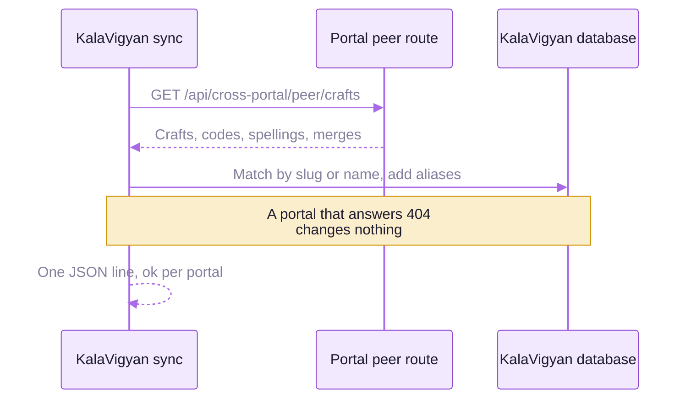

# Portal craft feed

What the designer portal (DesignWorkshop, `designer-portal`) and the documentation portal (Field
Repository, `documentation-portal`) must serve so KalaVigyan holds every craft either team added,
not only the 455 master crafts, and how KalaVigyan reads and stores it. Engineers in all three
repositories read it before changing either side of the route.

Last reviewed: 2026-11-16.

| For | Read |
|---|---|
| The design choices | [decision 0003](../decisions/0003-portal-craft-sync.md) |
| The master crafts and their aliases | [crafts.md](crafts.md) |
| The portals' transcripts and images, over the same peer mechanism | [field-voices.md](field-voices.md) |
| The daily sync and its switch | [RUNBOOK.md](../RUNBOOK.md) |



## Why a new route

No existing route returns what the sync needs:

| Route | Why it is not enough |
|---|---|
| `GET /api/crafts/catalogue` | Needs a signed-in user (`get_current_user`), and `includeInactive=true` needs a content admin. Its `aliases` are already normalised (`cross_portal_codes.normalise`), so the original spelling is lost, and spellings are folded into each craft by code. |
| `POST /api/cross-portal/peer/search`, `/search/record`, `/explore` | Search across records; no craft list, no merge redirects. |
| FR `GET /api/cross-portal/peer/coverage` | Coverage counts by craft code only. |

So both portals add one peer route. It uses the cross-portal peer mechanism they already share
(`services/cross_portal.py`, `services/cross_portal_peer.py`, `services/cross_portal_client.py`),
with the same token. **The route does not exist yet in either portal**; until it ships, the sync
reports `not_found` for that portal and changes nothing (see `docs/TECH_DEBT.md`).

## The route (both portals, identical)

```
GET /api/cross-portal/peer/crafts
```

Add it to the existing `APIRouter(prefix="/cross-portal/peer")` in `api/routes/cross_portal_search.py`
(or a new `api/routes/cross_portal_crafts.py` included next to it in `api/router.py`).

### Who may call it

- **Gate:** a new setting `CROSS_PORTAL_CRAFT_FEED_ENABLED` (default `false`) and
  `CROSS_PORTAL_TOKEN` of at least `MIN_SECRET_LENGTH` (32) characters. It must not require
  `CROSS_PORTAL_IDENTITY_ENABLED` or `AADHAAR_FINGERPRINT_KEY`: the feed carries no personal data.
  Gate off: 404 `{"detail": "Not Found"}`, as the other peer routes do.
- **Request headers:** `Authorization: Bearer <CROSS_PORTAL_TOKEN>`, `X-Cross-Portal-Nonce`
  (16-128 characters), optional `X-Cross-Portal-Requested-By` (KalaVigyan sends
  `kalavigyan-craft-sync`). Reuse `cross_portal_peer._admit` with a new readiness function; a wrong
  bearer or nonce is 401 `Not authorised.`.
- **Answer:** `cross_portal_peer.signed(settings, request, payload)`, so the body carries
  `X-Cross-Portal-Signature` = HMAC-SHA256 with the token over
  `"GET\n/cross-portal/peer/crafts\n<nonce>\n" + body` (`cross_portal.sign` with `peer_path`).
  KalaVigyan refuses an answer whose signature does not match.
- **Access log:** one `CrossPortalAccessLog` row per call, `action="CRAFT_FEED"`, outcome `OK`.
- No paging: the whole list is one answer (about 500 to 1,000 crafts, well under the 20 MiB the
  reader accepts). No ETag is needed; the reader is idempotent.

### Body (`schemaVersion` 1)

```json
{
  "schemaVersion": 1,
  "portal": "DESIGNER",
  "generatedAt": "2026-11-16T02:59:00Z",
  "categories": [
    {"id": "cm…", "slug": "Textiles-Based-Craft-Category", "name": "Textiles based Craft Category", "sortOrder": 1,
     "subCategories": [{"id": "cm…", "slug": "Hand-Block-Printing", "name": "Hand Block Printing", "sortOrder": 3}]}
  ],
  "crafts": [
    {"id": "cm…", "slug": "Kutch-Ajrakh", "name": "Ajrakh Print of Kutch", "localName": null,
     "subCategoryId": "cm…", "stateOfOrigin": ["Gujarat"], "stateOfPractice": ["Gujarat"],
     "giStatus": "GI", "isCatchAll": false, "craftCode": "ajrakh",
     "status": "ACTIVE", "mergedIntoId": null,
     "aliases": ["Ajrak", "अजरख"], "updatedAt": "2026-11-10T08:00:00Z"}
  ],
  "codes": [{"code": "ajrakh", "name": "Ajrakh"}],
  "spellings": [{"spelling": "ajrak", "label": "Ajrak", "craftCode": "ajrakh", "source": "SHARED"}]
}
```

| Field | Rule |
|---|---|
| `portal` | `DESIGNER` from the designer portal, `FIELD_REPOSITORY` from the documentation portal. The reader refuses a feed whose portal is not the one it called. |
| `categories` | Every `CraftCategory` with every `CraftSubCategory` (`category_tree` already builds this; drop `craftCount`). |
| `crafts` | **Every** `Craft` row, whatever its status: `ACTIVE`, `LEGACY` (waiting for review) and `MERGED`. `build_catalogue(db, include_inactive=True)` gives all but two fields. |
| `crafts[].status`, `mergedIntoId` | `MERGED` exactly when `mergedIntoId` is set, and the target is in the same feed. |
| `crafts[].aliases` | The raw strings of `craft_master.craft_aliases(craft)` (`extraMetadata.aliases`), **not** normalised, in any script. Merged-away names are already there because `merge_craft` adds them. |
| `crafts[].localName`, `updatedAt` | From the row (ISO 8601 with a zone). |
| `crafts[].subCategoryId`, `craftCode` | Must name a sub-category and a code in the same feed, or be null. |
| `codes` | Every `CraftCode` row. |
| `spellings` | Every `CraftSpelling` row, `spelling` as stored (normalised key), `label` the original. |

The reader ignores fields it does not know, so a portal may add fields within version 1. Removing
or renaming a field, or changing a meaning, is version 2 and needs a KalaVigyan change first.

A sketch for both portals (Prisma, inside the new route):

```python
catalogue = await craft_master.build_catalogue(db, include_inactive=True)
rows = {c.id: c for c in await db.craft.find_many()}
crafts = [
    {**{k: row[k] for k in ("id", "slug", "name", "localName", "subCategoryId", "stateOfOrigin",
                            "stateOfPractice", "giStatus", "isCatchAll", "craftCode", "status",
                            "mergedIntoId")},
     "aliases": craft_master.craft_aliases(rows[row["id"]]),
     "updatedAt": rows[row["id"]].updatedAt.isoformat()}
    for row in catalogue["crafts"]
]
```

## How KalaVigyan reads it

Code: `backend/app/services/portal_peer.py` (the adapter), `portal_craft_feed.py` (the typed feed
and its checks), `portal_craft_plan.py` and `portal_craft_reconcile.py` (pure planning),
`portal_craft_sync.py` (database writes and the run), `app/scripts/sync_portal_crafts.py`
(the entry point). Tests: `backend/tests/portal_sync/`, `backend/tests/db/test_portal_craft_sync.py`.

- **Settings:** `CROSS_PORTAL_TOKEN` (the shared value, SSM `/iit/shared/cross-portal-token`,
  copied to `/kalavigyan/env/CROSS_PORTAL_TOKEN` and the KalaVigyan GitHub secret),
  `DESIGNER_PORTAL_API_URL` and `FIELD_REPOSITORY_API_URL` (https, ending in `/api`).
- **Checks on every feed:** the signature; `schemaVersion` 1; the portal; unique ids and slugs;
  every `subCategoryId`, `mergedIntoId` and `craftCode` resolves inside the feed; no craft merged
  into itself. A failed check refuses that portal's whole feed.
- **When it runs:** on every deploy after `seed_crafts`, `seed_claims` and `seed_districts`
  (`infra/deploy/blue_green.sh`; a failure is a warning and the release goes on), and daily at
  21:37 UTC by `.github/workflows/craft-sync.yml` on the box (a failure turns the run red).
- **One portal down:** the other portal's feed is still applied; the down portal's recorded
  sources are kept as they were; the script exits 1 and prints which portal failed.

## What it stores

| Feed item | KalaVigyan |
|---|---|
| category, sub-category | Matched by slug, else by name (normalised). New ones are inserted with id `seed_uuid("k" or "s", slug)`. Existing ones are never renamed. |
| craft | Matched by slug, else by normalised name in the same sub-category (so the same craft added in both portals is one row). A new craft is inserted with id `seed_uuid("c", slug)`, the same rule as the master list, so every environment gets the same id. |
| master craft (slug on the master list) | Name, columns and status are never changed by the sync. Only `extraMetadata.portalSources` is written; the portal's other names become aliases. |
| other craft | Columns come from the portal that first brought it (`extraMetadata.portalOrigin`, designer portal first). Status: `ACTIVE` if any portal lists it active, else `MERGED` into the first portal's target (followed to the end of the chain), else `LEGACY`. A craft no portal lists any more becomes `LEGACY` and is never deleted. |
| rename onto another craft's name | The stored name stays, the new name becomes an alias, and the run reports it under `nameConflicts`. |
| name, local name, aliases | `CraftAlias` rows, `source` `DR_SYNC` (designer) or `FR_SYNC` (documentation), `status` `ACTIVE`, `aliasNorm` from `craft_text.alias_norm`; the stored name's own form is skipped; duplicates are ignored. |
| codes, spellings | Inserted when absent; existing rows are kept. |

`extraMetadata.portalSources` is `{portal: {id, slug, name, status, mergedIntoSlug, updatedAt,
syncedAt}}`, ordered designer then documentation portal. The resolver follows `mergedIntoId`
for `MERGED_REDIRECT` (`docs/contracts/research.md`).

## Output

The script prints one JSON line and exits 0 when every portal answered, 1 otherwise:

```json
{"ok": false,
 "portals": [{"portal": "DESIGNER", "ok": true, "crafts": 512, "error": null},
             {"portal": "FIELD_REPOSITORY", "ok": false, "crafts": 0,
              "error": "ExternalFailure: FIELD_REPOSITORY craft feed answered 404"}],
 "counts": {"categories": 0, "sub_categories": 1, "codes": 0, "spellings": 2, "crafts_created": 41,
            "crafts_synced": 471, "crafts_merged": 6, "crafts_unlisted": 0, "aliases": 88,
            "name_conflicts": []}}
```

## How this document is kept true

| Claim | Kept true by |
|---|---|
| The body is parsed as stated, unknown fields refused | `backend/tests/portal_sync/test_feed.py` |
| The peer call and its token | `backend/tests/portal_sync/test_peer.py` |
| Merges, unlisting and name conflicts | `backend/tests/portal_sync/test_reconcile.py` and `test_sync_seam.py` |
| What is stored | `backend/tests/db/test_portal_craft_sync.py` |
| The portals' side | each portal's own tests of the route, which ships there first |

Re-read it when a portal ships the route, the body gains a field, or the sync's output changes.
