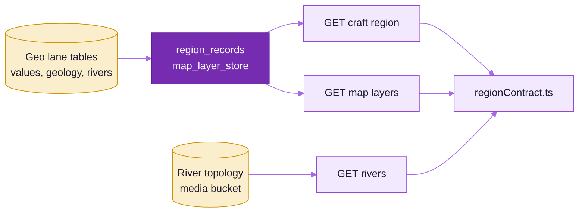

# Region: a craft's environment and the map layers

What the region panel of a craft page and the map's choropleths receive: a craft's places and
their environment values, the map's layers, rivers, monthly rainfall and climate trends. Engineers
changing the region producer, a layer or the client's shapes read it.

| For | Read |
|---|---|
| Why the contract has this shape | [decision 0014](../decisions/0014-science-region-voice-media-contracts.md) |
| The producer | [decision 0016](../decisions/0016-region-profile.md) |
| The stored tables and how they are loaded | [geo.md](geo.md) and [DATA_SOURCES.md](../DATA_SOURCES.md) |
| The specification | `docs/PLAN.md` section 8; section 0 overrides it |



## Where the code is

The models are
`backend/app/schemas/region.py`; the client's types and shapes `frontend/lib/regionContract.ts`;
the golden answers `shared/region.craft.golden.json`, `shared/region.layers.golden.json` and
`shared/region.layer.golden.json`. Change them together with
`backend/tests/contracts/test_region_contract.py` and `frontend/e2e/contracts-unit.spec.ts`.
Design choices: decision 0014; the producer: decision 0016 (`backend/app/geo/`,
`services/region_records.py`, `services/map_layer_store.py`). PLAN 8 is the specification, PLAN 0 overrides it, and the stored
tables are the geo lane's (`docs/contracts/geo.md`, `docs/DATA_SOURCES.md`).

Last reviewed: 2026-11-18 (rivers and monthly rainfall, decisions 0042 and 0043; river ranking, 0044; content-addressed river files and the rainfall's district, 0050).

Golden values are shapes for tests, not measurements: the district numbers in the fixtures are
written by hand. The dataset rows are the real `EnvDataset` rows from `etl/geo`. The layer file's
`classes` and `version` are what the server computes from those numbers (decision 0016).
`backend/tests/geo/` rebuilds all three from records and `backend/tests/db/test_region_db.py`
from stored rows.

## Routes

| Method | Path | Auth | Answer |
|---|---|---|---|
| GET | `/api/crafts/{slug}/region` | public (decision 0079) | `CraftRegion`; 404 for an unknown slug; a `MERGED` slug answers with its target's region |
| GET | `/api/map/layers` | public | `MapLayerList`; 404 while no `DR_DISTRICT_SHAPES` dataset row is stored (nothing could cite the boundary) |
| GET | `/api/map/layers/{layer}` | public | `MapLayer`; 404 for an unknown or empty layer, or without the boundary row. `ETag: "<version>"`; a matching `If-None-Match` answers 304 |

All three answer `Cache-Control: private, no-cache` with a token and `public, max-age=300`
without, with `Vary: Authorization` (decision 0079); the craft region's and the layer list's
`ETag` is the SHA-256 of the body, and a matching `If-None-Match` answers 304 on all three.
Nothing is queried live: every value is a stored per-district aggregate (PLAN 17.1).

## CraftRegion

```
CraftRegion {schemaVersion: 1, craft: CraftRef, places: RegionPlace[], datasets: RegionDataset[],
             sources: SourceRef[]}
RegionPlace {key, scope: DISTRICT|STATE, stateLgd, stateName, districtLgd|null, districtName|null,
             placeLabel, basis: PlaceBasis, valuesFrom: DISTRICT|STATE, inheritedReason|null,
             facets: RegionFacet[]}
PlaceBasis {kind: CRAFT_LOCATION|MASTER_LIST, sourceId|null, label, level}
RegionFacet {facet, values: RegionValue[] (>=1)}
RegionValue {datasetCode, variable, depth|null, period, stat, aggregation, value|null, valueText|null,
             unit, resolution, method|null, districtCount|null, districtTotal|null}
RegionDataset {code, title, publisher|null, edition, period, nativeResolution, licence,
               licenceUrl|null, attribution|null, citation|null, url|null}
```

`RegionDataset` is `research/datasets.DatasetRef` on the server since decision 0042, the one
dataset-row shape the region contract and the explainer's dataset citations share; it lives there
with `BOUNDARY_CAPTION` and `BOUNDARY_DATASET_CODE` so explainer blocks can check them. The JSON
is unchanged; the client keeps the name `RegionDataset` (`datasetShape`).

### Places

- One `DISTRICT` place per `CraftLocation` of precision `DISTRICT`, and per `POINT` location (the
  district whose polygon covers the point, the lowest LGD when indicative polygons overlap, else
  the location's own `districtLgd`; a point in no district is not shown). `basis` is
  `CRAFT_LOCATION` with the location's `sourceId` and that source's title as `label`, and the
  location's `evidenceLevel`. A location without a source, or whose source is `RESTRICTED`, is not
  shown (every fact cites) and is logged. Two locations in one district are one place, cited by
  the stronger level (ties by location id). A district place's `placeLabel` is its district's
  name, since its values describe the whole district; the client names the craft's villages and
  towns inside it from the craft page's places.
- One `STATE` place per state in `Craft.stateOfPractice` that has no district place:
  `basis` `MASTER_LIST`, `sourceId` null, `label` `IIT Crafts Master List, 2026-10-20`
  (`MASTER_LIST_LABEL`), level `REVIEWED` (the profile's level for the master list,
  `geo/places.MASTER_LIST_LEVEL`). The client says "Practised across the state". A cited
  `CraftLocation` of precision `STATE` is a state place too, basis `CRAFT_LOCATION`; when the
  master list also names that state, the stronger level wins and a cited location wins a tie.
  `All India` is not a state; any other name without an LGD state is logged.
- `key` is `district-<lgd>` or `state-<lgd>` (`place_key`); each place appears once. Order:
  district places by state name, then district name; then state places by name.
- A craft with no state and no location has no places; the client then leaves the panel out.
- `sources` holds the `SourceRef` (the answer stream's shape) of every `basis.sourceId` once, in
  the order of the places (`schemas/region.basis_source_ids`); a state of practice adds none. The
  craft page numbers them after the profile's and the process's sources (`craftSources`), so a
  location's source always has its number, link and Sources entry even when no claim cites it
  (decision 0022).

### Values

- **District values** (`valuesFrom` `DISTRICT`): every `DistrictEnvValue` row of the district,
  `aggregation` `DISTRICT`, no district counts. Geology rows (`DistrictGeology`) with an area
  share become `variable` `lithology`, `valueText` the lithology name (its code when a row has no
  name), `value` the area share, `stat` `SHARE`, `unit` `fraction`. GLiM also stores each share as
  a `DistrictEnvValue` `lithology_<code>`; those twins are not read (`LITHOLOGY_TWIN_PREFIX`).
  Geology rows without a share (the MRDS occurrence list) are not values.
- **One normal per quantity.** Where two datasets give a climate normal of the same quantity
  (`geo/region_view.CLIMATE_QUANTITIES`), a place shows the normal of the dataset of that
  quantity's trend (`NORMAL_SOURCES`, built from `geo/climate.TREND_DATASETS`): annual and monthly
  rainfall from CHIRPS, annual mean temperature from GHCN CAMS, so the Region card and the
  answer's climate card state the same normal. The other dataset's `NORMAL` and its district percentiles
  of that normal (`DISTRICT_P10`, `DISTRICT_P90` over a `YYYY-YYYY` or `YYYY-YYYY-MM` period) are
  left out, month by month, only when the preferred dataset has that normal for the place. Yearly
  values and trends are always kept. The map's district panel applies the same rule.
- **Order within a facet**: dataset code, variable, depth from the surface down, period,
  `ENV_STATS` order, value text (`geo/region_view.value_order`).
- **Inherited districts.** A district with no polygon (34 LGD districts and 9 pending ones today,
  `district_env_summary.json` `districtsWithoutShapes`) has no rows. Its place shows its state's
  aggregates, `valuesFrom` `STATE`, `inheritedReason` `NO_DISTRICT_POLYGON`, and the client says
  so (PLAN 8).
- **State aggregates** (`valuesFrom` `STATE`), over the state's districts with polygons that
  have the value, weighted by district area (`ST_Area` of `AdminDistrict.geom` on the sphere):
  `DISTRICT_MEAN`, `NORMAL`, `SHARE` and `DENSITY` become `STATE_AREA_MEAN`; `TOTAL` and `COUNT`
  `STATE_SUM`; `DISTRICT_MIN` `STATE_MIN`; `DISTRICT_MAX` `STATE_MAX` (`STATE_AGGREGATIONS`).
  Percentiles, uncertainty, `CLASS` and `DISTANCE` have no state aggregate and are left out.
  `districtCount` is how many districts contributed and `districtTotal` how many the state has.
  GLiM class shares and MRDS per-commodity counts are stored only where the class or commodity
  occurs, so for those (`ABSENT_MEANS_ZERO`) every district of the state holding any value of the
  dataset contributes, with zero where its row is absent. A state value's `resolution` lists
  every grid its districts were read at (`; ` between them) and `method` their distinct methods.
  Values are rounded to 6 decimals.
- **Depth and period.** `depthOrPeriod` is split by `split_depth_or_period`: a value like `0-5cm`
  (`DEPTH_PATTERN`) is the `depth` and the dataset's period is the `period`; any other non-empty
  value is the `period`; empty takes the dataset's period.
- **Resolution** is the grid the value was read at. For most rows that is the dataset's
  `nativeResolution`, but ESA WorldCover is read at 40 m from its 10 m grid. The ETL already
  writes it per row (`district_env.parquet` `resolution`) and `load.py` loads it into
  `DistrictEnvValue.resolution` (migration 0005, which also fills it for WorldCover and Copernicus
  DEM rows loaded earlier from their method text). A row without it is sent with the dataset's
  `nativeResolution`.
- Every value names its dataset by `datasetCode`; `datasets` lists each cited dataset once,
  sorted by code, so the client can show "District mean · CHELSA V2.1 30 arc-seconds · 1981-2010"
  and the licence and attribution.

### Facets

`REGION_FACETS` in this order: `SOIL`, `CLIMATE`, `WATER`, `FOREST`, `LAND_COVER`, `TERRAIN`,
`GEOLOGY`. A facet with no value for a place is left out, never sent empty (PLAN 8). The dataset
of a value decides its facet (`DATASET_FACETS`):

| Facet | Datasets |
|---|---|
| SOIL | `SOILGRIDS_2_0` |
| CLIMATE | `CHELSA_2_1_1981_2010`, `CHIRPS_3_0`, `GHCN_CAMS_T2M` |
| WATER | `HYDRORIVERS_1_0` |
| FOREST | `HANSEN_GFC_2025_V1_13` |
| LAND_COVER | `ESA_WORLDCOVER_2021_V200` |
| TERRAIN | `COPERNICUS_DEM_GLO90` |
| GEOLOGY | `USGS_MRDS`, `GLIM_1_0_05DEG` |

A test fails when `etl/geo/geo_etl/catalog.py` gains a dataset without a row here. At run time a
value of an unmapped dataset is left out and logged with its code.

## Map layers

```
MapLayerList {layers: MapLayerSummary[], datasets: RegionDataset[], boundary: BoundaryNote}
MapLayerSummary {id, facet, title, datasetCode, variable, depth|null, period, stat, unit}
MapLayer {layer: MapLayerSummary, dataset: RegionDataset, resolution, classes: LayerClass[] (1-5),
          values: {"<district lgd>": number}, version, boundary: BoundaryNote}
LayerClass {min, max}
BoundaryNote {caption, dataset}
```

- Layers are a registry (`geo/layers.MAP_LAYERS`, decision 0016), each one dataset, variable,
  stored depth or period and stat, with an id of lowercase words and hyphens (`soil-ph-0-5cm`),
  in facet order. Only layers with at least one district value are listed, in registry order.
  The unit is the stored rows' one unit; a CHIRPS or GHCN CAMS layer's period is its dataset
  row's period. The annual precipitation and annual mean temperature layers draw the normal of
  the quantity's trend dataset (`TREND_DATASETS`, CHIRPS and GHCN CAMS), the normal the district
  panel shows.
  A layer's `resolution` lists every grid its values were read at.
- `values` maps each district LGD code (as a string) to its value; districts with no value are
  absent and drawn as no data.
- `classes`: at most `LAYER_CLASS_MAX` (5) and at most as many as there are distinct values,
  rising and contiguous (each `max` is the next `min`), from the lowest to the highest value. The
  inner breaks are Hyndman and Fan type 7 quantiles (`statistics.quantiles(..., method=
  "inclusive")`) at 3 significant figures, dropped when they fall on either end. A value belongs
  to the class with `min <= value < max`; the top class also holds its `max` (`layerClassOf`).
- `version` is the SHA-256 hex of the canonical JSON (sorted keys, separators `,` and `:`, UTF-8)
  of every other field of the body, sent as the ETag, so any change the body shows moves it.
- `boundary` is the caption PLAN 8 requires, word for word, `External boundaries of India as
  depicted by Survey of India. District boundaries are indicative.` (`BOUNDARY_CAPTION`), over
  the `DR_DISTRICT_SHAPES` dataset, drawn beneath every map. The DR outline is the only
  international border drawn; there is no tile basemap.
- Geography and environment data are open datasets only (PLAN 0).

## Rivers (decision 0042; built by decision 0043)

The river data other lanes build to. The models are `backend/app/research/rivers.py`; the
explainer's `region_story` refers to rivers by these ids (`docs/contracts/explainer.md`).

```
RiverReach {hyrivId, nextDown, mainRiv, ordStra, uplandSkm, disAvCms, lengthKm,
            geometry: [[longitude, latitude], ...] (>= 2)}
RiverTrace {datasetCode: "HYDRORIVERS_1_0", mainRiv, reachIds[] (>= 1), districtLgds[]}
```

- **Reaches.** One row per HydroRIVERS v1.0 reach in India and the basins that cross it, with the
  dataset's own fields: `HYRIV_ID`, `NEXT_DOWN` (0 at an outlet), `MAIN_RIV` (the outlet reach of
  the river system, which is the basin key), `ORD_STRA` (Strahler order), `UPLAND_SKM`,
  `DIS_AV_CMS`, `LENGTH_KM` and the line in WGS84. A reach flows into another reach or ends its
  river, and ends it exactly when it is the outlet (`hyrivId == mainRiv`). Kept: every reach
  with `UPLAND_SKM >= 100` km² (`LINE_UPLAND_MIN_SKM`) of a basin at least one of whose kept
  reaches crosses a district polygon, the whole basin, so every `nextDown` is stored and a river's
  source as drawn is its first reach of that size. Stored by the geo ETL (`etl/geo`, run on GitHub
  Actions, `riverlines`) in `RiverReach` (a `LINESTRING` in EPSG:4326) and `RiverBasin`
  (`mainRiv`, the `HYDRORIVERS_1_0` dataset row, reach count, topology SHA-256), migration
  `0016_river_reaches`; a load replaces both tables.
- **The traced path.** A river is shown from its source to its outlet: from a reach downstream
  over `nextDown` to the outlet, and upstream at each junction to the reach with the largest
  `UPLAND_SKM` (ties: the lowest `HYRIV_ID`), to a headwater (no reach flows into it); traced
  from the outlet it is the basin's main stem. `reachIds` is that path from the headwater down,
  once each, the last `mainRiv`. `services/river_store.trace_river(session, reachId)` traces it
  (`geo/river_trace`, at most 10,000 reaches, a cycle or a `nextDown` not stored refused) and
  `trace_problems(trace, reaches)` checks every trace against every stored reach of its basin
  (any `ReachTopology`): each reach stored and in the basin, each flowing into the next, the first
  a headwater. `rivers_crossing(session, districtLgds)` offers, per basin, the reach with the
  largest upstream area inside those districts, with its Strahler order and mean discharge,
  ranked by order, then discharge, then upstream area (decision 0044), at most five: the reach a
  story traces from. `stored_trace_problems(session, trace)` checks a stored story's path against
  the reaches stored now (its own and any flowing into its source), and `rivers_loaded(session)`
  says whether any basin is stored.
- **Districts reached.** `districtLgds` lists each district the path crosses once, in the order
  the path first enters it (measured along the path from the source; `ST_Intersects` of the reach
  lines with `AdminDistrict.geom`, dumped into parts, ordered by reach, then by the
  `ST_LineLocatePoint` of each part's start, then by LGD). Computed by PostGIS each time a river
  is traced, so it always follows the stored district shapes (decision 0043).
- **Geometry served.** `GET /api/rivers/{mainRiv}` (public, decision 0079) answers one TopoJSON topology per
  basin, read from the private media bucket where the ETL wrote it (key from `services/naming`,
  under `media/rivers/<edition>/<mainRiv>/<sha256>/`, with its naming golden row): object `reaches`
  (`RIVER_REACHES_OBJECT`), a `GeometryCollection` of `LineString`s, each `id` its `HYRIV_ID` and
  `properties {nextDown, ordStra}`, simplified for drawing at district scale and quantized:
  each reach on its own, topology-preserving Douglas-Peucker at 0.005 degree, which keeps both
  ends so every junction stays a shared position, then 100,000 steps over the basin's box, one
  delta-encoded arc per reach, reaches by `HYRIV_ID`. The key is
  `media/rivers/<edition>/<mainRiv>/<sha256>/KalaVigyan_Dataset_HydroRIVERS-1-0_River-Topology_Basin-<mainRiv>.json`
  (`naming.river_topology_key(edition, mainRiv, sha256)`, the `riverTopologies` golden rows), the
  edition the dataset row's and the folder the file's own SHA-256, the `RiverBasin` row's
  `topologySha256`, so a load writes changed files beside the old ones and a row and its object
  never drift (decision 0050).
  `Content-Type: application/json`, `Cache-Control: private, no-cache` with a token and
  `public, max-age=300` without, `Vary: Authorization` (decision 0079), `ETag` the file's SHA-256
  (a matching `If-None-Match` answers 304 from the stored hash, without reading the bucket), 404
  for an unknown basin, a basin with no stored file or a file whose SHA-256 is not the row's (the
  client then hides the river; decision 0050), 503 when the bucket is not configured or
  does not answer, 422 for an id no reach can have (outside 1 to 99,999,999). The basin row is
  read and its connection released before the bucket is read; files are kept in a per-process
  cache by hash. `shared/river.topology.golden.json` is the phase B fixture's placeholder river
  as the geo ETL writes it (reproduced by `etl/geo/tests/test_rivers.py`, parsed by
  `e2e/river-topology-golden-unit.spec.ts`). The client draws
  the path's reaches from it with the districts from its district shapes, the boundary caption
  beneath, and the HydroRIVERS dataset row as the river's citation. The client
  (`frontend/lib/riverTopology.ts`, decision 0048) accepts exactly `type: "Topology"`, an optional
  `bbox` of four numbers and an optional `transform {scale, translate}`, `objects.reaches` and
  `arcs` (each at least two positions, delta-encoded when `transform` is present); each geometry
  is `{type: "LineString", id (integer), arcs (indexes, negative reversed), properties {nextDown,
  ordStra}}`. Any other field, an arc index out of range, a coordinate off the globe, a reach
  listed twice or a basin without its outlet reach (`nextDown` 0) is refused, as is a story whose
  `reachIds` are not all in the basin.

## Monthly rainfall (decision 0042; built by decision 0043)

A `seasons` block's rainfall is the CHIRPS monthly normal of a district: twelve
`DistrictEnvValue` rows of the `CHIRPS_3_0` dataset, one per month, variable
`monthly_precipitation`, `depthOrPeriod` `<period>-<MM>` (`2016-2025-07`), `stat` `NORMAL`, unit
`mm/month`, read on the 0.05 degree grid, over the period the dataset row names
(`geo/rainfall`, `docs/DATA_SOURCES.md`). The CHIRPS layer writes them only when every year of
the period has every month. `services/monthly_rain.district_rainfall(session, district)` takes
the district's `DistrictRef` (LGD code, register name and state) and answers `MonthlyRain
{district: DistrictRef, datasetCode, period, millimetres[12]}` with the dataset row (`DatasetRef`,
which carries the period and the grid); a district missing any month, or with a value below zero
or in another unit, has no rainfall. The seasons builder takes the first of the craft's mapped
districts with a register row (`place_offers.district_refs`) that has rainfall
(`season_supply_builders.craft_rainfall`, decisions 0047 and 0050); when none has, the block shows
its rows without rainfall. The client credits it as "Rainfall · <district>, <state> · monthly
normal · <period>".

## Climate trends (decision 0065)

The CHIRPS layer now runs from 1981, the first year of the record, to the last complete year, so
the CHIRPS dataset row's period (`1981-2025`) is the period of its yearly series, its annual and
monthly normals and its trends; the GHCN CAMS layer (`GHCN_CAMS_T2M`, `annual_mean_temperature`,
0.5 degree) writes the same for temperature. A district with a complete series of at least 30
years gets `TREND_PER_DECADE` (the Theil-Sen slope per decade, `mm/year per decade` or `degC per
decade`) and `TREND_P_VALUE` (the two-sided Mann-Kendall p-value, unit `p-value`) over that
period. They are district values like any other: the region route and ask the map list them
under `CLIMATE`, and the state aggregates leave them out (`STATE_AGGREGATIONS` names neither).
`geo/climate.climate_trends` reads them for a `climate_risk` block
(`docs/contracts/explainer.md`).

## How this document is kept true

| Claim | Kept true by |
|---|---|
| The three goldens and the models' rules | `backend/tests/contracts/test_region_contract.py` |
| The client's shapes | `frontend/e2e/contracts-unit.spec.ts` and `region-view-unit.spec.ts` |
| The goldens rebuilt from records and from stored rows | `backend/tests/geo/` and `backend/tests/db/test_region_db.py` |
| Places, values, facets and the layers' classes | `backend/tests/geo/test_places.py`, `test_region_view.py`, `test_layers.py` and `test_aggregation.py` |
| Rivers, their traces and topology files | `backend/tests/geo/test_river_trace.py`, `test_river_routes.py`, `backend/tests/db/test_rivers_db.py`, `etl/geo/tests/test_rivers.py` and `frontend/e2e/river-topology-golden-unit.spec.ts` |
| Monthly rainfall and climate trends | `backend/tests/geo/test_rainfall.py` and `test_climate_trends.py` |
| The map's layers on the client | `frontend/e2e/map-layers-unit.spec.ts` and the other `map-*-unit.spec.ts` |

Re-read it when a layer, a value's unit or a river rule changes, or the geo lane loads a new edition.
