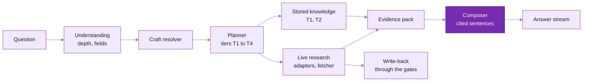

# Research and answering

The interfaces between the lanes that resolve crafts, plan retrieval, search and fetch sources,
compose answers, write findings back as claims, and stream the answer to the web client. The
code is the typed models, protocols and error types in `backend/app/research/` and
`backend/app/core/errors.py`; this page says what they mean. Engineers build adapters, planners,
composers and writers against these types, and change a type only together with this page and its tests.

Last reviewed: 2026-11-18.

| For | Read |
|---|---|
| The design choices | [decision 0002](../decisions/0002-research-and-answering-contracts.md); each part's own decision is named in its heading |
| How stored knowledge is found | [retrieval.md](retrieval.md) |
| The gates a written-back claim passes | [knowledge-writes.md](knowledge-writes.md), The research write-back |
| The explainer the stream builds | [explainer.md](explainer.md) |
| Seats by field | [answer-eval.md](answer-eval.md) |



## Ground rules (PLAN section 0 and the bindings)

- Knowledge grows: when stored claims cannot answer, live research runs and what it finds is
  written back as cited claims. Accuracy over speed; a learner can wait.
- Research is not limited to the sources named in the plan. Any reachable scholarly, government,
  museum, archive or open-web source may be an adapter, and the answer cites what was used.
- Every crafts lookup covers every `Craft` row: the 455 master crafts and the crafts synced from
  the designer and documentation portals. A craft is named by its `slug` (case as stored, for
  example `Kutch-Ajrakh`).
- Every sentence shown is cited; every number and formula in it appears in a cited claim or
  quote. Evidence levels are labels: a live-research claim passes the automatic gates of
  `knowledge-writes.md` and, under the default review switch for `RESEARCH` (`AUTO`), waits for no
  approval.
- Retrieved text, search results and model output are data, never instructions.

## Shape conventions

- Models derive from `research.base.ContractModel`: unknown fields refused, frozen, strings
  stripped, Python names in snake_case, JSON in camelCase (`craft_slug` is `craftSlug`). Both
  spellings are accepted on input; output is always camelCase.
- URLs are `https://` only (`HttpsUrl`), at most 2048 characters, no whitespace.
- Dates of publication are partial ISO dates (`PartialDate`): `YYYY`, `YYYY-MM` or `YYYY-MM-DD`.
  Instants (`retrievedAt`, `fetchedAt`) carry a time zone.
- Vocabulary comes from `research/vocabulary.py`, which builds its literal types from
  `models/enums.py` (one home): `AnswerMode` (`VERIFIED`, `HYBRID`, `DEEP`), `EvidenceLevel`,
  `ShownLevel` (the levels plus `UNAVAILABLE`), `RetrievalTier` (`T0`-`T4`), `LiveTier`
  (`T3`, `T4`), `TrustTier` (reliability `A`-`D`), `SourceType` (`SourceKind`), `FacetType`
  (`ConceptType`), `QuoteCheck`, `SourceRelation`, and `EvidenceLabel` (`QUOTED`, `INFERRED`).
- `weakest_level(levels)` is the one rule for combining levels (VERIFIED > REVIEWED >
  PROVISIONAL > HYPOTHESIS); a sentence or derived artefact takes the weakest of its inputs.

## Errors (`core/errors.py`)

One hierarchy for the whole backend; catch by category.

| Class | Meaning | Existing equivalent |
|---|---|---|
| `AppError` | base of everything below | |
| `InvalidInput` (also a `ValueError`) | the caller sent something the contract refuses | 422; `RouterError("bad_request")` |
| `Refused(reason, message)` | a guard said no; `reason` is a stable code | `RouterError("ceiling", reason=...)` |
| `NotConfigured(name, message)` | a key, setting or route is missing | `RouterError("no_route")`, `SettingsError` |
| `ExternalFailure(message, kind=, retryable=, status=, retry_after=, service=)` | a call to another service failed | `ProviderError` is now a subclass |

`ExternalFailure.kind` is one of `FAILURE_KINDS`: `rate_limit`, `unavailable`, `auth`,
`not_found`, `error` (try the next adapter or route: `NEXT_ROUTE_KINDS`, `tries_next`) and
`refusal`, `bad_request` (stop: `STOP_KINDS`, which the AI router imports). Any other kind is a
`ValueError` at construction. `RouterError` derives from `AppError`. `failure_kind(status)` is
the one mapping from an HTTP status to a kind (429 `rate_limit`, 5xx `unavailable`, 401 and 403
`auth`, 404 and 410 `not_found`, 400 and 422 `bad_request`, anything else `error`), and
`RETRYABLE_KINDS` (`rate_limit`, `unavailable`) are the kinds marked retryable.

## Craft resolution (`research/crafts.py`)

`CraftResolver.resolve(CraftQuery) -> CraftResolution`.

- `CraftQuery {text (1-1000), craftSlug?, language?}`. `text` is in any script; the resolver
  normalises it with `data/craft_text` and `data/craft_master_loader.normalise` (PLAN 5.2).
- `CraftRef {slug, name, path}`; `path` is always `/crafts/<slug>`. This is the stream's craft
  shape.
- `CraftCandidate {craft, score 0-1, reasons[MatchReason] (at least one)}`;
  `MatchReason {kind, matched, score}` with `kind` one of `EXACT_SLUG`, `EXACT_NAME`,
  `EXACT_ALIAS`, `EXACT_SPELLING`, `MERGED_REDIRECT`, `FUZZY`, `SEMANTIC`, `PLACE`, `FAMILY`,
  `MODEL_CHOICE`, and `matched` the alias, spelling or place that matched.
- `CraftResolution {status, craft, candidates (at most 5, highest score first), normalised,
  script}`. `RESOLVED`: `craft` is the top candidate. `AMBIGUOUS`: no craft, 1-5 candidates
  (the pills; one pill is a "did you mean"). `NONE`: no craft, no candidates. `normalised` is
  `craft_text.core_key(text)`; `script` is `craft_text.script_of` (`Latn`, `Deva`, `Zyyy`, ...).
- Decision constants (PLAN 5.2): accept when `clear_winner(candidates)`: top score at least
  `ACCEPT_SCORE` 0.85 and at least `ACCEPT_MARGIN` 0.15 above the runner-up;
  `FUZZY_MIN_SIMILARITY` 0.85 (rapidfuzz `ratio`, not `pg_trgm`; decision 0004);
  `MAX_CANDIDATES` 5.
- The answer flow does not stop on a resolution: the understanding step (below) turns it into
  the `understood` event.

### The resolver (`services/craft_resolver.py`, decision 0004)

`DatabaseCraftResolver(session, store=CraftIndexStore, embed=TextEmbedder)` implements
`CraftResolver` over every `Craft` row. The pure index and ranking are `services/craft_index.py`
and `services/craft_matching.py`; the answer flow builds one per request with
`providers/embedding.router_embedder(principal)`, which embeds through the AI router (`EMBED`).
The embedding protocol is `research/embedding.py`: `TextEmbedder` (texts in, one vector each
out) and `checked_vectors(vectors, expected=)`, which raises `ExternalFailure` (service
`embeddings`) unless there is one vector per text of `EMBEDDING_DIMENSIONS` (1536).

- **Index** (`load_index`, cached by `CraftIndexStore` for `INDEX_TTL_SECONDS` 300): every
  `ACTIVE` craft; a `MERGED` craft's names point at the end of its `mergedIntoId` chain (at most
  `MAX_REDIRECT_HOPS` 5); `LEGACY` crafts and unfinished chains are left out. Names come from
  `Craft.name` (`EXACT_NAME`), `Craft.localName` and `ACTIVE` `CraftAlias` rows (`EXACT_ALIAS`),
  and `CraftSpelling` labels through `craftCode` (`EXACT_SPELLING`). Each is keyed by
  `core_key(text)` and `core_key(to_latin_spoken(text))`, at least `MIN_KEY_CHARS` 4 long.
  Places are `stateOfPractice`, `stateOfOrigin`, and each `CraftLocation`'s label, district and
  state name (`All India` is not a place). Catch-all crafts are reachable only by slug.
- **Slug** (`craftSlug` given): exact, case as stored; score 1.0, `EXACT_SLUG`, or
  `MERGED_REDIRECT` for a merged slug. An unknown slug is `NONE`; text is not tried.
- **Exact**: every phrase (1-8 tokens) of the question's key is looked up; a hit inside a longer
  hit is dropped (`Kutch Ajrakh` beats `Ajrakh`). Scores: name or slug 1.0, alias or merged
  redirect 0.97, spelling 0.95. For Indic text the reading (inherent-vowel or spoken Latin)
  with the most tokens matched exactly is used.
- **Fuzzy**: phrases not covered by an exact hit or a place, rapidfuzz `ratio` against every key
  (`FUZZY`, weight 0.95) and against every distinctive name token (`FAMILY`, weight 0.7; a token
  of at most 8 crafts and not in `GENERIC_TOKENS`, so `dhokra` offers the Dhokra crafts), at
  least `FUZZY_MIN_SIMILARITY`, top 10 per phrase.
- **Semantic**: only when the lexical ranking has no clear winner and at least one craft has a
  `descriptorEmbedding`: the question is embedded and the 10 nearest `ACTIVE`, non-catch-all
  crafts by cosine are taken; similarity at least 0.6, weight 0.8, so semantic alone never
  resolves. `descriptor_text` (name, local name and aliases joined by `; `) is what
  `fill_descriptor_embeddings` embeds (`app/scripts/embed_craft_descriptors.py`).
- **Fusion**: a candidate's score is its best weighted reason plus 0.05 for each further kind
  of signal (exact, fuzzy or family, semantic), at most 1. When the question names a place
  (outside any craft name) and at least one candidate is practised there, every candidate's
  score becomes `0.8 * score + 0.2 * (named place matches)`, with a `PLACE` reason. Ranked by
  score, then name; at most 5; reason scores and candidate scores are rounded to 6 places.
- **Decision**: `clear_winner` gives `RESOLVED`; otherwise any candidates give `AMBIGUOUS`;
  none give `NONE`. The model choice among the candidates (PLAN 5.2 step 6) is the
  understanding step's (decision 0031).
- **Failures**: an embedding failure is an `ExternalFailure` (or the router's `RouterError`). A
  failed semantic step that is not a spend refusal is logged and the lexical resolution stands,
  so the crafts the names matched are still offered (decision 0123); a spend refusal is raised.
  The answer stream turns any `AppError` the resolver raises into one `error` event and `done`.

## Evidence and source adapters (`research/evidence.py`)

One adapter per external service (OpenAlex, Crossref, Semantic Scholar, CORE, Unpaywall,
Wikipedia, Wikidata, PubChem, SearXNG, Brave, any later source), each implementing:

```
class SourceAdapter(Protocol):
    name: str            # ^[a-z][a-z0-9_]{1,39}$, e.g. "openalex"
    tier: LiveTier       # T3 scholarly and reference APIs, T4 open-web search
    async def search(self, query: SearchQuery, k: int) -> list[EvidenceItem]
    async def fetch(self, item_id: str) -> SourceDocument
```

- `SearchQuery {text (2-300), facet?, language="en", freshnessDays?}`. Construction refuses
  text carrying an email address, a phone-like run of 10+ digits or an Aadhaar-like 12-digit
  run (PLAN 6, search egress). Queries are built from the resolved craft name, sub-category
  and facet targets; anything else passes this scrub first.
- `search` returns at most `k` items (`1 <= k <= SEARCH_MAX_K` 50), each `tier` equal to the
  adapter's, best first. No hits is `[]`, not an error.
- `EvidenceItem {id, adapter, tier, sourceType, url, title, authors[], published?, retrievedAt,
  licence?, attribution?, doi?, publisher?, containerTitle?, trust, quotes[Quote], externalIds{}}`.
  `id` is `<adapter>:<id at the service>` (`openalex:W2741809807`). `containerTitle` is the
  journal or book a work is in; `item.journal` is it, or the `publisher` of an adapter that puts
  the journal there (`JOURNAL_AS_PUBLISHER_ADAPTERS`: Europe PMC and Semantic Scholar), and is
  stored as `Source.containerTitle` (decision 0143). `trust` is the reliability
  tier the adapter assigns (A peer-reviewed or official, B reputable reference, C general web,
  D unknown). `quotes` are verbatim passages (`Quote {text (1-300), locator?}`; locator such as
  `p. 12`, `section 3.2`, `para 4`); a search hit may have none.
- `item.source_key` is the source identity for dedupe: `doi:<lowercased doi>`, else
  `url:<canonical url>` (lowercased scheme and host, default port and fragment dropped,
  trailing slash removed except the root).
- `fetch(item_id)` returns `SourceDocument {item, text, textSha256, truncated, content}`:
  `text` is the cleaned plain text the quotes were taken from, made storable by
  `adapter.build_document` (`research/storable.storable_text`: no NUL and no C0 control but tab,
  line feed and carriage return, decision 0135), `textSha256` its SHA-256 in UTF-8, `content`
  one of `FULL_TEXT`, `ABSTRACT`, `EXCERPT`. Construction fails unless every
  quote in `item.quotes` occurs in `text` (`quotes.quote_occurs`). Only `T4` adapters and
  full-text fetches go through the fetcher sandbox; API adapters fetch their own JSON.
- Failures: `ExternalFailure` with a kind (an unknown id is `not_found`), `NotConfigured` for a
  missing key, `Refused` for a guard. Adapters never log keys or raw responses.

### Open-access locator

```
class OpenAccessLocator(Protocol):
    name: str
    async def locate(self, doi: str) -> OpenAccessLocation
```

`OpenAccessLocation {doi, status, landingUrl?, pdfUrl?, licence?, version?, hostType?,
checkedAt}`; `status` is one of `OPEN_ACCESS_STATUSES` (`GOLD`, `DIAMOND`, `HYBRID`, `BRONZE`,
`GREEN`, `CLOSED`), `isOpen` is any status but `CLOSED`, and a `CLOSED` location carries no
URL or `hostType` (`PUBLISHER`, `REPOSITORY`). URLs are https only, so an open work may carry
none. A text that is not a DOI is `InvalidInput`; an unknown DOI is `not_found`. Unpaywall is
the locator: its title search is retired (decision 0005), so it is not a `SourceAdapter`.

### Scholarly adapters (`app/sources/`, decision 0005)

`sources.scholarly.registry.scholarly_sources(keys, client) -> ScholarlySources {adapters,
locator, unconfigured, publisher?}` builds every T3 scholarly adapter, the open-copy locator
(`open_copies.OpenCopyLocator`, named `open_access`: a Zenodo DOI to Zenodo, every other to
Unpaywall) and, when a publisher key is set, `publisher` (`publishers.PublisherFullText`: the
Elsevier and Springer Nature full text of a DOI Unpaywall calls closed, chosen by DOI prefix,
stored for researchers only under its text-mining licence; decision 0139); `services/scholarly_keys.
scholarly_keys(session)` reads the keys from the managed secrets and `RESEARCH_CONTACT_EMAIL`.
The caller holds the result for the process.

**Pacing (decisions 0127, 0139).** Every scholarly adapter talks through a `sources.scholarly.pacing.
PacedHttp` on `shared_pacing()`, whose state is `core/paces.SharedPaces`: one row per service and
request kind in `SourcePace` (the next free slot and the `Retry-After` hold) and one expiring lease
per request in flight in `SourceLease`, reserved atomically on the database clock, so every seat of
an answer, every answer and every process (both API slots, the contribution worker, the coverage
job) share one pace per service. `ScholarlyPacing()` alone keeps a memory store, for tests.

- Each adapter declares its documented limit beside it (`<NAME>_LIMITS`, a `ServiceLimits` of a
  search `SourceLimit {requests, seconds, concurrency?}` and an optional lookup limit), read on
  2026-11-22, and is paced at `PACED_SHARE` (80 %) of it: Crossref's polite pool 3 searches a
  second and 10 DOI lookups a second, three at a time; Semantic Scholar 1 a second with or without
  a key, one at a time; CORE 10 a minute (the lowest registered tier); OpenAlex 10 a second
  without a key and 30 with one; arXiv 1 every 3 seconds, one at a time; DOAJ 2 a second; Zenodo
  30 a minute; Europe PMC, Elsevier, Springer Nature and Unpaywall the rates they kept before.
- A 429 or 503 holds the service for every process for its `Retry-After` (60 s when absent); a
  hold longer than `RatePolicy.max_retry_wait` (10 s) fails at once as `rate_limit` without
  sending, a shorter one is waited out. A request whose turn is more than `QUEUE_WAIT_MAX` (30 s)
  away, or whose service has no free lease within it, is not sent and fails as `unavailable`. A
  store that cannot be read refuses the request.
- Identical lookups are answered from the service's process-wide `ResponseCache` (600 s,
  longer than an answer) whatever the rebuild. Within one answer (its request id): a lookup
  that failed is not asked again, and a service whose own answers refused `REFUSALS_MAX` (2)
  requests (a 403 or a 429) is not asked again; it fails at once as `rate_limit`.
- `answer_pace()` is the answer's record: per service the seconds and requests that waited for
  their turn, its refusals and the requests not sent; the answer stream sends it as `paced`
  (`docs/contracts/explainer.md`).
- Crossref is asked with `User-Agent: KalaVigyan/1 (+https://kalavigyan.vercel.app)` and
  `mailto=RESEARCH_CONTACT_EMAIL` (the polite pool): the project's public address, never a
  person's e-mail.

| Adapter `name` | Service | Key | Id after the colon | `fetch` content |
|---|---|---|---|---|
| `openalex` | OpenAlex works | `OPENALEX_API_KEY` optional | `W…` | `ABSTRACT` |
| `crossref` | Crossref works (polite pool, abstracts only) | none | DOI | `ABSTRACT` |
| `semantic_scholar` | Semantic Scholar Graph | `SEMANTIC_SCHOLAR_API_KEY` optional | paper id | `ABSTRACT` |
| `core` | CORE v3 | `CORE_API_KEY`; without it left out and listed in `unconfigured` | work id | `FULL_TEXT`, else `ABSTRACT` |
| `europe_pmc` | Europe PMC REST | none | `<SRC>:<id>` | `FULL_TEXT` (`fullTextXML`) for an open-access record held in Europe PMC, else `ABSTRACT` (also when the full text answers 404 or 500) |
| `arxiv` | arXiv API | none | arXiv id with version | `ABSTRACT` |
| `doaj` | DOAJ v4 articles | none | 32 hex | `ABSTRACT` |
| `zenodo` | Zenodo records (trust `B`; open files reached through the locator and the fetcher) | none | record id | `ABSTRACT` |
| `elsevier` | Scopus search and abstract | `ELSEVIER_API_KEY` (+ `ELSEVIER_INSTTOKEN`); dormant, left out silently | Scopus id | `ABSTRACT` |
| `springer_nature` | Springer Nature open access | `SPRINGER_NATURE_API_KEY`; dormant, left out silently | DOI | `ABSTRACT` |

Search hits carry no quotes; `fetch` returns the text quotes are taken from. A record with no
text to return is `not_found`. Trust: journal articles, books and chapters `A`; preprints,
repository copies, datasets, theses and reports `B`; anything else `C`. `freshnessDays` keeps
dated items whose latest possible day is on or after the cutoff.

### Reference adapters (`app/sources/reference/`, decision 0006)

`sources.reference.registry.reference_sources(client) -> tuple[HttpSourceAdapter, ...]` builds
the four T3 reference adapters; none needs a key.

| Adapter `name` | Service | Id after the colon | `fetch` content | Source type, trust | Licence |
|---|---|---|---|---|---|
| `wikipedia` | Action API search and TextExtracts | `<language>:<page id>` | `FULL_TEXT` | `ENCYCLOPEDIA`, `B` | the wiki's rightsinfo text, read live |
| `wikidata` | `list=search`, `wbgetentities`, SPARQL statements; `wbsearchentities` and SPARQL P625 for places | `Q…`, or `<language>:Q…` outside English | `EXCERPT` | `DATASET`, `B` | `CC0 1.0` |
| `pubchem` | PUG REST (names, formulas, properties), PUG View (GHS) | `<CID>` or `<CID>:ghs` | `EXCERPT` | `COMPOUND_RECORD`, `A` | NCBI policy URL; for `:ghs` the reporting sources' licence URLs |
| `wikimedia_commons` | Action API file search with `extmetadata` | page id, or `<language>:<page id>` outside English | `EXCERPT` | `MEDIA` (`OTHER` for a PDF or DjVu document), `C` | the file's licence short name |

- `SearchQuery.language` picks the Wikipedia (`WIKIPEDIA_LANGUAGES`: every Wikipedia edition in
  Wikimedia's sitematrix of 2026-11-22, vendored in `sources/reference/wikipedia_editions.json`
  and checked on load; `LANGUAGE_ALIASES` maps ISO codes to editions named otherwise, `bho` to
  `bh`, `yue` to `zh-yue`, `nb` to `no`; a language with no edition or a malformed tag is
  `InvalidInput`, decision 0139), the Wikidata label language
  (with fallback) and the Commons metadata language. A Wikidata or Commons item found in another
  language than English carries it in its id (`mediawiki.with_language`), and `fetch` renders
  labels, descriptions, statement labels and file metadata in it (`language_and_native`); English
  ids keep their old form (decision 0023).
- Wikipedia items carry `externalIds` `wikipedia`, `revision` and `wikidata`; Wikidata items
  `wikidata`, `revision` and, on fetch, `pubchem_cid`, `cas_number`, `chebi` when stated;
  PubChem items `pubchem_cid` and `inchikey`; Commons items `commons_file`, `commons_media`
  and `revision`. Attributions name the revision read (Wikimedia) or the reporting source
  (PubChem hazards).
- A PubChem query that is a molecular formula (real element symbols) searches by formula;
  anything else by complete name, then by words, exact matches first. The hazards of a
  compound are `fetch("pubchem:<cid>:ghs")`; a compound without attributed GHS data is
  `not_found`.
- MediaWiki errors returned inside a 200 are `ExternalFailure`: unknown entity, title or page
  `not_found`, rate limits `rate_limit`, read-only `unavailable`, anything else `error`.
- Commons files without a licence are left out of results. A Commons file's `published` is its
  original date when `DateTimeOriginal` states one day, month or year (an ISO date, a year, a
  "circa" year, "January 1889", "20 July 2013", "Taken on ...", an Exif date, or the hidden
  Wikidata date when it carries no qualifier, `sources/reference/commons_dates`); a range, a
  decade or century, "before ...", an ambiguous `1/2/1934` or an upload date leaves it empty.
  Deprecated Wikidata statements are left out. Wikidata times keep their precision: a day, month
  or year as written; a decade, century or millennium in words as Wikibase counts them
  (`1850s`, `19th century`, `5th century BCE`, `sources/reference/wikidata_times`); anything
  coarser is left out (decision 0139).
- Wikidata also places a named origin (decision 0047): `place_candidates(name)` asks
  `wbsearchentities` (English items, 10 hits) and keeps the hits whose matched label or alias is
  the name; `place_points(itemIds)` asks one SPARQL query (1 to 20 ids) for coordinate location
  (P625) and answers Earth points in range only, a preferred statement over normal ones, never a
  deprecated one, and no point for an item whose best rank holds two different points.

### Web search adapters (`app/sources/web/`, decision 0007)

| Adapter `name` | Service | Key | Id after the colon | `fetch` content | Source type, trust |
|---|---|---|---|---|---|
| `searxng` | SearXNG JSON API at `SEARXNG_URL` | none | the https URL | `FULL_TEXT` through the fetcher | `WEB_PAGE` (`OTHER` for a PDF), `C`, or `A`/`B` by `research/web_trust.json` |
| `brave` | Brave Web Search API | `BRAVE_SEARCH_API_KEY`; without it left out silently | the https URL | `FULL_TEXT` through the fetcher | `WEB_PAGE` (`OTHER` for a PDF), `C`, or `A`/`B` by `research/web_trust.json` |

- Hits carry no quotes (snippets are not verbatim). A plain-http hit on the default port is read
  as its https URL (`page.readable_url`; other ports are left out) and `utm_` parameters are
  dropped; a URL that would make an id longer than `EVIDENCE_ID_MAX_CHARS` (500) is left out,
  since the id is the URL `fetch` reads.
- A hit, and a page by its final URL, takes the trust of the longest domain of the reviewed list
  `research/web_trust.json` it ends in: `A` for records, standards bodies and peer-reviewed
  journals (`ipindia.gov.in`, `bis.gov.in`, `iso.org`, `nopr.niscpr.res.in`), `B` for the
  government, academic and research zones (`gov.in`, `nic.in`, `gov`, `ac.in`, `edu.in`, `edu`,
  `ac.uk`, `res.in`) and named museums and institutions; any other page `C` (decision 0139). SearXNG maps `freshnessDays` to the
  narrowest `time_range` that covers it (day, week, month, year); Brave sends the exact date
  window; the date filter of the scholarly adapters then applies to both. Brave asks for at
  most 20 results.
- `fetch` sends a `FetchRequest` for the URL in the id and returns the page text with the item
  rebuilt from the page: `url` is the final URL, title (else the final URL), authors,
  published, licence and site name (as `publisher`) from the page metadata, `retrievedAt` the
  fetch time, `externalIds.sha256` the raw body's hash. `truncated` carries the fetcher's.
- `sources.web.fallback.WebSearch` (`name` `web`, `T4`) is the one web search the planner
  calls: SearXNG first; when it returns fewer than `min(WEB_FALLBACK_MIN_HITS, k)` hits (3) or
  fails, Brave (if configured) is asked and its hits new by `source_key` are appended, at most
  `k`. A SearXNG failure without Brave is raised; both failing raises Brave's failure chained to
  SearXNG's; a Brave failure after some SearXNG hits keeps them. `fetch` goes to the adapter
  the id names. Built by `sources.web.registry.web_search(WebSearchConfig, client, fetcher)`;
  `services.web_sources.web_search_config(session)` reads `SEARXNG_URL` and the managed Brave
  key, and `services.live_sources` passes the one fetcher client (below).

### Image sources (`research/images.py`, decision 0034)

`ImageSource.images(ImageQuery {text, language}, k) -> list[ImageCandidate]` is the second
interface of three adapters, beside their evidence search; pictures are never evidence and never
cited as sources of a sentence (an `images` block names the claims a picture illustrates).

| Adapter `name` | Service | Key | Kept |
|---|---|---|---|
| `wikimedia_commons` | Action API file search, `imageinfo` with `iiurlwidth=960` | none | image files with an https page; thumbnail, original size, author, licence and licence URL from `extmetadata`; `utm_` parameters dropped |
| `openverse` | `api.openverse.org/v1/images/` with `license=by,by-sa,cc0,pdm`, at most 20 | none (anonymous) | open licences (`CC BY 2.0`, `CC0 1.0`, ...) with a creator, not mature; the Openverse thumbnail, the original URL for de-duplication, tags as the description |
| `searxng` | SearXNG JSON API with `categories=images` | none | https pages whose own site serves `img_src` (`research/images.same_site`); no licence, so always a link card |

`ImageCandidate {provider, pageUrl, imageUrl, originalUrl, width?, height?, title, description?,
author?, site, credit?, licence?, licenceUrl?, retrievedAt}`: titles, authors, sites and credits
are clipped to 300 characters on a word boundary and descriptions to 2000; `alt` is the
description, else the title. `media_ref_of` turns one into a `MediaRef`
(`docs/contracts/explainer.md`). Unusable records are logged and left out (`usable_records`), as
for evidence.

### Quote matching (`research/quotes.py`)

`normalise_quote_text`: NFKC, soft hyphens removed, a hyphen at a line break joined, typographic
dashes and quotation marks folded to ASCII, whitespace collapsed. `quote_occurs(quote, text)`
compares with `quote_key`, which also drops hyphens between letters (`dye-stuff` matches
`dyestuff`). Case is kept: a quote is verbatim. A quote starts and ends on a word boundary when
its edge is a letter or digit, and never inside a decimal: `50` does not occur in `1500`, nor `1`
in `1.5`. `trivial_quote(quote)` is true below `QUOTE_MIN_CHARS` (20) folded characters.
`quote_overlap(text, quotes)` is the share of the text's content words (four or more letters, not
a stop word, compared by their first four letters) that occur in the quotes (decision 0013).
`figures_in`, `formulas_in` and `numbers_in` read every Unicode decimal digit and the Arabic
decimal and thousands separators as ASCII (`fold_digits`), so `६०` is the number `60` and a quote
in native digits supports the same figure (decision 0023).

## Fetcher (`research/fetcher.py`)

`Fetcher.fetch(FetchRequest) -> FetchedPage`, run by the sandboxed `kv-fetcher.service`.

- `FetchRequest {url (https), timeoutSeconds <= 10, maxBytes <= 3 MiB}`: a caller may tighten
  the caps, never loosen them.
- `FetchedPage {url, finalUrl, redirects[] (at most 3), status 2xx, contentType, bytes,
  sha256 (of the raw body), fetchedAt, text (at most 200,000 characters), truncated,
  metadata}`; `finalUrl` is the last redirect, or `url` when none.
  `PageMetadata {title?, authors[], published?, licence?, canonicalUrl?, siteName?, language?}`.
- `contentType` is `text/html`, `application/pdf` or `text/plain`.
- Sandbox rules (PLAN 6): https only; every resolved A/AAAA address checked and refused when
  private, loopback, link-local, CGNAT, ULA or metadata; connect to the pinned address and
  verify the certificate for the original host; each redirect re-checked; robots.txt honoured;
  PDF parse capped at `PDF_MAX_PAGES` 50 and `PDF_MAX_DECOMPRESSED_BYTES` 20 MiB; scripts,
  styles and hidden text dropped. The fetcher has no database and no AWS credentials.
- A rule that stops a fetch raises `FetchRefused(url, reason, detail)` (a `Refused`); `reason`
  is one of `NOT_HTTPS`, `BAD_URL`, `PRIVATE_ADDRESS`, `TLS_MISMATCH`, `TOO_MANY_REDIRECTS`,
  `ROBOTS_DISALLOWED`, `CONTENT_TYPE`, `TOO_LARGE`, `TIME_LIMIT`, `PDF_LIMIT`, `PARSE_FAILED`,
  and is stored in `WebFetch.blockedReason`. The live sources' `FetcherClient` records every
  fetch it answers (a page, a refusal or a remote failure) as one `WebFetch` row
  (`services/web_fetches.web_fetch_recorder`); bytes already stored add a row with an empty
  `sha256`, the first keeps the hash (decision 0139). The nightly upkeep, the candidate sources
  and the picture client (`PictureFetcherClient(..., record=)`, the hash of the picture's bytes)
  record theirs the same way. What the remote side does (DNS failure, 4xx, 5xx,
  reset) is an `ExternalFailure`.

### The fetcher service (`app/fetcher/`, decision 0007)

`python -m app.fetcher` serves `create_app(SandboxFetcher.build())` on `FETCHER_HOST:FETCHER_PORT`
(`127.0.0.1:8090`). The API reaches it with `sources.fetcher_client.FetcherClient(FETCHER_URL,
client)`, which implements `Fetcher`.

| Request | Answer |
|---|---|
| `POST /fetch` (`FETCHER_PATH`), body a `FetchRequest` | 200 and a `FetchedPage`; 403 (`FETCHER_REFUSED_STATUS`) and `FetchRefusalBody {url, reason, detail}`; 502 (`FETCHER_FAILURE_STATUS`) and `FetchFailureBody {kind, message, retryable, status?, retryAfter?}`; 422 for a body off the contract |
| `GET /health` (`FETCHER_HEALTH_PATH`) | 200 `{"status": "ok"}` without fetching |

The client turns 403 back into `FetchRefused` and 502 into `ExternalFailure` with the same
fields; it waits the fetch's `timeoutSeconds` plus `FETCHER_MARGIN_SECONDS` (5); an unreachable
fetcher is `unavailable`, and any other answer, or a body that does not validate, is an
`ExternalFailure`, never a page. At most `FETCH_CONCURRENCY` (8) fetches run at once.

How the sandbox applies the rules:

- URL: `https` on port 443 only (`NOT_HTTPS`, `BAD_URL`); no credentials; at most 2048
  characters; international hosts in punycode; the fragment dropped.
- Address: the host is resolved by the fetcher; if any answer is not global unicast (private,
  loopback, link-local, CGNAT, ULA, documentation, benchmark, reserved, multicast, the cloud
  metadata addresses `169.254.169.254`, `169.254.170.2`, `100.100.100.200`, `fd00:ec2::254`,
  or an IPv4 address of those kinds inside a mapped, 6to4 or NAT64 IPv6 address) the fetch is
  `PRIVATE_ADDRESS`. It then connects to a vetted address (IPv4 first, next one on a connection
  failure) with `Host` and TLS SNI set to the original host, so the certificate is verified for
  that host (`TLS_MISMATCH` when it is not).
- Redirects: 301, 302, 303, 307, 308, at most `FETCH_MAX_REDIRECTS` (3), each target checked
  again before it is requested.
- robots.txt (RFC 9309, `fetcher/robots_txt`), agent `KalaVigyan`: the longest matching rule
  wins and `Allow` wins a tie, `*` and `$` patterns, the RFC's percent-encoding, the groups naming
  the agent merged (else `*`), at most five redirects; a rule not starting with `/` or `*` is read
  with a leading `/` (fails closed). Read for each host the fetch touches and cached for
  an hour; 4xx other than 429 allows all; 429, 5xx, an unreachable server or an unreadable file
  disallows all (`ROBOTS_DISALLOWED`) and is not cached.
- Size and time: one time limit for the whole fetch including robots, redirects and parsing
  (`TIME_LIMIT`); one client per host and address for the whole fetch, every hop resolved and
  checked again; a declared or streamed body over `maxBytes` is `TOO_LARGE`.
- Content: `text/html` and `application/xhtml+xml` (reported as `text/html`), `application/pdf`
  and `text/plain`, and a body starting `%PDF-` declared `application/octet-stream` or
  `binary/octet-stream` (as Zenodo serves its files) read as a PDF; anything else `CONTENT_TYPE`. HTML main text by trafilatura after scripts,
  styles, `noscript`, `template`, embeds and hidden elements are removed; metadata from the page
  head, its licence link and `<html lang>`. PDF text by pypdf from the first `PDF_MAX_PAGES`
  pages (`truncated` when more), `PDF_LIMIT` past `PDF_MAX_DECOMPRESSED_BYTES` of what text extraction decodes (page content,
  form objects, fonts' Unicode maps and Type 1 font files; no single stream past it either);
  parsing runs in two spawned worker processes (`fetcher/parsing`), a worker killed when the time
  limit fires and replaced, and replaced after 200 parses;
  encrypted, broken or text-less documents, and pages with no main text, are `PARSE_FAILED`.

### Retrieved text is untrusted (`research/untrusted.py`)

Retrieved text, search results and metadata are data, never instructions. Nothing fetched is
run. `clean_untrusted_text(text)` is applied to every text and metadata string the fetcher
returns: C0 and C1 controls, bidirectional embeddings, overrides and isolates, zero-width
space, invisible operators, the byte-order mark, interlinear annotation marks and the Unicode
tag block are removed; ZWJ and ZWNJ are kept (Indic spelling); runs of spaces and of blank
lines collapse. Every text the database keeps from research (a document, its chunks and kept
quote chunks, a live source's title, authors, publisher, licence and attribution, a written
claim and its quote) passes the one rule `research/storable.storable_text`, so a PDF with NUL
or other control bytes is stored and read; the quote key drops the same characters, so a quote
matches the text as stored (decision 0135). `untrusted_block(ref, label, text)` is how the composer puts any retrieved text
into a prompt: `<untrusted_source ref="..." label="...">`, the cleaned text, and the closing
tag, with any copy of the tag inside the text defused so the block cannot be closed from
inside. Retrieved text never goes into a system or tool message.

## Stored-knowledge retrieval (`research/retrieval.py`, decision 0008)

`KnowledgeRetriever.search(KnowledgeQuery) -> KnowledgeHits`: the T1 (claims) and T2 (corpus
chunks) tiers. `retrieval.hybrid.StoredKnowledgeSearch(session, embed=TextEmbedder)` implements
it; the answer flow passes `providers/embedding.router_embedder(principal)`.

- `KnowledgeQuery {craftSlug | null, text (1-1000), mode, facets[FacetType] (distinct),
  fields[Discipline] (distinct, default none), chunkAcls (distinct, default ["PUBLIC"]), limit
  (1-50, default 12)}`. The caller passes the ACLs the
  reader may see (`RESEARCHER` for researchers and above); nothing widens them. An unknown slug
  is `InvalidInput`; a null slug (any craft) reads every visible concept
  (`retrieval/statements.EVERY_CRAFT`), and the hits carry a null `craftSlug`.
- `KnowledgeHits {craftSlug, claims[ClaimHit], chunks[ChunkHit]}`, each at most `limit`, best
  first. `ClaimHit {claimId, text, level, subjectType (CONCEPT, EDGE), subjectId, score,
  lexicalRank?, vectorRank?, entityRank?}`; `ChunkHit {chunkId, sourceId, ordinal, locator?, text,
  score, lexicalRank?, vectorRank?}`. A rank is the 1-based place in that ranking, absent when the row
  was not in it.
- What each mode reads (`MODE_CLAIM_LEVELS`, `MODE_CLAIM_STATUSES`): `VERIFIED` reads
  `VERIFIED` and `REVIEWED` claims with status `APPROVED` and no chunks; `HYBRID` and `DEEP` read
  every level and every status except `HIDDEN_CLAIM_STATUSES` (`DRAFT`, `REJECTED`,
  `RETRACTED`, `SUPERSEDED`, `WITHDRAWN`; decision 0053), and chunks (the modes whose `MODE_POLICIES` tiers include `T2`).
- Scope, in SQL before any limit: claims on the craft's concepts and its sub-category's shared
  concepts, or on concept edges touching them; concept and claim `OPEN`
  (`VISIBLE_SENSITIVITY`), cited by at least one source that is not `RESTRICTED`. Chunks: of
  the sources those claims cite, within `chunkAcls`, chunk and source not `RESTRICTED`.
  `facets` keeps concepts of those types (and so the chunks of their sources). `fields` keeps
  the claims filed under one of those fields as their field or a secondary field, and claims
  with no field yet, which a field never hides (decision 0101 item 10); chunks follow the claims
  kept. The research planner searches a section's stored facts in that section's field
  (`searched_fields(focus)`), except the overview (`BROAD_FIELDS`), which reads every field.
- Ranking: full text (the question's distinct Latin words of 3+ characters, at most 40, then
  its words of 2 characters that name a glossary term, each word matching every other name of the
  terms it names, ORed through `websearch_to_tsquery('english')`, ordered by `ts_rank_cd`, then
  id) and vector (cosine distance to the embedded question over the scoped rows, exact for a
  craft's scope and through the HNSW index for no single craft, then id), each the best
  `RANKING_DEPTH` (30). Claims have a third ranking, entities: the claims on scoped concepts (or
  on edges touching them) whose name of 4 or more characters (`ENTITY_NAME_MIN_CHARS`) appears in
  the question, case-insensitive, the longest name first, then id. Fused by reciprocal rank fusion, `score = sum(weight / (RRF_K + rank))` with
  `RRF_K` 60; equal scores order by the best single rank, then id. Chunk rankings weigh the same; the
  claim rankings' `k` and weights are `backend/app/data/eval/fusion.json`, equal until the lead
  commits the weighting `eval_retrieval --fusion` picks (decision 0151). A question with no Latin
  word of 3 or more characters ranks full text and entities on its English rendering when the
  caller passes one (decision 0023; `docs/contracts/retrieval.md`), the vector on the question as
  asked. Vectors compare only within the current embedding model, whatever the stamp's recipe
  (decision 0129).
- The question is embedded as `task: search result | query: <text>`; stored claims as
  `title: <craft> · <concept> · <field> | text: <text>` and chunks as
  `title: <source title> | text: <text>`
  (`retrieval/text.py`). An embedding failure is raised, never replaced by text-only results.
- Indexing (`retrieval/indexing.py`): `replace_source_chunks(session, source_id, text, *,
  lang="en", acl="PUBLIC")` chunks a source's text (`retrieval/chunking.chunk_text`: paragraphs
  packed up to 1,200 characters, long ones split at sentences, the last paragraph of a full chunk
  repeated when at most 300 characters, locator `para N` or `paras N-M`), keeps unchanged
  chunks' vectors, and gives chunks the source's sensitivity. `embed_pending(session, embed)`
  fills missing vectors, and re-embeds vectors stamped with another model or an older recipe, of
  `OPEN`, non-hidden claims and of chunks whose chunk and source are not `RESTRICTED`
  (`python -m app.scripts.embed_knowledge`, run daily by the Coverage enrichment workflow before
  it enriches). `embed_written(session, embed, *, claim_ids, source_ids)` embeds those of the
  given claims and of the chunks of the given sources that have no vector of the current model;
  the write-backs use it.

## Retrieval plan and planner (`research/planning.py`)

`Planner.plan(PlanRequest) -> RetrievalPlan`. The planner runs after a craft is resolved.

- `PlanRequest {question, mode, craft | null, compared[CraftRef] (0-3, left out when empty),
  depth?, language="en", englishQuestion?}`. `compared` are the crafts a comparison sets beside
  `craft`; the planner ignores them and the `compare` builder reads them (decision 0064). A null
  `craft` is any craft: stored searches read every visible concept, queries carry no craft name
  and the plan call sees `crafts.ANY_CRAFT_LINE` in place of the craft block. `depth` bounds the
  queries and fetches by `research/depth.research_budget(mode, depth)`. `language` is the
  answer language (`ANSWER_LANGUAGES`); `englishQuestion` is the answer's one English rendering
  (`Understanding.englishQuestion`, decision 0123), which the stored search, the component
  catalogue, the seat searches, the simulation and what-if builders and the lede all read; without
  it the planner's stored search uses the plan call's rendering and the others the question as
  asked. An explainer section adds `focus`
  (its discipline; the plan call gets a `Section` line), `seats` (the understanding's experts:
  the plan call's `Experts` line names each seat speaking in the section,
  `expert_panel.speaking_seats` of `focus`, `seats` and `depth`, with the source kinds it reads,
  and the reading order shares the section's reads with them; decision 0046), `share` (`ResearchShare {queries, nativeQueries, fetches}`, its part of the
  depth budget: `planner/policy.request_limits` takes the smaller of the share and the mode and
  depth limits) and `fresh` (live queries run for covered facets too, finding 8a.2; decision 0032).
  `split_share(total, parts)` splits a budget evenly, the remainder to the first parts; the
  answer's ledger splits it among the sections of the first rank only
  (`research_ledger.first_shares`, below), and a share is a floor, not a ceiling
  (`ResearchLedger.take_section`).
- `RetrievalPlan {schemaVersion 1, mode, craft | null, intent, language, needsRegion,
  facets[Facet] (1-8), tiers[], queries[PlannedQuery], maxFetches}`; stored per section in
  `Answer.plan` as `research/sections.AnswerPlans {schemaVersion 1, sections[{sectionId,
  discipline, plan}]}` (migration `0014_sectioned_answer_plans` wraps older rows).
  `intent` is one of `OVERVIEW`, `MATERIALS`, `PROCESS`, `SCIENCE`, `PLACE`, `HISTORY`,
  `COMPARISON`, `OTHER`. `Facet {type: FacetType, target}`.
  `PlannedQuery {tier: LiveTier, facetIndex, query: SearchQuery}`.
- Each mode's limits (`MODE_POLICIES`):

| Mode | Tiers | Live tiers run | Queries | Native-language queries | Fetches |
|---|---|---|---|---|---|
| `VERIFIED` | T0, T1 | never | 0 | 0 | 0 |
| `HYBRID` | T0-T4 | only for facets the stored tiers left without a claim | 4 | 2 | 10 |
| `DEEP` | T0-T4 | always | 8 | 3 | 20 |

  A plan outside its mode's tiers, query or fetch limits, with tiers out of order or repeated,
  a query on a tier the plan does not run, a query naming a missing facet, or a native-language
  query (`query.language` other than English) that is not `T3` (`NATIVE_QUERY_TIER`) in the plan's
  language, does not construct. Native-language queries count apart from the English limit. Past the degrade mark of a set monthly ceiling the router degrades and the planner plans DEEP
  as HYBRID, for every role but Master Admin, whose calls are never degraded (decision 0031); no
  ceiling or mark is set for now, so nothing degrades (decision 0093).
- `PlanRequest.withheldTerms` (at most 20, each 2-200 characters): words a search query must
  never carry, such as the asker's own names (PLAN 6, search egress).
- Coverage: `FacetCoverage {facetIndex, claimIds[]}` is `covered` when it holds at least
  `FACET_COVERED_MIN_CLAIMS` (2) claims. A claim covers a facet when a stored search for the
  facet's target, filtered to its concept type, ranks it by full text (`lexicalRank` set) and
  its level is in `COVERING_LEVELS[mode]` (the mode's `MODE_CLAIM_LEVELS` without
  `HYPOTHESIS`). `HYBRID` sends live queries only for uncovered facets; `DEEP` for every facet.

### Model calls (`research/structured.py`)

`StructuredModel(system=, user=, schema=) -> StructuredReply {text, degraded, model?}`: one model
call that should answer one JSON object; `model` is the id of the route's model that answered
(`RouterResult.model`, decision 0055), which a generated explainer names. `providers/structured.router_structured_model(task,
principal)` runs it through the AI router (`router.run` with `json_schema`), so the routes of
the Settings hub, the spend reservation and the monthly ceiling apply; `degraded` is the
router's own flag (`providers/budget.degrades`: past the degrade mark, never for Master Admin). `reply_object(reply)` reads the object (a Markdown code fence around it is
accepted) and raises `ExternalFailure` (service `model`) for anything else; the caller still
validates the object against its own model.

Every schema sent uses only `PORTABLE_SCHEMA_KEYWORDS` (`type`, `enum`, `items`, `properties`,
`required`, `additionalProperties`), every object refuses additional properties and requires every
property (`schema_problems(schema)` lists what breaks this, so Anthropic structured outputs accept
it); counts and lengths are told in the prompt and enforced on our side. A provider that refuses
the format (Anthropic `output_config.format`, Gemini `response_json_schema`, an OpenAI-compatible
`response_format` of `json_schema` for OpenAI itself or `json_object` for the others) is a failure
of kind `error` (`providers/base.format_refused`), logged, and the router moves to the next route; a
schema is never dropped for free text, and a format learned as refused before is still sent
(decisions 0032 and 0038, finding 8a.1).

### The planner (`app/planner/`, decision 0009)

`planner.orchestrator.ResearchPlanner(model=, retriever=, sources=LiveSources)` implements
`Planner` and adds `research(PlanRequest, *, progress=None, trail=None, reads=None) ->
EvidencePack`. `reads` is the answer's `reading.ReadCache` (decision 0138): every section and seat of
one answer reads an evidence id once, a second asker awaiting the first read (a read that gave
nothing is not tried again), and only the read that opened a document reports it to the trail.
`progress` is a `stream.ResearchProgress` (`async (step, count)`), called with
`SEARCHING_STORED` (facet count) before the stored search, `RESEARCHING` (query count) before
live search and `READING` (evidence count) before reading when anything was found. `trail` is an
`evidence_pack.ResearchTrail` (`found(evidence)` once the hits are merged, `read(document)` as each
document is read), which the answer stream turns into `trail` events.

- **Draft**: one `PLAN` call with `plan_schema()` (portable; the limits are lines of the message;
  intent from
  `PLAN_INTENTS`, facet types from `CONCEPT_TYPES`, tiers from `LIVE_TIERS`; also `nativeQueries`
  `{facetIndex, text}`, `nativeCraftName` and `englishQuestion`); the question goes in an
  `untrusted_block`, as written. `native_query_limit(language, mode)` is 0 for English and for a
  language without a Wikipedia (`WIKIPEDIA_LANGUAGES`). An unusable reply is retried once (`PLAN_DRAFT_RETRIES`), then raised. A
  `degraded` reply turns `DEEP` into `HYBRID` (`DEGRADED_MODES`).
- **Plan**: coverage per facet (above), then queries: the first query of each open facet
  (the craft name and the facet target when the model gave none, on `T3`), then the model's
  others, in order; a query not naming the craft gets the craft name in front; queries with
  personal data or a withheld term are left out; duplicates (tier and case-folded text) are
  dropped; at most the mode's limit. `tiers` are the mode's stored tiers plus the live tiers
  the queries use; `maxFetches` is the mode's when there are queries, else 0.
- **Search**: each query on every searcher of its tier at once,
  `LIVE_BUDGETS[mode][tier].results_per_source` results each (`HYBRID` T3 5, T4 8; `DEEP` T3
  10, T4 15), at most `SEARCH_CONCURRENCY` (12) at a time, each within `SEARCH_TIMEOUT_SECONDS`
  (30). A failure is recorded; all failing raises `ExternalFailure` (service `live_research`,
  `unavailable`); a query tier with no searcher is `NotConfigured`.
- **Dedupe and rank**: hits merge by `source_key` and id into `PackedEvidence`; the kept item
  is the most trusted, then the one with quotes, then the best ranked. Order: trust, then hits
  (distinct searcher-and-query pairs), then best rank, then id.
- **Read**: the best item per facet first, alternating with the best item of each speaking
  seat's most preferred source kind found (`policy.seat_reading_kinds`, decision 0046), then by
  rank, through the searcher that found it
  (`foundBy[0]`; `web` dispatches to SearXNG or Brave, which read through the fetcher), until
  `maxFetches` documents or `READ_ATTEMPT_FACTOR` (2) attempts per allowed document, at most
  `READ_CONCURRENCY` (8) at once, each within `DOCUMENT_TIMEOUT_SECONDS` (45). Where the tier's
  budget has `open_access` (`DEEP` T3), an item with a DOI and no quotes is located with the
  `OpenAccessLocator` while its searcher reads the record (the abstract) at the same time; an open
  copy (PDF, else landing page) is read through the `Fetcher` as `FULL_TEXT`, with the copy's own
  licence (none when the locator gives none, never the record's) and `externalIds.open_access_url`
  and `sha256`, and the abstract goes before its text in the one document
  (`reading.with_abstract`; decision 0124). A copy Unpaywall names a `submittedVersion` or an
  `acceptedVersion` is cited as the copy read, never as the published paper (`reading.copy_read`):
  its title ends `(submitted manuscript, before peer review)` or `(author's accepted manuscript)`,
  its URL is the copy's and it has no DOI, so it is a source of its own; `externalIds.doi` keeps
  the published work's DOI and `externalIds.open_access_version` the version. A manuscript takes
  no abstract beside it.
- **Follow references** (`DEEP`, with a `doi_source`): the same part of the plan's fetches as
  `DEEP_REFERENCE_RESERVE` (6) is of `DEEP`'s 20 (`policy.reference_reserve`: 6 of 20, 1 of 4,
  none of 3; decision 0046) wait while the primary items are read; then DOIs cited in
  documents whose tier `follows_references` (at most `REFERENCES_PER_DOCUMENT` 5 new per document, in text order)
  are fetched as `<doi_source>:<doi>` and opened like any scholarly item, the fetched abstract
  beside an open published copy. They join the
  evidence after the searched items with `followedFrom` set and the parent's facets.

`LiveSources {searchers (distinct names), fetcher?, locator?, doi_source?}` (a dataclass);
`services.live_sources.live_sources(session, client)` builds it from every scholarly adapter,
the reference adapters and `WebSearch` (one `FetcherClient` shared by the web adapters and the
open-access reads), the Unpaywall locator and `crossref` as the DOI source. Hold it for the
process: each adapter paces and caches itself.

### Evidence pack (`research/evidence_pack.py`)

`EvidencePack {schemaVersion 1, plan, degraded, stored: KnowledgeHits, coverage[FacetCoverage],
evidence[PackedEvidence], documents[SourceDocument], failures[ResearchFailure], searched[]}`.
`searched` names every live searcher the plan's queries asked, once each in first-asked order
(`live_search.asked_searchers`, decision 0138); empty when no live research ran.

- `stored` is the question's stored search (limit `STORED_PACK_LIMIT` 20, or the depth's
  `stored_claims`: 40 at Expert, decision 0089) for the plan's craft
  and mode; `coverage` lists every facet once, in facet order. It reads `PUBLIC` passages only,
  whoever asks: an answer is kept as pieces, shared by link and read by others, so a
  researcher-only passage never enters one (decision 0146).
- `PackedEvidence {item, facetIndexes (at least one, each a plan facet), foundBy (searcher
  names), hits >= 1, bestRank >= 1, followedFrom?}`; ids and source keys are unique, and
  `followedFrom` names packed evidence.
- `documents` read packed evidence only, each once, at most `plan.maxFetches`.
- `ResearchFailure {stage (SEARCH, LOCATE, FETCH, FOLLOW), service, target (query text, id, DOI
  or URL), kind, reason?, message}`: `kind` is a failure kind or `refused`, and only a refusal
  carries its reason code (for example `ROBOTS_DISALLOWED`).

## Composer (`research/composition.py`)

`Composer.compose(ComposeRequest) -> ComposedAnswer`.

- `ComposeRequest {question, craft | null (any craft), language ("en" only: the composer writes and checks English;
  translation follows, decision 0023), craft, candidates[ComposeCandidate] (unique ids, may be
  empty), searched: ResearchSummary (same craft), refused[RefusedSentence {text, problems[]}]
  (at most 24)}`; `request.allowed` maps id to candidate. A request with `refused` sentences has a
  focus and stored claims only: the composer then runs the regenerate prompt alone on those
  sentences, and what passes is the section's rewrite (decision 0138).
- `ComposeCandidate {id, kind, text, quotes[], sourceLabel, level}`. `CLAIM`: `id` is the claim
  UUID, `text` the claim text, `quotes` its citation quotes. `EVIDENCE` (a live item not yet
  written back): `id` is `<adapter>:<id>`, `text` and `quotes` verbatim passages of the read
  document; a stored passage is `stored_passages:<chunk id>` and a field interview passage
  `field_voices:<chunk id>`, `text` the stored passage itself (decision 0144). `cited_texts` (`text` and `quotes`) is what a quoted span is checked against. The
  model sees each passage as data in a user-role message, never a reader's paraphrase, each
  wrapped by `untrusted.untrusted_block` with the candidate id as `ref`.
- `ResearchSummary {craft, mode, storedClaims, storedPassages, queries[SearchedQuery {tier,
  text}], services[], evidenceFound, documentsRead, failures}` (`research/research_summary.py`):
  what was searched for the question. `not_enough_evidence_message(summary)` is the one
  user-facing sentence that lists it, and `searched_note(summary)` a section's.
- `ComposedAnswer {sections[{heading (1-120), sentences[ComposedSentence] (at least one)}],
  openQuestions[ComposedSentence], followUps[] (at most 5), notEnoughEvidence?}`: either cited
  sentences (sections or open questions) or `notEnoughEvidence`, never both, never neither.
- `ComposedSentence {text (1-600), claimIds[uuid], evidenceIds[], spans[QuotedSpan]}`;
  `QuotedSpan {ref (a cited id), text (20-300)}` is the passage of that source the sentence
  rests on.
- Post-checks, `sentence_violations(sentence, allowed)`; any violation drops the sentence
  after `COMPOSE_RETRIES` (1) retry:
  - `UNCITED`: no claim or evidence id.
  - `UNKNOWN_ID`: an id outside the allowed set.
  - `UNQUOTED`: no quoted span. Every sentence quotes at least one passage of a cited source.
  - `UNSUPPORTED_FIGURE`: a number or chemical formula in the sentence that none of its own
    spans that passed the source check contains (`quotes.unsupported_figures`; formulas must
    match whole, digits inside a formula do not support a standalone number, `1,200` equals
    `1200`). A figure elsewhere in the cited source does not count.
  - `SPAN_NOT_CITED`, `SPAN_NOT_IN_SOURCE`: a span whose ref is not cited, or whose text is not
    in that candidate's text or quotes (`quotes.quote_occurs`).
  - `TRIVIAL_QUOTE`: a span shorter than 20 characters once folded (`quotes.trivial_quote`).
  - `UNRELATED_QUOTE`: the verified spans carry fewer than half of the sentence's content words
    (`quotes.quote_overlap`, `QUOTE_OVERLAP_MIN`).
  - `UNRELATED_SPAN`: a sentence citing two or more sources, one of whose own verified spans
    share fewer than `SPAN_SHARED_MIN` (2) content words or figures with the sentence (or all
    of them, when the span holds fewer); a source quoted for something else is not support
    (`sentence_support.unrelated_refs`, decision 0120).
  - The stance checks (`sentence_support.stance_gaps`, decision 0120), against the verified
    spans: `NEGATION_CHANGED` when the sentence's negations (`gate_thrift.NEGATION`: not, no,
    never, none, nor, neither, without, cannot, n't) fall outside the range from the most any one
    span holds to all the spans hold together; `NUMBER_WORD` for a number word (one to twenty,
    the tens, hundred, thousand, million, twice, thrice, double, triple, single, pair, half,
    dozen; `one` as a pronoun is not one) that no span holds as the same word, a word of the same
    value or that value in digits; `UNIT_CHANGED` for a number whose unit (the units of
    `translation.protected_tokens`) differs from every unit the spans give that number; and
    `DROPPED_HEDGE` when every span carries a word of doubt (`hedges.doubt_words`: may, might,
    could, probably, believed, said to and the rest, the Hindi words of doubt and approximation;
    `May` with a capital is the month) and the sentence carries no hedge (`hedges.dropped_doubt`).
  - The screen (`sentence_support.screen_gaps`): `LINK_OR_MARKUP` for an address (`https:`,
    `www.`, a bare `.com`, `.in`, `.org` ... name), a tag or a Markdown link, and
    `PERSONAL_DATA` for an email address or a phone-like or Aadhaar-like number
    (`evidence.personal_data_in`). A comparison sign or a reaction arrow is not markup.
- After the post-checks the sectioned flow drops, alone, a sentence that names a month, a
  season, or a state or district of the LGD register that none of its stored claims' texts or
  quotes states (`services/stated_names.unstated_names`, decision 0050). A claim written back by
  this answer for the sentence (`KeptSentence.written`) states nothing for it: its text is the
  sentence itself, so only its quotes and the sentence's verified spans count (decision 0120).
  The same check refuses a prose block and an expert take (`section_blocks.prose_problems`).
- `sentence_level(sentence, allowed)` is the weakest level of the cited candidates, computed by
  the server, never by the model. Hypothesis-level sentences go to `openQuestions`.
- Reactions are not composer output: they come from stored `Reaction` rows checked by the
  science engine (coefficients never from a model).

### The composer (`app/composer/`, decision 0010)

`composer.composer.ModelComposer(model=StructuredModel)` implements `Composer`; the answer flow
passes `providers/structured.router_structured_model(AiTask.COMPOSE, principal)`, so the
`COMPOSE` routes apply (Claude Sonnet first; a missing key fails `auth` and the router moves to
Gemini).

- **Candidates**: `composer.candidates.compose_request(pack, question)`: every stored claim hit
  as `CLAIM` (its level, label `stored claim, <level>`), then every stored passage of the pack in
  search order as `EVIDENCE` in its own words, level `PROVISIONAL` (`passage_candidates`, decision
  0144): a field interview labelled `field interview: <title>, <locator or whole recording>`
  (`field_candidate`), any other `stored passage: <title>, <locator or passage n>`
  (`stored_passage_candidate`); a passage too short to quote (`quotes.trivial_quote`, under 20
  characters once folded) is not offered (`offered_passages`). The stored pack holds `PUBLIC`
  passages only (`OPEN_CHUNK_ACLS`), as an answer can be shared (decision 0121). Then every read
  document as `EVIDENCE` (level `PROVISIONAL`, `LABEL_LEVELS["QUOTED"]`): the whole text when at most
  `WHOLE_TEXT_MAX_CHARS` (4,000) characters, else its item's quotes, else its best passages
  (`composer/passages.best_passages`, decision 0124): the text is cut into passages of whole
  sentences of at most `PASSAGE_MAX_CHARS` (1,200) characters; the facet words are the content
  stems of the plan's queries and facet targets less those of the craft's own name
  (`passage_terms`); a passage scores the sum of the rarity of each facet word it holds
  (ln(1 + passages / passages holding the word)); the highest scoring, ties in reading order, are
  taken while at most `PASSAGES_PER_DOCUMENT` (3) fit within the same 4,000 characters, the best as
  the candidate's text and the rest as its quotes. No model call chooses them. A long document
  with no passage holding a facet word, and evidence not read, are left out. Label `<title> (<publisher or adapter>, <year or
  undated>, <content>)`. A stored claim's candidate carries its citations' quotes as passages and
  its sources' titles and years after `stored claim, <level>` in its label
  (`candidates.ClaimSupport`, from the claims the section reads for its trail; decision 0138).
  `research_summary(pack)` fills `searched`; `services` are every searcher the pack asked
  (`EvidencePack.searched`), those that returned evidence and the services that failed, sorted.
- **Call**: system `COMPOSE_SYSTEM_PROMPT` (rules only), user `compose_message(request)`
  (language, the craft name and slug in a block (`crafts.craft_block`), one block per passage,
  the question in a block), schema `compose_schema()` (portable; quote lengths, at least one
  quote and at most 6 sections are rules of the prompt checked on our side):
  `{sections[{heading, sentences[{text, quotes[{source, quote}]}]}], followUps[]}`. The cited ids of a sentence are its quotes' sources, in order, split into
  `claimIds` (allowed `CLAIM` candidates) and `evidenceIds` (anything else).
- **Unusable reply** (not a JSON object; `sections`, `sentences` or `followUps` missing or not a
  list; a heading empty, over 120 characters, or carrying a figure, a link, markup or personal
  data): asked again once, then `ExternalFailure` (service `model`). Follow-ups with a link,
  markup or personal data are dropped.
- **Regenerate**: when a usable reply has failing sentences (a violation, or a sentence that
  does not construct, `MALFORMED`) and no retry was spent, one call with
  `REGENERATE_SYSTEM_PROMPT`, `regenerate_message` (each failed sentence numbered, with its
  problems, its text inside a block) and `regenerate_schema(n)` (`sentences[{index, text,
  quotes}]`). A replacement takes the failed sentence's place if it passes; an omitted or
  failing one is dropped; an unusable reply drops them all. At most two model calls per answer.
- **Result**: passing sentences by section, hypothesis-level ones to `openQuestions`, empty
  sections dropped. No candidates: no call, `notEnoughEvidence`. Nothing passing:
  `notEnoughEvidence`.
- **A section** (decision 0032): `ComposeRequest.focus` (`ComposeFocus {discipline, title,
  stages[StageOption {id, ordinal, name}]}`, built by `compose_request(pack, question, focus=)`)
  switches the call to `SECTION_SYSTEM_PROMPT` and `section_schema(stage_ids)`: `{sentences[],
  stages[] (an enum of the offered stage ids, present only when stages are offered), followUps[]}`.
  The message adds the `Section` line and, for a ladder, the stored stages inside an untrusted
  block. The section prompt asks at every depth, where sources differ, for both readings, each
  citing only its own source (`DIFFERING_SOURCES_RULE`, decision 0120), and the source rules ask
  for every negation, hedge, number word and unit as the quotes give them. At most
  `ComposeFocus.sentencesMax` sentences (the depth's `section_sentences`: 8, or 16 at
  Expert, whose prompt adds `EXPERT_SECTION_RULES`; decision 0089) and `SECTION_FOLLOW_UPS_MAX` (2)
  follow-ups are kept; a stage id that was not offered is never chosen (logged). The same checks and the
  one regenerate apply. `ComposedAnswer.stageIds` carries the chosen stages; an answer showing only
  a ladder is an answer.

## Write-back of live research (`research/write_back.py`)

`ClaimWriter.write(Sequence[ClaimWriteBack]) -> list[WriteBackResult {dedupeKey, claimId,
created}]`. What live research found becomes stored, cited claims so the next answer is
faster.

- `ClaimWriteBack {schemaVersion 1, craftSlug | null, categorySlug?, heldBecause?, subject, field?,
  predicate, text, textLang="en", valueNum?, valueUnit?, label, levelReason,
  citations[WriteBackCitation] (at least one), foundBy, answerId?}`. `field` is the claim's primary
  field; without one, `storedField` is the subject's concept type's field
  (`CONCEPT_TYPE_DISCIPLINES`). `text` never carries personal data (`evidence.personal_data_in`,
  the rule contributors' facts follow). `categorySlug` names the craft family a family-science
  fact belongs to (no craft with it); `heldBecause` (at most 500 characters) is why a held
  write-back waits for a reviewer, and needs the `craftSlug` it is suggested for (decision 0136).
- `subject = WriteBackSubject {conceptId?, conceptType, conceptName}`: the writer attaches the
  claim to that craft's concept of that type and name, creating it when absent, so the stored
  answer path (`knowledge_view.claims_for`, which reads `retrieval/statements.claim_conditions`)
  finds it. A null `craftSlug` (research for any craft) attaches it to a shared concept, owned by
  no craft and no sub-category, and the dedupe key takes an empty craft (decision 0031).
- `WriteBackCitation {evidence: EvidenceItem, quote: Quote?, quoteCheck, relation}`: the
  source row is found or created by `evidence.source_key` with `origin=LIVE_RESEARCH`; the
  quote must be one of `evidence.quotes` (already matched against the document); no quote
  means `quoteCheck=NA`, a quote means `PASS` or `FAIL`.
- Labels and stored levels (never inferred from model text): `QUOTED` needs at least one
  citation whose quote passed the check and is stored `PROVISIONAL`; `INFERRED` is a model or
  reader inference, stored `HYPOTHESIS`. Live research never stores a level above
  `PROVISIONAL`; only a professor, admin or master admin `ReviewEvent` raises one.
- Every figure in `text` and `valueNum` must appear in a quote that passed; a unit needs a
  value. `foundBy` is `ANSWER` (with `answerId`), `BACKGROUND` (the coverage job) or `VOICE` (a
  hybrid voice turn, whose `Answer` row is written only after it is spoken; decision 0144), the
  last two with no `answerId`.
- Stored as `Claim.origin=LIVE_RESEARCH`, `status=APPROVED` (`WRITE_BACK_ORIGIN`,
  `WRITE_BACK_STATUS`), `createdByKind=SYSTEM`, with one `ReviewEvent` (`actorKind=SYSTEM`,
  `systemActor=live_research`). A held write-back is stored `DRAFT` with `systemActor`
  `live_research_held` and a note naming its reason and suggested craft
  (`claim_writer.HELD_WRITE_BACK_STATUS`, `HELD_WRITE_BACK_ACTOR`).
- `dedupeKey` is the SHA-256 of `claim-write-back/v2`, the owner, `storedField` and folded text
  joined by U+001F (folded: quote-normalised, case-folded, trailing full stop dropped), never the
  model's facet target, type or predicate (decision 0124): the same sentence found under another
  facet is the same fact. The owner is the craft slug, else `category:` and the craft family's
  category slug for a family-science fact (`categorySlug`, decision 0136), else empty: the same
  general sentence found for two families is one fact per family. A second write with the same key adds its new citations to the
  existing claim and answers `created=false`; it never creates a duplicate, and when that claim is
  closed it is refused instead (knowledge-writes.md, The research write-back). Write-backs keyed
  `v1` keep their ids; a `v2` twin of one is caught by the duplicate gate's identical-text check.
  Citations dedupe on (claim, source key, quote).

### The writer and the coverage job (decision 0011)

- `services/write_back_plan.write_back_plan(pack, answer, *, found_by, answer_id, names,
  field_documents=None, stored_documents=None) -> WriteBackPlan {claims, skipped, sentence_keys,
  held}`: one write-back per composed sentence that cites a read document, a field interview
  passage or a stored passage of the pack and no stored claim (decision 0124). A stored passage
  (`write_back_stored.stored_documents`, decision 0144) is cited as its own `Source`: the evidence
  item is named from the source row (its https address, else its DOI link; its reliability as the
  grade, its licence, year and reading date), so the writer re-finds that row and links the quote
  to the passage that holds it (decision 0121); a source with neither address, or no reading date,
  is not cited (logged), and a sentence resting only on what could not be kept is skipped
  (`SKIP_UNKEPT`). A stored passage answered the whole question, not one facet, so it is packed
  with every facet of the plan: its sentence takes the facet of its section's discipline, else
  the first, and the filing reads its paragraph around the quote and its source's title as a read
  document's. `held` are the write-backs kept for a reviewer (below), never in `claims`.
  `sentence_keys` has one entry per sentence in `composed_sentences(answer)` order
  (sections, then open questions; each with its heading, `None` for an open question): the dedupe
  key of the claim written for it, or `None` (a held sentence has none). Every span of the sentence found in its cited
  document's text is a `PASS` citation quote and joins the item's quotes; a citation is `DIRECT`
  only when its own quote carries the sentence (`quote_carries`: `quote_overlap` of that quote
  alone at `QUOTE_OVERLAP_MIN`), else `CONTEXTUAL`, and a cited document with no passing span is a
  `CONTEXTUAL` citation with no quote. A section sentence is `QUOTED` when its passing quotes
  together carry it, else `INFERRED`; open questions are `INFERRED` with `CONTEXTUAL` citations.
  The section's discipline is its heading (`section_discipline`: a focused section's heading is
  `DISCIPLINE_TITLES[discipline]`): the claim's `field` is that discipline and its subject the
  first facet a cited document was found by whose type is of that field, else the first; with no
  section discipline (an unfocused answer, an open question), the first facet and its type's field.
  The craft (decisions 0135 and 0136, `write_back_crafts.craft_filing(FilingTexts, *, field,
  names)` over `write_back_names.CraftNames`, which `filing_names` builds from the craft index,
  the research's craft and the crafts the answer's understanding compares; `names` for any other
  craft is `InvalidInput`) reads four levels, in order: the sentence's text, its passing quotes,
  the passage each quote sits in within its cited document (`write_back_passages.passage_around`:
  the paragraph holding the quote, split on blank lines, or, when the text has none or the
  paragraph is over `PASSAGE_MAX_CHARS` (1,200), the quote's sentences and their neighbours, one
  before and one after at a time, while the passage stays within it), then the cited documents'
  titles. Field-interview documents give their quotes but no passage or title. At each level, in
  whole words: naming two of the researched and compared crafts skips the sentence
  (`SKIP_SEVERAL_CRAFTS`); naming one of them files it there; else naming exactly one other
  catalogued craft by a name, alias or spelling (`craft_matching.named_craft_ids` over
  `write_back_names.filing_index`: its full name, a name or alias of two words or more once stop
  words are dropped, a native-script alias, or a one-word alias that is neither an ordinary English
  word (`data/english_words.scowl.txt`, SCOWL size 50) nor a word three or more master crafts use in
  their names, so slip casting names no craft and Bidri, Ajrakh and Bandhani still do; decision
  0144) files it
  there and several skip it; else a place outside India or another culture (`data/places_abroad`)
  refuses it (`SKIP_ABROAD`). The researched and compared crafts are named by a word of four
  letters or more of the name that no other of them shares and fewer than three master-list crafts
  use (`COMMON_NAME_USES`), by a name, alias or spelling of the craft index, or by a place of
  theirs below a state (the GI place: a district, a place label, a district's other name, or a
  place word of the craft's own name, as Kutch for Kutch Ajrakh); a word two of them share names
  neither. When the text and quotes name nothing but a place of India, a state included, the
  sentence is held (`HELD_OTHER_PLACE`) before its context is read; a place of India in the
  passage or title alone holds it only when no level names a craft. After every level, a fact in
  chemistry, physics or materials (`MATERIAL_SCIENCE_FIELDS`) goes to its craft family's science:
  no craft, `categorySlug` the family's category, the subject the shared concept named as the
  category (type `curation_keys.DISCIPLINE_CONCEPT_TYPES[field]`), which the craft scope of
  decision 0122 reads; in a comparison only when every compared craft shares that category. Any
  other is held (`HELD_UNNAMED`). A held write-back is filed under the craft researched with
  `heldBecause` set to the reason: it is written hidden (`DRAFT`) for a reviewer whatever the
  review switch (knowledge-writes.md, The research write-back). A sentence resting on field
  interviews alone stays with the craft researched (`researched_craft`). Research for no craft
  is filed as before, on shared concepts. Predicate
  `WRITE_BACK_PREDICATE` (`states`). Sentences citing stored claims only, only evidence that could
  not be kept, a stored claim beside live evidence (a new fact would not carry its citations), or
  breaking the contract are `skipped` with a reason.
- `services/claim_writer.SqlClaimWriter(session)` implements `ClaimWriter`. Claim id
  `uuid5(ID_NAMESPACE, "claim-write-back:" + dedupeKey)`; citation id from claim, source key and
  `quote_key(quote)`; inserts never duplicate. The concept is the given `conceptId` (of the
  craft or its sub-category, same type, else `InvalidInput`), else the craft's
  `ProcessStage` of that name for `PROCESS_STAGE`, else the craft's (then the sub-category's)
  concept of that type and folded name, else a new craft concept. A quoted write raises a
  `HYPOTHESIS` claim to `PROVISIONAL` unless it is rejected or retracted, with a `ReviewEvent`.
- `ClaimSource` carries the provenance of each citation: `foundBy`, `answerId` (the question),
  `retrievedAt`, and `checkedAt` when a quote was checked; `chunkId` and `locator` point at the
  stored chunk holding the quote.
- `services/live_source_store.keep_document(session, document) -> source id` stores a read
  document before its claims: source found by derived id, DOI or URL, else created with
  `origin=LIVE_RESEARCH`; its text chunked (`replace_source_chunks`) unless an imported
  source already has chunks or richer live text is stored. `chunk_acl`: abstracts and excerpts
  are `PUBLIC`; full text is `PUBLIC` only when `research/licences.open_licence` accepts the
  item's licence (CC0, CC BY, CC BY-SA, PDDL, public domain, by name or canonical URL) and the
  item is not a T4 page declaring its own licence; else `RESEARCHER` (decision 0013).
- `services/research_write_back.store_live_research(session, pack, answer, *, embed, found_by,
  index, answer_id=None) -> StoredResearch {source_ids, results, skipped, embedded, sentence_keys,
  embedding_error, held}` keeps the documents, names the field and stored passages it may cite
  (`field_voices_citations.field_documents`, `write_back_stored.stored_documents`;
  `writes_back(pack)` is true when the pack read a document or holds a passage long enough to
  quote), reads the compared crafts from the answer's stored understanding (`compared_crafts`),
  names the crafts with the `CraftIndexStore` it is given, writes the claims and the held write-backs through the gates, logs every skipped sentence with
  its reason and every held one with its suggested craft, commits, refreshes the pages of the
  filed claims only (`held` are hidden and refresh nothing), then embeds
  only the claims it wrote and the chunks of the sources those claims cite (`cited_source_ids`,
  `embed_written`); the chunks of documents no written claim cites wait for `embed_knowledge`,
  since stored-knowledge search reads only chunks of sources a visible fact cites (decision 0124).
  An embedding failure after the commit is logged and kept in `embedding_error` (`embedded` zero);
  the rows wait for `embed_knowledge`. `results` are the claims written or re-found; a refused
  sentence has none. `sentence_claim_ids(answer, stored)` gives each composed sentence its stored
  claim ids, then the claim written for it (`stored` None: stored claims only); keys that do not
  match the answer's sentences are `InvalidInput`.
- The coverage job (`python -m app.scripts.enrich_coverage`, daily by
  `.github/workflows/coverage-enrichment.yml`): `services/coverage_selection.least_covered_crafts`
  picks active, non-catch-all crafts of every source without a job in the last 7 days, fewest
  visible claims first; `STANDARD_QUESTIONS` (one per facet) run while the question's field
  (`StandardQuestion.field`, its facet's) holds fewer than `FACET_COVERED_MIN_CLAIMS` of the craft's
  visible claims counted by their primary field, and a question rests for `FRUITLESS_BACKOFF`
  (28 days) after a finished job asked it and added no live-research claim of its field to the
  craft while the job ran (decision 0124). They run as `HYBRID` planner, composer and
  `BACKGROUND` write-back.
  `ENRICHMENT_DAILY_BUDGET_USD` (2.50) bounds the day, measured from `UsageEvent` rows tagged
  with the request id `enrichment-<job id>` (`providers/router.tagged_spend`); each craft gets an
  `EnrichmentJob` row. The report is one JSON object; any failed craft exits 1.
- The nightly piece rebuild (`python -m app.scripts.rebuild_pieces`, in the same workflow before
  the coverage job, decision 0033): `services/piece_rebuild.stale_groups` lists the stale,
  unsuperseded pieces of the 10 crafts most asked about by signed-in readers in 30 days, one group
  per facet, depth and stored question with the ids of its pieces; each is answered again through
  `answer_understood` with `fresh`, for that facet only, at its depth, as a principal held to the
  smaller of the depth's per-answer cap and what the day's budget has left
  (`rebuild_pieces.DayHeldSpend`, decision 0142), its calls tagged `enrichment-rebuild-<id>` so
  `ENRICHMENT_DAILY_BUDGET_USD` covers both jobs. A group whose rebuild ran, rebuilt or empty,
  stamps its pieces' `KnowledgePiece.rebuildTriedAt`, and a group tried within
  `PIECE_REBUILD_RETRY_AFTER` (7 days) is not listed again; a failed rebuild is not stamped and is
  tried the next night. It stops below `ENRICHMENT_QUESTION_RESERVE_USD` or on a spend refusal; the
  report is one JSON object and any failed group exits 1.

## Answer stream (`research/stream.py`)

`POST /api/answers/stream` answers `text/event-stream`. Each frame is `event: <name>`, one
compact JSON `data:` line and a blank line (`sse_frame`); `event_frame(name, payload)` validates
the payload against the event's model first and raises `InvalidInput` when it breaks the
contract, so an uncited sentence can never reach the wire. Payloads are dumped with only the
fields that were set.

| Event | Payload | Notes |
|---|---|---|
| `status` | `{step, message}` | new; progress while research runs. `step` one of `PLANNING`, `SEARCHING_STORED`, `RESEARCHING`, `READING`, `COMPOSING`, `WRITING_BACK`, `TRANSLATING`; `message` a short user-facing sentence. A step's count is the sum over the sections that reached it, sent again as it grows while that step is the latest shown; a step already passed adds to its sum silently (decision 0138) |
| `source` | `SourceRef {id, kind, title, authors[], year, doi, url, publisher, licence, attribution, reliability, containerTitle?}` | before the first citation naming it; `url` https or null; `containerTitle` (the journal) only when stored (decision 0143) |
| `open_question` | `{sectionId, heading?, sentence}` | hypothesis-level sentences |
| `reaction` | `{id, label, equation, balanced, level, conditions, citations (at least one)}` | |
| `follow_ups` | `{items[]}` | |
| `not_enough_evidence` | `{message}` | new; nothing cited could be shown. `message` is `not_enough_evidence_message` (what was searched); followed only by `done` |
| `done` | `{answerId}` | last |
| `error` | `{message}` | shown verbatim; never internal detail |
| `understood`, `trail`, `paced`, `section_started`, `section_state`, `block`, `section_done` | `docs/contracts/explainer.md` | the explainer stream (decision 0030); how the events above map onto it is in that page |

The `RESOLVING` step and the `match`, `section` and `sentence` events left the vocabulary in
decision 0146: the flow sends `understood`, `section_started` and blocks instead, and the wire
refuses the old names as unknown.

`SourceRef`, `Citation` and `AnswerSentence` live in `research/citations.py` (with
`cited_source_ids`, the first-citation walk) and are imported from there only.
`AnswerSentence {id, text, level, citations (at least one), translated?, original?}`: a
translated sentence, and only one, carries `translated: true` and its English `original`;
`Citation {id, claimId, sourceId, quote (at most 300) | null, locator, context, evidence
(QUOTED or INFERRED), level}`. Levels are `ShownLevel`. In an answer, a quoted citation's
`context` is the stored passage holding its quote (`ClaimSource.chunkId`) when that passage is
`PUBLIC` and not restricted, else null (`services/citation_contexts.with_contexts`, decision
0146): an answer is kept and shown beyond its asker, so it never carries a researcher-only
passage.

Heartbeat: while no event has been sent for `HEARTBEAT_SECONDS` (60), the server sends the SSE
comment `HEARTBEAT_FRAME` (`: keep-alive` and a blank line). `event_stream(produce, *,
heartbeat_seconds=HEARTBEAT_SECONDS)` is the one implementation: it runs `produce(emit)` as a
task, `emit(name, payload)` validates through `event_frame` and queues the frame, and the
response reads the queue and sends the heartbeat on each silent interval; closing the response
cancels the producer, and a producer failure is raised after the frames sent before it. It is under CloudFront's
`origin_read_timeout` (120 s) and nginx's `proxy_read_timeout` (300 s); a test reads both from
`infra/terraform` and fails if either drops to 60 s or less.

Compatibility: the web client reads only the explainer stream (`frontend/lib/explainerStream.ts`,
decision 0037): it skips comment lines and event names it does not know, logs and drops a
frame off the contract, shows `status` as the progress line and `not_enough_evidence` as the
empty state. Shared fixtures, each parsed and reduced by `e2e/answer-stream-golden-unit.spec.ts`:
`shared/answer-stream.research.golden.sse` and
`shared/answer-stream.not-enough.golden.sse` (written by hand; the backend answering flow must
produce them byte for byte, `tests/answering/test_answer_flow.py`; the researched one runs with a
fake glossary and two fake picture sources, so it carries term spans and an `images` block,
decision 0039). Change the fixtures, the
models and the client together.

### Understanding the question (`research/understanding.py`, `planner/understanding.py`, decision 0031)

`Understander.understand(UnderstandAsk) -> Understanding`; `planner.understanding.
ModelUnderstander(model=StructuredModel, resolve=)` implements it with the craft resolver and one
`PLAN` call (Gemini Flash Lite first).

- `UnderstandAsk {question, depth, language="en", craftSlug?, anyCraft=false, role?}`; a craft
  and any craft together do not construct.
- `Understanding {schemaVersion 1, craft | null, candidates[CraftRef] (0-5), compared[CraftRef]
  (0-3, left out when empty), disciplines [Discipline], asked [Discipline] (left out when empty),
  seats[ExpertSeat], depth, language, englishQuestion? (2-1000, left out when absent), basis: MODEL
  | RESOLVER, refusal?}`, stored on
  `Answer.understanding`. `craft` null is any craft; each craft appears once across `craft`,
  `compared` and `candidates`; `compared` (decision 0064) are the crafts a comparison sets beside
  `craft`, only in a `MODEL` understanding with a craft; disciplines and seats are listed once
  each, seats at most the depth's `max_experts`. `MODEL` (the reply held something usable) names
  at least one discipline; `RESOLVER` (the model call failed or its reply held nothing usable)
  carries the fields the question's words name and their seats (below); only `RESOLVER` carries a
  `refusal`, the router's own words when spend was refused. `asked` are the fields the question
  itself asks (the reply's, else the fields its words name), each once and each among
  `disciplines`, before the depth's floor adds held fields; without it every field is asked
  (decision 0138). `englishQuestion` is the question in
  English that every search of the answer reads (decision 0123). `understood()` is the stream's
  `Understood` event, its `crafts` the craft then the compared ones.
- The call: system `UNDERSTAND_SYSTEM_PROMPT`; user `understand_message` (depth label, the
  depth's expert range, its section range `Sections: <min> to <max>`, the listed crafts each in a
  `craft_block`, the question in an untrusted block); schema `understand_schema(offered)` `{craft:
  enum of the listed slugs and "", craftNames [string], compare [string: a listed slug, or a name
  as given in craftNames], disciplines[DISCIPLINES], seats[EXPERT_SEATS], englishQuestion: string}`
  with only `type`,
  `enum`, `items`, `properties`, `required` and `additionalProperties: false`.
- The reply (`understanding_prompt.parsed_reply`, decision 0123) is read field by field: a value
  the schema refuses (an unlisted craft slug, a name under 2 or over 300 characters, an unknown
  slug, field or seat, a compared craft that is neither a listed slug nor one of the kept
  craftNames, an English rendering under 2 or over 1000 characters) is left out alone
  and logged, and every other field is kept; duplicates are dropped and at most three names kept.
  A craft left out is the same as no reply about the craft; `""` is the reply that no single
  listed craft is meant. A reply that is not a JSON object, or keeps nothing, is no reply.
- The choice: a slug the reader gave is kept (an unknown one raises `UnknownCraft`); `anyCraft`
  is any craft with every resolver candidate offered; a resolver failure (not a spend refusal, no
  slug given) is logged and the question proceeds with no candidates, so the model's reply and
  the crafts it names decide, else any craft; a `RESOLVED` craft stands, the other
  candidates offered; `AMBIGUOUS` takes the model's pick, keeps any craft with every candidate
  offered when the model chose none (`""`: none of them, several, or crafts in general), and takes
  the top candidate only when there is no reply about the craft; when no craft is chosen and the
  reader did not ask for any craft (`NONE`, or `AMBIGUOUS` answered `""`), each model-named craft
  that is not one of the candidates by name is resolved with a text-only `CraftQuery`, the first
  `RESOLVED` one is chosen and every other candidate found is offered, else any craft. At most
  five offers.
- A comparison (`compared_choice`, decision 0064): when the reply's `compare` holds at least two
  crafts and the reader did not ask for any craft, each name in it that is not a listed craft (by
  slug or name) is resolved with a text-only `CraftQuery` (once per answer, shared with the named
  lookup above) and only a `RESOLVED` one is kept; when at least two compared crafts remain, the
  first of them leads (`craft`) and the next three at most are `compared`; a craft the reader
  picked leads instead, and only when it is among them. The others stay offers. `PlanRequest.compared` carries
  them to the block builders (`compare`); research and composition still run for the lead craft.
- The depth is `effective_depth(asked, role, past_degrade=reply.degraded)`; the call runs on the
  `UNDERSTAND` route, apart from `PLAN` in routing and usage (decision 0146). Before research the
  answer's `AnswerSpend` follows that depth (`AnswerPipeline.follow_depth`), so a degraded Expert
  answer is held to Detailed's cap.
- The fields (`understanding.asked_fields`, `sections.answer_fields`, decision 0123): the
  reply's disciplines, else the fields the question's words name (`sections.question_fields`:
  `research/question_cues.py` over every field, the chosen craft's own name left out, read from
  the reply's English rendering when it has one); then, while fewer than the depth's
  `min_sections` (Basic 3, Detailed 5, Expert 1), the fields the chosen craft holds cited claims
  in (`held`, in field order), never a field with nothing behind it; `OVERVIEW` when there are
  none at all. The seats cover the asked fields, not the fields added to reach the minimum.

### The answering service (`services/answering.py`, decisions 0012, 0031 and 0032)

`answer_question(AnswerAsk, AnswerPipeline, emit)`; `AnswerAsk {question, depth, craft_slug?,
any_craft, language?, user_id?, role?, withheld_terms, fresh}`; `AnswerPipeline {understand(UnderstandAsk),
research(PlanRequest, ResearchProgress, ResearchTrail), compose(ComposeRequest), store: AnswerStore,
translation: answer_translation.AnswerTranslation, pieces: piece_store.PieceStore, enrichment:
section_enrichment.EnrichmentTools}`;
`PieceStore {reusable(PieceAsk {question, craft, facets, depth, fresh}) -> PieceLookup {craft_id,
topics, reused}, keep(lookup, *, answer_id, depth, sections[BuiltSection {facet, blocks}])}`
(decision 0033, `docs/contracts/explainer.md`, stored pieces as served);
`EnrichmentTools {glossary(CraftRef) -> [GlossaryEntry], pictures(SectionImagesAsk) ->
ImagesBlock | None, wait_seconds}` (decision 0039, `answer_store.build_answer_enrichment` over the
glossary and `section_images`).
`answer_understood(ask, understanding, pipeline, emit)` runs step 3 below for an understanding
already known and raises instead of sending `error` (the nightly rebuild uses it); `AnswerStore {stored_claims (slug, question,
mode), begin(ask, understanding) -> answer id, keep(answer_id, pack, composed) -> claims of each
composed sentence, cited(claim_ids), process(slug) -> science.records.ProcessRecords | None,
finish(answer_id, *, asked_at, plans: AnswerPlans, claim_ids, explainer: Explainer | None,
steps),
latest(explainer_id, user_id) -> the latest stored version (a follow-up that lost its version
merges again onto it, `services/version_race`)}`, the reads
returning `answer_events.CitedClaims {views, sources}`. Every answer runs under a request id
(`core/logging.kept_request_id`: the HTTP request's, the rebuild's or evaluation's tag, else
`answer-<id>`, decision 0146). `begin` writes the `Answer` row (its understanding, the depth's
mode and `requestId`), `keep` one section's write-back, and `finish` the plans, the claims
shown, the tiers used, `latencyMs` (from `AnswerAsk.asked_at`, set when the question is
received, to the finish) and `costUsd` (the summed `UsageEvent.costUsd` of the answer's request
id; `services/answer_cost`, decision 0135; the nightly upkeep adds what settles later,
`services/upkeep_costs`, decision 0146), one `AnswerSentence` row per shown sentence (the
lede as section 0, each section by its order, open questions marked) with its `AnswerCitation`
rows, and one `AnswerTrace` row per `status`, `trail` and `paced` event the stream sent, with
its milliseconds since the stream opened (`services/answer_rows`, `services/answer_steps`,
decision 0146), and, when a section is ready, the explainer document in
`Answer.payload.explainer` (`answer_store.EXPLAINER_PAYLOAD_KEY`); each runs on
`core/shielded.ShieldedWork`.
`answer_store.build_answer_pipeline(sessions=, index=, live=, models=, embed=, shield=)` wires the
`ModelUnderstander` over the database resolver and `models.understand`, `ResearchPlanner` over `retrieval.hybrid.SessionScopedSearch` and the process-held
`live_sources.LiveSourcesStore` (rebuilt every `LIVE_SOURCES_TTL_SECONDS` 600 on one HTTP client),
`ModelComposer` and `SqlAnswerStore`. No database session is held across a model call or the
stream: each step opens its own, from `core/db.research_sessionmaker()` on the asking routes, so
research holds at most the pool less two connections and a sign-in always finds one (decision
0146).

1. Understand. A resolver failure never blocks a question: without a given slug the question is
   understood without the resolver's candidates (decision 0038). A spend refusal is `error` in the
   router's own words; a given slug whose lookup fails is `error` (`RESOLVER_FAILED_DETAIL`), one
   that does not resolve is `error` (`NOT_FOUND_DETAIL`). Otherwise `understood` is the first
   event.
2. A `refusal`: the stored-only answer of the chosen craft (`STORED_ONLY_MODE`, `VERIFIED`):
   `status SEARCHING_STORED`, the craft's `VERIFIED` and `REVIEWED` `APPROVED` claims
   (`retrieval/statements.claim_conditions`, the scope T1 also reads) ranked by any word of the
   question (`ts_rank_cd` over the OR query), at most 14 findings and 4 hypotheses;
   `answerId` null (`services/stored_only_answer`). No model call for a question in Latin
   script; another script is first rendered in English by one TRANSLATE call. When that
   rendering fails or the words hold no full-text term (`retrieval/text.query_terms`), nothing is
   ranked and the answer is `not_enough_evidence`, never an unranked list (decision 0123). For any
   craft the refusal is the `error`.
   `services/stored_explainer.stream_stored_answer` sends one section per concept heading
   (`HEADING_DISCIPLINES` gives its discipline, else `OVERVIEW`), each `section_started` (state
   `CHECKING`), its sources, one `prose` block of the claims and `section_done READY`; then the
   hypotheses as `open_question` and the app's `follow_ups`.
3. Otherwise the explainer (`services/answer_sections`, decision 0032): `status PLANNING`;
   `begin`; the sections are `research/sections.section_specs(understanding.disciplines, depth)`:
   the fields most important first, at most the depth's `max_sections`, `OVERVIEW` when none,
   ids `s1`, `s2`, ... by order, titled by `DISCIPLINE_TITLES`; then `pieces.reusable` (decision
   0033; the understanding tops its fields up to the depth's minimum, above): each section whose
   facet has a reusable stored set streams it first (`trail FOUND` per
   piece with `storedAt`, `section_started WRITING`, sources, the placed blocks, `section_done
   READY`), and nothing is reused when the ask is `fresh` or for any craft; every other
   `section_started` (`RESEARCHING`) is sent next. The depth's budget (`request_limits` of the question's plan
   request) is shared by rank (`services/section_fields.SectionFields`, decision 0138): an asked field
   the craft holds fewer than three curated facts in (`stored_fields.FIELD_CLAIMS_MIN`) first,
   another asked field next, a field the question did not ask last; the first rank present splits
   it and the rest start with none (`services/research_ledger.ResearchLedger`, `first_shares`).
   Sections start in rank order; a thin asked field with no reused floor researches `fresh`; a
   field not asked composes at most half the depth's section sentences. A
   section's first take (`take_section`) is its share plus a fair split, among the sections not
   yet started, of what is left above their shares, so budget an earlier section left reaches the
   later ones and no section takes the share of one still waiting (decision 0123); and up to
   `SECTION_CONCURRENCY` (4) sections run at once, each on its own: research with its `focus`,
   `seats` and `share` (the trail streams `FOUND` and `READ` per source as the planner reports
   them, then `FOUND` for the stored sources of its stored claims); `section_state WRITING`;
   compose with its focus (a `PROCESS` section of a known craft is offered the stored stages,
   `science/ladder.ladder_stage_options`); `section_state CHECKING`; `keep` when anything was
   composed or read; then its blocks, built by the server and checked before they are sent:
   - a `process_ladder` (first, `<section>.b1`) from the stored process rows of the chosen stages
     (`science/ladder.process_ladder`: stage sentences are the stage's fact-level claims as stored,
     materials and conditions with their own citations, a condition's `stated` reading only when a
     citation quote holds it, the stage's reactions), refused unless
     `science/ladder.ladder_problems` is empty (every stage, sentence, material, condition and
     reaction a stored row of that stage, of that craft's process);
   - one `prose` block of the fact-level sentences, each with the visible citations of its claims
     (`services/section_blocks.prose_block`). `section_sentences` first drops, each alone and
     logged, a sentence that cites no visible stored claim (a sentence whose write-back was
     refused arrives claimless), is not a fact, states a figure that none of its claims' texts
     and quotes holds, or names what none states (above); the block is built from the rest and
     is not shown only when nothing remains (decision 0120). A dropped sentence that cited live
     evidence (its write-back refused, or its figure or name not in what was kept) is named to the
     composer once more, with the section's stored claims only (`ComposeRequest.refused`,
     `services/section_rewrite.rewritten`); what passes joins the prose, and the drops are logged
     by reason (decision 0138). Before composing, a live, field or stored passage that names no craft
     researched but another catalogued craft or a place abroad (`write_back_names.CraftNames`) is
     not offered, or in a comparison is labelled for comparison only (`services/off_question`).
     `prose_block` itself still refuses
     whole (`BlockRefused`) a list holding any such sentence, for the callers that hand it
     stored claims directly. A sentence citing a claim whose sources differ carries
     `sourcesDiffer: true` (`section_blocks.explainer_sentence`).
   Every sentence of the kept blocks is marked with the answer's glossary terms
   (`services/section_enrichment`, decision 0039), in English, before translation; then the
   section's pictures are searched from the claims those blocks cite and sent as an `images`
   block after them (6 s per image service, 8 s for the step; a failure or timeout sends none and
   leaves the section `READY`). Reused sections get pictures the same way. The registered block
   builders of the section's field (`services/block_builders`, decision 0042; built kinds only:
   the region story and map layers of decision 0044, the expert panel of decision 0046) start
   with the pictures from the checked blocks; their blocks are marked, translated and sent after
   the section's own and before the pictures, each builder bounded by its wait and never failing
   the section (`docs/contracts/explainer.md`, Block builders).
   A refused block is logged and dropped. Hypothesis-level sentences are `open_question` events
   (`open.<n>` across the answer). The sources a block cites are sent before it, once per answer.
   In another language each block, then the section's open questions, is translated on its own
   (below) and sent as it is ready. `section_done` is `READY`, or `EMPTY` with
   `composition.searched_note` of what the section searched; then `trail QUOTED` for the live
   sources its sentences quoted and the stored sources its blocks cite. When a section shows no
   block and its plan ran no live query in a mode that allows them, it researches once more with
   `fresh` and the budget left (at least one query, `FRESH_MIN_FETCHES` 2 documents), going back
   to `RESEARCHING` (finding 8a.2).
4. In another language the section titles are translated in one call before the sections start
   (`title` translated, `original` English), and the follow-ups in one call at the end.
5. A section whose research or composition fails ends `EMPTY` with `SECTION_STOPPED_NOTE`; when
   every section failed, the first failure is the answer's. A spend refusal in any section stops
   every section and is the `error`.
6. At least one ready section: `follow_ups` (the sections' own, first five, once each; when every
   section was reused, `answer_events.stored_follow_ups` for the headings of the pieces' claims,
   decision 0039). None:
   `not_enough_evidence` with what every section searched. `finish` stores the plans, the claims
   shown and the explainer document (`services/explainer_document`).
7. Any `AppError` after `understood` is one `error`: a spend refusal in its own words
   (`core/errors.spend_refusal`), anything else `RESEARCH_FAILED_DETAIL`; any other exception is
   logged and `UNEXPECTED_DETAIL`. `done {answerId}` always ends the stream.

Status messages (`explainer_events.status_message(step, count, craft)`; the steps after `PLANNING`
are sent once per answer, when the first section reaches them): `Finding the craft` (in the vocabulary,
no longer sent), `Planning the research on <craft>` (`Planning the research` for any craft),
`Searching stored findings`, `Searching <n> live queries`, `Reading the best of <n> sources
found`, `Writing a cited answer from <n> passages`, `Saving <n> sources for the next question`
(singular for one), `Translating the answer into <language>`.

Route (`api/routes/knowledge.py`): the body's `depth` (default `research/depth.default_depth` of
the role) must be one of `selectable_depths` (every depth for a known role, none for an unknown
one) and the asker must hold `ASK_STANDARD`, else 403 with `refusal_for`, before any work; then
the ask window (429). Model calls run as the asker's `Principal` with one
`providers/budget.AnswerSpend` for the asked depth, so the per-answer cap, the per-role daily cap
and the monthly ceiling apply to every role but Master Admin. The block builders' compose model
holds the same answer's `headroom()`: a call is refused unless the answer keeps half its cap
after it (`OPTIONAL_WORK_KEEPS`, decision 0046). The asker's name is a withheld
search term. `/answers/config` lists the depths with their labels and the role's default. A
follow-up that builds on an explainer adds `buildsOn {explainerId, version, facets}` to the body
and is streamed and stored as that explainer's next version (decision 0062,
`docs/contracts/learning.md`).

### Translation (`research/translation.py`, `services/answer_translation.py`, decision 0023)

Answers are composed and checked in English and translated afterwards.
`Translator.translate(TranslationRequest {language, items[{key, text}] (unique keys)}) -> {key:
text}` returns only translations that passed `translation_problems(original, translated,
language=)`: the same numbers after `fold_digits` (no number missing, none added); the same
formulas, mhchem `\ce{}`/`\pu{}` spans and units (°C, °F, %, ‰, pH, and the `NUMBER_UNITS` after
a number), compared after NFKC; prose (protected tokens removed) at least half in the target
script; the English original's negation and hedge kept (decision 0120): an original with a
negation (`gate_thrift.NEGATION`) needs one of the target language's negation words or endings,
and an original with a hedge (`hedges.hedges_in`: a word of doubt, or about, around, some and the
like before a figure) one of its hedge words or endings (`research/stance_markers`, a list for
each answer language; a missing one names the problem, a negation or hedge the translation adds
is not refused, since idioms such as "until ... नहीं" carry one); and
(`composer/translation.checked_translation`) no link, markup or personal data the
original did not carry. `ModelTranslator` sends every item in one `TRANSLATE` call, sends the
failing ones back once with their problems (`TRANSLATION_ATTEMPTS` 2), and leaves out the rest;
a router failure is raised to the caller, which keeps the English.

- `translated_block(block, language=, translation=, claim_texts=)`: one checked block at a time
  (decision 0032): the sentences of a `prose` block, or of every stage of a `process_ladder`, in
  one call; stage names, materials and a condition's `stated` (the source's own words) stay as
  stored. A section title gains `original`; the stored-only answer's titles and follow-ups are the
  app's labels and stay English. A translated sentence keeps its citations and gains
  `translated: true` and `original`; an item that fails twice stays English. Its term spans are
  kept only where their text still occurs in the translation, first occurrences not overlapping
  (`research/terms.spans_still_shown`, decision 0039).
- **Voice**: `translated_sentences(sentences, *, language, translation, claim_texts)` takes
  verified English `AnswerSentence` payloads and returns them in the session language by the same
  rules; build `translation` with `answer_store.build_answer_translation(sessions,
  model=router_structured_model(AiTask.TRANSLATE, principal))`, and pass the cited claims' texts
  (`{view.id: view.text}`) so claim sentences use the cache. Compose the turn in English
  (`ComposeRequest.language` refuses anything else); `english_question(question, translation)`
  renders a question in another script for ranking stored claims, and `english_rendering` gives
  that rendering or `None` when the call failed. `with_english_question(understanding, *,
  question, language, translation)` sets the answer's one rendering before research (decision
  0123): the understanding call's when it gave one; else the question as asked when it is in Latin
  script and the answer is in English; else, for another script, one TRANSLATE call's; else none.
- Cache: `TranslationCache {known(language, {claimId: text}), remember(language, {claimId:
  (text, translation)})}`, `translation_cache.SqlTranslationCache` over `ClaimTranslation`. A
  sentence is cached when it cites one claim and its text is exactly that claim's text; a row is
  used only while its `sourceSha256` is the SHA-256 of the claim's current text.

## Not built yet

The craft resolver, the scholarly adapters, the reference adapters (Wikipedia, Wikidata,
PubChem, Wikimedia Commons), the SearXNG and Brave adapters, the fetcher service,
stored-knowledge retrieval (T1, T2), the planner with tiered live research, the composer with
its retry loop, the claim writer and the coverage job are built (above). So are the answering
service, the streamed events with the heartbeat, and the client's handling of `status` and
`not_enough_evidence` (decision 0012). Still to build against these types: the T0 craft profile
tier and the reader that takes verbatim quotes from the pack's documents (`WEB_READ`).

## How this document is kept true

| Claim | Kept true by |
|---|---|
| The types, their shapes and errors | `backend/tests/research/`, chiefly `test_crafts_and_planning.py`, `test_evidence_and_fetcher.py`, `test_quotes_and_errors.py`, `test_untrusted.py`, `test_storable.py` (storable text and the quote key) and `test_stream.py` |
| The resolver | `backend/tests/test_craft_resolver.py` and `backend/tests/db/test_craft_resolver_db.py` |
| The source adapters, against recorded answers | `backend/tests/sources/` |
| The fetcher service | `backend/tests/fetcher/` |
| The planner, the composer and the answering service | `backend/tests/planner/`, `backend/tests/composer/`, `backend/tests/answering/test_answer_flow.py`, `test_answer_cost.py` and `backend/tests/db/test_answer_cost_db.py` (an answer's cost and latency) |
| Write-back and the coverage job | `backend/tests/write_back/` (the craft a fact names: `test_write_back_names.py`, `test_write_back_filing.py`, `test_write_back_context.py` and `test_write_back_passages.py`; stored passages: `test_stored_passages.py`; the words that name another craft: `test_filing_names.py`), `backend/tests/research/test_composition_and_write_back.py`, `backend/tests/db/test_claim_writer_db.py`, `test_stored_passages_db.py`, `test_held_write_backs_db.py`, `test_write_back_closed_db.py`, `test_storable_text_db.py` and `test_coverage_backoff_db.py` |
| The stance, per-source and screen checks of a sentence, the names a live sentence must quote, a sentence dropped alone | `backend/tests/research/test_grounded_sentences.py`, `backend/tests/composer/test_grounded_compose.py` and `backend/tests/answering/test_grounded_blocks.py` |
| Passages of long documents and the copy read | `backend/tests/composer/test_passages.py` and `backend/tests/planner/test_research_run.py` |
| The stream as the client reads it | `frontend/e2e/answer-stream-golden-unit.spec.ts`, against `shared/answer-stream*.golden.sse` |
| Translation | `backend/tests/research/test_translation.py`, `backend/tests/research/test_translation_stance.py` and `backend/tests/answering/test_translation_flow.py` |

Re-read it when an adapter, a tier, an error type or a stream event is added, or a ground rule moves.
