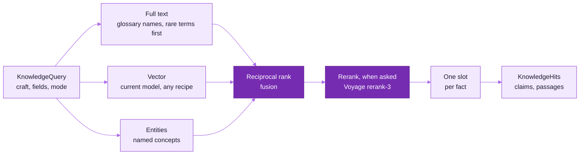

# Stored-knowledge retrieval

How stored claims (T1) and stored passages (T2) are found for a question, how their vectors are
made, stamped and renewed, and how retrieval is measured. Engineers changing the search, its
ranking, the embedding runs or the evaluation read it.

| For | Read |
|---|---|
| Why retrieval works this way | [decision 0008](../decisions/0008-stored-knowledge-retrieval.md) and [0101](../decisions/0101-knowledge-architecture-for-every-craft.md), item 10 and build step 3 |
| Why a quote follows its page and a held fact leaves answers | [decision 0121](../decisions/0121-quote-visibility.md) |
| Why a fact stays for every reader when its quotes are closed, and the one rule for a fact a reader sees | [decision 0149](../decisions/0149-a-fact-readers-can-see.md) |
| Why stored facts are reranked, and when stored knowledge is enough | [decision 0125](../decisions/0125-reranking.md) |
| Why vectors carry their context, the glossary reaches the words search and any-craft questions use the vector indexes | [decision 0129](../decisions/0129-first-stage-retrieval.md) |
| Why retrieval is measured as it grows, and why the evaluation scores the reranked and the fused order | [decision 0126](../decisions/0126-measurement-that-grows.md) and [0133](../decisions/0133-the-evaluation-scores-what-answers-read.md) |
| The seats that each search their own fields | [answer-eval.md](answer-eval.md) |
| Where retrieval sits in answering | [research.md](research.md) |

| Part | Code |
|---|---|
| The search, ranking, stamps and runs | `app/retrieval/` |
| The glossary's names in the words search | `app/retrieval/glossary_words.py` |
| The any-craft vector ranking and its index settings | `app/retrieval/nearest.py` |
| A claim's title for its vector | `app/retrieval/claim_titles.py`, `app/retrieval/text.py` |
| One embedding per text for an answer | `app/retrieval/answer_embeddings.py` |
| Facts embedded as they are written | `app/services/written_vectors.py` |
| The rerank stage and the collapse of restatements | `app/retrieval/rerank.py` |
| The reranker's contract, its route and its adapter | `app/research/reranking.py`, `app/providers/rerank_router.py`, `app/providers/voyage_p.py` |
| Who may read a citation, and held facts | `app/retrieval/citation_access.py` |
| The passage that holds a quote, and re-reading a source | `app/retrieval/quote_passages.py`, `app/retrieval/citation_links.py` |
| The contract types | `app/research/retrieval.py` |
| The seat search | `app/services/seat_search.py` |
| The seed passages | `app/services/claim_seed_passages.py` |
| The stamps' columns | migration `0043_embedding_stamps`; the recipe, migration `0061_embedding_recipe` |

## The search

`KnowledgeRetriever.search(KnowledgeQuery) -> KnowledgeHits`. Two implementations:
`StoredKnowledgeSearch(session, *, embed, english=None, rerank=None)` on one session and
`SessionScopedSearch(sessions, *, embed, english=None, rerank=None)`, which opens a session per
search. Searches sharing one `StoredKnowledgeSearch` take turns on its session once their words
and vector are made, and call the reranker after their turn; searches through
`SessionScopedSearch` run at once.

- `KnowledgeQuery {craftSlug | null, text, mode, facets[], fields[], chunkAcls, limit,
  sourceKinds[], passages, rerank}`. `craftSlug` null reads every visible concept. A craft's scope
  (`hybrid.craft_scope`) reads:
  - the craft's own concepts and the shared concepts of its sub-category;
  - its **family science**: the concepts its category's curated facts are about (the claims
    `CuratedCategoryClaim` marks for the category of the craft's sub-category, the link the craft
    page's family science and its page stamp read), and the shared concepts named as the category
    is, which hold the category's contributed facts (`statements._family_science`). The nine
    category dossiers' 2,029 facts reach the answers of every craft of their family;
  - the concepts of every craft merged into it, followed through `Craft.mergedIntoId` for up to
    `MERGE_HOPS_MAX` (5) hops (`hybrid.merged_into`), so a merged craft's knowledge stays in the
    surviving craft's answers.

  The page stamp, the review queue, the candidate gates and `knowledge_view` build `CraftScope`
  with neither, and read as before. Modes set the statuses and levels read
  (`MODE_CLAIM_STATUSES`, `MODE_CLAIM_LEVELS`); only the modes whose policy holds tier `T2` read
  passages.
- A held fact (every quote it cites failed its check, `nightly-upkeep.md` 1a) is never searched,
  in any mode: `statements.claim_conditions(..., held=HELD_LEFT_OUT)` by default, so answers,
  coverage and the saved-answer re-check never rest on it. `held=HELD_KEPT` keeps it, for the
  reads a contributor re-sources it from (decision 0121).
- `facets` keeps the claims whose subject concept is of one of the facet's concept types, and,
  for a facet type that belongs to a discipline (`vocabulary.CONCEPT_TYPE_DISCIPLINES`,
  `statements.facet_disciplines`), every claim of the scope filed under that discipline whatever
  its subject's type (decision 0142): a history facet (`HISTORICAL_CONTEXT`) finds a `HISTORY`
  claim about a curated place, which is an `ENVIRONMENTAL_CONDITION` concept. An empty tuple reads
  every type.
- `fields` keeps the claims filed under one of the fields (as their field or a secondary field)
  and the claims with no field yet; passages follow the claims kept. An empty tuple reads every
  field.
- `sourceKinds` keeps the claims citing at least one visible source of those kinds
  (`statements.cited_from_kinds`) inside every ranking, so a search kept to some kinds fills its
  `limit` with them. An empty tuple reads every kind.
- `passages` false runs no passage ranking even in a mode that reads `T2`; `chunks` is then empty.
  The facet coverage (`planner/coverage.facet_query`) and the seats set it, since they read claims
  only; the stored pack keeps the default, true.
- `rerank` true asks for the rerank stage (Reranking, below); the default is false. The seats
  (`seat_query`) and the stored pack (`planner/coverage.stored_knowledge`) ask for it. The facet
  coverage does not: it reads which facts the full-text ranking found, not their order.
- `chunkAcls` is the reader's passage access (`chunk_acls_for(reader)`); restricted chunks and
  sources and withheld field recordings are never read.

### A fact a reader can see

`citation_access.reader_fact(held, statuses)` is the one rule for which facts a reader sees
(decision 0149): shown status (`PROPOSED`, `IN_REVIEW`, `APPROVED`, narrowed by a mode), sensitivity
`OPEN`, filed under a concept readers see (a relation: one of its two concepts), cited by at least one
source that is not `RESTRICTED` and not a withheld field recording (`cited_for_readers`), and not held
unless `HELD_KEPT`. Search (`statements.claim_conditions`), the views (`knowledge_view.claims_for`,
`claims_by_id`), coverage and the field tasks (`open_work_counts.owned_facts`), the open data, the
proposal reply and the nightly count of hidden facts read it. Whether a closed page's words may be
read never decides whether the fact is shown.

`citation_access.reader_citations(claim_ids, acls)` reads every citation of those facts whose source
readers may see, with whether its words are readable at `acls`. A view shows each such citation with
its source and locator, and its quote only when the words are readable and the quote has not failed;
otherwise it is unquoted and labelled `INFERRED`. `ClaimView.closed` keeps the ids of the citations
whose words it hid, and `readable_citation_ids()` leaves them out, so a stored piece quoting them is
never reused for that reader.

### Who may read a citation

A citation's words (`ClaimSource.quote`) are read through `citation_access.readable_citation(acls)`,
the one rule behind `reader_citations` (every view of a fact) and the re-reading below (decision
0121):

- linked to a passage (`chunkId`): that passage's `acl` is one of `acls` and it is not
  `RESTRICTED`;
- not linked and not quoted: readable, since it shows no words of its source;
- not linked but quoted: every passage of its source is readable by `acls` and not `RESTRICTED`,
  and the source is not `RESTRICTED`. A quote no passage holds therefore takes the most closed
  passage of its page: a quote of a page whose full text is kept for researchers is shown to
  researchers only. A source with no passages (a book cited by page, a supplied source) shows
  its short quotes to everyone, as before.

A view never shows a quote whose last check failed (`quoteCheck` `FAIL`): the citation stays,
unquoted and labelled `INFERRED` (`knowledge_view.shown_quote`). A stored answer read publicly
(`public_explainer.closed_citations`) is redacted per citation: a quoted citation stays only when
a readable citation of the same fact and source carries the same quote (compared by
`quotes.quote_key`), an unquoted one when the fact and source have any readable citation.

### The passage that holds a quote

`quote_passages.QuotePassages(passages).holding(quote)` (read by
`live_source_store.chunk_for_quote`, so by every writer that links a quote) finds the first
passage, by ordinal, whose text holds the quote by `quotes.quote_occurs`; failing that, the first
two neighbouring passages of the same `acl` whose joined text holds it, linked to the first with
the paragraph range of both (`para 4` and `paras 5-6` become `paras 4-6`; any other locator keeps
the first). A quote that crosses one passage boundary is so linked, whether or not the chunker
carried the last paragraph over; one no passage or pair holds stays unlinked and is read by the
rule above.

### Re-reading a source

`indexing.replace_source_chunks(session, source_id, text, *, lang, acl)` rewrites a source's
passages by ordinal, then re-links every quoted citation of the source
(`citation_links.relink_quotes`): each moves to the passage that holds its quote now, with that
passage's locator unless the citation carries its own (one that is not its old passage's
locator); a quote no passage holds is left unlinked, and the rule above decides it. A citation
everyone could read before the re-reading, whose quote has not failed, is never hidden by it:
when its new passage is less open than `PUBLIC`, or none holds it, a `PUBLIC` passage holding
exactly its quote is kept for it after the document's passages (one per quote, with the
document's language and the source's sensitivity), as the seed import keeps its quotes. So a
public abstract quote stays public when the paper's closed full text is read, and the closed text
around it does not become public. The function returns the passages stored, kept quotes
included. A citation that already points at the right passage and locator is not written.

### Ranking

- Claims: three rankings of at most `RANKING_DEPTH` (60) each, fused by weighted reciprocal rank
  fusion (`score = sum(weight / (k + rank))`, with `k` and the lexical, vector and entity weights
  read from `app/data/eval/fusion.json` by `fusion_settings.fusion_settings()`: k 60 and equal
  weights until the lead commits the weighting `eval_retrieval --fusion` picks, decision 0151).
  Each ranking votes with its first `VOTING_DEPTH` (30) items
  (`fusion.reciprocal_rank_fusion`, decision 0132): the fused order sorts by the score of those
  ranks, then by the whole score, then by best single rank, then id, so an item found only below
  rank 30 in every ranking follows every voted item and only fills the rerank pool. `score` stays
  the whole sum:
  - full text: the search words' distinct Latin terms of 3 or more characters (at most
    `TSQUERY_MAX_TERMS`, 40), then their words of 2 characters (at most `TSQUERY_SHORT_TERMS`, 8;
    `text.or_tsquery`), each a slot ORed with the others. A short word counts only when it is a
    glossary term's label, alias or local name (`Term`), so "GI" is searched and "is", "pH" or "xy"
    are not until the glossary names them. Every word that is a name of a glossary term, folded to
    lower case, also matches every other name of that term (its label, aliases and local names, so
    the transliterations the glossary holds): its slot is
    `websearch_to_tsquery('english', '"<word>" or "<name>" or ...')`
    (`glossary_words.slot_query`), so "GI" finds "geographical indication" and "siyahi" finds
    "syahi". A question with no word of 3 characters has no full-text ranking. The first
    `LEXICAL_CANDIDATES` (400) matches of any slot by `ts_rank_cd` are then ordered by the rarity
    of the slots each matches: a slot weighs `ln(1 + n / n_t)`, where `n` is the number of
    candidates and `n_t` the number matching the slot, so a claim holding the question's rare word
    (settled, bacteria, a person's name) outranks claims that only repeat the craft's name or a
    name every claim carries; ties by `ts_rank_cd`, then id. `statements.text_query`, which the
    knowledge view, the category knowledge and the component library rank by, reads the glossary
    the same way;
  - vector: cosine distance between the embedded question and the scoped claims whose vector was
    made by the embedding route's current model, whatever its recipe (see Stamps); a claim with no
    vector, or with another model's, ranks by text and entities alone. A craft's scope is an exact
    scan of its claims. A search of no single craft (`craftSlug` null, `statements.ANY_CRAFT`
    among its conditions) reads the HNSW index on `Claim.embedding` instead
    (`nearest.vector_ranking`): the nearest `depth x INDEX_CANDIDATES_PER_HIT` (8) vectors of the
    current model in index order, then the claim conditions, then the first `depth` by exact
    distance. Before it runs, the session sets `hnsw.iterative_scan = relaxed_order` and
    `hnsw.ef_search = 200` for its transaction (`set_config(..., true)`, a `do_orm_execute` hook on
    the statement's `kv_vector_index_scan` option), so the index keeps scanning until enough
    vectors of the current model are found (pgvector 0.8; production runs 0.8.2). Passages of no
    single craft read `Chunk.embedding`'s HNSW index the same way;
  - entities: claims on scoped concepts (or edges touching them) named in the search words by a
    name of 4 or more characters, longest name first. A concept is named by its whole name, by its
    native head before ` (` and by the gloss inside the parentheses (`Syahi (fermented iron
    black)` is named by "syahi" and by "fermented iron black"), and by the label, aliases and
    local names of every glossary term linked to it (`TermConcept`). A name counts only as whole
    words: no letter, digit or underscore may stand right before it or right after it, but an
    English plural ending `s` or `es` may (`lower(words) ~ concat('(?<!\w)', name,
    '(?:e?s)?(?!\w)')`, the name's regular-expression characters escaped). So "blocks" names
    Block, while "leading" names no Lead, "chemicals" no Mica, "thousand" no Sand, "formation" no
    Mati, "carnelian" no Neli, "pattachitra" no Atta and "channapatna" no Patna. A native name
    written in another script matches the same way.
- Passages: full text and vector as above, fused in two separate lists of at most `limit` each:
  corpus passages, and the passages of field recordings (`Source` of a `FieldRecording`). A
  craft's many corpus passages therefore never crowd an artisan's recorded words out of the
  hits. `KnowledgeHits.chunks` holds both lists merged by score, so up to twice `limit` rows.
- The question is embedded as `task: search result | query: <text>`, passages as
  `title: <source title> | text: <text>`, and claims with their context
  (`claim_titles.titled_claims`, `text.context_title`): `title: <owner> · <concept> · <field> |
  text: <text>`, the owner being the craft of the claim's concept, else the sub-category of a
  shared concept, else the category whose curated facts mark the claim (`CuratedCategoryClaim`),
  else the category the concept is named as; the concept is the claim's concept, or the source
  concept of an edge; the field is the claim's field in sentence case. A part repeated or missing
  is left out, and a claim with none is `title: none`. So "It is then washed in the river." is
  embedded as `title: Kutch Ajrakh · Washing · Process | text: It is then washed in the river.`

### Reranking

A search with `rerank` true orders its candidate facts by relevance to the question with Voyage
`rerank-3`, through the AI router (decision 0125). Passages are not reranked.

1. **A wider pool.** The three claim rankings are fused as above, and the first
   `rerank.RERANK_POOL` (60) fused claims, or `limit` if that is larger, are the candidates.
2. **Titled like the vectors.** Each candidate is sent as
   `title: <craft>, <concept>, <field> | text: <claim text>` (`rerank.claim_title`; the craft and
   concept of the claim's concept subject and the claim's field, lower case, each where known, else
   `title: none`).
3. **One call.** The search words (the question, or its English rendering when it has no Latin
   word) and the candidates go to the reranker in one call, after the search's turn on its session
   and after `release_connection`, so no connection is held across it. The seats of one section
   search through `SessionScopedSearch` at once, so they rerank concurrently.
4. **Rerank order.** The candidates come back in descending `relevanceScore`, ties by fused order;
   each carries its score as `ClaimHit.relevanceScore`. A candidate the reranker did not score
   follows in fused order, without a score. `score` and the three ranks stay the fused values.
5. **One fact, one slot.** Walking that order, a candidate whose text folds to the same words as a
   kept fact (`rerank.folded_words`: NFKC, case folded, words only) or whose vector lies within
   cosine similarity `RESTATEMENT_COSINE` (0.97) of one (both vectors from the same model) joins that
   fact: the first, best-ranked, is kept and the others are listed in its `corroboratingIds`. The
   hits hold the first `limit` distinct facts.
6. **Never in the way.** When the search has no reranker, the call fails, no rerank route has a key,
   or the spend is refused, the search keeps the fused order, logs one warning
   (`the search keeps its fused order: reranking failed (<kind>)`) and still collapses
   restatements. A search without `rerank` runs none of this and reads exactly as before.

The reranker is `research/reranking.Reranker`, `async (query, documents) -> [Relevance{index,
score}]`, checked by `checked_relevance` (each index inside the documents, once; finite scores).
The answer pipeline passes `providers/rerank_router.router_reranker(principal)` as
`AnswerModels.rerank` to its `SessionScopedSearch`, with the answer's spend as `principal.answer`;
the route, prices and refusals are `docs/contracts/backend.md`, AI router. The evaluation passes
`router_reranker()` and asks each question with and without `rerank` (Evaluation, Scoring); the
coverage enrichment and direct callers build their searches without a reranker. A reranked search
whose hits carry no `relevanceScore` kept the fused order (`evaluation.kept_fused_order`).

### Questions without Latin words

The search words are the question itself unless it has no Latin term of 3 or more characters.
Then, when the search was built with an `english` rendering (`EnglishRendering`, an
`async (text) -> str`), the search words are that rendering; the vector is still made from the
question as asked. The answer pipeline (`services/answer_store.build_answer_pipeline`) passes
`english_question` of decision 0023, so a direct caller with Hindi, Gujarati or any other
non-Latin question gets a full-text and entity ranking in English. A question with any Latin
word makes no model call. A failed rendering leaves the question as asked (decision 0023's
rule). The rendering and the question's vector are both made before the search takes a
connection.

### Expert seats

`seat_query(ask, brief)` searches the seat's own fields and source kinds: `fields` is the seat's
`SeatBrief.fields` (the Historian reads `HISTORY` and `OVERVIEW`, the Chemist `CHEMISTRY`,
`PROCESS`, `MATERIALS` and `HEALTH`) and `sourceKinds` its `SeatBrief.source_kinds`, so both are
filters inside the search and the seat's `SEAT_SEARCH_LIMIT` (12) hits are all facts it may use.
The words are the answer's English question (`PlanRequest.english_question`, else the question)
and the craft name only: the seat label and field titles are not added, since the fields already
filter and the extra words would pull every seat's vector to one point. The seat search reads no
passages (`passages` false) and asks for reranking (`rerank` true), so its hits are distinct facts
in order of relevance. The seat then keeps the first `SEAT_CLAIMS_MAX` (6) facts the section
has not shown whose readable citations include one of its kinds. Kept true by
`backend/tests/retrieval/test_seat_fields.py`, `backend/tests/experts/test_wider_panel.py` and
`backend/tests/db/test_evidence_reach_db.py`.

## Stamps

Every stored vector carries the model that made it and the recipe of the text it was made from.

- Columns (migration `0043_embedding_stamps`): `Claim.embeddingModel`, `Chunk.embeddingModel`,
  `Craft.embeddingModel` (for `descriptorEmbedding`), `varchar(120)` like `RoutePolicy.model`,
  and `Craft.descriptorHash` (SHA-256 hex of the descriptor text the vector was made from).
- The current stamp is `kv_embedding_model()`: the model of the first enabled `EMBED` route
  (by ordinal) whose provider is enabled, then `#` and the recipe, `ctx1` (migration
  `0061_embedding_recipe`), so `gemini-embedding-2#ctx1`. Python reads it as
  `retrieval/stamps.current_embedding_model()` and holds the recipe as `stamps.EMBEDDING_RECIPE`
  (a test keeps the two equal). Recipe `ctx1` is the claim titles of The search; a vector of
  another recipe is one embedded before it.
- A vector is read by the rankings when the model part of its stamp (`split_part(stamp, '#', 1)`,
  `stamps.made_by_current_model`) is the route's model, whatever its recipe, so the rankings never
  go blind while vectors are renewed.
- Every writer stamps. The writers in `retrieval/indexing` and the descriptor fill set the full
  stamp explicitly; triggers (`Claim_embedding_stamp`, `Chunk_embedding_stamp`,
  `Craft_descriptor_stamp`) stamp any other write (the write-back gates, proposals, tests): a claim
  or passage vector written without a stamp, or changed while its stamp stayed, takes the model
  alone (no recipe), since only `retrieval/indexing` writes the recipe's text; a descriptor takes
  the full stamp; a cleared vector clears its stamp (and a craft's hash).
- A claim or passage whose text changes in place loses its vector and stamp in the same
  statement, whichever path changed it: the curation import's claim updates
  (`services/curation_claims.write_claims`), the testimony erasure
  (`services/testimony_claims`), re-chunking (`retrieval/indexing._apply`) or any later writer.
  The next embedding run gives it a new one.
- An embedding run writes a vector only where the text is still the text it embedded: the
  `UPDATE` compares `Claim.text`, `Chunk.text` or `KnowledgePiece.payload` with what was read,
  so a text rewritten while the model ran (a curation import, a testimony erasure) keeps no
  vector, is not counted, and is embedded by the next run.
- The migration stamps the vectors stored before it with the route's model at that moment;
  `gemini-embedding-2` is the only catalogue model that can run `EMBED` and has been since the
  foundation.

## Embedding runs

- `embed_pending(session, embed, *, batch_size=50, deadline=None)` embeds the visible claims and
  unrestricted passages whose stamp is not the current one (`stamps.needs_vector`), in the order
  of `stamps.renewal_order`: no vector first, then another model's vector, then an older recipe of
  the current model, oldest `updatedAt` first, then id; then the knowledge pieces with no vector.
  It works in batches of `EMBED_BATCH` (50), at most `EMBED_RUN_ROWS` (20,000) rows of each kind a
  run. With a `Deadline` it starts no batch once the time is spent; each batch is committed, so a
  stopped run keeps what it did. It returns `EmbeddedCounts {claims, chunks, pieces, complete}`.
  So a new recipe needs no hand step: the release and the daily run renew every vector, oldest
  first, after the missing ones.
- `embed_written(session, embed, *, claim_ids, source_ids)` embeds the rows a write just stored
  that have no vector of the current model (`stamps.needs_model_vector`), so they are searchable
  at once; an older recipe of the current model is left to the runs.
- Facts are embedded in the request that writes them, with the embedding route of the account
  that wrote them (`providers/embedding.router_embedder(principal)`), through
  `services/written_vectors.embed_now`, which never undoes the write: a failed or refused
  embedding is logged (`written facts stored without vectors, left for embed_knowledge`) and the
  runs embed the rest. The writers: an answer's write-back (`store_live_research`, as before); a
  term summary's write-back (`SqlTermStore(..., embed=)`, built by the term route for a signed-in
  reader); a structure item written at once for a Professor or Admin (`structure_proposed`, behind
  the MCP tool and `/api/knowledge/structure`, and `page_proposed` for a page bundle) or approved
  from the review queue (`POST /api/review-queue/STRUCTURE/{id}/approve`, `embed_decided`). A
  proposed fact keeps the vector its duplicate gate made, and its sources are embedded as before
  (`fact_proposals.embed_sources`).
- One answer embeds a text once: `build_answer_pipeline` wraps its embedder in
  `answer_embeddings.AnswerEmbeddings`, which keeps each vector for the answer's life keyed by
  the current stamp (`stamps.stamp_reader`, read at each call) and the text, and shares a vector
  still being made with every caller that asks for it, so the seats of a section that search the
  same words make one call. A failed call is forgotten, so the next asks again. Nothing is kept
  across answers.
- `services/craft_resolver.fill_descriptor_embeddings(session, embed, *, batch_size, deadline)`
  embeds a craft's descriptor (name, local name and aliases joined by `; `) when it has no
  vector, another model's stamp, or a `descriptorHash` that differs from the hash of its
  descriptor text now, so a craft whose aliases change is embedded again. The resolver's
  semantic step reads only descriptor vectors of the current model.
- Scripts: `python -m app.scripts.embed_knowledge [--seconds N]` and
  `python -m app.scripts.embed_craft_descriptors [--seconds N]` print a JSON report
  (`{ok, model, claims, chunks, pieces, complete}`, `model` being the full stamp, and
  `{ok, filled}`), or `{ok: false, error}` and exit 1 when the embedding route fails.
- `.github/workflows/embed-knowledge.yml` (dispatched by hand, input `seconds`, 60 to 3,300,
  default 1,800) runs `embed_craft_descriptors` once and then `embed_knowledge` on the box over SSM
  again and again until a report says `complete` or the time is spent, so the lead can renew every
  vector after a new recipe in one go. On 2026-11-22 production held 8,311 claims (about 1.07
  million characters) and 8,787 passages (about 7.78 million characters, with 0.81 million of
  source titles): about 2.6 million tokens, near 0.52 US dollars at Gemini Embedding 2's 0.20 US
  dollars per million tokens.

### On every release

`infra/deploy/blue_green.sh` runs, after the seeds, the curated import and the craft sync,
`embed_craft_descriptors` and then `embed_knowledge`, each with `--seconds $EMBED_SECONDS`
(240) inside `timeout` of that plus `EMBED_GRACE` (60). Their reports are logged; a failure, a
time-out or a down embedding route is a warning and the release goes on. What is left is
embedded by the next release or the daily Coverage enrichment run; after a release that changes
the recipe the lead dispatches `embed-knowledge.yml` to renew every vector in one go.

## Stored passages of the corpus imports

The seed import (`app.scripts.seed_claims`) keeps the verbatim passages it quotes as chunks of
their sources (`claim_seed_passages.store_seed_passages`): every quote whose upstream check
passed (`quoteCheck` `PASS`), once per source, with every locator it was cited at joined by
`; `, `PUBLIC` (the same words are already shown as the claim's quote), language `en`. A
source that already has chunks (an earlier run, or a document live research stored) is left as
it is, so a second run stores nothing. `ClaimSource.chunkId` is not set: an unlinked quote is
read by its source's passages (Who may read a citation), and these are all `PUBLIC`. When a full
text of such a source is read later (`live_source_store.keep_document`), its passages are
replaced and each curated quote re-linked as in Re-reading a source, so it stays public. The
passages are searched like any corpus passage and embedded by `embed_knowledge`.

The chunker (`chunking.chunk_text`) joins a word broken by a hyphen at a line end the way the
quote matcher does (`quotes.LINE_BREAK_HYPHEN`: `mor-` and `dant` on the next line become
`mordant`), so a quote the gate found in a document is found in its passages too.

The Wood Handbook is cited by the inferential-system seed (FPL-GTR-190, 2010) by chapter title,
with no quote; the repository holds no text of that edition, so it has no passages.

## Evaluation

Retrieval is measured on production by question sets that grow with the data, so a drop is
caught when it happens, at 500 crafts as at 20 (decision 0126). Every number below is printed by
`python -m app.scripts.eval_retrieval` and compared with the floors in
`app/data/eval/floors.json`.

| Part | Code |
|---|---|
| The question sets and their loaders | `app/retrieval/golden.py`, `app/data/eval/retrieval_questions.json`, `app/data/eval/generated/` |
| The scorer and its report | `app/retrieval/evaluation.py`, `app/retrieval/eval_runs.py` |
| Writing generated questions | `app/retrieval/question_facts.py`, `question_writing.py`, `question_generation.py`; `app.scripts.generate_eval_questions` |
| The judge of misses | `app/retrieval/miss_judging.py` |
| The floors | `app/retrieval/eval_floors.py`, `app/data/eval/floors.json` |
| The release check | `app/retrieval/release_check.py`, `infra/deploy/blue_green.sh` (`check_retrieval`) |
| Craft matching | `app/retrieval/craft_cases.py`, `app/data/eval/craft_matching_cases.json`; `app.scripts.build_craft_cases` |

### The hand-written set

`app/data/eval/retrieval_questions.json` (version 1, read by `retrieval/golden.golden_questions()`):
78 questions over 22 crafts and the shared block-printing science, covering all sixteen fields.
One (`farrukhabad-family-mordants`) asks an uncurated craft a question only its family science
answers, so it is scored where the category dossiers are imported (the live database), not in the
seeded test database. Each question names the field it asks about (`field`) and, sometimes, the
field filter it is asked with (`fields`). Each entry of `expected` is one fact the answer needs: a
claim, or a list of every stored claim that states that fact (the knowledge base often holds a seed
claim and the curated claims that restate it), any one of which counts. Claims are named by seed
key (`seed-...`) or claim id, read from each craft's public export on 2026-11-21. `test_evaluation`
checks the counts, that every name is a seed key or a claim id, and that every seed key is a seeded
concept claim of the named craft in an allowed field. The set is kept as it is, beside the
generated one.

### The generated set

`app/data/eval/generated/retrieval_questions.json`, validated by `golden.parse_generated` against
the model whose JSON Schema is kept beside it (`retrieval_questions.schema.json`, written by
`generate_eval_questions --schema`; a test fails when the two differ). Its questions have the shape
the hand-written loader reads: `GeneratedSet {version 1, revision, generatedAt, model, seed,
factsPerCraft, questions[]}`, each a `GeneratedQuestion` (a golden question whose `craftSlug` is
required) `{key "<fact id>-<language>", craftSlug, field, question, expected [[fact id,
restatement ids...]], fact, language, rejected[]}`: exactly one expected fact, named by claim ids,
holding the fact it was written from; `rejected` names the claims the judge said do not answer it,
never expected. A missing file is no generated set.

`python -m app.scripts.generate_eval_questions [--cap USD] [--out PATH] [--previous PATH]` writes
it from the live database:

- **Facts.** For each active craft that is not a catch-all (`question_facts.eval_crafts`), its
  published facts are the claims a `HYBRID` search of the craft's own concepts reads
  (`statements.claim_conditions` on the craft alone: a shown status, `OPEN`, cited, not held), each
  with its field (the claim's, else its concept type's).
- **Sample.** `FACTS_PER_CRAFT` (20) facts per craft, first by the SHA-256 of
  `"<seed>:<fact id>"` (`GENERATION_SEED` 20261122), so the set stays near 10,000 questions at 500
  crafts and a new fact enters only where it ranks. A fact already sampled for an earlier craft (by
  slug) is not written again.
- **Restatements.** A sampled fact's restatements are the craft's facts the duplicate gate would
  call the same without a judge: the same text by `statement_key`, or a vector of the current model
  at cosine similarity `VECTOR_TWIN_SIMILARITY` (0.97) or more that `gate_thrift.vector_twin`
  accepts (the same figures and negations, the stems overlapping). Any one of them counts as found.
- **Writing.** One call per batch of at most `WRITING_BATCH` (25) facts of one craft, at most
  `WRITING_CONCURRENCY` (4) at once, to the cheapest structured route: the `EVAL_JUDGE` task tuned to
  each provider's least priced model (`candidate_judge_routes.cheapest_judge_models`), under the
  request id `eval-questions-<run>-b<NNNNN>`. The prompt (`WRITER_SYSTEM_PROMPT`) asks for one
  question a reader would ask that the fact answers, reads the craft's names and the facts as
  untrusted data, and takes `{questions[{ref, question, unavoidable[], translated}]}`.
- **Worded apart, checked in code.** A fact's distinctive words are its content stems
  (`quotes.content_stems`: words of four letters or more, stop words left out, their first four
  letters) less the stems of the craft's names and those common to the craft (in at least three of
  its facts and a fifth of them). A question may reuse at most `UNAVOIDABLE_MAX` (2) distinctive
  stems, and only those of the terms it lists as unavoidable. The facts whose question (in either
  language) reused more are asked once more in one call (`REWRITER_SYSTEM_PROMPT`, request id
  `<batch id>-again`), each fact's line naming the words it reused
  (`question_writing.rewriting_message`, decision 0151); a question kept then counts as
  `rewritten`, and one that reuses them again is dropped and counted as copied.
- **A second language.** For about one fact in five (`SECOND_LANGUAGE_EVERY`, by the SHA-256 of
  `"<seed>:language:<fact id>"`) the same question is also asked in the craft's own language: the
  first language of its states of origin (`app/data/state_languages.json`) the site answers in,
  else Hindi. The model leaves it empty where it cannot write it; one with fewer than half of its
  letters in that language's script (`question_writing.in_its_script`: `translation.written_in` with
  the script of `ANSWER_LANGUAGE_SPECS`, so Devanagari for Hindi and Marathi, Bengali for Bengali
  and Assamese, Arabic for Urdu; decision 0133), or one that copies the fact, is dropped.
- **Reuse.** The questions of the previous set (`--previous`, the kept file by default) for a fact
  still sampled for the same craft are kept with their judged claims and the restatements found now,
  so a regeneration pays only for new facts; a kept question not in its language's script is
  dropped and counted, and a fact left with no kept question is written again. The new set's
  `revision` is the previous one's plus one.
- **Spend.** The router meters every call; before each batch the run's spend (`router.tagged_spend`
  on its request id prefix) must leave `WRITING_RESERVE_USD` (0.05) of `--cap` (default
  `GENERATION_CAP_USD`, 3 US dollars). A refused spend stops the writing, and the facts left are
  counted as unwritten. The script prints `{ok, crafts, facts, questions, reused, batches, asked,
  keptEnglish, keptShare, askedAgain, rewritten, dropped{reason: count}, stopped, model, revision,
  spentUsd, capUsd, out}`: `asked` is the facts the writer answered for, and `keptShare` the share of
  them that keep an English question.

The lead runs it on production with `.github/workflows/eval-questions.yml` (dispatched by hand,
input `cap`), which keeps the set as the `eval-questions-<run id>` artifact for 90 days, to be
committed as the generated file. The first, from run 44993519051 (revision 1, `claude-haiku-5-5`,
169 questions on 34 crafts, 58 of them in English), was committed on 2026-11-22.

### Scoring

`retrieval/evaluation.evaluate_golden(retriever, questions, *, claim_id, present=None, pace=None)`
asks each question twice in `HYBRID` mode for `EVAL_DEPTH` (20) claims, first without and then with
`rerank` (decision 0133), at most `pace.concurrency` questions at once and none once
`pace.deadline` has passed (those are `skipped`), and keeps both rankings. A hit is its claim and
its `corroboratingIds` (`hit_claims`), so a restatement the reranked search folded into a hit is the
same fact found there; the fused order folds nothing. Per question and order it measures recall at
5 (the share of its facts with any of their claims in the first five hits), the reciprocal rank of
the first hit holding a claim of any fact, and recall at 20. It returns a `SetReport {reranked,
fused, fell_back}`: a `RetrievalReport` per order, each averaging the measures overall, by field
and by craft (`Measures {questions, recallAt5, meanReciprocalRank, recallAt20}`) with the facts each
question missed in its first five (`a or b`), and the keys of the questions whose reranked ask came
back with no `relevanceScore` on any hit, so kept the fused order (`kept_fused_order`). The reranked
order is primary, as answers read it; the fused order is what a failed rerank keeps. Expected claims
not visible are reported as `absent` and not scored; a fact whose claims are all absent is dropped.
`SetReport.compared()` is the orders whose floors are compared: the fused order always, the
reranked only when no question fell back.

`eval_runs.scored` reads which expected claims are visible (`eval_runs.visible_claims`), embeds
every question once, in batches of `EMBED_BATCH` (50), before the searches (`prefetched_embedder`,
so both asks of a question share one vector; a search that embeds another text embeds it then), and
searches through one `SessionScopedSearch` given `EvalTools.rerank`, `EVAL_CONCURRENCY` (4)
questions at a time. The script passes `router_reranker()`, so each run makes one Voyage call per
question it asks (about 60 short documents, about 0.0002 US dollars at list price), reserved and
settled by the rerank router like every model call.

**Misses judged once.** In the weekly run, a generated question whose first reranked hit holds no
expected claim and is headed by a claim not rejected is shown with both facts to the same cheapest
route as the writer
(`miss_judging`, `MISS_JUDGE_SYSTEM_PROMPT`, 20 asks a call, request id `eval-misses-<run>-j<NNNNN>`),
within `--cap` (at most `MISS_JUDGE_CAP_USD`, 1 US dollar; reserve 0.05). A claim the judge says
answers the question as fully counts as found in that run's scores of both orders and joins the
question's expected claims in the next revision of the generated file; one it refuses joins
`rejected`. Neither is asked again. An ask left unjudged (by the cap or a failed call) stays a miss.

`python -m app.scripts.eval_retrieval [--cap USD] [--out PATH]` scores both sets on the live
database with the embedding and rerank routes and prints `{ok, sets {handWritten, generated},
judged[{question, claim, answers}], judgeStopped, generatedRevision, floors[{measure, floor, value,
held}], belowFloor, warnings[], searchSpentUsd, judgeSpentUsd, judgeCapUsd, out}`, each set
`{reranked, fused}` and each order `{questions, recallAt5, meanReciprocalRank, recallAt20, skipped,
absent[], misses{}, byField{}, byCraft{}}`, the reranked order also `fellBackToFused[]`.
`searchSpentUsd` is what the run's query embeddings and reranks spent, read by
`router.tagged_spend` on its request id `eval-search-<run>`. With `--out` it writes the judged
revision there.

`python -m app.scripts.eval_retrieval --fusion [--out PATH]` (decision 0151) is read-only and makes
no rerank or judge call: it embeds every hand-written and generated question once, reads each one's
three claim rankings once (`SessionScopedSearch.rankings`) and fuses them in memory under the
weighting in `fusion.json` and each of the 60 of `fusion_sweep.FUSION_GRID` (k 60 or 20, lexical 1
or 0.5, vector 1, 1.5, 2, 3 or 5, entity 1, 0.5 or 0.25). It prints `{ok, current, picked, changed,
absent[], rows[]}`, each row `{fusion, sets{handWritten, generatedEnglish, generatedOther,
releaseSample}}` in the fused order's `{questions, recallAt5, meanReciprocalRank, recallAt20}`. The
pick is the weighting whose generated English recall at 5, then reciprocal rank, is highest among
those whose hand-written recall at 5 and reciprocal rank are at least the current weighting's; ties
keep the earlier row, so the current weighting stays unless another does better. With `--out` it
writes the pick as a `fusion.json` whose `about` names the run and its numbers.

### Floors

`app/data/eval/floors.json` (version 2, read by `eval_floors.eval_floors()`) holds, per question
set and per order, a floor for recall at 5 and for mean reciprocal rank
(`retrieval{set: {reranked: {recallAt5, meanReciprocalRank}, fused: {...}}}`), and floors for the
answer judge's and rubric means ([answer-eval.md](answer-eval.md)). The sets are `handWritten`,
`generated` (the whole generated file, scored by the weekly run) and `releaseSample` (the release
check's sample of it, below). `eval_floors.parse_floors` migrates a version 1 file, whose floors
were per set only and measured the fused order, by putting each set's floors on `fused`; any other
version is refused. A floor holds when the value, rounded to four places, is at or above it; a
missing value breaks it; a `null` or absent floor is reported and never alerts. Checks are named
`<set>.<order>.<measure>` (`eval_runs.set_checks`), and a set's reranked floors are not compared
when any of its questions fell back to the fused order. They were set on 2026-11-22 at the live
numbers of release db09b9e7 less 0.05, rounded down to two places (decision 0133):

| Set | Reranked recall at 5 / MRR | Fused recall at 5 / MRR |
|---|---|---|
| `handWritten` (78) | 0.93 / 0.93 | 0.88 / 0.65 |
| `generated` (169) | 0.94 / 0.86 | 0.73 / 0.65 |
| `releaseSample` (41) | 0.95 / 0.80 | 0.38 / 0.24 |

Answers: judge 0.76, re-based on 2026-11-22 to the Claude judge, and rubric 0.82, re-based the same
day when the rubric began to count each shown sentence once (decision 0147). The lead raises them
as the numbers improve.

`.github/workflows/retrieval-eval.yml` (weekly on Monday at 04:11 UTC and by hand, input `cap`) runs
the script on the box over SSM, keeps `report.json`, `stdout.txt` and the judged revision
`retrieval_questions.json` as the `retrieval-eval-<run id>` artifact for 90 days, writes the warnings,
each set's orders (with the questions that fell back), the fields of both orders and the
hand-written misses of both orders into the run summary, fails when a floor is broken, and keeps one
issue, `Retrieval fell below its floor`, through `.github/actions/release-issue`: opened or
commented on while a floor is broken, closed when a run passes, left as it is when no report was
written or when the run warned (outcome `warned`: no floor broken, but a rerank failed, so some
reranked floors were not compared).

`tests/db/test_retrieval_eval.py` keeps its own floors on the seeded test database: it seeds the
claims and passages, embeds them with a hashed bag-of-words embedder (deterministic, no network),
scores the hand-written questions with a seeded claim (at least the 22 seed-keyed ones) and asserts
recall at 5 of at least 0.9 and a mean reciprocal rank of at least 0.7 in the fused order (it has no
reranker, so every reranked ask falls back); a change that lowers either below its floor fails.

### The release check

`infra/deploy/blue_green.sh` runs `check_retrieval` after the seeds, the curated import, the craft
sync, the embedding steps and the page rebuild, and before traffic moves:
`python -m app.scripts.eval_retrieval --release --seconds $CHECK_SECONDS` (180) from the new
colour's tree inside `timeout` of that plus `EMBED_GRACE` (60), against the same database, with the
embedding and rerank routes only (no answer is composed and no judge is asked). It scores the
hand-written questions (`handWritten`) and a fixed, stratified sample of the generated English ones
as their own set, `releaseSample` (`release_check.release_sample`: two per craft, the first by the
SHA-256 of `"<seed>:<key>"`, crafts in the order of `"<seed>:craft:<slug>"`, so that with the
hand-written set there are at most `RELEASE_SAMPLE_MAX` (400) questions; 41 from 29 crafts on
2026-11-22), in both orders, and compares each set and order with its floors. The sample holds only
paraphrased English questions, which the fused order finds worst, so it has floors of its own and
the weekly run's `generated` floors never apply to it. It prints `{ok, verdict, complete,
warnings[], error, sets{name: {reranked: {questions, recallAt5, meanReciprocalRank, recallAt20,
skipped, fellBackToFused[]}, fused: {...}}}, floors[]}` and exits:

| Exit | Verdict | The release |
|---|---|---|
| 0 | `PASSED`: every question asked, reranked in both sets, every floor held | goes on |
| 2 | `WARNED`: no generated set, the embedding route or another call failed, the time ran out before every question was asked (no floor is compared then), or a rerank failed and kept the fused order (`release_check.RERANK_FAILED`: that set's reranked floors are not compared) | goes on, with a warning |
| 3 | `BELOW_FLOOR`: every question asked and a compared floor broken, a fused one included when a rerank failed | stops like a failed seed; nginx still proxies to the old colour |

Any other exit (a crash, a time-out) is a warning and the release goes on.

### Craft matching

`app/data/eval/craft_matching_cases.json` (version 1) holds 1,764 cases built by
`python -m app.scripts.build_craft_cases` from the craft master list and `craft_aliases.json`
(`craft_cases.craft_cases`, every craft that is not a catch-all): `EXACT` (the name, one recorded
Latin alias that is not a machine transliteration, one name in another script), `FOLDED` (the name
in upper or lower case or without its punctuation, and a Latin alias without its accents),
`MISSPELLED` (one deterministic edit of the name's longest word that fewer than four craft names
share: a letter dropped, two swapped or one doubled, never the first), `PARTIAL` (the name without
the words four or more craft names share, when two or more words are left) and `COMPARISON` (two
crafts of one sub-category, `"<a> or <b>"`). A text that, folded, more than one craft holds expects
`AMBIGUOUS` with every holder; every other expects its craft. A `RESOLVED` case passes when its craft
is the first candidate, an `AMBIGUOUS` one when the resolver says `AMBIGUOUS` and offers every
expected craft. A test fails when the kept file is not what the script builds from the craft lists.

`tests/db/test_craft_matching_db.py` asks the lexical resolver (`lexical_match` and
`resolution_from` over `load_index` of the seeded crafts) the `EXACT`, `FOLDED` and `COMPARISON`
cases and asserts that at least 95% of each kind pass. `python -m app.scripts.eval_retrieval
--crafts` asks every case of the live database through `DatabaseCraftResolver` with the embedding
route, so the misspelt and partial names that need the semantic step are scored there, and prints
`{ok, cases, byKind{kind: {cases, passed, resolved, failed[]}}}`.

## Not built

- Knowledge pieces carry no stamp; a piece's vector is filled when missing only.
- The candidate gates' neighbour search (`services/candidate_store`) and the piece store's reuse
  distance compare vectors without reading the stamp.
- Wood Handbook passages wait for the cited edition's text.
- Generated questions in another language are searched as asked, with no English rendering, and
  the report does not split the generated set by language.

## How this document is kept true

| Claim | Kept true by |
|---|---|
| Recall at 5 of at least 0.9 and a mean reciprocal rank of at least 0.7 | `backend/tests/db/test_retrieval_eval.py`; a change that lowers either fails |
| The scorer, its depths, both orders, folded restatements, the fallback and its report | `backend/tests/retrieval/test_evaluation.py` |
| The generated set, its schema, its writing and the script check | `backend/tests/retrieval/test_generated_set.py`, `test_question_writing.py`, `test_question_generation.py` and `backend/tests/db/test_measurement_db.py` |
| Misses judged once, the floors per set and order, their migration and the workflows' issues | `backend/tests/retrieval/test_miss_judging.py`, `test_eval_floors.py`, `test_eval_workflows.py` and `backend/tests/db/test_measurement_db.py` |
| The release check, its warning on a failed rerank and its place in a release | `backend/tests/retrieval/test_release_check.py` and `backend/tests/db/test_measurement_db.py` |
| The craft-matching cases and the lexical resolver's floor | `backend/tests/retrieval/test_craft_cases.py` and `backend/tests/db/test_craft_matching_db.py` |
| Fusion, rarity weighting and the search words | `backend/tests/retrieval/test_fusion_and_text.py` and `test_search_words.py` |
| Claim titles, the glossary's names, short words, the any-craft index and one embedding per text | `backend/tests/retrieval/test_first_stage.py`, `test_statements.py` and `backend/tests/db/test_first_stage_db.py` |
| Facts embedded as they are written | `backend/tests/knowledge_writes/test_written_vectors.py`, `backend/tests/db/test_term_write_back_gates_db.py` and `test_retrieval_stamps_db.py` |
| Rerank order, its fallback, the titles, the collapse and the released connection | `backend/tests/retrieval/test_rerank.py`, `test_rerank_search.py` and `backend/tests/db/test_rerank_search_db.py` |
| The reranker's route, spend and adapter | `backend/tests/db/test_reranking_db.py`, `backend/tests/test_voyage_adapter.py` and `test_reranking_catalogue.py` |
| Stamps, the recipe and embedding runs | `backend/tests/retrieval/test_stamps.py`, `test_embedding_budget.py` and `backend/tests/db/test_retrieval_stamps_db.py` |
| Seats' field filters | `backend/tests/retrieval/test_seat_fields.py` |
| Seed passages and the corpus | `backend/tests/retrieval/test_seed_passages.py`, `test_chunking.py` and `backend/tests/db/test_retrieval_passages_db.py` |
| Ranking on Postgres | `backend/tests/db/test_retrieval_ranking_db.py` and `test_knowledge_retrieval_db.py` |
| Who may read a citation, held facts and failed quotes | `backend/tests/retrieval/test_statements.py`, `backend/tests/learning/test_share_links.py` and `backend/tests/db/test_quote_visibility_db.py` |
| The passage that holds a quote, re-reading and the vector guard | `backend/tests/retrieval/test_quote_passages.py`, `test_chunking.py` and `backend/tests/db/test_quote_relinks_db.py` |

Re-read it when the embedding model, a ranking, a question set or the evaluation's floors change.
