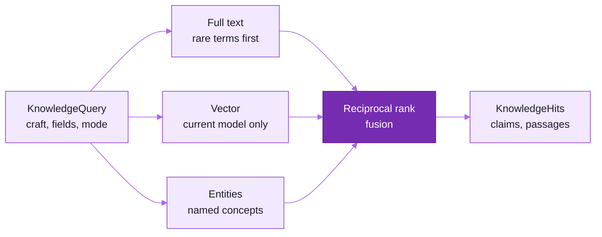

# Stored-knowledge retrieval

How stored claims (T1) and stored passages (T2) are found for a question, how their vectors are
made, stamped and renewed, and how retrieval is measured. Engineers changing the search, its
ranking, the embedding runs or the evaluation read it.

| For | Read |
|---|---|
| Why retrieval works this way | [decision 0008](../decisions/0008-stored-knowledge-retrieval.md) and [0101](../decisions/0101-knowledge-architecture-for-every-craft.md), item 10 and build step 3 |
| Why a quote follows its page and a held fact leaves answers | [decision 0121](../decisions/0121-quote-visibility.md) |
| The seats that each search their own fields | [answer-eval.md](answer-eval.md) |
| Where retrieval sits in answering | [research.md](research.md) |

| Part | Code |
|---|---|
| The search, ranking, stamps and runs | `app/retrieval/` |
| Who may read a citation, and held facts | `app/retrieval/citation_access.py` |
| The passage that holds a quote, and re-reading a source | `app/retrieval/quote_passages.py`, `app/retrieval/citation_links.py` |
| The contract types | `app/research/retrieval.py` |
| The seat search | `app/services/seat_search.py` |
| The seed passages | `app/services/claim_seed_passages.py` |
| The stamps' columns | migration `0043_embedding_stamps` |

## The search

`KnowledgeRetriever.search(KnowledgeQuery) -> KnowledgeHits`. Two implementations:
`StoredKnowledgeSearch(session, *, embed, english=None)` on one session and
`SessionScopedSearch(sessions, *, embed, english=None)`, which opens a session per search. Searches
sharing one `StoredKnowledgeSearch` take turns on its session once their words and vector are
made; searches through `SessionScopedSearch` run at once.

- `KnowledgeQuery {craftSlug | null, text, mode, facets[], fields[], chunkAcls, limit,
  sourceKinds[], passages}`. `craftSlug` null reads every visible concept. A craft's scope
  (`hybrid.craft_scope`) reads:
  - the craft's own concepts and the shared concepts of its sub-category;
  - its **family science**: the concepts its category's curated facts are about (the claims
    `CuratedCategoryClaim` marks for the category of the craft's sub-category, the link the craft
    page's family science and its page stamp read), and the shared concepts named as the category
    is, which hold the category's contributed facts (`statements._family_science`). The nine
    category dossiers' 2,029 facts reach the answers of every craft of their family;
  - the concepts of every craft merged into it, followed through `Craft.mergedIntoId` for up to
    `MERGE_HOPS_MAX` (5) hops (`hybrid.merged_into`), so a merged craft's knowledge stays in the
    surviving craft's answers.

  The page stamp, the review queue, the candidate gates and `knowledge_view` build `CraftScope`
  with neither, and read as before. Modes set the statuses and levels read
  (`MODE_CLAIM_STATUSES`, `MODE_CLAIM_LEVELS`); only the modes whose policy holds tier `T2` read
  passages.
- A held fact (every quote it cites failed its check, `nightly-upkeep.md` 1a) is never searched,
  in any mode: `statements.claim_conditions(..., held=HELD_LEFT_OUT)` by default, so answers,
  coverage and the saved-answer re-check never rest on it. `held=HELD_KEPT` keeps it, for the
  reads a contributor re-sources it from (decision 0121).
- `fields` keeps the claims filed under one of the fields (as their field or a secondary field)
  and the claims with no field yet; passages follow the claims kept. An empty tuple reads every
  field.
- `sourceKinds` keeps the claims citing at least one visible source of those kinds
  (`statements.cited_from_kinds`) inside every ranking, so a search kept to some kinds fills its
  `limit` with them. An empty tuple reads every kind.
- `passages` false runs no passage ranking even in a mode that reads `T2`; `chunks` is then empty.
  The facet coverage (`planner/coverage.facet_query`) and the seats set it, since they read claims
  only; the stored pack keeps the default, true.
- `chunkAcls` is the reader's passage access (`chunk_acls_for(reader)`); restricted chunks and
  sources and withheld field recordings are never read.

### Who may read a citation

A citation (`ClaimSource`) is read through `citation_access.readable_citation(acls)`, the one rule
behind `statements.readable_citations` (every view of a fact), the open-data export (`acls`
`PUBLIC`) and the re-reading below (decision 0121):

- linked to a passage (`chunkId`): that passage's `acl` is one of `acls` and it is not
  `RESTRICTED`;
- not linked and not quoted: readable, since it shows no words of its source;
- not linked but quoted: every passage of its source is readable by `acls` and not `RESTRICTED`,
  and the source is not `RESTRICTED`. A quote no passage holds therefore takes the most closed
  passage of its page: a quote of a page whose full text is kept for researchers is shown to
  researchers only. A source with no passages (a book cited by page, a supplied source) shows
  its short quotes to everyone, as before.

A view never shows a quote whose last check failed (`quoteCheck` `FAIL`): the citation stays,
unquoted and labelled `INFERRED` (`knowledge_view.shown_quote`). A stored answer read publicly
(`public_explainer.closed_citations`) is redacted per citation: a quoted citation stays only when
a readable citation of the same fact and source carries the same quote (compared by
`quotes.quote_key`), an unquoted one when the fact and source have any readable citation.

### The passage that holds a quote

`quote_passages.QuotePassages(passages).holding(quote)` (read by
`live_source_store.chunk_for_quote`, so by every writer that links a quote) finds the first
passage, by ordinal, whose text holds the quote by `quotes.quote_occurs`; failing that, the first
two neighbouring passages of the same `acl` whose joined text holds it, linked to the first with
the paragraph range of both (`para 4` and `paras 5-6` become `paras 4-6`; any other locator keeps
the first). A quote that crosses one passage boundary is so linked, whether or not the chunker
carried the last paragraph over; one no passage or pair holds stays unlinked and is read by the
rule above.

### Re-reading a source

`indexing.replace_source_chunks(session, source_id, text, *, lang, acl)` rewrites a source's
passages by ordinal, then re-links every quoted citation of the source
(`citation_links.relink_quotes`): each moves to the passage that holds its quote now, with that
passage's locator unless the citation carries its own (one that is not its old passage's
locator); a quote no passage holds is left unlinked, and the rule above decides it. A citation
everyone could read before the re-reading, whose quote has not failed, is never hidden by it:
when its new passage is less open than `PUBLIC`, or none holds it, a `PUBLIC` passage holding
exactly its quote is kept for it after the document's passages (one per quote, with the
document's language and the source's sensitivity), as the seed import keeps its quotes. So a
public abstract quote stays public when the paper's closed full text is read, and the closed text
around it does not become public. The function returns the passages stored, kept quotes
included. A citation that already points at the right passage and locator is not written.

### Ranking

- Claims: three rankings of at most `RANKING_DEPTH` (30) each, fused by reciprocal rank fusion
  (`score = sum(1 / (60 + rank))`, ties by best single rank, then id):
  - full text: the search words' distinct Latin terms of 3 or more characters ORed through
    `to_tsquery('english')`; the first `LEXICAL_CANDIDATES` (400) matches by `ts_rank_cd` are
    then ordered by the rarity of the terms each holds: a term weighs `ln(1 + n / n_t)`, where `n`
    is the number of candidates and `n_t` the number holding the term, so a claim holding the
    question's rare word (settled, bacteria, a person's name) outranks claims that only repeat the
    craft's name or a name every claim carries; ties by `ts_rank_cd`, then id;
  - vector: exact cosine distance between the embedded question and the scoped claims whose
    vector was made by the embedding route's current model (see Stamps); a claim with no vector,
    or with another model's, ranks by text and entities alone;
  - entities: claims on scoped concepts (or edges touching them) named in the search words by a
    name of 4 or more characters, longest name first. A concept is named by its whole name, by its
    native head before ` (` and by the gloss inside the parentheses (`Syahi (fermented iron
    black)` is named by "syahi" and by "fermented iron black"), and by the label, aliases and
    local names of every glossary term linked to it (`TermConcept`). A name counts only as whole
    words: no letter, digit or underscore may stand right before it or right after it, but an
    English plural ending `s` or `es` may (`lower(words) ~ concat('(?<!\w)', name,
    '(?:e?s)?(?!\w)')`, the name's regular-expression characters escaped). So "blocks" names
    Block, while "leading" names no Lead, "chemicals" no Mica, "thousand" no Sand, "formation" no
    Mati, "carnelian" no Neli, "pattachitra" no Atta and "channapatna" no Patna. A native name
    written in another script matches the same way.
- Passages: full text and vector as above, fused in two separate lists of at most `limit` each:
  corpus passages, and the passages of field recordings (`Source` of a `FieldRecording`). A
  craft's many corpus passages therefore never crowd an artisan's recorded words out of the
  hits. `KnowledgeHits.chunks` holds both lists merged by score, so up to twice `limit` rows.
- The question is embedded as `task: search result | query: <text>`, claims as
  `title: none | text: <text>`, passages as `title: <source title> | text: <text>`.

### Questions without Latin words

The search words are the question itself unless it has no Latin term of 3 or more characters.
Then, when the search was built with an `english` rendering (`EnglishRendering`, an
`async (text) -> str`), the search words are that rendering; the vector is still made from the
question as asked. The answer pipeline (`services/answer_store.build_answer_pipeline`) passes
`english_question` of decision 0023, so a direct caller with Hindi, Gujarati or any other
non-Latin question gets a full-text and entity ranking in English. A question with any Latin
word makes no model call. A failed rendering leaves the question as asked (decision 0023's
rule). The rendering and the question's vector are both made before the search takes a
connection.

### Expert seats

`seat_query(ask, brief)` searches the seat's own fields and source kinds: `fields` is the seat's
`SeatBrief.fields` (the Historian reads `HISTORY` and `OVERVIEW`, the Chemist `CHEMISTRY`,
`PROCESS`, `MATERIALS` and `HEALTH`) and `sourceKinds` its `SeatBrief.source_kinds`, so both are
filters inside the search and the seat's `SEAT_SEARCH_LIMIT` (12) hits are all facts it may use.
The words are the answer's English question (`PlanRequest.english_question`, else the question)
and the craft name only: the seat label and field titles are not added, since the fields already
filter and the extra words would pull every seat's vector to one point. The seat search reads no
passages (`passages` false). The seat then keeps the first `SEAT_CLAIMS_MAX` (6) facts the section
has not shown whose readable citations include one of its kinds. Kept true by
`backend/tests/retrieval/test_seat_fields.py`, `backend/tests/experts/test_wider_panel.py` and
`backend/tests/db/test_evidence_reach_db.py`.

## Stamps

Every stored vector carries the model that made it.

- Columns (migration `0043_embedding_stamps`): `Claim.embeddingModel`, `Chunk.embeddingModel`,
  `Craft.embeddingModel` (for `descriptorEmbedding`), `varchar(120)` like `RoutePolicy.model`,
  and `Craft.descriptorHash` (SHA-256 hex of the descriptor text the vector was made from).
- The current model is `kv_embedding_model()`: the model of the first enabled `EMBED` route
  (by ordinal) whose provider is enabled. Python reads it as
  `retrieval/stamps.current_embedding_model()`.
- Every writer stamps. The writers in `retrieval/indexing` and the descriptor fill set the stamp
  explicitly; triggers (`Claim_embedding_stamp`, `Chunk_embedding_stamp`,
  `Craft_descriptor_stamp`) stamp any other write (the write-back gates, proposals, tests): a
  vector written without a stamp, or changed while its stamp stayed, takes the current model; a
  cleared vector clears its stamp (and a craft's hash).
- A claim or passage whose text changes in place loses its vector and stamp in the same
  statement, whichever path changed it: the curation import's claim updates
  (`services/curation_claims.write_claims`), the testimony erasure
  (`services/testimony_claims`), re-chunking (`retrieval/indexing._apply`) or any later writer.
  The next embedding run gives it a new one.
- An embedding run writes a vector only where the text is still the text it embedded: the
  `UPDATE` compares `Claim.text`, `Chunk.text` or `KnowledgePiece.payload` with what was read,
  so a text rewritten while the model ran (a curation import, a testimony erasure) keeps no
  vector, is not counted, and is embedded by the next run.
- The migration stamps the vectors stored before it with the route's model at that moment;
  `gemini-embedding-2` is the only catalogue model that can run `EMBED` and has been since the
  foundation.

## Embedding runs

- `embed_pending(session, embed, *, batch_size=50, deadline=None)` embeds the visible claims and
  unrestricted passages with no vector or another model's stamp (missing first), then the
  knowledge pieces with no vector, in batches of `EMBED_BATCH` (50), at most `EMBED_RUN_ROWS`
  (20,000) rows of each kind a run. With a `Deadline` it starts no batch once the time is
  spent; each batch is committed, so a stopped run keeps what it did. It returns
  `EmbeddedCounts {claims, chunks, pieces, complete}`.
- `embed_written(session, embed, *, claim_ids, source_ids)` applies the same rules to the rows a
  write just stored.
- `services/craft_resolver.fill_descriptor_embeddings(session, embed, *, batch_size, deadline)`
  embeds a craft's descriptor (name, local name and aliases joined by `; `) when it has no
  vector, another model's stamp, or a `descriptorHash` that differs from the hash of its
  descriptor text now, so a craft whose aliases change is embedded again. The resolver's
  semantic step reads only descriptor vectors of the current model.
- Scripts: `python -m app.scripts.embed_knowledge [--seconds N]` and
  `python -m app.scripts.embed_craft_descriptors [--seconds N]` print a JSON report
  (`{ok, model, claims, chunks, pieces, complete}` and `{ok, filled}`), or
  `{ok: false, error}` and exit 1 when the embedding route fails.

### On every release

`infra/deploy/blue_green.sh` runs, after the seeds, the curated import and the craft sync,
`embed_craft_descriptors` and then `embed_knowledge`, each with `--seconds $EMBED_SECONDS`
(240) inside `timeout` of that plus `EMBED_GRACE` (60). Their reports are logged; a failure, a
time-out or a down embedding route is a warning and the release goes on. What is left is
embedded by the next release or the daily Coverage enrichment run.

## Stored passages of the corpus imports

The seed import (`app.scripts.seed_claims`) keeps the verbatim passages it quotes as chunks of
their sources (`claim_seed_passages.store_seed_passages`): every quote whose upstream check
passed (`quoteCheck` `PASS`), once per source, with every locator it was cited at joined by
`; `, `PUBLIC` (the same words are already shown as the claim's quote), language `en`. A
source that already has chunks (an earlier run, or a document live research stored) is left as
it is, so a second run stores nothing. `ClaimSource.chunkId` is not set: an unlinked quote is
read by its source's passages (Who may read a citation), and these are all `PUBLIC`. When a full
text of such a source is read later (`live_source_store.keep_document`), its passages are
replaced and each curated quote re-linked as in Re-reading a source, so it stays public. The
passages are searched like any corpus passage and embedded by `embed_knowledge`.

The chunker (`chunking.chunk_text`) joins a word broken by a hyphen at a line end the way the
quote matcher does (`quotes.LINE_BREAK_HYPHEN`: `mor-` and `dant` on the next line become
`mordant`), so a quote the gate found in a document is found in its passages too.

The Wood Handbook is cited by the inferential-system seed (FPL-GTR-190, 2010) by chapter title,
with no quote; the repository holds no text of that edition, so it has no passages.

## Evaluation

Retrieval is measured on production by question sets that grow with the data, so a drop is
caught when it happens, at 500 crafts as at 20 (decision 0126). Every number below is printed by
`python -m app.scripts.eval_retrieval` and compared with the floors in
`app/data/eval/floors.json`.

| Part | Code |
|---|---|
| The question sets and their loaders | `app/retrieval/golden.py`, `app/data/eval/retrieval_questions.json`, `app/data/eval/generated/` |
| The scorer and its report | `app/retrieval/evaluation.py`, `app/retrieval/eval_runs.py` |
| Writing generated questions | `app/retrieval/question_facts.py`, `question_writing.py`, `question_generation.py`; `app.scripts.generate_eval_questions` |
| The judge of misses | `app/retrieval/miss_judging.py` |
| The floors | `app/retrieval/eval_floors.py`, `app/data/eval/floors.json` |
| The release check | `app/retrieval/release_check.py`, `infra/deploy/blue_green.sh` (`check_retrieval`) |
| Craft matching | `app/retrieval/craft_cases.py`, `app/data/eval/craft_matching_cases.json`; `app.scripts.build_craft_cases` |

### The hand-written set

`app/data/eval/retrieval_questions.json` (version 1, read by `retrieval/golden.golden_questions()`):
78 questions over 22 crafts and the shared block-printing science, covering all sixteen fields.
One (`farrukhabad-family-mordants`) asks an uncurated craft a question only its family science
answers, so it is scored where the category dossiers are imported (the live database), not in the
seeded test database. Each question names the field it asks about (`field`) and, sometimes, the
field filter it is asked with (`fields`). Each entry of `expected` is one fact the answer needs: a
claim, or a list of every stored claim that states that fact (the knowledge base often holds a seed
claim and the curated claims that restate it), any one of which counts. Claims are named by seed
key (`seed-...`) or claim id, read from each craft's public export on 2026-11-21. `test_evaluation`
checks the counts, that every name is a seed key or a claim id, and that every seed key is a seeded
concept claim of the named craft in an allowed field. The set is kept as it is, beside the
generated one.

### The generated set

`app/data/eval/generated/retrieval_questions.json`, validated by `golden.parse_generated` against
the model whose JSON Schema is kept beside it (`retrieval_questions.schema.json`, written by
`generate_eval_questions --schema`; a test fails when the two differ). Its questions have the shape
the hand-written loader reads: `GeneratedSet {version 1, revision, generatedAt, model, seed,
factsPerCraft, questions[]}`, each a `GeneratedQuestion` (a golden question whose `craftSlug` is
required) `{key "<fact id>-<language>", craftSlug, field, question, expected [[fact id,
restatement ids...]], fact, language, rejected[]}`: exactly one expected fact, named by claim ids,
holding the fact it was written from; `rejected` names the claims the judge said do not answer it,
never expected. A missing file is no generated set.

`python -m app.scripts.generate_eval_questions [--cap USD] [--out PATH] [--previous PATH]` writes
it from the live database:

- **Facts.** For each active craft that is not a catch-all (`question_facts.eval_crafts`), its
  published facts are the claims a `HYBRID` search of the craft's own concepts reads
  (`statements.claim_conditions` on the craft alone: a shown status, `OPEN`, cited, not held), each
  with its field (the claim's, else its concept type's).
- **Sample.** `FACTS_PER_CRAFT` (20) facts per craft, first by the SHA-256 of
  `"<seed>:<fact id>"` (`GENERATION_SEED` 20261122), so the set stays near 10,000 questions at 500
  crafts and a new fact enters only where it ranks. A fact already sampled for an earlier craft (by
  slug) is not written again.
- **Restatements.** A sampled fact's restatements are the craft's facts the duplicate gate would
  call the same without a judge: the same text by `statement_key`, or a vector of the current model
  at cosine similarity `VECTOR_TWIN_SIMILARITY` (0.97) or more that `gate_thrift.vector_twin`
  accepts (the same figures and negations, the stems overlapping). Any one of them counts as found.
- **Writing.** One call per batch of at most `WRITING_BATCH` (25) facts of one craft, at most
  `WRITING_CONCURRENCY` (4) at once, to the cheapest structured route: the `EVAL_JUDGE` task tuned to
  each provider's least priced model (`candidate_judge_routes.cheapest_judge_models`), under the
  request id `eval-questions-<run>-b<NNNNN>`. The prompt (`WRITER_SYSTEM_PROMPT`) asks for one
  question a reader would ask that the fact answers, reads the craft's names and the facts as
  untrusted data, and takes `{questions[{ref, question, unavoidable[], translated}]}`.
- **Worded apart, checked in code.** A fact's distinctive words are its content stems
  (`quotes.content_stems`: words of four letters or more, stop words left out, their first four
  letters) less the stems of the craft's names and those common to the craft (in at least three of
  its facts and a fifth of them). A question may reuse at most `UNAVOIDABLE_MAX` (2) distinctive
  stems, and only those of the terms it lists as unavoidable; one that reuses more is dropped and
  counted.
- **A second language.** For about one fact in five (`SECOND_LANGUAGE_EVERY`, by the SHA-256 of
  `"<seed>:language:<fact id>"`) the same question is also asked in the craft's own language: the
  first language of its states of origin (`app/data/state_languages.json`) the site answers in,
  else Hindi. The model leaves it empty where it cannot write it; one with no letter outside ASCII,
  or one that copies the fact, is dropped.
- **Reuse.** The questions of the previous set (`--previous`, the kept file by default) for a fact
  still sampled for the same craft are kept with their judged claims and the restatements found now,
  so a regeneration pays only for new facts. The new set's `revision` is the previous one's plus one.
- **Spend.** The router meters every call; before each batch the run's spend (`router.tagged_spend`
  on its request id prefix) must leave `WRITING_RESERVE_USD` (0.05) of `--cap` (default
  `GENERATION_CAP_USD`, 3 US dollars). A refused spend stops the writing, and the facts left are
  counted as unwritten. The script prints `{ok, crafts, facts, questions, reused, batches,
  dropped{reason: count}, stopped, model, revision, spentUsd, capUsd, out}`.

The lead runs it on production with `.github/workflows/eval-questions.yml` (dispatched by hand,
input `cap`), which keeps the set as the `eval-questions-<run id>` artifact for 90 days, to be
committed as the generated file.

### Scoring

`retrieval/evaluation.evaluate_golden(retriever, questions, *, claim_id, present=None, pace=None)`
asks each question in `HYBRID` mode for `EVAL_DEPTH` (20) claims, at most `pace.concurrency` at
once and none once `pace.deadline` has passed (those are `skipped`), and keeps each ranking. Per
question it measures recall at 5 (the share of its facts with any of their claims in the first
five), the reciprocal rank of the first claim of any fact, and recall at 20. A `RetrievalReport`
averages them overall, by field and by craft (`Measures {questions, recallAt5,
meanReciprocalRank, recallAt20}`), with the facts each question missed in its first five
(`a or b`). Expected claims not visible are reported as `absent` and not scored; a fact whose
claims are all absent is dropped.

`eval_runs.scored` reads which expected claims are visible, embeds every question once, in batches
of `EMBED_BATCH` (50), before the searches (`prefetched_embedder`; a search that embeds another text
embeds it then), and searches through `SessionScopedSearch`, `EVAL_CONCURRENCY` (4) questions at a
time.

**Misses judged once.** In the weekly run, a generated question whose first hit is a claim neither
expected nor rejected is shown with both facts to the same cheapest route as the writer
(`miss_judging`, `MISS_JUDGE_SYSTEM_PROMPT`, 20 asks a call, request id `eval-misses-<run>-j<NNNNN>`),
within `--cap` (at most `MISS_JUDGE_CAP_USD`, 1 US dollar; reserve 0.05). A claim the judge says
answers the question as fully counts as found in that run's scores and joins the question's expected
claims in the next revision of the generated file; one it refuses joins `rejected`. Neither is asked
again. An ask left unjudged (by the cap or a failed call) stays a miss.

`python -m app.scripts.eval_retrieval [--cap USD] [--out PATH]` scores both sets on the live
database with the embedding route and prints `{ok, sets {handWritten, generated}, judged[{question,
claim, answers}], judgeStopped, generatedRevision, floors[{measure, floor, value, held}], belowFloor,
judgeSpentUsd, judgeCapUsd, out}`, each set `{questions, recallAt5, meanReciprocalRank, recallAt20,
skipped, absent[], misses{}, byField{}, byCraft{}}`. With `--out` it writes the judged revision there.

### Floors

`app/data/eval/floors.json` (version 1, read by `eval_floors.eval_floors()`) holds, per question
set, a floor for recall at 5 and for mean reciprocal rank, and floors for the answer judge's and
rubric means ([answer-eval.md](answer-eval.md)). A floor holds when the value, rounded to four
places, is at or above it; a missing value breaks it; a `null` floor is reported and never alerts.
They were set on 2026-11-22 at the live numbers of 2026-11-21 less 0.05: hand-written recall at 5
0.82 and mean reciprocal rank 0.64; the generated set has none until its first live run; answers
0.85 and 0.85. The lead raises them as the numbers improve.

`.github/workflows/retrieval-eval.yml` (weekly on Monday at 04:11 UTC and by hand, input `cap`) runs
the script on the box over SSM, keeps `report.json`, `stdout.txt` and the judged revision
`retrieval_questions.json` as the `retrieval-eval-<run id>` artifact for 90 days, writes the sets,
the fields and the hand-written misses into the run summary, fails when a floor is broken, and keeps
one issue, `Retrieval fell below its floor`, through `.github/actions/release-issue`: opened or
commented on while a floor is broken, closed when a run passes, left as it is when no report was
written.

`tests/db/test_retrieval_eval.py` keeps its own floors on the seeded test database: it seeds the
claims and passages, embeds them with a hashed bag-of-words embedder (deterministic, no network),
scores the hand-written questions with a seeded claim (at least the 22 seed-keyed ones) and asserts
recall at 5 of at least 0.9 and a mean reciprocal rank of at least 0.7; a change that lowers either
below its floor fails.

### The release check

`infra/deploy/blue_green.sh` runs `check_retrieval` after the seeds, the curated import, the craft
sync, the embedding steps and the page rebuild, and before traffic moves:
`python -m app.scripts.eval_retrieval --release --seconds $CHECK_SECONDS` (180) from the new
colour's tree inside `timeout` of that plus `EMBED_GRACE` (60), against the same database, with the
embedding route only (no answer is composed and no judge is asked). It scores the hand-written
questions and a fixed, stratified sample of the generated English ones
(`release_check.release_sample`: two per craft, the first by the SHA-256 of `"<seed>:<key>"`, crafts
in the order of `"<seed>:craft:<slug>"`, so that with the hand-written set there are at most
`RELEASE_SAMPLE_MAX` (400) questions), and compares each set with its floors. It prints `{ok,
verdict, complete, warnings[], error, sets{name: {questions, recallAt5, meanReciprocalRank,
recallAt20, skipped}}, floors[]}` and exits:

| Exit | Verdict | The release |
|---|---|---|
| 0 | `PASSED`: every question asked, every floor held | goes on |
| 2 | `WARNED`: no generated set, the embedding route or another call failed, or the time ran out before every question was asked (no floor is compared then) | goes on, with a warning |
| 3 | `BELOW_FLOOR`: every question asked and a floor broken | stops like a failed seed; nginx still proxies to the old colour |

Any other exit (a crash, a time-out) is a warning and the release goes on.

### Craft matching

`app/data/eval/craft_matching_cases.json` (version 1) holds 1,764 cases built by
`python -m app.scripts.build_craft_cases` from the craft master list and `craft_aliases.json`
(`craft_cases.craft_cases`, every craft that is not a catch-all): `EXACT` (the name, one recorded
Latin alias that is not a machine transliteration, one name in another script), `FOLDED` (the name
in upper or lower case or without its punctuation, and a Latin alias without its accents),
`MISSPELLED` (one deterministic edit of the name's longest word that fewer than four craft names
share: a letter dropped, two swapped or one doubled, never the first), `PARTIAL` (the name without
the words four or more craft names share, when two or more words are left) and `COMPARISON` (two
crafts of one sub-category, `"<a> or <b>"`). A text that, folded, more than one craft holds expects
`AMBIGUOUS` with every holder; every other expects its craft. A `RESOLVED` case passes when its craft
is the first candidate, an `AMBIGUOUS` one when the resolver says `AMBIGUOUS` and offers every
expected craft. A test fails when the kept file is not what the script builds from the craft lists.

`tests/db/test_craft_matching_db.py` asks the lexical resolver (`lexical_match` and
`resolution_from` over `load_index` of the seeded crafts) the `EXACT`, `FOLDED` and `COMPARISON`
cases and asserts that at least 95% of each kind pass. `python -m app.scripts.eval_retrieval
--crafts` asks every case of the live database through `DatabaseCraftResolver` with the embedding
route, so the misspelt and partial names that need the semantic step are scored there, and prints
`{ok, cases, byKind{kind: {cases, passed, resolved, failed[]}}}`.

## Not built

- Knowledge pieces carry no stamp; a piece's vector is filled when missing only.
- The candidate gates' neighbour search (`services/candidate_store`) and the piece store's reuse
  distance compare vectors without reading the stamp.
- The HNSW indexes on the vector columns are unused by the exact craft-scoped scan.
- Wood Handbook passages wait for the cited edition's text.
- Generated questions in another language are searched as asked, with no English rendering, and
  the report does not split the generated set by language.

## How this document is kept true

| Claim | Kept true by |
|---|---|
| Recall at 5 of at least 0.9 and a mean reciprocal rank of at least 0.7 | `backend/tests/db/test_retrieval_eval.py`; a change that lowers either fails |
| The scorer, its depths and its report | `backend/tests/retrieval/test_evaluation.py` |
| The generated set, its schema and its writing | `backend/tests/retrieval/test_generated_set.py`, `test_question_writing.py`, `test_question_generation.py` and `backend/tests/db/test_measurement_db.py` |
| Misses judged once, the floors and the workflows' issues | `backend/tests/retrieval/test_miss_judging.py`, `test_eval_floors.py`, `test_eval_workflows.py` and `backend/tests/db/test_measurement_db.py` |
| The release check and its place in a release | `backend/tests/retrieval/test_release_check.py` and `backend/tests/db/test_measurement_db.py` |
| The craft-matching cases and the lexical resolver's floor | `backend/tests/retrieval/test_craft_cases.py` and `backend/tests/db/test_craft_matching_db.py` |
| Fusion, rarity weighting and the search words | `backend/tests/retrieval/test_fusion_and_text.py` and `test_search_words.py` |
| Stamps and embedding runs | `backend/tests/retrieval/test_stamps.py`, `test_embedding_budget.py` and `backend/tests/db/test_retrieval_stamps_db.py` |
| Seats' field filters | `backend/tests/retrieval/test_seat_fields.py` |
| Seed passages and the corpus | `backend/tests/retrieval/test_seed_passages.py`, `test_chunking.py` and `backend/tests/db/test_retrieval_passages_db.py` |
| Ranking on Postgres | `backend/tests/db/test_retrieval_ranking_db.py` and `test_knowledge_retrieval_db.py` |
| Who may read a citation, held facts and failed quotes | `backend/tests/retrieval/test_statements.py`, `backend/tests/learning/test_share_links.py` and `backend/tests/db/test_quote_visibility_db.py` |
| The passage that holds a quote, re-reading and the vector guard | `backend/tests/retrieval/test_quote_passages.py`, `test_chunking.py` and `backend/tests/db/test_quote_relinks_db.py` |

Re-read it when the embedding model, a ranking, a question set or the evaluation's floors change.
