# Review queue

One review path for everything other people give: proposed and researched facts, artisans'
testimony, contributed pictures, component proposals, page layout proposals and page structure
proposals, whatever their origin (the site, the Knowledge API, the MCP server, an artisan's
conversation). Reviewers see one page of pending items, newest first, and decide each through one
route per action. Reviewers and the engineers who add a kind or a decision read it.

| For | Read |
|---|---|
| Why one queue | [decision 0101](../decisions/0101-knowledge-architecture-for-every-craft.md), items 5, 12, 13 and 14 |
| How a fact, layout, structure item or source reaches the queue | [knowledge-writes.md](knowledge-writes.md) |
| Pictures | [image-contributions.md](image-contributions.md) |
| Component proposals | [open-work.md](open-work.md) |
| Artisans' testimony | [roles-and-contributions.md](roles-and-contributions.md) |

A reviewer's own contribution is approved at once by its own write path (`knowledge-writes.md`,
`image-contributions.md`, `open-work.md`) and never enters the queue; the queue also leaves out
anything the viewer proposed.

```mermaid
%%{init: {"theme":"base","fontFamily":"Inter, ui-sans-serif, system-ui, -apple-system, Segoe UI, Roboto, Helvetica, Arial, sans-serif","themeVariables":{"fontSize":"15px","primaryColor":"#F2E9FE","primaryTextColor":"#1E1B2E","primaryBorderColor":"#9148D2","secondaryColor":"#FAEECD","secondaryTextColor":"#1E1B2E","secondaryBorderColor":"#CD9200","tertiaryColor":"#F3F1FA","tertiaryTextColor":"#1E1B2E","tertiaryBorderColor":"#A7A3BC","mainBkg":"#F2E9FE","nodeBorder":"#9148D2","nodeTextColor":"#1E1B2E","lineColor":"#AA69E9","textColor":"#857F9E","edgeLabelBackground":"#F9F5FF","clusterBkg":"#F9F5FF","clusterBorder":"#D6B6FB","titleColor":"#762CB1"}}}%%
flowchart LR
  subgraph Kinds
    FA["FACTS"]
    TE["TESTIMONY"]
    IM["IMAGES"]
    CO["COMPONENTS"]
    LA["LAYOUTS"]
    ST["STRUCTURE"]
  end
  Kinds --> Q["GET review-queue<br/>one page, newest first"]
  Q --> D{"Decision"}
  D -->|approve| A["Written or shown"]
  D -->|reject or retract| R["Kept with a reason"]
  A --> RV["Signed-out pages<br/>refreshed"]
  R --> RV
  classDef accent fill:#762CB1,stroke:#5F1C93,color:#FFFFFF
  class D accent
```

## Where the code is

Contract: `backend/app/research/review_queue.py`, with the component body in
`research/review_queue_components.py`, the layout body in `research/layout_proposals.py`, the
structure body in `research/review_queue_structure.py` and the shared source and check parts in
`research/review_queue_parts.py`.
Services: `services/review_queue.py` (the page), `review_queue_select.py` (what is pending, per kind),
`review_queue_fact_views.py`, `review_queue_components.py`, `review_queue_layouts.py` and
`review_queue_structure.py` (what a reviewer needs to judge an item, and the component, layout and
structure decisions), `review_queue_decisions.py`, `review_queue_facts.py` (decisions),
`review_queue_refresh.py` (the signed-out pages a decision refreshes) and `review_queue_errors.py`.
Route: `api/routes/review_queue.py`. No table or column of its own: the queue reads the rows each kind
already keeps.

## Who sees which kind

Each kind follows the capability its queue names in `research/open_work.py` (`REVIEW_QUEUES`):

| Kind | Capability | Roles |
|---|---|---|
| `FACTS` | `MARK_CLAIM_LEVEL` (`RETRACT_CLAIM` to retract) | Professor and above |
| `TESTIMONY` | `REVIEW_TESTIMONY` | Professor and above |
| `IMAGES` | `REVIEW_CONTRIBUTIONS` | Admin and above |
| `COMPONENTS` | `REVIEW_CONTRIBUTIONS` | Admin and above |
| `LAYOUTS` | `REVIEW_CONTRIBUTIONS` | Admin and above |
| `STRUCTURE` | `MARK_CLAIM_LEVEL` | Professor and above |

So an Admin or Master Admin sees every kind (item 12); a Professor sees facts, testimony and
structure. An
account that reviews no kind is refused the route (403).

**Who proposed it is kept privately** (item 13). An item carries `proposer {name, role}` only when
the viewer holds `REVIEW_CONTRIBUTIONS` (Admin and above); for everyone else it is `null`, and the
name is never sent. Research written back by the system has no proposer. Testimony keeps its own
consented credit line (`speaker`, `line`), which the artisan chose and the existing testimony
review already shows.

## What is pending

| Kind | Row | Pending when |
|---|---|---|
| `FACTS` | `Claim` | `status` is `DRAFT` (waiting, hidden: the review switch said `APPROVAL`, or a new contributor proposed it) or `IN_REVIEW` (live and unreviewed: `AUTO`, or a proven contributor's fact drawn for review, one in five), it went through the candidate gates (it has `CandidateCheck` rows), and the viewer did not write it; a proven contributor's fact not drawn is `APPROVED` at `PROVISIONAL` and does not wait here (`knowledge-writes.md`, Trust tiers); or it is a shown fact held from its pages because none of its quotes is found any more (`nightly-upkeep.md` 1a), whose `QUOTES` check is the night's evidence, one reason per failing quote |
| `TESTIMONY` | `ArtisanContribution` | `status` `PENDING`, not the viewer's |
| `IMAGES` | `ImageContribution` | `status` `PENDING`, not the viewer's |
| `COMPONENTS` | `ComponentProposal` | `status` `PENDING`, not the viewer's |
| `LAYOUTS` | `LayoutProposal` | `status` `PENDING`, not the viewer's |
| `STRUCTURE` | `StructureProposal` | `status` `PENDING` (it passed its checks; a refused one is `REFUSED`), not the viewer's |

**Origins.** A fact's origin is `RESEARCH` when it was written back from an answer's research
(`Claim.origin` `LIVE_RESEARCH`), `AGENT` when a source was found by an agent
(`ClaimSource.foundBy` `AGENT`), else `CONTRIBUTION`. Testimony is `TESTIMONY`, a picture
`CONTRIBUTION`, a component proposal `AGENT`, a layout proposal its own `origin` (`CONTRIBUTION`
from the site or the Knowledge API, `AGENT` from the MCP server), a structure proposal likewise.

**Craft.** A fact belongs to a craft through its concept (the craft's own concepts and edges, as
retrieval scopes them); testimony and pictures by `craftId`; a component proposal by `craftId` or a
`CRAFT` subject naming the craft's slug; a layout proposal by `craftId` (a craft's or family's page;
a category's page has no craft); a structure proposal by `craftId`.

## `GET /api/review-queue`

Query: `kind` (`FACTS`, `TESTIMONY`, `IMAGES`, `COMPONENTS`, `LAYOUTS`, `STRUCTURE`), `craft` (a craft slug), `origin`
(`RESEARCH`, `CONTRIBUTION`, `AGENT`, `TESTIMONY`), `cursor`, `limit` (1 to 50, default 25).

Answer `ReviewQueuePage`:

- `schemaVersion: 1`;
- `kinds`: the kinds this viewer reviews, in the order above;
- `counts`: pending items per kind the viewer reviews, under the craft and origin filters (not the
  kind filter, so the tabs can show every count);
- `total`: the pending items the page's filters select;
- `items`: newest first by `submittedAt`, then id, across kinds;
- `nextCursor`: `"<microseconds since 1970>~<id hex>"` of the last item when more follow, else
  `null`. Pass it back as `cursor` with the same filters.

Each item has `id`, `kind`, `origin`, `submittedAt`, `craft {slug, name, path}` or `null`,
`proposer` (above) and one body:

- `fact`: `statement`, `field`, `fields`, `status`, `level`, `sourcesDiffer`, `concept {name,
  type}`, `sources [{title, url, licence, reliability, quotes [{text, locator}]}]` and `gates
  [{gate, passed, reasons, model, related [{id, text}]}]` in gate order (QUOTES, SOURCE,
  DUPLICATE, NOVELTY); `related` are the held facts a gate compared it with.
- `component`: the proposal (`label`, `title`, `description`, `kind`, `field`, `fields`,
  `subjects`, `consideredLabels`, `extends`, `extension`, `taskKey`) and `closest`: up to three
  library components, most matching reasons first, then the most words shared (`overlap` 0 to 1),
  never the one it extends. A delivered component also carries `delivery` (round 7,
  `services/review_queue_delivery.py`): `drawing`, a one-component `MonographDocument` drawn from its
  checked spec with its units cited as the page would cite them (null while a fact it rests on is
  not shown), `units [{unit, text, claimIds}]` as delivered, and `facts [{id, text, level, shown,
  sources}]`, the facts the units rest on with their sources and verbatim quotes.
- A `layout` item's `placed [{label, title, kind, delivery}]` (round 7): the waiting components of
  the same proposer that the layout places, as a page bundle delivers them, each with its `delivery`.
- `layout`: `subject {kind, slug}`, `subjectName`, `pageUrl`, `baseVersion`, `currentVersion` (the
  page's layout now, 0 for none), `stale` (the two differ, so approval is refused), `note`,
  `entryCount` and `changes [{ref, change (ADDED, CHANGED, REMOVED), before, after}]`: the proposal
  against the current layout, entry by entry, in reading order (chapter, then place), each side a
  `PageLayoutEntry` (`research/layout_proposals.layout_changes`).
- `structure`: `kind`, `subject {kind, slug}`, `subjectName`, `pageUrl` (the craft page's path),
  `target` ("Stage P03, Mordanting", "Material M02, Indigo" or `null`), `current` (what the page holds
  now for a stage's after or why or a material's botanical name, else `null`), `item` (as proposed,
  `knowledge-writes.md`), `statement`, `field`, `note`, `taskKey`, `sources` (as a fact's, graded by
  the kept source), `checks [{check, passed, reasons}]` (STATED, QUOTES, SOURCE), `conflicting [{id,
  text}]` (a conflict's facts) and `stale`: why approval would be refused now (the page moved on), or
  `null`.
- `picture`: the `ImageContributionView` of `image-contributions.md`.
- `testimony`: the review item of the testimony review (`/api/testimony/review/{id}`).

Refusals: 403 for an account that reviews nothing, 404 for an unknown craft, 422 for a malformed
filter or cursor.

## Decisions

| Route | Body | For |
|---|---|---|
| `POST /api/review-queue/{kind}/{id}/approve` | `{note?, version?, englishChecked?, craft?}` | every kind; `craft` (a craft slug) for facts only |
| `POST /api/review-queue/{kind}/{id}/reject` | `{reason, version?, testimonyReason?}` | every kind |
| `POST /api/review-queue/FACTS/{id}/raise` | `{note?}` | facts |
| `POST /api/review-queue/FACTS/{id}/retract` | `{reason}` | facts |

`reason` is 3 to 500 characters and kept with the decision; `note` up to 500. Answer
`QueueDecision {schemaVersion, kind, id, status, level, sourcesDiffer, message}`.

**Facts** (`review_queue_facts.py`), each with a `ReviewEvent` (actor `USER`) and an audit entry
`review.fact_<approved|rejected|raised|retracted>`:

| Action | From | To |
|---|---|---|
| approve | `DRAFT`, `IN_REVIEW` | `APPROVED` at its level |
| reject | `DRAFT`, `IN_REVIEW` | `REJECTED`, the reason as the event's note |
| raise | `DRAFT`, `IN_REVIEW`, `APPROVED` at `PROVISIONAL` | `APPROVED` at `REVIEWED`, `levelReason` "Reviewed against its quoted sources by a <role> on <day>" |
| retract | `IN_REVIEW`, `APPROVED` | `RETRACTED`, the reason as the event's note |

Approving or raising a waiting (`DRAFT`) fact publishes it and calls
`candidate_writes.mark_sources_differ`, so a fact the duplicate gate found to differ from a held
one is shown with that one as "sources differ" (item 5). The page rebuilds through nightly upkeep,
whose page stamps follow the facts' status and level.

**Filing under another craft** (decision 0136, `review_queue_refile.py`). Approving a fact with
`craft` files it under that craft in the same decision: its claim moves to the craft's concept
of the same type and name (found, else created, as the write-back's writer finds one), the event's
note ends `filed under <slug>` and the audit entry's detail carries `filedUnder`. This is how a
reviewer files a held write-back (knowledge-writes.md, The research write-back) or re-files one
filed before decision 0135; rejecting drops it. `craft` on any other kind, an unknown craft, or a
fact not about a concept is refused (422). The route refreshes the signed-out pages the fact was
on before the move as well as those it moves to.

**Component proposals** (`review_queue_components.py`): approve records `APPROVED` with the
reviewer, the time and the note: it waits for a builder to build and register it in the library;
nothing is built. Reject records `REJECTED` with the reason. Audit `review.component_<...>`.

**Layout proposals** (`review_queue_layouts.py`): approve writes the proposal's entries as the
page's next `PageLayout` version through `page_layouts.store_layout`, as the reviewer (audited
`PAGE_LAYOUT_WRITTEN`), and records `APPROVED` with the reviewer, the time, the note and the version
written; when the page's layout has moved past `baseVersion` it is refused (409) and the proposal
can only be rejected. Reject records `REJECTED` with the reason; nothing is written. Audit
`review.layout_<...>` with the version.

**Structure proposals** (`review_queue_structure.py`, `structure_proposals_review.py`): approve
writes the item and its fact into the page and its dossier (`knowledge-writes.md`, Structure
proposals) and records `APPROVED` with the reviewer, the time, the note and `claimId`; when the page
has moved on (the stage or material is gone, the name or conflict is already there) it is refused
(409) and the proposal can only be rejected. Reject records `REJECTED` with the reason; nothing is
written. Audit `review.structure_<approved|rejected>` with the kind and the fact.

**Pictures** go through `image_contributions.approve` and `.reject` (the reason is the note), with
an audit entry `review.image_<...>`. **Testimony** goes through `testimony_writes.approve` and
`.reject`: a testimony decision names the `version` it was read at (422 without it; 409 when the
item changed since); approval takes `englishChecked`; a rejection takes `testimonyReason` (one of
the testimony reasons, `OTHER` by default) with `reason` as the note to the artisan. The old routes
(`/api/contributions/images/review/...`, `/api/testimony/review/...`) keep working.

Refusals: 403 for a kind the account does not review or for one's own item, 404 for an unknown item
(and for a fact that never went through the gates), 409 for a decision the item's state does not
allow or a stale testimony version, 422 for a bad body or an action a kind does not have (only a
fact is raised or retracted). Every refusal rolls the session back.

## Refreshing signed-out pages

Once a decision is committed, the route asks the web app to refresh the signed-out pages it changed
(`review_queue_refresh.refresh_after_decision`, `services/page_revalidation.py`): every fact decision
(approved, raised, rejected or retracted: each changes what the page shows; round 7), testimony rejected (approved words are retracted with it), a
structure proposal approved, and (round 7) a component approved (its craft, the crafts its CRAFT
subjects name, the crafts and sub-category members of its CONCEPT subjects, and the pages of the
facts its units rest on), a layout approved (its craft or family, or its category alone) and a
picture approved (its craft). The pages are those of the fact's concept, or of the item's craft: the
craft, the families of its sub-category (a catch-all, or practised in All India only) and its
category, each with its monograph document; a fact about a sub-category's shared concept reaches the
families and the category, and a category's curated fact its category. The craft page's hide routes
(`services/craft_page_hiding.py`: a piece, an explainer simulation or a picture hidden or shown again)
do the same after their commit, and so does a structure proposal written at once.

`POST <PUBLIC_WEB_URL>/api/revalidate` with header `x-revalidate-secret: <WEB_REVALIDATE_SECRET>` and
body `{paths, tags}`: for a craft `/crafts/<slug>` and `/crafts/<slug>/monograph` with tags
`craft-page:<slug>` and `monograph-document:craft:<slug>`; for a category `/categories/<slug>` and
`/categories/<slug>/monograph` with `monograph-document:category:<slug>` (`research/page_revalidation.py`).
The web app's route (`frontend/app/api/revalidate/route.ts`, rules in `lib/server/revalidation.ts`,
served by the web app itself rather than proxied) compares the secret in constant time (SHA-256 of
both, `timingSafeEqual`), answers 503 when it has no secret, 401 for a wrong one and 422 for anything
but up to 40 such paths and tags, then revalidates each path and expires each tag at once. Without
the secret on the API nothing is sent; a refusal or an unreachable web app is logged as a warning and
the change stays, the pages refreshing on their daily schedule. The secret lives in Parameter Store
and the Vercel env (`docs/RUNBOOK.md`, Secrets).

## Erased testimony takes its orphaned concepts

When an artisan withdraws testimony or deletes a conversation, its claims are erased
(`WITHDRAWN`) and `testimony_claims.drop_orphans` removes the testimony concepts of that craft that
nothing else rests on (owner, 2026-11-19): no claim other than erased ones, and no link that
`orphan_concepts.concept_unlinked` names (an edge, a process stage, a material, a component subject
or a term). A concept something still links stays.

## The Review page (`/admin/review`)

In admin settings, for Professors and above (route guard `/admin/review`, gate `queue_reviewer`),
from the menu and the settings hub. Tabs per kind with their counts; filters for origin and craft,
kept in the address (`?kind=&origin=&craft=`). A card per item:

- a fact (`components/review/FactReviewCard.tsx`): the statement, what is shown now, level, fields,
  concept, "sources differ", sources with their verbatim quotes, and each automatic check with its
  reasons and the facts it was compared with;
- a component proposal (`ComponentReviewCard.tsx`): the proposal, the labels its proposer
  considered and the closest library components, and a delivered one drawn by its real view
  (`DeliveredComponentView.tsx`: `ComponentSlot` with `COMPONENT_VIEWS` and `BundleView`), its units
  with the numbered facts each rests on, and those facts with their sources and quotes; a layout
  proposal draws the waiting components it places the same way;
- a layout proposal (`LayoutReviewCard.tsx`, `LayoutChangeList.tsx`): the page (linked from the header
  for a craft or family, from its name for a category), the kind of page and the number of entries,
  the proposer's note, which version it builds on and what approving writes, and each change ("Placed",
  "Moved from ... to ...", "Taken out"), the first 12 and then "Show all N changes"; a stale proposal
  offers Reject only (`frontend/lib/layoutReviewView.ts`);
- a structure proposal (`StructureReviewCard.tsx`, rules in `frontend/lib/structureReviewView.ts`,
  shapes in `frontend/lib/structureReviewContract.ts`): the kind, the page and the stage or material
  it changes, the proposer's note, the item's parts (a native name or term in its own language and
  script), what the page holds now, the field, the statement, the facts that disagree for a
  conflict, the sources with their quotes and the checks, and what approving writes; a stale proposal
  offers Reject only;
- a picture: `PictureReviewCard.tsx`; testimony: the testimony `ReviewCard.tsx`, both reused with
  their own decision routes.

Facts, component, layout and structure proposals decide through `QueueDecisionBar.tsx`: an `ActionGroup` of Approve, Approve as
reviewed (facts), then Reject (waiting) or Retract (live) last as the destructive action, with a
Reason field required for either. The client contract is `frontend/lib/reviewQueueContract.ts`;
pure rules are in `frontend/lib/reviewQueueView.ts`. `/admin/pictures` and `/admin/testimony`
stay, and list decided items.

## How this document is kept true

| Claim | Kept true by |
|---|---|
| Who sees which kind, what is pending, the page and the decisions | `backend/tests/review_queue/` (rules and routes), `backend/tests/db/test_review_queue_db.py`, `test_review_queue_decisions_db.py` and `test_review_queue_refile_db.py` (filing under another craft) |
| Layout proposals | `backend/tests/db/test_layout_proposals_db.py` and `backend/tests/layouts/` (layout proposal rules and routes) |
| Structure proposals | `backend/tests/structure/`, `backend/tests/db/test_structure_proposals_db.py`, `test_structure_writes_db.py` and `test_structure_export_db.py` |
| Refreshing signed-out pages | `backend/tests/test_page_revalidation.py`, `backend/tests/db/test_page_revalidation_db.py` and `test_review_queue_refresh_db.py` |
| The Review page | `frontend/e2e/review-queue-unit.spec.ts`, `review-layouts-unit.spec.ts`, `review-structure-unit.spec.ts` and `revalidate-unit.spec.ts` |

Re-read it when a kind joins the queue, a decision is added, or a capability moves between roles.
