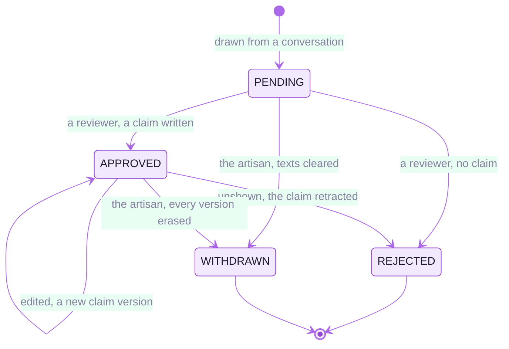

# Roles and contributions: students, artisans and artisan testimony

What a Student and an Artisan are asked when they first enter, where those answers are kept, how a
student's age band reaches composition, what the Artisan role may do, how an artisan talks with
KalaVigyan about their craft, and how what they say becomes testimony that is reviewed, shown,
cited and withdrawn. The owner's direction of 2026-11-18 governs, including the addition that an
artisan practises one or more crafts. Engineers and reviewers of testimony read it.

Last reviewed: 2026-11-18. Status: built in the tree, not deployed; the database tests run on GitHub.

| For | Read |
|---|---|
| The design choices | [decision 0083](../decisions/0083-students-and-artisans.md) |
| The voice backend this reuses | [voice.md](voice.md) |
| The portals' quotes, which share the `artisan_voice` block and the craft page's Voices part with this testimony | [field-voices.md](field-voices.md) (version 2, [decision 0084](../decisions/0084-field-voices-v2.md)) |
| The page and the blocks | [craft-page.md](craft-page.md), [explainer.md](explainer.md) |
| The error forms | [backend.md](backend.md) |
| How testimony is decided beside every other kind | [review-queue.md](review-queue.md) |



## 1. Vocabulary and limits

Each value is defined once. Python lives in the module named, the web client in the contract file
named, and both are pinned by `frontend/e2e/backend-vocabulary-unit.spec.ts`.

The stored values are defined once in `backend/app/models/people_vocabulary.py`, because the
models' check constraints need them and models import nothing above them; `models/enums.py`
re-exports them, and the research modules named build their `Literal` types and labels from them.

| Name | Values | Home |
|---|---|---|
| role | `ARTISAN`, rank 18, label "Artisan", joins `STUDENT` 15, `RESEARCHER` 30, `PROFESSOR` 40, `ADMIN` 50 and `MASTER_ADMIN` 60 | `core/roles.py`, `shared/roles.json`, `frontend/lib/permissions.ts` |
| age band | `UNDER_14` "Under 14", `14_17` "14 to 17", `18_22` "18 to 22", `23_PLUS` "23 and over" | `research/reading_style.py`, `frontend/lib/profileContract.ts` |
| gender | `WOMAN` "Woman", `MAN` "Man", `ANOTHER` "Another identity", `UNSAID` "Prefer not to say" | `research/reading_style.py`, `frontend/lib/profileContract.ts` |
| reading style | `CHILD`, `TEEN`, `UNDERGRADUATE` | `research/reading_style.py` (server only) |
| credit mode | `FULL_NAME`, `FIRST_NAME`, `CRAFT_AND_DISTRICT` | `research/testimony.py`, `frontend/lib/profileContract.ts` |
| interview topic | `PROCESS`, `MATERIALS`, `TIMING`, `TOOLS`, `HISTORY`, `CHANGE` | `voice/artisan_guide.py`, `frontend/lib/conversationContract.ts` |
| contribution status | `PENDING`, `APPROVED`, `REJECTED`, `WITHDRAWN` | `research/testimony.py`, `frontend/lib/testimonyContract.ts` |
| English source | `ORIGINAL` (spoken in English), `MACHINE`, `REVIEWED` (a reviewer checked or edited it) | `research/testimony.py` |
| locator precision | `WORD` (relay word timings), `TURN` (the turn's time) | `research/testimony.py` |
| reject reason | `NOT_ABOUT_THE_CRAFT`, `MISHEARD`, `PERSONAL_DETAILS`, `ABOUT_OTHER_PEOPLE`, `DUPLICATE`, `UNCLEAR`, `OTHER` | `research/testimony.py` |
| extraction status | `PENDING`, `RUNNING`, `DONE`, `NONE` (nothing drawn), `WAITING` (spend refused), `FAILED` | `research/testimony.py` |
| screen | `NAME_HELD_BACK` | `research/testimony.py` |
| consent kind | `ARTISAN_RECORDING` and `GUARDIAN_CONSENT`, joining `PRIVACY_NOTICE` and `VOICE_NOTICE` | `models/enums.CONSENT_KINDS` |
| claim origin | `ARTISAN`, joining `CLAIM_ORIGINS` | `models/enums.py` |
| source origin | `CONTRIBUTION`, joining `SOURCE_ORIGINS` | `models/enums.py` |
| AI task | `INTERVIEW` (the interviewer's turns) and `TESTIMONY` (drawing contributions), joining `AI_TASKS`; neither is a public-text task | `models/enums.py`, `services/ai_providers.py` |
| voice session purpose | `ASK` (the existing call), `ARTISAN` | `schemas/voice.py` |

Limits, as named constants in `research/testimony.py` unless noted:

| Constant | Value | Why |
|---|---|---|
| `ARTISAN_CRAFTS_MAX` | 12 | a practitioner of related crafts; more is a catalogue, not a practice |
| `CREDIT_NAME_MAX`, `CREDIT_SHORT_NAME_MAX` | 120, 60 characters | a name in any script |
| `CONVERSATION_MAX_SECONDS` | `MAX_SESSION_SECONDS` (600) | one sitting; the agent's `max_duration_seconds` |
| `CONVERSATION_MAX_TURNS` | `MAX_TURNS` (40) | counted as the voice session counts them |
| `QUESTION_MAX_WORDS` | 40 English words, at most 2 sentences | a spoken question, not a lecture |
| `ANSWER_MAX_WORDS` | `MAX_SPOKEN_WORDS` (60) | the voice reply cap, for a reply to the artisan's question |
| `CLOSING_SECONDS` | 45 | when this much time is left, the closing is spoken |
| `CONTRIBUTIONS_PER_CONVERSATION_MAX` | 30 | one extraction's output |
| `EXTRACTION_PART_CHARACTERS` | 40,000 characters of artisan turns per `TESTIMONY` call, at most 3 calls | bounds one conversation's spend |
| quote | `QUOTE_MIN_CHARS` (20) to `QUOTE_MAX_CHARS` (300) characters | the size `ClaimSource.quote` holds |
| `CLAIM_TEXT_MAX`, `ENGLISH_MAX` | 300, 600 characters | |
| `REVIEW_NOTE_MAX` | 500 characters | |
| `CORROBORATING_CLAIMS_MAX` | 5 | |
| `TESTIMONY_RETENTION_DAYS` | 30 | as `TRANSCRIPT_RETENTION_DAYS` |
| `AUDIO_LINK_SECONDS` | 900 | a reviewer listens to one turn |

## 2. Profiles and their storage

### `StudentProfile` (one row per Student who finished first entry)

| Column | Type | Rule |
|---|---|---|
| `userId` | uuid primary key, FK `User` cascade | |
| `ageBand` | varchar(16), check in the age bands | |
| `gender` | varchar(16), check in the genders | |
| `completedAt` | timestamptz | |
| `createdAt`, `updatedAt` | timestamptz | |

### `ArtisanProfile` (one row per Artisan who finished first entry)

| Column | Type | Rule |
|---|---|---|
| `userId` | uuid primary key, FK `User` cascade | |
| `districtLgd` | int, FK `AdminDistrict.lgd` restrict | a district the LGD register lists, never a pending one |
| `spokenLanguage` | varchar(16), check in `ANSWER_LANGUAGES` | |
| `creditMode` | varchar(24), check in the credit modes | |
| `creditName` | varchar(120) null | required for `FULL_NAME` |
| `creditShortName` | varchar(60) null | required for `FIRST_NAME` |
| `adultConfirmedAt` | timestamptz | the artisan confirmed being 18 or older |
| `completedAt` | timestamptz | |
| `createdAt`, `updatedAt` | timestamptz | |

Checks: `FULL_NAME` implies a `creditName`, and `FIRST_NAME` implies a `creditShortName`. The route
refuses a credit name that `research/evidence.personal_data_in` matches.

### `ArtisanCraft` (the crafts an artisan practises: one or more)

| Column | Type | Rule |
|---|---|---|
| `userId` | uuid, FK `User` cascade | |
| `craftId` | uuid, FK `Craft` restrict | an `ACTIVE` craft; a `MERGED` slug is stored as its target |
| `position` | smallint | the artisan's order, from 1 |

The primary key is (`userId`, `craftId`), and (`userId`, `position`) is unique. An artisan has 1 to
`ARTISAN_CRAFTS_MAX` rows, replaced in one transaction by the profile route. A catch-all craft
("Other hand block printing") may be chosen: it is how an artisan of a craft the register lacks says
so.

### `ConsentRecord`

Gains `recordedById` (uuid null, FK `User` set null, indexed): the person who recorded a consent
for someone else (a guardian confirmation, section 3.3). It is null when users consent for
themselves. Gains `withdrawnAt` (timestamptz null): withdrawing an agreement sets it, so the row
stays as the history of what was agreed and when; a withdrawn row is never read as consent.

### Who sees a profile

- Only the account holder, through `/api/profile/me`.
- The age band, gender and the reading style derived from them never appear in `serialize_user`,
  the users list, the access roster, Usage, an audit detail, a log, an `AnswerTrace`, a usage event,
  an evaluation fixture or any response about another account. Audit rows name the fields changed,
  never their values.
- An artisan's crafts, district and credit reach other people only as the speaker of shown
  testimony (section 9), and reviewers see them beside an item under review.
- `/api/auth/me` gains two booleans and no values: `profileRequired` (a first-entry step is owed)
  and `guardianConsentRequired` (section 3.3).
- A data export (`DataRequest` `EXPORT`) holds the profile, the crafts, every conversation's
  transcript and every contribution.

### When the role changes

`services/reader_profiles.apply_role_change(session, user, new_role)` runs in the same transaction
as every role change: Manage users, `_adopt_admitted_role` and the master admin path.

- Leaving `STUDENT` deletes the `StudentProfile`.
- Becoming `STUDENT` or `ARTISAN` owes that role's first entry.
- Leaving `ARTISAN` keeps the `ArtisanProfile` and crafts while any contribution is `PENDING` or
  `APPROVED`, since they credit shown words, and deletes them otherwise.
- The account keeps reading and withdrawing its own contributions whatever its role (section 10).

## 3. First entry

### 3.1 Order of the gates

`components/AppShell.tsx` checks, in order:

1. a password change that is owed;
2. a two-step setup that is owed;
3. `profileRequired` (first entry);
4. `guardianConsentRequired`.

Each is one screen with Sign out, and nothing else is drawn behind it. Other roles owe no first entry.

### 3.2 Student

One screen, "Before you start" (`components/onboarding/FirstEntryGate.tsx` with `StudentProfileForm.tsx`):

- **Age** (four choices) and **Gender** (four choices, "Prefer not to say" among them), both
  required.
- Under them: "Your age sets how answers are written for you. Your gender is only for drawing story
  characters. No one else sees either. Change them in Settings." and a link to the privacy notice.
- Continue records the current privacy notice (`POST /api/auth/consent`, `PRIVACY_NOTICE`) when the
  accepted version is older, then sends `PUT /api/profile/me/student`.

Settings gains "Your profile" (`components/settings/ProfileCards.tsx`) with the same two
fields.

### 3.3 Students under 18 (owner to confirm, decision 0083 item 9)

**The confirmation.** A Professor or above (`CONFIRM_GUARDIAN_CONSENT`) confirms each student
account once, without knowing its age: "If this student is under 18, their parent or guardian has
agreed to their using KalaVigyan, and our institution holds that agreement."

- It is asked for every student, so it reveals nobody's age.
- Manage users shows "Guardian consent not confirmed" on every student without it, with "Confirm
  guardian consent" for a Professor or above. `GET /api/users` and `GET /api/users/{id}` carry
  `guardianConsent` (`CONFIRMED` or `NOT_CONFIRMED`) on student accounts only; it says nothing of
  age.
- `POST /api/users/{id}/guardian-consent` with `{affirmed: true, noticeVersion}` writes
  `ConsentRecord {userId: the student, kind: GUARDIAN_CONSENT, noticeVersion, acceptedAt,
  recordedById: the confirmer}` and an audit row `users.guardian_consent_confirmed`. The statement's
  version is `core/guardian_hold.GUARDIAN_STATEMENT_VERSION` (`2026-11-18`).
- It answers 201 `{userId, confirmedAt}`. It answers 403 without the capability or when the target
  ranks at or above the actor, 404 when the target is not a student, 422 when `affirmed` is not true
  or `noticeVersion` is not the current statement's, and 409 when it is already confirmed.

**The hold.** A student whose band is `UNDER_14` or `14_17` and whose account has no
`GUARDIAN_CONSENT` has `guardianConsentRequired`.

- Until it clears, `core/guardian_hold.refuse_until_guardian_consent`, called by
  `core/deps.get_current_user` and `get_optional_user`, refuses every route except `GET /api/auth/me`
  (and its alias `GET /api/me`), `GET` and `PUT /api/profile/me*`, `GET /api/privacy/notice` and
  `POST /api/auth/logout`. Only Student accounts are looked up, in one query, and the hold reads the
  stored profile and consent, never a request body.
- The refusal is 403
  `{"detail": "Your teacher needs to confirm that your parent or guardian agrees before you continue."}`
  with `X-Guardian-Consent-Required: 1`. The shell shows that sentence with Sign out.

**Sign-up.** The Student role's sign-up attestation reads "I am 18 or older, or I am under 18 and
my parent or guardian agrees." Every other role keeps "I am 18 or older".

### 3.4 Artisan

One form (`components/onboarding/ArtisanProfileForm.tsx`, shown by `FirstEntryGate.tsx`) holds
parts 1 to 3 and Continue saves them; the recording agreement (`RecordingAgreement.tsx`) follows as
part 4.

1. **Your crafts.** "Which crafts do you practise?" is a searchable multi-select over
   `GET /api/crafts/catalogue`.
   - Each row shows `displayName`, the `localName` when there is one, and `familyLabel` with
     `kindLabel`.
   - The search matches the display name, register name, local name and aliases with the
     catalogue's own text normalisation.
   - One to 12 crafts; the chosen ones show as removable pills in the order chosen.
2. **Where, which language, your age.**
   - State, then district, from `GET /api/places/districts`.
   - "Which language do you speak?" offers the 13 answer languages, each by autonym and label.
   - "I am 18 or older" is required.
3. **How to credit you.** Three choices, with a live preview of the speaker line (section 8.4) for
   the first craft:
   - "Your full name", a field prefilled with the account name;
   - "Your first name", prefilled with its first word;
   - "An artisan of <craft>, <district>", with the note "Few artisans of some crafts live in one
     district, so this may still point to you."
4. **Recording.** The recording notice (section 11.2) in the spoken language, with "I agree" and
   "Not now". "Not now" still finishes first entry: the artisan can ask questions, and talking about
   the craft asks again.

Finishing sends `PUT /api/profile/me/artisan`, then `POST /api/profile/me/recording-consent` on "I
agree". The first save also sets `UserPreference.answerLanguage` to the spoken language while it is
still `auto`. Settings gains "Your craft profile" (`components/settings/ProfileCards.tsx`)
with the same fields and the recording agreement with Withdraw (section 10).

## 4. Profile routes

All need a session. Bodies and answers are camelCase, and unknown fields are refused.

| Method | Path | Who | Body | Answer |
|---|---|---|---|---|
| GET | `/api/profile/me` | the account | | 200 `ProfileView` |
| PUT | `/api/profile/me/student` | role `STUDENT` | `{ageBand, gender}` | 200 `ProfileView`; 403 another role; 422 a value off the vocabulary |
| PUT | `/api/profile/me/artisan` | role `ARTISAN` | `{craftSlugs[] (1 to 12), districtLgd, spokenLanguage, adultConfirmed: true, credit {mode, name?, shortName?}}` | 200 `ProfileView`; 403 another role; 404 a slug or district that does not resolve; 422 a duplicate craft after merges, a pending district, `adultConfirmed` not true, a missing credit name or one with personal data |
| GET | `/api/artisan/recording-notice?language=` | role `ARTISAN` | | 200 `{version, language, title, body (Markdown), publishedAt}`, in English when the language has no text |
| POST | `/api/profile/me/recording-consent` | role `ARTISAN` | `{noticeVersion, language}` | 201 `{kind: "ARTISAN_RECORDING", noticeVersion, acceptedAt}`; 409 when `noticeVersion` is not the current one |
| DELETE | `/api/profile/me/recording-consent` | the account | | 200 `{withdrawnContributions, deletedConversations}` (section 10) |
| GET | `/api/places/districts` | public reading, `Cache-Control: public, max-age=86400` | | 200 `{states: [{lgd, name, districts: [{lgd, name}]}]}` from `data/district_register`, without pending districts, ordered by name |

```
ProfileView {
  role, profileRequired,
  student: {ageBand | null, gender | null, guardianConsent: "NOT_NEEDED" | "NEEDED" | "CONFIRMED"} | null,
  artisan: {
    crafts: [{slug, name, displayName, familyLabel | null, kindLabel | null}],
    district: {lgd, name, state: {lgd, name}} | null,
    spokenLanguage | null,
    credit: {mode | null, name | null, shortName | null, preview | null},
    recordingConsent: {noticeVersion, acceptedAt} | null,
    recordingNoticeVersion
  } | null,
  updatedAt | null
}
```

`student` is present only for a Student, and `artisan` only for an Artisan. `guardianConsent` is
`NEEDED` only for an under-18 band without the confirmation. A credit change rewrites `Source.authors`
and `Source.attribution` of the account's conversation sources in the same transaction.

## 5. How the age band reaches composition

### 5.1 The style

`research/reading_style.reading_style_for(role, student_profile) -> ReadingStyle | None` is pure:

| Reader | Style |
|---|---|
| Student, `UNDER_14` | `CHILD` |
| Student, `14_17` | `TEEN` |
| Student, `18_22` | `UNDERGRADUATE` |
| Student, `23_PLUS` | none: today's adult prompts |
| every other role, artisans included | none: today's prompts, byte for byte |

- The answer route derives the style from the stored profile. It is never read from a request body,
  so a client cannot choose another reader's style.
- A Student without a `StudentProfile` is refused by `POST /api/answers/stream` with 409
  `{"detail": "Finish setting up your profile first."}` and `X-Profile-Required: student`. No style
  is guessed.
- Gender is never an input to a prompt, model call, ranking or block builder. Its one reader will be
  `character_figure`, the illustrated characters of the comic stories designed separately.

### 5.2 The exact text

`READING_STYLE_INSTRUCTIONS` holds one fixed English paragraph per style; nothing in it comes from
a user. Each ends with `STYLE_LIMIT`.

| Style | Paragraph |
|---|---|
| `CHILD` | "Reader: a school student under 14. Use everyday words and short sentences of about 12 words, never more than 18. The first time a scientific word appears, say what it means in the same sentence. Tell the process as a story of what the artisan's hands and materials do, step by step, warmly and plainly." |
| `TEEN` | "Reader: a secondary-school student aged 14 to 17. Use clear words and sentences of at most 22 words. Name each scientific term and explain it once in plain words. Tell the process as a chain of causes and effects, step by step." |
| `UNDERGRADUATE` | "Reader: a college student aged 18 to 22. Use the field's terms, each explained briefly the first time, and sentences of at most 28 words. Connect each step to the reason it works." |

`STYLE_LIMIT` reads: "This changes only the wording: state the same facts, figures and citations
you would for any reader, and follow every source rule above."

### 5.3 Where it goes

`composer/prompt.styled(system_prompt, style)` appends the paragraph to the system prompt, after a
blank line. It goes in the system prompt, not the user message, because the message holds untrusted
data and the paragraph is an instruction chosen from a fixed table by an enum.

| Call | Takes the style |
|---|---|
| `POST /api/answers/stream`: each section's `COMPOSE` (whatever section system prompt the composer builds), the whole-answer compose, the one regenerate and the lede (`services/answer_lede`) | yes |
| the same route with `buildsOn` (a follow-up) | yes, the asker's current style |
| expert takes, term summaries, generated explainers, region stories, the builders that only choose stored refs, translation, the stored-explainer fallback (no model), Listen, film, lessons, exports, artisan conversations | no |

- `ComposeRequest` and `LedeRequest` gain `style: ReadingStyle | None = None`.
- The route (`api/reading_deps.asker_style`) reads the stored profile and sets
  `AnswerAsk.reading_style`; nothing below the route reads the profile. Sections, the lede, the
  regenerate, the pieces kept and the nightly rebuild (the stale piece's own style) take it from there.
- `Answer.plan` records `readingStyle`.
- Candidates, schemas, the user message, the post-checks (quotes, figures, claim ids, stated names)
  and the regenerate rule are the same for every style: a styled request differs only by the
  paragraph.

### 5.4 Stored pieces

`KnowledgePiece` gains `readingStyle` (varchar(16) null, checked against the styles).

- Blocks of `STYLED_PIECE_KINDS` (`prose` and `process_ladder`, the kinds a composer writes) are
  stored with the style they were composed in. They are reused only by a reader of the same style
  (`IS NOT DISTINCT FROM`), so a child is never served a graduate's section from earlier research,
  and an adult never a child's.
- Every other kind is stored with a null style and reused by every reader.
- Claims written back by live research carry no style. A styled reader's first answer on a covered
  craft therefore composes from stored claims without researching again.

## 6. The Artisan role

### 6.1 Rank and capabilities

`ARTISAN` ranks 18: above `STUDENT` (15) and below `RESEARCHER` (30). The number is free in both
portals' ladders: the designer portal uses 10, 20, 30, 35, 37, 40, 42, 45, 48, 50 and 60, and its
`FIELD_CONTRIBUTOR` (20), who documents artisans in the field, ranks above. Decision 0083 item 1
gives the reasons.

| Capability | Holders | Rule |
|---|---|---|
| `ASK_STANDARD`, `VOICE` (Listen), `GENERATE_IMAGE`, `SAVE_EXPORT` | Student and above, so Artisans too | the ladder (`CAPABILITY_MIN_ROLE`) |
| `CONTRIBUTE_TESTIMONY`: start a conversation and have contributions drawn from it | `ARTISAN` only | role-only (`ROLE_ONLY_CAPABILITIES`) |
| `REVIEW_TESTIMONY` | Professor and above | the ladder |
| `CONFIRM_GUARDIAN_CONSENT` | Professor and above | the ladder |
| every capability held from Researcher up | not Artisans | the ladder |

- `core/roles.can` reads `ROLE_ONLY_CAPABILITIES` first, where the role must be in the capability's
  set, and the ladder otherwise.
- The Master Admin does not hold `CONTRIBUTE_TESTIMONY`, because testimony is only ever an artisan's
  own words.
- Reading and withdrawing one's own contributions needs no capability, only ownership.

| Setting | Artisan |
|---|---|
| default depth | `BASIC` (`ROLE_DEFAULT_DEPTHS`); every depth selectable |
| daily allowances (`DAILY_ALLOWANCES`, `QuotaPolicy`) | none: the owner's direction of 2026-11-18 sets no caps for now on anyone, in money or tokens; spend is still recorded |
| daily AI spend (`AI_ROLE_DAILY_USD`) | none: the owner's direction of 2026-11-18 sets no caps for now on anyone, in money or tokens; spend is still recorded |
| two-step verification | not required |
| who admits, changes and suspends Artisans | Professor and above (`assignable_roles`, `may_manage_target`) |
| how the role is given | requested at sign-up (`requestedRole` `ARTISAN`, "Artisan" in `SIGNUP_ROLE_LABELS`) or in an access request, and granted by the person who admits the account or changes its role; nobody grants it to themselves |

The web client mirrors this in `lib/permissions.ts` (`ROLE_RANK`, `ROLE_LABELS`,
`canContributeTestimony`, `canReviewTestimony`, `canConfirmGuardianConsent`), checked against
`shared/roles.json`.

## 7. Conversations: an artisan talks with KalaVigyan

### 7.1 The switch and the routes

- **The switch.** `ARTISAN_CONVERSATION_ENABLED` (`Settings.artisan_conversation_enabled`, default
  false) guards the conversation routes below. While it is false, each answers 404 before anything
  else is read, and `/answers/config` sends the hidden `ConversationAvailability`.
- **The general call stays off.** `VOICE_CALL_ENABLED` stays false and keeps guarding all of
  `/api/voice`. Neither setting turns the other on.
- **Shared machinery.** Conversations reuse the voice backend's session row (`VoiceSession`,
  `purpose` `ARTISAN`), binding, relay upload rules, seconds ledger, ElevenLabs adapter, transcript
  cipher and heard-text scrub.
- **The agent.** It is a second ElevenLabs agent (`ELEVENLABS_ARTISAN_AGENT_ID`) with its own nonce
  context, `kalavigyan-artisan/v1`. The voice custom-LLM route refuses an `ARTISAN` row and this one
  refuses an `ASK` row, both with the same 401.
- **Transport.** `AppSetting` `voice.transport`, as for the call. `AGENT` needs the artisan agent's
  id; without it, conversations run `RELAY`.

| Method | Path | Who | Switch |
|---|---|---|---|
| POST | `/api/artisan/conversations` | `CONTRIBUTE_TESTIMONY` | guarded |
| POST | `/api/artisan/conversations/{id}/turns` | its owner, `RELAY` | guarded |
| GET | `/api/artisan/conversations/{id}/turns/{turnId}/speech` | its owner, `RELAY` | guarded |
| POST | `/api/artisan/conversations/{id}/end` | its owner | guarded |
| POST | `/api/artisan/llm/v1/chat/completions` | ElevenLabs (bearer `VOICE_LLM_BEARER`) | guarded |
| GET, DELETE | `/api/artisan/conversations`, `/api/artisan/conversations/{id}` | the owner | always (section 10) |
| GET, POST | `/api/artisan/contributions...` | the owner | always (section 10) |

### 7.2 Availability

`GET /api/answers/config` gains `conversation: ConversationAvailability`:

```
ConversationAvailability {configured, transport ("AGENT" | "RELAY" | null), languages[VoiceLanguageOption],
                          noticeVersion | null, consentRequired, remainingSeconds | null, crafts[CraftRef]}
```

- `configured` is true only when all of these hold:
  - the account is an `ARTISAN` with `CONTRIBUTE_TESTIMONY`, a verified email and at least one
    craft;
  - the switch is on;
  - the transport's keys are set and ElevenLabs answers (the voice availability check).
- Otherwise every field is empty:
  `{configured: false, transport: null, languages: [], noticeVersion: null, consentRequired: false, remainingSeconds: null, crafts: []}`.
- As for `VoiceAvailability`, the block is configured exactly when it names a transport and a
  language.

### 7.3 The screen

`/contribute`, "Your craft in your words" (`app/(protected)/contribute/page.tsx`,
`components/artisan/`), is in the nav for an Artisan when conversations are configured or the
account has contributions.

1. **Which craft.** With one craft it is already chosen. With several, the screen asks "Which craft
   shall we talk about?" and shows the artisan's crafts as pills in their order. The conversation,
   and everything drawn from it, belongs to that one craft.
2. **Language.** The spoken language, changeable to any offered voice language.
3. **Consent.** When `consentRequired`, the recording notice with "I agree" comes first.
4. **Start recording.** This sends `POST /api/artisan/conversations`.
   - The dock reuses the voice client: `lib/voiceRelay.ts` and `lib/voiceDevice.ts` in `RELAY`,
     `lib/elevenLabsAgent.ts` in `AGENT`, with push to talk, the clock and End.
   - A recording that reaches `maxTurnSeconds` is sent with `continued: true`, and the next part
     starts recording at once, so a long answer is never cut off.
5. **After.** The conversation, and its contributions as they are drawn, each with its status and
   Withdraw (section 10).

### 7.4 Starting

`POST /api/artisan/conversations`, body `{craftSlug, language, noticeVersion}`, refuses with the
first check that fails:

| Check | Status |
|---|---|
| `ARTISAN_CONVERSATION_ENABLED` | 404 |
| signed in | 401 |
| at most 10 starts in 10 minutes (`voice_session_attempt`) | 429 + `Retry-After` |
| `CONTRIBUTE_TESTIMONY`; a verified email | 403 with a sentence |
| an `ARTISAN_RECORDING` consent for the current notice version, and `noticeVersion` equal to it | 403 + `X-Recording-Consent-Required: <version>` |
| `language` is a voice language | 400 |
| `craftSlug` resolves (merges followed) to one of the artisan's crafts | 422 "Choose one of your crafts." |
| the transport is configured | 503 |
| no live voice session of this user (`VoiceSession_one_live_per_user_key`) | 409 |
| at least `MIN_START_SECONDS` (30) of the day's `VOICE_SECONDS` left | 429 + `Retry-After` |
| live sessions below `voice.max_live_sessions` | 503 + `Retry-After: 30` |

It creates the `VoiceSession` and the `ArtisanConversation`, and loads the craft's claim pack
(`voice/pack.py`), which replies to the artisan's own questions (section 7.5). Then:

- **`RELAY`**: 201 `RelayConversationStarted`:
  `{conversationId, voiceSessionId, transport: "RELAY", craft: CraftRef, language, maxDurationSeconds, remainingSeconds, maxTurns, expiresAt, maxTurnSeconds, maxAudioBytes, audioBitsPerSecond, audioTypes[], opening: {turnId, text, speechPath}}`.
  The opening is synthesised at start and billed as reply audio.
- **`AGENT`**: the binding of `voice.md` with the artisan agent, then 201 `AgentConversationStarted`:
  `{conversationId, voiceSessionId, transport: "AGENT", craft, language, maxDurationSeconds, remainingSeconds, maxTurns, expiresAt, conversationToken}`.
  The opening is the agent's `first_message` for the session language (section 7.8).

### 7.5 Turn structure

| Turn | Speaker | Content |
|---|---|---|
| 0 | KalaVigyan | the fixed opening in the session language: a greeting; "I will record what you tell me about {craft} so a reviewer can check it before anyone else sees it. You can stop at any time."; then the `PROCESS` guide question |
| odd | artisan | speech, heard and scrubbed (section 7.7) |
| even | KalaVigyan | one reply: an answer when the artisan asked something, then one question; nothing when the upload was `continued` |
| last | KalaVigyan | the fixed closing: "Thank you. What you told me goes to a reviewer before anyone else sees it. You can follow it on your page." |

**The guide** (`voice/artisan_guide.py`) has six topics, each with a fixed opening question. They
are written in English and in every offered language in one table, and a test fails when a
language or script is missing.

| Topic | Fixed question (English) |
|---|---|
| `PROCESS` | "Please walk me through how you make your work, from the raw material to the finished piece." |
| `MATERIALS` | "Which materials do you use, and where do they come from?" |
| `TIMING` | "How long does each step take, and does the season or the weather change how you work?" |
| `TOOLS` | "Which tools do you use, and how are they made or looked after?" |
| `HISTORY` | "How did you learn this craft, and how was it done in your elders' time?" |
| `CHANGE` | "What has changed in your craft in the years you have practised it?" |

**The interviewer's turn** is one `INTERVIEW` call through the AI router, as the artisan.

- Input:
  - the craft line;
  - the six topics, each with whether it was asked and its follow-ups so far;
  - up to five gap names: the names of the craft's disciplines holding fewer than three visible fact
    claims, and the names of its stored open questions (names only, never a claim's text, so the
    interviewer never leads);
  - the last six turns: the artisan's as `untrusted_source` blocks in their original language,
    KalaVigyan's as earlier model output;
  - the seconds and turns left.

  The artisan's words are data, never instructions.
- Rules, in the fixed `INTERVIEW_SYSTEM_PROMPT`:
  - ask one open question (how, what, why, when) that follows the artisan's last words;
  - move to an unasked topic after at most three follow-ups on one topic;
  - never state a fact, a figure or what a source says;
  - never ask for names of people, contact details, an address, the village, an identity number,
    religion, caste, health or income;
  - set `asked` when the artisan's last turn asks KalaVigyan something about the craft.
- Output schema: `{asked, topic, question, close}`, in English.
- Post-check (`voice/artisan_turn.question_problems`): the question has at most 40 words and 2
  sentences and ends with "?". It must also hold:
  - no digit unless the same figure is in the artisan's last turn;
  - no URL;
  - nothing `personal_data_in` matches;
  - none of the screened request words (phone, number, address, village, Aadhaar, caste, religion,
    income, "name of" and their entries in the phrase table).

  A failed check, a provider failure or a spend refusal speaks the next unasked guide question
  instead, with no regenerate, so a turn never stalls.
- **A reply to the artisan's question.** When `asked` is true, the voice turn's `VERIFIED` path
  (`voice/turns.py`, no model) answers the heard question from the conversation's craft pack:
  - stored claims spoken word for word, with spoken source labels, within `ANSWER_MAX_WORDS`;
  - saved as an `Answer` row (channel `VOICE`) with its cited sentences;
  - then the question follows. When no claim ranks, the voice turn's own no-evidence phrase stands
    in for the answer.

  This is "they can talk to the AI" without a second answering pipeline.
- **Translation.** The question is translated into the session language by
  `answer_translation.translated_sentences`, with its number and script checks. A failed translation
  speaks the guide question in the session language.
- **Closing.** The closing is spoken and the session ends on `close`, when `CLOSING_SECONDS` or
  fewer remain, or when fewer than two turns remain.

**The relay turn route.** `POST /api/artisan/conversations/{id}/turns` (40 per 10 minutes, 429 +
`Retry-After`) takes a multipart `audio` part under the relay rules of `voice.md` (types, sizes, the
claim under the session row's lock, holds and refunds), and `continued` (`"true"`, or absent). It
answers `text/event-stream`:

| Event | Payload |
|---|---|
| `heard` | `{turnId, text, language, continued}` |
| `status` | `{step}`: `transcribing`, `thinking` or `speaking` |
| `source` | a `SourceRef`, before the first citation of it in a reply's answer |
| `reply` | `{turnId, answerId | null, sentences[AnswerSentence], question, english, topic, text (everything spoken), speechPath}` |
| `closing` | `{turnId, text, speechPath}` |
| `done` | `{turnId, billedSeconds, remainingSeconds, sessionEnded}` |
| `error` | `{message}`, then `done` |

A `continued` upload ends with `heard` and `done`. `speechPath` is
`/api/artisan/conversations/{id}/turns/{turnId}/speech`, whose `GET` (60 per 10 minutes) answers
`audio/mpeg` under the call's rules: while the call is live or for `SPEECH_GRACE` after it ends,
otherwise 410.

**Agent turns.** After the binding checks, `POST /api/artisan/llm/v1/chat/completions` scrubs the
last user message, appends it to the conversation transcript and streams the reply (or the closing,
then `end_call`) as `LlmChunk` frames, under the same caps.

**Ending.** `POST /api/artisan/conversations/{id}/end` answers 200
`{conversationId, endedAt, turnCount, billedSeconds, extraction: "PENDING" | "NONE"}`, and the same
again if called twice. A session left open is closed at its hard end by the next start or by the
daily upkeep, as calls are.

### 7.6 Seconds and spend

- Seconds follow `voice.md` with no new ledger keys: `RELAY` bills heard audio and reply audio
  under the session's `voice:` keys, and `AGENT` holds the whole duration and is reconciled.
- `INTERVIEW` and `TESTIMONY` calls are recorded in USD against the artisan like every model call;
  no role cap applies (owner, 2026-11-18).
- Both tasks are served only by providers whose data class is `ANY`, because a conversation is
  personal data. `EXTRACT` is a public-text task and is not used.

### 7.7 Recording, transcript and scrubbing

- **Heard text.** It passes `voice/privacy.heard_text` before it reaches a model, the transcript or
  a log. That replaces invisible characters, email addresses written or spoken, phone numbers and
  Aadhaar-like numbers. None of it enters logs, `AnswerTrace` or fixtures.
- **The transcript.** `ArtisanConversation.transcriptEnc` holds Fernet JSON under
  `TRANSCRIPT_ENCRYPTION_KEY`, written under the session row's lock:

  ```
  {version: 1, turns: [{id, ordinal, speaker: "KALAVIGYAN" | "ARTISAN", text, english | null,
                        topic | null, answerId | null, startMs, endMs,
                        words: [{text, start, end}] | null, audioId | null, scrubbed, continued}]}
  ```

  - Times count from the session start.
  - In `RELAY` they are the upload's offset (the received time less its audio length) plus Scribe's
    word times.
  - In `AGENT` a turn carries the `time_in_call_secs` read from the conversation details at
    reconciliation (unverified), and until that is shown, the time its request arrived (`TURN`).
  - `VoiceSession.transcriptEnc` stays null for a conversation.
- **Audio.** In `RELAY` each artisan upload is kept as uploaded, in the private bucket at
  `media/<userId>/<uuid32hex>/<leaf>` (`services/naming.artisan_audio_key`), with one
  `ArtisanConversationAudio` row per upload.
  - The leaf is `KalaVigyan_Artisan-Conversation_<YYYY-MM-DD>_<HHMM>_<District>_<Craft>_Recording_T<nn>.<ext>`
    in IST, with no subject field, so no name is in any key. It gets a row in
    `shared/naming-golden.json`.
  - A turn whose heard text lost anything to scrubbing keeps no audio, since spoken digits cannot be
    cut out of a recording.
  - KalaVigyan's own speech is not kept.
  - In `AGENT` no audio is kept until fetching a recorded conversation's audio is shown to work: the
    artisan agent has `record_voice` false, and its conversation is deleted at ElevenLabs after
    reconciliation.
- **Retention.** Transcript and audio are kept while extraction is unfinished or any contribution of
  the conversation is `PENDING` or `APPROVED`.
  - Once neither holds, they are purged: at once when the last change was a withdrawal or a
    deletion, otherwise `TESTIMONY_RETENTION_DAYS` later (`retentionUntil`).
  - The daily upkeep (`kv-worker`, `voice/daily_upkeep`) deletes the audio objects, then their rows, and clears
    `transcriptEnc`.

### 7.8 The artisan agent (`AGENT` only)

`provision_voice_agent.py --artisan` (not run) creates or updates a second private agent with:

- the same bearer secret, `X-KV-Conversation-Id` header, privacy settings and system tools as the
  call's agent;
- `custom_llm.url` set to `<PUBLIC_API_URL>/api/artisan/llm/v1`;
- `max_duration_seconds` 600;
- `turn_eagerness` `patient` with a soft timeout of 5.0 s, so an artisan can pause mid-thought;
- per language preset, `first_message` set to the fixed opening;
- no client overrides.

An agent's fixed first message cannot name the craft, so in `AGENT` the opening says "your craft"
and the first question names it. The id goes into `ELEVENLABS_ARTISAN_AGENT_ID`, both a GitHub
secret and a line in the box `.env`.

### 7.9 Drawing contributions

When the conversation ends, a shielded task (`voice/artisan_extract.py`) sets `extractionStatus` to
`RUNNING`. It makes one `TESTIMONY` call per `EXTRACTION_PART_CHARACTERS` of artisan turns, in whole
turns, at most 3 calls.

- **Input.** The craft line, and the artisan's turns as `untrusted_source` blocks with refs
  `t<ordinal>` in their original language. Each turn follows KalaVigyan's turn before it, given as
  earlier model output.
- **Output schema.**
  `{contributions: [{turn, quote, english, claim, discipline, conceptType, conceptName}]}`.
- **Rules**, in `TESTIMONY_SYSTEM_PROMPT`:
  - one contribution per fact the artisan states about their own craft and practice;
  - `quote` copied exactly from that turn, starting and ending on whole words;
  - `english` its translation;
  - `claim` the fact in one plain English sentence that adds nothing the quote does not say;
  - never a statement about another person;
  - never a fact the artisan only repeats from KalaVigyan's answer.
- **Server checks** (`research/testimony.contribution_problems`). Each failure drops only that item.
  - The turn exists and is the artisan's.
  - `quote` is a substring of the turn's text after NFC, on word boundaries, 20 to 300 characters.
  - `english` is 1 to 600 characters and carries exactly the figures of the quote: digits in any
    script, by `research/quotes.figures_in`.
  - `claim` is 1 to 300 characters, and its figures are all in the quote.
  - `personal_data_in` matches none of the three texts.
  - `discipline` is in `DISCIPLINES`.
  - `conceptType` is one of `ARTISAN_ACTION`, `PROCESS_STAGE`, `MATERIAL`, `TOOL`, `SENSORY_CUE`,
    `ARTISAN_DECISION`, `TRADITION`, `HISTORICAL_CONTEXT`, `CHANGE`, `ENVIRONMENTAL_CONDITION` or
    `OUTCOME`.
  - `conceptName` is 1 to 120 characters.
  - A quote overlapping one already kept from the same turn goes.
  - At most 30 are kept, in turn order.
- **English and times.** An English conversation's `english` is the quote itself, with
  `englishSource` `ORIGINAL`; otherwise it is `MACHINE`. `startMs` and `endMs` come from the words
  the quote covers (`WORD`), or from the turn (`TURN`).
- **Screens.** A contribution whose quote or English holds a held-back name term is kept with
  `screens` `["NAME_HELD_BACK"]`, and cannot be approved until an edit clears it.
  - The terms are each word of three or more letters of the account name and `creditName` when the
    credit is not `FULL_NAME`, less the words of `creditShortName` when it is `FIRST_NAME`.
  - They are matched after NFKC and case folding, with no letter or digit on either side.
- **Outcome.**
  - Each kept item is written as an `ArtisanContribution` row, `PENDING`.
  - Extraction then becomes `DONE`, or `NONE` when nothing was kept.
  - A spend refusal sets `WAITING` and a provider failure `FAILED`. The daily upkeep retries each
    once more (`extractionAttempts` is at most 2).

## 8. Testimony: the data model and the review queue

A contribution is a proposed claim. It becomes a `Claim` only when a reviewer approves it, so the
knowledge tables never hold unreviewed testimony.

### 8.1 Tables

**`ArtisanConversation`**

| Column | Type | Rule |
|---|---|---|
| `id` | uuid | |
| `userId` | uuid, FK `User` cascade | the artisan |
| `voiceSessionId` | uuid null unique, FK `VoiceSession` set null | |
| `craftId` | uuid, FK `Craft` restrict | one of the artisan's crafts when it started |
| `language` | varchar(16) | the session language |
| `transport` | varchar(16), check `AGENT`, `RELAY` | |
| `consentRecordId` | uuid null, FK `ConsentRecord` set null | the `ARTISAN_RECORDING` consent relied on |
| `consentVersion` | varchar(40) | |
| `startedAt`, `endedAt` | timestamptz | |
| `transcriptEnc` | text null | section 7.7 |
| `topicsAsked` | text[] | guide topics asked; the artisan's next conversation on the same craft starts from those not asked |
| `extractionStatus` | varchar(16), check in the extraction statuses | section 7.9 |
| `extractionAttempts` | smallint | |
| `extractedAt` | timestamptz null | |
| `sourceId` | uuid null, FK `Source` set null | set at the first approval |
| `retentionUntil` | timestamptz null | section 7.7 |
| `deletedAt` | timestamptz null | the artisan deleted it |
| `createdAt`, `updatedAt` | timestamptz | |

Indexes: (`userId`, `startedAt`), (`craftId`), (`retentionUntil`), and (`extractionStatus`) where
it is not `DONE` or `NONE`.

**`ArtisanConversationAudio`**

| Column | Rule |
|---|---|
| `id` | |
| `conversationId` | FK cascade |
| `turnId` | uuid |
| `ordinal` | |
| `objectKey` | unique |
| `mimeType`, `bytes`, `durationMs`, `startMs` | |
| `createdAt` | |

(`conversationId`, `turnId`) is unique. The bucket object is deleted before its row.

**`ArtisanContribution`**

| Column | Type | Rule |
|---|---|---|
| `id` | uuid | |
| `conversationId` | uuid, FK `ArtisanConversation` restrict | |
| `userId` | uuid, FK `User` cascade | the artisan |
| `craftId` | uuid, FK `Craft` restrict | the conversation's craft |
| `turnId`, `ordinal` | uuid, smallint | the artisan turn quoted |
| `status` | varchar(16), check in the statuses, default `PENDING` | |
| `quote` | varchar(300) null | the artisan's words, verbatim from the turn |
| `quoteLanguage` | varchar(16) | the session language |
| `english` | varchar(600) null | |
| `englishSource` | varchar(16), check | |
| `claimText` | varchar(300) null | |
| `discipline` | varchar(16), check in `DISCIPLINES` | |
| `conceptType` | varchar(40), check in the list of section 7.9 | |
| `conceptName` | varchar(120) | |
| `startMs`, `endMs` | int | `endMs` > `startMs` |
| `locatorPrecision` | varchar(8), check | |
| `screens` | text[], default `{}` | |
| `claimId` | uuid null, FK `Claim` set null | the current claim, from approval on |
| `corroboratingClaimIds` | uuid[], default `{}` | at most 5 |
| `reviewedById` | uuid null, FK `User` set null | the last reviewer |
| `reviewedAt`, `approvedAt`, `rejectedAt`, `withdrawnAt` | timestamptz null | |
| `rejectReason` | varchar(32) null, check in the reasons | |
| `reviewNote` | varchar(500) null | |
| `textsClearedAt` | timestamptz null | |
| `version` | int, default 1 | the optimistic lock, raised by every change |
| `createdAt`, `updatedAt` | timestamptz | `createdAt` is when it was submitted |

Checks:

- `APPROVED` implies a `claimId` and an `approvedAt`.
- `REJECTED` implies a `rejectReason` and a `rejectedAt`.
- `WITHDRAWN` implies a `withdrawnAt`.
- A set `textsClearedAt` implies the status is `REJECTED` or `WITHDRAWN` and that `quote`, `english`
  and `claimText` are null.

Indexes: (`status`, `createdAt`), (`craftId`, `status`), (`userId`, `createdAt`),
(`conversationId`), (`claimId`).

### 8.2 What approval writes

`services/testimony_writes.approve` writes everything in one transaction.

1. **The source**, once per conversation, a `Source` with:

   | Field | Value |
   |---|---|
   | `kind` | `FIELD_TESTIMONY` |
   | `title` | "Artisan conversation, <craft display name>, <D Month YYYY>" (IST) |
   | `authors` | the speaker name of section 8.4 (none when it is null) |
   | `attribution` | the speaker line |
   | `year` | the conversation's year |
   | `publisher` | "KalaVigyan" |
   | `url` | null |
   | `storage` | `EXCERPT` |
   | `sensitivity` | `ATTRIBUTE_REQUIRED` |
   | `origin` | `CONTRIBUTION` |
   | `reliability` | `C` |
   | `evidenceKind` | "artisan testimony" |
   | `externalIds` | `{"kalavigyan": {"conversationId": "..."}}` |
   | `retrievedAt` | `endedAt` |

   The recording date and the time locator together place every quote.
2. **The concept.** A testimony concept of the craft (sensitivity `ATTRIBUTE_REQUIRED`, `originRef`
   `artisan-testimony`) with the contribution's `conceptType` and a name equal after NFKC, case and
   space folding; failing that, a new one of that kind. Never an `OPEN` concept: some readers
   (`craft_process`, `what_if_evidence`) select claims by concept without a sensitivity filter.
3. **The claim.** A `Claim` with:

   | Field | Value |
   |---|---|
   | `subjectType`, `subjectId` | `CONCEPT`, that concept |
   | `predicate` | `artisan_testimony` |
   | `text` | `claimText` |
   | `textLang` | `en` |
   | `origin` | `ARTISAN` |
   | `status` | `APPROVED` |
   | `evidenceLevel` | `PROVISIONAL`, always |
   | `levelReason` | "Artisan testimony, approved for showing <date>; not independently confirmed" |
   | `createdById`, `createdByKind` | the artisan, `USER` |
   | `sensitivity` | `ATTRIBUTE_REQUIRED` |
4. **The citation.** One `ClaimSource` with:

   | Field | Value |
   |---|---|
   | `quote` | the original words |
   | `locator` | `m:ss–m:ss` (`h:mm:ss` past an hour) from `startMs` and `endMs`; "at m:ss" for a `TURN` locator |
   | `relation` | `DIRECT` |
   | `quoteCheck` | `PASS` (checked against the transcript) |
   | `foundBy` | `artisan_conversation` |
   | `retrievedAt` | the approval time |

   No `Chunk` is written, so testimony is never a passage offered to a composer.
5. **The record.**
   - A `ReviewEvent` (to `APPROVED`, actor the reviewer).
   - The contribution's status, `claimId`, `approvedAt`, `reviewedById`, `reviewedAt` and
     `version + 1`.
   - An audit row `testimony.approved`.

### 8.3 Statuses

| From | To | By | Effect |
|---|---|---|---|
| `PENDING` | `APPROVED` | a reviewer | section 8.2 |
| `PENDING` | `REJECTED` | a reviewer | no claim is written |
| `PENDING` | `WITHDRAWN` | the artisan | the texts are cleared at once |
| `APPROVED` | `APPROVED` (edited) | a reviewer | a new claim version (`supersedesId`); the old one `SUPERSEDED`; `claimId` moves |
| `APPROVED` | `REJECTED` (unshown) | a reviewer | the claim `RETRACTED`, with a `ReviewEvent` |
| `APPROVED` | `WITHDRAWN` | the artisan | every version of the claim is erased (below); the texts are cleared at once |
| `REJECTED`, `WITHDRAWN` | none | | final |

- When a conversation's last claim goes, its `Source` is deleted, and so is any concept created for
  testimony that no claim rests on.
- `TESTIMONY_RETENTION_DAYS` after a contribution is `REJECTED`, its texts are cleared and an unshown
  claim is erased. The row keeps its status and dates as a tombstone.
- **Erasing a claim** (`testimony_claims.erase_claim`). `ReviewEvent` is append-only (a trigger
  refuses every update and delete, and a claim's events go with it by cascade), so an erased claim
  is redacted rather than deleted: its citations are deleted, its `text` becomes "Withdrawn by its
  speaker.", its status `WITHDRAWN`, and its value, level reason, embedding and `createdById` are
  cleared. One `ReviewEvent` per version is appended (to `WITHDRAWN`, `SYSTEM` actor
  `testimony_erasure`); earlier events are never altered and hold no testimony text.

### 8.4 The speaker line

`research/testimony.speaker(profile, craft, district)` returns the `speaker` of the `artisan_voice`
block (`field-voices.md`, version 2): `{name, role: "ARTISAN", district, state}`.

| Credit mode | `name` | Line shown |
|---|---|---|
| `FULL_NAME` | `creditName` | "<name>, <craft>, <district>, <state>" |
| `FIRST_NAME` | `creditShortName` | "<name>, <craft>, <district>, <state>" |
| `CRAFT_AND_DISTRICT` | null | "An artisan of <craft>, <district>, <state>" |

Here `<craft>` is the contribution's craft display name, and `<district>` and `<state>` are the LGD
register's names. The line for a null name is the field voices contract's own. It is computed from
the current profile whenever testimony is shown, stored answers included (section 9.4).

A credit change re-screens the artisan's `PENDING` and `APPROVED` contributions. An `APPROVED` one
that gains a screen stops being shown, with no change of status, until a reviewer edits it clean.

### 8.5 The review queue

The queue needs `REVIEW_TESTIMONY` (Professor, Admin, Master Admin).

- **Screen.** `/admin/testimony`, "Artisan testimony" (`components/review/`), in the admin nav by
  its route guard.
- **What reviewers see.** Never an artisan's email, age or any profile field beyond the speaker line
  and district.
- **Holders.** Everyone holding the capability uses two-step verification.

| Method | Path | Body | Answer |
|---|---|---|---|
| GET | `/api/testimony/review?status=&craft=&language=&cursor=` | | 200 `{counts: {pending, approved, rejected, withdrawn}, total, items[ReviewItem], nextCursor}`; `status` defaults to `PENDING`; oldest first, 25 a page; `total` counts the filter, so the screen offers "Show all N" and the last item is reachable |
| GET | `/api/testimony/review/{id}` | | 200 `ReviewItem` |
| PUT | `/api/testimony/review/{id}` | `{version, quote?, english?, englishChecked?, claimText?, discipline?, conceptType?, conceptName?}` | 200 `ReviewItem`; `PENDING` or `APPROVED` only, else 409 |
| POST | `/api/testimony/review/{id}/approve` | `{version, englishChecked, corroboratingClaimIds[] (0 to 5)}` | 200 `ReviewItem` |
| POST | `/api/testimony/review/{id}/reject` | `{version, reason, note?}` | 200 `ReviewItem`; from `PENDING`, or from `APPROVED` to unshow |
| GET | `/api/testimony/review/{id}/corroboration?q=` | | 200 `{claims: [{id, text, level, citation: Citation}]}`: visible `OPEN` claims of the craft in `HYBRID` scope that match `q`, at most 20 |

```
ReviewItem {
  id, version, status, craft: CraftRef, discipline, conceptType, conceptName,
  claimText, quote, language, script, direction, english, englishSource,
  locator, locatorPrecision, recordedAt, speaker: {name | null, role, district, state}, line,
  screens[], corroboratedBy: [Citation],
  context: {before: {text, english, answerId | null}, turnText,
            audio: {url, expiresAt, mimeType, startMs, endMs} | null},
  submittedAt, reviewedAt | null, reviewerRole | null, rejectReason | null, reviewNote | null
}
```

`context` holds KalaVigyan's turn before the quote, including any answer it gave, so a reviewer can
tell testimony from an echo. It also holds the whole turn as heard and, while audio is kept, a
presigned link to the turn's recording (`AUDIO_LINK_SECONDS`), which the client plays from `startMs`
to `endMs`. Nothing else of the transcript is sent.

Rules:

- **Never one's own.** A reviewer never reviews their own contributions: the queue leaves them out,
  and edit, approve and reject answer 403 `{"detail": "Someone else reviews your own words."}`.
- **Closed items.** A `WITHDRAWN` item, or one whose texts are cleared, is listed and answered only
  as `{id, status, craft, withdrawnAt}`.
- **Versions.** Every change carries `version`. A stale one is 409
  `{"detail": "Someone changed this contribution. Reload it."}`.
- **The quote.** An edited `quote` must be a substring of the same turn, on word boundaries, 20 to
  300 characters; when it repeats, the occurrence nearest the old span is taken. The artisan's words
  are never rewritten, only a shorter span chosen.
- **Re-checks.** Every edit re-runs the checks of section 7.9 and the screens, and a failure is 422
  naming the problem.
- **English.** `englishChecked` set to true, or an edited `english`, sets `englishSource` to
  `REVIEWED`.
- **Approve.** It recomputes the screens from the current profile, then refuses with 422 while
  `screens` is not empty, or while `english` is null for a quote not in English.
- **Corroborating claims.** Each must be visible, `OPEN` and in the craft's scope, else 422 naming
  the id.
- **Corroboration changes the display only.** The testimony claim stays `PROVISIONAL`. The fact
  reaches answers only through the corroborating claims, which are facts with their own sources.
- **Reject.** A `reason` is required, and `OTHER` also needs a `note`.
- **Audit.** Reviewer actions are audited (`testimony.edited`, `testimony.approved`,
  `testimony.rejected`), the detail naming the fields changed, never the texts.

## 9. How approved testimony appears

The rule everywhere: testimony is shown as the artisan's own words, labelled, cited to the
conversation and credited, and never as a fact KalaVigyan states.

### 9.1 Never a fact

Testimony claims have sensitivity `ATTRIBUTE_REQUIRED`, and every shared claim reader takes only
`OPEN` claims: `claim_conditions`, `knowledge_view.claims_for` and `claims_by_id`. So no section,
lede, expert take, follow-up, quiz, lesson, piece, saved re-check, count, catalogue entry or craft
page fact can use testimony. The guard already exists; no new filter is written in any reader.

Only `services/testimony_store.py` reads testimony. It takes:

- claim origin `ARTISAN`;
- status `APPROVED`;
- the contribution `APPROVED` and its conversation not deleted.

A test pins that no other module selects claims by this origin.

### 9.2 In answers: the `artisan_voice` block, version 2

The block's shape is the field voices contract's version 2. Each testimony quote fills it as follows:

| Field | Value |
|---|---|
| `origin` | `KALAVIGYAN` |
| `itemId` | `"kalavigyan:<contribution id>"` |
| `speaker` | section 8.4 |
| `quote` | the original words |
| `language` | the session language |
| `english`, `englishSource` | `ORIGINAL`, `MACHINE` or `REVIEWED`; the block takes the union with the portals' values |
| `sourceId`, `locator` | the conversation source and the quote's locator |
| `workshop` | null |
| `recordedOn` | `YYYY-MM` of the conversation |
| `corroboratedBy` | the explainer's `Citation`s of the corroborating claims |

The block also carries `removed`, the number of quotes left out on read-back.

- **Built.** `services/artisan_voice_builder` is registered in `BLOCK_BUILDERS` for every field and
  starts for researched and reused sections alike. When the field voices storage exists it chooses
  from both stores; until then, from testimony alone.
- **Chosen.** It takes the approved testimony of the answer's crafts whose `discipline` is the
  section's field, picking 1 quote at Basic, 2 at Detailed and 3 at Expert. The order is:
  1. corroborated quotes;
  2. quotes sharing word stems with the section's cited sentences;
  3. distinct speakers;
  4. the most recently approved.

  No model is called.
- **Placed.** After the section's prose and ladder, before its pictures (`PIECE_BLOCK_ORDER`).
- **Never stored as a piece**, so an approval or a withdrawal shows in the next answer.
- The claim ledger shows each quote once per answer, and an any-craft answer gets none.

**Drawn** by one renderer in `components/answer/blockRenderers.ts`, under "In the artisan's words":

- the original words in their script and direction, with the English beneath, labelled "Machine
  translation" when `englishSource` is `MACHINE`;
- the speaker line and "Recorded <Month YYYY>";
- the citation chip, the conversation at the locator;
- "Not independently confirmed", or "Also stated by" with the corroborating claims' chips.

Quotes are not translated into the reader's answer language.

### 9.3 On the craft page

The field voices lane's Voices part, headed "In the artisan's words", shows testimony beside the
portals' quotes, told apart by `origin`.

- Testimony is shown to every reader, signed in or not, since approval is the decision to show it.
- Its first page is merged with the portals' quotes, newest first by recording date.
- `GET /api/crafts/{slug}/field-voices?kind=quotes&cursor=` pages all of them, so "Show all N" reaches
  the last one.
- Testimony claims are not listed in `claims` or in All evidence: their sensitivity keeps them out of
  every fact reader. Each quote's conversation source is listed in `sources`, in the page's
  numbering.

The craft page contract and its golden fixtures change once, with the field voices lane.

### 9.4 Stored answers

Stored explainers are not rebuilt (decision 0080). Every route that reads one back passes it
through `services/testimony_readback`: versions, saved explainers, the PDF and citation exports, and
the version picker.

- A `KALAVIGYAN` quote whose contribution is no longer `APPROVED` is left out, and `removed` counts
  it.
- A block left with no quote shows only "A quote was withdrawn by its speaker."
- Each remaining quote's speaker is replaced by the current one.

### 9.5 Elsewhere

- Listen, film, the quiz and lesson packs leave the block out.
- The PDF export draws it, labelled as above.
- The citation exports list the conversation source as an interview.
- The expert panel's artisan seat does not read testimony (debt).

## 10. What the artisan sees, and withdrawal

These routes work whatever the switch or the account's current role: they need only ownership.

| Method | Path | Answer |
|---|---|---|
| GET | `/api/artisan/conversations` | 200 `{conversations: [{id, craft, language, startedAt, endedAt, durationSeconds, extraction, contributions: {pending, approved, rejected, withdrawn}, retentionUntil}]}`, newest first |
| GET | `/api/artisan/conversations/{id}` | 200 `{conversationId, craft, language, startedAt, endedAt, retentionUntil, turns: [{ordinal, speaker, text, english, answerId, startMs, endMs, hasAudio}], contributions[ContributionView]}`; `turns` is empty once purged; 404 for another account's |
| DELETE | `/api/artisan/conversations/{id}` | 200 `{withdrawn}`: every contribution `WITHDRAWN`, the transcript and audio purged now, `deletedAt` set |
| GET | `/api/artisan/contributions?status=` | 200 `{counts, items[ContributionView]}`, newest first |
| POST | `/api/artisan/contributions/{id}/withdraw` | 200 `ContributionView`; 409 when already `REJECTED` or `WITHDRAWN` |
| GET | `/api/artisan/contributions/{id}/audio` | its owner or a `REVIEW_TESTIMONY` holder, only while `PENDING` or `APPROVED`: 200 `{url, expiresAt, mimeType, startMs, endMs}`; 404 when no audio is kept |

```
ContributionView {id, status, conversationId, craft: CraftRef, discipline, claimText, quote, language,
                  english, englishSource, locator, recordedAt, line, submittedAt,
                  reviewedAt | null, reviewerRole | null, rejectReason | null, reviewNote | null,
                  approvedAt | null, withdrawnAt | null}
```

The artisan sees each contribution as the reviewer left it, an edited claim text included, and the
reviewer's role ("Reviewed by a professor"), never the reviewer's name. A withdrawn contribution
shows only its status and date.

1. **One contribution.** Withdraw asks "Take this back? It will no longer be shown anywhere." and
   section 8.3 applies at once.
2. **One conversation.** Delete conversation withdraws all of its contributions and deletes its
   recording and transcript.
3. **Everything.** Withdrawing the recording agreement in Settings first confirms with the counts.
   It then withdraws every contribution, deletes every conversation's transcript and audio, sets
   `withdrawnAt` on the agreement, and stops new conversations until the artisan agrees again.
4. **Account deletion** does all of item 3, then deletes the profile, the crafts, the
   conversations and the contribution rows themselves (no tombstones are kept); stored explainers
   still leave the quotes out on read-back.

## 11. Privacy notices

### 11.1 The privacy notice

`data/privacy_notice.md` moves to version `2026-11-18` (`NOTICE_VERSION`, published
`2026-11-18T00:00:00+05:30`). First entry asks Students and Artisans to accept it, since it
describes what they are asked for.

- **The account line** in "What we collect" ends: "and the date you confirmed you are 18 or older
  or, for a student under 18, that your parent or guardian agrees."
- **New entries** in "What we collect":

  > - **If you are a student**: your age band (under 14, 14 to 17, 18 to 22, or 23 and over) and your
  >   gender (woman, man, another identity, or prefer not to say). Your age band sets how answers are
  >   written for you: the words, the length of sentences and the way the story is told, never which
  >   facts or sources you see. Your gender is kept only so that illustrated stories can show
  >   characters you can see yourself in; it never changes facts, science or examples. No one else
  >   using KalaVigyan sees either, not your teachers and not administrators. Change them in Settings.
  > - **If you are under 18**: we need your parent's or guardian's agreement before you use
  >   KalaVigyan. Your institution confirms it for every student account, so no one learns your age
  >   from it.
  > - **If you are an artisan**: the crafts you practise, your district, the language you speak, and
  >   how you want to be credited (your full name, your first name, or "an artisan of" your craft and
  >   district). If you agree to be recorded, also the sound of what you say when you talk with
  >   KalaVigyan about your craft, a written transcript of the conversation (encrypted), and the facts
  >   drawn from it. A professor or administrator checks each fact before it is shown. Once approved,
  >   your words are shown on KalaVigyan with the credit you chose and an English translation, marked
  >   as your own account. You can see everything you contributed and take any of it back in
  >   Settings. We never ask for your phone number, address, village or identity numbers. Phone
>   numbers, email addresses and identity numbers you say are removed before anything is stored;
>   anything else you say, such as the name of a person or a village, is kept privately for review
>   and never shown.

- **Location.** "We do not collect your location, contacts or device identifiers" becomes "We do not
  read your device's location, contacts or identifiers".
- **AI providers.** Their line in "Who processes it" becomes: "AI providers (...) receive the text
  of a question when an answer needs a model and, for a student under 23, an instruction on how to
  write for them (for example 'a secondary-school student aged 14 to 17'). They receive no account
  details and never your gender. When an artisan is recorded, Google Gemini, Anthropic and OpenAI
  (never DeepSeek) also receive the transcript, to ask the next question, draw out the facts in it
  and translate them into English."
- **ElevenLabs.** A new line: "**ElevenLabs** turns an artisan's speech into text and our questions
  into speech."
- **A new section**, "How long we keep it":

  > Recordings and transcripts of an artisan's conversations are kept while a fact drawn from them is
  > waiting for review or shown, and deleted when that ends: at once when you take something back,
  > otherwise 30 days later.

### 11.2 The recording notice

`data/artisan_recording_notice.md`, version `2026-11-18`, is titled "Recording notice". The English
text is authoritative, and each other answer language has its own file
(`artisan_recording_notice.<code>.md`), served by language.

> When you talk with KalaVigyan about your craft:
>
> - **What is recorded.** The sound of what you say, and a written transcript of the whole
>   conversation. ElevenLabs turns your speech into text and our questions into speech. The
>   transcript is encrypted; the sound is kept in our private storage in Mumbai.
> - **Questions.** You can ask KalaVigyan about your craft too. It answers only from its sources and
>   names them.
> - **What happens next.** When you finish, the facts you stated are drawn from the transcript, each
>   with your exact words and an English translation. A professor or administrator checks each one.
>   Nothing is shown to anyone else until it is approved.
> - **How you are shown.** Approved facts appear on KalaVigyan in your words, with the credit you
>   chose, marked as your own account.
> - **What we never keep.** Phone numbers, email addresses and identity numbers you say are removed
>   before anything is stored, and a recording in which one was said is not kept. If you name other
>   people or your village, a reviewer will hear it, and it is not shown.
> - **Your choice.** Being recorded is optional. Stop at any time. Take back any fact, delete any
>   conversation, or withdraw this agreement in Settings; withdrawing it deletes every recording and
>   takes back every fact.
> - **How long.** Recordings are kept while a fact from them is waiting for review or shown, and
>   deleted when that ends.

## 12. Storage changes: one migration

`0028_roles_and_contributions` is chained after `0027_field_voices`, the newest revision present
when it was written (the field voices lane's). The lead re-chains it at integration if needed.

1. **New enum values**, in an autocommit block as `0009_admin_role` adds them:
   - `UserRole`: `ARTISAN`;
   - `ConsentKind`: `ARTISAN_RECORDING`, `GUARDIAN_CONSENT`;
   - `ClaimOrigin`: `ARTISAN`;
   - `SourceOrigin`: `CONTRIBUTION`;
   - `AiTask`: `INTERVIEW`, `TESTIMONY`.
2. **`ConsentRecord.recordedById`.**
3. **Tables**: `StudentProfile`, `ArtisanProfile`, `ArtisanCraft`, `ArtisanConversation`,
   `ArtisanConversationAudio`, `ArtisanContribution`.
4. **`VoiceSession.purpose`**: varchar(16), not null, default `ASK`, checked against `ASK` and
   `ARTISAN`.
5. **`KnowledgePiece.readingStyle`**: varchar(16), null, checked against the styles.
6. **No caps for artisans.** The owner's direction of 2026-11-18 sets no caps for now, so no
   `QuotaPolicy` row is added, and the `AI_ROLE_DAILY_USD` setting gains an `ARTISAN` key set to null
   (no cap) where absent, as `DEFAULTS` and `DAILY_ALLOWANCES` say, so artisans never fall back to
   the Student limits.
7. **`ConsentRecord.withdrawnAt`** (timestamptz null).
8. **No route rows.** The default routes of `INTERVIEW` (as `VOICE_TURN`) and `TESTIMONY` (as
   `COMPOSE`) are the code defaults in `services/ai_providers.py`, which the master admin can change
   in AI routing.

The downgrade works in reverse:

- it deletes any `QuotaPolicy` row of `ARTISAN` an operator added, and any `RoutePolicy` and
  `UsageEvent` row of the two new tasks;
- it deletes the testimony claims (with their citations and review events) and the
  `CONTRIBUTION` sources;
- it drops the new tables and columns;
- it deletes the `ARTISAN_RECORDING` and `GUARDIAN_CONSENT` consent rows;
- it recreates the five types without the new values (read from the database's current values
  less the added ones), retyping the six `UserRole` columns so that
  `ARTISAN` becomes `STUDENT`, one rank down.

## 13. Golden files and tests

Golden files, parsed by both sides:

- `shared/profile.student.golden.json` and `shared/profile.artisan.golden.json`;
- `shared/conversation.availability.golden.json` and `shared/conversation.started-relay.golden.json`;
- `shared/conversation.turn.golden.sse`;
- `shared/testimony.review-item.golden.json` and `shared/testimony.contribution.golden.json`;
- a `KALAVIGYAN` quote added to the `artisan_voice` version 2 fixture of the field voices lane;
- `shared/roles.json` with `ARTISAN`.

Tests run without a database unless marked. Models are faked, and no provider is called.

| Area | What is checked |
|---|---|
| roles | the ladder with `ARTISAN`; the role-only capability, including that the Master Admin lacks it; the allowances |
| reading style | the style table; that a styled request differs from an unstyled one only by the paragraph; that no prompt builder takes or emits gender |
| pieces | style-keyed reuse for the styled kinds only |
| testimony rules | the speaker lines; the quote substring, word-boundary, figure and personal-data checks; the held-back name screen; the status transitions; that only the testimony store selects testimony |
| conversations | the question post-check and its fallbacks; the guide and phrase tables complete in all thirteen languages and scripts |
| blocks | the `artisan_voice` v2 validator with a `KALAVIGYAN` quote |
| on GitHub (`db` marker) | approval writes; testimony absent from every fact reader; a withdrawal erasing the claim and leaving the next answer and every read-back; the guardian hold; the migration's upgrade and downgrade |

## How this document is kept true

| Claim | Kept true by |
|---|---|
| The goldens above, parsed by both sides | `backend/tests/testimony/test_testimony_contracts.py`, `backend/tests/profiles/test_profile_view_contract.py` and `frontend/e2e/backend-vocabulary-unit.spec.ts` |
| Profiles, first entry and the guardian hold | `backend/tests/profiles/` and `backend/tests/db/test_profiles_db.py` |
| Conversations and the artisan agent | `backend/tests/voice/test_artisan_*.py` and `backend/tests/db/test_artisan_conversations_db.py` |
| Testimony rules, transitions and withdrawal | `backend/tests/testimony/`, `backend/tests/db/test_testimony_rules_db.py` and `test_testimony_writes_db.py` |
| The age band reaching composition, and reading styles | `backend/tests/composer/test_reading_style_compose.py` and `backend/tests/answering/test_reading_style_flow.py` |
| The areas listed in section 13 | the tests that table names, each with hand-derived expected values |

Re-read it when a role, an age band, a language or a testimony status changes, and before the work is deployed.
