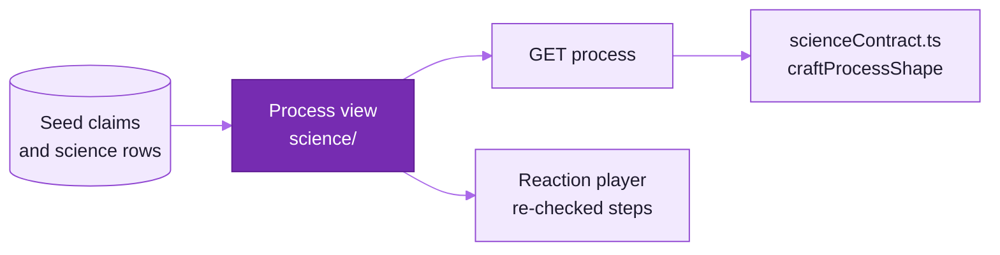

# Science: process stages and reactions

What `GET /api/crafts/{slug}/process` answers, and the rules every value in it follows: stages,
materials, conditions and reactions, each built from stored rows and shown at its evidence level.
Engineers changing the science engine, the reaction player or the client's process shapes read it.

| For | Read |
|---|---|
| The science engine | [decision 0015](../decisions/0015-science-engine.md) |
| Why the contract has this shape | [decision 0014](../decisions/0014-science-region-voice-media-contracts.md) |
| Reactions shared with the explainer's player | [decision 0042](../decisions/0042-phase-b-contract.md), [0045](../decisions/0045-reactions-materials-molecules.md) and [explainer.md](explainer.md) |
| The specification | `docs/PLAN.md` section 7; section 0 overrides it |



## Where the code is

The models are `backend/app/schemas/science.py`; the client's types and runtime shapes are
`frontend/lib/scienceContract.ts`; the golden answer is `shared/science.process.golden.json`
(Kutch Ajrakh, from the seeded GI Journal claims). Change the three together, with
`backend/tests/contracts/test_science_contract.py` and `frontend/e2e/contracts-unit.spec.ts`.
Design choices: decision 0014. PLAN 7 is the specification; PLAN 0 overrides it.
`ReactionSpecies`, `mhchem_equation`, `reaction_level` and the unbalanced cap live in
`backend/app/research/reactions.py` since decision 0042, shared with the explainer's reaction
player (`reactionSpeciesShape` on the client); the rules below are unchanged. The reaction
player's steps are this route's reaction views, in process order, and are re-checked against
these rows when built and reused (`science/reaction_player`, decision 0045).

Last reviewed: 2026-11-17 (decision 0042).

## Route

| Method | Path | Auth | Answer |
|---|---|---|---|
| GET | `/api/crafts/{slug}/process` | public (decision 0079) | `CraftProcess`; 404 `{detail}` for an unknown slug (`NOT_FOUND_DETAIL`); a `MERGED` slug answers with its target's process, as the profile does |

`Cache-Control: private, no-cache` with a token and `public, max-age=300` without, with
`Vary: Authorization` and an `ETag` of the body that a matching `If-None-Match` turns into a 304
(decision 0079). The body is built only from stored rows, quoting only chunks the reader may
read; no model is called while answering it.

## Shape

```
CraftProcess {schemaVersion: 1, craft: CraftRef, processes: ProcessView[], sources: SourceRef[]}
ProcessView {id, name, variant|null, stages: ProcessStageView[]}           stages by rising ordinal
ProcessStageView {id, ordinal, name, stageType, level, claims: CitedClaim[],
                  materials: StageMaterialView[], conditions: StageCondition[], reactions: ReactionView[]}
StageMaterialView {id, name, kind, role, quantityText|null, compound: CompoundRef|null, level, claims (>=1)}
CompoundRef {id, name, formula|null, pubchemCid|null}
StageCondition {id, label, quantity, unit, readings: ConditionReading[] (>=1), sourcesDiffer, level, claims (>=1)}
ConditionReading {claimId, min|null, max|null, stated, envelope: {status, min|null, max|null}}
ReactionView {id, kind, label, species: ReactionSpecies[] (>=2), balanced, equation|null, checkerVersion|null,
              conditions: StageCondition[], deltaH: {kjPerMol, claimId}|null, level, levelReason|null, claims (>=1)}
ReactionSpecies {role: REACTANT|PRODUCT, formula|null, name|null, coefficient|null, compoundId|null}
CitedClaim {id, text, level, citations: Citation[] (>=1)}
```

`CraftRef`, `Citation` and `SourceRef` are the answer stream's (`docs/contracts/research.md`).
Vocabulary: `stageType` is `StageType`, `kind` of a material `MaterialKind`, `role`
`MaterialRole`, reaction `kind` `ReactionKind` (all from `models/enums.py` through
`research/vocabulary.py`). `quantity` is one of `CONDITION_QUANTITIES`; `envelope.status` is
`WITHIN`, `OUTSIDE` or `NONE`.

## What is shown

- **Every item cites.** A material, condition or reaction is sent only with at least one
  `CitedClaim`, and a claim only with at least one visible citation. A stage is sent even
  without claims (its name and order come from the stored process) and then has `level`
  `UNAVAILABLE`, which the client draws as the "No source found" badge.
- **Visible claims** are those the profile shows: status not `DRAFT`, `REJECTED` or
  `RETRACTED`, sensitivity `OPEN`, cited by a source that is not `RESTRICTED`
  (`retrieval/statements.claim_conditions`, mode `HYBRID`). Hypotheses are shown with their
  label; nothing waits for review (PLAN 0).
- `ProcessStage.durationText`, `tempMinC`, `tempMaxC`, `phMin`, `phMax` and `medium` are not
  on the wire: a duration, temperature or pH appears only as a cited condition reading.
- Each citation names its claim and carries the claim's level (`CitedClaim` checks it).
- `sources` lists every cited source once, in the order of first citation, walking processes,
  stages, then each stage's claims, materials, conditions, reactions and reaction conditions
  (`process_claims`).

## Levels

- A claim's `level` is its stored `evidenceLevel`.
- A material's and a condition's `level` is the weakest of its claims (`weakest_level`).
- A stage's `level` is the weakest of its own claims, or `UNAVAILABLE` with none.
- A reaction's `level` is the weakest of its claims, then capped (below). `balanced` is a
  check result, never a level, and nothing derived is raised above its inputs (PLAN 1).

## Reactions (PLAN 7)

- **Species** are proposed by a model or a researcher. **Coefficients never come from a
  model.** The science engine computes them: the integer null space of the element matrix
  with `sympy` rationals; `balanced` is true only when that null space has one dimension and
  its smallest positive integer vector exists. Then every species has a formula and a
  coefficient, their greatest common divisor is 1, and `checkerVersion` names the checker.
- When `balanced` is false every `coefficient` is null.
- **Unbalanced equations are capped.** When every species has a formula but the reaction does
  not balance, its level is capped at `HYPOTHESIS` with `levelReason` `unbalanced`
  (`reaction_level`, `UNBALANCED_LEVEL_CAP`, `UNBALANCED_REASON`).
- **Species-only reactions.** When a species has no formula (an alizarin lake, whose
  stoichiometry varies), the reaction is species and conditions only: `equation` null,
  `balanced` false, no cap.
- `equation` is built by the server from the species (`mhchem_equation`):
  reactants, ` -> `, products, joined by ` + `, a coefficient written only when above 1
  (`Fe + 2 CH3COOH -> Fe(CH3COO)2 + H2`). It is null exactly when a species lacks a formula.
  The client renders it with KaTeX mhchem, `trust:false` (`frontend/lib/chemistry.ts`).
- `deltaH` is shown only when one of the reaction's claims cites it.

## Conditions and envelopes

- Values are normalised with pint into one unit per quantity (`CONDITION_UNITS`):
  `TEMPERATURE` °C, `PH` pH, `DURATION` h, `CONCENTRATION` g/L, `PRESSURE` kPa. `stated` is the
  phrase as the claim says it (`up to four hours`); `min`/`max` are the normalised bounds
  (an exact value has both equal; "up to" has only `max`).
- Each reading names the one claim it comes from, and that claim is in the condition's
  `claims`.
- **Envelope.** The stage-type envelopes live in `science/envelopes.py` (decision 0015) with
  PLAN 7's values: `DYE` 20-100 °C and pH 2-12, `MORDANT` 15-100 °C, `FIRE` 500-1300 °C,
  `CAST` 700-1200 °C. Each physical constant used there (quartz α→β 573 °C, kaolinite
  dehydroxylation 450-600 °C, water 100 °C at 1 atm, beeswax 62-64 °C, brass liquidus about
  900-940 °C) is its own cited claim. `envelope_status`: `NONE` when the stage type has no
  envelope for the quantity, else `OUTSIDE` when any stated bound falls below the envelope's
  minimum or above its maximum, else `WITHIN`. An `OUTSIDE` reading is shown with its status and
  listed in the review queue; it is never hidden (PLAN 0).
- **Sources differ** (`sources_differ`): readings are compared by their midpoint (or their one
  bound). Temperatures differ when two readings are more than 25 °C apart
  (`SOURCES_DIFFER_CELSIUS`); any other quantity when the gap exceeds 15 % of the larger value
  (`SOURCES_DIFFER_RELATIVE`). When they differ the client shows "Sources differ" with every
  reading and its citation.

## Where the values come from (decision 0015)

The route is `api/routes/crafts.py`; `services/craft_process.process_records` reads the rows
and `science/process_view.craft_process` builds the answer.

- Processes and stages: `Process`, `ProcessStage` of the craft (the seed has one
  `Seed process` per craft, its stages from the immersive stage concepts with an ordinal).
- Stage claims: visible claims whose subject is the stage's concept, if that concept is `OPEN`.
- Materials: `StageMaterial` joined to `Material` (and `Compound`); their claims are the
  `StageMaterial.claimId` claim and the visible claims on `Material.conceptId`. A material's
  `id` is its `StageMaterial` id. The seed makes one `Material` per material concept, and the
  stage's `USES` edge claim is its `StageMaterial.claimId`.
- Reactions: `Reaction` rows of the stage, by `ordinal` then `label`; `species` (a list of
  `{role, formula, name, compoundId}`) and `coefficients` from those columns; coefficients are
  read only when `balanced`, and only `science/reactions.check_reaction` writes them. A
  reaction's claims are the claims of its `ReactionCitation` rows, each shown with only those
  linked citations. `deltaH` is `deltaHKjMol` with `deltaHClaimId`, shown when that claim is.
- Conditions: `ProcessCondition` rows owned by the stage or the reaction (exactly one), with
  `key`, `label` and `quantity`; `id` is `<owner id>.<key>`. Each `ConditionReading` names one
  citation (`claimSourceId`), the stated phrase and the stated bounds and unit; the bounds are
  normalised with pint when the answer is built (`science/units.normalised_bounds`). A reading
  whose claim or citation is not visible is left out; a condition or reaction with nothing
  left is left out.
- Orders: claims by level (strongest first), then text, then id; a claim's citations quoted
  first, then by id (as the profile); readings by their claim's place, then the stated phrase;
  conditions by quantity (`CONDITION_QUANTITIES` order), label, key; materials by name.
- Envelopes and constants: `science/envelopes.py`; the constants are the claims
  `sci-constant-*` of `backend/app/data/science_seed.json`, each quoting a pinned Wikipedia
  revision. The cited source puts the start of kaolinite dehydroxylation at 550–600 °C, so
  that is the constant (PLAN 7 says 450–600 °C).

## How this document is kept true

| Claim | Kept true by |
|---|---|
| The golden answer and every rule above, with hand-worked values | `backend/tests/contracts/test_science_contract.py` |
| The client's shapes refuse unknown fields and values | `frontend/e2e/contracts-unit.spec.ts` |
| The producer builds and serves the golden answer | `backend/tests/science/test_process_view.py`, `test_process_route.py` and `backend/tests/db/test_craft_process_db.py` |
| Balancing, units, envelopes, the seed plan and the compound lookup | `backend/tests/science/` |

Re-read it when a stage, condition or reaction field changes, or a seeded constant is re-cited.

`backend/tests/contracts/test_science_contract.py` reproduces the golden file byte for byte from
the models and checks each rule above with hand-worked values (kaolinite dehydroxylation
`Al2Si2O5(OH)4 -> Al2Si2O7 + 2 H2O`, a doubled equation refused, 60 vs 90 °C differing and 60 vs
80 °C not, pH 4.0 vs 4.8 differing and 4.0 vs 4.6 not). `frontend/e2e/contracts-unit.spec.ts`
parses the same file with `craftProcessShape`, which refuses unknown fields and values.

The producer is checked on both sides of its seams: `backend/tests/science/test_process_view.py`
builds the golden answer from records made from the real seed claims and hand-written science
rows (`tests/science/golden_process.py`), `test_process_route.py` serves it through the route,
and `backend/tests/db/test_craft_process_db.py` (GitHub Actions) stores the same rows and reads
the golden file back from `GET /api/crafts/Kutch-Ajrakh/process`. Balancing, units, envelopes,
the seed plan and the compound lookup have their own tests with hand-derived values in
`backend/tests/science/`.
