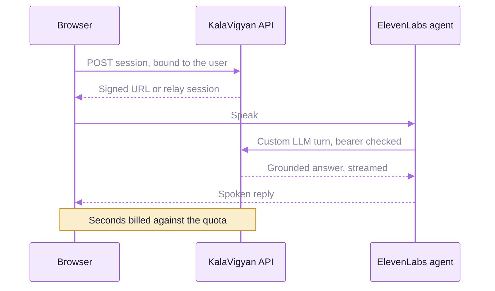

# Voice: sessions, the custom LLM and the relay path

How a two-way voice conversation is started, bound to one user, answered by our grounded
pipeline and billed, and how a finished explainer is read aloud (Listen). Engineers changing a
voice route, the custom LLM turn or the client's shapes read it.

| For | Read |
|---|---|
| Why the contract has this shape | [decision 0014](../decisions/0014-science-region-voice-media-contracts.md) |
| The voice backend and client lanes | [decision 0017](../decisions/0017-voice-backend.md) and [0020](../decisions/0020-voice-ui.md) |
| Why the call is switched off, and Listen | [decision 0035](../decisions/0035-listen-and-voice-switched-off.md) |
| Artisans' conversations on the same path | [roles-and-contributions.md](roles-and-contributions.md) |
| The specification | `docs/PLAN.md` section 10 |

## Where the code is

The models are `backend/app/schemas/voice.py` (sessions, transcript, client
tools, relay events) and `backend/app/schemas/voice_llm.py` (the OpenAI-compatible wire
ElevenLabs calls); the client's types and shapes are `frontend/lib/voiceContract.ts`. Golden
files: `shared/voice.availability.golden.json`, `voice.session-agent`, `voice.session-relay`,
`voice.session-ended`, `voice.transcript` (`.golden.json`), `voice.llm-request.golden.json`
(what ElevenLabs sends), `voice.llm.golden.sse` (what we stream back) and
`voice.turn.golden.sse` (the relay turn). PLAN 10 is the specification. Design choices:
decision 0014.

Last reviewed: 2026-11-17, against the ElevenLabs documentation of that day.

**The live call is switched off (owner, 2026-11-17; decision 0035).** `VOICE_CALL_ENABLED`
(`Settings.voice_call_enabled`, default false) guards every route under `/api/voice`: while it is
false each answers 404 before anything else is read, and `/answers/config` sends the hidden
`VoiceAvailability` (`configured` false), so no voice button is drawn. Nothing is deleted; the rest
of this page describes the call as it runs when the setting is true. Turning it on offers the Talk
dock (`components/voice/VoicePanel.tsx`), which no page mounts since the tabbed craft screen and its
Talk button were retired (round 6): the mic on `/ask` is dictation (decision 0036), and no call
starts from there. Listening to finished explainers is Listen, below.

**Session purpose (decision 0083).** `VoiceSession.purpose` is `ASK` for this call and `ARTISAN`
for an artisan's conversation about their craft (`docs/contracts/roles-and-contributions.md`
section 7). Artisan conversations reuse the session row, binding, relay rules, seconds ledger,
adapter and cipher, under their own switch `ARTISAN_CONVERSATION_ENABLED` and their own routes
under `/api/artisan`; neither switch turns the other on. Their agent is a second one
(`ELEVENLABS_ARTISAN_AGENT_ID`, `provision_voice_agent.py --artisan`), bound with the nonce
context `kalavigyan-artisan/v1`. The custom-LLM route below refuses an `ARTISAN` row, and the
artisan route refuses an `ASK` row, with the same 401. A conversation's transcript is kept on
`ArtisanConversation`, so `VoiceSession.transcriptEnc` stays null for it.

## ElevenLabs facts this contract rests on

Verified on the official documentation (2026-11-16):

| Fact | Source |
|---|---|
| `GET https://api.elevenlabs.io/v1/convai/conversation/token?agent_id=…` (optional `participant_name`, `branch_id`, `version_id`, `environment`) answers `{token, conversation_id}`: the server learns the conversation id before the browser connects | elevenlabs.io/docs/api-reference/conversations/get-webrtc-token |
| A custom LLM is `conversation_config.agent.prompt.custom_llm {url, model_id, api_key, request_headers, api_version, api_type}`; `api_key` is a workspace secret; `api_type` `chat_completions` is the default | elevenlabs.io/docs/api-reference/agents/create |
| The custom LLM receives an OpenAI chat completions body (`messages`, `model`, `temperature`, `max_tokens`, `stream`, `tools` for system tools, and `elevenlabs_extra_body` when the client sends one) and answers SSE `data: {chat.completion.chunk}` frames ending `data: [DONE]` | elevenlabs.io/docs/eleven-agents/customization/llm/custom-llm |
| `platform_settings.overrides.custom_llm_extra_body` (default false) decides whether the client's extra body is forwarded; `conversation_config_override` holds the other client overrides | agents/create |
| Clients may not send or override `system__` dynamic variables; `system__conversation_id` and `system__call_duration_secs` exist | elevenlabs.io/docs/eleven-agents/customization/personalization/dynamic-variables |
| `platform_settings.privacy {record_voice, retention_days, delete_transcript_and_pii, delete_audio, zero_retention_mode}`; `call_limits {agent_concurrency_limit, daily_limit}`; `conversation.max_duration_seconds` (default 600); `turn {turn_timeout, turn_eagerness, soft_timeout_config.timeout_seconds}` | agents/create |
| `GET /v1/convai/conversations/{conversation_id}` gives `status` and `metadata.call_duration_secs`; `DELETE /v1/convai/conversations/{conversation_id}` deletes it | api-reference/conversations/get, /delete |
| `end_call` takes `reason` (required) and `message` (optional) | eleven-agents/customization/tools/system-tools/end-call |
| Client tools are `{type: "client", name, description, parameters, expects_response}`; the browser registers handlers as `clientTools` (`@elevenlabs/react` `useConversation`, `startSession({conversationToken})` for WebRTC) | eleven-agents/customization/tools/client-tools, eleven-agents/libraries/react |
| Speech to text `POST /v1/speech-to-text` (multipart `model_id` such as `scribe_v2`, `file`, `language_code`, `keyterms`) answers `{language_code, language_probability, text, words[{text, start, end, type}]}` | api-reference/speech-to-text/convert |
| Text to speech `POST /v1/text-to-speech/{voice_id}/stream` (`text`, `model_id`, `language_code`; `output_format` default `mp3_44100_128`); `enable_logging=false` (zero retention) is for enterprise customers only | api-reference/text-to-speech/stream |
| Text to speech with timings `POST /v1/text-to-speech/{voice_id}/with-timestamps` (`text`, `model_id`, `language_code`, `previous_text`, `next_text`; `output_format` default `mp3_44100_128`) answers `{audio_base64, alignment {characters, character_start_times_seconds, character_end_times_seconds}, normalized_alignment}`; `alignment` covers the text as sent (2026-11-17) | api-reference/text-to-speech/convert-with-timestamps |
| `eleven_v4` is the narration model ("audiobooks & video narration"), at most 10,000 characters a generation; the v4 family speaks all thirteen answer languages (2026-11-17) | overview/models, elevenlabs.io/v4 |
| Speech to text `language_code` takes ISO 639-1 or ISO 639-3; the Scribe v3 language list names English, Hindi, Bengali, Tamil, Telugu, Marathi, Gujarati, Kannada, Malayalam, Odia, Punjabi, Assamese and Urdu (`eng` ... `urd`); Eleven v4 Turbo lists the same thirteen and takes their ISO 639-1 codes as `language_code` (decision 0025) | api-reference/speech-to-text/convert, overview/capabilities/speech-to-text, overview/models |

**Unverified** (the P1a spike of PLAN 10.1, run by lane 0017 on GitHub Actions, settles each one
and records the captured requests in decision 0017):

1. That `custom_llm.request_headers` values substitute `{{system__conversation_id}}` on every
   request (documented for tool headers; a third-party gateway guide says it works for custom
   LLM headers).
2. Whether ElevenLabs appends `/chat/completions` to `custom_llm.url` or calls it as given.
3. That ElevenLabs sends `custom_llm.api_key` as `Authorization: Bearer <key>` (third-party
   guides say so; the official page only says the key is a secret).
4. That a custom LLM's `tool_calls` reach `end_call` and the client tools.
5. That a reply may stream text and then a tool call in the same response.
6. Speech in and out of an agent in each offered language (how a session's language reaches the
   agent, decision 0025), and keyterm support in agents.
7. The WebRTC and WebSocket hosts for the CSP `connect-src`. Client side, settled by lane 0020
   from the pinned SDK (`@elevenlabs/client` 1.36.1, `livekit-client` 2.24.1): a token session
   connects only to `wss://livekit.rtc.elevenlabs.io` and checks it over
   `https://livekit.rtc.elevenlabs.io`; both are in the CSP (`frontend/next.config.ts`). The
   spike still confirms the media path.
8. Which `retention_days` minimum and `record_voice=false` the bought plan allows.

## Transport

`VoiceAvailability.transport` is `AGENT` (ElevenAgents with our custom LLM) or `RELAY` (speech to
text, our text pipeline, text to speech through the ElevenLabs APIs, PLAN 10.1). The owner sets
`AppSetting` `voice.transport` after the spike; the default is `RELAY`, because it needs nothing
unproven. `AGENT` is allowed only when unverified items 1 and 3 hold: the custom-LLM request
carries the ElevenLabs conversation id in a header the browser cannot set, and our bearer.

## Routes

ElevenLabs calls the custom LLM at the CloudFront origin (`NEXT_PUBLIC_API_URL`), not through
the web proxy. CloudFront's default behaviour forwards every path with caching off, nginx sends
`location /` to uvicorn with buffering off, and the app mounts everything under `/api`; so the
voice routes live under `/api/voice/` (checked by `test_voice_contract.py`).

| Method | Path | Who | Answer |
|---|---|---|---|
| GET | `/api/answers/config` | signed in | its `voice` block is `VoiceAvailability`; its `languages` are `{code, label, autonym, script, direction}`, the voice languages (decision 0025) |
| GET | `/api/voice/notice` | signed in | `{version, title, body (Markdown), publishedAt}`, the voice notice |
| POST | `/api/voice/session` | `VOICE` | body `VoiceSessionRequest {craftSlug?, mode (VERIFIED, HYBRID), language}`; 201 `VoiceSessionStarted` |
| POST | `/api/voice/session/{id}/end` | its user | `VoiceSessionEnded`; ending twice answers the same |
| GET | `/api/voice/session/{id}/transcript` | its user | `VoiceTranscript` until `retentionUntil`, then 404 |
| POST | `/api/voice/llm/v1/chat/completions` | ElevenLabs (bearer) | `text/event-stream` of `LlmChunk` frames and `data: [DONE]` |
| POST | `/api/voice/session/{id}/turns` | its user, `RELAY`; 40 per 10 min (429 + `Retry-After`) | multipart `audio`, one of `RELAY_AUDIO_TYPES`: WebM, Ogg and MP4 at most `RELAY_MAX_AUDIO_BYTES` (300 000 bytes, a minute at `RELAY_AUDIO_BITS_PER_SECOND` 32 kbit/s with a quarter's headroom) that decode to at most a minute, WAV uncompressed PCM of at most `RELAY_MAX_TURN_SECONDS` (60 s) by its own sample rate, channels and sample size and at most `RELAY_MAX_WAV_BYTES` (4 MiB); larger 413, unreadable WAV 400; `text/event-stream` of relay events |
| GET | `/api/voice/session/{id}/turns/{turnId}/speech` | its user, `RELAY`; 60 per 10 min (429 + `Retry-After`) | `audio/mpeg` (`mp3_44100_128`); only while the call is live or for `SPEECH_GRACE` (2 minutes) after it ended, else 410; 429 when no seconds are left today |

### Starting a session

`POST /api/voice/session` checks, in this order, and refuses with the first that fails:

| Check | Status |
|---|---|
| signed in | 401 |
| at most 10 starts by this user in 10 minutes (`core/rate_limit.voice_session_attempt`) | 429 with `Retry-After` |
| `VOICE` capability; a verified email (`emailVerifiedAt`) | 403 with a sentence |
| a `VOICE_NOTICE` consent for the current notice version (`POST /api/auth/consent`) | 403 with `X-Voice-Consent-Required: <version>` |
| `language` is a voice language (`VOICE_LANGUAGES`) | 400 with a sentence |
| `craftSlug` resolves (merged slugs follow their target) | 404 |
| voice is configured (keys, agent, ElevenLabs reachable) | 503 |
| no session of this user still holds its slot: open until it ends, and an `AGENT` call also until it is reconciled or `START_WINDOW_SECONDS` plus `MAX_SESSION_SECONDS` (12 minutes) after its start (`VoiceSession_one_live_per_user_key` for open rows); the user's ended agent calls are reconciled first, as they are whenever the availability is read | 409 with a sentence |
| at least `MIN_START_SECONDS` (30) of the day's `VOICE_SECONDS` left | 429 with `Retry-After` until midnight IST |
| global live sessions below the plan's concurrent limit | 503 with `Retry-After: 30` |

`maxDurationSeconds` is the smaller of `MAX_SESSION_SECONDS` (600, the agent's
`max_duration_seconds`) and the seconds left today; `maxTurns` is `MAX_TURNS` (40); `expiresAt`
is when the session may last start. The client shows the voice button only when
`VoiceAvailability.configured` is true, and the consent step when `consentRequired`.

### Session binding (`AGENT`)

1. The server creates the `VoiceSession` row (user, craft, mode, language) and fetches
   `GET /v1/convai/conversation/token?agent_id=<ELEVENLABS_AGENT_ID>` with `xi-api-key`. It
   stores the answer's `conversation_id` as `VoiceSession.elConversationId`.
2. It computes the binding nonce `kvs1.<voiceSessionId>.<exp>.<mac>`, where `mac` is the
   base64url HMAC-SHA256 under `VOICE_SESSION_HMAC_KEY` of `kalavigyan-voice/v1`, the user id,
   the session id, the conversation id and `exp` joined by U+001F, and stores its SHA-256 hex as
   `nonceHash`. The nonce never leaves the server; `exp` is `expiresAt` plus
   `maxDurationSeconds`.
3. The browser receives `AgentSessionStarted`: the conversation token and the session's
   non-secret facts, never the nonce or the conversation id. It calls `startSession`
   with the token over WebRTC.
4. The agent is configured once (lane 0017, recorded with ids in `docs/RUNBOOK.md`): private (a
   token is required), `custom_llm.url` our route, `custom_llm.api_key` a workspace secret
   holding `VOICE_LLM_BEARER`, `custom_llm.request_headers`
   `{"X-KV-Conversation-Id": "{{system__conversation_id}}"}` (`CONVERSATION_HEADER`), every client
   override off including `custom_llm_extra_body`.
5. On every custom-LLM request the server requires, in constant time, the bearer
   `VOICE_LLM_BEARER`; then finds the live session whose `elConversationId` equals the header;
   then recomputes the nonce from that row and compares its hash with `nonceHash`; then checks
   `exp` and that the session has not ended or passed `MAX_TURNS`. Any failure is 401 with one
   `LlmError` (`code` `unauthorized`) and the same message, whichever check failed. User, role,
   mode, craft and language come only from the row. `elevenlabs_extra_body` and dynamic
   variables are never read (`LlmChatRequest` ignores unknown fields).
6. Ending the session sets `endedAt` and clears `nonceHash`, so any later request is 401.

Tests (lane 0017): a forged conversation id, a forged or altered row, an ended session and a
missing bearer each get 401.

### The custom LLM turn

- Request: `LlmChatRequest {model, messages (system, user, assistant, tool), stream: true,
  temperature?, max_tokens?, tools[]}`; anything else is ignored. A request that does not stream,
  or carries no user message, is 400 (`bad_request`).
- Pipeline (PLAN 10.3): the session's claim pack, prefetched at session start (T0 and T1 for the
  craft) plus T2, read and kept per reader access (`VoicePackStore.get(craft, mode, acls, load)`,
  `chunk_acls_for(role)`), so a student's turn cites a researcher-only page without its words
  (decision 0149); no planner, no craft match when the session has a craft, no live web; one
  `VOICE_TURN` call through the AI router as the session's user; the per-sentence claim-id and
  figure checks of the composer before anything streams.
- Reply: `LlmChunk {id: "chatcmpl-<turn id hex>", object: "chat.completion.chunk", created,
  model: "kalavigyan-voice", choices: [{index: 0, delta, finish_reason}]}` frames
  (`llm_frame`), the first delta with `role: "assistant"`, then content, then an empty delta with
  `finish_reason: "stop"`, then `DONE_FRAME`. At most `MAX_SPOKEN_WORDS` (60) words: the checked
  sentences word for word, then short spoken source labels. When retrieval passes 700 ms a filler
  phrase ending `... ` streams first; the latency gate measures the first real sentence.
- Every spoken turn is an `Answer` row (channel `VOICE`) with its cited sentences, so the on-screen
  transcript links the same citations. Its `question` holds no words of the user (they are only
  in the encrypted transcript).
- When the day's seconds run out or `MAX_TURNS` is reached, the reply is one tool call
  `end_call` with `{"reason": ..., "message": ...}` and `finish_reason: "tool_calls"`
  (unverified item 4).
- Failures after the stream started are one `llm_error_frame` then `DONE_FRAME`.

### Client tools

`show_on_map {craftSlug}`, `open_stage {stageId}`, `show_sources {answerId}`, `offer_image
{stageId}` (`ClientToolCall`, `CLIENT_TOOL_NAMES`; parameter names in camelCase). The server
decides them from the turn's result, never from model text. The browser re-validates each
against what it already holds (the session's craft, stages it fetched, answers in its
transcript) and ignores anything else; `offer_image` only reveals the image button when
`GET /api/media/options` offers that stage. The same calls are listed as `actions` in each
transcript turn, which the browser reads when the agent cannot forward a tool call
(unverified item 4). System tools: `end_call`, `language_detection`, `skip_turn`. Agent turn
settings (PLAN 10.4): `turn_eagerness` `normal`, soft timeout 3.0 s, interruptions on,
`turn_timeout` 10, `max_duration_seconds` 600.

The browser (lane 0020, `frontend/lib/voiceCall.ts`) applies a call only after it parses
(`clientToolCallShape`) and is held: `show_on_map` for the session's craft, `open_stage` for a
stage the page drew, `show_sources` for an answer in the transcript, `offer_image` for a drawn
stage that `GET /api/media/options` offers an image. In `AGENT` a call applied from the SDK is
not applied again from the transcript's `actions`; in `RELAY` a turn's actions are applied at its
`done`. The SDK is given the conversation token and the client tools only: no overrides, dynamic
variables, extra body or user id.

### Relay turns (`RELAY`)

Before speech to text the turn is claimed in one transaction under the session row's lock: the
session must be live and below `MAX_TURNS`, the day must have at least the upload's floor left
(else `error` "Not enough voice time is left today." and nothing is billed), the claim holds
`RELAY_MAX_TURN_SECONDS` (or what is left today, if less) under `voice:<sessionId>:<turnId>` and
counts one of the 40 turns. So every upload, heard or not, takes a turn, and parallel uploads
each hold their own minute. After speech to text the turn keeps the larger of the floor and the
heard seconds (the last word's end) and writes the rest back as `voice-refund:<sessionId>:<turnId>`.
The floor is the recording's length rounded up, at least 1 s: a WAV's from its header, any other
upload's as `ffmpeg` decodes it (`voice/audio_decode.py`, the last `out_time_us` of its progress),
so an upload encoded below the asked bit rate that decodes past `RELAY_MAX_TURN_SECONDS` is refused
413 before speech to text is paid; an upload `ffmpeg` cannot decode is refused 400, and a machine
without `ffmpeg` answers 503 (decision 0140). The form is read by `python-multipart` through
Starlette's parser, with the body cut off at its limit as it streams (`api/multipart_form.read_form`).

`POST /api/voice/session/{id}/turns` streams, in order: `heard {text, language}` (the speech to
text result, scrubbed), `status` steps, `source` before the first citation of it, `sentence
{sentence}` for each checked sentence, `action` for each client tool, `spoken {text,
speechPath}` and `done {turnId, answerId, billedSeconds, remainingSeconds, sessionEnded}`; or
`error {message}` then `done`. Frames are built by `relay_frame`, which refuses a payload off
the contract. The client fetches `speechPath` for the audio. The browser uploads the first of
`audioTypes` it can record, labelled with the bare type, named
`KalaVigyan_Voice-Session_<date>_<HHMM>_<Craft>_Recording.<ext>` (`frontend/lib/voiceDevice.ts`),
recorded at the session's `audioBitsPerSecond` and sent as soon as it reaches nine tenths of
`maxAudioBytes` or `maxTurnSeconds`, whichever comes first.

## Quota in seconds

- `VOICE_SECONDS` per day by role (`QuotaPolicy.perDay` through `core/daily_allowances`, set on
  the AI budget screen, decision 0146): unlimited for every role for
  now (decision 0093), so `remainingSeconds` is `null` and no call, turn or Listen press is refused
  for time; the seconds are still written to `QuotaLedger` on Asia/Kolkata days and shown on Usage.
  A table set again there (PLAN 12 had student 600, researcher and professor 1800) is enforced by
  the same code.
- `AGENT`: when the token is minted the session holds its whole `maxDurationSeconds` in
  `QuotaLedger` under `voice:<sessionId>:hold`; custom-LLM turns write nothing more. Reconciliation
  (the daily upkeep, and the user's next start) reads `metadata.call_duration_secs` and settles both
  ways: one `voice-refund:<sessionId>` row for any surplus, one `voice-settle:<sessionId>` row for
  time past the hold (a call left connected after its row ended), each dated to the call's start so
  it counts on the call's day, not the day it is written (decision 0140); `billedSeconds` is then set. The
  call ends at its `maxDurationSeconds` with `end_call` (`quota` when the day's seconds cut it
  short, else `turns`) or at `MAX_TURNS`.
- `RELAY`: a turn bills its audio as above (the hold, then the refund) plus the reply audio's
  seconds (bytes at 128 kbit/s, rounded up) under `voice:<sessionId>:<turnId>:speech`. The reply
  audio is kept in the media bucket at `media/voice-replies/<sessionId>/<turnId>/reply.mp3` for a
  day (decision 0140), so the speech route of any API process plays it free; only a reply whose
  audio was never kept (its text to speech or its store failed) is synthesised again, billed under
  `voice:<sessionId>:<turnId>:speech:<replay id>`, capped at what is left today.
- Exhaustion mid-call ends it (`end_call`, or `sessionEnded` in relay); a new session needs 30 s.

## Consent, retention and privacy

- The voice notice is accepted once per version (`ConsentRecord` `VOICE_NOTICE`).
- The transcript (what was heard and what was said) is stored only in
  `VoiceSession.transcriptEnc`, Fernet under `TRANSCRIPT_ENCRYPTION_KEY`, with email addresses
  and phone numbers removed before storage; `retentionUntil` is the end plus
  `TRANSCRIPT_RETENTION_DAYS` (30); the worker purges it then. It never enters logs,
  `AnswerTrace` or eval fixtures.
- ElevenLabs side: `record_voice` false and the shortest `retention_days` the plan allows
  (unverified item 8); after reconciling the call the worker deletes the conversation
  (`DELETE /v1/convai/conversations/{id}`). Text to speech with zero retention is enterprise
  only, so relay speech is subject to ElevenLabs' default logging (debt register).
- ElevenLabs unreachable: the voice button is hidden; reading aloud uses the Gemini voice
  (`gemini-3.8-flash-tts`, PLAN 10.6).

## Languages

A voice language is an answer language (decision 0023) that both `scribe_v3` and
`eleven_v4_turbo` support: `voice/languages.VOICE_LANGUAGES`, derived from the tables in
`providers/elevenlabs.py` (`STT_LANGUAGE_CODES`, `TTS_LANGUAGES`), today all thirteen
(decision 0025). `VoiceAvailability.languages` lists them as `{code, label, autonym, script,
direction}`, the shape of the answer languages, and the client offers only those. A session in
another language is 400 (`language`).

A turn renders a question not in Latin script in English for ranking
(`answer_translation.english_question`), ranks the pack's claims by the stored hybrid search
first (lexical, vector and entity rankings fused, the question embedded while the filler plays; a
claim the pack does not hold is dropped) and by shared word stems after, falling back to the words
alone when the search fails (decision 0140). A `HYBRID` turn asks the same search for stored
passages under its reader's access (`chunk_acls_for(role)`: a `RESEARCHER` passage only for a
reader who may read researchers' quotes) and offers at most `PACK_PASSAGES` (3) of those long
enough to quote as `EVIDENCE` candidates in their own words beside the ranked claims, screened as an
answer's passages are (one naming another craft or a place abroad, and not the craft asked, is not
offered). A sentence citing a passage is written back before it is spoken
(`voice/passage_store.SqlTurnPassages`, `store_live_research` with `foundBy` `VOICE`, filed under
the concept of the first ranked claim, through the same filing and gates as an answer's): it is
spoken citing the fact written for it, and a sentence whose passage is refused, held or not written
in time is not spoken (decision 0144). A `VERIFIED` turn reads no passage. The turn then composes
and checks in English, picks what fits 60 English words, translates those sentences with `translated_sentences` (cache, number, formula, unit and script
checks), and caps the spoken text at 60 words in the session language. Source labels stay names; the
word before them is in the session language. A sentence whose translation fails twice is left out;
when none translates the reply is `UNSAID_REPLIES` and the turn has no answer. Speech to text gets
the session's Scribe code and speech its ISO 639-1 code. Every fixed phrase (filler, refusals,
`end_call` messages) comes from `voice/phrases.py` in the session language. Translation runs within
the call's hard end.

## Built by lane 0017 (decision 0017)

- Code: `backend/app/voice/` (sessions, binding, turns, relay, transcript, upkeep, agent body),
  `backend/app/providers/elevenlabs.py` (the one ElevenLabs adapter), `backend/app/providers/quota.py`
  (the ledger), `backend/app/api/routes/voice.py`. `GET /api/answers/config` sends `VoiceAvailability`.
- `AppSetting` keys: `voice.transport` (`RELAY` by default), `voice.max_live_sessions` (5, 0 to
  100), `voice.voice_id` (the relay voice, letters and digits), set by a Master Admin through
  `GET`/`PUT /api/settings/voice` (`VoiceSettingsUpdate`; `{transport, maxLiveSessions, voiceId,
  defaults}`; decision 0140). `expiresAt` is the start plus `START_WINDOW_SECONDS` (120).
- Relay ledger keys: `voice:<sessionId>:<turnId>` (the turn's hold), `voice-refund:<sessionId>:<turnId>`
  (its unheard part), `voice:<sessionId>:<turnId>:speech` (reply audio) and
  `voice:<sessionId>:<turnId>:speech:<replay id>` (each synthesis the speech route makes again);
  agent keys `voice:<sessionId>:hold`, `voice-refund:<sessionId>` and `voice-settle:<sessionId>`
  (decision 0022).
- Client tools reach the browser through the transcript's `actions` only; the agent stream carries
  text or one `end_call` until unverified item 5 is settled.
- Voice offers every answer language both ElevenLabs models support (decision 0025); the agent
  lists them as `language_presets` (not provisioned).
- The agent's `custom_llm.url` is `<PUBLIC_API_URL>/api/voice/llm/v1` (unverified item 2); the
  bearer is the workspace secret `KALAVIGYAN_VOICE_LLM_BEARER` (`provision_voice_agent.py`).

## Listen (decision 0035)

`GET /api/answers/{answerId}/listen?language=&section=` (the `VOICE` capability; 30 in 10 minutes,
Master Admin unlimited) reads aloud the reader's own explainer (`Answer.payload.explainer`, the `Explainer`
document), or one section of it, through `ElevenLabs.narration` (`eleven_v4`, character timings).

| Rule | Value |
|---|---|
| What is read | the whole answer opens with its lede (block `lede`), then each section's blocks; one section reads only its own; each block's cited sentences in reading order (prose, a ladder's stage sentences) except a hypothesis, which only the page shows with its Hypothesis badge (decision 0140); pictures, titles and labels are not read; a translated sentence in the explainer's language, an untranslated one in English, one request per language |
| Parts | whole sentences, at most `PART_CHARACTERS` (2,000) characters and one language each; neighbours' text as `previous_text` and `next_text`; one track per part |
| Words | runs of non-space characters of a sentence; `start` the first character's start, `end` the last character's end, seconds to the millisecond, never earlier than the previous word |
| One maker | a request that misses a block puts `media/narration/<cacheId>/lease.json` (`NarrationLease {schemaVersion 1, cacheId, takenAt}`) only where none is (`If-None-Match: *`); a second request that finds a live lease holds no seconds and polls for the manifest each second until the lease lapses at 120 s, then makes the block itself, taking the lapsed lease over; the maker deletes the lease once the manifest is stored or the making fails (decision 0140) |
| Cache | per block: SHA-256 of `kalavigyan-narration`, `NARRATION_VERSION` (2 since hypotheses left Listen), voice id, explainer language and piece content hash (U+001F between); parts at `media/narration/<cacheId>/KalaVigyan_Explainer_<date>_<HHMM>_Narration_Part-NN.mp3`, then `narration.json` (the `NarrationManifest`) last; presigned GET links of 3,600 s |
| Seconds | a cache hit is free; misses hold `ceil(characters × 60 / 1000)` `VOICE_SECONDS` under `listen:<requestId>:hold` (429 + `Retry-After` until midnight IST when less is left), then `listen-refund:<requestId>` or `listen-settle:<requestId>` settle to the audio (bytes at 128 kbit/s); Master Admin never refused |
| Answers | 200 `ListenScript {schemaVersion 1, answerId, language, tracks[{blockId, audioUrl, durationSeconds, words[{sentenceId, text, start, end}]}]}` (`schemas/listen.py`, `shared/listen.script.golden.json`, `frontend/lib/listen.ts`); 404 another reader's answer, no explainer, another language or nothing to read; 422 a malformed `language` or `section`; 503 the bucket, key or ElevenLabs failing |

`/answers/config` carries `listen {languages}`: the answer languages the narration model speaks when
the bucket, the key and ElevenLabs answer, else `[]`, and the client draws no Listen control.

Film mode (decision 0054, `docs/contracts/explainer.md`) plays the same script: its scenes are
timed by these tracks and captioned with these words; its optional score is ElevenLabs music and
sound effects through the media router (`docs/contracts/media.md`), not narration seconds.

## Secrets (names only)

`ELEVENLABS_API_KEY`, `ELEVENLABS_AGENT_ID`, `ELEVENLABS_ARTISAN_AGENT_ID` (decision 0083),
`VOICE_LLM_BEARER` (rotated quarterly), `VOICE_SESSION_HMAC_KEY`, `TRANSCRIPT_ENCRYPTION_KEY`; each
in GitHub Actions secrets and the box `.env` (PLAN 15).

## How this document is kept true

| Claim | Kept true by |
|---|---|
| Every shape against its golden (`shared/voice.*`) | `backend/tests/contracts/test_voice_contract.py` and `frontend/e2e/contracts-unit.spec.ts` |
| Starting a session, its checks in order and the switch | `backend/tests/voice/test_sessions.py` and `test_voice_routes.py` |
| Session binding and the custom LLM turn | `backend/tests/voice/test_binding.py`, `test_agent_turn.py` and `test_llm_stream.py` |
| Relay turns and their audio | `backend/tests/voice/test_relay.py`, `test_turns.py` and `test_audio.py` |
| Passages a hybrid turn offers, under its reader's access, and writes back before it speaks them | `backend/tests/voice/test_turn_passages.py` and `backend/tests/db/test_stored_passages_db.py` |
| Quota, consent, retention and languages | `backend/tests/voice/test_privacy.py`, `test_upkeep.py`, `test_languages.py` and `test_turn_languages.py` |
| Listen and the film's score | `backend/tests/voice/test_listen.py`, `test_listen_routes.py`, `test_narration.py`, `test_film_score.py` and `test_film_routes.py` |
| The store on Postgres | `backend/tests/db/test_voice_store_db.py` and `test_listen_db.py` |

Re-read it against ElevenLabs' documentation before the call is switched on, and when a voice route, the quota or a language changes.
