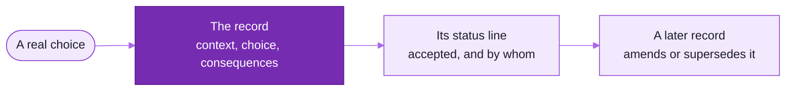

# Decisions

The decision log: one short record per choice between real alternatives, numbered in the order it was
taken, each with its context, the choice and what follows from it. Each record opens with what was
decided and a table that links what it superseded, amended or built on and what later did the same
to it, both ways; it closes with how it is kept true. Read the record before changing what it
decided, and write a new record rather than rewriting an accepted one. Engineers, reviewers and the
lead read them.

| For | Read |
|---|---|
| The interfaces these decisions shaped | [contracts/README.md](../contracts/README.md) |
| How the pieces fit today | [ARCHITECTURE.md](../ARCHITECTURE.md) |
| The plan the decisions carry out | [PLAN.md](../PLAN.md) |
| What was knowingly left below standard | [TECH_DEBT.md](../TECH_DEBT.md) |
| Every other document | [docs/README.md](../README.md) |

## Foundation, sources and the answer stream

| Decision | What was decided | Later changed by |
|---|---|---|
| [0001](0001-adopt-practice-skills.md) | Adopt the practice skills and an automated hygiene check | [0139](0139-sources-and-providers-reach-outside-services-once.md) |
| [0002](0002-research-and-answering-contracts.md) | One contract package for research and answering | · |
| [0003](0003-portal-craft-sync.md) | Crafts from both portals, synced through a new peer route | · |
| [0004](0004-craft-resolver.md) | The craft resolver | · |
| [0005](0005-scholarly-source-adapters.md) | Scholarly source adapters | · |
| [0006](0006-reference-source-adapters.md) | Reference source adapters: Wikipedia, Wikidata, PubChem, Wikimedia Commons | · |
| [0007](0007-web-search-and-fetcher.md) | Web search adapters and the fetcher sandbox | · |
| [0008](0008-stored-knowledge-retrieval.md) | Stored-knowledge retrieval | · |
| [0009](0009-planner-and-tiered-research.md) | Planner and tiered research | · |
| [0010](0010-composer.md) | Composer | [0138](0138-answers-composed-from-the-asked-fields.md) |
| [0011](0011-claim-write-back-and-coverage-enrichment.md) | Claim write-back and the coverage enrichment job | · |
| [0012](0012-answer-stream-end-to-end.md) | The answer stream end to end | · |
| [0013](0013-review-fixes-quotes-licences-scope.md) | Quote strength, open licences, one craft scope and scoped embedding | · |
| [0014](0014-science-region-voice-media-contracts.md) | Contracts for process science, region profile, voice and media | · |
| [0015](0015-science-engine.md) | Science engine: balancing, units, envelopes, the science seed and the process route | · |
| [0016](0016-region-profile.md) | Region profile and map layers from the stored district statistics | · |
| [0017](0017-voice-backend.md) | Voice backend: sessions, the custom LLM, the relay path and upkeep | [0025](0025-multilingual-voice.md) and [0140](0140-voice-and-listen-kept-true.md) |
| [0018](0018-media-backend.md) | Media backend: stage illustrations and clips through the router, the job queue and S3 | · |
| [0019](0019-craft-page-and-region-panel.md) | Craft page process timeline, region panel and map choropleths | [0092](0092-design-system.md) |
| [0020](0020-voice-ui.md) | Voice UI: the voice dock on /ask and the craft page | [0140](0140-voice-and-listen-kept-true.md) |
| [0021](0021-media-ui.md) | Media UI: Image and Video on the craft page's process stages | [0092](0092-design-system.md) |
| [0022](0022-batch-3-review-fixes.md) | Voice spend fails closed, a filtered style hint, region sources and one home per rule | · |
| [0023](0023-multilingual-answers.md) | Answers in Indian languages | [0117](0117-pages-in-other-languages.md) |
| [0024](0024-admin-role.md) | Admin role | · |
| [0025](0025-multilingual-voice.md) | Voice in every answer language | · |
| [0026](0026-yahoo-sign-in.md) | Yahoo sign-in (and Microsoft, off): DR's OpenID Connect module, ported | · |
| [0027](0027-geo-etl-state-gaps.md) | Geo ETL: district shapes are polygons only, and a part that loses a state fails | · |
| [0028](0028-first-password-provider-proof.md) | A first password needs a fresh provider proof: DR's rule, ported | · |
| [0029](0029-e2e-production-run.md) | E2E against production, on dispatch, as one Researcher account | · |

## The answer experience, phases A to D

| Decision | What was decided | Later changed by |
|---|---|---|
| [0030](0030-explainer-contract.md) | The explainer contract | · |
| [0031](0031-understanding-and-depth.md) | Understanding the question, and depth by role | [0093](0093-no-caps-for-now.md) |
| [0032](0032-sectioned-composition.md) | Sectioned composition: research per field, blocks per section | [0138](0138-answers-composed-from-the-asked-fields.md) |
| [0033](0033-knowledge-pieces-and-reuse.md) | Stored knowledge pieces and reuse | [0096](0096-reader-question-pieces-join-their-craft-page.md) |
| [0034](0034-images-and-terms.md) | Pictures and tappable terms | · |
| [0035](0035-listen-and-voice-switched-off.md) | Listen, and the live voice call switched off | [0140](0140-voice-and-listen-kept-true.md) |
| [0036](0036-asking-screen.md) | The asking screen: dictation, an optional craft, depth by role | · |
| [0037](0037-explainer-ui.md) | The explainer view | [0140](0140-voice-and-listen-kept-true.md) |
| [0038](0038-phase-a-review-fixes.md) | Phase A review fixes | · |
| [0039](0039-pictures-and-terms-wired.md) | Pictures and terms in the answer stream | · |
| [0040](0040-no-connection-held-across-a-model-call.md) | No connection held across a model call | · |
| [0041](0041-one-gemini-content-per-embedded-text.md) | One Gemini content per embedded text | · |
| [0042](0042-phase-b-contract.md) | Phase B contract: place, matter and the expert panel | · |
| [0043](0043-river-lines-tracer-and-monthly-rain.md) | River lines, the tracer and monthly rainfall | · |
| [0044](0044-region-story-and-map-layers.md) | Region story and map layers | · |
| [0045](0045-reactions-materials-molecules.md) | Reaction player, material cards and 3D molecules | · |
| [0046](0046-expert-panel.md) | The expert panel | [0093](0093-no-caps-for-now.md) |
| [0047](0047-seasons-and-supply.md) | Seasons and supply | · |
| [0048](0048-place-renderers.md) | Place renderers: region story, map layer, seasons and supply | [0092](0092-design-system.md) |
| [0049](0049-matter-and-expert-renderers.md) | Matter and expert renderers | · |
| [0050](0050-phase-b-review-fixes.md) | Phase B review fixes | · |
| [0051](0051-curation-tooling.md) | Curation tooling: the dossier model, fetch, verify and check | · |
| [0052](0052-opus-composes-at-medium-effort.md) | Opus 5.5 composes answers, at medium effort | · |
| [0053](0053-curated-dossier-import.md) | Curated dossiers are imported on deploy and served as one craft page | · |
| [0054](0054-phase-c-contract.md) | Phase C contract: generated explainers, the what-if lab, zoom, timelines and film mode | · |
| [0055](0055-generated-explainers.md) | Generated explainers: built from cited figures, checked, stored, reused and hidden | · |
| [0056](0056-what-if-lab.md) | The what-if lab's builder | [0140](0140-voice-and-listen-kept-true.md) |
| [0057](0057-zoom-story-and-timeline-map.md) | Zoom story and timeline map builders | · |
| [0058](0058-elevenlabs-music-sound-image-video.md) | ElevenLabs music, sound effects, image and video | · |
| [0059](0059-sandbox-and-what-if-renderers.md) | Sandbox and what-if renderers | · |
| [0060](0060-zoom-timeline-and-film-renderers.md) | Zoom, timeline and film mode renderers | · |
| [0061](0061-phase-c-review-fixes.md) | Phase C review fixes | · |
| [0062](0062-phase-d-contract.md) | Phase D contract: learning blocks, versions, alerts, lessons, exports and the map | [0067](0067-lessons-and-exports.md) |
| [0063](0063-follow-ups-versions-and-alerts.md) | Follow-ups that build, version history, saved explainers and alerts | [0070](0070-phase-d-review-fixes.md) |
| [0064](0064-quiz-compare-and-shared-science.md) | Quiz, compare and the shared-science explorer | [0070](0070-phase-d-review-fixes.md) |
| [0065](0065-climate-risk-and-ask-the-map.md) | Climate and risk, and ask the map | · |
| [0066](0066-local-measures-and-market-gi.md) | Local measures, and market and GI | [0070](0070-phase-d-review-fixes.md) |
| [0067](0067-lessons-and-exports.md) | Lesson packs, the explainer PDF and citation export | [0070](0070-phase-d-review-fixes.md) |
| [0068](0068-learning-block-renderers.md) | Learning block renderers | · |
| [0069](0069-learning-screens.md) | Learning screens: follow-ups, saved answers, notes, lessons, exports, the map and compare | [0070](0070-phase-d-review-fixes.md), [0067](0067-lessons-and-exports.md) and [0141](0141-design-system-and-answer-screens-without-debt.md) |
| [0070](0070-phase-d-review-fixes.md) | Phase D review fixes | · |

## Craft pages, the design system and public reading

| Decision | What was decided | Later changed by |
|---|---|---|
| [0071](0071-craft-page-rebuild.md) | The craft page reads as a curated reference | [0081](0081-craft-page-contract-v2.md), [0095](0095-craft-page-chapters.md) and [0100](0100-ajrakh-monograph-served-as-built.md) |
| [0072](0072-field-voices-contract.md) | Field voices come through signed peer routes, filtered by consent at the portal | [0084](0084-field-voices-v2.md) |
| [0075](0075-reader-names-normals-and-citation-clusters.md) | Reader names, one normal per quantity and citation clusters | · |
| [0076](0076-release-gate-that-sees.md) | The release gate looks at what the reader sees | · |
| [0077](0077-lede-headings-and-question-order.md) | Every answer opens with a lede, its sections carry headings shaped by the question | [0140](0140-voice-and-listen-kept-true.md) |
| [0078](0078-category-dossiers-in-the-app.md) | Category dossiers are imported keyed to their category and served as public category pages | · |
| [0079](0079-public-reading.md) | Craft, category, map and science pages read without signing in | [0084](0084-field-voices-v2.md), [0091](0091-field-voices-kalavigyan-side.md) and [0095](0095-craft-page-chapters.md) |
| [0080](0080-claim-ledger.md) | An answer renders each claim once: the claim ledger | · |
| [0081](0081-craft-page-contract-v2.md) | Craft page contract version 2: a page whose structure is final at first paint | [0095](0095-craft-page-chapters.md) |
| [0082](0082-catalogue-v2-and-server-fetch.md) | Catalogue v2: reader names, depth, concepts and one count, and server fetch | · |
| [0083](0083-students-and-artisans.md) | Students and artisans: profiles at first entry, the Artisan role, conversations and testimony | · |
| [0084](0084-field-voices-v2.md) | Field voices v2: both portals, full transcripts and craft images, by cursor with tombstones | [0097](0097-public-reading-everywhere-but-asking.md) and [0112](0112-reviewed-field-photographs.md) |
| [0085](0085-answer-map-switch-and-locator.md) | The story map's layers redraw what it shows, and zoomed answer maps carry an India locator | · |
| [0086](0086-signature-figures-built.md) | The four signature figures are built, as lede figures only, behind a setting | · |
| [0087](0087-generated-explainers-per-concept.md) | A generated explainer, or a picture, for every concept that needs one | · |
| [0088](0088-reactions-step-by-step-and-molecules.md) | Reactions play step by step with their stage, conditions, colours and why; curated CIDs become compounds | [0095](0095-craft-page-chapters.md) |
| [0089](0089-expert-depth-caps-and-answer-routes.md) | Expert answers research and write more, compose on Opus at high effort, and cost more; Hindi terms survive translation | [0093](0093-no-caps-for-now.md) |
| [0090](0090-reused-and-curated-sections-enriched.md) | Reused and curated sections are enriched like researched ones | · |
| [0091](0091-field-voices-kalavigyan-side.md) | Field voices v2 in KalaVigyan: storage, citation, the craft page and the reading view | [0097](0097-public-reading-everywhere-but-asking.md) and [0112](0112-reviewed-field-photographs.md) |
| [0092](0092-design-system.md) | The KalaVigyan design system: Alum & Indigo | [0114](0114-kinds-and-datasets.md) and [0141](0141-design-system-and-answer-screens-without-debt.md) |
| [0093](0093-no-caps-for-now.md) | No caps for now: every AI cap defaults to none, and every call asks for its model's documented maximum output | · |
| [0094](0094-design-primitives.md) | The design primitives: one citation cluster, one motion owner, the editorial folder | · |
| [0095](0095-craft-page-chapters.md) | The craft page becomes a monograph in chapters, public to read, built without a question | [0097](0097-public-reading-everywhere-but-asking.md) and [0100](0100-ajrakh-monograph-served-as-built.md) |
| [0096](0096-reader-question-pieces-join-their-craft-page.md) | Every piece built for a reader's question joins its craft's page, whoever asked | · |
| [0097](0097-public-reading-everywhere-but-asking.md) | Everything reads without signing in except asking | · |
| [0098](0098-craft-page-chapters-build.md) | How the craft page chapters were built: the readings taken where the contract was open | [0100](0100-ajrakh-monograph-served-as-built.md) |
| [0099](0099-wider-expert-panel.md) | The expert panel searches its own fields, calls each seat on its own, seats up to 12 at Expert, and hears the artisan from field transcripts | · |
| [0100](0100-ajrakh-monograph-served-as-built.md) | The Kutch Ajrakh craft page is the hand-built monograph, served as built | [0106](0106-one-monograph-template-for-every-page.md) |

## One knowledge architecture and the MCP server

| Decision | What was decided | Later changed by |
|---|---|---|
| [0101](0101-knowledge-architecture-for-every-craft.md) | One knowledge architecture for every craft: facts, sections, components, monographs | [0115](0115-client-id-metadata-documents.md) and [0117](0117-pages-in-other-languages.md) |
| [0102](0102-knowledge-fields-schema-as-built.md) | Fields on facts, section records and the component registry: step 1 as built | · |
| [0103](0103-mcp-server-read-slice.md) | The MCP server, slice 1: public read tools over our own JSON-RPC framing | [0111](0111-fewer-mcp-tools.md) |
| [0104](0104-image-contributions-intake.md) | Image contributions: declared, read byte by byte, private until approved | [0109](0109-image-formats-and-screens.md) |
| [0105](0105-ajrakh-page-as-structured-content.md) | The Ajrakh page as structured content, rebuilt by a static build | · |
| [0106](0106-one-monograph-template-for-every-page.md) | One monograph template for every page, reached through fragments | · |
| [0107](0107-craft-articles-in-english-with-room-for-translation.md) | Craft articles are written in English, with room for translations | [0117](0117-pages-in-other-languages.md) |
| [0108](0108-structure-proposals-become-curated-facts.md) | An approved structure proposal becomes a curated fact of its dossier | [0111](0111-fewer-mcp-tools.md) |
| [0109](0109-image-formats-and-screens.md) | Pictures in every common format, given from the chat and screened before review | · |
| [0110](0110-contributor-supplied-sources.md) | Sources a contributor's AI can read and we cannot, and a studio to build a page in | [0111](0111-fewer-mcp-tools.md) |
| [0111](0111-fewer-mcp-tools.md) | Twenty-one MCP tools in six groups, with small schemas | [0114](0114-kinds-and-datasets.md) and [0117](0117-pages-in-other-languages.md) |
| [0112](0112-reviewed-field-photographs.md) | Each field photograph filed on an artisan is reviewed by a person before it is shown | · |
| [0113](0113-questions-become-work.md) | Questions KalaVigyan cannot answer well become open work | · |
| [0114](0114-kinds-and-datasets.md) | Component kinds any craft can use, and one dataset record | [0131](0131-drawings-in-the-design.md) |
| [0115](0115-client-id-metadata-documents.md) | MCP clients sign in with their published identity | · |
| [0116](0116-open-data-with-a-doi.md) | KalaVigyan's knowledge is an open dataset with a DOI | [0130](0130-a-craft-release.md) |
| [0117](0117-pages-in-other-languages.md) | A page in another language is the same page, translated passage by passage | · |
| [0118](0118-python-3-15.md) | The backend runs on Python 3.15, and each release pins its interpreter | · |
| [0119](0119-nightly-refresh-of-changed-pages.md) | The night refreshes only the pages that changed; it never rebuilds the site | · |
| [0120](0120-grounded-sentences.md) | Every sentence says no more than the quotes it cites | · |
| [0121](0121-quote-visibility.md) | A quote is shown only where its page allows | · |
| [0122](0122-evidence-reach.md) | Evidence the knowledge base holds reaches the answers that need it | · |
| [0123](0123-question-understanding.md) | A question is understood honestly before any evidence is read | · |
| [0124](0124-live-research-write-back.md) | Live research writes back only what its sources say | [0135](0135-write-backs-filed-under-the-craft-they-name.md) |
| [0125](0125-reranking.md) | Stored facts are reranked, and relevance decides when stored knowledge is enough | [0132](0132-a-ranking-votes-with-its-first-thirty.md) and [0133](0133-the-evaluation-scores-what-answers-read.md) |
| [0126](0126-measurement-that-grows.md) | Measurement grows with the knowledge and alerts when it falls | [0133](0133-the-evaluation-scores-what-answers-read.md) |
| [0127](0127-coherent-answers.md) | An answer says each fact once, never admits a gap, keeps the stages it is asked and paces its sources | [0138](0138-answers-composed-from-the-asked-fields.md) and [0139](0139-sources-and-providers-reach-outside-services-once.md) |
| [0129](0129-first-stage-retrieval.md) | The stored search finds the right facts as the knowledge grows | · |
| [0130](0130-a-craft-release.md) | One craft can be released as its own dataset with its own DOI | · |
| [0131](0131-drawings-in-the-design.md) | Whatever an AI draws for KalaVigyan speaks the design and follows the reader's theme | [0141](0141-design-system-and-answer-screens-without-debt.md) |
| [0132](0132-a-ranking-votes-with-its-first-thirty.md) | A ranking votes with its first thirty; deeper finds only fill the rerank pool | · |
| [0133](0133-the-evaluation-scores-what-answers-read.md) | The evaluation scores what answers read | · |
| [0134](0134-each-sentence-once-in-a-block.md) | A block says each sentence once, and the judge reads it as a reader does | · |
| [0135](0135-write-backs-filed-under-the-craft-they-name.md) | A write-back is filed under the craft it names, every stored text is storable, and an answer records its cost | [0136](0136-write-backs-filed-by-their-source.md) |
| [0136](0136-write-backs-filed-by-their-source.md) | A write-back is filed by what its source says around it, and what nothing names waits for a reviewer | · |
| [0137](0137-limits-kept-by-choice.md) | Nine limits are kept by choice and leave the debt register | · |
| [0138](0138-answers-composed-from-the-asked-fields.md) | An answer researches the fields it is asked first, tells one fact once across sections, and cites only passages about its craft | · |
| [0139](0139-sources-and-providers-reach-outside-services-once.md) | Sources and providers reach outside services once, at the pace and spend every process shares | · |
| [0140](0140-voice-and-listen-kept-true.md) | Voice and Listen hold their state in the bucket, bill what they hear and read the lede first | · |
| [0141](0141-design-system-and-answer-screens-without-debt.md) | The design system holds no migration alias, and the answer screens number their figures, read every caption from the server and keep only what is stored | · |

## How this document is kept true

It is an index, so it is wrong in three ways only: a record exists and is not listed, a row names a
file that is gone, or a row's later changes differ from its record's opening. Each title is the
record's own first line, so a row is only as true as its record. Numbers 0073 and 0074 were never
used.

| Change | What to do here |
|---|---|
| A new record | add its row under its group, in the same change that adds the file |
| A record amended or superseded | add the later record to the row's Later changed by, and link the two records' openings both ways |
| A new group of work | start a new group when a plan or track begins |

Compare the rows with `ls docs/decisions` after every round's merges; the lead writes the records,
so the lead adds their rows.
