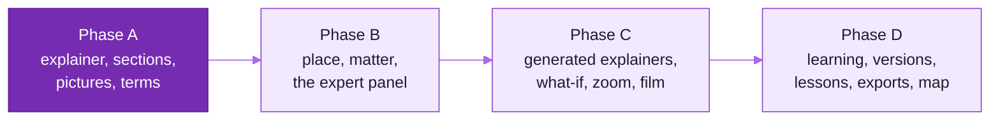

# Plan: the answer experience

The plan that turned an answer into an explainer of cited sections, built in four phases, A to D.
Engineers read it beside the explainer and learning contracts; it is a plan, and what was built is
in the decisions it led to.

| For | Read |
|---|---|
| The explainer's shapes and rules | [contracts/explainer.md](../contracts/explainer.md) |
| Phase D's learning routes | [contracts/learning.md](../contracts/learning.md) |
| What each phase decided as it was built | [decisions/README.md](../decisions/README.md), decisions 0030 to 0070 |
| The owner's standing direction | [PLAN.md](../PLAN.md), section 0 |

Status: approved by the owner, 2026-11-17 (section 8); phase A deployed, phases B and C built and
reviewed, not yet deployed, the contract of phase D fixed (section 5).
Supersedes the chat-style answer and the live voice call. PLAN section 0 still binds: accuracy over speed, every claim cited, research not limited
to named sources, the knowledge base grows from every answer, no review gates.

Owner direction this plan answers (2026-11-17):

- A question is typed or dictated. Dictation uses the browser's Web Speech API, so no AI tokens are
  spent turning speech into text.
- The craft can be picked, but never has to be. The app works out the craft (or crafts) from the
  question and proceeds; a wrong guess is one tap to change.
- The answer is expert-grade across every field the question touches: chemistry, physics, materials,
  geography and water, geology and soil, climate, ecology, botany, history, economics, design, health.
  Master Admin and Admin get the fullest depth by default; students get the clear version; anyone
  can switch.
- The answer is immersive: a process ladder that fills step by step, a river that flows from its
  source across the districts it affects, soil and terrain maps when they explain something,
  reactions that play out, interactive explainers that Claude builds, pictures from the web,
  underlined terms that open a short sourced summary.
- Voice is for listening to finished research, in the reader's language. The live voice call is
  retired.
- Every source and citation stays.
- What one answer researches is stored in a structured form per craft and reused by later answers
  when it is relevant.
- Approved features 1 to 16 of the 2026-11-17 list, with a wider expert panel. Feature 17 (offline
  field copy) is not in scope.

## 1. What the reader sees

1. **Ask.** A large question box. A microphone starts dictation (live transcript, language shown,
   Stop). Optional controls under it: craft (detected, changeable, or "Any craft"), depth (Basic,
   Detailed, Expert), answer language, and Ask from a photo.
2. **Understand.** Within a second: "Answering for Kutch Ajrakh · Expert · in Hindi", each part
   changeable. Several crafts can be detected for comparison questions.
3. **Research trail.** Sources appear as they are found, read and quoted, grouped by kind (papers,
   encyclopaedia, datasets, web, stored knowledge). Reused stored pieces show as "From earlier
   research" with their date.
4. **Explainer.** Sections build one at a time, each with its own state (researching, writing,
   checking, ready). A section bar lets the reader jump. The order adapts to the question; a "how is
   it made" question leads with the process.
5. **Use it.** Listen (highlighted as it reads), Save, Export, Share, Film mode, follow-up questions
   that extend the same explainer.

The board is the visual reference: the "Answer experience" page of
https://claude.ai/artifact/Qrpuvcfq4X53uryZz2Kngs.

## 2. Architecture changes

### 2.1 The explainer document

An answer becomes an **explainer**: an ordered list of typed **blocks** inside **sections**.
Sentences keep today's contract (verbatim quote, citation, number and formula checks). New
`research/explainer.py` holds the models; `docs/contracts/explainer.md` the contract;
`shared/explainer.*.golden.json` the fixtures both sides test against.

Block kinds (each is one renderer on the web and one validator on the server):

| Block | Content | Data it may use |
|---|---|---|
| `prose` | cited sentences, term spans | claims, read documents |
| `process_ladder` | ordered stages, materials, conditions, links to science | process route, claims |
| `region_story` | river path, districts reached, narrative steps, layer list | HydroRIVERS lines, district register, geo values, claims |
| `map_layer` | a choropleth with legend and basis | geo values only |
| `reaction_player` | ordered steps, balanced equations, species | science engine, claims |
| `material_card` | formula, local names, role, origin, handling | PubChem, Wikidata, claims |
| `molecule_3d` | a PubChem compound to render in 3D | PubChem 3D conformer |
| `images` | open-licence images inline, other images as credited links | Commons, Openverse, web search |
| `simulation` | a generated interactive explainer (section 2.6) | claims passed in as data |
| `what_if` | inputs, outcomes per option | claims only |
| `timeline_map` | dated places and routes on a time slider | claims, Wikidata coordinates |
| `zoom_story` | district → workshop → cloth → fibre → molecule levels | geometry, licensed images, PubChem |
| `expert_view` | one expert's take, agreements and disagreements | claims |
| `seasons` | months against process steps | CHIRPS monthly, claims |
| `supply_map` | where each material comes from | claims, Wikidata |
| `compare` | two crafts side by side | both crafts' stored pieces |
| `in_practice` | advice per audience | claims |
| `quiz` | questions with keyed answers | claims |
| `open_questions` | unknowns and how to find out | composer hypotheses |
| `artisan_voice` | consented quotes from field interviews | documentation portal (section 4.9) |
| `designs` | prototypes made for the craft | designer portal (section 4.10) |

Rules every block validator enforces, failing closed:

- Every fact carries a citation to a source or a dataset row. A block with an uncited fact is
  dropped and the section says what it searched.
- Numbers, coordinates, districts and river paths come from claims or datasets, never from a model.
  A model chooses and orders; the server fills values.
- Geometry is the real geometry (HydroRIVERS, the district register); the boundary caption is shown
  on every map.
- Untrusted text stays inside untrusted blocks in every prompt.

### 2.2 Structured knowledge per craft (reuse)

Every finished block is stored as a **knowledge piece**, so the next relevant answer reuses it.

- New table `KnowledgePiece`: `craftId` (nullable for cross-craft pieces such as a district's water
  story), `kind` (the block kind), `facet` (process, region, chemistry, …), `topicKey` (normalised
  subject, for example `water:kachchh` or `reaction:alum-alizarin`), `language` (`en`; translations
  are cached separately as today), `depth`, `payload` (the validated block JSON), `claimIds` and
  `sourceIds` (what it rests on), `contentHash`, `embedding`, `createdFromAnswerId`, `createdAt`,
  `supersededById`.
- The structured parts also land in their natural homes so other screens use them: process stages
  and reactions in the science tables (the craft page Process tab), region stories against districts,
  terms in a `Term` glossary, images in a `MediaRef` table with licence and credit.
- **Reuse at answer time.** After the craft and facets are known, retrieval looks up pieces by
  craft, facet and topic key, then by embedding similarity to the question. A piece is reused when it
  matches the question's facet and topic, its depth is at least the requested depth, and every claim
  it rests on is still visible and not retracted. Reused pieces stream first and are marked "From
  earlier research · date". Research then runs only for facets with no reusable piece, or when the
  reader asks for fresh research.
- **Freshness.** When a claim is retracted or its level changes, every piece resting on it is
  marked stale; the next answer that would reuse it rebuilds that block instead. A nightly job
  rebuilds stale pieces for the most-asked crafts.
- **Growth.** The coverage job (decision 0011) and the full curation run (section 6) produce pieces
  too, so popular questions become instant over time.

### 2.3 Pipeline

1. **Understand** (one cheap call, Gemini Flash Lite): craft candidates (resolver plus model, never
   blocking: best match proceeds, others offered), facets and fields the question touches, the
   experts to seat (section 4.6), answer language, depth from the role default unless set.
2. **Reuse** stored pieces (section 2.2).
3. **Plan** per open facet (today's planner, extended with the expert seats).
4. **Research** per facet in parallel within the depth budget (today's tiered research; the trail
   streams per source).
5. **Compose** per section in parallel: Claude Sonnet writes each section's blocks against the block
   schema; Gemini is the fallback route. Expert views are composed from the same evidence by expert.
6. **Validate** each block (section 2.1), regenerate once, then drop with a note.
7. **Enrich** with images, term spans, 3D molecules and simulations (section 2.6) as they finish.
8. **Translate** checked English blocks (decision 0023), block by block.
9. **Store** pieces and claims (section 2.2), with citations.

Streaming: the stream contract gains `section_started`, `block`, `section_done`, `trail` events;
blocks render as they arrive. The 60-second heartbeat stays.

### 2.4 Depth by role

| Depth | Default for | Sections | Experts | Live research | Rough model cost |
|---|---|---|---|---|---|
| Basic | Student | 3 to 4 | 2 | stored first, light | low |
| Detailed | Researcher, Professor | 5 to 7 | 4 | hybrid | medium |
| Expert | Admin, Master Admin | all relevant | 6 to 10 | deep | high |

Per-answer cost caps per depth are settings in the AI budget for every role except Master Admin. **Master
Admins have no caps (owner, 2026-11-17):** no per-answer cap, no daily cap, and the monthly ceiling does not
refuse or degrade their answers; their spend still shows on Usage. For everyone else the monthly
ceiling applies and degrades Expert to Detailed at 80%.

### 2.5 Voice

- **Dictation:** Web Speech API `SpeechRecognition` in the browser, interim results shown live, the
  recogniser's language set from the reader's choice. Offered only where the browser has it (Chrome,
  Edge, Safari); hidden elsewhere. Languages are offered after a check on each target browser; Indian
  languages are expected on Chrome and must be verified one by one.
- **Listen:** ElevenLabs text to speech of the finished answer in the answer language, with word
  timings so the text highlights as it reads. Audio is cached per answer piece and language in the
  private media bucket, so a second listener costs nothing.
- **Switched off (owner, 2026-11-17):** the live voice call stays in the code but off: the voice
  session, custom-LLM endpoint and relay routes answer 404 and the voice button is not drawn. Nothing
  is deleted.

### 2.6 Generated explainers (sandboxed)

- Claude Sonnet writes one self-contained HTML file for a concept the block library cannot show (dye
  bonding, heat in a kiln, indigo oxidising, resist paste).
- **Data in, not numbers made up.** The server passes the cited values as a JSON object; a static
  check rejects numeric literals in the code that are not in that object (beyond layout constants
  such as sizes), any network API (`fetch`, `XMLHttpRequest`, `WebSocket`, `EventSource`,
  `navigator.sendBeacon`, `import()`, `eval`, `Function`), and external URLs.
- **Sandbox.** Rendered in an `iframe` with `sandbox="allow-scripts"` (no same-origin, no forms, no
  popups, no top navigation), `srcdoc`, and a CSP meta of `default-src 'none'; script-src
  'unsafe-inline'; style-src 'unsafe-inline'; img-src data:`. It cannot read the page, the account or
  the network. Size cap 200 KB.
- **Labelled.** "Generated explainer · model · date", what it was built from, View code.
- **Stored and reused** as a knowledge piece keyed by the claim set and concept; a professor can hide
  one.

### 2.7 Pictures from the web

- Inline: Wikimedia Commons and Openverse images with an open licence, shown with author, licence and
  link; relevance checked against the claim text and, for the top candidates, one cheap vision call.
- Other web images: shown as credited link cards from web search, opening the source page. Owner
  decision O2 below picks whether the card shows a thumbnail.

### 2.8 Tappable terms

The composer marks term spans against a `Term` glossary (local names included). Tapping opens a
30-second summary: Wikipedia summary first, then a quick web search with a Flash Lite summary, both
cited, cached per term and language; "Ask about it" starts a follow-up.

## 3. Data and engineering pieces this needs

| Piece | Work |
|---|---|
| River lines | HydroRIVERS lines for India simplified per basin, stored as static TopoJSON in the media bucket; a path tracer over `NEXT_DOWN` from source to mouth; districts crossed computed with PostGIS |
| Monthly rainfall | extend the geo ETL with CHIRPS monthly normals per district |
| Rainfall trends | CHIRPS annual series 1981 to 2025 per district, a trend per district |
| Glossary | `Term` table seeded from craft aliases, Wikidata labels and the master list |
| Images | Commons and Openverse adapters (one adapter per service), `MediaRef` table |
| 3D | 3Dmol.js (BSD) from npm, pinned to an exact version (decision 0049), PubChem 3D conformers through the PubChem adapter |
| Units | Indian traditional units in Pint with cited regional values; a value is only shown with its region and source |
| PDF export | print stylesheet plus server render; citations through citeproc (APA, BibTeX) |
| Lesson builder | slides as HTML (vendored reveal.js) and PPTX (python-pptx), reading list, quiz |
| Alerts | in-app notifications and a weekly email digest through SES |

## 4. The sixteen approved features

1. **Powers-of-ten zoom.** A `zoom_story` block: district map (real geometry) → workshop photo →
   cloth → fibre (open-licence micrograph or open-access figure) → molecule in 3D. A level without a
   licensed image is skipped, never faked.
2. **3D molecules and tools.** 3Dmol.js with PubChem conformers; tools from CC0 3D collections
   (Smithsonian Open Access) when one exists for the tool, else a photo.
3. **Film mode.** Plays the explainer as a narrated sequence: each block's own animation as a scene,
   ElevenLabs narration with timings, captions in the answer language. No generated video.
4. **Trade routes through time.** `timeline_map`: dated places and routes from history claims,
   coordinates from Wikidata, a time slider; every point cited.
5. **What-if lab.** `what_if` blocks: one input changed at a time (natural or synthetic dye, river or
   well water, temperature), outcomes only from cited relationships; options without evidence are
   shown as unknown.
6. **Expert panel.** Seats chosen per question from: chemist, physicist, materials scientist,
   textile or ceramic technologist, geologist, hydrologist, soil scientist, climatologist, ecologist,
   botanist (dye and fibre plants), toxicologist and health, historian, anthropologist, economist,
   design and art historian, conservator, GI and policy expert, and the artisan's voice (feature 9).
   Each seat is a role brief with preferred source kinds; each speaks only from cited evidence;
   disagreements across seats are shown as "Experts differ", with both citations.
7. **Shared-science explorer.** A concept graph from claims (alum mordant, iron-rich water, reduction
   firing); "other crafts that share this" with links; a graph view for researchers.
8. **Local measures converter.** Recipes in local units converted to metric with the region and the
   source of each conversion.
9. **Artisan voices.** The transcripts and craft images of both portals (the designer portal and
   the documentation portal), credited to the artisan or designer by the name the portal records,
   the workshop and the date, never with contact or identity details. The owner stated on
   2026-11-18 that everything in those applications is already consented for. Source: each
   portal's signed field voices routes (`docs/contracts/field-voices.md` version 2, decisions 0084
   and 0091). A nightly KalaVigyan job reads them by cursor, applies tombstones, stores each
   recording as a `FIELD_TESTIMONY` source with public quote chunks and signed-in transcript chunks,
   and each image as credited media; quotes join stored-knowledge retrieval and the craft page; the
   full transcript is for signed-in readers. Built in KalaVigyan; the portal side is listed at the
   end of the contract.
10. **Designs from the workshops.** Prototypes and designs from designer-portal workshops for the
    craft. The images arrive with feature 9 (prototypes, sketches, iterations, final products);
    the design records themselves still need a peer route in the portals (section 7).
11. **Lesson builder.** Professors turn an explainer into a lesson pack: slides, reading list, quiz;
    export PPTX and PDF.
12. **Climate and risk.** Rainfall and temperature trends per district, groundwater notes where open
    data exists, and what they mean for the craft; actionable notes for policy and NGOs; every value
    with dataset, period and resolution.
13. **Market and GI insight.** GI status from the registry, signs of imitation from GI journal text,
    price ranges from cited sources with date and place.
14. **Ask the map.** Tap a district: crafts practised there, and an explainer of why the land suits
    them, built from region pieces.
15. **Follow-ups that build.** A follow-up adds or deepens sections of the same explainer; the
    explainer keeps a version history.
16. **"This answer got better" alerts.** Saved explainers are re-checked when new claims arrive for
    their craft and facets; the reader gets an in-app note and an optional weekly email.

Already designed and in scope with the explainer: research trail, local names spoken, quiz, compare
two crafts, seasons and supply, export, ask from a photo (Gemini vision names the craft and
technique; the photo is private and deleted after 30 days).

## 5. Phases

Each phase ends with every check green on GitHub, one or two known-answer questions asked in
production, the E2E run at three widths, and one deploy.

| Phase | Scope | Proves |
|---|---|---|
| A. Foundation | explainer contract and stream events; block renderer shell; never-blocking craft detection; depth by role; dictation; Listen with highlighting; research trail; prose, process ladder, images and terms; knowledge pieces and reuse; retire the live voice call | an Expert answer for Kutch Ajrakh streams as sections, reuses its pieces on a second ask, and every sentence is cited |
| B. Place and matter | river lines and tracer; region story; map layers; reaction player; material cards; 3D molecules; expert panel; seasons and supply (CHIRPS monthly) | the water story for Kachchh plays from real geometry; experts differ is shown where sources disagree |
| C. Play | sandboxed generated explainers; what-if lab; film mode with ElevenLabs music and sound effects under the narration; powers-of-ten zoom; trade routes; ElevenLabs image and video as further media routes beside the existing ones | a generated explainer passes the static check and runs with no network |
| D. Learn and act | quiz, compare, shared-science explorer, local measures, market and GI, climate and risk, ask the map, follow-ups that build, alerts, lesson builder, PDF and citation export | a professor builds a lesson pack from one explainer |
| E. Field voices | artisan voices from the portals' transcripts | named, credited artisan quotes appear for a craft, each cited to its recording |

**Phase A status (2026-11-17).** Deployed (3b5cc6e, then the fixes of decisions 0040 and 0041):
both known-answer questions pass in production with 27 cited sentences and 52 citations each,
the Hindi answer reused all five stored blocks of the English one, and every section carried
pictures. Built: the explainer
contract (decision 0030), understanding and depth (0031), sectioned composition (0032), knowledge
pieces and reuse (0033), pictures and terms (0034), Listen with the live call switched off (0035),
the asking screen (0036), the explainer view (0037), the review fixes (0038) and step 7 of section
2.3, pictures and term spans in the stream with https pictures allowed on every page (0039). The E2E
run passes at all three widths after the phone layout fix (run 44001978530), and Listen works with
a key restricted to the server's address. Open: process stages found by answers do not reach the
Process tab until a source states their order (0038). `docs/PROGRESS.md` and `docs/TECH_DEBT.md`
hold the details.

**Phase B status (2026-11-18).** Built and reviewed, not yet deployed: all eight kinds are in
`BUILT_BLOCK_KINDS` on both sides. Open: the deploy, the Geo ETL `riverlines` load (region stories
wait for it, after the owner creates the river load role) and the proof in production, the water
story for Kachchh from real geometry (the E2E's third known-answer question) and "Experts differ"
where sources disagree. The contract is fixed (decision 0042): the eight kinds' final
fields and validators, the block builder and renderer registries (empty but wired), the expert
panel, the river data contract and the Kutch Ajrakh fixture. Lanes 0043 to 0049 build the data,
builders and renderers; 0050 is the review. The place renderers are built (decision 0048: the
river story, map layers, seasons and supply), and all four have joined the built kinds.
The matter builders are built (decision 0045: the reaction player, material cards and 3D
molecules with their conformer route), and so are their renderers and the expert panel's
(decision 0049: the player, cards, 3Dmol.js molecules, seat cards and "Experts differ"); the
review joined the three matter kinds to the built kinds on both sides (decision 0050). The expert panel is built
and joined the built kinds (decision 0046: seats per depth and field, a reading share for each
seat's sources, one cited panel call per section, "Experts differ" only for two stored facts
about one subject from two sources, panel spend within the answer's headroom). The region story
and map layers are built and joined the built kinds (decision 0044: rivers crossing a craft's
districts by stream order and discharge, traced, with steps a model only chooses from stored
claims, unnamed until a dataset names rivers, kept as cross-craft pieces by basin or districts;
a section's map layer chosen by the words its sentences use); stories wait for the river load.
Seasons and supply are built and joined the built kinds (decision 0047: stages and claims placed
only on the months or season their own text names, a season given months only by a cited quote
that states them, CHIRPS rainfall of the craft's district; supply origins a model only picks from
stated words, placed only with Wikidata coordinates, else listed without a pin). The review (decision 0050) released
the conformer route's connection before PubChem, rebuilt map layers and molecules in reused
sections, started no builder for a section with nothing checked, gave phase B blocks one order,
kept a supply link, a story step's district, a season row and every sentence of prose and expert
takes to the materials, places, months and seasons their sources state, held builder plan calls
to the answer's headroom, content-addressed river files and refused a changed one, moved the
river load to a scoped OIDC role, named the rainfall district, and added the water question to the
production E2E.

**Phase C status (2026-11-18).** The contract is fixed (decision 0054): the final fields and
validators of the generated explainer (`simulation`), the what-if lab, the zoom story and the
timeline map; the generated explainer's static check with its escape-attempt corpus and its
sandboxed frame; how a generated explainer is stored, reused by claim set and concept, and hidden
by a professor; film mode derived on the client with an optional ElevenLabs score, its route and
payload; and the ElevenLabs music, sound effect, image and video routes beside the existing media
routes (image and video only where ElevenLabs publishes an API). The Kutch Ajrakh fixture is
checked on both sides. Lanes 0055 to 0060 build the rest; 0061 is the review. The zoom story
and timeline map builders are registered (decision 0057) and their renderers and film mode are
built (decision 0060); both kinds join the built kinds in the review. ElevenLabs music, sound
effects, image and video are built (decision 0058): ElevenLabs publishes all four, so the film
score is made on demand and cached, and image and video are further route choices in Settings.
The generated explainer's builder is registered (decision 0055: figures offered only from
cited quotes, one checked call with one redraft, reuse by claim set and concept before any
call, the professor's hide route) and joins the built kinds with its renderer in the review.
The what-if lab's builder is registered (decision 0056: a stage's materials that a stored
contrast or text relates as alternatives, outcomes only from cited relationships the server
assembles, unknown options shown as unknown, one input at a time, a hypothesis relationship
labelled as one) and joins the built kinds with its renderer in the review.
Built and reviewed, not yet deployed (decision 0061): all four kinds are in `BUILT_BLOCK_KINDS` on
both sides. The review made the frame refuse peer connections in every browser (the policy above
plus `webrtc 'block'`, and a guard script of the client's own, because Chromium ignores that
directive), made the static check read markup as a browser does, close the reflection routes to
the window, read figures written against letters and run in linear time on a bounded draft, kept
and hid every generated explainer a reader can see (also across versions), pinned and bounded the
ElevenLabs download, and brought Music and sound, Mute on iOS and the score's failure message to
the ask screen. Open: the deploy and the proof in production, the E2E's fourth known-answer
question (how indigo turns blue on Kutch Ajrakh cloth, at Expert depth), whose generated
explainer must run in the sandboxed frame with every request from the frame blocked and recorded.

**Phase D status (2026-11-18).** The contract is fixed (decision 0062): the final fields and
validators of the quiz (a cloze over the explainer's cited sentences, options only terms the server
marked), compare, the concept graph, local measures (an exact definition or a value a source
states for the region, O5), market and GI, and climate and risk; follow-ups stored as versions
that never rewrite an earlier one; saved explainers with a nightly re-check that only detects,
in-app notes and a weekly SES digest behind a setting left off; lesson packs for Professors and
above (slides, reading list, quiz; HTML, PPTX, PDF); the PDF and APA, BibTeX and RIS exports; the
shared-science explorer and ask the map. The Kutch Ajrakh fixtures (with Bagru for compare) are
checked on both sides. Lanes 0063 to 0069 build the rest; 0070 is the review. Climate and risk
and ask the map are built (decision 0065): CHIRPS rainfall and GHCN CAMS temperature from 1981
with a Theil-Sen trend and Mann-Kendall p-value per district, the `climate_risk` builder (joined
to the built kinds), and `GET /api/map/districts/{districtLgd}`; they wait for the Geo ETL load
after the deploy, and no open groundwater dataset exists. The screens are built (decision 0069):
follow-ups that extend the explainer with a version picker, Save and the "This answer got better"
inbox on `/saved`, the lesson builder with its slide preview and PPTX, PDF and HTML files, the
explainer's PDF and citation exports, the district panel on the map and the compare page.
Local measures and market and GI are built and joined the built kinds (decision 0066): feet,
inches, yards, miles and square feet convert by their exact definitions in any section, Indian
units (in Pint, each its own dimension) only by a value a stored quote states for a register
district or state holding the craft (O5), else they stay as written; an economics section shows
each craft's curated GI record or the registry fields its GI journal and government claims state,
signs of imitation from GI journal text and curated prices whose year and place their sentences
state, all by fixed rules with no model call. Lesson packs and exports are built (decision 0067): a
professor's pack from one version (cited sentences still shown, the one quiz rule, reading list,
sources) as an offline reveal.js deck, PPTX and PDF, and any reader's version PDF and citations,
all written on the server in pure Python (fpdf2 with HarfBuzz and Noto fonts, python-pptx,
citeproc-py with the APA 7 CSL style) and handed out as short-lived links from the private bucket.
The review (decision 0070) moved APA formatting off the event loop and the export libraries out
of start-up, served every version with its hidden generated explainers left out of exports, the
quiz and lessons, showed GI and price dates only as precisely as their quotes state, closed
BibTeX to braces in stored values, linked each digest item to its explainer, told an unknown craft
from an empty comparison, held notes per account, added the Shared science tab to the craft page
and the export proof to the production E2E. Phase D is built; open are the deploy, the Geo ETL
climate load and the proof itself, which needs the owner's choice of a Professor account for the
E2E (`docs/PROGRESS.md`, Waiting on the owner).

Then the **curation run**: the owner chose on 2026-11-17 that it costs no API spend. Claude Code
curates every craft into a verified dossier (`docs/plans/dataset-curation.md`, decision 0051), and
the import turns each dossier into stored claims, so most first questions are fast.

Rough effort: A two days, B two days, C two to three days, D two to three days, E one day once the
portal routes exist; the curation run one to two days of background running.

## 6. Cost

- Expert answers cost several times a Basic one: more sections, more experts, deep research, a
  generated explainer. The first Expert answers in phase A measure the real figure; until then the
  per-answer caps in section 2.4 hold the spend.
- Reuse (section 2.2) is the main saving: a second question on a covered craft and facet costs a
  fraction of the first.
- The curation run is a one-time budget outside the monthly ceiling (PLAN 17.2 estimated $700 to
  $1,000); it stops when the budget is spent.

## 7. Dependencies

- **Portal routes** for feature 9: both portals' field voices routes (`docs/contracts/field-voices.md`
  version 2); no portal password, session or two-step code is ever used, which supersedes the sync
  account of section 8.
- **Feature 10** (designs): deferred until the workshops hold designs.
- **Keys:** Brave (web search fallback and image results) and Semantic Scholar improve research;
  neither blocks.

## 8. Owner decisions (all taken 2026-11-17)

- **O1. Live voice call:** switched off and kept; nothing deleted.
- **O2. Web images that are not openly licensed:** credited link cards with a thumbnail loaded from
  the source site, opening the source page.
- **O3. Cost:** Master Admins have no caps at all. Admin Expert answers start with a modest per-answer
  cap, raised once phase A measures real costs. The $800 monthly ceiling stays for everyone except
  Master Admins.
- **O4. Artisan quotes:** consent covers all existing transcriptions. Artisans are quoted by name,
  with their credentials (titles, awards, GI holder, years in the craft) and their place (village,
  district, state) where it matters to the answer. Phone numbers, email addresses and identity
  numbers are never shown.
- **O5. Local units:** only conversions a source states for that region are shown.
- **Sync account (superseded 2026-11-18):** no sync account exists. The nightly field voices sync
  reads only the portals' signed peer routes with `CROSS_PORTAL_TOKEN` and never uses, requests or
  stores any person's sign-in credentials, sessions or two-step codes (decisions 0084 and 0091).
- **Feature 10 (designs from the workshops):** deferred; the workshops hold no designs yet.

## 8a. Production findings phase A must fix (E2E run 43959098727, 2026-11-17)

Status: 1 fixed (decisions 0032 and 0038), 2 fixed (0032), 4 fixed (0038); 3 open, not reproduced
offline (`docs/TECH_DEBT.md`, Craft Process tab on phones hangs).

1. **Composition with Claude Sonnet produces nothing.** Both known-answer questions (English and
   Hindi, Kutch Ajrakh, Hybrid) ended "not enough cited evidence" although 20 stored claims were
   retrieved. Server log: the first two `POST https://api.anthropic.com/v1/messages` calls answer
   400 Bad Request, `providers/anthropic_p.py` then drops `output_config.format` (the
   `rejects(model, "format")` path) and sends again, the reply is free text, and every sentence is
   dropped (`compose dropped 5 sentence(s): {'MALFORMED': 5}`; the regenerate reply has no
   `sentences` list). Fix in the sectioned-composition lane: make the compose and block schemas
   valid for Anthropic structured outputs (only supported keywords, `additionalProperties: false`
   on every object, required lists complete), test the exact schema against Anthropic's rules, and
   never fall back to free text: a rejected format is a provider failure that moves to the next
   route (Gemini), logged as such.
   Fixed by decision 0032's portable schemas; on 2026-11-17 Claude Sonnet went back to COMPOSE
   route 1 in production and composed 36 sections of the enrichment run with no refusal.
2. **No live research when stored composition fails.** The planner skips live research when stored
   coverage looks sufficient; when composition from stored claims then yields no block, the answer
   must run live research for that facet instead of ending with not enough evidence.
3. **Craft Process tab on phones hangs.** The phone run reached Craft Overview and timed out on
   Process (10 minutes). Found 2026-11-17 (decision 0040): the reactions grid's implicit `auto`
   column grew to a long KaTeX equation, so the Process page scrolled 114 px sideways at 390 px,
   and the screen check's unbounded click on the fixed menu button never landed. The reaction and
   material grids are `grid-cols-1` (each card holds its width and the equation scrolls inside
   it), and every production E2E action is bounded at 30 s.
4. **E2E overflow false positives.** The overflow check flags KaTeX's visually hidden MathML copy
   (`.katex-mathml`); the check in `frontend/e2e/production/` must ignore elements inside it, and
   only it.

## 9. Practice and checks

- One contract per phase written first (`docs/contracts/explainer.md` and fixtures), decisions
  recorded from 0030 on, debt in `docs/TECH_DEBT.md`.
- Every block kind has a validator test with hand-derived expected values and a fixture the web
  renderer parses; every adapter is tested on recorded responses.
- The sandbox static check has its own test set of escape attempts.
- Accuracy: one or two known-answer questions per phase in production, not a large suite.
- Reduced motion: every animation has a static end state; the river, ladder and reactions are
  readable without motion.

## How this document is kept true

| Part | Kept true by |
|---|---|
| The status line | updated as each phase ships; the phases' decisions say what was built |
| The sandbox frame | `backend/tests/contracts/test_explainer_phase_c.py` reads the frame's sandbox attribute and policy from this plan |
| The owner's decisions (section 8) | taken on 2026-11-17 and changed only by the owner |

Re-read it before changing how an answer is composed, drawn or exported.
