# Dataset curation by Claude Code

The plan for building the knowledge base without paid model calls: what a curated dossier holds, how
its quotes are verified, how it is checked and how it reaches the app. Curators and engineers read
it; the contract holds the rules a dossier must pass.

| For | Read |
|---|---|
| Every rule a dossier must pass | [contracts/curation.md](../contracts/curation.md) |
| The commands, step by step | [RUNBOOK.md](../RUNBOOK.md), How to curate a craft |
| Curated knowledge now that the database is its source | [contracts/dossier-export.md](../contracts/dossier-export.md) |
| The method contributors follow over MCP | [kalavigyan-craft-pages](../../.claude/skills/kalavigyan-craft-pages/SKILL.md) |

```mermaid
%%{init: {"theme":"base","fontFamily":"Inter, ui-sans-serif, system-ui, -apple-system, Segoe UI, Roboto, Helvetica, Arial, sans-serif","themeVariables":{"fontSize":"15px","primaryColor":"#F2E9FE","primaryTextColor":"#1E1B2E","primaryBorderColor":"#9148D2","secondaryColor":"#FAEECD","secondaryTextColor":"#1E1B2E","secondaryBorderColor":"#CD9200","tertiaryColor":"#F3F1FA","tertiaryTextColor":"#1E1B2E","tertiaryBorderColor":"#A7A3BC","mainBkg":"#F2E9FE","nodeBorder":"#9148D2","nodeTextColor":"#1E1B2E","lineColor":"#AA69E9","textColor":"#857F9E","edgeLabelBackground":"#F9F5FF","clusterBkg":"#F9F5FF","clusterBorder":"#D6B6FB","titleColor":"#762CB1"}}}%%
flowchart LR
  S["Sourcing order<br/>section 4"] --> V["Verification<br/>section 5"]
  V --> C["The checker<br/>section 6"]
  C --> K["The critic<br/>section 7"]
  K --> I["Import into the app<br/>section 8"]
  I --> R["How readers see it<br/>section 9"]
  classDef accent fill:#762CB1,stroke:#5F1C93,color:#FFFFFF
  class V accent
```

Status: approved by the owner on 2026-11-17 with every recommendation in section 14 (D1 to D7); the
pilot (wave 0) started the same day.

## 0. Owner direction

- Build the knowledge base for every craft **without paid model calls**. The research, reading,
  writing and checking are done by Claude Code agents; the app only imports what they produce.
  The nightly paid enrichment (research and piece rebuilds) was switched off on 2026-11-17
  (commit fdf478c); the same job now only upkeeps voice records and fills missing vectors.
- Accuracy over speed. Every fact a reader sees is cited, with a verbatim quote from a source the
  curation actually opened. Nothing is invented, padded or inferred to fill a gap.
- All crafts. Run in parallel, in waves, and keep going until every craft has a dossier.
- No review gates (PLAN section 0); quality comes from automatic checks and an independent critic
  agent, not from a human approval step.

## 1. Why

Measured in production on 2026-11-17:

| Measure | Value |
|---|---|
| Active crafts | 461 (455 on the master list, plus portal additions) |
| Crafts with **no** stored claims | 443 |
| Crafts with 1 to 19 claims | 12 |
| Crafts with 20 or more | 6 (the seeded block-printing traditions) |
| GI-registered crafts (master list) | 209 |

The six seeded crafts show the second problem. Kutch Ajrakh's page lists 425 sentences in one
flat list: 118 hypotheses mixed with facts, 65 fragments of seven words or fewer, filler such as
"Sequential order in the GI method of production." thirteen times (557 of the 1,914 seed claims
are graph edges written out as sentences), the same story told five ways with conflicting numbers,
and a Region tab that knows only "Gujarat, practised across the state". The knowledge exists; it
was never curated.

## 2. What curation produces

For each craft, one **dossier**: a structured, cited, de-duplicated record of what is known, plus
a written overview built only from it. A dossier is done when it passes the checker (section 6),
the quote verifier (section 5) and the critic (section 7).

Not in scope: generating images or video, translating dossiers (answers translate on demand),
human expert review (a later "Reviewed" level stays for professors), and anything that needs the
portals' private data (artisan transcripts are phase E of the answer plan).

## 3. What a dossier contains

One JSON file per craft, `backend/app/data/curation/<CraftSlug>.json`, validated by a Pydantic
model and a published JSON Schema. Ids are stable inside the file (`S01`, `C001`, `P01`, ...) and
become deterministic UUIDs at import (`uuid5(namespace, "curation:<slug>:<id>")`), so re-curation
updates rows instead of duplicating them.

### 3.1 Header

`schemaVersion`, `craftSlug` (must exist in the craft register), `version` (increments on each
re-curation), `curatedAt`, `curator` ("claude-code"), `coverage` (`FULL` or `THIN`, see 3.15),
`scope` (`CRAFT`, `FAMILY` or `CATEGORY`, see 3.16; a category names `categorySlug` instead of
`craftSlug`),
`searched` (the queries and sites tried, kept so a thin dossier shows what was looked for).

### 3.2 Sources

| Field | Rule |
|---|---|
| `id` | `S01`... |
| `kind` | one of the stored kinds: PAPER, BOOK, BOOK_CHAPTER, WEB_PAGE, ENCYCLOPEDIA, DATASET, GI_JOURNAL, GOVERNMENT_REPORT, COMPOUND_RECORD, OTHER (theses and museum records use OTHER with `subKind`: THESIS, MUSEUM_RECORD, NGO_REPORT, NEWS) |
| `title`, `authors`, `publisher`, `year` | as the source states them; never guessed |
| `url` | https, canonical page (not a search result, not a tracking link); `doi` when there is one |
| `archivedUrl` | a Wayback Machine snapshot when the live page blocks automated reading |
| `language` | ISO code; Indian-language sources allowed (decision D4) |
| `licence`, `access` | `OPEN`, `ABSTRACT_ONLY` or `RESTRICTED`; restricted sources are cited from their open abstract only |
| `reliability` | A to D, by the rubric below |
| `retrievedAt` | the day the curator read it |

Reliability rubric (one home: the checker's table):

- **A** primary or authoritative: GI journal and registry, peer-reviewed papers, museum collection
  records, government reports (Textiles Committee, Development Commissioner (Handicrafts), state
  handicraft boards), academic books.
- **B** theses, conference papers, edited encyclopedias, established craft institutions with named
  authors (for example Khamir, Craft Revival Trust).
- **C** reputable press features, artisan organisations' own pages with a named author, and a
  page a named organisation publishes about its own work (for example Khamir about its own
  programmes, a cooperative about its members).
- **D** other web pages, and shop, sales and retail pages. A D source may support a fact only
  alongside an A to C source, except a price, which may cite a dated retailer page as a price on
  that date.

Never used: shadow libraries (owner rule), AI-generated content farms, social media posts,
unattributed blog spam, and anything behind a login.

### 3.3 Claims

A claim is **one atomic fact** that a reader could check.

| Field | Rule |
|---|---|
| `id` | `C001`... |
| `discipline` | one of the answer engine's 14 disciplines: OVERVIEW, PROCESS, CHEMISTRY, PHYSICS, MATERIALS, GEOGRAPHY, GEOLOGY, CLIMATE, ECOLOGY, BOTANY, HISTORY, ECONOMICS, DESIGN, HEALTH |
| `subject` | `{type, ref}`: the craft, a stage (`P..`), a material (`M..`), a place (`L..`), a tool (`T..`), a community (`G..`) or a term (`W..`) |
| `text` | plain English, one sentence, 8 to 40 words, no hedging words that the sources do not use |
| `quotes` | one or more `{sourceId, locator, quote}`; `quote` verbatim, 25 to 300 characters, in the source's language; `locator` is a page, section, paragraph or timestamp |
| `numbers` | every number, date and unit in `text` must appear in at least one quote |
| `hypothesis` | true only when the source itself states it as uncertain, a theory or a legend; such claims show only under open questions |
| `corroborated` | computed: two or more quotes from different publishers |
| `sensitivity` | OPEN unless the claim names a living private person beyond what a published source states |

Rules the checker enforces:

- No relationship sentences. "X uses Y" or "X precedes Y" is structure, stored in 3.6 and 3.7,
  never a claim. A claim must say something a reader learns.
- One fact, one claim. Two sources saying the same thing are two quotes on one claim, not two
  claims. The checker flags pairs whose texts are near-identical.
- Conflicting facts are separate claims linked in `conflicts` (3.11), never silently merged.
- No claim restates the craft's name or category as its only content.

### 3.4 Places (`L..`)

`name`, `kind` (VILLAGE, TOWN, DISTRICT, STATE, COUNTRY, REGION, RIVER), `district` and `state`
names that must match the district register (LGD) for places in India, `country`, `wikidata` QID
when one exists, `role` (PRACTISED, ORIGIN, HISTORIC_CENTRE, MATERIAL_SOURCE, MARKET, MIGRATED_FROM,
MIGRATED_TO) and `claimIds` that state the role. A place without a claim stating its role is not
listed. Kutch Ajrakh, for example, should yield Ajrakhpur and Dhamadka (Kachchh), Khavda, Barmer,
and Sindh as origin, each from a cited sentence.

### 3.5 Communities and people (`G..`)

Artisan communities (Khatri, Prajapati, ...) with the claims that describe them. Named master
artisans only when a published source names them in connection with the craft (awards, GI
proprietors, museum records), with name, honours and place (owner decision O4). Never phone
numbers, email addresses, identity numbers or home addresses.

### 3.6 Process (`P..`)

| Field | Rule |
|---|---|
| `name`, `localName` | as sources use them |
| `stageType` | PREP, SCOUR, MORDANT, DYE, RESIST, PRINT, WASH, DRY, SHAPE, CARVE, FIRE, CAST, FINISH, OTHER |
| `order` | set only when a source states the sequence (`orderClaimId`); otherwise stages are listed unordered |
| `duration`, `season` | only from claims |
| `materials`, `tools` | refs to `M..` and `T..`, each backed by a claim |
| `claimIds` | what happens in the stage and why |

A GI journal's "method of production" usually states the order; a dossier that cannot find an
ordering source shows the stages without numbers.

### 3.7 Materials, tools and chemistry (`M..`, `T..`)

Materials carry `kind` (FIBRE, DYE, MORDANT, MINERAL, CLAY, METAL, WOOD, RESIN, FUEL, WATER, OTHER),
`role` (INPUT, MORDANT, DYE, RESIST, BINDER, FLUX, FUEL, PRODUCT, OTHER), `localNames`, the
botanical name for plants, and a PubChem CID only for a well-defined substance (alum, alizarin,
ferrous acetate), checked against PubChem's own record. Reactions are listed only when a source
states them; the science engine balances and stores them on import, and an unbalanceable reaction
is kept as text with its citation, never as an equation.

### 3.8 Environment links

Claims that tie the craft to its land, water and climate (iron in the river water darkens the
black; the sun bleaches in tapano; the river at Dhamadka dried up). Dataset values (rainfall, soil,
temperature) are **not** curated here; they come from the geo ETL per district and are joined at
display through the places in 3.4.

### 3.9 Market, GI and economics

GI application and certificate numbers, dates, journal issue, registered proprietor and
authorised users, all from the GI registry or journal. Prices only with their date, place and
source. Numbers of artisans or households only with the year the source states.

### 3.10 Glossary (`W..`)

Local terms with their meaning as a source gives it (`kut` = iron-water black paste), language and
script where stated. These feed the `Term` glossary that answers underline.

### 3.11 Conflicts

`{claimIds: [...], about: "..."}` for facts that sources state differently (80 or 100 families,
40 or 50 km). Shown as "Sources differ" with every citation; never resolved by the curator.

### 3.12 Open questions

What the sources say is unknown or disputed, and hypotheses (3.3), with what would settle them
when a source says so.

### 3.13 Pictures (decision D5)

Up to six openly licensed images per craft (Wikimedia Commons, Openverse, museum open access):
`url`, `pageUrl`, `author`, `licence`, `licenceUrl`, `caption` and the claim or stage it shows.
Only licences on the existing allow-list; no screenshots of other sites.

### 3.14 The written overview

Written by the curator from the dossier's own claims, never from memory:

- `lede`: two to four sentences: what the craft is, where, by whom, what makes it distinctive.
- `keyFacts`: up to eight label and value pairs (GI status, centres, communities, colours or
  materials, number of stages, age where cited).
- `sections`: one per discipline with enough claims (HISTORY, PROCESS, CHEMISTRY, MATERIALS,
  GEOGRAPHY, ECONOMICS, DESIGN, ...), each three to eight sentences.
- Every sentence lists the `claimIds` it rests on; every number in it appears in a quote of those
  claims; no sentence adds a fact that no cited claim contains. The import runs the same prose
  validator the answer engine uses, and a failing sentence is dropped, not kept.

### 3.15 Coverage targets

| Target | FULL craft or family | FULL category (3.16) | THIN dossier |
|---|---|---|---|
| Sources | 8 or more, at least 3 rated A or B | 12 or more, at least 5 rated A or B | whatever exists, all listed |
| Claims | 40 to 150 atomic facts | 60 to 250 | at least 5, at most the scope's cap |
| Disciplines with three or more claims | OVERVIEW, HISTORY, PROCESS, MATERIALS and two more | OVERVIEW, HISTORY, MATERIALS and two more | no minimum |
| Places | district level for every centre named (a family: state or region where the source says so) | centres at the level each source gives | as found |
| Process | every stage a source names | no minimum | as found |
| Overview | lede, key facts, three or more sections | lede, key facts, three or more sections, every sub-category covered | lede and key facts |

A craft with little published material gets a THIN dossier that says what was searched. It is
never padded.

### 3.16 Families and categories

One `scope` field, checked against the master list and the portal craft register
(`backend/app/data/portal_craft_register.json`, crafts the portals added under their own slugs):

- `CRAFT`: one named craft, from the master list or the register.
- `FAMILY`: a catch-all row or a craft practised across "All India" (Other Stone Carving, Cane &
  Bamboo Craft; 81 crafts). Centres may be states or regions as sources name them; no GI record.
- `CATEGORY`: one master document per craft category (the nine `categorySlug` values), in
  `backend/app/data/curation/categories/`, curated and verified like a craft and shown later as
  a category page. Its overview covers every sub-category of the category with a cited sentence,
  or an open question saying no source was found; member crafts are linked by slug, never copied;
  no GI record; up to 250 claims. Category dossiers are imported on deploy with the craft
  dossiers and served as public category pages (`docs/contracts/category-page.md`, decision 0078).

## 4. Sourcing order for a curator

1. The craft's existing seed sources and claims, if any (re-read and re-verified, not trusted).
2. The GI registry and journal for GI crafts (application details, statement of case, method of
   production, proof of origin).
3. Government: Textiles Committee, Development Commissioner (Handicrafts), state handicraft and
   tourism boards, census and district handbooks.
4. Scholarship: OpenAlex, Crossref, Semantic Scholar, CORE, Shodhganga theses, museum collection
   records (V&A, Met, British Museum, Smithsonian, CSMVS, National Museum).
5. Craft institutions and NGOs with named authors, then reputable press.
6. Encyclopedias as pointers to primary sources, cited only for what they state plainly.

## 5. Verification

The curator reads sources with **raw fetches** (an HTTP request whose text it extracts itself), not
with summarising page readers, because a quote must be exact. The verifier,
`tools/curation/verify.py`, then re-fetches every source independently:

- HTML through trafilatura, PDF through pypdf, plain text as is; the Wayback snapshot when the live
  page refuses automated reading.
- Text and quote are normalised the same way (Unicode NFKC, case, whitespace, curly quotes and
  dashes, hyphenated line breaks) and the quote must be a substring.
- It writes `<CraftSlug>.check.json` beside the dossier: per quote PASS or FAIL, the final URL,
  the fetch time and a SHA-256 of the extracted text.
- A claim keeps only its PASS quotes; a claim left with none is dropped. A source that cannot be
  read at all is dropped with its claims.

Import maps a dossier claim to evidence level PROVISIONAL (quote verified) or HYPOTHESIS (3.3).
Curation never sets REVIEWED or VERIFIED; those stay for people.

## 6. The checker

`tools/curation/check.py` runs offline and in CI on every dossier:

- schema and vocabulary (disciplines, kinds, roles, stage types);
- every reference resolves (claims to sources, places, stages, materials; overview to claims);
- craft slug, districts and states exist in the registers;
- number rule (3.3) and the overview sentence rule (3.14);
- no relationship sentences, no duplicate or near-duplicate claim texts, quote length bounds,
  https URLs, no personal contact details (patterns for phones, emails, ID numbers);
- coverage class matches 3.15;
- the dossier's check file exists and is newer than the dossier.

It prints one line per problem and exits non-zero on any. CI runs it for every file under
`backend/app/data/curation/` (Backend checks).

## 7. The critic

A second, independent agent per craft, told to find faults, not to agree:

- re-reads ten random quotes against their sources and confirms each claim says only what its
  quote says (no stretch, no wrong subject, no dropped qualifier);
- checks the overview against the claims sentence by sentence;
- looks for missing basics (a named centre without a place, a stage without materials, a GI craft
  without its GI record) and for filler or duplicates the checker missed;
- confirms every conflict is recorded and no hypothesis is stated as fact.

It returns a list of problems. The curator fixes them and re-runs check and verify. A dossier ships
only when the critic returns none or only problems it marks as notes.

## 8. Import into the app

A deploy-time script, `app.scripts.import_curation`, after the seeds, idempotent:

| Dossier part | Lands in |
|---|---|
| Sources | `Source` (origin IMPORT, system actor `curation`, storage EXCERPT) |
| Claims and quotes | `Claim` and `Citation`, level from section 5, `sourcesDiffer` from conflicts |
| Places | `CraftLocation` at district (or village with its district), with role |
| Communities, materials, tools, terms | `Concept` rows and the `Term` glossary |
| Process | `Process` and `ProcessStage`, ordered only when a source states the order |
| Reactions | the science engine's reaction tables, balanced on import |
| Pictures | `MediaRef` with licence and credit |
| Overview | knowledge pieces (prose blocks, one per section, craft-level, Expert depth) that the craft page and answers reuse |

- A new version supersedes the previous one: claims absent from the new file are marked superseded,
  never deleted, so citations in old answers still resolve.
- Curation never edits claims written by answers; those stay, shown as "From answers".
- When a craft has a curated dossier, its old seed edge sentences stop appearing anywhere a reader
  sees them; the seed rows remain for the record.
- Vectors: imported claims and pieces need search vectors, filled by the existing nightly
  embedding step (decision D1).

## 9. How readers see it

- **Craft page** (the rebuild proposed on 2026-11-17): the overview from 3.14 with key facts,
  pictures and tappable terms; sections by discipline; "Sources differ" rows; Process from 3.6 with
  materials, timing and chemistry; Region from 3.4 at district level with the river story and
  district datasets; Sources with reliability; and an **All evidence** view for researchers with
  every claim grouped by discipline and subject, duplicates folded, hypotheses apart.
- **Answers** retrieve curated claims and reuse the curated overview pieces, so a first question
  about a curated craft starts from verified material instead of live research.

## 10. Running it

Claude Code workflows, one agent per craft, each running the same pipeline:

1. **Scope**: read the craft's register entry, aliases, any seed data and the sourcing order.
2. **Search and read**: web search, raw fetches, PDFs; record every query in `searched`.
3. **Extract**: atomic claims with verbatim quotes; places, stages, materials, terms, conflicts.
4. **Write** the dossier and the overview.
5. **Verify** (section 5) and **check** (section 6); fix until both pass.
6. **Critic** (section 7) by a separate agent; fix; verify and check again.

- **Concurrency**: about twelve crafts at a time (the workflow cap), one file each, so agents never
  edit the same file. A crashed or interrupted run resumes by skipping crafts whose dossier and
  check file already pass.
- **Waves** (decision D2):
  - 0: pilot, three crafts (Kutch Ajrakh, a metal craft, a thin miscellaneous craft); the owner
    reads the result before wave 1.
  - 1: the 209 GI crafts, by category.
  - 2: the 246 non-GI crafts.
  - 3: crafts added by the portals.
- **Committing**: one commit per wave after the checker passes on every file; the next deploy
  imports them. No partial imports.
- **Progress**: `backend/app/data/curation/index.json`, generated by the checker: per craft, version,
  coverage class, counts and check status.
- **Effort**: to be measured in the pilot. A first guess is 200,000 to 400,000 tokens per craft
  with the critic, so 90 to 180 million tokens for all crafts, run over several days within the
  plan's usage limits. This is Claude Code usage, not API spend.

## 11. Existing data

- The six seeded crafts are re-curated like any other; their seed sources are the starting point
  and every quote is re-verified.
- The 557 edge sentences of the seed are withdrawn from display for every craft at the first import,
  curated or not; the relationships they encoded are kept as structure.
- Claims written by answers stay and keep their citations.

## 12. Checks and proof

- Unit tests for the checker and verifier (normalisation, number rule, duplicate detection,
  relationship sentences, personal data patterns) on hand-written fixtures.
- Import tests (marked `db`) for idempotence, supersession and the Ajrakh pilot dossier.
- Proof for the pilot: the Kutch Ajrakh page before and after, at desktop, tablet and phone, from
  the production E2E run; and three questions answered from curated material with no live research.

## 13. Risks

| Risk | Guard |
|---|---|
| A quote is invented or paraphrased | the verifier re-fetches and requires an exact match; failures are dropped |
| A claim says more than its quote | the critic re-reads a sample per craft; the overview validator drops unsupported sentences |
| Sites block automated reading | Wayback snapshots; otherwise the source is dropped and listed under `searched` |
| Copyright | quotes of at most 300 characters, excerpts only, credited images under open licences only |
| Personal data | checker patterns and the people rule in 3.5 |
| English-only bias | Indian-language sources allowed with verbatim quotes in the original (D4) |
| A craft with little written about it | a THIN dossier, honestly marked, never padded |
| Usage limits stop a wave | resumable runs; waves pause and continue |

## 14. Decisions for the owner

| | Decision | Recommendation |
|---|---|---|
| D1 | Search vectors for curated data come from the Gemini embedding API, the one remaining paid call. Measured on 2026-11-17: filling all 1,958 claims plus the day's other embedding calls cost $0.06, so about 50,000 curated claims would cost roughly $2 in total | allow it; without vectors, answers find curated facts by keywords only |
| D2 | Order of waves | GI crafts first, by category, then the rest |
| D3 | Depth per craft | FULL targets in 3.15; THIN when the sources are not there |
| D4 | Sources in Indian languages | allow, with verbatim quotes in the original and an English claim |
| D5 | Openly licensed pictures in dossiers | include, up to six per craft |
| D6 | Named master artisans from published sources | include name, honours and place only (O4) |
| D7 | Withdraw the seed edge sentences from display now | yes, at the first import |

## How this document is kept true

| Part | Kept true by |
|---|---|
| The dossier's format and rules | `docs/contracts/curation.md` and `tools/curation/check.py`, run in Backend checks with `--check-index` |
| The owner's decisions (section 14) | approved on 2026-11-17 and changed only by the owner |
| Where curated knowledge lives | decision 0101, item 6, and `docs/contracts/dossier-export.md` |

Re-read it before a curation wave, and when the dossier schema version changes.
